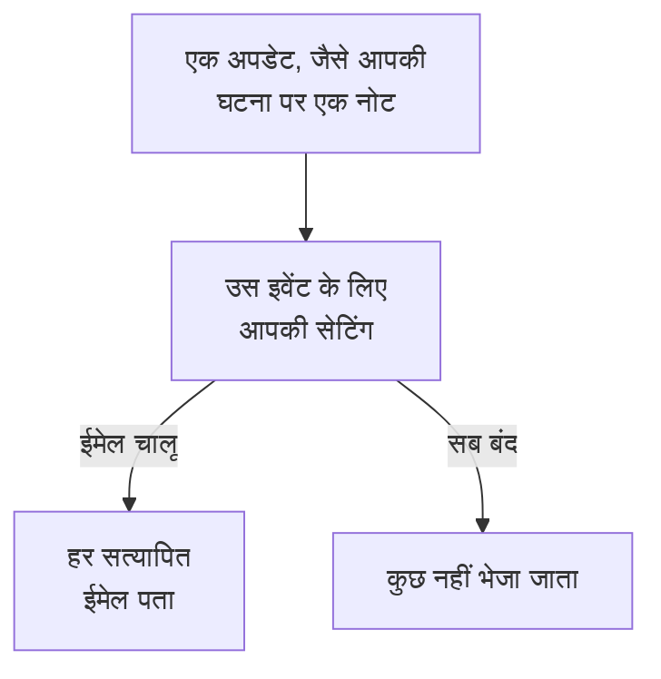

# सूचना सेटिंग्स

सूचना सेटिंग्स तय करती हैं कि आपके रिकॉर्ड, जैसे कोई घटना, मॉनिटर या स्थिति पृष्ठ, और आपकी अपनी ऑन-कॉल शिफ्टों के बारे में कौन-से अपडेट आप तक पहुँचें, और किन चैनलों पर। ये आपको कभी पेज नहीं करतीं: पेज करना आपके ऑन-कॉल नियमों का काम है। आप इन्हें **उपयोगकर्ता सेटिंग्स → सूचना सेटिंग्स** में सेट करते हैं, हर इवेंट और चैनल के लिए एक स्विच।

:::cards
- [सेटिंग्स कैसे काम करती हैं](#सेटिंग्स-कैसे-काम-करती-हैं): हर इवेंट और चैनल के लिए एक स्विच, हर सत्यापित विधि पर भेजा जाता है।
- [कोई सेटिंग बदलें](#कोई-सेटिंग-बदलें): तीन क्लिक, तुरंत सेव।
- [नए सदस्य के लिए क्या चालू है](#नए-सदस्य-के-लिए-क्या-चालू-है): डिफ़ॉल्ट, टैब दर टैब।
- [कम ईमेल](#कम-ईमेल): अपडेट की बौछार को एक साथ समेटें, या रोज़मर्रा के ईमेल हटाएँ।
:::

## सेटिंग्स कैसे काम करती हैं

- हर पंक्ति एक इवेंट है, और हर कॉलम एक चैनल: ईमेल, SMS, कॉल, पुश, WhatsApp, Telegram, Slack और Microsoft Teams, और Webhook। Slack और Microsoft Teams कॉलम तभी बनते हैं जब प्रोजेक्ट ने उन्हें जोड़ा हो।
- चालू चैनल इस प्रोजेक्ट में उस चैनल पर आपकी हर सत्यापित विधि पर भेजता है, केवल एक पर नहीं।
- जो चैनल चालू है लेकिन जिसके पीछे कोई सत्यापित विधि नहीं है, वह कुछ नहीं भेजता। **Your setup checklist** इसे **Staying informed** के तहत बताती है।
- अपडेट रिकॉर्ड के मालिकों को जाता है: वे लोग जिन्हें मालिक के रूप में नामित किया गया है, और उसकी मालिक टीमों के सदस्य। जब किसी रिकॉर्ड का कोई मालिक नहीं होता, तो वह इसके बजाय प्रोजेक्ट के मालिकों को जाता है। मालिक के रूप में जोड़े जाने का इवेंट केवल जोड़े गए व्यक्ति को जाता है।
- सुरक्षा केस के कोई मालिक नहीं होते। नया केस उन सभी को जाता है जो प्रोजेक्ट के केस देख सकते हैं, हर व्यक्ति की अपनी चुनी हुई प्राथमिकता के हिसाब से, और असाइन किया गया केस उन लोगों को जिन्हें वह असाइन है। देखें [सुरक्षा केस](/docs/telemetry/security-cases#सूचनाएँ)।
- मालिकों को भेजा गया हर ईमेल "Manage notification preferences" लिंक के साथ खत्म होता है, जो इसी पेज पर वापस लाता है।

## कोई सेटिंग बदलें

:::steps
### अपनी सेटिंग्स खोलें

**उपयोगकर्ता सेटिंग्स → सूचना सेटिंग्स** पर जाएँ। टैब हैं **घटनाएं**, **अलर्ट**, **निगरानी**, **स्थिति पृष्ठ**, **अनुसूचित रखरखाव**, **ऑन-कॉल** और **सुरक्षा**।

### इवेंट ढूँढें

हर टैब में एक या अधिक कार्ड होते हैं, जैसे **घटनाएं** टैब पर **घटना एपिसोड**। हर पंक्ति एक इवेंट है, साथ में एक पंक्ति जो बताती है कि वह कब भेजा जाता है।

### किसी चैनल पर क्लिक करें

किसी चैनल का गोला चालू करने के लिए उस पर क्लिक करें, और बंद करने के लिए फिर से क्लिक करें। सही का निशान मतलब चालू। बदलाव अपने आप सेव होते हैं।
:::

## नए सदस्य के लिए क्या चालू है

जब आप किसी प्रोजेक्ट में शामिल होते हैं, तो ये इवेंट ईमेल से चालू रहकर शुरू होते हैं। बाकी सब बंद रहकर शुरू होता है, और तब तक कुछ नहीं भेजता जब तक आप कोई चैनल चालू न करें।

| टैब | ईमेल से चालू | तब तक बंद जब तक आप चालू न करें |
| --- | --- | --- |
| **घटनाएं** | **घटना बनाई गई**, **घटना स्थिति बदली गई**, **Incident reminder**, **घटना का SLA उल्लंघन**, **घटना एपिसोड बनाया गया**, **घटना एपिसोड स्थिति बदली गई**, **घटना एपिसोड में घटना जोड़ी गई** | **घटना नोट पोस्ट किया गया**, **घटना स्वामी के रूप में जोड़ा गया**, **किसी घटना को सौंपा गया**, **घटना एपिसोड नोट पोस्ट किया गया**, **घटना एपिसोड स्वामी के रूप में जोड़ा गया** |
| **अलर्ट** | **अलर्ट बनाया गया**, **अलर्ट की स्थिति बदली**, **Alert reminder**, **अलर्ट एपिसोड बनाया गया**, **अलर्ट एपिसोड की स्थिति बदली**, **अलर्ट एपिसोड में अलर्ट जोड़ा गया** | **अलर्ट नोट पोस्ट किया गया**, **अलर्ट स्वामी के रूप में जोड़ा गया**, **अलर्ट एपिसोड नोट पोस्ट किया गया**, **अलर्ट एपिसोड स्वामी के रूप में जोड़ा गया** |
| **निगरानी** | **आपके मॉनिटर के लिए प्रोब स्थिति बदली गई**, **मॉनिटर में कोई सक्रिय प्रोब नहीं है**, **SLO status changed**, **Added as SLO owner**, **प्रोब स्थिति बदली गई**, **प्रोब स्वामी के रूप में जोड़ा गया** | **मॉनिटर बनाया गया**, **मॉनिटर स्थिति बदली गई**, **मॉनिटर स्वामी के रूप में जोड़ा गया**, **AI एजेंट की स्थिति बदली**, **AI एजेंट स्वामी के रूप में जोड़ा गया** |
| **स्थिति पृष्ठ** | कोई नहीं | **स्थिति पृष्ठ बनाया गया**, **स्थिति पृष्ठ घोषणा पोस्ट की गई**, **स्थिति पृष्ठ स्वामी के रूप में जोड़ा गया** |
| **अनुसूचित रखरखाव** | **Maintenance reminder** | **रखरखाव इवेंट बनाया गया**, **रखरखाव स्थिति बदली गई**, **रखरखाव नोट पोस्ट किया गया**, **रखरखाव स्वामी के रूप में जोड़ा गया** |
| **ऑन-कॉल** | **आप ऑन-कॉल हो रहे हैं**, **आप अगले ऑन-कॉल हैं**, **आप ऑफ-कॉल हो रहे हैं**, **ऑन-कॉल नीति में जोड़ा गया**, **ऑन-कॉल नीति से हटाया गया**, **छूटी हुई कॉल**, और पुश से भी: **मेरी ऑन-कॉल शिफ्ट शुरू होने से पहले**, **मेरी आगामी ऑन-कॉल शिफ्ट किसी और को सौंपी गई** | कोई नहीं |
| **सुरक्षा** | पुश से भी: **नया सुरक्षा केस** (High और Critical केस), **मुझे सौंपा गया सुरक्षा केस**, **मेरी स्वीकृति की प्रतीक्षा में प्लेबुक चरण** | कोई नहीं |

> [!IMPORTANT]
> **मॉनिटर स्थिति बदली गई** बंद रहकर शुरू होता है। आपका मॉनिटर कब डाउन होता है या वापस आता है, यह जानने के लिए इसे **निगरानी** टैब पर चालू करें।

## आपकी शिफ्टें

**ऑन-कॉल** टैब आपके बारे में है, आपके रिकॉर्ड के बारे में नहीं:

- **आप ऑन-कॉल हो रहे हैं**, **आप अगले ऑन-कॉल हैं** और **आप ऑफ-कॉल हो रहे हैं** उन ऑन-कॉल शेड्यूल में आपकी बारी का पालन करते हैं जिनमें आप हैं।
- **ऑन-कॉल नीति में जोड़ा गया** और **ऑन-कॉल नीति से हटाया गया** आपको बताते हैं कि कब कोई ऑन-कॉल नीति आपका नाम लेना शुरू या बंद करती है।
- **मेरी ऑन-कॉल शिफ्ट शुरू होने से पहले** उन समयों पर रिमाइंडर भेजता है जिन्हें आप **उपयोगकर्ता सेटिंग्स → कैलेंडर → कैलेंडर फ़ीड** पर चुनते हैं, और **मेरी आगामी ऑन-कॉल शिफ्ट किसी और को सौंपी गई** आपको बताता है कि जिस शिफ्ट का आपको रिमाइंडर मिला था उसे कोई और कवर कर रहा है। देखें [कैलेंडर फ़ीड](/docs/on-call/calendar-feeds#रिमाइंडर-और-फिर-से-सौंपने-की-सूचनाएँ)।
- **इनकमिंग कॉल नीतियां** कार्ड पर **छूटी हुई कॉल** इनकमिंग कॉल नीति के मालिकों को बताता है कि कॉल करने वाले की किसी से बात नहीं हुई। देखें [आने वाली कॉल नीति](/docs/on-call/incoming-call-policy#छूटी-हुई-कॉल)।

## सुरक्षा केस

**सुरक्षा** टैब उन सुरक्षा केस के बारे में है जिन्हें आप देख सकते हैं:

- **नया सुरक्षा केस** के नाम के नीचे एक प्राथमिकता होती है: केस की वह सबसे कम प्राथमिकता जिस पर आपको सूचना मिलती है। यह **उच्च और ऊपर** होती है, जब तक आप **केवल गंभीर**, **मध्यम और ऊपर**, **निम्न और ऊपर** या **हर केस** न चुनें।
- **मुझे सौंपा गया सुरक्षा केस** उन केस पर नज़र रखता है जो आपको, और आपकी टीमों को, असाइन किए जाते हैं।
- **मेरी स्वीकृति की प्रतीक्षा में प्लेबुक चरण** आपसे ऐसे केस पर किसी प्लेबुक चरण को अनुमोदित या अस्वीकार करने को कहता है, जिस पर आप अनुमोदन कर सकते हैं।

देखें [सुरक्षा केस](/docs/telemetry/security-cases#सूचनाएँ)।

## कम ईमेल

ये स्विच तय करते हैं कि कौन-से अपडेट आप तक पहुँचें, यह नहीं कि वे कितने ईमेल बनते हैं। उसके लिए **उपयोगकर्ता सेटिंग्स → ईमेल प्राथमिकताएँ** में दो कार्ड हैं, दोनों केवल आपके लिए, इस प्रोजेक्ट में:

- **Email Rollup** अपडेट की बौछार को एक ईमेल में समेटता है: शुरुआती कुछ अब भी एक-एक करके आते हैं, और बाकी कुछ मिनट बाद एक साथ।
- **Fewer routine emails**, **Reduce routine emails** के साथ, नोट्स, नए मालिकों, नए मॉनिटर और स्थिति पृष्ठों, एपिसोड में जोड़े जाने और ऑन-कॉल नीति में बदलावों के ईमेल बंद कर देता है।

देखें [सूचना सारांश](/docs/emails/notification-rollup)।

## समस्या निवारण

:::details स्विच चालू है, लेकिन कुछ नहीं आता
जाँचें कि **उपयोगकर्ता सेटिंग्स → सूचना विधियां** में उस चैनल पर आपकी कोई सत्यापित विधि है। SMS, कॉल, WhatsApp और Telegram के लिए प्रोजेक्ट में भी वह चैनल चालू होना चाहिए।
:::

:::details मैं एक मॉनिटर का मालिक हूँ, लेकिन उसके डाउन होने पर मुझे कभी पता नहीं चलता
**मॉनिटर स्थिति बदली गई** बंद रहकर शुरू होता है। **निगरानी** टैब पर उसके लिए कोई चैनल चालू करें।
:::

:::details सब कुछ बंद करने के बाद भी मुझे ईमेल मिलते हैं
पेज आपके ऑन-कॉल नियमों का पालन करते हैं, इन स्विचों का नहीं, और साइन-इन, सुरक्षा और बिलिंग ईमेल रिकॉर्ड के बारे में अपडेट नहीं हैं। हर प्रोजेक्ट की अपनी सेटिंग्स होती हैं, इसलिए उस प्रोजेक्ट को जाँचें जिससे ईमेल आया। देखें [व्यक्तिगत ऑन-कॉल नियम](/docs/notifications/on-call-rules)।
:::

## आगे के कदम

:::cards
- [सूचना विधियां](/docs/notifications/notification-methods): वे विधियाँ जोड़ें जिन पर आपकी सेटिंग्स भेजती हैं।
- [व्यक्तिगत ऑन-कॉल नियम](/docs/notifications/on-call-rules): तय करें कि पेज आप तक कैसे पहुँचे।
- [सूचना सारांश](/docs/emails/notification-rollup): बौछार के दौरान कम, लेकिन भरे-पूरे ईमेल।
- [OneUptime आप तक कैसे पहुँचता है](/docs/notifications/index): विधियाँ, नियम और सेटिंग्स कैसे एक साथ काम करते हैं।
:::
