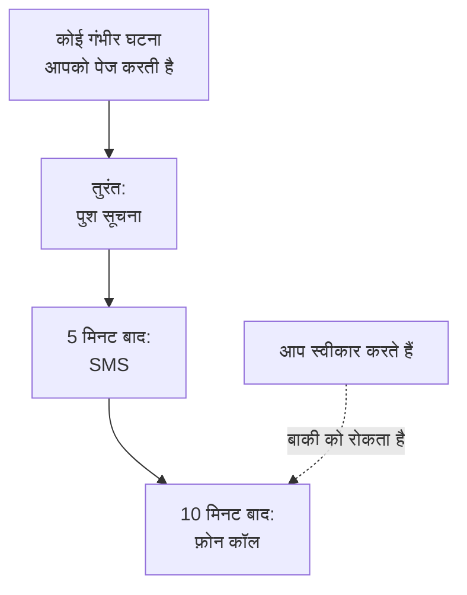

# व्यक्तिगत ऑन-कॉल नियम

आपके ऑन-कॉल नियम तय करते हैं कि पेज आप तक कैसे पहुँचता है: OneUptime आपकी कौन-सी सूचना विधियाँ आज़माता है, और पेज शुरू होने के कितनी देर बाद। हर तरह के पेज के अपने नियम होते हैं, हर गंभीरता के लिए एक सेट, इसलिए कोई गंभीर घटना आपको तुरंत कॉल कर सकती है जबकि कोई कम गंभीर अलर्ट ईमेल का इंतज़ार करता है। आप इन्हें **उपयोगकर्ता सेटिंग्स → ऑन-कॉल नियम** में सेट करते हैं।

> [!NOTE]
> ये नियम केवल आपके हैं। **घटनाएं → नियम** और **अलर्ट → नियम** में मौजूद **ऑन-कॉल नियम** कुछ और हैं: वे तय करते हैं कि नई घटना या नया अलर्ट कौन-सी ऑन-कॉल नीतियाँ चलाता है।

:::cards
- [पेज आप तक कैसे पहुँचता है](#पेज-आप-तक-कैसे-पहुँचता-है): एक पेज के लिए आपके नियम, कदम दर कदम।
- [शुरुआत में मिलने वाले नियम](#शुरुआत-में-मिलने-वाले-नियम): हर सत्यापित विधि क्या जोड़ती है, और उसे कैसे कम करें।
- [नियम जोड़ें](#नियम-जोड़ें): एक गंभीरता के लिए एक विधि और एक देरी।
- [पुश नियम](#पुश-नियम): साइलेंट मोड को पार करके बजें, और तब तक दोहराएँ जब तक कोई स्वीकार न करे।
:::

## पेज आप तक कैसे पहुँचता है

कोई ऑन-कॉल नीति आपको तब पेज करती है जब उसका कोई एस्केलेशन नियम आपका, आपकी किसी टीम का, या किसी ऐसे शेड्यूल का नाम लेता है जिसमें आप ऑन-कॉल हैं। फिर OneUptime उस तरह के पेज और उसकी गंभीरता के लिए आपके नियमों पर काम करता है: हर नियम अपनी विधि पर तब चलता है जब पेज शुरू होने के बाद उसकी देरी बीत जाती है। घटना या अलर्ट को किसी भी संदेश से या OneUptime में स्वीकार करने से वे सभी नियम रुक जाते हैं जो अभी नहीं चले हैं।

ज़्यादातर संदेश पेज को स्वीकार कर सकते हैं: ईमेल, SMS और WhatsApp, Telegram, Slack और Microsoft Teams संदेशों में स्वीकार करने का लिंक होता है, और कॉल आपसे 1 दबाने को कहती है। जब आप कोई पेज नहीं ले सकते, तो वही संदेश आपको उसे एस्केलेट करने देते हैं, और कॉल आपसे 2 दबाने को कहती है: नीति तुरंत अपने अगले स्तर को पेज करती है, और आपको इसके बारे में फिर से पेज नहीं किया जाता। देखें [पेज एस्केलेट करना](/docs/on-call/escalation-rules#पेज-एस्केलेट-करना)। आपको मिला हर पेज **उपयोगकर्ता सेटिंग्स → ऑन-कॉल लॉग** में सूचीबद्ध होता है, जहाँ **टाइमलाइन देखें** उसके भेजे हर संदेश को दिखाता है और यह भी कि वह डिलीवर हुआ या नहीं।

## चार टैब

**उपयोगकर्ता सेटिंग्स → ऑन-कॉल नियम** में हर तरह के पेज के लिए एक टैब है। हर टैब में हर गंभीरता के लिए एक कार्ड है, उसी नाम और रंग के साथ जो आपके प्रोजेक्ट ने उसे दिया है:

| टैब | किसके पेज | किसके कार्ड |
| --- | --- | --- |
| **घटनाएं** | घटनाएँ | घटना की गंभीरताएँ |
| **घटना एपिसोड** | घटनाओं को समूहित करने वाले एपिसोड | घटना की गंभीरताएँ |
| **अलर्ट** | अलर्ट | अलर्ट की गंभीरताएँ |
| **अलर्ट एपिसोड** | अलर्ट को समूहित करने वाले एपिसोड | अलर्ट की गंभीरताएँ |

एपिसोड आपको अपनी ऑन-कॉल नीतियों के ज़रिए पेज करता है, उसमें शामिल घटनाओं या अलर्ट से अलग, इसलिए उसके नियम अपने अलग टैब पर हैं। पेज का पता खुले टैब का नाम बताता है, जैसे `/dashboard/{projectId}/user-settings/on-call-rules?type=alerts`; बाकी मान `incident-episodes` और `alert-episodes` हैं, और बिना `type` के पेज **घटनाएं** पर खुलता है।

## शुरुआत में मिलने वाले नियम

आप जो भी विधि सत्यापित करते हैं, उसे हर टैब के हर कार्ड पर एक नियम मिलता है, जो आपके पेज होते ही भेजा जाता है। आपके साइन-इन ईमेल के पास ये नियम आपके शामिल होने के दिन से होते हैं, ताकि पेज हमेशा आप तक पहुँचे। SMS के लिए फ़ोन नंबर सत्यापित करें, और हर पेज आपको SMS भी भेजेगा।

यह एक सुरक्षित शुरुआत है, और आमतौर पर ज़रूरत से ज़्यादा। इसे उतना कम करें जितनी हर गंभीरता को ज़रूरत है:

| गंभीरता | एक समझदार सेट |
| --- | --- |
| गंभीर | तुरंत पुश, 5 मिनट बाद कॉल |
| बड़ी | तुरंत पुश, 10 मिनट बाद SMS |
| छोटी या कम | तुरंत ईमेल |

आपके अपने नियमों में शांत घंटे नहीं होते: कम गंभीरताओं को ईमेल पर रखें, या **सामान्य** पर सेट किए गए पुश नियम पर, ताकि वे आपको कभी न जगाएँ। सबके लिए कम गंभीरता वाले पेज को कार्य समय की प्रतीक्षा कराने के लिए, उसे बुलाने वाले ऑन-कॉल नियम को **केवल कार्य समय में** पर सेट करें: देखें [ऑन-कॉल नियम](/docs/alerts/settings#ऑन-कॉल-नियम)।

## नियम जोड़ें

:::steps
### कार्ड खोलें

**उपयोगकर्ता सेटिंग्स → ऑन-कॉल नियम** पर जाएँ, पेज के प्रकार का टैब खोलें, और गंभीरता का कार्ड ढूँढें।

### विधि चुनें

**सूचना नियम जोड़ें** क्लिक करें। **सूचना विधि** में अपनी सत्यापित विधियों में से एक चुनें; जो विधि आपने सत्यापित नहीं की है वह विकल्प में नहीं आती।

### चुनें कि पुश कैसे बजे

फ़ोन के लिए **पुश सूचना** चुनें: **महत्वपूर्ण अलर्ट** या **सामान्य**। किसी भी पुश डिवाइस के लिए **स्वीकार किए जाने तक दोहराएं** चुनें। देखें [पुश नियम](#पुश-नियम)।

### देरी सेट करें

**मुझे इसके बाद सूचित करें** चुनें: **तुरंत**, **5 मिनट**, **10 मिनट**, **15 मिनट**, **30 मिनट** या **1 घंटा**। फिर डायलॉग में **सूचना नियम जोड़ें** क्लिक करें।
:::

कार्ड अपने नियमों को उनकी देरी के क्रम में दिखाता है, हर एक के लिए **सूचना विधि** और **इसके बाद सूचित करें** के साथ।

## नियम बदलें या हटाएँ

- नियम की पंक्ति पर **संपादित करें** उसकी देरी बदलता है। किसी नियम को दूसरी विधि पर भेजने के लिए, उसे हटाएँ और नया जोड़ें।
- पुश नियम पर, **महत्वपूर्ण अलर्ट** और **सामान्य** के बीच बदलने के लिए, या यह बदलने के लिए कि वह कितनी बार दोहराए, विधि के नीचे वाले लेबल पर क्लिक करें। यह तुरंत सेव होता है।
- **हटाएं** पहले पूछता है, और बताता है कि क्या गंभीरता बिना नियम के रह जाएगी। बिना नियम वाली गंभीरता आपकी सत्यापित विधियों पर लौट आती है; देखें [जब किसी गंभीरता का कोई नियम नहीं होता](#जब-किसी-गंभीरता-का-कोई-नियम-नहीं-होता)।

## पुश नियम

फ़ोन को पेज करने वाला नियम बताता है कि उसका पुश कैसे बजता है:

| विकल्प | फ़ोन क्या करता है |
| --- | --- |
| **महत्वपूर्ण अलर्ट** | फ़ोन साइलेंट या डू नॉट डिस्टर्ब में होने पर भी बजता है, बशर्ते OneUptime On-Call ऐप में Critical On-Call Alerts चालू हो। नया फ़ोन नियम इसी से शुरू होता है। |
| **सामान्य** | फ़ोन की ध्वनि, साइलेंट और डू नॉट डिस्टर्ब सेटिंग्स का पालन करता है। |

पुश नियम, फ़ोन या ब्राउज़र के लिए, अपना पुश तब तक दोबारा भी भेज सकता है जब तक कोई स्वीकार न करे: **न दोहराएं**, डिफ़ॉल्ट, या **हर मिनट**, **हर 2 मिनट**, **हर 3 मिनट**, **हर 5 मिनट**, **हर 10 मिनट**, **हर 15 मिनट** या **हर 30 मिनट**। यह अधिकतम 10 बार और दोहराता है, और घटना, अलर्ट या एपिसोड के स्वीकार होते ही रुक जाता है। देखें [गंभीर ऑन-कॉल अलर्ट](/docs/self-hosted/push-notifications#गंभीर-ऑन-कॉल-अलर्ट-साइलेंट-मोड-को-ओवरराइड-करना)।

## जब किसी गंभीरता का कोई नियम नहीं होता

आपका प्रोजेक्ट बाद में जो गंभीरता जोड़ता है, उसे कुछ ही मिनटों में नियम मिल जाते हैं, जो उस टैब पर आपके पहले से किए गए चुनावों से बनते हैं: वही विधियाँ, वही देरी। अगर उस टैब पर आपके कोई नियम नहीं थे, तो उसे आपका सत्यापित ईमेल मिलता है, तुरंत।

जिस पेज को फिर भी कोई नियम नहीं मिलता, वह आपकी सत्यापित विधियों पर भेजा जाता है, और आपको इसके बारे में ईमेल मिलता है; देखें [जब कोई नियम मेल नहीं खाता](/docs/notifications/index#जब-कोई-नियम-मेल-नहीं-खाता)।

:::details किसी गंभीरता को जानबूझकर बंद करना
API एक ऑप्ट-आउट नियम सहेज सकता है, जिसमें `isOptOut` सेट हो और कोई विधि न हो: तब उस तरह के पेज और गंभीरता के लिए आपको बिल्कुल पेज नहीं किया जाता, और कुछ भी फ़ॉलबैक नहीं होता। पंक्ति पर **Muted - notifications turned off for this rule** लिखा होता है, और उसे हटाने से पेजिंग फिर चालू हो जाती है। बाद में जोड़ी गई गंभीरता भी म्यूट रहती है, जब उस टैब पर आपके सभी नियम ऑप्ट-आउट हों।
:::

:::details पूरे प्रोजेक्ट के लिए फ़ॉलबैक बंद करना
प्रोजेक्ट का मालिक, या **Manage Billing** वाला कोई व्यक्ति, API के ज़रिए प्रोजेक्ट का `disableOnCallNotificationFallback` सेट कर सकता है। तब जिस पेज को कोई नियम नहीं मिलता वह डिलीवर नहीं होता, और उसका लॉग बताता है कि उपयोगकर्ता को **उपयोगकर्ता सेटिंग्स → ऑन-कॉल नियम** में नियम जोड़ने चाहिए।
:::

## किसी सहकर्मी के नियम

प्रोजेक्ट के मालिक और एडमिन प्रोजेक्ट के किसी भी व्यक्ति के लिए यही पेज देख और बदल सकते हैं: **उपयोगकर्ता** में उस व्यक्ति को खोलें, फिर **ऑन-कॉल** सेक्शन में **ऑन-कॉल नियम**। उसके पास **तैयारी** दिखाता है कि क्या हर गंभीरता उन तक पहुँचती है। जब कोई और आपके नियम जोड़ता, बदलता या हटाता है, तो आपको इसके बारे में ईमेल मिलता है, और हर बदलाव प्रोजेक्ट के ऑडिट लॉग में दर्ज होता है।

## समस्या निवारण

:::details गंभीर पेज पर मेरा फ़ोन चुप रहा
जाँचें कि नियम का पुश **महत्वपूर्ण अलर्ट** है, **सामान्य** नहीं, और यह कि **उपयोगकर्ता सेटिंग्स → सूचना विधियां** में, **Push Notifications** टैब पर, फ़ोन के लिए **महत्वपूर्ण अलर्ट** चालू है।
:::

:::details हर घटना के लिए मुझे दो बार पेज किया जाता है
हर सत्यापित विधि के पास हर गंभीरता के लिए एक नियम है, जो तुरंत भेजा जाता है। जो नियम आप नहीं चाहते उन्हें हटाएँ, या उन्हें देरी दें। किसी एपिसोड की घटना आपको दो नीतियों के ज़रिए एक बार घटना के लिए और एक बार एपिसोड के लिए पेज कर सकती है।
:::

:::details मुझे ईमेल मिला, हालाँकि मेरा नियम SMS कहता है
पेज को अपने प्रकार या गंभीरता के लिए कोई नियम नहीं मिला, और वह आपकी मुफ़्त विधियों पर लौट आया: सही टैब और कार्ड पर नियम जोड़ें। या वह ईमेल आपके किसी रिकॉर्ड के बारे में अपडेट था, जो आपके नियमों का नहीं, **सूचना सेटिंग्स** का पालन करता है। आपके **ऑन-कॉल लॉग** में केवल पेज सूचीबद्ध होते हैं।
:::

## आगे के कदम

:::cards
- [सूचना विधियां](/docs/notifications/notification-methods): वे विधियाँ जोड़ें और सत्यापित करें जिनकी ओर आपके नियम इशारा करते हैं।
- [एस्केलेशन नियम](/docs/on-call/escalation-rules): ऑन-कॉल नीति स्तर दर स्तर लोगों को कैसे पेज करती है।
- [पुश सूचनाएँ](/docs/self-hosted/push-notifications): फ़ोन पर गंभीर अलर्ट, अलार्म ध्वनियाँ और दोहराव।
- [OneUptime आप तक कैसे पहुँचता है](/docs/notifications/index): विधियाँ, नियम और सेटिंग्स कैसे एक साथ काम करते हैं।
:::
