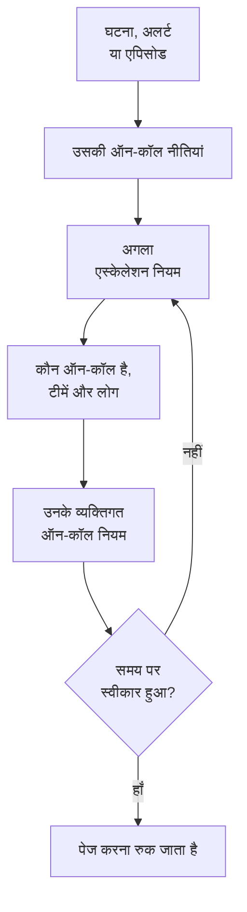

# ऑन-कॉल का अवलोकन

ऑन-कॉल वह तरीका है जिससे OneUptime किसी भी समय किसी व्यक्ति को समस्या तक पहुँचाता है। जब किसी घटना, अलर्ट या एपिसोड को किसी की ज़रूरत होती है, तो उसकी ऑन-कॉल नीतियां तब तक लोगों को स्तर-दर-स्तर पेज करती हैं जब तक कोई स्वीकार न कर ले, और हर व्यक्ति तक उसी तरह पहुँचा जाता है जैसा उसने चुना है: पुश सूचना, SMS, कॉल, ईमेल या चैट संदेश। यह पेज दिखाता है कि ये हिस्से कैसे एक साथ काम करते हैं और हर हिस्सा कहाँ है।

:::cards
- [पेज किसी तक कैसे पहुँचता है](#पेज-किसी-तक-कैसे-पहुँचता-है): नई घटना से लेकर जवाब देने वाले व्यक्ति तक।
- [बुनियादी हिस्से](#बुनियादी-हिस्से): नीतियां, एस्केलेशन नियम, शेड्यूल, ओवरराइड और व्यक्तिगत नियम।
- [ऑन-कॉल सेट अप करें](#ऑन-कॉल-सेट-अप-करें): शून्य से लेकर पेज होने वाली टीम तक, पाँच चरणों में।
- [ऑन-कॉल कहाँ है](#ऑन-कॉल-कहाँ-है): ऑन-कॉल ड्यूटी मेनू, सेक्शन-दर-सेक्शन।
:::

## पेज किसी तक कैसे पहुँचता है

1. नई घटना, अलर्ट या एपिसोड तुरंत अपनी ऑन-कॉल नीतियां चलाता है: उस पर चुनी गई नीतियां और उसके ऑन-कॉल नियमों द्वारा जोड़ी गई नीतियां। हर नीति अलग से चलती है। **केवल कार्य समय में** पर सेट किया गया ऑन-कॉल नियम अपनी जोड़ी गई नीतियों से कार्य समय शुरू होने तक प्रतीक्षा कराता है।
2. नीति का पहला एस्केलेशन नियम तुरंत पेज करता है: उसके शेड्यूल में अभी जो ऑन-कॉल है, उसकी टीमों का हर सदस्य, और वे लोग जिनका नाम नियम में है।
3. अगर उनमें से कोई अनुपस्थित है, तो उपयोगकर्ता ओवरराइड उसका पेज कवर करने वाले व्यक्ति को भेज देता है, या उसे छोड़ देता है।
4. हर व्यक्ति तक उसके व्यक्तिगत ऑन-कॉल नियमों से पहुँचा जाता है: उसकी कौन-सी विधि आज़माई जाए, और कितनी देर बाद। बिना नियम वाला पेज भी उस तक उन विधियों पर पहुँचता है जिन्हें उसने सत्यापित किया है।
5. अगर नियम का इंतज़ार खत्म होने से पहले कोई स्वीकार नहीं करता, तो अगला नियम पेज करता है। आख़िरी नियम के बाद, अगर नीति दोहराई जाती है तो वह फिर से शुरू होती है, वरना रुक जाती है।

घटना, अलर्ट या एपिसोड को स्वीकार करने या सुलझाने से वे सभी नीतियां रुक जाती हैं जो अब भी उसके लिए पेज कर रही हैं। OneUptime चल रही नीतियों को हर मिनट आगे बढ़ाता है और हर रन को, नियम-दर-नियम, **निष्पादन लॉग** में दर्ज करता है।

जब कोई पेज पहली बार किसी तक पहुँचता है, तो OneUptime उसे घटना, अलर्ट या एपिसोड पर `First Paged At` के रूप में दर्ज करता है। कोई माप उसी पल से गिनती कर सकता है: **बुलावे के बाद स्वीकार करने में लगा समय** यह मापता है कि पेज किए जाने के बाद लोगों ने जवाब देने में कितना समय लिया, न कि यह कि किसी को पेज किए जाने से पहले रिकॉर्ड ने कितना इंतज़ार किया। देखें [बुलावे के बाद स्वीकार करने में लगा समय](/docs/incidents/settings#बुलावे-के-बाद-स्वीकार-करने-में-लगा-समय)।

> [!NOTE]
> जो घटना, अलर्ट या एपिसोड पहले से स्वीकार या सुलझा हुआ बनाया जाता है, वह अपनी कोई भी नीति नहीं चलाता, और उसकी फ़ीड यह बताती है। देखें [पहले से स्वीकार या सुलझा हुआ बनाया गया](/docs/alerts/index#पहले-से-स्वीकार-या-सुलझा-हुआ-बनाया-गया)।

## बुनियादी हिस्से

| हिस्सा | यह क्या तय करता है | और पढ़ें |
| --- | --- | --- |
| ऑन-कॉल नीति | किसी घटना या अलर्ट के लिए स्तर-दर-स्तर किसे पेज किया जाए | [ऑन-कॉल नीतियां](/docs/on-call/policies) |
| एस्केलेशन नियम | नीति का एक स्तर: यह किसे पेज करता है, और स्वीकृति के लिए कितनी देर इंतज़ार करता है | [एस्केलेशन नियम](/docs/on-call/escalation-rules) |
| ऑन-कॉल शेड्यूल | लोग बारी-बारी से ड्यूटी करते हैं, तो किसी भी समय कौन ऑन-कॉल है | [ऑन-कॉल अनुसूची](/docs/on-call/schedules) |
| उपयोगकर्ता ओवरराइड | किसी के अनुपस्थित रहने पर उसे कौन कवर करता है | [उपयोगकर्ता ओवरराइड](/docs/on-call/user-overrides) |
| व्यक्तिगत ऑन-कॉल नियम | एक व्यक्ति तक कैसे पहुँचा जाए: कौन-सी विधि, और कितनी देर बाद | [व्यक्तिगत ऑन-कॉल नियम](/docs/notifications/on-call-rules) |
| आने वाली कॉल नीति | एक फ़ोन नंबर जो ऑन-कॉल व्यक्ति को कॉल लगाता है | [आने वाली कॉल नीति](/docs/on-call/incoming-call-policy) |

नीतियां, एस्केलेशन नियम, शेड्यूल और ओवरराइड प्रोजेक्ट के होते हैं, और **ऑन-कॉल ड्यूटी** के अंतर्गत रहते हैं। सूचना विधियां और व्यक्तिगत ऑन-कॉल नियम हर व्यक्ति के अपने होते हैं, और **उपयोगकर्ता सेटिंग्स** के अंतर्गत रहते हैं: कोई एडमिन किसी का सेटअप देख सकता है, लेकिन अपना फ़ोन या ईमेल केवल वही व्यक्ति सत्यापित कर सकता है। देखें [OneUptime आप तक कैसे पहुँचता है](/docs/notifications/index)।

## ऑन-कॉल सेट अप करें

:::steps
### एक शेड्यूल बनाएँ

**उत्पाद** मेनू से **ऑन-कॉल ड्यूटी** खोलें और **ऑन-कॉल अनुसूची** पर जाएँ। **ऑन-कॉल अनुसूची बनाएं** पर क्लिक करें, उसे नाम दें, और **बारी-बारी से कौन ऑन-कॉल रहेगा?** के नीचे लोगों को उसी क्रम में चुनें जिसमें वे बारी लेते हैं। देखें [ऑन-कॉल अनुसूची](/docs/on-call/schedules)।

### एक नीति बनाएँ

**ऑन-कॉल नीतियां** पर जाएँ और **ऑन-कॉल नीति बनाएँ** पर क्लिक करें। **सबसे पहले किसे सूचित किया जाए?** के नीचे शेड्यूल चुनें। यह नीति का पहला एस्केलेशन नियम, **Level 1**, बन जाता है, जो स्वीकृति के लिए 30 मिनट इंतज़ार करता है।

### अगले स्तर जोड़ें

नीति के **एस्केलेशन नियम** पेज पर, पहले स्तर के बाद हर स्तर के लिए **एस्केलेशन नियम जोड़ें** पर क्लिक करें: उसी शेड्यूल के रोटेशन में अगला व्यक्ति, टीम लीड, मैनेजर। देखें [एस्केलेशन नियम](/docs/on-call/escalation-rules)।

### नीति को अपने-आप चलाएँ

प्रोजेक्ट की पहली नीति बनाते समय ही यह कर सकती है: **हर नई घटना और अलर्ट पर इसे ट्रिगर करें** को चालू रहने दें। किसी भी दूसरी नीति के लिए, **घटनाएं → नियम → ऑन-कॉल नियम** या **अलर्ट → नियम → ऑन-कॉल नियम** पर जाएँ, और एक नियम जोड़ें जो मेल खाने वाली घटनाओं या अलर्ट के लिए उसे चलाए, जैसे हर गंभीर घटना। देखें [नीति को क्या चलाता है](/docs/on-call/policies#नीति-को-क्या-चलाता-है)।

### जाँचें कि सभी तक पहुँचा जा सकता है

**ऑन-कॉल ड्यूटी → तैयारी** खोलें। आपकी नीतियां जिन्हें पेज कर सकती हैं, वे सभी **तैयार**, **सेटअप ज़रूरी** या **पहुँच से बाहर** के रूप में दिखते हैं, साथ में यह भी कि क्या कमी है। देखें [तैयारी और रिपोर्ट](/docs/on-call/readiness)।
:::

> [!NOTE]
> OneUptime Cloud पर ऑन-कॉल नीतियां और एस्केलेशन नियम हर प्लान में हैं। ऑन-कॉल शेड्यूल, उपयोगकर्ता ओवरराइड, निष्पादन लॉग और ऑन-कॉल समय रिपोर्ट के लिए **Growth** प्लान चाहिए।

## ऑन-कॉल कहाँ है

ऊपर की बार में **उत्पाद** मेनू से **ऑन-कॉल ड्यूटी** खोलें। यह `/dashboard/{projectId}/on-call-duty/policies` पर **ऑन-कॉल नीतियां** खोलता है, और इसके साइड मेनू में बाकी सब है:

| सेक्शन | पेज |
| --- | --- |
| **नीतियां** | **ऑन-कॉल नीतियां** और **तैयारी**: आपकी नीतियां असल में किस तक पहुँच सकती हैं |
| **अनुसूची** | **ऑन-कॉल अनुसूची**, **शेड्यूल टाइमलाइन** और **कैलेंडर फ़ीड** |
| **इनकमिंग कॉल** | **इनकमिंग कॉल नीतियां**: एक फ़ोन नंबर जो ऑन-कॉल व्यक्ति को कॉल लगाता है |
| **उन्नत** | **उपयोगकर्ता ओवरराइड**, **निष्पादन लॉग** और **संग्रहीत नीतियां** |
| **रिपोर्ट** | **उपयोगकर्ता ऑन कॉल समय**: हर व्यक्ति कितनी देर ऑन-कॉल रहा |
| **वर्कस्पेस** | **Slack** और **Microsoft Teams**: नियम जो ऑन-कॉल इवेंट किसी चैनल में पोस्ट करते हैं |
| **सेटिंग्स** | **कस्टम फ़ील्ड**, **लेबल नियम** और **स्वामी नियम** |
| **डेवलपर** | **Terraform**, **API** और **AI सहायक**: कोड से सेट अप किया गया ऑन-कॉल |

**नीतियां**, **अनुसूची** और **इनकमिंग कॉल** खुले रहते हैं; बाकी सेक्शन बंद शुरू होते हैं, और जब आप किसी सेक्शन के किसी पेज पर होते हैं तो वह सेक्शन अपने-आप खुल जाता है। **वर्कस्पेस** उन चैट टूल को दिखाता है जिन्हें प्रोजेक्ट ने कनेक्ट किया है, या कोई न हो तो **Slack या Teams कनेक्ट करें** दिखाता है।

जब आप किसी नीति के लिए ड्यूटी पर होते हैं, तो ऊपर दाईं ओर की घंटी यह बताती है। **मेरी ऑन-कॉल नीतियाँ** खोलने के लिए उस पर क्लिक करें: आपके सभी प्रोजेक्ट में हर वह नीति जिसके लिए आप ऑन-कॉल हैं, और यह कि आपका नाम उसमें सीधे है, किसी टीम के ज़रिए या किसी शेड्यूल के ज़रिए।

## समस्या निवारण

:::details नई घटना के लिए किसी को पेज नहीं किया गया
घटना का **ऑन-कॉल निष्पादन** पेज खोलें। खाली होने का मतलब है कि घटना के पास कोई ऑन-कॉल नीति नहीं थी: उस पर कोई नीति नहीं चुनी गई, और कोई ऑन-कॉल नियम उससे मेल नहीं खाया। **Execution Completed - No One Notified** वाला रन हर एस्केलेशन नियम से गुज़रा और उसे कोई नहीं मिला: आमतौर पर ऐसा शेड्यूल जिसमें कोई ऑन-कॉल नहीं है। देखें [निष्पादन लॉग](/docs/on-call/policies#निष्पादन-लॉग)। **प्रतीक्षारत** रन **केवल कार्य समय में** पर सेट किए गए ऑन-कॉल नियम के कारण कार्य समय की प्रतीक्षा कर रहा है, और कार्य समय शुरू होने तक किसी को नहीं बुलाता।
:::

:::details किसी को गलत चैनल पर पेज किया गया, या बिल्कुल नहीं
**ऑन-कॉल ड्यूटी → तैयारी** खोलें और उस व्यक्ति की पंक्ति में **Coverage** पर क्लिक करें। यह उसकी सत्यापित विधियां और हर वह गंभीरता दिखाता है जिसके लिए उसका कोई नियम नहीं है। इसे केवल वही व्यक्ति **उपयोगकर्ता सेटिंग्स** में ठीक कर सकता है: उसी पेज से उसे सेटअप रिमाइंडर भेजें। देखें [तैयारी और रिपोर्ट](/docs/on-call/readiness)। OneUptime Cloud पर, अनजान कॉल रोकने वाला फ़ोन किसी पेज को चुप करा सकता है: [OneUptime के नंबर](/docs/on-call/phone-number-whitelist) उसकी अनुमति सूची में जोड़ें।
:::

:::details छुट्टी पर गए व्यक्ति को अब भी पेज किया जा रहा है
उस व्यक्ति को **कौन अनुपस्थित है?** में रखकर एक उपयोगकर्ता ओवरराइड जोड़ें। **ऑन-कॉल ड्यूटी → उन्नत → उपयोगकर्ता ओवरराइड** के अंतर्गत जोड़ा गया ओवरराइड हर नीति पर लागू होता है; किसी नीति के अपने **उपयोगकर्ता ओवरराइड** पेज पर जोड़ा गया ओवरराइड केवल उसी नीति पर लागू होता है। देखें [उपयोगकर्ता ओवरराइड](/docs/on-call/user-overrides)।
:::

## अगले कदम

:::cards
- [ऑन-कॉल नीतियां](/docs/on-call/policies): नीति बनाएँ, तय करें कि उसे क्या चलाता है, और पढ़ें कि उसने क्या किया।
- [एस्केलेशन नियम](/docs/on-call/escalation-rules): कोई जवाब दे, तब तक लोगों को स्तर-दर-स्तर पेज करें।
- [ऑन-कॉल अनुसूची](/docs/on-call/schedules): रोटेशन, परतें और हैंड-ऑफ़।
- [OneUptime आप तक कैसे पहुँचता है](/docs/notifications/index): वे विधियां और नियम जो तय करते हैं कि हर व्यक्ति तक कैसे पहुँचा जाए।
:::
