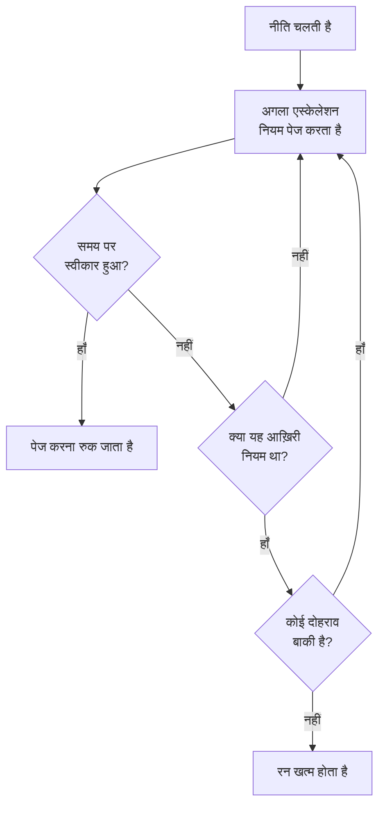

# ऑन-कॉल नीतियां

ऑन-कॉल नीति तय करती है कि किसी घटना या अलर्ट के लिए किसे पेज किया जाए, और अगर कोई स्वीकार न करे तो अगला कौन है। इसके एस्केलेशन नियम इसके स्तर हैं, और जो घटनाएं, अलर्ट और एपिसोड इसका इस्तेमाल करते हैं, वे इसे चलाते हैं। यह पेज बताता है कि नीति कैसे बनाएँ, उसे क्या चलाता है, उसके पेज क्या दिखाते हैं, और हर रन कैसे दर्ज होता है।

:::cards
- [नीति बनाएँ](#नीति-बनाएँ): एक नाम, और सबसे पहले किसे पेज किया जाए।
- [नीति को क्या चलाता है](#नीति-को-क्या-चलाता-है): नियम, टेम्पलेट, मॉनिटर, चैट और आप खुद।
- [निष्पादन लॉग](#निष्पादन-लॉग): हर रन, नियम-दर-नियम, और वह क्यों रुका।
- [नीति संग्रहीत करें या हटाएँ](#नीति-संग्रहीत-करें-या-हटाएँ): नीति को सेवा से बाहर करें।
:::

## नीति बनाएँ

:::steps
1. **ऑन-कॉल → ऑन-कॉल नीतियां** पर जाएँ और **ऑन-कॉल नीति बनाएँ** पर क्लिक करें।
2. एक **नाम** दर्ज करें, जैसे "भुगतान प्राथमिक"।
3. **सबसे पहले किसे सूचित किया जाए?** के नीचे **प्रतिक्रियाकर्ता जोड़ें** पर क्लिक करें और सबसे पहले पेज किए जाने वाले ऑन-कॉल शेड्यूल, टीमें और लोग चुनें।
4. **ऑन-कॉल नीति बनाएँ** पर क्लिक करें। नीति अपने **एस्केलेशन नियम** पेज पर खुलती है, जहाँ **Level 1** पहले से मौजूद होता है।
:::

**सबसे पहले किसे सूचित किया जाए?** वैकल्पिक है, और केवल उन लोगों से पूछा जाता है जो एस्केलेशन नियम जोड़ सकते हैं: खाली छोड़ने पर नीति तब तक किसी को पेज नहीं करती जब तक उसमें कोई नियम न हो। **और फ़ील्ड** के नीचे **विवरण** और **लेबल** मिलते हैं। अगले स्तर जोड़ने के लिए देखें [एस्केलेशन नियम](/docs/on-call/escalation-rules)।

जो लोग ऑन-कॉल नियम जोड़ सकते हैं, उनसे फ़ॉर्म **हर नई घटना और अलर्ट पर इसे ट्रिगर करें** भी पूछता है। यह **घटनाएं → नियम → ऑन-कॉल नियम** के नीचे एक नियम और **अलर्ट → नियम → ऑन-कॉल नियम** के नीचे एक नियम जोड़ता है, जिनमें से हर एक सब कुछ से मेल खाता है और यह नीति चलाता है। प्रोजेक्ट की पहली नीति के लिए, जब तक प्रोजेक्ट में न कोई ऑन-कॉल नीति हो न कोई ऑन-कॉल नियम, यह शुरू में चालू रहता है, और बाद की नीतियों के लिए बंद: हर नई घटना और अलर्ट पर दो नीतियाँ चलाना सोच-समझकर किया जाने वाला चुनाव है। बंद रहने पर नीति किसी को पेज नहीं करती, जब तक कोई नियम, मॉनिटर या व्यक्ति उसे न चलाए।

इसके बजाय चरण-दर-चरण मार्गदर्शन के लिए, अपने फ़ोन से लेकर एक टेस्ट पेज तक, **गाइडेड सेटअप** पर क्लिक करें: खाली **ऑन-कॉल नीतियां** सूची पर, या **यह कैसे काम करता है** में। देखें [फ़ोन, SMS या पुश से पेज पाएँ](/docs/guides/paging)।

**ऑन-कॉल नीतियां** सूची हर नीति का **नाम**, **विवरण**, **लेबल** और **मालिक** दिखाती है। नीतियां चुनें और **लेबल जोड़ें**, **लेबल हटाएँ**, **स्वामी जोड़ें**, **स्वामी हटाएँ**, **संग्रहीत करें** या **JSON निर्यात करें** इस्तेमाल करें, या उन्हें हटाएँ। **JSON आयात करें** किसी निर्यात से नीतियां बनाता है: निर्यात में नीति की अपनी सेटिंग्स होती हैं, उसके एस्केलेशन नियम या मालिक नहीं।

## नीति को क्या चलाता है

जब तक कोई चीज़ नीति को नहीं चलाती, तब तक वह किसी को पेज नहीं करती। हर घटना, अलर्ट और एपिसोड बनते ही अपनी नीतियां चलाता है:

| क्या | नीति कैसे जुड़ती है | और पढ़ें |
| --- | --- | --- |
| रिकॉर्ड खुद | घटना या अलर्ट बनाते समय **ऑन-कॉल नीति** फ़ील्ड, घटना टेम्पलेट, या मॉनिटर के मानदंड का **ऑन-कॉल** वाला मुड़ा हुआ हिस्सा | [घटना घोषित करना](/docs/incidents/declaring-incidents) |
| ऑन-कॉल नियम | **घटनाएं → नियम → ऑन-कॉल नियम** और **अलर्ट → नियम → ऑन-कॉल नियम** मेल खाने वाले हर नियम की नीतियां जोड़ते हैं | [घटना ऑन-कॉल नियम](/docs/incidents/settings#घटना-ऑन-कॉल-नियम) |
| समूहीकरण नियम | समूहीकरण नियम एपिसोड खोलते समय अपनी नीतियां चलाता है | [अलर्ट एपिसोड और समूहीकरण नियम](/docs/alerts/episodes) |
| हाथ से | **ऑन-कॉल नीति निष्पादित करें**, किसी फ़ीड के **क्रियाएँ** मेनू में, या Slack या Microsoft Teams संदेश पर | [घटना फ़ीड](/docs/incidents/notes-owners-and-feed#घटना-फ़ीड) |
| चैट और वर्कफ़्लो | Slack या Microsoft Teams में `/oneuptime page`, और वर्कफ़्लो का **Page an On-Call Policy** चरण | [Paging](/docs/workflows/components#paging) |

जिस नीति को कई नियम जोड़ते हैं, वह एक बार चलती है। कोई गंभीरता अपने-आप कभी नीति नहीं चलाती: उस गंभीरता से मेल खाने वाला ऑन-कॉल नियम चलाता है। जो घटना या अलर्ट पहले से स्वीकार या सुलझा हुआ बनाया जाता है, वह अपनी कोई भी नीति नहीं चलाता। **केवल कार्य समय में** पर सेट किया गया ऑन-कॉल नियम अपनी जोड़ी गई नीतियों से कार्य समय शुरू होने तक प्रतीक्षा कराता है।

## नीति के पेज

सूची से कोई नीति खोलें। उसके साइड मेनू में उसके बारे में सब कुछ है:

| सेक्शन | पेज |
| --- | --- |
| **बेसिक** | **अवलोकन**, **एस्केलेशन नियम** और **मालिक** |
| **लॉग** | **निष्पादन लॉग** और **सूचना लॉग** |
| **डेवलपर** | **Terraform**, **API**, **CLI** और **AI सहायक** |
| **उन्नत** | **उपयोगकर्ता ओवरराइड**, **कस्टम फ़ील्ड**, **सेटिंग्स**, **ऑडिट लॉग** और **नीति हटाएं** |

**बेसिक** खुला रहता है; बाकी सेक्शन तब तक बंद रहते हैं जब तक आप उन पर क्लिक नहीं करते।

- **अवलोकन** पहले **ऑन-कॉल नीति विवरण** दिखाता है, फिर **नीति एक नज़र में**: नीति में कितने स्तर और प्रतिक्रियाकर्ता हैं, आख़िरी स्तर तक कितना समय लगता है, और यह कितनी बार दोहराई जाती है। **प्रतिक्रियाकर्ता तैयारी** बताता है कि क्या यह जिन्हें पेज कर सकती है, उन सभी तक अभी पहुँचा जा सकता है, और **ऑन-कॉल नीति फ़ीड** बताती है कि क्या बदला: जोड़े या हटाए गए लोग, टीमें और शेड्यूल, ओवरराइड और हैंड-ऑफ़। इसके Slack, Microsoft Teams और Mattermost नियम इन्हें आपके चैनलों में पोस्ट करते हैं, एक हैंडऑफ़ एक पंक्ति में: देखें [ऑन-कॉल संदेश](/docs/workspace-connections/slack#ऑन-कॉल-संदेश)।
- **मालिक** वे लोग और टीमें हैं जो नीति के लिए ज़िम्मेदार हैं। जब इसका भेजा कोई पेज किसी के लिए कोई नियम नहीं पाता, या पहुँचाया नहीं जा सकता, तो उन्हें ईमेल जाता है; बिना मालिकों वाली नीति इसके बजाय प्रोजेक्ट स्वामियों को ईमेल करती है।
- **सूचना लॉग** नीति के भेजे हर संदेश को दिखाता है, हर चैनल के लिए एक टैब के साथ।
- **उपयोगकर्ता ओवरराइड** केवल इस नीति में लोगों को कवर करता है। देखें [उपयोगकर्ता ओवरराइड](/docs/on-call/user-overrides)।
- **सेटिंग्स** में **ऑन-कॉल नीति निर्यात करें** और नीति को संग्रहीत करने वाला कार्ड है।

**अवलोकन** पर **इस नीति को क्या चलाता है** ऑन-कॉल नियम, वे मॉनिटर जिनके मानदंड नीति को चलाते हैं, इसे चलाने वाले टेम्पलेट और अन्य नियम, और ऐसा करने वाले वर्कफ़्लो दिखाता है, हर एक लिंक के साथ। बंद किया गया नियम **बंद** दिखाता है। जब कुछ भी नीति को नहीं चलाता, तो कार्ड यह बताता है: जब तक कोई इसे नहीं चलाता, यह किसी को पेज नहीं करती। नीति को हटाते या संग्रहीत करते समय पहले यही बताया जाता है। जिसे आप नहीं खोल सकते, वह गिना जाता है, उसका नाम नहीं दिखाया जाता।

## नीति दोहराएँ

जब आख़िरी स्तर का इंतज़ार बिना किसी के स्वीकार किए खत्म हो जाता है, तो नीति रुक जाती है, जब तक वह दोहराई न जाए। चुनने के लिए, नीति का **एस्केलेशन नियम** पेज खोलें और नियमों के नीचे **दोहराव नीति** कार्ड पर **संपादित करें** पर क्लिक करें। **दोहराव नीति संपादित करें** पूछता है **अगर आखिरी स्तर के बाद भी कोई स्वीकार नहीं करता**:

| जवाब | यह क्या करता है |
| --- | --- |
| **सूचित करना बंद करें** | किसी को फिर से सूचित नहीं किया जाता, इसलिए नीति एक बार चलती है। नई नीति इसी जवाब से शुरू होती है। |
| **Level 1 से फिर शुरू करें** | हर स्तर को क्रम से फिर से सूचित किया जाता है। **और कितनी बार?** बताता है कितनी बार: 1 या उससे ज़्यादा। |

जो नीति तीन बार और फिर से शुरू होती है, वह कुल चार बार अपने स्तरों से गुज़रती है। जिस दौर में किसी भी स्तर पर पेज करने के लिए कोई नहीं था, वह दोहराया नहीं जाता: अगला दौर भी किसी को पेज नहीं करेगा, इसलिए नीति रुक जाती है। कार्ड की **आखिरी स्तर के बाद** पंक्ति बताती है कि नीति क्या करती है, और **अवलोकन** पर **नीति एक नज़र में** यही बात शब्दों में बताता है।

## हल न होने पर फिर से सूचित करें

स्वीकार करने से नीति का सूचित करना हमेशा के लिए रुक जाता है, भले ही बाद में कोई घटना या अलर्ट को न सुलझाए। इसके बजाय नीति फिर से सूचित कर सकती है: नीति का **एस्केलेशन नियम** पेज खोलें, नीचे **और सेटिंग्स** खोलें, और **स्वीकृति के बाद टाइमआउट** कार्ड पर **संपादित करें** पर क्लिक करें। **स्वीकृति के बाद टाइमआउट संपादित करें** पूछता है **अगर स्वीकार किया गया है लेकिन सुलझाया नहीं गया**:

| जवाब | यह क्या करता है |
| --- | --- |
| **फिर से सूचित न करें** | स्वीकार करने से सूचित करना हमेशा के लिए बंद हो जाता है। नई नीति इसी जवाब से शुरू होती है। |
| **फिर से सूचित करें** | स्वीकार करने वाले को, और अभी ऑन-कॉल व्यक्ति को सूचित करता है। **कितने मिनट बाद?** बताता है कब: 5 से 1440 तक, शुरू में 30। |

मिनट हर स्वीकृति से गिने जाते हैं, और एक नीति एक ही घटना, अलर्ट या एपिसोड के लिए ज़्यादा से ज़्यादा 5 बार फिर से सूचित करती है। फिर से सूचना उसी स्तर से शुरू होती है जो स्वीकार किए जाने के समय सूचित कर रहा था, वहाँ अभी ऑन-कॉल व्यक्ति को सूचित करती है, और फिर पहले रन की तरह स्तरों से गुज़रती है। घटना या अलर्ट स्वीकार किया हुआ ही रहता है: फिर से सूचना अपना अलग रन है, उसकी फ़ीड और नीति के निष्पादन लॉग में, जहाँ उसकी **स्थिति** "फिर से सूचित किया गया (5 में से 1)" बताती है।

जिसे फिर से सूचित किया गया, वह उसे संदेश से, या घटना या अलर्ट के पेज पर **फिर से स्वीकार करें** से स्वीकार करता है, और मिनट फिर से शुरू होते हैं; **एस्केलेट करें** उसे अगले स्तर को सौंपता है। घटना या अलर्ट को सुलझाने या हटाने, नीति को संग्रहीत करने या हटाने, या **फिर से सूचित न करें** चुनने से यह रुक जाता है। कार्ड की **स्वीकृति के बाद** पंक्ति बताती है कि नीति क्या करती है, और **और सेटिंग्स** मुड़ा होने पर भी मिनट दिखाता है। **अवलोकन** पर **नीति एक नज़र में** और **एस्केलेशन सारांश** यही बात शब्दों में बताते हैं।

## जब कई नीतियाँ पेज करती हैं

कोई घटना, अलर्ट या एपिसोड अपनी हर नीति को अलग-अलग, एक ही समय पर चलाता है।

- जो व्यक्ति उनमें से दो में ऑन-कॉल है, उसे एक ही बार पेज किया जाता है। जब किसी नीति का स्तर ऐसे व्यक्ति तक पहुँचता है जिसे कोई दूसरी नीति उसी के बारे में पहले से पेज कर रही है, तो वह उसे दोबारा पेज नहीं करती: उसका निष्पादन लॉग उस व्यक्ति को **पहले ही पेज किया गया** के रूप में दिखाता है, और घटना की फ़ीड तथा Slack और Microsoft Teams में नीति का संदेश उस नीति का नाम बताते हैं जो उसे पेज कर रही है। स्तर फिर भी अगले स्तर से पहले अपने मिनटों का इंतज़ार करता है, जैसे वह अपने पेज किए गए किसी भी व्यक्ति के लिए करता है। उस एक पेज का जवाब देने से दोनों नीतियों के लिए जवाब हो जाता है। एक ही नीति के भीतर, जिस व्यक्ति का नाम कोई स्तर दो बार लेता है, सीधे और किसी टीम या शेड्यूल के ज़रिए, उसे एक ही बार पेज किया जाता है।
- सीधे लोगों को भेजा गया पेज भी गिना जाता है। जब किसी नीति का स्तर ऐसे व्यक्ति तक पहुँचता है जिसे Slack या Microsoft Teams से भेजा गया कोई पेज, या किसी वर्कफ़्लो का पेज वाला ब्लॉक, उसी के बारे में पहले से पेज कर रहा है, तो वह उसे दोबारा पेज नहीं करती: उसका निष्पादन लॉग बताता है कि वह पेज किसने भेजा, या कौन-सा वर्कफ़्लो। किसी वर्कफ़्लो का पेज वाला ब्लॉक भी ऐसे व्यक्ति को दोबारा पेज नहीं करता जिसे कोई नीति या कोई दूसरा पेज पहले से पेज कर रहा है।
- घटना या अलर्ट को स्वीकार करने से उसके लिए चल रही हर नीति एक मिनट के भीतर रुक जाती है, चाहे उसे कहीं से भी स्वीकार किया जाए: उसके बारे में किसी भी पेज से, उसके अपने पेज पर, मोबाइल ऐप में, या Slack या Microsoft Teams में। अगले स्तर को पेज नहीं किया जाता, और जो कॉल या SMS अभी भेजे जाने बाकी हैं, वे नहीं भेजे जाते। जो सूचनाएँ पहले ही भेजी जा चुकी हैं, वे भेजी हुई ही रहती हैं।

एक ही बार पेज किए जाने से किसी का कोई पेज नहीं छूटता। उसका पेज उसके जवाब के बिना भी खत्म हो सकता है: वह उसके किसी संदेश से उसे एस्केलेट कर देता है, जिससे सिर्फ़ वही पेज एस्केलेट होता है, पेज भेजा नहीं जा सकता, या वह रुक जाता है। तब दूसरी नीति, या वर्कफ़्लो का ब्लॉक, एक मिनट के भीतर खुद उसे पेज करता है, और जो उस तक पहुँच चुका है उसे दोबारा नहीं भेजती। घटना के पेज पर या मोबाइल ऐप में **एस्केलेट करें** दोनों को एस्केलेट करता है। फिर से सूचना, हाथ से शुरू की गई नीति और Slack या Microsoft Teams से किसी का भेजा गया पेज हमेशा अपने लोगों को खुद पेज करते हैं, उसे भी जिसे कोई दूसरी नीति पेज कर रही है। ऑब्ज़र्वर का पेज और प्रतिक्रियाकर्ता का पेज कभी नहीं मिलाए जाते।

कुछ पेज स्वीकार किए जाने के बाद भी चलते रहते हैं, जब तक उनके पेज किए गए लोगों में से कोई जवाब न दे या वह सुलझ न जाए: फिर से सूचना, ऑब्ज़र्वर को भेजा गया पेज, Slack या Microsoft Teams से किसी का लोगों को भेजा गया पेज, और हाथ से शुरू की गई नीति।

हाथ से शुरू की गई नीति वह है जिसे **ऑन-कॉल नीति निष्पादित करें** से, या Slack या Microsoft Teams के ऐसे पेज से शुरू किया गया हो जिसमें उसका नाम हो। यह हर रन की तरह स्तर दर स्तर पेज करती है, कॉल और दोहराए जाने वाले पुश समेत, और किसी और के घटना को स्वीकार करने से यह नहीं रुकती: इसी तरह आप किसी ऐसी घटना पर दूसरी टीम को पेज करते हैं जिस पर कोई पहले से काम कर रहा है। जिसे इसने पेज किया, वह अपने पेज के संदेश, किसी कॉल या SMS से, या खुद घटना को स्वीकार करके जवाब देता है; घटना स्वीकार हो जाने के बाद, घटना का पेज उसे **फिर से स्वीकार करें** देता है। **एस्केलेट करें** इसे अगले स्तर को सौंपता है। सुलझ चुकी घटना, अलर्ट या एपिसोड पर कुछ भी शुरू नहीं होता, और आपको कारण बताया जाता है: डैशबोर्ड **ऑन-कॉल नीति निष्पादित करें** को बंद कर देता है और कारण दिखाता है। इसकी सूचनाएँ बताती हैं कि किसने कौन-सी नीति शुरू की, और Slack या Microsoft Teams से पेज के साथ भेजा गया संदेश भी साथ लाती हैं।

## किसी नीति का परीक्षण करें

किसी नीति के एस्केलेशन नियमों पर **इस नीति का परीक्षण करें** उसके पहले स्तर को परीक्षण के रूप में पेज करता है, बिना किसी घटना के: हर संदेश में TEST लिखा होता है, और किसी स्थिति पृष्ठ, सब्सक्राइबर या चैनल को सूचना नहीं जाती। **हर एस्केलेशन स्तर से गुजरें** चालू करें ताकि हर स्तर बारी-बारी से पेज हो, अधिकतम 2 मिनट के अंतर पर, जब तक कोई इसे स्वीकार न कर ले। कुछ भी भेजने से पहले, डायलॉग बताता है कि परीक्षण किसे और कैसे पेज करता है, और OneUptime Cloud पर इसकी लागत क्या है।

जब तक परीक्षण किसी तक नहीं पहुँचेगा, **परीक्षण पेज भेजें** बंद रहता है: यह जिन्हें पेज करता है, उन सभी ने उस गंभीरता से ऑप्ट आउट किया है, उनके पास उसके लिए कोई नियम और कोई वैकल्पिक तरीका नहीं है, या उनके पास केवल ऐसे तरीके हैं जो सत्यापित नहीं हैं या प्रोजेक्ट में बंद हैं। सूची के नीचे एक पंक्ति बताती है कि क्यों। जब केवल बाद का कोई स्तर पहुँच में हो, तो वह पंक्ति एक क्लिक में **हर एस्केलेशन स्तर से गुजरें** देती है।

जिसे पेज किया गया है, वह परीक्षण के किसी भी संदेश से उसे स्वीकार करता है: ईमेल, SMS या चैट संदेश का लिंक, कॉल में 1, या 1.6.0 से नए संस्करणों वाले OneUptime On-Call ऐप में उसकी पुश सूचना। किसी नीति का परीक्षण हर 5 मिनट में एक बार हो सकता है, और कोई प्रोजेक्ट एक घंटे में अधिकतम 20 परीक्षण भेजता है।

### किसी मॉनिटर पर फ़ायर ड्रिल चलाएँ

किसी मॉनिटर के **जब यह बंद हो** कार्ड पर **फ़ायर ड्रिल चलाएँ** मॉनिटर की किसी एक विफलता का अभ्यास करता है: कोई घटना या अलर्ट जिसे उसका कोई मानदंड खोलता है, या वह घटना जिसे कोई अलर्ट घटना नियम ऐसे अलर्ट से घोषित करता है। यह उन सभी ऑन-कॉल नीतियों का परीक्षण करता है जिन्हें वह विफलता पेज करती, हर एक का वैसे ही जैसे **इस नीति का परीक्षण करें** करता है, और कुछ भी सार्वजनिक नहीं होता: कोई घटना या अलर्ट नहीं बनता, और किसी स्थिति पृष्ठ, सब्सक्राइबर या चैनल को सूचना नहीं जाती। कुछ भी भेजने से पहले, डायलॉग विफलता, हर नीति और वह नीति अभी किसे पेज करती है, यह बताता है। घोषित घटना के लिए यह नियम भी बताता है, और यह भी कि उससे पहले अलर्ट कितनी देर खुला रहता है: ड्रिल बिना उस इंतज़ार के घटना की नीतियों का परीक्षण तुरंत करती है।

ड्रिल हर नीति के पहले स्तर को पेज करती है। **और फ़ील्ड** के नीचे **हर एस्केलेशन स्तर से गुजरें** चालू करें ताकि हर नीति के स्तर बारी-बारी से पेज हों, अधिकतम 2 मिनट के अंतर पर, जब तक कोई स्वीकार न करे: तब डायलॉग हर वह स्तर दिखाता है जिस तक हर नीति पहुँचती है, और गुजरने की अधिकतम लागत। जब पहले स्तरों पर किसी तक नहीं पहुँचा जा सकता पर बाद के किसी स्तर पर पहुँचा जा सकता है, तो सूची के नीचे की पंक्ति एक क्लिक में **हर एस्केलेशन स्तर से गुजरें** देती है।

जब तक उन नीतियों में कोई ऐसी नीति है जिसका परीक्षण आप नहीं कर सकते, क्योंकि आप उसे संपादित नहीं कर सकते, या जब तक वे जिन्हें पेज करती हैं उनमें से कोई पहुँच में नहीं है, **फ़ायर ड्रिल शुरू करें** बंद रहता है। ड्रिल की हर नीति एक अलग परीक्षण गिनी जाती है: पिछले 5 मिनट में परीक्षण की गई कोई नीति पूरी ड्रिल रोक देती है, और तीन नीतियों वाली ड्रिल प्रोजेक्ट के प्रति घंटे 20 परीक्षणों में से तीन लेती है।

डायलॉग बंद होने के बाद, कार्ड पर **पिछली फ़ायर ड्रिल** बताती है कि मॉनिटर की पिछली ड्रिल ने किस विफलता का अभ्यास किया, उसे कब और किसने शुरू किया, और उसके कितने परीक्षण स्वीकार किए गए। **विवरण दिखाएँ** हर नीति का परीक्षण दिखाता है: वह स्वीकार हुआ या नहीं, किसने, किस माध्यम से और कितनी जल्दी। हर परीक्षण अपनी नीति के निष्पादन लॉग में रहता है, मॉनिटर की फ़ायर ड्रिल के रूप में चिह्नित। किसी ड्रिल के परिणाम उसे दिखते हैं जो मॉनिटर और उन सभी निष्पादन लॉग को पढ़ सकता है।

## निष्पादन लॉग

हर बार जब नीति चलती है, वह एक निष्पादन लॉग लिखती है, और रन आगे बढ़ने के साथ लॉग अपनी स्थितियों से गुज़रता है:

| स्थिति | इसका मतलब |
| --- | --- |
| **प्रतीक्षारत** | **केवल कार्य समय में** पर सेट किया गया ऑन-कॉल नियम रन से कार्य समय शुरू होने तक प्रतीक्षा कराता है: यह बताता है कि बुलाना कब शुरू होगा, और तब तक किसी को नहीं बुलाता। अगर घटना या अलर्ट पहले ही स्वीकार या सुलझा लिया जाए तो यह बिना बुलाए खत्म हो जाता है। अगर घटना या अलर्ट बदल जाए और अब किसी ऐसे ऑन-कॉल नियम से मेल खाए जो तुरंत बुलाता है, तो यह उसी समय बुलाना शुरू कर देता है। |
| **निर्धारित**, **शुरू हुआ** | रन तैयार हो रहा है। 5 मिनट बाद भी यहीं रहने वाला रन शुरू होना पूरा नहीं कर पाया: वह **निष्पादित हो रहा है** पर चला जाता है और वहीं से पेज करता है जहाँ उसकी शुरुआत रुकी थी। यहीं रहने वाला सीधा पेज या टेस्ट पेज **त्रुटि** के रूप में रोक दिया जाता है। |
| **निष्पादित हो रहा है** | रन पेज कर रहा है। OneUptime इसे हर मिनट आगे बढ़ाता है। कोई चरण जो कुछ पल के लिए विफल हो, उदाहरण के लिए क्योंकि डेटाबेस तक पहुँचा नहीं जा सका, एक मिनट बाद फिर से आज़माया जाता है, फिर 2 और 4 मिनट बाद, फिर हर 5 मिनट। |
| **निष्पादन पूरा हुआ** | किसी ने स्वीकार किया, घटना या अलर्ट सुलझ गया, हर नियम और दोहराव इस्तेमाल हो गया, या नीति संग्रहीत कर दी गई। |
| **निष्पादन पूरा हुआ - किसी को सूचित नहीं किया गया** | रन हर नियम से गुज़रा और किसी को पेज नहीं किया: आमतौर पर ऐसा शेड्यूल जिसमें कोई ऑन-कॉल नहीं है, या ऐसा स्तर जिसमें कोई प्रतिक्रियाकर्ता नहीं है। |
| **त्रुटि** | रन विफल रहा: कोई चरण ऐसे विफल हुआ जिसे दोबारा कोशिश ठीक नहीं कर सकती, जैसे हटाया गया एस्केलेशन नियम, या लगभग 37 मिनट में लगातार 10 कोशिशों में विफल रहा। **स्थिति संदेश देखें** बताता है क्यों। |

आप निष्पादन लॉग तीन जगह पाते हैं:

- नीति के अपने **निष्पादन लॉग** में, **लॉग** के अंतर्गत;
- **ऑन-कॉल → उन्नत → निष्पादन लॉग** में, हर नीति के लिए, जहाँ वर्कफ़्लो और चैट से आए सीधे पेज **सीधा बुलावा** के रूप में दिखते हैं;
- किसी घटना या अलर्ट के **ऑन-कॉल निष्पादन** पेज पर।

हर पंक्ति दिखाती है कि रन किसने शुरू किया, कब, उसकी **स्थिति** और किसने उसे स्वीकार किया। **टाइमलाइन देखें** उसकी **निष्पादन समयरेखा** खोलता है: हर एस्केलेशन नियम, उसने किसे पेज किया, किस शेड्यूल के ज़रिए, और हर पेज कैसे खत्म हुआ। **सूचित करने का माध्यम** दिखाता है कि हर पेज व्यक्ति तक कैसे पहुँचा: फ़ोन कॉल, SMS, ईमेल, पुश सूचना आदि। जिस शेड्यूल में कोई ऑन-कॉल नहीं है, वह किसी व्यक्ति के बजाय **कोई ऑन-कॉल नहीं था** दिखाता है। जिस स्तर ने किसी को पेज नहीं किया, वह कारण बताता है, और उसके नीचे **बिना प्रतीक्षा आगे बढ़ा** होता है: नीति ने उसका इंतज़ार नहीं किया। जिस व्यक्ति को कोई दूसरी नीति या सीधे भेजा गया कोई पेज पहले से पेज कर रहा था, उसके लिए **पहले ही पेज किया गया** दिखता है: देखें [जब कई नीतियाँ पेज करती हैं](#जब-कई-नीतियाँ-पेज-करती-हैं)। OneUptime Cloud पर निष्पादन लॉग के लिए **Growth** प्लान चाहिए।

## नीति संग्रहीत करें या हटाएँ

संग्रहीत करना नीति को सेवा से बाहर कर देता है और सब कुछ रखता है: नीति की **सेटिंग्स** खोलें और उसके संग्रह कार्ड पर **संग्रहीत करें** पर क्लिक करें, या सूची में नीतियां चुनें और **संग्रहीत करें** चुनें।

- संग्रहीत नीति किसी को पेज नहीं करती। जो घटनाएं और अलर्ट इसका इस्तेमाल करते हैं, वे इसे छोड़ देते हैं, और जो रन अभी एस्केलेट हो रहा है, वह अपने अगले चरण पर रुक जाता है।
- यह **ऑन-कॉल नीतियां** सूची से निकलकर **ऑन-कॉल → उन्नत → संग्रहीत नीतियां** में चली जाती है, जहाँ **संग्रह से निकालें** इसे फिर से सेवा में लाता है।

**उन्नत** के अंतर्गत **नीति हटाएं** नीति को उसके एस्केलेशन नियमों और उपयोगकर्ता ओवरराइड के साथ हटा देता है। सूची से हटाना पहले पूछता है, और इसके बजाय संग्रहीत करने का सुझाव देता है।

## नीति कौन बदल सकता है

**प्रोजेक्ट स्वामी**, **प्रोजेक्ट एडमिन**, **प्रोजेक्ट सदस्य**, **ऑन-कॉल एडमिन** और **ऑन-कॉल सदस्य** नीतियां बना, बदल और हटा सकते हैं; **दर्शक** और **ऑन-कॉल दर्शक** उन्हें पढ़ सकते हैं। कस्टम भूमिका में अनुमतियों के नाम **Create On-Call Policy**, **Edit On-Call Policy**, **Delete On-Call Policy** और **Read On-Call Policy** हैं, और कुछ लेबल तक सीमित भूमिका केवल उन्हीं लेबल वाली नीतियों तक पहुँचती है। OneUptime Cloud पर मालिक और कस्टम फ़ील्ड जोड़ने के लिए **Growth** प्लान चाहिए।

## API और Terraform

ऑन-कॉल नीतियां `/api/on-call-duty-policy` संसाधन हैं, और Terraform में `oneuptime_on_call_policy` संसाधन:

| सेटिंग | API फ़ील्ड |
| --- | --- |
| **नाम** | `name` |
| **विवरण** | `description` |
| **अगर आखिरी स्तर के बाद भी कोई स्वीकार नहीं करता** | `repeatPolicyIfNoOneAcknowledges` |
| **और कितनी बार?** | `repeatPolicyIfNoOneAcknowledgesNoOfTimes` |
| **कितने मिनट बाद?** | `acknowledgementTimeoutInMinutes` |
| संग्रहीत | `isArchived` |

`repeatPolicyIfNoOneAcknowledges` **सूचित करना बंद करें** के लिए `false` और **Level 1 से फिर शुरू करें** के लिए `true` है। `true` होने पर `repeatPolicyIfNoOneAcknowledgesNoOfTimes` 1 या उससे बड़ी पूर्ण संख्या होनी चाहिए: OneUptime `0` को अस्वीकार करता है। `0` के साथ सहेजी गई कोई पुरानी नीति कभी नहीं दोहराई जाती, और डैशबोर्ड उसे **सूचित करना बंद करें** दिखाता है।

`acknowledgementTimeoutInMinutes` **फिर से सूचित न करें** के लिए `null` है, और **फिर से सूचित करें** के लिए 5 से 1440 तक मिनटों की पूरी संख्या। OneUptime इसके अलावा कुछ भी अस्वीकार करता है।

एक ही अनुरोध में पहले स्तर के साथ नीति बनाने के लिए देखें [API या Terraform से नियम बनाना](/docs/on-call/escalation-rules#api-या-terraform-से-नियम-बनाना)।

## समस्या निवारण

:::details नीति चली, लेकिन किसी को पेज नहीं किया गया
उसका रन **निष्पादन पूरा हुआ - किसी को सूचित नहीं किया गया** दिखाता है। **टाइमलाइन देखें** खोलें: **कोई ऑन-कॉल नहीं था** वाली पंक्ति ऐसे शेड्यूल की ओर इशारा करती है जिसमें खाली जगह है, और **छोड़ा गया** पंक्ति का स्थिति संदेश बताता है क्यों, जैसे कोई अनुपस्थित था और उसे कवर करने वाला कोई नहीं था। **ऑन-कॉल → तैयारी** दिखाता है कि किस तक नहीं पहुँचा जा सका।
:::

:::details अगला स्तर अपने इंतज़ार के एक मिनट बाद पेज किया गया
OneUptime चल रही नीतियों को मिनट में एक बार आगे बढ़ाता है, इसलिए कोई स्तर अपना इंतज़ार खत्म होने के बाद की पहली जाँच पर पेज किया जाता है।
:::

:::details अगला स्तर बिना इंतज़ार के तुरंत पेज किया गया
उससे पहले वाले स्तर पर पेज करने के लिए कोई नहीं था: कोई प्रतिक्रियाकर्ता नहीं, उसके शेड्यूल में कोई ऑन-कॉल नहीं, या ऐसा कोई नहीं जिस तक पहुँचा जा सके। जो स्तर किसी को पेज नहीं करता, उसका कोई इंतज़ार नहीं होता, इसलिए नीति के पहुँचते ही अगला स्तर पेज किया जाता है। **टाइमलाइन देखें** दिखाता है कि उस स्तर ने किसी को पेज क्यों नहीं किया।
:::

:::details किसी घटना में ऐसी नीति दिखती है जिसने किसी को पेज नहीं किया
नीति संग्रहीत है: संग्रहीत नीति उन घटनाओं और अलर्ट पर बनी रहती है जो इसका इस्तेमाल करते हैं, किसी को पेज नहीं करती, और उसका निष्पादन लॉग बताता है कि वह निष्पादित नहीं हुई। इसे **ऑन-कॉल → उन्नत → संग्रहीत नीतियां** में संग्रह से निकालें।
:::

:::details किसी को एक घटना के लिए दो बार पेज किया गया
जो व्यक्ति उन दो नीतियों में ऑन-कॉल है जिन्हें घटना चलाती है, उसे एक ही बार पेज किया जाता है, उस नीति के द्वारा जो सबसे पहले उस तक पहुँचती है, और ऐसा ही उस व्यक्ति के साथ होता है जिस तक कोई नीति और Slack, Microsoft Teams या किसी वर्कफ़्लो से भेजा गया पेज दोनों पहुँचते हैं। दूसरी नीति भी उसे पेज करती है जब वह फिर से सूचना, हाथ से शुरू की गई नीति, Slack या Microsoft Teams से भेजा गया पेज या ऑब्ज़र्वर को भेजा गया पेज हो, जो अपने लोगों को खुद पेज करते हैं, या जब उसका पहला पेज दूसरी नीति के उस तक पहुँचने से पहले ही खत्म हो चुका था: उसने उसे एस्केलेट किया था, या वह रुक चुका था। दूसरे पेज के **टाइमलाइन देखें** में, जिस व्यक्ति को उसने दोबारा पेज नहीं किया, उसके लिए **पहले ही पेज किया गया** दिखता है।
:::

:::details घटना स्वीकार होने के बाद भी एक नीति पेज करती रही
उसे हाथ से शुरू किया गया था, या वह फिर से सूचना है: वह तब तक चलती है जब तक उसके पेज किए गए लोगों में से कोई जवाब न दे, या घटना सुलझ न जाए। देखें [जब कई नीतियाँ पेज करती हैं](#जब-कई-नीतियाँ-पेज-करती-हैं)।
:::

## अगले कदम

:::cards
- [एस्केलेशन नियम](/docs/on-call/escalation-rules): वे स्तर जोड़ें जिन्हें नीति पेज करती है, और हर स्तर कितनी देर इंतज़ार करता है।
- [उपयोगकर्ता ओवरराइड](/docs/on-call/user-overrides): किसी के अनुपस्थित रहने पर उसके पेज किसी सहकर्मी को भेजें।
- [तैयारी और रिपोर्ट](/docs/on-call/readiness): जाँचें कि नीति जिन्हें पेज करती है, उन सभी तक पहुँचा जा सकता है।
:::
