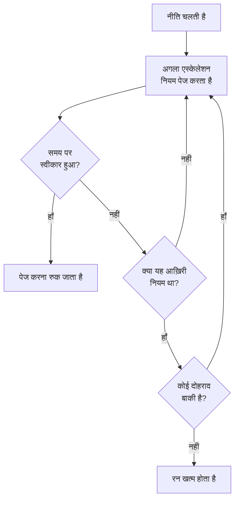

# ऑन-कॉल नीतियां

ऑन-कॉल नीति तय करती है कि किसी घटना या अलर्ट के लिए किसे पेज किया जाए, और अगर कोई स्वीकार न करे तो अगला कौन है। इसके एस्केलेशन नियम इसके स्तर हैं, और जो घटनाएं, अलर्ट और एपिसोड इसका इस्तेमाल करते हैं, वे इसे चलाते हैं। यह पेज बताता है कि नीति कैसे बनाएँ, उसे क्या चलाता है, उसके पेज क्या दिखाते हैं, और हर रन कैसे दर्ज होता है।

:::cards
- [नीति बनाएँ](#नीति-बनाएँ): एक नाम, और सबसे पहले किसे पेज किया जाए।
- [नीति को क्या चलाता है](#नीति-को-क्या-चलाता-है): नियम, टेम्पलेट, मॉनिटर, चैट और आप खुद।
- [निष्पादन लॉग](#निष्पादन-लॉग): हर रन, नियम-दर-नियम, और वह क्यों रुका।
- [नीति संग्रहित करें या हटाएँ](#नीति-संग्रहित-करें-या-हटाएँ): नीति को सेवा से बाहर करें।
:::

## नीति बनाएँ

:::steps
1. **ऑन-कॉल ड्यूटी → ऑन-कॉल नीतियां** पर जाएँ और **ऑन-कॉल नीति बनाएँ** पर क्लिक करें।
2. एक **नाम** दर्ज करें, जैसे "भुगतान प्राथमिक"।
3. **सबसे पहले किसे सूचित किया जाए?** के नीचे **प्रतिक्रियाकर्ता जोड़ें** पर क्लिक करें और सबसे पहले पेज किए जाने वाले ऑन-कॉल शेड्यूल, टीमें और लोग चुनें।
4. **ऑन-कॉल नीति बनाएँ** पर क्लिक करें। नीति अपने **एस्केलेशन नियम** पेज पर खुलती है, जहाँ **Level 1** पहले से मौजूद होता है।
:::

**सबसे पहले किसे सूचित किया जाए?** वैकल्पिक है, और केवल उन लोगों से पूछा जाता है जो एस्केलेशन नियम जोड़ सकते हैं: खाली छोड़ने पर नीति तब तक किसी को पेज नहीं करती जब तक उसमें कोई नियम न हो। **और फ़ील्ड** के नीचे **विवरण** और **लेबल** मिलते हैं। अगले स्तर जोड़ने के लिए देखें [एस्केलेशन नियम](/docs/on-call/escalation-rules)।

प्रोजेक्ट की पहली नीति के लिए फ़ॉर्म **हर नई घटना और अलर्ट पर इसे ट्रिगर करें** भी पूछता है, जो शुरू में चालू रहता है। यह **घटनाएं → नियम → ऑन-कॉल नियम** के नीचे एक नियम और **अलर्ट → नियम → ऑन-कॉल नियम** के नीचे एक नियम जोड़ता है, जिनमें से हर एक सब कुछ से मेल खाता है और यह नीति चलाता है। यह केवल उन लोगों से पूछा जाता है जो ऑन-कॉल नियम जोड़ सकते हैं, और तभी तक जब तक प्रोजेक्ट में न कोई ऑन-कॉल नीति हो, न कोई ऑन-कॉल नियम।

**ऑन-कॉल नीतियां** सूची हर नीति का **नाम**, **विवरण**, **लेबल** और **मालिक** दिखाती है। नीतियां चुनें और **लेबल जोड़ें**, **लेबल हटाएँ**, **स्वामी जोड़ें**, **स्वामी हटाएँ**, **संग्रहित करें** या **JSON निर्यात करें** इस्तेमाल करें, या उन्हें हटाएँ। **JSON आयात करें** किसी निर्यात से नीतियां बनाता है: निर्यात में नीति की अपनी सेटिंग्स होती हैं, उसके एस्केलेशन नियम या मालिक नहीं।

## नीति को क्या चलाता है

जब तक कोई चीज़ नीति को नहीं चलाती, तब तक वह किसी को पेज नहीं करती। हर घटना, अलर्ट और एपिसोड बनते ही अपनी नीतियां चलाता है:

| क्या | नीति कैसे जुड़ती है | और पढ़ें |
| --- | --- | --- |
| रिकॉर्ड खुद | घटना या अलर्ट बनाते समय **ऑन-कॉल नीति** फ़ील्ड, घटना टेम्पलेट, या मॉनिटर के मानदंड का **ऑन-कॉल** वाला मुड़ा हुआ हिस्सा | [घटना घोषित करना](/docs/incidents/declaring-incidents) |
| ऑन-कॉल नियम | **घटनाएं → नियम → ऑन-कॉल नियम** और **अलर्ट → नियम → ऑन-कॉल नियम** मेल खाने वाले हर नियम की नीतियां जोड़ते हैं | [घटना ऑन-कॉल नियम](/docs/incidents/settings#घटना-ऑन-कॉल-नियम) |
| समूहीकरण नियम | समूहीकरण नियम एपिसोड खोलते समय अपनी नीतियां चलाता है | [अलर्ट एपिसोड और समूहीकरण नियम](/docs/alerts/episodes) |
| हाथ से | **ऑन-कॉल नीति निष्पादित करें**, किसी फ़ीड के **क्रियाएँ** मेनू में, या Slack या Microsoft Teams संदेश पर | [घटना फ़ीड](/docs/incidents/notes-owners-and-feed#घटना-फ़ीड) |
| चैट और वर्कफ़्लो | Slack या Microsoft Teams में `/oneuptime page`, और वर्कफ़्लो का **Page an On-Call Policy** चरण | [Paging](/docs/workflows/components#paging) |

जिस नीति को कई नियम जोड़ते हैं, वह एक बार चलती है। कोई गंभीरता अपने-आप कभी नीति नहीं चलाती: उस गंभीरता से मेल खाने वाला ऑन-कॉल नियम चलाता है। जो घटना या अलर्ट पहले से स्वीकार या सुलझा हुआ बनाया जाता है, वह अपनी कोई भी नीति नहीं चलाता। **केवल कार्य समय में** पर सेट किया गया ऑन-कॉल नियम अपनी जोड़ी गई नीतियों से कार्य समय शुरू होने तक प्रतीक्षा कराता है।

## नीति के पेज

सूची से कोई नीति खोलें। उसके साइड मेनू में उसके बारे में सब कुछ है:

| सेक्शन | पेज |
| --- | --- |
| **बेसिक** | **अवलोकन**, **एस्केलेशन नियम** और **मालिक** |
| **लॉग** | **निष्पादन लॉग** और **सूचना लॉग** |
| **डेवलपर** | **Terraform**, **API** और **AI सहायक** |
| **उन्नत** | **उपयोगकर्ता ओवरराइड**, **कस्टम फ़ील्ड**, **सेटिंग्स**, **ऑडिट लॉग** और **नीति हटाएं** |

**बेसिक** खुला रहता है; बाकी सेक्शन तब तक बंद रहते हैं जब तक आप उन पर क्लिक नहीं करते।

- **अवलोकन** पहले **ऑन-कॉल नीति विवरण** दिखाता है, फिर **नीति एक नज़र में**: नीति में कितने स्तर और प्रतिक्रियाकर्ता हैं, आख़िरी स्तर तक कितना समय लगता है, और यह कितनी बार दोहराई जाती है। **प्रतिक्रियाकर्ता तैयारी** बताता है कि क्या यह जिन्हें पेज कर सकती है, उन सभी तक अभी पहुँचा जा सकता है, और **ऑन-कॉल नीति फ़ीड** बताती है कि क्या बदला: जोड़े या हटाए गए लोग, टीमें और शेड्यूल, ओवरराइड और हैंड-ऑफ़।
- **मालिक** वे लोग और टीमें हैं जो नीति के लिए ज़िम्मेदार हैं। जब इसका भेजा कोई पेज किसी के लिए कोई नियम नहीं पाता, या पहुँचाया नहीं जा सकता, तो उन्हें ईमेल जाता है; बिना मालिकों वाली नीति इसके बजाय प्रोजेक्ट के मालिकों को ईमेल करती है।
- **सूचना लॉग** नीति के भेजे हर संदेश को दिखाता है, हर चैनल के लिए एक टैब के साथ।
- **उपयोगकर्ता ओवरराइड** केवल इस नीति में लोगों को कवर करता है। देखें [उपयोगकर्ता ओवरराइड](/docs/on-call/user-overrides)।
- **सेटिंग्स** में **ऑन-कॉल नीति निर्यात करें** और नीति को संग्रहित करने वाला कार्ड है।

## नीति दोहराएँ

जब आख़िरी स्तर का इंतज़ार बिना किसी के स्वीकार किए खत्म हो जाता है, तो नीति रुक जाती है, जब तक वह दोहराई न जाए। चुनने के लिए, नीति का **एस्केलेशन नियम** पेज खोलें और नियमों के नीचे **दोहराव नीति** कार्ड पर **संपादित करें** पर क्लिक करें। **दोहराव नीति संपादित करें** पूछता है **अगर आखिरी स्तर के बाद भी कोई स्वीकार नहीं करता**:

| जवाब | यह क्या करता है |
| --- | --- |
| **सूचित करना बंद करें** | किसी को फिर से सूचित नहीं किया जाता, इसलिए नीति एक बार चलती है। नई नीति इसी जवाब से शुरू होती है। |
| **Level 1 से फिर शुरू करें** | हर स्तर को क्रम से फिर से सूचित किया जाता है। **और कितनी बार?** बताता है कितनी बार: 1 या उससे ज़्यादा। |

जो नीति तीन बार और फिर से शुरू होती है, वह कुल चार बार अपने स्तरों से गुज़रती है। कार्ड की **आखिरी स्तर के बाद** पंक्ति बताती है कि नीति क्या करती है, और **अवलोकन** पर **नीति एक नज़र में** यही बात शब्दों में बताता है।

## हल न होने पर फिर से सूचित करें

स्वीकार करने से नीति का सूचित करना हमेशा के लिए रुक जाता है, भले ही बाद में कोई घटना या अलर्ट को न सुलझाए। इसके बजाय नीति फिर से सूचित कर सकती है: नीति का **एस्केलेशन नियम** पेज खोलें, नीचे **और सेटिंग्स** खोलें, और **स्वीकृति के बाद टाइमआउट** कार्ड पर **संपादित करें** पर क्लिक करें। **स्वीकृति के बाद टाइमआउट संपादित करें** पूछता है **अगर स्वीकार किया गया है लेकिन सुलझाया नहीं गया**:

| जवाब | यह क्या करता है |
| --- | --- |
| **फिर से सूचित न करें** | स्वीकार करने से सूचित करना हमेशा के लिए बंद हो जाता है। नई नीति इसी जवाब से शुरू होती है। |
| **फिर से सूचित करें** | स्वीकार करने वाले को, और अभी ऑन-कॉल व्यक्ति को सूचित करता है। **कितने मिनट बाद?** बताता है कब: 5 से 1440 तक, शुरू में 30। |

मिनट हर स्वीकृति से गिने जाते हैं, और एक नीति एक ही घटना, अलर्ट या एपिसोड के लिए ज़्यादा से ज़्यादा 5 बार फिर से सूचित करती है। फिर से सूचना उसी स्तर से शुरू होती है जो स्वीकार किए जाने के समय सूचित कर रहा था, वहाँ अभी ऑन-कॉल व्यक्ति को सूचित करती है, और फिर पहले रन की तरह स्तरों से गुज़रती है। घटना या अलर्ट स्वीकार किया हुआ ही रहता है: फिर से सूचना अपना अलग रन है, उसकी फ़ीड और नीति के निष्पादन लॉग में, जहाँ उसकी **स्थिति** "फिर से सूचित किया गया (5 में से 1)" बताती है।

जिसे फिर से सूचित किया गया, वह उसे संदेश से, या घटना या अलर्ट के पेज पर **फिर से स्वीकार करें** से स्वीकार करता है, और मिनट फिर से शुरू होते हैं; **एस्केलेट करें** उसे अगले स्तर को सौंपता है। घटना या अलर्ट को सुलझाने या हटाने, नीति को संग्रहित करने या हटाने, या **फिर से सूचित न करें** चुनने से यह रुक जाता है। कार्ड की **स्वीकृति के बाद** पंक्ति बताती है कि नीति क्या करती है, और **और सेटिंग्स** मुड़ा होने पर भी मिनट दिखाता है। **अवलोकन** पर **नीति एक नज़र में** और **एस्केलेशन सारांश** यही बात शब्दों में बताते हैं।

## निष्पादन लॉग

हर बार जब नीति चलती है, वह एक निष्पादन लॉग लिखती है, और रन आगे बढ़ने के साथ लॉग अपनी स्थितियों से गुज़रता है:

| स्थिति | इसका मतलब |
| --- | --- |
| **प्रतीक्षारत** | **केवल कार्य समय में** पर सेट किया गया ऑन-कॉल नियम रन से कार्य समय शुरू होने तक प्रतीक्षा कराता है: यह बताता है कि बुलाना कब शुरू होगा, और तब तक किसी को नहीं बुलाता। अगर घटना या अलर्ट पहले ही स्वीकार या सुलझा लिया जाए तो यह बिना बुलाए खत्म हो जाता है। अगर घटना या अलर्ट बदल जाए और अब किसी ऐसे ऑन-कॉल नियम से मेल खाए जो तुरंत बुलाता है, तो यह उसी समय बुलाना शुरू कर देता है। |
| **निर्धारित**, **शुरू हुआ** | रन तैयार हो रहा है। 5 मिनट बाद भी यहीं रहने वाला रन **त्रुटि** के रूप में रोक दिया जाता है। |
| **Executing** | रन पेज कर रहा है। OneUptime इसे हर मिनट आगे बढ़ाता है। |
| **Execution Completed** | किसी ने स्वीकार किया, घटना या अलर्ट सुलझ गया, हर नियम और दोहराव इस्तेमाल हो गया, या नीति संग्रहित कर दी गई। |
| **Execution Completed - No One Notified** | रन हर नियम से गुज़रा और किसी को पेज नहीं किया: आमतौर पर ऐसा शेड्यूल जिसमें कोई ऑन-कॉल नहीं है। |
| **त्रुटि** | रन विफल रहा। **स्थिति संदेश देखें** बताता है क्यों। |

आप निष्पादन लॉग तीन जगह पाते हैं:

- नीति के अपने **निष्पादन लॉग** में, **लॉग** के अंतर्गत;
- **ऑन-कॉल ड्यूटी → उन्नत → निष्पादन लॉग** में, हर नीति के लिए, जहाँ वर्कफ़्लो और चैट से आए सीधे पेज **सीधा बुलावा** के रूप में दिखते हैं;
- किसी घटना या अलर्ट के **ऑन-कॉल निष्पादन** पेज पर।

हर पंक्ति दिखाती है कि रन किसने शुरू किया, कब, उसकी **स्थिति** और किसने उसे स्वीकार किया। **टाइमलाइन देखें** उसकी **निष्पादन समयरेखा** खोलता है: हर एस्केलेशन नियम, उसने किसे पेज किया, किस शेड्यूल के ज़रिए, और हर पेज कैसे खत्म हुआ। जिस शेड्यूल में कोई ऑन-कॉल नहीं है, वह किसी व्यक्ति के बजाय **कोई ऑन-कॉल नहीं था** दिखाता है। OneUptime Cloud पर निष्पादन लॉग के लिए **Growth** प्लान चाहिए।

## नीति संग्रहित करें या हटाएँ

संग्रहित करना नीति को सेवा से बाहर कर देता है और सब कुछ रखता है: नीति की **सेटिंग्स** खोलें और उसके संग्रह कार्ड पर **संग्रहित करें** पर क्लिक करें, या सूची में नीतियां चुनें और **संग्रहित करें** चुनें।

- संग्रहित नीति किसी को पेज नहीं करती। जो घटनाएं और अलर्ट इसका इस्तेमाल करते हैं, वे इसे छोड़ देते हैं, और जो रन अभी एस्केलेट हो रहा है, वह अपने अगले चरण पर रुक जाता है।
- यह **ऑन-कॉल नीतियां** सूची से निकलकर **ऑन-कॉल ड्यूटी → उन्नत → संग्रहीत नीतियां** में चली जाती है, जहाँ **अनसंग्रहीत करें** इसे फिर से सेवा में लाता है।

**उन्नत** के अंतर्गत **नीति हटाएं** नीति को उसके एस्केलेशन नियमों और उपयोगकर्ता ओवरराइड के साथ हटा देता है। सूची से हटाना पहले पूछता है, और इसके बजाय संग्रहित करने का सुझाव देता है।

## नीति कौन बदल सकता है

**प्रोजेक्ट स्वामी**, **प्रोजेक्ट एडमिन**, **प्रोजेक्ट सदस्य**, **ऑन-कॉल एडमिन** और **ऑन-कॉल सदस्य** नीतियां बना, बदल और हटा सकते हैं; **दर्शक** और **ऑन-कॉल दर्शक** उन्हें पढ़ सकते हैं। कस्टम भूमिका में अनुमतियों के नाम **Create On-Call Duty Policy**, **Edit On-Call Duty Policy**, **Delete On-Call Duty Policy** और **Read On-Call Duty Policy** हैं, और कुछ लेबल तक सीमित भूमिका केवल उन्हीं लेबल वाली नीतियों तक पहुँचती है। OneUptime Cloud पर मालिक और कस्टम फ़ील्ड जोड़ने के लिए **Growth** प्लान चाहिए।

## API और Terraform

ऑन-कॉल नीतियां `/api/on-call-duty-policy` संसाधन हैं, और Terraform में `oneuptime_on_call_policy` संसाधन:

| सेटिंग | API फ़ील्ड |
| --- | --- |
| **नाम** | `name` |
| **विवरण** | `description` |
| **अगर आखिरी स्तर के बाद भी कोई स्वीकार नहीं करता** | `repeatPolicyIfNoOneAcknowledges` |
| **और कितनी बार?** | `repeatPolicyIfNoOneAcknowledgesNoOfTimes` |
| **कितने मिनट बाद?** | `acknowledgementTimeoutInMinutes` |
| संग्रहित | `isArchived` |

`repeatPolicyIfNoOneAcknowledges` **सूचित करना बंद करें** के लिए `false` और **Level 1 से फिर शुरू करें** के लिए `true` है। `true` होने पर `repeatPolicyIfNoOneAcknowledgesNoOfTimes` 1 या उससे बड़ी पूर्ण संख्या होनी चाहिए: OneUptime `0` को अस्वीकार करता है। `0` के साथ सहेजी गई कोई पुरानी नीति कभी नहीं दोहराई जाती, और डैशबोर्ड उसे **सूचित करना बंद करें** दिखाता है।

`acknowledgementTimeoutInMinutes` **फिर से सूचित न करें** के लिए `null` है, और **फिर से सूचित करें** के लिए 5 से 1440 तक मिनटों की पूरी संख्या। OneUptime इसके अलावा कुछ भी अस्वीकार करता है।

एक ही अनुरोध में पहले स्तर के साथ नीति बनाने के लिए देखें [API या Terraform से नियम बनाना](/docs/on-call/escalation-rules#api-या-terraform-से-नियम-बनाना)।

## समस्या निवारण

:::details नीति चली, लेकिन किसी को पेज नहीं किया गया
उसका रन **Execution Completed - No One Notified** दिखाता है। **टाइमलाइन देखें** खोलें: **कोई ऑन-कॉल नहीं था** वाली पंक्ति ऐसे शेड्यूल की ओर इशारा करती है जिसमें खाली जगह है, और **छोड़ा गया** पंक्ति का स्थिति संदेश बताता है क्यों, जैसे कोई अनुपस्थित था और उसे कवर करने वाला कोई नहीं था। **ऑन-कॉल ड्यूटी → तैयारी** दिखाता है कि किस तक नहीं पहुँचा जा सका।
:::

:::details अगला स्तर अपने इंतज़ार के एक मिनट बाद पेज किया गया
OneUptime चल रही नीतियों को मिनट में एक बार आगे बढ़ाता है, इसलिए कोई स्तर अपना इंतज़ार खत्म होने के बाद की पहली जाँच पर पेज किया जाता है।
:::

:::details किसी घटना में ऐसी नीति दिखती है जिसने किसी को पेज नहीं किया
नीति संग्रहित है: संग्रहित नीति उन घटनाओं और अलर्ट पर बनी रहती है जो इसका इस्तेमाल करते हैं, किसी को पेज नहीं करती, और उसका निष्पादन लॉग बताता है कि वह निष्पादित नहीं हुई। इसे **ऑन-कॉल ड्यूटी → उन्नत → संग्रहीत नीतियां** में अनसंग्रहीत करें।
:::

## अगले कदम

:::cards
- [एस्केलेशन नियम](/docs/on-call/escalation-rules): वे स्तर जोड़ें जिन्हें नीति पेज करती है, और हर स्तर कितनी देर इंतज़ार करता है।
- [उपयोगकर्ता ओवरराइड](/docs/on-call/user-overrides): किसी के अनुपस्थित रहने पर उसके पेज किसी सहकर्मी को भेजें।
- [तैयारी और रिपोर्ट](/docs/on-call/readiness): जाँचें कि नीति जिन्हें पेज करती है, उन सभी तक पहुँचा जा सकता है।
:::
