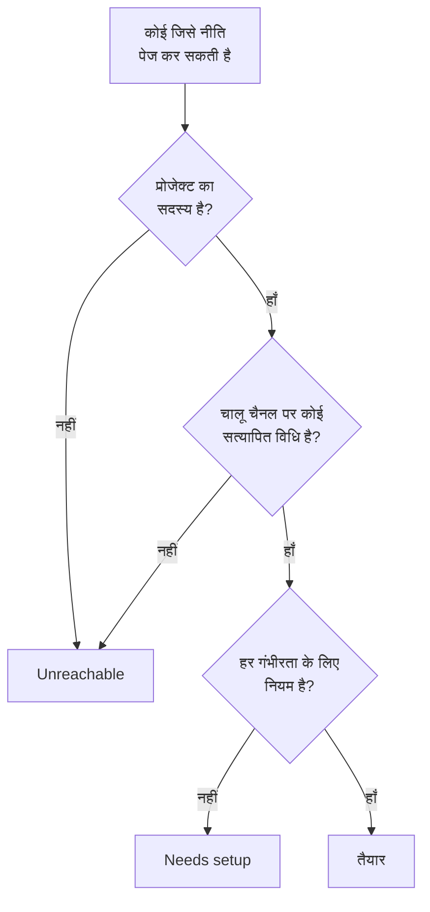

# तैयारी और रिपोर्ट

तैयारी किसी घटना से पहले एक सवाल का जवाब देती है: अगर अभी कुछ ट्रिगर हो, तो क्या आपकी ऑन-कॉल नीतियां जिन्हें पेज करती हैं, उन सभी तक सच में पहुँचा जा सकेगा? यह प्रोजेक्ट के हर प्रतिक्रियाकर्ता को सूचीबद्ध करती है, बताती है कि कौन तैयार है और कौन नहीं, और आपको लोगों को उनका सेटअप पूरा करने की याद दिलाने देती है। फिर **उपयोगकर्ता ऑन कॉल समय** रिपोर्ट दिखाती है कि हर व्यक्ति कितनी देर ऑन-कॉल रहा।

:::cards
- [स्थिति कैसे तय होती है](#स्थिति-कैसे-तय-होती-है): तैयार, Needs setup या Unreachable, और क्यों।
- [तैयारी पेज](#तैयारी-पेज): प्रोजेक्ट का हर प्रतिक्रियाकर्ता, एक सूची में।
- [लोगों को सेटअप पूरा करने की याद दिलाएँ](#लोगों-को-सेटअप-पूरा-करने-की-याद-दिलाएँ): एक ईमेल जो बताता है कि क्या कमी है।
- [उपयोगकर्ता ऑन कॉल समय](#उपयोगकर्ता-ऑन-कॉल-समय): हर व्यक्ति कितनी देर ऑन-कॉल रहा।
:::

## स्थिति कैसे तय होती है

प्रतिक्रियाकर्ता वह कोई भी है जिसे ऑन-कॉल नीति पेज कर सकती है: एस्केलेशन नियम में नामित व्यक्ति, उस टीम का सदस्य जिसे कोई नियम पेज करता है, उस शेड्यूल की किसी परत में मौजूद व्यक्ति जिसे कोई नियम पेज करता है, और ऐसे उपयोगकर्ता ओवरराइड में कवर करने वाला व्यक्ति जो अभी खत्म नहीं हुआ। जिस शेड्यूल को कोई नीति पेज नहीं करती, वह किसी को नहीं जोड़ता।

| स्थिति | इसका मतलब |
| --- | --- |
| **तैयार** | उसके पास ऐसे चैनल पर सत्यापित विधि है जिसे प्रोजेक्ट ने चालू रखा है, और उसके ऑन-कॉल नियमों के हर टैब पर हर गंभीरता के लिए एक नियम है। |
| **सेटअप ज़रूरी** | उस तक पहुँचा जा सकता है, लेकिन कुछ गंभीरताओं के लिए कोई नियम नहीं है। पंक्ति इन कमियों को गिनती है। |
| **पहुँच से बाहर** | उस तक कुछ नहीं पहुँचता: कोई सत्यापित विधि नहीं, हर सत्यापित विधि ऐसे चैनल पर है जिसे प्रोजेक्ट ने बंद कर दिया है, या वह प्रोजेक्ट का सदस्य नहीं है। |

कमी वह गंभीरता है जिसके लिए घटनाओं, घटना एपिसोड, अलर्ट या अलर्ट एपिसोड टैब पर कोई नियम नहीं है। जो नियम जान-बूझकर किसी गंभीरता को बंद करता है, वह कमी नहीं है। कमी से टकराने वाला पेज भी व्यक्ति तक उसकी सत्यापित विधियों पर पहुँचता है, जब तक प्रोजेक्ट ने वह फ़ॉलबैक बंद न किया हो: देखें [जब कोई नियम मेल नहीं खाता](/docs/notifications/index#जब-कोई-नियम-मेल-नहीं-खाता)।

## तैयारी पेज

**ऑन-कॉल ड्यूटी → तैयारी** खोलें। **On-call readiness** कार्ड हर उस व्यक्ति को सूचीबद्ध करता है जिस तक प्रोजेक्ट की कोई भी ऑन-कॉल नीति पहुँच सकती है, जिन्हें पहले कुछ चाहिए वे सबसे ऊपर। प्रोजेक्ट में कोई भी इसे खोल सकता है।

सूची के ऊपर टाइलें **प्रतिक्रियाकर्ता**, **तैयार**, **सेटअप ज़रूरी** और **पहुँच से बाहर** गिनती हैं। केवल उन प्रतिक्रियाकर्ताओं को दिखाने के लिए **तैयार**, **सेटअप ज़रूरी** या **पहुँच से बाहर** पर क्लिक करें, और सभी को दिखाने के लिए फिर से क्लिक करें।

| कॉलम | यह क्या दिखाता है |
| --- | --- |
| **प्रतिक्रियाकर्ता** | व्यक्ति, उसके ईमेल पते के साथ। |
| **स्थिति** | **तैयार**, **पहुँच से बाहर**, या उसकी कितनी कमियां हैं। |
| **टीमें** | वे टीमें जो उसे एस्केलेशन नियम के ज़रिए पेज करती हैं। |
| **चैनल** | हर चैनल के लिए एक खंड: सत्यापित विधि के लिए भरा हुआ, जो अभी सत्यापित नहीं है उसके लिए खाली। |
| **Coverage** | सभी गंभीरताओं में से कितनी के लिए हर टैब पर नियम है। |
| **Reached via** | नीतियां उस तक कैसे पहुँचती हैं: `Direct`, `Team`, `Schedule` या `Override`। |

किसी पंक्ति पर **Coverage** व्यक्ति की सूचना विधियां, उसकी स्थिति की वजह, और नियम वाली या बिना नियम वाली हर गंभीरता का ग्रिड दिखाता है। फ़नल सूची को **प्रतिक्रियाकर्ता**, **स्थिति**, **टीम** या **Reached via** से फ़िल्टर करता है। जवाब एक मिनट पुराना हो सकता है: **रिफ्रेश** इसे फिर से तय करता है।

## लोगों को सेटअप पूरा करने की याद दिलाएँ

अपनी सूचना विधियां और नियम केवल वही व्यक्ति जोड़ और सत्यापित कर सकता है, इसलिए हल यही है कि उससे कहा जाए।

:::steps
1. तैयारी पेज पर उन प्रतिक्रियाकर्ताओं को चुनें जिन्हें याद दिलाना है। तैयार प्रतिक्रियाकर्ताओं को चुना नहीं जा सकता: उन्हें याद दिलाने के लिए कुछ नहीं है।
2. **सेटअप रिमाइंडर भेजें** पर क्लिक करें। पुष्टि उन सभी के नाम बताती है जिन्हें ईमेल भेजा जाने वाला है।
3. पुष्टि करें। हर व्यक्ति को एक ईमेल मिलता है जो बताता है कि उसके अपने सेटअप में क्या कमी है, उस पेज के लिंक के साथ जहाँ इसे ठीक किया जाता है।
:::

इसके बाद एक बैनर बताता है कि कितने रिमाइंडर भेजे गए, छोड़े गए या विफल रहे, और जो नहीं भेजे गए उनमें से हर एक की वजह। किसी को 24 घंटे में एक से ज़्यादा बार याद नहीं दिलाया जाता, और एक बार में अधिकतम 250 लोगों को याद दिलाया जाता है। रिमाइंडर भेजने के लिए **प्रोजेक्ट स्वामी**, **प्रोजेक्ट एडमिन** या **ऑन-कॉल एडमिन**, या कस्टम भूमिका में **Edit On-Call Duty Policy** चाहिए।

## दूसरे पेजों पर तैयारी

- किसी नीति के **अवलोकन** पर, **प्रतिक्रियाकर्ता तैयारी** उन सभी को सूचीबद्ध करता है जिन्हें वह नीति पेज कर सकती है और जिन पर ध्यान देने की ज़रूरत है, और **फिर से जाँचें** इसे फिर से पढ़ता है। आपकी अपनी पंक्ति में उस पेज का बटन है जो इसे ठीक करता है; किसी और की पंक्ति आपके अपने मेल ऐप में उसके लिए एक ईमेल खोलती है, जिसमें समाधान लिखा होता है।
- किसी नीति के **एस्केलेशन नियम** पर, जिस स्तर के सभी प्रतिक्रियाकर्ताओं को पेज नहीं किया जा सकता, वह अपने कार्ड पर यह बताता है। देखें [एस्केलेशन सारांश](/docs/on-call/escalation-rules#एस्केलेशन-सारांश)।
- **उपयोगकर्ता** के अंतर्गत किसी सदस्य को खोलें, फिर **ऑन-कॉल** सेक्शन में **तैयारी**: उसकी स्थिति, उसकी विधियां और उसका गंभीरता ग्रिड।
- अपने सेटअप के लिए, **उपयोगकर्ता सेटिंग्स → सेटअप चेकलिस्ट** आपको इसमें आगे बढ़ाती है। देखें [सेटअप चेकलिस्ट](/docs/notifications/index#सेटअप-चेकलिस्ट)।

## तैयारी का साप्ताहिक ईमेल

हफ़्ते में एक बार, OneUptime हर उस प्रोजेक्ट की जाँच करता है जिसमें कोई ऑन-कॉल नीति है। जब उसमें कोई **पहुँच से बाहर** या **सेटअप ज़रूरी** होता है, तो प्रोजेक्ट के मालिकों को एक ईमेल मिलता है जो उन्हें दो समूहों में सूचीबद्ध करता है, जिन्हें बिल्कुल पेज नहीं किया जा सकता और जिन तक कमियों के साथ पहुँचा जा सकता है, हर समूह में अधिकतम 20 नाम, तैयारी पेज के लिंक के साथ।

जिस हफ़्ते सभी तैयार हों, उसमें कुछ नहीं भेजा जाता, इसलिए इस ईमेल का मतलब हमेशा यही होता है कि कुछ ठीक करना है। जब किसी को बिल्कुल पेज नहीं किया जा सकता, तो इसका विषय `[Action Required]` से शुरू होता है।

## उपयोगकर्ता ऑन कॉल समय

**ऑन-कॉल ड्यूटी → रिपोर्ट → उपयोगकर्ता ऑन कॉल समय** दिखाता है कि आपकी चुनी हुई अवधि में हर व्यक्ति कितनी देर ऑन-कॉल रहा: शुरुआत में **पिछला 1 महीना**।

| कॉलम | यह क्या दिखाता है |
| --- | --- |
| **उपयोगकर्ता** | व्यक्ति। |
| **उपयोगकर्ता ऑन-कॉल पर था वह समय** | अवधि में उसका ऑन-कॉल समय, घंटों और मिनटों में। |

समय तब दर्ज होता है जब लोग ऑन-कॉल पर आते और जाते हैं: जब किसी नियम द्वारा पेज किया जाने वाला शेड्यूल उन्हें बारी देता है, या उन्हें सीधे या किसी टीम के ज़रिए किसी नियम में जोड़ा जाता है, तब से लेकर हैंड-ऑफ़ तक या उन्हें हटाए जाने तक। एक साथ दो नीतियों के ज़रिए ऑन-कॉल रहने का समय एक बार गिना जाता है, और अभी चल रहा समय अभी तक गिना जाता है।

**शेड्यूल टाइमलाइन** और कैलेंडर फ़ीड पिछली शिफ्टें उसी तरह दिखाते हैं जैसा रोटेशन आज सेट है। यह रिपोर्ट घटनाओं के साथ-साथ लिखी जाती है, इसलिए इसे निष्पक्षता की समीक्षा और ऑन-कॉल भुगतान के लिए इस्तेमाल करें।

> [!NOTE]
> OneUptime Cloud पर इस रिपोर्ट के लिए **Growth** प्लान चाहिए, और 200 दिन से पहले खत्म हुआ समय हटा दिया जाता है। सेल्फ़-होस्टेड इंस्टॉलेशन यह सब रखता है।

## समस्या निवारण

:::details किसी तक पहुँचा नहीं जा सकता, लेकिन उसके पास सत्यापित फ़ोन नंबर है
हो सकता है उसकी सभी विधियां ऐसे चैनलों पर हों जिन्हें प्रोजेक्ट ने बंद कर दिया है: नए प्रोजेक्ट में SMS, कॉल, WhatsApp और Telegram बंद रहते हैं। देखें [अपने प्रोजेक्ट के लिए चैनल चालू करें](/docs/notifications/notification-methods#अपने-प्रोजेक्ट-के-लिए-चैनल-चालू-करें)।
:::

:::details कोई सूची से गायब है
सूची में केवल वे लोग होते हैं जिन्हें कोई ऑन-कॉल नीति पेज कर सकती है। जिस टीम सदस्य ने अपना निमंत्रण स्वीकार नहीं किया, जो व्यक्ति ऐसे शेड्यूल में है जिसे कोई नीति पेज नहीं करती, और वह कवर करने वाला जिसका ओवरराइड खत्म हो चुका है, ये सूची में नहीं होते।
:::

:::details मालिकों को साप्ताहिक ईमेल कभी नहीं मिलता
यह केवल उस हफ़्ते भेजा जाता है जब कोई **पहुँच से बाहर** या **सेटअप ज़रूरी** हो, और केवल प्रोजेक्ट के मालिकों को।
:::

## अगले कदम

:::cards
- [OneUptime आप तक कैसे पहुँचता है](/docs/notifications/index): हर स्थिति के पीछे की विधियां, नियम और फ़ॉलबैक।
- [सूचना विधियां](/docs/notifications/notification-methods): वे तरीके जोड़ें और सत्यापित करें जिनसे OneUptime किसी तक पहुँचता है।
- [व्यक्तिगत ऑन-कॉल नियम](/docs/notifications/on-call-rules): गंभीरता-दर-गंभीरता कमियां दूर करें।
:::
