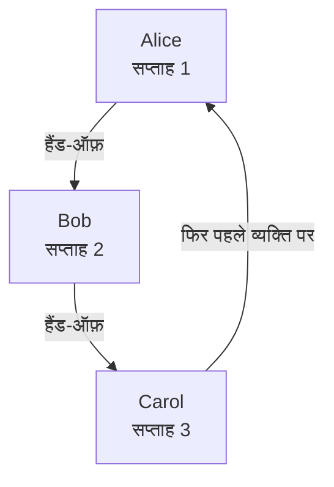
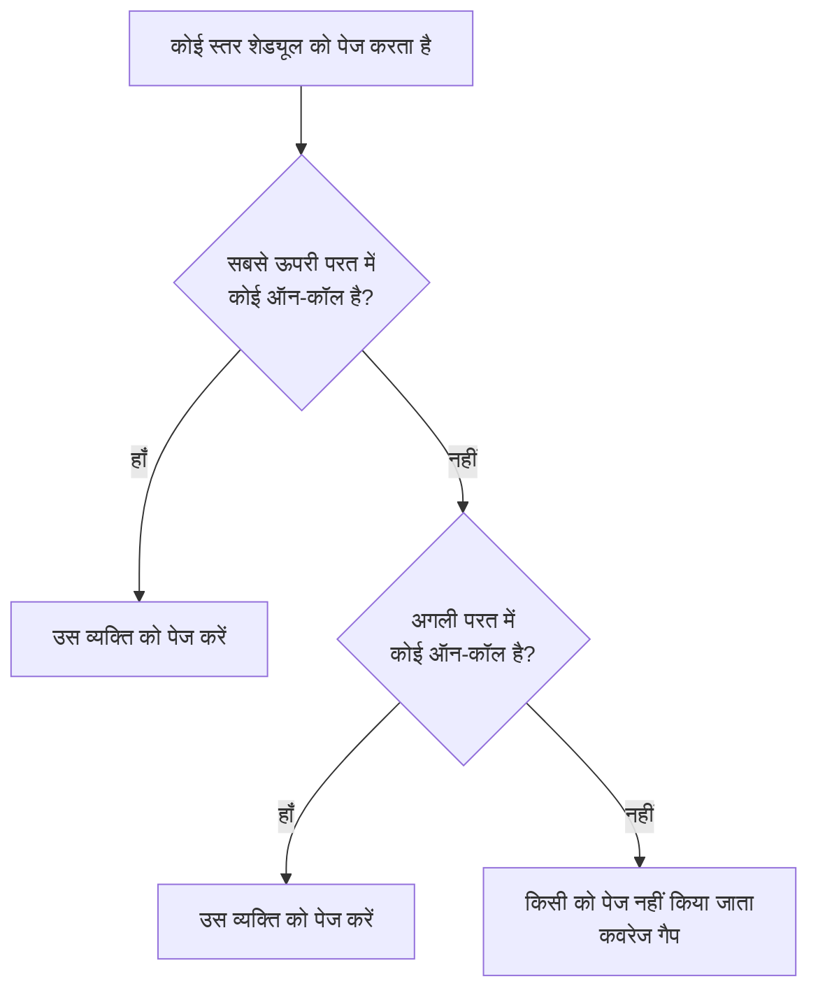

# ऑन-कॉल अनुसूची

ऑन-कॉल शेड्यूल तय करता है कि किसी भी पल कौन ऑन-कॉल है। लोग इसमें बारी-बारी से रहते हैं: हर व्यक्ति कुछ समय ऑन-कॉल रहता है, फिर अगला व्यक्ति संभाल लेता है। किसी ऑन-कॉल नीति के एस्केलेशन नियमों में शेड्यूल जोड़ें, और जब वह स्तर चलता है तो नीति उसमें ऑन-कॉल व्यक्ति को पेज करती है।

> [!NOTE]
> OneUptime Cloud पर ऑन-कॉल शेड्यूल **Growth** और उससे ऊपर के प्लान में हैं। Growth ट्रायल ख़त्म होने या प्लान घटने के बाद भी, किसी प्रोजेक्ट में बचा हुआ शेड्यूल, उसका नाम लेने वाले एस्केलेशन नियमों के ज़रिए अपने लोगों को पेज करता रहता है। इसलिए **Growth** से नीचे, **ऑन-कॉल अनुसूची** पेज प्लान का नोट दिखाता है और उसके नीचे अब भी सेट शेड्यूल, जहाँ आप उन्हें हटा सकते हैं। शेड्यूल बनाने या बदलने के लिए **Growth** चाहिए।

:::cards
- [कौन बारी-बारी से रहता है](#कौन-बारी-बारी-से-रहता-है): पहले रोटेशन के साथ एक शेड्यूल बनाएँ।
- [परतें](#परतें): रोटेशन एक के ऊपर एक रखें, ऑन-कॉल घंटे सीमित करें और बैकअप कवर जोड़ें।
- [जब कोई अनुपस्थित हो](#जब-कोई-अनुपस्थित-हो): किसी को उसके लौटने तक रोटेशन में छोड़ें।
- [API और Terraform](#api-या-terraform-से-शेड्यूल-बनाना): शेड्यूल और उनके रोटेशन कोड के रूप में बनाएँ।
:::

## कौन बारी-बारी से रहता है

जब आप **ऑन-कॉल अनुसूची** पेज पर शेड्यूल बनाते हैं, तो फ़ॉर्म उसका **नाम** और **बारी-बारी से कौन ऑन-कॉल रहेगा?** पूछता है। आप जिन लोगों को चुनते हैं, वे शेड्यूल की पहली परत, **Layer 1**, बन जाते हैं, जो चौबीसों घंटे ऑन-कॉल रहती है।

:::steps
1. **ऑन-कॉल** > **ऑन-कॉल अनुसूची** पर जाएँ और **ऑन-कॉल अनुसूची बनाएं** पर क्लिक करें।
2. एक **नाम** दर्ज करें। प्रोजेक्ट के किसी दूसरे शेड्यूल का नाम, अक्षरों के छोटे-बड़े होने या स्पेस की परवाह किए बिना, अस्वीकार कर दिया जाता है, ताकि हर चयनकर्ता में शेड्यूल अलग-अलग पहचाने जा सकें।
3. **बारी-बारी से कौन ऑन-कॉल रहेगा?** के नीचे **उपयोगकर्ता जोड़ें** पर क्लिक करें और लोगों को उसी क्रम में चुनें जिसमें वे बारी लेते हैं।
4. चाहें तो **और फ़ील्ड** खोलकर हर बारी की अवधि, टाइमज़ोन, विवरण या लेबल बदलें।
5. **ऑन-कॉल अनुसूची बनाएं** पर क्लिक करें। नया शेड्यूल फिर अपने **परतें** पेज पर खुलता है, जहाँ आप रोटेशन बदल सकते हैं या और परतें जोड़ सकते हैं।
:::

लोग एक-एक करके बारी लेते हैं, और शेड्यूल बनते ही पहला व्यक्ति ऑन-कॉल हो जाता है:



**बारी-बारी से कौन ऑन-कॉल रहेगा?** वैकल्पिक है। इसे खाली छोड़ने पर शेड्यूल बिना परतों के शुरू होता है: जब तक आप उसके **परतें** पेज पर कोई परत नहीं जोड़ते, यह किसी को ऑन-कॉल नहीं रखता। यह सवाल केवल उन लोगों से पूछा जाता है जो परतें जोड़ सकते हैं।

बाकी सब कुछ **और फ़ील्ड** के नीचे रहता है, जो खोलने तक सिमटा रहता है:

| फ़ील्ड | यह क्या करता है |
| --- | --- |
| **हर बारी की अवधि** | **1 दिन**, **1 सप्ताह**, **2 सप्ताह** या **1 महीना**, और अगर आप न बदलें तो **1 सप्ताह**। यह तब पूछा जाता है जब कोई बारी लेता है। हर व्यक्ति इतनी देर ऑन-कॉल रहता है, फिर दिन के उसी समय अगला व्यक्ति संभालता है जिस समय शेड्यूल बना था। |
| **टाइमज़ोन** | वह टाइमज़ोन जिसमें हैंड-ऑफ़ के समय और ऑन-कॉल घंटे रखे जाते हैं। यह आपके टाइमज़ोन से शुरू होता है। बाद में इसे बदलने पर हर समय वैसा ही रहता है जैसा लिखा है: 09:00 का हैंड-ऑफ़ 09:00 पर ही रहता है, और सोमवार की अवधि सोमवार को ही रहती है। हर टाइमज़ोन अपने क्षेत्र के मौजूदा नियमों का पालन करता है: America/Vancouver (ब्रिटिश कोलंबिया) 2026 से पूरे साल UTC-7 पर रहता है। |
| **विवरण** | शेड्यूल के बारे में नोट्स। |
| **लेबल** | शेड्यूल खोजने और समूहित करने के लिए लेबल। |

जब तक कोई बारी लेता है और **और फ़ील्ड** के नीचे कुछ नहीं बदला गया, उसका सिमटा हुआ शीर्षक बताता है कि क्या होगा: हर व्यक्ति एक सप्ताह ऑन-कॉल रहता है, फिर अगला व्यक्ति संभालता है।

जिसे प्रोजेक्ट में आमंत्रित किया गया है और जो अभी उसमें शामिल नहीं हुआ, वह भी बारी ले सकता है, लेकिन जब तक वह अपना निमंत्रण स्वीकार नहीं करता, कुछ भी उसे पेज नहीं करता, और उसे कुछ नहीं बताया जाता। उसकी बारी एक कवरेज गैप है, और शेड्यूल को पेज करने वाली हर ऑन-कॉल नीति के चैनल और फ़ीड यही बताते हैं, उसे निमंत्रण के साथ लिखे गए नाम से बताते हुए, कभी उसके ईमेल पते से नहीं: "⚠️ Nobody is paged for Payments through schedule Primary until tomorrow at 5:50 PM, when @bob takes over: Ivy is on call but hasn't joined the project yet." Slack में `/oneuptime oncall` और Microsoft Teams में `oncall` भी यही बताते हैं। शामिल होते ही पेज उस तक पहुँचते हैं, उसे बताया जाता है कि अब कौन-सी ऑन-कॉल नीतियां उसे पेज करती हैं, और चैनलों में आता है "📞 Ivy has joined the project and is now on call for Payments until tomorrow at 5:50 PM, then @bob." तब तक [तैयारी और रिपोर्ट](/docs/on-call/readiness) उसे सूची में दिखाता है, साथ में यह कि क्या करना है।

## परतें

शेड्यूल का रोटेशन उसके **परतें** पेज पर परतों से बना होता है। परतें ऊपर से नीचे पढ़ी जाती हैं: जिस सबसे ऊपरी परत में कोई ऑन-कॉल है, वही पेज करती है, इसलिए मुख्य रोटेशन सबसे ऊपर रखें और बैकअप कवर उसके नीचे।



**परत जोड़ें** ऐसी परत जोड़ता है जो पहली परत की तरह शुरू होती है: अभी से ऑन-कॉल, हर व्यक्ति एक सप्ताह, चौबीसों घंटे। किसी परत में लोग जोड़ने के लिए, और यह बदलने के लिए कि वह कब शुरू होती है, कितनी बार हैंड-ऑफ़ करती है, पहला हैंड-ऑफ़ कब करती है और किन घंटों में ऑन-कॉल रहती है, उसे फैलाएँ:

| फ़ील्ड | यह क्या तय करता है |
| --- | --- |
| **लेयर का नाम** | परत क्या कवर करती है, जैसे "कार्यदिवस प्राथमिक"। |
| **रोटेशन यहाँ से शुरू होता है** | वह तारीख़ और समय जब परत का रोटेशन शुरू होता है। |
| **हर इतने समय में बदलें** | ऑन-कॉल ड्यूटी कितनी बार परत के अगले व्यक्ति के पास जाती है। |
| **पहले हैंड-ऑफ़ का समय** | अगले व्यक्ति को पहला हैंड-ऑफ़, शुरुआत पर या उसके बाद। बाद के हैंड-ऑफ़ हर रोटेशन अंतराल पर होते हैं। |
| **प्रतिबंध** | वे घंटे जिनमें परत ऑन-कॉल रहती है (**सक्रिय घंटे**): शेड्यूल के टाइमज़ोन में **कोई प्रतिबंध नहीं**, **दिन के विशिष्ट समय** या **सप्ताह के विशिष्ट समय**। इनके बाहर नीचे की परतें संभालती हैं। |

**सप्ताह के विशिष्ट समय** की अवधि **से:** के नीचे दिए दिन और समय से **तक:** के नीचे दिए दिन और समय तक चलती है, और वह जो दिन दिखाती है, उन्हीं दिनों में वह ऑन-कॉल रहती है। जिस अवधि के समय उन दिनों से अलग दिनों पर पड़ते हैं जिनके साथ वह सहेजी गई थी, जैसे API से लिखी गई ऐसी अवधि जिसके समयों की तारीख़ें दूसरे दिनों की हों, या शेड्यूल का टाइमज़ोन बदलने से पहले सहेजी गई अवधि, उस पर उसकी परत में **जाँचने के लिए सक्रिय घंटे** का निशान लगता है, और उसके नीचे लिखा होता है कि वह किन दिनों के रूप में सहेजी गई थी। वह दिखाए गए दिनों में ऑन-कॉल रहती है, और **लेयर सहेजें** उसे वहीं रखता है: सहेजने से पहले अपने मनचाहे दिन चुनें।

सक्रिय घंटों में हर अवधि अपनी अलग शिफ्ट होती है। 17:00 से 07:00 एक शिफ्ट है, जो अगली सुबह 07:00 बजे ख़त्म होती है: **शेड्यूल टाइमलाइन** में, ईमेल में, मोबाइल ऐप में और Slack और Microsoft Teams में एक जैसी, शेड्यूल के टाइमज़ोन में और उन रातों में भी जब घड़ियाँ बदलती हैं। किसी व्यक्ति की बारी अगले हैंड-ऑफ़ तक उसकी सभी अवधियाँ है, और उसे हर ओर से एक बार बताया जाता है: "You are now on-call" जब उसकी बारी की पहली अवधि शुरू होती है, इस अवधि और उसकी बारी के ख़त्म होने के समय के साथ, और "You are no longer on-call" जब आख़िरी अवधि ख़त्म होती है, हर अवधि पर नहीं। हर अवधि से पहले याद दिलाने के लिए **शिफ्ट से पहले मुझे याद दिलाएँ** पर समय चुनें, जैसा [कैलेंडर फ़ीड](/docs/on-call/calendar-feeds#रिमाइंडर-और-फिर-से-सौंपने-की-सूचनाएँ) बताता है। जब उसकी दो अवधियों के बीच कोई और ऑन-कॉल हो, किसी ओवरराइड या नीचे की परत से, या परतों में कोई बदलाव अगली अवधि किसी और को दे दे, तो वह हैंड-ऑफ़ है और वैसे ही बताया जाता है। उसका ऑन-कॉल समय अब भी अवधि-दर-अवधि दर्ज होता है, और ऑन-कॉल नीति के चैनल और फ़ीड अब भी हर बार बताते हैं कि कौन ऑन-कॉल है।

कौन-सी परत पहले आए, यह बदलने के लिए परत के कार्ड पर बने तीरों का इस्तेमाल करें: **लेयर ऊपर ले जाएँ (ऊँची प्राथमिकता)** या **लेयर नीचे ले जाएँ (नीची प्राथमिकता)**।

कौन बारी-बारी से ऑन-कॉल रहेगा, इसमें किए बदलाव तब तक रुके रहते हैं जब तक आप उन्हें सहेजते नहीं, ताकि आप कई बदलाव करके उन्हें जाँच सकें, इससे पहले कि किसी की बारी खिसके। लोगों को नए क्रम में खींचें, लोग जोड़ें या हटाएँ, किसी परत को ऊपर या नीचे ले जाएँ या हटाएँ, और पेज हर बदलाव को सहेजे जाने से पहले दिखाता है:

- जिसे आपने जोड़ा उस पर **नया** और जिसे नई जगह खींचा उस पर **जगह बदली** लिखा होता है। जिन लोगों को आपने हटाया, वे **सहेजने पर हटाए जाएँगे** के नीचे दिखते हैं, हर एक के साथ **पूर्ववत करें**।
- जिस परत को आप हटाते हैं, वह बताती है कि सहेजने पर हटा दी जाएगी, साथ में **पूर्ववत करें**।
- हर परत और अंतिम शेड्यूल रोटेशन को वैसा दिखाते हैं जैसा वह होगा। अंतिम शेड्यूल पर **बिना सहेजे बदलाव शामिल हैं** लिखा होता है।
- पेज के नीचे एक पट्टी बदलावों को गिनाती है, साथ में **बदलाव सहेजें** और **छोड़ें**।

**बदलाव सहेजें** सारे बदलाव एक साथ सहेजता है। फिर कौन ऑन-कॉल है, यह सहेजी गई परतों के हिसाब से एक बार तय होता है: जो ऑन-कॉल होता है, ऑन-कॉल से हटता है या अगला है, उसे एक बार बताया जाता है, हर बदलाव पर अलग से नहीं। **छोड़ें** परतों को वैसा कर देता है जैसी वे आखिरी बार सहेजी गई थीं। सहेजने से पहले पेज छोड़ने पर पहले पूछा जाता है: **परिवर्तन सहेजें** सहेजकर पेज छोड़ देता है, **संपादन जारी रखें** पेज पर रहता है, और **परिवर्तन रद्द करें** बिना सहेजे पेज छोड़ देता है।

अगर आपके पेज खोलने के बाद किसी और ने परतें बदल दीं, तो आपके बदलाव उनके बदलावों के ऊपर नहीं सहेजे जाते। पट्टी यह बताती है, और **लेयर फिर से लोड करें** परतों को अभी जैसी हैं वैसी दिखाता है, ताकि आप अपने बदलाव दोबारा करें। **परत जोड़ें** परत को तुरंत जोड़ देता है, और किसी परत की सेटिंग उसके अपने **लेयर सहेजें** बटन से सहेजी जाती हैं।

हर व्यक्ति का रंग हर जगह एक ही रहता है, ताकि आप उसे एक नज़र में पहचान सकें: हर परत पर, अंतिम शेड्यूल और उसके ओवरराइड में, और **शेड्यूल टाइमलाइन** पर।

## जब कोई अनुपस्थित हो

जब कोई छुट्टी पर जाए, तो उसके लौटने तक उसे छोड़ दें। शेड्यूल के **परतें** पेज पर कोई लेयर खोलें और उसके नाम के पास **तारीख तक छोड़ें…** पर क्लिक करें। इससे अनुपस्थिति का फ़ॉर्म खुलता है, जिसमें वह व्यक्ति **कौन अनुपस्थित है?** में, **कौन कवर करेगा?** में **रोटेशन में अगला व्यक्ति** और **शुरू होता है** में अभी का समय होता है: **समाप्त होता है** में उसके लौटने का समय सेट करें और सेव करें। अगर उस समय उसकी पहले से कोई अनुपस्थिति है, तो समय चुनते समय फ़ॉर्म समय के बगल में यह बता देता है, और साथ में **उस ओवरराइड को संपादित करें** देता है ताकि आप इसके बजाय उसे बदल सकें।

उसके अनुपस्थित रहने के दौरान:

- उसकी हर बारी, हर उस शेड्यूल में जिसमें वह है, लेयर के अगले ऐसे व्यक्ति को जाती है जो अनुपस्थित नहीं है। बाकी किसी की बारियाँ नहीं खिसकतीं, और लौटते ही उसकी बारियाँ फिर उसकी हो जाती हैं।
- अगर किसी लेयर में सभी अनुपस्थित हैं, तो उस लेयर में कोई ऑन-कॉल नहीं होता और उसके नीचे की लेयर ज़िम्मेदारी ले लेती हैं। लेयर पर **इस लेयर में अभी सभी अनुपस्थित हैं** दिखता है।
- जो एस्केलेशन नियम उसे सीधे, या किसी टीम के ज़रिए, पेज करते हैं, वे उसे छोड़ देते हैं। नीति के रन में लिखा होता है कि वह अनुपस्थित है, और कब तक।
- लेयर में उसकी पंक्ति बताती है कि वह कब तक अनुपस्थित है, और अंतिम शेड्यूल और **शेड्यूल टाइमलाइन** दिखाते हैं कि उसकी हर बारी किसके पास है।

इसके बजाय **कौन कवर करेगा?** में किसी को चुनें, तो रोटेशन के उसकी बारियाँ लेने के बजाय उस व्यक्ति को हर शेड्यूल और हर नीति से उसके सारे पेज मिलते हैं।

इस तरह जोड़ी गई अनुपस्थिति हर ऑन-कॉल नीति पर लागू होती है, इसलिए इसे जोड़ने के लिए पूरे प्रोजेक्ट पर ओवरराइड अनुमति चाहिए। अगर आपकी टीम की भूमिका उसकी अपनी नीतियों या कुछ लेबल तक सीमित है, तो इसके बजाय यह इस शेड्यूल की उन नीतियों पर जुड़ती है जिन पर आप ओवरराइड जोड़ सकते हैं, हर नीति पर एक ओवरराइड, जो हर नीति के अपने **उपयोगकर्ता ओवरराइड** पेज पर दिखता है; कई हों तो आप उन्हें **ऑन-कॉल नीतियां** में टिक करते हैं। **तारीख तक छोड़ें…** सिर्फ़ वहीं लॉक रहता है और कारण बताता है जहाँ आप इनमें से किसी पर नहीं जोड़ सकते। यह **ऑन-कॉल** > **अनुसूची** > **उपयोगकर्ता ओवरराइड** में, और शेड्यूल के **परतें** पेज पर उसके उपयोगकर्ता ओवरराइड में दिखती है, जहाँ **अभी समाप्त करें** उसे जल्दी वापस ले आता है। किसी को केवल एक नीति में छोड़ने के लिए, उस नीति के **उपयोगकर्ता ओवरराइड** पेज पर ओवरराइड जोड़ें और **कौन कवर करेगा?** को जैसा है वैसा ही रहने दें। देखें [उपयोगकर्ता ओवरराइड](/docs/on-call/user-overrides)।

API से बनाया गया यूज़र ओवरराइड ( `/api/on-call-duty-policy-user-override` ), अगर `routeAlertsToUserId` के बिना बनाया जाए, तो `overrideUserId` वाले व्यक्ति को `startsAt` से `endsAt` तक छोड़ देता है।

किसी अनुसूची के **अवलोकन** में एक **द्वारा उपयोग** कार्ड होता है: वे ऑन-कॉल नीतियां जिनके एस्केलेशन नियम ऑन-कॉल व्यक्ति को पेज करते हैं, उन नियमों के साथ। जब कोई नीति ऐसा नहीं करती, तो कार्ड यह बताता है और ऑन-कॉल नीतियों का लिंक देता है। अनुसूची को उसके पेज से या सूची से हटाते समय पहले बताया जाता है कि कौन सी नीतियां उसके ज़रिए पेज करती हैं। जिन नीतियों को आप नहीं खोल सकते, वे गिनी जाती हैं, उनके नाम नहीं दिखाए जाते। जिस अनुसूची का नाम उस समय से किसी दूसरी अनुसूची जैसा है जब नामों का अलग होना ज़रूरी नहीं था, उस पर **ऑन-कॉल अनुसूची** सूची में **किसी दूसरी अनुसूची जैसा नाम** का निशान लगता है, और वह सूची बताती है कि ऐसी कितनी अनुसूचियां हैं: उनकी परतों की तुलना करें, फिर उसकी पंक्ति में **नाम बदलें** से किसी एक का नाम बदलें।

## API या Terraform से शेड्यूल बनाना

ऑन-कॉल शेड्यूल `/api/on-call-duty-policy-schedule` रिसोर्स हैं; उनकी परतें और उनमें मौजूद लोग `/api/on-call-duty-schedule-layer` और `/api/on-call-duty-schedule-layer-user` रिसोर्स हैं।

- शेड्यूल को उसके `miscDataProps` में `firstLayerUsers` (यूज़र ID की सूची, उसी क्रम में जिसमें वे बारी लेते हैं) के साथ बनाने पर उसे डैशबोर्ड की तरह उसकी पहली परत मिलती है: **Layer 1**, अभी से ऑन-कॉल, चौबीसों घंटे। `firstLayerRotation` बताता है कि हर बारी कितनी देर चलती है, `{"_type": "Recurring", "value": {"intervalType": "Week", "intervalCount": 1}}` जैसे रोटेशन के रूप में; इसके बिना एक सप्ताह। हर यूज़र प्रोजेक्ट का सदस्य होना चाहिए और कॉल करने वाले को परतें बनाने की अनुमति होनी चाहिए, वरना शेड्यूल नहीं बनता।
- इनके बिना बनाए गए शेड्यूल में पहले की तरह कोई परत नहीं होती; Terraform का शेड्यूल रिसोर्स इन्हें नहीं भेजता।
- बिना `rotation` के बनाई गई परत हर हफ़्ते हैंड-ऑफ़ करती है, और बिना `restrictionTimes` वाली परत चौबीसों घंटे ऑन-कॉल रहती है, जैसे डैशबोर्ड में एक नई परत शुरू होती है।
- किसी परत के `restrictionTimes`, यानी उसके सक्रिय घंटे, उसका प्रकार `restrictionType` के नीचे बताते हैं: `None` (चौबीसों घंटे ऑन-कॉल), `Daily` या `Weekly`। `restictionType`, दूसरे "r" के बिना इसकी पुरानी वर्तनी, भी पढ़ी जाती है, और हर जवाब प्रकार को दोनों के नीचे देता है, ताकि इनमें से किसी से भी लिखा क्लाइंट या Terraform कॉन्फ़िगरेशन चलता रहे; परत `restrictionType` के साथ सहेजी जाती है। जवाबों में `restictionType` अप्रचलित है: जवाब इसे 1 जून 2027 को या उसके बाद जारी होने वाले पहले मेजर संस्करण तक देते हैं, और लेखन इसे हमेशा पढ़ेंगे। `restrictionType` लिखें।
- `Weekly` अवधि, `{"startDay", "startTime", "endDay", "endTime"}`, उन दिनों में ऑन-कॉल रहती है जिनका वह नाम लेती है: उसके `startTime` और `endTime` शेड्यूल के टाइमज़ोन में उसके `startDay` और `endDay` पर पड़ने चाहिए। जिस अवधि का समय किसी दूसरे दिन पड़ता है, वह एक `400` के साथ अस्वीकार की जाती है, जो उस अवधि को, उस दिन को जिस पर उसका समय पड़ता है, और नाम लिए गए दिन का वह समय बताता है जिसे इसके बजाय भेजा जा सकता है। छोड़ा गया दिन वह दिन होता है जिस पर उसका समय पड़ता है। जो अवधि ठीक वैसे ही वापस भेजी जाती है जैसे परत उसे रखती है, उसे फिर से नहीं परखा जाता, इसलिए जो क्लाइंट किसी परत को पढ़कर वापस लिखता है, वह इस वजह से अस्वीकार नहीं होता। बिना टाइमज़ोन वाले शेड्यूल में, जिसके समय सर्वर के टाइमज़ोन में पढ़े जाते हैं, कोई समय तभी अस्वीकार होता है जब वह किसी भी टाइमज़ोन में अपने दिन पर नहीं पड़ता।
- OneUptime को अपग्रेड करने पर हर सहेजी गई ऐसी अवधि, जिसके समय उसके बताए दिनों से अलग दिनों पर पड़ते हैं और किसी भी टाइमज़ोन में उन दिनों पर नहीं पड़ते, दिन के उसी समय पर उसके बताए दिनों पर ले जाई जाती है, और कौन ऑन-कॉल है यह फिर से तय होता है। जिस अवधि के समय किसी दूसरे टाइमज़ोन में उसके दिनों पर पड़ते हैं, जैसा किसी दूसरे टाइमज़ोन में सेट की गई या उसके शेड्यूल का टाइमज़ोन बदलने से पहले सहेजी गई अवधि के साथ हो सकता है, उसे बिना बदले छोड़ दिया जाता है, ताकि वह पहले की तरह पेज करती रहे, और उस पर **जाँचने के लिए सक्रिय घंटे** का निशान लगाया जाता है।
- किसी शेड्यूल का `timezone` एक टाइमज़ोन से दूसरे में बदलने पर उसकी परतों के `startsAt`, `handOffTime` और `restrictionTimes` नए टाइमज़ोन की घड़ी पर ले जाए जाते हैं: हर एक वहाँ वही तारीख़, दिन और दिन का समय दिखाता है जो पहले दिखाता था। किसी शेड्यूल को उसका पहला टाइमज़ोन देने, या उसे हटाने पर, पल जैसे हैं वैसे ही रहते हैं।
- ऐसा लिखना जिससे कोई परत किसी भी समय ऑन-कॉल न रहे, एक `400` के साथ अस्वीकार किया जाता है जो कुंजी का नाम बताता है: ऐसा प्रकार जो नहीं है, अज्ञात है, या दोनों वर्तनियों में अलग है (अपडेट वह लेता है जो परत के मौजूदा प्रकार से अलग है); ऐसी `Daily` अवधि जिसके `startTime` और `endTime` तारीख़ और समय नहीं हैं (अकेला `"09:00"` अस्वीकार होता है); `weeklyRestrictionTimes` के बिना `Weekly` प्रतिबंध; या ऐसी अवधि जो एक ही समय पर शुरू और ख़त्म होती है। ऐसा `rotation` जिसका `intervalType` `Hour`, `Day`, `Week`, `Month` या `Year` नहीं है, उसी तरह अस्वीकार होता है।
- जो परत इन लेखनों के अस्वीकार होने से पहले, बिना किसी पढ़े गए प्रकार के सहेजी गई थी, वह कभी ऑन-कॉल नहीं थी। OneUptime को अपग्रेड करने पर हर ऐसी परत उसमें मौजूद घंटों के हिसाब से पढ़ी जाती है, वैसे ही सहेजी जाती है, और उसके शेड्यूल में कौन ऑन-कॉल है यह फिर से तय होता है, ताकि उसके लोगों को तब से पेज किया जाए और इसकी सूचना दी जाए।
- API या Terraform से किसी शेड्यूल की परतों और उनमें मौजूद लोगों में किया गया बदलाव एक ही बदलाव के रूप में बताया जाता है: कौन ऑन-कॉल है, यह तब तय होता है जब परतों में आधे मिनट तक कोई बदलाव नहीं होता, और जो ऑन-कॉल होता है, ऑन-कॉल से हटता है या अगला है, उसे एक बार बताया जाता है, हर लिखी गई परत या व्यक्ति पर अलग से नहीं। हर बदलाव सहेजे जाते ही पेज उसी को जाते हैं जिसे परतें ऑन-कॉल रखती हैं।
- किसी शेड्यूल की परतों में बारी लेने वालों को एक साथ बदलने के लिए, जैसे **परतें** पेज का **बदलाव सहेजें** करता है, `GET /api/on-call-duty-policy-schedule/<schedule-id>/layers` से परतें पढ़ें और उन्हें बदलकर `POST /api/on-call-duty-policy-schedule/<schedule-id>/save-layers` पर वापस भेजें। इनमें शेड्यूल की रखी हर परत होती है, सबसे ऊँची प्राथमिकता वाली पहले, और हर परत में उसके लोग बारी के क्रम में: जो पहले से किसी परत में है वह अपने `layerUserId` से, जो जोड़ा गया है वह सिर्फ़ `userId` से। `deletedLayerIds` में हटाई जाने वाली परतें होती हैं।
- एक सहेजना या तो पूरा लिखा जाता है या बिल्कुल नहीं, और कौन ऑन-कॉल है, यह एक बार, तुरंत तय होता है। किसी और के परतें बदलने के बाद किया गया सहेजना 409 के साथ अस्वीकार होता है, क्योंकि उसका `basedOnVersion` अब परतों का नहीं रहा: परतें फिर से पढ़ें और जो अभी है उस पर बदलाव करें। Terraform का `oneuptime_on_call_schedule_layers` रिसोर्स किसी शेड्यूल की परतें इसी तरह सहेजता है।

```bash
curl -X POST https://oneuptime.com/api/on-call-duty-policy-schedule \
  -H "apikey: $ONEUPTIME_API_KEY" \
  -H "Content-Type: application/json" \
  -d '{
    "data": {
      "projectId": "<project-id>",
      "name": "Primary on-call",
      "timezone": "Europe/Berlin"
    },
    "miscDataProps": {
      "firstLayerUsers": ["<user-id-1>", "<user-id-2>", "<user-id-3>"],
      "firstLayerRotation": {"_type": "Recurring", "value": {"intervalType": "Week", "intervalCount": 1}}
    }
  }'
```

```bash
curl -X POST https://oneuptime.com/api/on-call-duty-schedule-layer \
  -H "apikey: $ONEUPTIME_API_KEY" \
  -H "Content-Type: application/json" \
  -d '{
    "data": {
      "name": "Nights",
      "onCallDutyPolicyScheduleId": "<schedule-id>",
      "startsAt": "2026-11-23T08:00:00.000Z",
      "handOffTime": "2026-11-30T08:00:00.000Z",
      "rotation": {"_type": "Recurring", "value": {"intervalType": "Week", "intervalCount": {"_type": "PositiveNumber", "value": 1}}},
      "restrictionTimes": {"_type": "RestrictionTimes", "value": {
        "restrictionType": "Daily",
        "dayRestrictionTimes": {
          "startTime": {"_type": "DateTime", "value": "2026-01-05T17:00:00+01:00"},
          "endTime": {"_type": "DateTime", "value": "2026-01-05T07:00:00+01:00"}
        }
      }}
    }
  }'
```

```bash
curl -X PUT https://oneuptime.com/api/on-call-duty-schedule-layer/<layer-id> \
  -H "apikey: $ONEUPTIME_API_KEY" \
  -H "Content-Type: application/json" \
  -d '{
    "data": {
      "restrictionTimes": {"_type": "RestrictionTimes", "value": {
        "restrictionType": "Weekly",
        "weeklyRestrictionTimes": [{
          "startDay": "Monday",
          "startTime": {"_type": "DateTime", "value": "2026-01-05T09:00:00+01:00"},
          "endDay": "Friday",
          "endTime": {"_type": "DateTime", "value": "2026-01-09T17:00:00+01:00"}
        }]
      }}
    }
  }'
```

```bash
curl https://oneuptime.com/api/on-call-duty-policy-schedule/<schedule-id>/layers \
  -H "apikey: $ONEUPTIME_API_KEY"

curl -X POST https://oneuptime.com/api/on-call-duty-policy-schedule/<schedule-id>/save-layers \
  -H "apikey: $ONEUPTIME_API_KEY" \
  -H "Content-Type: application/json" \
  -d '{
    "basedOnVersion": "<the version the read answered>",
    "layers": [
      {
        "layerId": "<layer-id>",
        "users": [
          {"layerUserId": "<row-of-user-2>", "userId": "<user-id-2>"},
          {"layerUserId": "<row-of-user-1>", "userId": "<user-id-1>"},
          {"userId": "<user-id-4>"}
        ]
      }
    ],
    "deletedLayerIds": []
  }'
```

## अगले कदम

:::cards
- [एस्केलेशन नियम](/docs/on-call/escalation-rules): ऑन-कॉल नीति के किसी स्तर से इस शेड्यूल को पेज करें।
- [शेड्यूल टाइमलाइन](/docs/on-call/schedule-timeline): हर शेड्यूल को कवरेज गैप के साथ अगल-बगल देखें।
- [कैलेंडर फ़ीड](/docs/on-call/calendar-feeds): शिफ्टें Google कैलेंडर, Outlook या Apple कैलेंडर में रखें।
- [मुझसे कैसे संपर्क करें](/docs/notifications/on-call-rules): तय करें कि ऑन-कॉल रहते हुए कोई पेज आप तक कैसे पहुँचे।
:::
