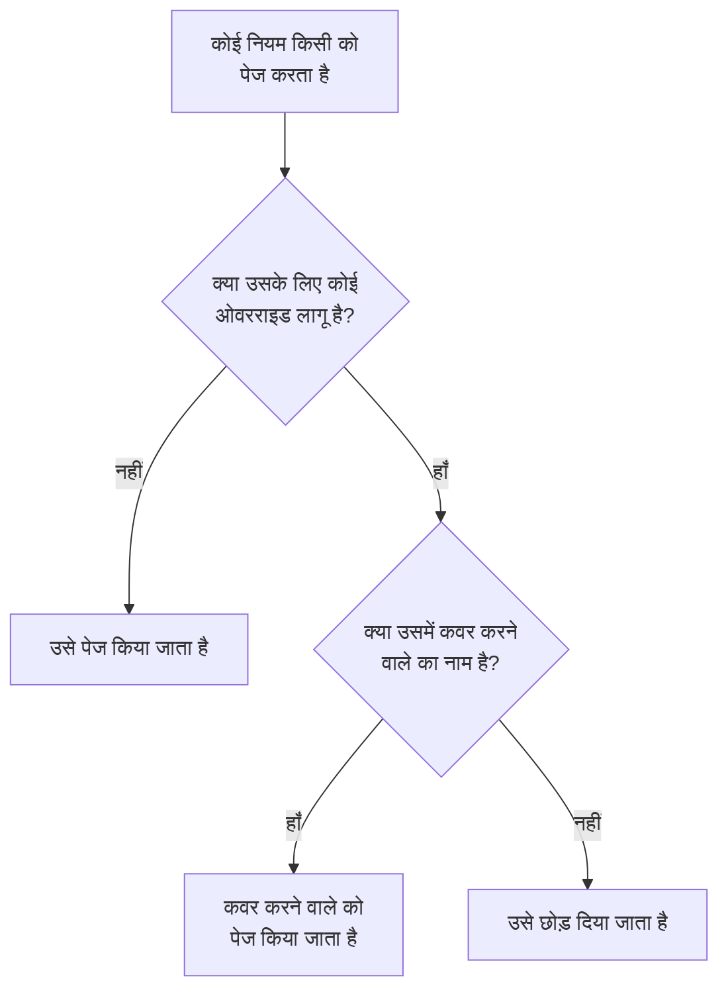

# उपयोगकर्ता ओवरराइड

जब कोई अनुपस्थित होता है, तो उपयोगकर्ता ओवरराइड एक तय समय के लिए उन पेज को, जो उस तक पहुँचते, उसे कवर करने वाले व्यक्ति को भेजता है। अगर कवर करने के लिए किसी का नाम नहीं दिया गया है, तो यह इसके बजाय उसे छोड़ देता है: ऑन-कॉल शेड्यूल में उसकी हर बारी रोटेशन में अगले व्यक्ति को चली जाती है। इसे छुट्टी, बीमारी के दिन या बदली गई शिफ्ट के लिए इस्तेमाल करें।

:::cards
- [ओवरराइड पेज को कैसे बदलता है](#ओवरराइड-पेज-को-कैसे-बदलता-है): इसके बजाय किसे पेज किया जाता है, और कब।
- [ओवरराइड जोड़ें](#ओवरराइड-जोड़ें): कौन अनुपस्थित है, कौन कवर करता है, कब से और कब तक।
- [हर नीति, या एक](#हर-नीति-या-एक): ओवरराइड कहाँ जोड़ें, और कौन-सा लागू होता है।
- [जोड़ने के दूसरे तरीके](#जोड़ने-के-दूसरे-तरीके): किसी शेड्यूल से, और अपनी आने वाली शिफ्टों से।
:::

## ओवरराइड पेज को कैसे बदलता है



जब तक ओवरराइड लागू है, उसकी शुरुआत से उसके अंत तक:

- अगर **कौन कवर करेगा?** के नीचे कोई है, तो उस व्यक्ति को अनुपस्थित व्यक्ति के सभी पेज मिलते हैं, हर उस शेड्यूल, टीम और नियम से जिस पर ओवरराइड लागू होता है। पेज उस तक उसके अपने व्यक्तिगत ऑन-कॉल नियमों से पहुँचता है।
- कवर करने वाला कोई न हो, तो व्यक्ति को छोड़ दिया जाता है। ऑन-कॉल शेड्यूल में उसकी हर बारी रोटेशन में अगले ऐसे व्यक्ति को जाती है जो अनुपस्थित नहीं है; अगर किसी परत में सभी अनुपस्थित हैं, तो उसके नीचे की परतें ज़िम्मेदारी ले लेती हैं। जो नियम उसका नाम सीधे या किसी टीम के ज़रिए लेता है, वह उसे पेज नहीं करता, और नीति का रन बताता है कि वह अनुपस्थित है, और कब तक।
- ओवरराइड एक-दूसरे से नहीं जुड़ते। अगर कवर करने वाला व्यक्ति भी अनुपस्थित है, तब भी जिस व्यक्ति को वह कवर कर रहा है, उसके लिए उसे ही पेज किया जाता है।

ओवरराइड खत्म होने के बाद पेज फिर से उसी व्यक्ति के होते हैं। **शेड्यूल टाइमलाइन**, किसी शेड्यूल की परतें और कैलेंडर फ़ीड, सभी दिखाते हैं कि हर कवर की गई शिफ्ट किसके पास है।

## ओवरराइड जोड़ें

:::steps
### ओवरराइड खोलें

किसी को हर ऑन-कॉल नीति में कवर करने के लिए **ऑन-कॉल ड्यूटी → उन्नत → उपयोगकर्ता ओवरराइड** पर जाएँ, या केवल उसी नीति में कवर करने के लिए **उन्नत** के अंतर्गत नीति के अपने **उपयोगकर्ता ओवरराइड** पेज पर जाएँ। **उपयोगकर्ता ओवरराइड जोड़ें** पर क्लिक करें।

### बताएँ कि कौन अनुपस्थित है

**कौन अनुपस्थित है?** आपसे शुरू होता है, क्योंकि अपनी छुट्टी दर्ज करना सबसे आम मामला है। किसी और के लिए कवर तय करने के लिए उसे चुनें।

### बताएँ कि कौन कवर करता है

उसे छोड़ने के लिए **कौन कवर करेगा?** को **रोटेशन में अगला व्यक्ति** पर रहने दें, या वह सहकर्मी चुनें जो उसके सभी पेज लेगा। अनुपस्थित व्यक्ति विकल्पों में नहीं दिखता।

### समय सेट करें

जब तक आप कोई और समय न चुनें, **शुरू होता है** अभी का समय होता है। **समाप्त होता है** को उस समय पर सेट करें जब वह वापस आएगा: यह शुरुआत के बाद होना चाहिए। **उपयोगकर्ता ओवरराइड जोड़ें** पर क्लिक करें।
:::

हर ओवरराइड एक पंक्ति है: **अनुपस्थित**, **कवर करने वाला**, **शुरू होता है** और **समाप्त होता है**, जिसे शुरुआत और अंत से फ़िल्टर किया जा सकता है। छोड़ने पर **कवर करने वाला** में **रोटेशन में अगला व्यक्ति** दिखता है। ओवरराइड को संपादित नहीं किया जा सकता: उसे हटाकर नया जोड़ें, या किसी को जल्दी वापस लाने के लिए उसे हटा दें।

## हर नीति, या एक

| कहाँ जोड़ा गया | कार्ड | किस पर लागू |
| --- | --- | --- |
| **ऑन-कॉल ड्यूटी → उन्नत → उपयोगकर्ता ओवरराइड** | **वैश्विक उपयोगकर्ता ओवरराइड** | प्रोजेक्ट की हर ऑन-कॉल नीति |
| किसी नीति के **उपयोगकर्ता ओवरराइड** | **ऑन-कॉल नीति के उपयोगकर्ता ओवरराइड** | केवल वही नीति |

जब एक ही व्यक्ति के दो ओवरराइड एक-दूसरे पर पड़ते हैं, तो नीति का अपना ओवरराइड वैश्विक ओवरराइड पर भारी पड़ता है, और कवर करने वाले का नाम देने वाला ओवरराइड छोड़ने वाले पर भारी पड़ता है। बिना नीति के भेजा गया पेज, किसी वर्कफ़्लो या चैट से, केवल वैश्विक ओवरराइड का पालन करता है।

## जोड़ने के दूसरे तरीके

- किसी शेड्यूल से: शेड्यूल के **परतें** पेज पर कोई परत खोलें और किसी व्यक्ति के बगल में **तारीख तक छोड़ें…** पर क्लिक करें। यह वही फ़ॉर्म खोलता है, जिसमें वह व्यक्ति अनुपस्थित और रोटेशन कवर करने वाला होता है, वैश्विक ओवरराइड के रूप में। देखें [जब कोई अनुपस्थित हो](/docs/on-call/schedules#जब-कोई-अनुपस्थित-हो)।
- अपनी आने वाली शिफ्टों से: **उपयोगकर्ता सेटिंग्स → कैलेंडर → कैलेंडर फ़ीड** के अंतर्गत अपनी किसी शिफ्ट पर **कवर पाएँ** फ़ॉर्म को उस शिफ्ट के समय के लिए आपको अनुपस्थित रखकर खोलता है, इसलिए केवल **कौन कवर करेगा?** बचता है। देखें [आने वाली शिफ्टें और कवर](/docs/on-call/calendar-feeds#आने-वाली-शिफ्टें-और-कवर)।

जब कोई प्रोजेक्ट छोड़ता है, तो हर वह ओवरराइड जिसमें उसका नाम है और जो अभी खत्म नहीं हुआ, हटा दिया जाता है, चाहे वह किसी भी तरफ़ हो।

## ओवरराइड कौन जोड़ सकता है

**प्रोजेक्ट स्वामी**, **प्रोजेक्ट एडमिन**, **प्रोजेक्ट सदस्य**, **ऑन-कॉल एडमिन** और **ऑन-कॉल सदस्य** ओवरराइड जोड़ और हटा सकते हैं; **दर्शक** और **ऑन-कॉल दर्शक** उन्हें देख सकते हैं। कस्टम भूमिका में अनुमतियों के नाम **Create On-Call Duty Policy User Override**, **Delete On-Call Duty Policy User Override** और **Read On-Call Duty Policy User Override** हैं। **शेड्यूल टाइमलाइन** पर केवल वे लोग देखते हैं कि किसकी शिफ्ट कवर की जा रही है, जो ओवरराइड पढ़ सकते हैं।

OneUptime Cloud पर उपयोगकर्ता ओवरराइड के लिए **Growth** प्लान चाहिए।

## API

उपयोगकर्ता ओवरराइड `/api/on-call-duty-policy-user-override` संसाधन हैं:

| फ़ील्ड | इसमें क्या होता है |
| --- | --- |
| `overrideUserId` | वह व्यक्ति जो अनुपस्थित है। ज़रूरी। |
| `routeAlertsToUserId` | वह व्यक्ति जो कवर करता है। इसके बजाय व्यक्ति को छोड़ने के लिए इसे हटा दें। |
| `startsAt`, `endsAt` | ओवरराइड कब शुरू और कब खत्म होता है। दोनों ज़रूरी हैं, और अंत शुरुआत के बाद आता है। |
| `onCallDutyPolicyId` | वह नीति जिस पर यह लागू होता है। वैश्विक ओवरराइड के लिए इसे हटा दें। |

```bash
curl -X POST https://oneuptime.com/api/on-call-duty-policy-user-override \
  -H "apikey: $ONEUPTIME_API_KEY" \
  -H "Content-Type: application/json" \
  -d '{
    "data": {
      "projectId": "<project-id>",
      "overrideUserId": "<away-user-id>",
      "routeAlertsToUserId": "<cover-user-id>",
      "startsAt": "2026-12-22T09:00:00Z",
      "endsAt": "2027-01-05T09:00:00Z"
    }
  }'
```

जिस ओवरराइड में अनुपस्थित व्यक्ति और कवर करने वाला एक ही हों, वह अस्वीकार कर दिया जाता है, और वह भी जो शुरू होने से पहले खत्म हो जाता है।

## समस्या निवारण

:::details छुट्टी पर गए व्यक्ति को फिर भी पेज किया गया
जाँचें कि ओवरराइड कहाँ जोड़ा गया था। किसी नीति के **उपयोगकर्ता ओवरराइड** पेज पर जोड़ा गया ओवरराइड केवल उसी नीति को कवर करता है, और दूसरी नीतियां उसे अब भी पेज करती हैं: हर नीति को कवर करने के लिए इसे **ऑन-कॉल ड्यूटी → उन्नत → उपयोगकर्ता ओवरराइड** के अंतर्गत जोड़ें। इसके **शुरू होता है** और **समाप्त होता है** भी जाँचें: समय आपके समय क्षेत्र में दिखते हैं।
:::

:::details कवर करने वाले व्यक्ति को भी पेज नहीं किया गया
उस तक उसके अपने व्यक्तिगत ऑन-कॉल नियमों और सत्यापित विधियों से पहुँचा जाता है। उसे **ऑन-कॉल ड्यूटी → तैयारी** पर देखें, और रन के लिए नीति के **निष्पादन लॉग** जाँचें।
:::

:::details मैं ओवरराइड नहीं जोड़ सकता
इसके लिए ऊपर दी गई भूमिकाओं में से एक चाहिए, और OneUptime Cloud पर **Growth** प्लान भी।
:::

## अगले कदम

:::cards
- [ऑन-कॉल अनुसूची](/docs/on-call/schedules): रोटेशन, परतें, और किसी परत में किसी को छोड़ना।
- [शेड्यूल टाइमलाइन](/docs/on-call/schedule-timeline): सभी शेड्यूल में हर कवर की गई शिफ्ट देखें।
- [कैलेंडर फ़ीड](/docs/on-call/calendar-feeds): अपनी किसी शिफ्ट के लिए कवर पाएँ।
:::
