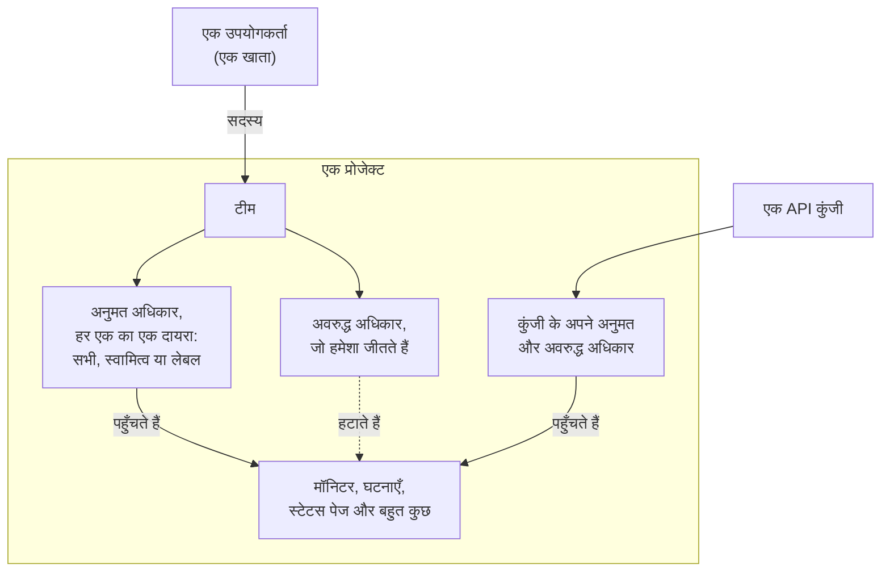
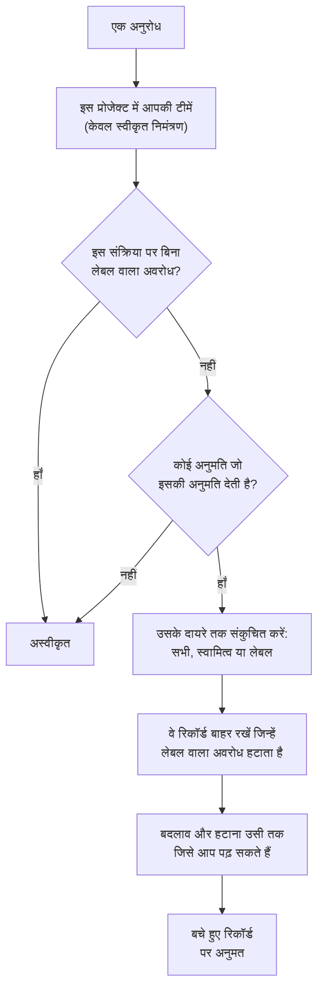

# उपयोगकर्ता, टीमें और अनुमतियाँ

OneUptime में सब कुछ किसी **प्रोजेक्ट** के भीतर रहता है। उस प्रोजेक्ट में कौन क्या कर सकता है, यह तीन बातों पर निर्भर करता है: उसमें मौजूद **उपयोगकर्ता**, वे **टीमें** जिनके वे सदस्य हैं, और उन टीमों को दी गई **अनुमतियाँ**।

> [!IMPORTANT]
> **उपयोगकर्ताओं के पास कभी सीधे अनुमतियाँ नहीं होतीं।** किसी उपयोगकर्ता की पहुँच उस प्रोजेक्ट में उसकी सभी टीमों की अनुमतियों का योग होती है। किसी की क्षमताएँ बदलनी हों तो या तो उसकी टीम सदस्यता बदलिए, या उस टीम की अनुमतियाँ।

**स्वामी** एक अलग अवधारणा है। स्वामी वह है जो किसी एक विशिष्ट संसाधन के लिए ज़िम्मेदार है — एक मॉनिटर, एक घटना, एक डैशबोर्ड। स्वामियों को उनके संसाधनों की सूचनाएँ मिलती हैं, और चाहें तो अनुमतियों को "केवल वही जो मेरा है" तक सीमित किया जा सकता है।

## पहुँच कैसे काम करती है

| अवधारणा | यह क्या है |
| --- | --- |
| उपयोगकर्ता | एक अकेला OneUptime खाता। एक लॉगिन, कितने भी प्रोजेक्ट। |
| प्रोजेक्ट | टेनेंट की सीमा। मॉनिटर, घटनाएँ, टीमें और डेटा ठीक एक ही प्रोजेक्ट के होते हैं। |
| टीम | प्रोजेक्ट के भीतर एक नामित समूह जो अनुमतियाँ धारण करता है। |
| टीम सदस्य | वह उपयोगकर्ता जिसे टीम में आमंत्रित किया गया और जिसने स्वीकार कर लिया। |
| अनुमति | एक अकेली क्षमता, जैसे `CreateProjectMonitor`, या कई को समेटने वाली भूमिका, जैसे `MonitorAdmin`। |
| दायरा | कोई अनुमत अधिकार कितनी दूर तक पहुँचता है: सभी संसाधन, केवल स्वामित्व वाले, या केवल लेबल वाले। |
| स्वामी | किसी एक विशिष्ट संसाधन के लिए ज़िम्मेदार चिह्नित उपयोगकर्ता या टीम। |
| लेबल | संसाधनों पर लगाया गया चिह्न, जो अनुमतियाँ सीमित करने और व्यवस्थित करने में काम आता है। |

## उपयोगकर्ता

उपयोगकर्ता खाता पूरे OneUptime इंस्टेंस के लिए साझा होता है — वही लॉगिन हर उस प्रोजेक्ट में काम करता है जिसमें उपयोगकर्ता को आमंत्रित किया गया है।

उपयोगकर्ता किसी प्रोजेक्ट "में" तब होता है जब वह उसकी **कम से कम एक टीम** का सदस्य हो। "उपयोगकर्ता को प्रोजेक्ट में जोड़ें" जैसा कोई अलग चरण नहीं है: किसी को प्रोजेक्ट में आमंत्रित करना यानी उसे किसी टीम में आमंत्रित करना।

:::steps
1. **उत्पाद** मेनू में **सेटिंग्स** के अंतर्गत **उपयोगकर्ता** खोलिए और **उपयोगकर्ता को आमंत्रित करें** पर क्लिक कीजिए। सूची में प्रोजेक्ट के सभी लोग और उनके निमंत्रण की स्थिति दिखती है।
2. उनका **ईमेल** लिखिए। जिसके पास अभी OneUptime खाता नहीं है, उससे **नाम** भी पूछा जाता है।
3. उनकी **टीम** चुनिए, जो तय करती है कि वे क्या कर सकते हैं, और **आमंत्रित करें** पर क्लिक कीजिए।
4. वे ऊपर दाईं ओर की घंटी से, **प्रोजेक्ट आमंत्रण** पर, निमंत्रण स्वीकार करते हैं और तब से प्रोजेक्ट में होते हैं।
:::

- निमंत्रण एक लंबित टीम सदस्य बनाता है। उपयोगकर्ता प्रोजेक्ट सदस्य के रूप में गिना जाता है — और उसे कोई भी अनुमति मिलती है — **निमंत्रण स्वीकार करने के बाद ही।**
- **उपयोगकर्ता को आमंत्रित करें** प्रोजेक्ट की सदस्य टीम से शुरू होता है: वह टीम जिसके पास पूरे प्रोजेक्ट के लिए `ProjectMember` है, यानी **Members**, जब तक आपने उसका नाम न बदला हो। व्यक्ति को अधिक या कम पहुँच देने के लिए कोई दूसरी टीम चुनिए। जब आप स्वयं उस टीम में आमंत्रित नहीं कर सकते — किसी को आमंत्रित करना उसे टीम की अनुमतियाँ सौंपना है, और आप केवल वही अनुमतियाँ आगे दे सकते हैं जो आपके पास हैं — या जब प्रोजेक्ट में ऐसी कोई टीम नहीं है, तब कुछ भी चुना नहीं जाता। एडमिन डैशबोर्ड भी हर उस जगह इसी टीम से शुरू होता है जहाँ इंस्टेंस का कोई व्यवस्थापक किसी को प्रोजेक्ट में जोड़ता है: किसी प्रोजेक्ट पर **उपयोगकर्ता को आमंत्रित करें**, किसी उपयोगकर्ता पर और एक साथ कई उपयोगकर्ताओं पर **परियोजना में जोड़ें**, और [वैश्विक SSO प्रदाता](/docs/identity/global-sso) से जुड़े प्रोजेक्ट।
- किसी उपयोगकर्ता को प्रोजेक्ट की सभी टीमों से हटा देने पर उसकी उस प्रोजेक्ट तक पहुँच उसके अगले अनुरोध से समाप्त हो जाती है — तब भी जब वह साइन इन है। उसका खाता और उसके दूसरे प्रोजेक्ट प्रभावित नहीं होते। उसे प्रोजेक्ट के ऑन-कॉल शेड्यूल, एस्केलेशन नियमों और ओवरराइड से, उसकी खुली घटनाओं और एपिसोड की भूमिकाओं से, और उसके संसाधनों के मालिकों से हटा दिया जाता है; हल हो चुकी घटनाएँ यह रिकॉर्ड रखती हैं कि उनका मालिक कौन था और उन्हें किसने चलाया।
- प्रोजेक्ट छोड़ने वाले व्यक्ति को उस प्रोजेक्ट की सूचनाएँ मिलना बंद हो जाती हैं। प्रोजेक्ट के लिए उनके अपने सूचना तरीके, नियम और सेटिंग्स आख़िरी टीम छोड़ते ही हटा दिए जाते हैं — ईमेल, SMS, कॉल, WhatsApp, Telegram, पुश, webhook, Slack और Microsoft Teams, ईमेल सारांश और अभी तक न भेजा गया ईमेल, इनकमिंग कॉल के लिए नंबर और शिफ़्ट रिमाइंडर — इसलिए दोबारा जुड़ने पर सब कुछ डिफ़ॉल्ट से शुरू होता है। जो चीज़ें इसके बाद भी उनका नाम लेती हैं, जैसे वह उपयोगकर्ता जिसे इनकमिंग कॉल नियम कॉल करता है या हल हो चुकी घटना पर बना रहा मालिक, वे अब उन्हें सूचित नहीं करतीं: प्रोजेक्ट की ओर से किसी ऐसे व्यक्ति को कुछ नहीं भेजा जाता जो उसका सदस्य नहीं है, और लंबित आमंत्रण अभी सदस्यता नहीं है। इन जगहों पर नाम के आगे **अब सदस्य नहीं** दिखता है, ताकि आप किसी और को वहाँ रख सकें। जिसे आमंत्रित किया गया है पर जिसने अभी स्वीकार नहीं किया है, उसके नाम के आगे इसकी जगह **आमंत्रण अभी स्वीकार नहीं किया गया** दिखता है। अगर कोई ओवरराइड किसी के पेज ऐसे व्यक्ति को भेजता है जिसने प्रोजेक्ट छोड़ दिया है, तो उसकी जगह वह व्यक्ति पेज किया जाता है जिसे ओवरराइड कवर करता है। प्रोजेक्ट छोड़ने पर उस व्यक्ति के प्रोजेक्ट से जोड़े गए MCP क्लाइंट भी डिस्कनेक्ट हो जाते हैं, और उसका निजी ऑन-कॉल कैलेंडर लिंक तब से खाली कैलेंडर दिखाता है। OneUptime Cloud पर, जो व्यक्ति प्रोजेक्ट के सिंगल साइन-ऑन से वापस आता है, वह उसे अपने मेलबॉक्स से फिर से पुष्टि करता है।
- यदि आपका प्रोजेक्ट SSO अनिवार्य करता है और उपयोगकर्ता ने अभी तक पहचान प्रदाता से प्रमाणीकरण नहीं किया है, तो उसे अनधिकृत SSO उपयोगकर्ता माना जाता है और प्रमाणीकरण होने तक उसे कुछ नहीं दिखता। देखें [SSO](/docs/identity/sso)।
- SCIM कॉन्फ़िगर होने पर आपका पहचान प्रदाता उपयोगकर्ताओं और उनकी टीम सदस्यताओं को स्वतः बना, अद्यतन और हटा सकता है। देखें [SCIM](/docs/identity/scim)।

## टीमें

टीमें ही वह रास्ता हैं जिससे अनुमतियाँ लोगों तक पहुँचती हैं। हर नया प्रोजेक्ट तीन टीमों के साथ शुरू होता है:

| टीम | धारित अनुमति | संपादन योग्य |
| --- | --- | --- |
| Owners | `ProjectOwner` | नहीं। इसमें हमेशा कम से कम एक सदस्य रहता है। |
| Admin | `ProjectAdmin` | नहीं |
| Members | `ProjectMember` | हाँ — यह एक शुरुआती बिंदु है, इसे स्वतंत्र रूप से बदलें |

**Owners** और **Admin** टीमें जान-बूझकर लॉक हैं: उनकी अनुमतियाँ संपादित नहीं की जा सकतीं और टीमें न हटाई जा सकती हैं न उनका नाम बदला जा सकता है। यही बात प्रोजेक्ट को गलती से खुद को बाहर कर देने से रोकती है। Owners टीम में हमेशा कम से कम एक सदस्य रहना चाहिए।

`ProjectOwner` सर्वोच्च पहुँच स्तर है: बिलिंग, प्रोजेक्ट हटाना, और वह सब जो कोई व्यवस्थापक कर सकता है। `ProjectAdmin` बिलिंग और प्रोजेक्ट हटाने के अलावा सब कुछ शामिल करता है।

प्रोजेक्ट के लिए SMS, फ़ोन कॉल, WhatsApp या Telegram चालू या बंद करना बिलिंग में गिना जाता है, क्योंकि हर संदेश पर पैसा लगता है। केवल `ProjectOwner`, `BillingAdmin` भूमिका (**Billing Admin**) और `ManageProjectBilling` अनुमति (**Manage Billing**) ही इन स्विचों को **प्रोजेक्ट सेटिंग्स > सूचनाएं > सूचना सेटिंग्स** में बदल सकते हैं — `ProjectAdmin` नहीं।

प्रोजेक्ट के प्रीपेड बैलेंस रिचार्ज करना भी बिलिंग में गिना जाता है। OneUptime Cloud पर SMS, फ़ोन कॉल, WhatsApp और Telegram का भुगतान **प्रोजेक्ट सेटिंग्स > सूचनाएं > सूचना सेटिंग्स** वाले बैलेंस से होता है, और AI का भुगतान **प्रोजेक्ट सेटिंग्स > एआई > AI क्रेडिट** वाले AI क्रेडिट से। केवल प्रोजेक्ट का मालिक या **Manage Billing** अनुमति वाला कोई व्यक्ति ही इन्हें रिचार्ज कर सकता है या इनका **ऑटो रिचार्ज** बदल सकता है — प्रोजेक्ट व्यवस्थापक नहीं। कम बैलेंस के बारे में हर संदेश बताता है कि इसे कौन भर सकता है, और केवल उन्हीं लोगों को काम करने वाला **शेष रिचार्ज करें** बटन या पेज का लिंक मिलता है।

जितनी चाहें उतनी अतिरिक्त टीमें बनाइए — "फ्रंटएंड ऑन-कॉल", "सहायता", "केवल-पठन ऑडिटर" — और हर एक को उसकी ज़रूरत की अनुमतियाँ दीजिए। OneUptime Cloud पर टीम बनाने और उसकी अनुमतियाँ बदलने के लिए Scale प्लान चाहिए।

**टीम बनाना** एक नाम और टीम का **एक्सेस** पूछता है, यानी टीम के सदस्य क्या कर सकते हैं:

| एक्सेस | टीम के सदस्य क्या कर सकते हैं |
| --- | --- |
| प्रोजेक्ट एडमिन | प्रोजेक्ट में कुछ भी बनाना, बदलना और हटाना, उसकी सेटिंग्स सहित। बिलिंग नहीं, और प्रोजेक्ट हटाना नहीं। |
| प्रोजेक्ट सदस्य | मॉनिटर, घटनाएँ, स्टेटस पेज और प्रोजेक्ट के अन्य संसाधन बनाना, बदलना और हटाना। |
| दर्शक | प्रोजेक्ट में सब कुछ पढ़ना, और कुछ भी न बदलना। |
| अनुमतियाँ बाद में चुनें | अभी कुछ नहीं। शुरुआत में यही चुना रहता है। |

:::steps
1. **उत्पाद** मेनू में **सेटिंग्स** के अंतर्गत **टीमें** खोलिए और **टीम बनाएं** पर क्लिक कीजिए।
2. टीम का **नाम** लिखिए और उसका **एक्सेस** चुनिए। विवरण **और फ़ील्ड** के अंतर्गत है।
3. टीम बनाइए। भूमिका वाली टीम अपने **सदस्य** पृष्ठ पर खुलती है, ताकि आप लोगों को आमंत्रित कर सकें; **अनुमतियाँ बाद में चुनें** के साथ वह अपने **अनुमतियाँ** पृष्ठ पर खुलती है, जहाँ आप `IncidentMember` जैसी संकरी भूमिका या अलग-अलग अनुमतियाँ जोड़ते हैं।
:::

आपकी चुनी हुई भूमिका टीम बनते ही प्रोजेक्ट के सभी संसाधनों के लिए टीम की पहली अनुमति बन जाती है — ठीक वैसे ही जैसे आपने उसे टीम के अनुमतियाँ पृष्ठ पर **भूमिका जोड़ें** से जोड़ा हो। आपको केवल वही भूमिकाएँ दिखाई जाती हैं जो स्वयं आपके पास हैं, क्योंकि जिसे भी आप टीम में आमंत्रित करते हैं उसे टीम की अनुमतियाँ मिलती हैं, और जो टीमें बना सकता है लेकिन यह नहीं बदल सकता कि वे क्या कर सकती हैं, उससे यह पूछा नहीं जाता। अगर भूमिका नहीं जोड़ी जा सकती, तो भी टीम बन जाती है और सूची के ऊपर एक सूचना उस तक ले जाती है।

कहाँ मिलेगा: **सदस्य** और **अनुमतियाँ** तक पहुँचने के लिए **टीमें** से कोई टीम खोलिए; **अनुमतियां अवरुद्ध करें** अनुमतियाँ पृष्ठ के नीचे **और सेटिंग्स** के अंतर्गत हैं, जिसका मुड़ा हुआ शीर्षक दिखाता है कि टीम के पास ऐसी कितनी हैं।

## अनुमतियाँ

अनुमति एक अकेली क्षमता है। इन्हें बाँटने के दो तरीके हैं, और दोनों टीम के **अनुमतियाँ** टैब में हैं।

### भूमिकाएँ

भूमिका किसी पूरे उत्पाद क्षेत्र को तीन में से एक स्तर पर समेटती है:

- **Admin** — जो Member करता है, वह सब, और साथ में क्षेत्र की अपनी कॉन्फ़िगरेशन, जैसे इंसिडेंट और अलर्ट की गंभीरताएँ और स्थितियाँ, मॉनिटर की स्थितियाँ और मेंटेनेंस की स्थितियाँ।
- **Member** — रोज़मर्रा का काम: क्षेत्र के संसाधन उनके नोट्स, मालिकों और टेम्पलेट्स के साथ बनाना, बदलना और हटाना। स्टेटस पेज और ऑन-कॉल के लिए Member वह सब कर सकता है जो Admin करता है।
- **Viewer** — केवल पठन।

`MonitorAdmin`, `IncidentMember`, `StatusPageViewer` इत्यादि। लगभग हमेशा भूमिकाएँ ही सही विकल्प होती हैं — जैसे-जैसे OneUptime में नई सुविधाएँ जुड़ती हैं वे सही बनी रहती हैं, क्योंकि मॉनिटर से जुड़ी नई तालिका मौजूदा मॉनिटर भूमिकाओं में जुड़ जाती है, आपको नई अनुमति देनी नहीं पड़ती।

वर्कफ़्लो और Runbook अपवाद हैं। दोनों आपके प्रोजेक्ट में कोड चलाते हैं — वर्कफ़्लो अपने चरण, Runbook आपके Runners पर अपनी स्क्रिप्ट — इसलिए `WorkflowMember` वर्कफ़्लो और उनके रन खोलता है और उन्हें हाथ से चलाता है, और `RunbookMember` Runbook और उनके रन खोलता है और उन्हें चलाता है: वह रन शुरू करता है, उसके चरण पूरे करता है या छोड़ता है, और उसे रद्द करता है। दोनों में से कोई भी जो चलाता है उसे बनाता, बदलता या हटाता नहीं है; उन्हें `WorkflowAdmin` और `RunbookAdmin` बनाते हैं। कोई भूमिका केवल वही Runbook चलाती है जिन तक उसका दायरा पहुँचता है: कुछ लेबल तक सीमित `RunbookMember` उन लेबल वाले Runbook चलाता है। देखें [वर्कफ़्लो अनुमतियाँ](/docs/workflows/configuration#अनुमतियाँ) और [Runbook अनुमतियाँ](/docs/runbooks/configuration#अनुमतियाँ)।

किसी क्षेत्र के नियम (लेबल, मालिक, ऑन-कॉल, समूहन और रिमाइंडर नियम), कस्टम फ़ील्ड, SLA और सीक्रेट प्रोजेक्ट कॉन्फ़िगरेशन हैं: इनके लिए `ProjectAdmin` चाहिए, चाहे किसी के पास कोई भी क्षेत्र भूमिका हो। यही बात API कुंजियों, टीमों और उनकी अनुमतियों, लेबल, SSO और डोमेन पर भी लागू होती है — Settings भूमिकाएँ प्रोजेक्ट की सेवाएँ, प्रोब, इन्फ्रास्ट्रक्चर और इंटीग्रेशन संभालती हैं, यह नहीं कि कौन क्या कर सकता है।

बिलिंग की अपनी तीन भूमिकाएँ हैं। `BillingViewer` प्रोजेक्ट की बिलिंग पढ़ता है — प्लान और सब्सक्रिप्शन, चालान, उपयोग, बैलेंस, AI क्रेडिट, भुगतान विधियाँ और बिलिंग संपर्क विवरण — और कुछ नहीं बदलता। `BillingMember` इसके अलावा चालान डाउनलोड करता है और बिलिंग संपर्क विवरण बदलता है। `BillingAdmin` वह सब करता है जो `BillingMember` करता है, और SMS, फ़ोन कॉल, WhatsApp और Telegram चालू और बंद करता है। प्लान, भुगतान विधियाँ या बैलेंस बदलने और चालान का भुगतान करने के लिए `ProjectOwner` या **Manage Billing** चाहिए; बिलिंग पेजों पर ये बटन बाकी सभी के लिए लॉक रहते हैं और बताते हैं कि कौन इनका उपयोग कर सकता है।

सभी {{PERMISSION_ROLE_COUNT}} भूमिकाएँ [अनुमति संदर्भ](/docs/permissions/reference) में सूचीबद्ध हैं।

### सूक्ष्म अनुमतियाँ

हर अलग क्षमता को अकेले भी सौंपा जा सकता है — `CreateProjectMonitor`, `ReadProjectIncident`, `DeleteProjectStatusPage` और {{PERMISSION_TOTAL_COUNT}} अन्य। जब कोई भूमिका बहुत व्यापक हो और आपको ठीक एक ही चीज़ देनी हो, तब इनका उपयोग करें।

किसी चीज़ को बदलने या हटाने की अनुमति केवल उसी तक पहुँचती है जिसे आप पढ़ भी सकते हैं, इसलिए उसके साथ मेल खाती पढ़ने की अनुमति भी दीजिए: `ReadProjectIncident` के बिना `EditProjectIncident` कोई घटना नहीं बदलती। किसी दूसरे रिकॉर्ड के ज़रिए पढ़े जाने वाले रिकॉर्ड, जैसे किसी घटना के नोट, को उस दूसरे रिकॉर्ड को पढ़ने की अनुमति भी चाहिए: घटनाएँ पढ़ने की अनुमति के बिना `ReadIncidentInternalNote` किसी नोट तक नहीं पहुँचती, और `CreateIncidentInternalNote` केवल उसी घटना पर नोट जोड़ती है जिसे आप पढ़ सकते हैं। भूमिकाओं में दोनों पहले से शामिल हैं।

API कुंजियाँ बनाते समय भी आप यही कुंजियाँ उपयोग करते हैं, और API तथा Terraform प्रोवाइडर भी इन्हीं की अपेक्षा करते हैं।

पूरी सूची [अनुमति संदर्भ](/docs/permissions/reference) में है।

### अनुमति देना और अवरुद्ध करना

हर टीम की दो सूचियाँ होती हैं:

- **अनुमतियाँ** (अनुमति) — यह टीम क्या कर सकती है।
- **अनुमतियां अवरुद्ध करें** — यह टीम क्या कभी नहीं कर सकती, चाहे अनुमति सूची में कुछ भी हो।

दोनों टीम के **अनुमतियाँ** पृष्ठ पर हैं। कम ही टीमों को अवरोध की ज़रूरत होती है, इसलिए अवरुद्ध अनुमतियाँ पृष्ठ के नीचे **और सेटिंग्स** के अंतर्गत मुड़ी रहती हैं।

> [!WARNING]
> **अवरोध हमेशा जीतता है।** बिना लेबल वाली अवरोध प्रविष्टि उस क्षमता को टीम से पूरी तरह हटा देती है। लेबल वाली अवरोध प्रविष्टि उसे केवल उन संसाधनों के लिए हटाती है जिन पर वे लेबल लगे हैं — "यह टीम मॉनिटर संपादित कर सकती है, सिवाय उनके जिन पर Production लेबल है" जैसी स्थिति के लिए उपयोगी।

कोई अनुमति एक साथ दोनों सूचियों में प्रतिबंध लेबल नहीं रख सकती; OneUptime दूसरी प्रविष्टि को स्पष्टीकरण के साथ अस्वीकार कर देता है।

किसी उपयोगकर्ता की अनुमतियाँ उसकी सभी टीमों में जुड़ती हैं, लेकिन अवरोध उपयोगकर्ता के हर काम पर लागू होता है: किसी एक टीम पर बिना लेबल वाला अवरोध उस क्षमता को हटा देता है, भले ही कोई दूसरी टीम उसकी अनुमति देती हो, और अवरोध प्रविष्टि कभी कुछ नहीं देती। यदि किसी के पास अपेक्षा से कम पहुँच है, तो उसकी हर टीम में अवरोध खोजिए; यदि अधिक है, तो हर टीम में अनुमति खोजिए।

### स्थिति बदलना

कोई इंसिडेंट, अलर्ट, अलर्ट या इंसिडेंट एपिसोड, निर्धारित मेंटेनेंस या मॉनिटर अपनी स्थिति टाइमलाइन में एक नई पंक्ति जुड़ने से अपनी स्थिति बदलता है। **स्वीकार करें**, **सुलझाएं**, **स्थिति बदलें**, **स्थिति टाइमलाइन** पेज, API और वर्कफ़्लो, सभी ऐसी एक पंक्ति जोड़ते हैं। उसे जोड़ने के लिए उसी टाइमलाइन की बनाने की अनुमति चाहिए, साथ में उस रिकॉर्ड को पढ़ने की अनुमति जिसे वह बदलती है:

| इसकी स्थिति बदलने के लिए | चाहिए |
| --- | --- |
| कोई इंसिडेंट | **Create Incident State Timeline** |
| कोई अलर्ट | **Create Alert State Timeline** |
| कोई अलर्ट एपिसोड | **Create Alert Episode State Timeline** |
| कोई इंसिडेंट एपिसोड | **Create Incident Episode State Timeline** |
| कोई निर्धारित मेंटेनेंस | **Create Scheduled Maintenance State Timeline** |
| कोई मॉनिटर (उसकी स्थिति) | **Create Monitor Status Timeline** |

इसके बाद रिकॉर्ड नई स्थिति OneUptime से ही लेता है, उसके साथ आने वाली बातों सहित, जैसे कोई एपिसोड कब हल हुआ या कोई मेंटेनेंस अपने सब्सक्राइबरों को अगली बार कब याद दिलाता है। इसलिए किसी बदलाव के लिए रिकॉर्ड को संपादित करने की अनुमति अलग से नहीं चाहिए: **Create Incident State Timeline** वाली लेकिन **Edit Incident** के बिना कोई कस्टम भूमिका इंसिडेंट की स्थिति बदल देती है। किसी टीम को स्थितियाँ बदलने से रोकने के लिए टाइमलाइन की बनाने की अनुमति अवरुद्ध कीजिए; **Edit Incident** पर रोक स्थिति के बदलावों पर कोई असर नहीं डालती। लेबल, स्वामी और निजी रिकॉर्ड टाइमलाइन की बनाने की अनुमति को उसी तरह सीमित करते हैं जैसे किसी और अनुमति को, उस रिकॉर्ड के ज़रिए जिसकी स्थिति वह बदलती है: नीचे दायरे के नियम देखिए।

आपके लिए केवल स्थिति लिखी जाती है। किसी बदलाव के साथ भेजा गया नोट आपके नाम से भेजा जाता है और उसे नोट की अपनी अनुमति चाहिए, जैसा [स्थिति पृष्ठ सब्सक्राइबर को स्थिति बदलाव के बारे में बताना](/docs/incidents/states-and-severities#स्थिति-पृष्ठ-सब्सक्राइबर-को-स्थिति-बदलाव-के-बारे-में-बताना) में बताया गया है। किसी इंसिडेंट को घोषित करते समय उसके अलर्ट स्वीकार करने के लिए वही चाहिए जो उनमें से हर एक को उसके अपने पेज पर स्वीकार करने के लिए चाहिए: हर अलर्ट के ज़रिए सीमित **Create Alert State Timeline**, और कोई **Edit Alert** नहीं। देखें [घोषित करते समय अलर्ट स्वीकार करना](/docs/incidents/linked-alerts#घोषित-करते-समय-अलर्ट-स्वीकार-करना)।

## दायरा: कोई अनुमत अधिकार कितनी दूर पहुँचता है

हर अनुमत अधिकार एक दायरे के साथ दिया जाता है, जिसे आप जोड़ते समय **दायरा** में चुनते हैं:

| दायरा | अर्थ |
| --- | --- |
| प्रोजेक्ट के सभी संसाधन | डिफ़ॉल्ट। अनुमति हर मेल खाते संसाधन पर लागू होती है। |
| इस टीम या इसके सदस्यों के स्वामित्व में | अनुमति केवल उन संसाधनों पर लागू होती है जहाँ यह टीम, या कार्य करने वाला उपयोगकर्ता, स्वामी के रूप में दर्ज है। |
| लेबल द्वारा प्रतिबंधित करें (उन्नत) | अनुमति केवल उन संसाधनों पर लागू होती है जिन पर चयनित लेबल में से कम से कम एक लगा हो। |

**स्वामित्व** "अपनी सेवाओं की देखभाल आप स्वयं करें" वाला मॉडल बनाने का सबसे सरल तरीका है: किसी टीम को स्वामित्व दायरे के साथ `MonitorAdmin` दीजिए, फिर उस टीम को उन मॉनिटरों का स्वामी बनाइए जिनके लिए वह ज़िम्मेदार है। यह केवल उन्हीं संसाधनों को संकुचित करता है जिनके वास्तव में स्वामी हो सकते हैं — मॉनिटर, घटनाएँ, डैशबोर्ड, सेवाएँ इत्यादि। प्रोजेक्ट कॉन्फ़िगरेशन (घटना स्थितियाँ, लेबल, स्वयं टीमें) का कोई स्वामी नहीं होता, इसलिए वहाँ स्वामित्व दायरे वाली भूमिका सामान्य रूप से ही व्यवहार करती है।

**लेबल** उसी विचार का अधिक मैनुअल रूप है: संसाधनों पर चिह्न लगाइए, फिर उन चिह्नों तक सीमित अनुमतियाँ दीजिए।

**पूरे प्रोजेक्ट पर काम करने के लिए ऐसी अनुमति चाहिए जो उस तक पहुँचे।** किसी नियम का **Run Now** नियम को प्रोजेक्ट के हर संसाधन पर लागू करता है, और किसी नेटवर्क के साइट असाइनमेंट, डिवाइस लेबल और ऑटो इम्पोर्ट नियम हर नेटवर्क डिवाइस या स्कैन पर, इसलिए इसके लिए प्रोजेक्ट के सभी संसाधनों के दायरे वाली अनुमतियाँ चाहिए: लेबलों या स्वामित्व वाले संसाधनों तक सीमित अनुमति काफ़ी नहीं है, और रन जिन संसाधनों को बदलता है उन पर लेबल वाला अवरोध रन को अस्वीकार कर देता है, क्योंकि वह उन लेबलों वाले संसाधनों को भी बदल देगा।

कुछ भूमिकाएँ परिभाषा से ही पूरे प्रोजेक्ट पर लागू होती हैं और कोई दायरा देती ही नहीं, क्योंकि उन्हें संकुचित करना निरर्थक होगा — "Billing Admin, पर केवल उस बिलिंग के लिए जो मेरी है" कुछ भी नहीं कहता:

{{PERMISSION_SCOPE_EXEMPT_ROLES}}

## स्वामी

स्वामी एक उपयोगकर्ता या टीम है जो किसी एक विशिष्ट संसाधन से जुड़ा होता है। ऐसे अधिकांश संसाधन जो आपके संचालन की किसी चीज़ का प्रतिनिधित्व करते हैं — मॉनिटर, घटनाएँ, अलर्ट, नियोजित रखरखाव, ऑन-कॉल नीतियाँ, डैशबोर्ड, सेवाएँ, स्थिति पृष्ठ, वर्कफ़्लो, रनबुक और SLO — में एक **मालिक** टैब होता है।

स्वामी दो काम करते हैं:

1. **सूचना।** जब संसाधन के साथ कुछ होता है — मॉनिटर बंद हो जाए, घटना बने, कोई SLO अपना त्रुटि बजट खर्च करने लगे — तो OneUptime स्वामियों को ही बताता है।
2. **पहुँच, जब आप चाहें।** `Owned` (स्वामित्व) अनुमति दायरा इसी स्वामित्व के आधार पर हल होता है। उपयोगकर्ता तब मेल खाता है जब वह स्वयं स्वामी हो, या उसकी कोई टीम स्वामी हो।

अकेला स्वामित्व कुछ नहीं देता। किसी मॉनिटर का स्वामी होना उसे संपादित करने की अनुमति तब तक नहीं देता जब तक आपकी किसी टीम के पास मॉनिटर अनुमति भी न हो। स्वामित्व पहुँच को संकुचित करता है; उसे कभी बढ़ाता नहीं।

किसी संसाधन का स्वामी कौन है, यह उसी संसाधन के माध्यम से पढ़ा जाता है। किसी मॉनिटर या किसी भी अन्य संसाधन के स्वामियों को केवल वही व्यक्ति सूचीबद्ध करता, पढ़ता, जोड़ता और हटाता है जो उस संसाधन को पढ़ सकता है, और केवल स्वामियों पर दी गई अनुमति ऐसे किसी भी संसाधन के स्वामियों तक नहीं पहुँचती जिसे आप पढ़ नहीं सकते।

## लेबल

लेबल पूरे प्रोजेक्ट में मान्य चिह्न हैं जो आप संसाधनों पर लगाते हैं। इनके दो उद्देश्य हैं: डैशबोर्ड में छानना और समूहीकृत करना, तथा ऊपर बताए अनुसार अनुमतियाँ सीमित करना।

लेबल प्रतिबंध तब पूरा होता है जब संसाधन पर अनुमति के लेबलों में से **कम से कम एक** लगा हो। जिस संसाधन पर कोई लेबल ही नहीं है, वह किसी भी लेबल-प्रतिबंधित अनुमति को पूरा नहीं करता।

जिस रिकॉर्ड के अपने लेबल नहीं होते, जैसे किसी घटना का नोट, किसी स्टेटस पेज की घोषणा या किसी सेवा के बारे में AI इनसाइट, उस पर उन रिकॉर्डों के लेबल माने जाते हैं जिनसे वह जुड़ा है या जिनके बारे में है। लेबल तक सीमित अनुमति उस तक तब पहुँचती है जब उन रिकॉर्डों में से किसी एक पर अनुमति के लेबलों में से कोई हो, और लेबल वाला अवरोध उसे तब हटा देता है जब उनमें से किसी पर अवरोधित लेबल हो, पढ़ने, बदलने और हटाने में एक समान। जो रिकॉर्ड उनमें से किसी के बारे में नहीं है, जैसे कोई AI इनसाइट जो किसी सेवा के बारे में नहीं है, वह प्रोजेक्ट का अपना है: लेबल प्रतिबंध उसे संकुचित नहीं करता, और लेबल वाला अवरोध उसे नहीं हटाता।

कहाँ मिलेगा: **प्रोजेक्ट सेटिंग्स > बेसिक > लेबल**। किसी नए लेबल का रंग उसका फ़ॉर्म खुलते ही पहले से चुना होता है, ऐसा रंग जो पृष्ठ पर सूचीबद्ध लेबल अभी उपयोग नहीं करते; चाहें तो दूसरा चुनिए। OneUptime Cloud पर लेबल बनाने और बदलने के लिए Growth प्लान चाहिए।

## टेलीमेट्री

लॉग, ट्रेस, मेट्रिक्स, अपवाद, प्रोफ़ाइल और सेशन रीप्ले उस संसाधन के होते हैं जिसने उन्हें भेजा: कोई सेवा, कोई होस्ट, कोई Kubernetes क्लस्टर, कोई मॉनिटर, कोई RUM एप्लिकेशन आदि। टेलीमेट्री की अनुमति उतनी दूर तक पढ़ती है जितना उसका दायरा पहुँचता है:

- **सभी संसाधन** प्रोजेक्ट के हर संसाधन की टेलीमेट्री पढ़ती है।
- **स्वामित्व** उन संसाधनों की टेलीमेट्री पढ़ती है जिनके स्वामी आप या आपकी कोई टीम है, और वह टेलीमेट्री भी जो किसी संसाधन का नाम नहीं लेती।
- **लेबल** उन संसाधनों की टेलीमेट्री पढ़ती है जिन पर अनुमति के लेबल में से कोई एक लगा हो।

टेलीमेट्री की अनुमति पर लेबल वाला अवरोध उन लेबल वाले संसाधनों की टेलीमेट्री को बाहर रखता है, चाहे आपके पास और कुछ भी हो। यह हर उस जगह लागू होता है जहाँ टेलीमेट्री पढ़ी जाती है: एक्सप्लोरर और उनके चार्ट, फ़िल्टर और एट्रिब्यूट सूचियाँ, निर्यात, सेशन रीप्ले, और वह सब जो AI सहायक आपके लिए पढ़ता है। मेट्रिक नामों की सूची वे मेट्रिक्स दिखाती है जिन्हें कोई ऐसी सेवा भेजती है जिसे आप पढ़ सकते हैं, और वे मेट्रिक्स जिन्हें कोई सेवा नहीं भेजती, जैसे होस्ट और क्लस्टर के मेट्रिक्स। यदि आप अन्य प्रकार के संसाधनों, जैसे होस्ट या क्लस्टर, की टेलीमेट्री भी पढ़ सकते हैं, तो यह सभी मेट्रिक नाम दिखाती है।

टेलीमेट्री हटाना उन्हीं संसाधनों तक सीमित रहता है: हटाना उन संसाधनों की पंक्तियों तक पहुँचता है जिन तक सिग्नल पढ़ने की आपकी अनुमति और उसे हटाने की आपकी अनुमति दोनों पहुँचती हैं, उनमें से किसी पर लेबल वाले अवरोध द्वारा हटाए गए संसाधनों को छोड़कर, और यह एक बार में एक ही प्रोजेक्ट में होता है।

मॉनिटर लॉग, SLO इतिहास, नेटवर्क फ़्लो और Kubernetes लागत आवंटन भी इसी तरह, उस मॉनिटर, SLO, नेटवर्क डिवाइस या क्लस्टर के ज़रिए पढ़े जाते हैं जिससे वे जुड़े हैं: स्वामित्व और लेबल उन रिकॉर्डों की पंक्तियों तक पहुँचते हैं जिन्हें आप पढ़ सकते हैं, और लेबल वाला अवरोध उन लेबल वाले रिकॉर्डों की पंक्तियों को बाहर रखता है। ऑडिट लॉग और खतरा-खुफ़िया संकेतक पूरे प्रोजेक्ट में वह कोई भी पढ़ता है जिसे उन्हें पढ़ने की अनुमति है।

## API कुंजियाँ

API कुंजियों को अनुमतियाँ सीधे कुंजी पर ही दी जाती हैं — वे किसी टीम की नहीं होतीं और टीम सदस्यता से प्रभावित नहीं होतीं।

- वही सूक्ष्म अनुमतियाँ और भूमिकाएँ सौंपिए जो आप किसी टीम को देते।
- कुंजियाँ टीमों की तरह ही **अवरुद्ध अनुमतियाँ** और **लेबल प्रतिबंध** समर्थित करती हैं।
- कुंजियाँ स्वामित्व दायरे का समर्थन **नहीं** करतीं। स्वामित्व किसी उपयोगकर्ता के सापेक्ष हल होता है, और कुंजी उपयोगकर्ता नहीं है — इसलिए कुंजियों को आवश्यक पहुँच स्पष्ट रूप से दीजिए।

**कुंजी बनाना** एक नाम और कुंजी का **एक्सेस** पूछता है:

| एक्सेस | कुंजी क्या कर सकती है |
| --- | --- |
| प्रोजेक्ट एडमिन | प्रोजेक्ट में कुछ भी बनाना, बदलना और हटाना, उसकी सेटिंग्स सहित। बिलिंग नहीं, और प्रोजेक्ट हटाना नहीं। |
| प्रोजेक्ट सदस्य | मॉनिटर, घटनाएँ, स्टेटस पेज और प्रोजेक्ट के अन्य संसाधन बनाना, बदलना और हटाना, जैसे कोई प्रोजेक्ट सदस्य कर सकता है। |
| दर्शक | प्रोजेक्ट में सब कुछ पढ़ना, और कुछ भी न बदलना। |
| अनुमतियाँ बाद में चुनें | अभी कुछ नहीं। शुरुआत में यही चुना रहता है। |

:::steps
1. **प्रोजेक्ट सेटिंग्स > उन्नत > API कुंजियाँ** खोलिए और **API कुंजी बनाएँ** पर क्लिक कीजिए। OneUptime Cloud पर API कुंजियों के लिए Growth प्लान चाहिए।
2. कुंजी का **नाम** लिखिए और उसका **एक्सेस** चुनिए। विवरण और समाप्ति तिथि **और फ़ील्ड** के अंतर्गत हैं; जब तक आप कोई और तिथि न चुनें, कुंजी बनने के दिन से एक साल बाद समाप्त होती है, और मुड़ा हुआ भाग यही बताता है।
3. कुंजी बनाइए। वह अपने पृष्ठ पर खुलती है, जहाँ आप उसे कॉपी करते हैं।
:::

आपकी चुनी हुई भूमिका कुंजी बनते ही उसकी पहली अनुमति बन जाती है, ठीक वैसे ही जैसे आपने उसे कुंजी के पृष्ठ पर जोड़ा हो। आपको केवल वही भूमिकाएँ दिखाई जाती हैं जो स्वयं आपके पास हैं — किसी कुंजी को उसे देने वाले व्यक्ति से अधिक कभी नहीं दिया जा सकता — और जो कुंजियाँ बना सकता है लेकिन यह नहीं बदल सकता कि वे क्या कर सकती हैं, उससे यह पूछा नहीं जाता।

किसी कुंजी के पृष्ठ पर, **भूमिका जोड़ें** उसी सूची से भूमिका जोड़ता है जो टीम का अनुमतियाँ टैब देता है, और **अनुमति जोड़ें** (कार्ड के **⋯** मेनू में) एक सूक्ष्म अनुमति जोड़ता है। **अनुमतियां अवरुद्ध करें** पृष्ठ के नीचे **और सेटिंग्स** के अंतर्गत हैं, जिसका मुड़ा हुआ शीर्षक दिखाता है कि कुंजी के पास ऐसी कितनी हैं।

> [!TIP]
> हर एकीकरण को उसकी अपनी कुंजी दीजिए, अनुमतियों के सबसे संकीर्ण सेट के साथ जो काम करता हो, ताकि एक को रद्द करने पर बाकी अप्रभावित रहें।

## OneUptime कैसे तय करता है कि कोई अनुरोध अनुमत है

लॉग-इन उपयोगकर्ता के लिए, क्रम से:

1. इस प्रोजेक्ट में उपयोगकर्ता की टीमें खोजिए, केवल स्वीकृत निमंत्रण गिनते हुए। अनुरोध केवल इस प्रोजेक्ट के रिकॉर्ड तक पहुँचता है: किसी दूसरे प्रोजेक्ट का रिकॉर्ड, चाहे उसकी आईडी से बताया जाए या किसी फ़िल्टर में, ऐसे माना जाता है मानो वह मौजूद ही न हो।
2. उन टीमों की हर अनुमति पंक्ति एकत्र कीजिए — अनुमत और अवरुद्ध, हर एक अपने लेबल और दायरे के साथ।
3. पहले अवरोध सूची जाँचिए। लक्ष्य तालिका इस संक्रिया के लिए जो भी अनुमति स्वीकार करती है, उनमें से किसी पर भी बिना लेबल वाला अवरोध अनुरोध को तुरंत अस्वीकार कर देता है, चाहे वह किसी भी टीम पर हो।
4. अनुमति सूची जाँचिए। अनुरोध को कम से कम एक ऐसी अनुमति चाहिए जिसे लक्ष्य तालिका इस संक्रिया के लिए स्वीकार करती हो। किसी परिचालन संसाधन — मॉनिटर, घटना, डैशबोर्ड इत्यादि — पर संगत **All Operational Resources** अनुमति (Create, Read, Edit या Delete) भी गिनी जाती है, जब तक वह स्वयं अवरुद्ध न हो।
5. दायरा लागू कीजिए। स्वामित्व दायरे वाली अनुमतियाँ प्रश्न को स्वामित्व वाले संसाधनों तक संकुचित करती हैं; लेबल वाली मेल खाते लेबलों तक। यदि उसी संक्रिया के लिए कोई और अनुमति अधिक व्यापक है, तो व्यापक वाली जीतती है। जिस रिकॉर्ड के अपने लेबल नहीं होते, जैसे किसी घटना का नोट, वह लेबल वाली अनुमति से तब मेल खाता है जब वह जिन रिकॉर्डों से जुड़ा है उनमें से किसी एक पर अनुमति के लेबलों में से कोई हो। लेबलों तक सीमित **All Operational Resources** अनुमति भी इसी तरह संकुचित करती है: वह उन परिचालन संसाधनों तक पहुँचती है जिन पर उसका कोई लेबल लगा हो, जैसे उन्हीं लेबलों तक सीमित संसाधन की अपनी अनुमति पहुँचती। बनाना भी इसी तरह संकुचित होता है: लेबलों तक सीमित स्टेटस पेज बनाने की अनुमति केवल वही स्टेटस पेज बनाती है जिन पर उसका कोई लेबल हो, और लेबलों तक सीमित घटनाओं के नोट बनाने की अनुमति केवल उन घटनाओं पर नोट जोड़ती है जिन पर उनमें से कोई लेबल हो, जब तक बनाने की कोई और अनुमति पूरे प्रोजेक्ट तक न पहुँचती हो; उनसे बाहर का बनाना ऐसे संदेश के साथ अस्वीकार किया जाता है जो अनुमत लेबलों के नाम बताता है। स्वामित्व दायरे वाली बनाने की अनुमति अपने स्वामियों वाला संसाधन, जैसे मॉनिटर या स्टेटस पेज, केवल किसी व्यक्ति के लिए बनाती है, जो उसका स्वामी बन जाता है, और नोट केवल उस घटना पर जिसके स्वामी आप या आपकी कोई टीम हैं। किसी रिकॉर्ड पर लगे लेबलों का बदलाव भी इसी तरह संकुचित होता है: लेबलों तक सीमित बदलने की अनुमति के साथ रिकॉर्ड उनमें से कम से कम एक लेबल रखता है, जब तक कि बदलने की कोई दूसरी अनुमति पूरे प्रोजेक्ट तक न पहुँचे, और जो बदलाव उनमें से आख़िरी लेबल हटा दे, वह अनुमत लेबलों के नाम बताने वाले संदेश के साथ अस्वीकार किया जाता है। जब किसी प्रकार के रिकॉर्ड बनाने की आपकी अनुमति केवल उन्हीं तक पहुँचती है जिनके आप स्वामी हैं, तो आप जो बनाते हैं उसके साथ कुछ और होने से पहले आपको उसका स्वामी बनाया जाता है, और अगर ऐसा न हो सके तो बनाना अस्वीकार कर दिया जाता है और कुछ भी पीछे नहीं छूटता।
6. लेबल अवरोध लागू कीजिए। लेबल वाला अवरोध अनुरोध अस्वीकार कर देता है यदि लक्ष्य संसाधन पर उनमें से कोई लेबल हो। किसी **All Operational Resources** अनुमति पर लेबल वाला अवरोध उन लेबलों वाले संसाधनों को उस अनुमति के दिए हुए दायरे से हटा देता है। जब किसी रिकॉर्ड के अपने लेबल नहीं होते, जैसे किसी घटना का नोट या किसी स्टेटस पेज की घोषणा, तो लेबल वाला अवरोध उसे पढ़ने, बदलने और हटाने से बाहर रखता है यदि वह जिस रिकॉर्ड से जुड़ा है उस पर उनमें से कोई लेबल हो। आपके सभी प्रोजेक्टों के रिकॉर्ड एक साथ दिखाने वाली सूची, जैसे आपके होम पेज की घटनाएँ, हर प्रोजेक्ट के रिकॉर्ड को उस प्रोजेक्ट में आपके अवरोधों और अनुमतियों से संकुचित करती है। बनाने की अनुमति पर लेबल वाला अवरोध ऐसे नए रिकॉर्ड को अस्वीकार करता है जिस पर उसका कोई लेबल हो या, यदि उसके अपने लेबल न हों, जो ऐसे रिकॉर्ड से जुड़ा हो जिस पर उनमें से कोई लेबल हो। बदलने की अनुमति पर लेबल वाला अवरोध आपको किसी रिकॉर्ड को उसका कोई लेबल देने से रोकता है या, यदि रिकॉर्ड के अपने लेबल न हों, तो उसे ऐसे रिकॉर्ड से जोड़ने से रोकता है जिस पर उनमें से कोई लेबल हो।
7. बदलाव और हटाना उसी तक सीमित रखिए जिसे आप पढ़ सकते हैं। कोई बदलाव या हटाना बदलाव की अनुमति के साथ-साथ आपकी पढ़ने की अनुमतियों से भी संकुचित होता है: जिस रिकॉर्ड को आप नहीं पढ़ सकते — आपके लेबलों या स्वामियों से बाहर, या ऐसे लेबल वाला जिसे पढ़ने पर लगा अवरोध हटा देता है — उसे आप बदल या हटा भी नहीं सकते, और किसी प्रकार के रिकॉर्ड को पढ़ने पर बिना लेबल का अवरोध उसे बदलना और हटाना भी हटा देता है। किसी दूसरे रिकॉर्ड के ज़रिए पढ़ा जाने वाला रिकॉर्ड, जैसे किसी घटना का नोट या किसी स्टेटस पेज की घोषणा, केवल उस रिकॉर्ड के ज़रिए पहुँचा जाता है जिसे आप पढ़ सकते हैं: घटनाएँ पढ़ने की अनुमति के बिना नोटों की अनुमति किसी नोट तक नहीं पहुँचती, घटनाएँ पढ़ने पर लेबल वाला अवरोध उन लेबलों वाली घटनाओं के नोटों को बाहर रखता है, और जब घटनाएँ पढ़ने की आपकी अनुमति स्वामित्व दायरे तक सीमित हो, तब नोटों की अनुमति केवल उन घटनाओं के नोटों तक पहुँचती है जिनके स्वामी आप या आपकी कोई टीम हैं। ऐसा रिकॉर्ड भी केवल उसी रिकॉर्ड के अंतर्गत बनाया जाता है जिसे आप पढ़ सकते हैं: नोट केवल उस घटना पर जिसे आप पढ़ सकते हैं, और घोषणा केवल उन स्टेटस पेजों पर जिनमें से हर एक को आप पढ़ सकते हैं; ऐसा रिकॉर्ड बताने पर जिसे आप नहीं पढ़ सकते, अनुरोध ऐसे अस्वीकार किया जाता है मानो वह रिकॉर्ड मौजूद ही नहीं। बदलाव भी इसी नियम का पालन करता है: किसी दूसरे रिकॉर्ड के अंतर्गत ले जाया गया रिकॉर्ड, जैसे किसी दूसरे स्टेटस पेज पर रखी गई घोषणा, केवल ऐसे रिकॉर्ड के अंतर्गत जाता है जिसे आप पढ़ सकते हैं, और जिसके अंतर्गत वह पहले से है वह वैसा ही रहता है। कोई बनाना या बदलाव जिन रिकॉर्डों की सूची देता है, जैसे किसी घटना के मॉनिटर या किसी अलर्ट की सेवाएँ, वे उन्हें पढ़ने की आपकी अनुमति के भीतर रहते हैं जब आपके पास ऐसी अनुमति हो, और हर हाल में उन्हें पढ़ने पर लगे लेबल वाले अवरोध के भीतर: इनसे बाहर का रिकॉर्ड ऐसे अस्वीकार किया जाता है मानो वह मौजूद ही नहीं, जबकि जो रिकॉर्ड सूची में पहले से है वह बना रहता है। कोई बनाना या बदलाव जिस एक रिकॉर्ड को अपने अलग फ़ील्ड में बताता है, जैसे किसी अलर्ट का मॉनिटर या वह मॉनिटर जिसे कोई स्टेटस पेज दिखाता है, वह भी इसी नियम का पालन करता है, और वे रिकॉर्ड भी जिन्हें कोई टेम्पलेट भरता है, जैसे वे मॉनिटर और स्टेटस पेज जिन्हें कोई घटना टेम्पलेट उससे घोषित घटना में जोड़ता है; OneUptime के वैश्विक प्रोब और AI एजेंट हर प्रोजेक्ट के लिए खुले रहते हैं। अपनी ID से बताए गए किसी एक रिकॉर्ड का बदलाव या हटाना जो किसी चीज़ तक नहीं पहुँचता, उसे ऐसे उत्तर दिया जाता है मानो वह रिकॉर्ड मौजूद ही नहीं (`404`) जब आप उसे नहीं पढ़ सकते, और अस्वीकार किया जाता है जब आप उसे पढ़ सकते हैं पर बदल नहीं सकते। अपनी ID से किसी एक रिकॉर्ड को पढ़ना भी इसी तरह `404` उत्तर देता है जब रिकॉर्ड मौजूद न हो या आप उसे नहीं पढ़ सकते।

किसी रिकॉर्ड का हर फ़ील्ड उसी रिकॉर्ड की पढ़ने की अनुमति से पढ़ा जाता है: किसी दूसरे प्रकार के रिकॉर्ड की अनुमति उसे कभी नहीं खोलती। कुछ फ़ील्ड जानबूझकर अधिक सीमित हैं। रहस्य केवल वही लोग पढ़ते हैं जो उस रिकॉर्ड को संपादित या प्रशासित कर सकते हैं जिससे वे जुड़े हैं, जैसे किसी मॉनिटर की आने वाले अनुरोध और आने वाले ईमेल की कुंजियाँ और उसकी सर्वर एजेंट कुंजी, या किसी वर्कफ़्लो की वेबहुक और आने वाले ईमेल की कुंजियाँ। किसी सेशन रीप्ले की रिकॉर्डिंग देखने के लिए **Watch Session Replays** चाहिए, केवल **List Session Replays** नहीं। टेलीमेट्री हर सिग्नल के लिए अलग से पढ़ी जाती है: **Read Telemetry Service Log** लॉग पढ़ती है, **Read Telemetry Service Traces** ट्रेस पढ़ती है, और **Read Telemetry Service Metrics** मेट्रिक्स पढ़ती है, मेट्रिक चार्ट सहित।

फ़ील्ड भी इसी नियम का पालन करते हैं। किसी फ़ील्ड की अनुमति पर बिना लेबल वाला अवरोध उस फ़ील्ड को हटा देता है, और किसी परिचालन संसाधन पर संगत **All Operational Resources** अनुमति हर वह फ़ील्ड खोलती है जिसे रिकॉर्ड पढ़ या बदल सकने वाला कोई भी व्यक्ति खोल सकता है — लेकिन जानबूझकर अधिक सीमित फ़ील्ड नहीं, जैसे कोई गुप्त कुंजी।

क्रेडेंशियल रखने वाली सेटिंग को केवल वही व्यक्ति बता सकता है जो उसे पढ़ सकता है। कोई बनाना या बदलाव किसी SMTP सर्वर, कॉल और SMS प्रदाता, रनबुक क्रेडेंशियल, SNMP क्रेडेंशियल, वीडियो कॉल कनेक्शन या API कुंजी को — जैसे वह SMTP सर्वर जिससे कोई स्टेटस पेज ईमेल भेजता है, या वह क्रेडेंशियल जिससे कोई रनबुक चरण चलता है — केवल तभी बताता है जब आप उस प्रकार की सेटिंग पढ़ सकते हैं; जिसे आप नहीं पढ़ सकते उसे ऐसे अस्वीकार किया जाता है मानो वह मौजूद ही न हो, जबकि कोई रिकॉर्ड वह सेटिंग बनाए रखता है जिसे वह पहले से बताता है। किसी कॉल और SMS प्रदाता में खरीदने के लिए नंबर खोजने, या उसके स्वामित्व वाले नंबरों की सूची देखने के लिए भी यही पढ़ने की अनुमति चाहिए। SSH कमांड वाली किसी AI कमांड योजना को स्वीकृत करने के लिए, जो OneUptime AI द्वारा अपने Runner के क्रेडेंशियल में से चुने गए रनबुक क्रेडेंशियल के साथ चलती है, रनबुक क्रेडेंशियल पढ़ने की अनुमति चाहिए (**Read Runbook Credential**; Project Owners और Project Admins के पास यह होती है), और यही अनुमति ऐसा ऑटो रेमेडिएशन नियम सहेजने के लिए भी चाहिए जो OneUptime AI को बिना पूछे अपने कमांड चलाने देता है, जब सहेजना इसे चालू करता है या अनुमति-सूची पैटर्न या Runners जोड़ता है, SSH क्रेडेंशियल रखने वाले किसी Runner के लिए **AI उपचार कमांड चलाता है** चालू करने के लिए, या OneUptime AI के कमांड चलाने वाले किसी Runner को SSH क्रेडेंशियल सौंपने के लिए। किसी वर्कफ़्लो का चरण Project Admin की तरह काम करता है, लेकिन उसे क्रेडेंशियल रखने वाली सेटिंग पढ़ने की अनुमति कभी उधार नहीं दी जाती: वह उनमें से किसी को नहीं बताता और इनमें से कोई बदलाव नहीं करता; यह किसी ऐसे व्यक्ति को करना होता है जो उन्हें पढ़ सकता है।

यही नियम बाकी हर उस चीज़ का निर्णय करता है जो पूछती है कि आपके पास कोई अनुमति है या नहीं: ऐसी क्रियाएँ जो साधारण पढ़ना या लिखना नहीं हैं — जैसे SMS, कॉल या AI क्रेडिट जोड़ना, चालान का भुगतान करना या सूचना नियम का परीक्षण करना — और OneUptime द्वारा दिखाए गए बटन। जिस बटन का आप उपयोग नहीं कर सकते, वह लॉक दिखता है और कारण बताता है; यदि कारण आपकी किसी टीम पर लगा अवरोध है, तो वह अवरुद्ध अनुमति का नाम बताता है।

लाइव अपडेट भी इसी नियम का पालन करते हैं। जब कोई रिकॉर्ड बनाया, बदला या हटाया जाता है, तो OneUptime केवल उन लोगों के खुले पृष्ठों को बताता है जो उस रिकॉर्ड को पढ़ सकते हैं, किसी और को नहीं। जो कुछ आपके पढ़ने को सीमित करता है, वही आपके लाइव अपडेट को भी सीमित करता है: लेबल, स्वामी, लेबल वाला अवरोध, कोई निजी घटना या किसी और की AI बातचीत। जब कोई बदलाव किसी रिकॉर्ड तक आपकी पहुँच हटा देता है, जैसे उसे निजी बनाना, तो आपके खुले पृष्ठों को भी बताया जाता है, ताकि वे उसे दिखाना बंद कर दें। आपकी अनुमतियों में बदलाव, अवरोध, या मास्टर एडमिन न रहना तुरंत आपके खुले पृष्ठों तक पहुँच जाता है।

लाइव अपडेट उस साइन-इन के साथ भी समाप्त होते हैं जिसने उन्हें शुरू किया था। साइन आउट करने, अपना पासवर्ड बदलने या अवरुद्ध होने पर आपके खुले पृष्ठों के लाइव अपडेट तुरंत रुक जाते हैं। कोई खुला पृष्ठ हर 15 मिनट में अपना साइन-इन नवीनीकृत करता है और अपने लाइव अपडेट फिर से शुरू करता है; जब साइन-इन नवीनीकृत नहीं हो पाता, तो वह आपको साइन-इन पृष्ठ पर ले जाता है। जिस प्रोजेक्ट के लिए SSO आवश्यक है, वह बाकी सब की तरह लाइव अपडेट भी केवल उन्हीं पृष्ठों को देता है जो SSO से साइन इन हैं।

हर लॉग-इन उपयोगकर्ता के पास इसके अतिरिक्त कुछ स्वचालित अनुमतियाँ होती हैं, जैसे अपनी प्रोफ़ाइल और अपने सूचना नियम पढ़ना। ये व्यवस्थापकीय अनुमतियाँ नहीं हैं और किसी और का डेटा नहीं खोलतीं।

हल की गई अनुमतियाँ प्रति उपयोगकर्ता और प्रति प्रोजेक्ट कैश की जाती हैं, और टीम सदस्यता या टीम अनुमतियाँ बदलने पर ताज़ा होती हैं। यदि आप अनुमतियाँ बदलें और किसी उपयोगकर्ता को बदलाव तुरंत न दिखे, तो उससे पृष्ठ फिर से लोड करने को कहिए।

## नुस्खे

**केवल देखने वाली टीम।** **एक्सेस** में **दर्शक** चुनकर टीम बनाइए। केवल कुछ क्षेत्रों के लिए **अनुमतियाँ बाद में चुनें** चुनिए और वे क्षेत्रवार `*Viewer` भूमिकाएँ जोड़िए जो उसे दिखनी चाहिए।

**अपनी सेवाएँ स्वयं सँभालने वाले ऑन-कॉल इंजीनियर।** टीम को **स्वामित्व** दायरे के साथ `MonitorAdmin`, `IncidentMember` और `OnCallMember` दीजिए, फिर उस टीम को उन मॉनिटरों का स्वामी बनाइए जिन्हें वह चलाती है।

**प्रोडक्शन से दूर रखे जाने वाले ठेकेदार।** टीम को आवश्यक भूमिकाएँ **सभी** दायरे के साथ दीजिए, फिर संवेदनशील क्षमताओं के लिए `Production` लेबल तक सीमित एक **अवरुद्ध अनुमति** (टीम के अनुमतियाँ पृष्ठ पर **और सेटिंग्स** के अंतर्गत) जोड़िए।

**केवल परिनियोजन बताने वाली CI पाइपलाइन।** **अनुमतियाँ बाद में चुनें** के साथ एक API कुंजी बनाइए, फिर उसके पृष्ठ पर केवल आवश्यक सूक्ष्म अनुमतियाँ जोड़िए — कोई भूमिका नहीं।

**जिसे बिलिंग नहीं बदलनी चाहिए और चालान नहीं देखने चाहिए।** उसे `ProjectAdmin` नहीं, `ProjectMember` दीजिए: प्रोजेक्ट एडमिन प्लान, भुगतान विधियाँ या बैलेंस नहीं बदल सकता, लेकिन चालान पढ़ता और डाउनलोड करता है। किसी को कुछ बदले बिना बिलिंग पेज पढ़ने देने के लिए उसे `BillingViewer` दीजिए।

जब पहुँच आपकी अपेक्षा के अनुसार न हो:

:::details कोई व्यक्ति वह नहीं देख या बदल पा रहा जो उसे करना चाहिए
जाँचिए कि उसने निमंत्रण स्वीकार किया है: लंबित टीम सदस्य के पास कोई अनुमति नहीं होती। फिर उसकी हर टीम खोलिए: किसी भी टीम पर बिना लेबल वाला अवरोध क्षमता हटा देता है, और **स्वामित्व** या लेबल वाला दायरा केवल स्वामित्व वाले या लेबल वाले संसाधनों तक पहुँचता है। लॉक बटन उस अनुमति का नाम बताता है जो उसे चाहिए, या उस अवरोध का जो उसे अस्वीकार करता है।
:::

:::details कोई व्यक्ति आपकी अपेक्षा से अधिक कर सकता है
उसकी पहुँच उसकी सभी टीमों का योग है, इसलिए **Admin** और **Owners** सहित हर टीम में अनुमति खोजिए। उसकी टीमें चाहे जो अनुमति दें, एक क्षमता हटाने के लिए उसकी किसी एक टीम पर अवरुद्ध अनुमति जोड़िए।
:::

## अगले कदम

:::cards
- [अनुमति संदर्भ](/docs/permissions/reference): OneUptime के स्रोत कोड से बनी हर भूमिका और हर सूक्ष्म अनुमति।
- [SSO](/docs/identity/sso): लोगों को आपके पहचान प्रदाता से साइन इन करने दें।
- [SCIM](/docs/identity/scim): अपने पहचान प्रदाता से उपयोगकर्ता और टीम सदस्यताएँ बनाएँ।
- [API संदर्भ](/docs/api-reference/api-reference): API कुंजी और उसकी अनुमतियों से API को कॉल करें।
:::
