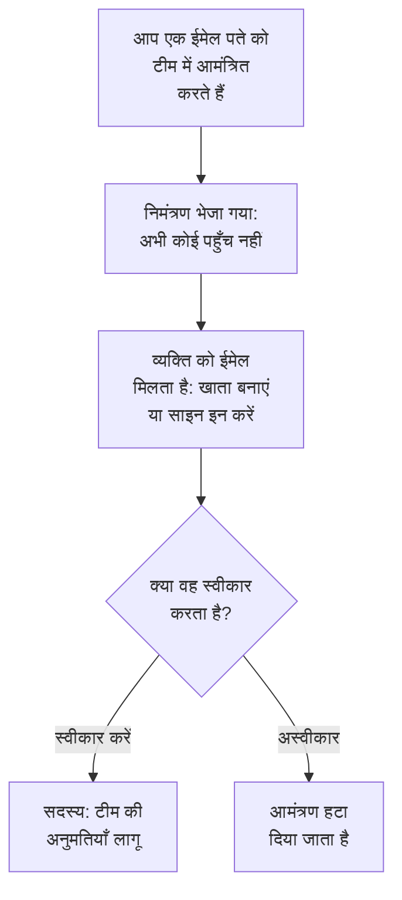

# लोगों को आमंत्रित करना

लोग आमंत्रण के ज़रिए किसी प्रोजेक्ट में आते हैं। आप किसी व्यक्ति के ईमेल पते को एक टीम में आमंत्रित करते हैं, वह स्वीकार करता है, और उसके बाद वह क्या कर सकता है, यह टीम तय करती है। यह पेज बताता है कि लोगों को कैसे आमंत्रित करें, उन्हें क्या दिखता है, और बाद में उनकी पहुँच कैसे बदलें या खत्म करें।

:::cards
- [किसी को आमंत्रित करें](#किसी-को-आमंत्रित-करें): एक ईमेल पता और एक टीम।
- [आमंत्रण स्वीकार करना](#आमंत्रण-स्वीकार-करना): आमंत्रित व्यक्ति क्या देखता और करता है।
- [किसी की टीमें बदलें](#किसी-की-टीमें-बदलें): ज़्यादा पहुँच दें, या कम।
- [किसी को हटाएं](#प्रोजेक्ट-से-किसी-को-हटाएं): प्रोजेक्ट छोड़ने पर क्या-क्या चला जाता है।
:::

## आमंत्रण कैसे काम करता है

- **टीम तय करती है कि व्यक्ति क्या कर सकता है।** किसी के पास अपनी निजी अनुमतियाँ नहीं होतीं: कोई व्यक्ति वही कर सकता है जिसकी अनुमति उसकी टीमें देती हैं। देखें [उपयोगकर्ता, टीमें और अनुमतियाँ](/docs/permissions/index)।
- **स्वीकार करने तक कुछ भी नहीं दिया जाता।** लंबित आमंत्रण **निमंत्रण भेजा गया** के रूप में दिखता है और प्रोजेक्ट तक कोई पहुँच नहीं देता।
- **एक स्वीकृति पूरे प्रोजेक्ट पर लागू होती है।** जब कोई आमंत्रण स्वीकार किया जाता है, तो उसी प्रोजेक्ट के लिए उस व्यक्ति के बाकी सभी आमंत्रण भी स्वीकार हो जाते हैं। जिस सदस्य को आप बाद में किसी दूसरी टीम में जोड़ते हैं, वह बिना कुछ स्वीकार किए तुरंत उसमें शामिल हो जाता है।

## शुरू करने से पहले

- **आमंत्रित कर सकने वाली भूमिका।** Project Owner, Project Admin, या **Invite New Members** अनुमति वाली भूमिका। आप लोगों को केवल उसी टीम में आमंत्रित कर सकते हैं जिसकी अनुमतियाँ आपके पास खुद हैं, क्योंकि आमंत्रण उन्हें उस टीम की पहुँच देता है।
- **OneUptime Cloud पर, आपके प्लान में जगह।** प्रोजेक्ट का हर व्यक्ति बिल पर एक सीट है, उसी पल से जब उसे आमंत्रित किया जाता है। Free प्लान में एक व्यक्ति की जगह है। देखें [बिलिंग और उपयोग](/docs/configuration/billing#आपका-प्लान-और-सीटें)।
- **SCIM Push Groups नहीं।** जब तक आपका पहचान प्रदाता SCIM Push Groups के ज़रिए प्रोजेक्ट की टीमें संभालता है, आप लोगों को वहीं आमंत्रित करते और हटाते हैं, OneUptime में नहीं।

## किसी को आमंत्रित करें

:::steps
### उपयोगकर्ता सूची खोलें

**उत्पाद → सेटिंग्स → उपयोगकर्ता** पर जाएं। **उपयोगकर्ता** सूची प्रोजेक्ट के हर व्यक्ति को, उनकी टीमों को, और यह दिखाती है कि वे शामिल हुए हैं या नहीं।

### आमंत्रण डायलॉग खोलें

**उपयोगकर्ता को आमंत्रित करें** पर क्लिक करें। **नए उपयोगकर्ता को आमंत्रित करें** डायलॉग खुलता है।

### ईमेल पता दर्ज करें

**ईमेल** में पता लिखें। अगर कोई OneUptime खाता अभी तक इसका उपयोग नहीं करता, तो डायलॉग एक **नाम** भी मांगता है, जिससे नया खाता शुरू होता है।

### टीम चुनें

**टीम** प्रोजेक्ट की सदस्य टीम पर शुरू होता है: वह टीम जिसके पास पूरे प्रोजेक्ट के लिए Project Member है, या फिर Members नाम वाली टीम। ज़्यादा या कम पहुँच देने के लिए कोई दूसरी टीम चुनें। जब प्रोजेक्ट में ऐसी कोई टीम न हो, या आप खुद उसमें किसी को आमंत्रित न कर सकें, तो **टीम** खाली रहता है।

### आमंत्रण भेजें

**आमंत्रित करें** पर क्लिक करें। OneUptime आमंत्रण ईमेल करता है और व्यक्ति का पेज खोलता है। आमंत्रण स्वीकार होने तक व्यक्ति **निमंत्रण भेजा गया** के रूप में दिखता है।
:::

> [!TIP]
> लोगों को उस सबसे छोटी टीम में आमंत्रित करें जो उन्हें अपना काम करने दे। आप बाद में उन्हें और टीमों में जोड़ सकते हैं, और हर नई टीम उनकी क्षमता बढ़ाती है।

## आमंत्रण स्वीकार करना

आमंत्रण ईमेल में प्रोजेक्ट का नाम होता है। उसका बटन उन लोगों के लिए **Create Your Account** है जिनके पास अभी OneUptime खाता नहीं है, और जिनके पास है उनके लिए **Sign In to OneUptime**। साइन इन करने के बाद, वे दो में से किसी एक जगह पर स्वीकार करते हैं:

| वे कहाँ हैं | उन्हें क्या दिखता है | वे क्या क्लिक करते हैं |
| --- | --- | --- |
| अभी किसी प्रोजेक्ट में नहीं | साइन इन के बाद खुलने वाले पेज पर आमंत्रण | **Accept & Join** या **Decline** |
| पहले से किसी दूसरे प्रोजेक्ट में | ऊपर दाईं ओर घंटी पर लंबित आमंत्रण, जो **प्रोजेक्ट आमंत्रण** खोलता है | **स्वीकार करें** या **अस्वीकार करें** |

स्वीकार करते ही वे तुरंत प्रोजेक्ट में आ जाते हैं, अपनी टीम की अनुमतियों और उस सूचना सेटअप के साथ जिससे हर सदस्य शुरू करता है: देखें [शुरुआत में आपको क्या मिलता है](/docs/notifications/index#शुरुआत-में-आपको-क्या-मिलता-है)। अस्वीकार करने से आमंत्रण हट जाता है, इसलिए बाद में शामिल होने के लिए नया आमंत्रण चाहिए।

## देखें कि प्रोजेक्ट में कौन है

**उपयोगकर्ता** में हर व्यक्ति की एक पंक्ति होती है:

| कॉलम | यह क्या दिखाता है |
| --- | --- |
| **उपयोगकर्ता** | उनका नाम और ईमेल पता। |
| **टीमें** | प्रोजेक्ट की हर वह टीम जिसमें वे हैं, या जिसमें उन्हें आमंत्रित किया गया है। |
| **स्थिति** | शामिल होने के बाद **सदस्य**, साथ में दूसरी टीमों के उन आमंत्रणों की गिनती जिन्हें उन्होंने अभी स्वीकार नहीं किया। तब तक **निमंत्रण भेजा गया**। |

सूची को **उपयोगकर्ता**, **स्थिति** या **टीम** से फ़िल्टर करें। व्यक्ति का पेज खोलने के लिए किसी पंक्ति पर क्लिक करें:

| पेज | यह किसलिए है |
| --- | --- |
| **प्रोफ़ाइल** | उनका नाम, ईमेल पता, तस्वीर और उपयोगकर्ता ID। |
| **टीमें** | वे टीमें जिनमें वे हैं। यहाँ कोई टीम जोड़ें या हटाएं। |
| **तैयारी**, **सूचना विधियां**, **ऑन-कॉल नियम** | क्या उन्हें पेज किया जा सकता है, और कैसे। Project Owners, Project Admins, खुद उस व्यक्ति, और लोगों के सूचना नियम पढ़ सकने वाले हर व्यक्ति को दिखते हैं। देखें [तैयारी और रिपोर्ट](/docs/on-call/readiness)। |
| **कस्टम फ़ील्ड** | लोगों के लिए प्रोजेक्ट के कस्टम फ़ील्ड, जब कोई हों। |
| **प्रोजेक्ट से हटाएं** | उन्हें प्रोजेक्ट से बाहर करें। |

## किसी की टीमें बदलें

:::steps
### उनका टीमें पेज खोलें

**उपयोगकर्ता** में व्यक्ति पर क्लिक करें, फिर **टीमें** पर।

### उन्हें किसी टीम में जोड़ें

**आमंत्रित करें** पर क्लिक करें, **टीम** चुनें, और डायलॉग में **आमंत्रित करें** पर क्लिक करें। सदस्य तुरंत नई टीम में आ जाता है। जो अभी शामिल नहीं हुआ है उसे एक और आमंत्रण मिलता है, और किसी एक को स्वीकार करने से दोनों स्वीकार हो जाते हैं।

### उन्हें किसी टीम से हटाएं

टीम की पंक्ति पर **हटाएं** पर क्लिक करें। अगर यह आखिरी टीम है जिसमें वे शामिल हुए हैं, तो इसे हटाने से वे प्रोजेक्ट से बाहर हो जाते हैं, और कुछ भी बदलने से पहले डायलॉग यह बता देता है।
:::

Owners टीम में हमेशा कम से कम एक ऐसा सदस्य रहता है जो शामिल हो चुका है, ताकि प्रोजेक्ट अपना आखिरी मालिक कभी न खोए।

## प्रोजेक्ट से किसी को हटाएं

**उपयोगकर्ता** में व्यक्ति की पंक्ति का मेनू, **⋯**, खोलें और **प्रोजेक्ट से हटाएं** पर क्लिक करें। या व्यक्ति को खोलें और उनके साइड मेनू में **प्रोजेक्ट से हटाएं** चुनें। एक साथ कई लोगों को हटाने के लिए उनकी पंक्तियाँ चुनें और चयन को हटाएं: उनमें से हर एक को उसी तरह हटाया जाता है।

किसी को हटाने से वह प्रोजेक्ट की हर टीम से बाहर हो जाता है। साइन इन रहते हुए भी वह तुरंत पहुँच खो देता है, प्रोजेक्ट के ऑन-कॉल शेड्यूल और एस्केलेशन नियमों से हटा दिया जाता है, और उसे प्रोजेक्ट की सूचनाएँ मिलना बंद हो जाता है। उसका OneUptime खाता नहीं हटता, और आप उसे फिर से आमंत्रित कर सकते हैं। [उपयोगकर्ता, टीमें और अनुमतियाँ](/docs/permissions/index#उपयोगकर्ता) बताता है कि प्रोजेक्ट छोड़ने पर क्या-क्या चला जाता है।

## शामिल होने के दूसरे तरीके

- **सिंगल साइन-ऑन।** जो व्यक्ति पहली बार प्रोजेक्ट के पहचान प्रदाता से साइन इन करता है, वह उन टीमों में शामिल होता है जिनका नाम प्रदाता देता है। देखें [SSO उपयोगकर्ताओं के लिए भूमिकाएँ और टीमें](/docs/identity/sso#sso-उपयोगकर्ताओं-के-लिए-भूमिकाएँ-और-टीमें)।
- **SCIM।** आपका पहचान प्रदाता लोगों को बनाता है और उन्हें कनेक्शन की डिफ़ॉल्ट टीमों में जोड़ता है। देखें [SCIM](/docs/identity/scim#प्रोजेक्ट-उपयोगकर्ता-कैसे-प्रोविजन-होता-है)।
- **Admin Dashboard।** सेल्फ-होस्टेड इंस्टॉलेशन पर, मास्टर एडमिन किसी को प्रोजेक्ट में जोड़ सकता है और उसकी ओर से आमंत्रण स्वीकार कर सकता है। देखें [उपयोगकर्ता, टीमें और अनुमतियाँ](/docs/permissions/index#उपयोगकर्ता)।

## समस्या निवारण

:::details "This user has already been invited to this team"
वे पहले से उस टीम में हैं, सदस्य के रूप में या ऐसे आमंत्रण के साथ जिसे उन्होंने स्वीकार नहीं किया है। उनकी टीमें देखने के लिए उन्हें **उपयोगकर्ता** में खोलें, या उन्हें किसी दूसरी टीम में आमंत्रित करें।
:::

:::details "You have reached the user limit for the free plan"
OneUptime Cloud पर, Free प्लान वाले प्रोजेक्ट में एक व्यक्ति की जगह होती है। प्लान बदलें, फिर दोबारा आमंत्रित करें। देखें [प्लान बदलें](/docs/configuration/billing#प्लान-बदलें)।
:::

:::details "Too many invitations were sent to this email address in the last hour"
एक पते पर, प्रोजेक्ट और निजी स्थिति पृष्ठों के निमंत्रण मिलाकर, एक घंटे में 10 निमंत्रण भेजे जा सकते हैं, चाहे उन्हें कोई भी भेजे। एक घंटा रुकें, फिर उन्हें दोबारा आमंत्रित करें।
:::

:::details आमंत्रण ईमेल नहीं पहुँचा, या उसका लिंक समाप्त हो गया
आमंत्रण ईमेल पर निर्भर नहीं है। उनसे उस पते से साइन अप करने को कहें जिसे आपने आमंत्रित किया था: OneUptime उस पते पर खाता बनाना पूरा करने के लिए एक नया लिंक ईमेल करता है। जिसके पास पहले से खाता है, वह साइन इन करता है और उसे आमंत्रण इंतज़ार करता हुआ मिलता है।
:::

:::details उपयोगकर्ता को आमंत्रित करें कहता है कि उपयोगकर्ता SCIM Push Groups से प्रबंधित होते हैं
आपका पहचान प्रदाता प्रोजेक्ट की टीमें संभालता है। लोगों को पहचान प्रदाता में आमंत्रित करें या हटाएं, या उन्हें यहाँ संभालने के लिए **प्रोजेक्ट सेटिंग्स → सुरक्षा → SCIM** में Push Groups बंद करें।
:::

## अगले कदम

:::cards
- [उपयोगकर्ता, टीमें और अनुमतियाँ](/docs/permissions/index): तय करें कि हर टीम क्या कर सकती है।
- [प्रोजेक्ट सेटिंग्स](/docs/configuration/project-settings): वह सब कुछ जो पूरे प्रोजेक्ट पर लागू होता है।
- [आपका खाता](/docs/introduction/your-account): साइन-इन, प्रोफ़ाइल और वे प्रोजेक्ट जिनमें आप हैं।
- [SCIM](/docs/identity/scim): अपने पहचान प्रदाता को लोगों और टीमों को संभालने दें।
:::
