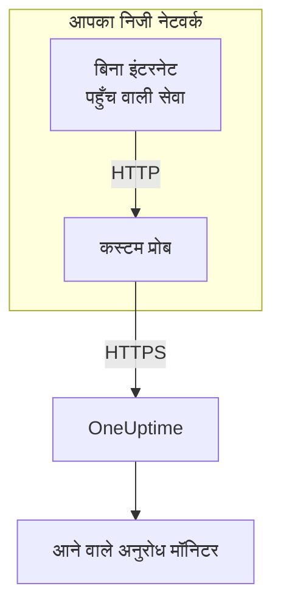

# आने वाले अनुरोध Ingress

बिना इंटरनेट पहुँच वाली सेवा भी [आने वाले अनुरोध मॉनिटर](/docs/monitor/incoming-request-monitor) को हार्टबीट भेज सकती है। वह इन्हें अपने ही नेटवर्क के किसी [कस्टम प्रोब](/docs/probe/custom-probe) को भेजती है, और प्रोब इन्हें OneUptime तक पहुँचाता है।

:::cards
- [यह कैसे काम करता है](#यह-कैसे-काम-करता-है): आपकी सेवा से, प्रोब के ज़रिए, मॉनिटर तक।
- [लिसनर चालू करें](#लिसनर-चालू-करें): प्रोब पर एक सेटिंग, Docker, Docker Compose या Kubernetes के लिए।
- [प्रोब को अनुरोध भेजें](#प्रोब-को-अनुरोध-भेजें): आपकी सेवा जिस URL पर भेजती है, केवल उसे बदलें।
- [समस्या निवारण](#समस्या-निवारण): अनुरोध न पहुँचने पर प्रोब क्या लॉग करता है।
:::

## यह कैसे काम करता है



1. **आपकी सेवा अनुरोध प्रोब को भेजती है।** वही `GET` या `POST`, उसी सीक्रेट कुंजी के साथ, जो वह OneUptime को भेजती, उस पोर्ट पर जिस पर प्रोब सुनता है।
2. **प्रोब तुरंत जवाब देता है।** अनुरोध आगे भेजने से पहले ही वह `200` लौटाता है, इसलिए आपकी सेवा कभी OneUptime का इंतज़ार नहीं करती।
3. **प्रोब इसे आगे भेजता है।** वह अनुरोध को उसकी मेथड, हेडर और बॉडी के साथ OneUptime को भेजता है, और प्रोब का नाम बताने वाला `OneUptime-Probe-Id` हेडर जोड़ता है।
4. **OneUptime इसे हमेशा की तरह पढ़ता है।** मॉनिटर के मानदंड अनुरोध को ऐसे देखते हैं जैसे सेवा ने उसे सीधे भेजा हो।

लिसनर अपने अलग पोर्ट पर चलता है, प्रोब के हेल्थ चेक से अलग, इसलिए आप बाकी कुछ खोले बिना इसे अपने निजी नेटवर्क के लिए खोल सकते हैं।

## इसका उपयोग कब करें

लिसनर का उपयोग तब करें जब:

- आपकी सेवाएँ ऐसे अलग नेटवर्क सेगमेंट में चलती हैं जहाँ बाहर जाने वाली HTTPS पहुँच नहीं है
- आपको पूरा मॉनिटरिंग ट्रैफ़िक अपने VPC या ऑन-प्रेम नेटवर्क के अंदर रखना है
- आप OneUptime तक पहुँचने की अनुमति वाला एक ही निकास बिंदु चाहते हैं: प्रोब
- आपने पहले से एक [कस्टम प्रोब](/docs/probe/custom-probe) लगाया है और उसे आने वाली हार्टबीट के लिए भी इस्तेमाल करना चाहते हैं

अगर आपकी सेवाएँ पहले से `https://oneuptime.com` (या आपके सेल्फ़-होस्टेड URL) तक सीधे पहुँच सकती हैं, तो आपको इस सुविधा की **ज़रूरत नहीं** है: सेवा से हार्टबीट URL को सीधे कॉल करें।

## शुरू करने से पहले

- **एक चलता हुआ कस्टम प्रोब।** उसकी **स्थिति** **कनेक्टेड** दिखाती है। इंस्टॉल करने के लिए [कस्टम प्रोब](/docs/probe/custom-probe) देखें।
- **एक आने वाले अनुरोध मॉनिटर।** उसके हार्टबीट URL में वह सीक्रेट कुंजी होती है जो आपकी सेवा भेजती है: [आने वाले अनुरोध मॉनिटर](/docs/monitor/incoming-request-monitor) देखें।
- **प्रोब के होस्ट पर एक पोर्ट जिस तक आपकी सेवाएँ पहुँच सकें।** उदाहरणों में `3875` इस्तेमाल हुआ है।

## लिसनर चालू करें

`PROBE_INGRESS_PORT` को उस पोर्ट पर सेट करें जिसे लिसनर इस्तेमाल करे। `0` से बड़ा कोई भी मान इसे चालू करता है; सेट न करने पर, या `0` पर, यह बंद रहता है।

:::tabs
@tab Docker
```bash
docker run --name oneuptime-probe --network host \
  -e PROBE_KEY=<probe-key> \
  -e PROBE_ID=<probe-id> \
  -e ONEUPTIME_URL=https://oneuptime.com \
  -e PROBE_INGRESS_PORT=3875 \
  -d oneuptime/probe:release
```

`--network host` के बिना, पोर्ट को `-p 3875:3875` से पब्लिश करें।
@tab Docker Compose
```yaml title="docker-compose.yml"
services:
  oneuptime-probe:
    image: oneuptime/probe:release
    container_name: oneuptime-probe
    environment:
      - PROBE_KEY=<probe-key>
      - PROBE_ID=<probe-id>
      - ONEUPTIME_URL=https://oneuptime.com
      - PROBE_INGRESS_PORT=3875
    network_mode: host
    restart: always
```

`network_mode: host` के बिना, पोर्ट को `ports:` के नीचे `"3875:3875"` के रूप में पब्लिश करें।
@tab Kubernetes
```yaml title="oneuptime-probe.yaml"
apiVersion: apps/v1
kind: Deployment
metadata:
  name: oneuptime-probe
spec:
  selector:
    matchLabels:
      app: oneuptime-probe
  template:
    metadata:
      labels:
        app: oneuptime-probe
    spec:
      containers:
        - name: oneuptime-probe
          image: oneuptime/probe:release
          env:
            - name: PROBE_KEY
              value: "<probe-key>"
            - name: PROBE_ID
              value: "<probe-id>"
            - name: ONEUPTIME_URL
              value: "https://oneuptime.com"
            - name: PROBE_INGRESS_PORT
              value: "3875"
          ports:
            - name: ingress
              containerPort: 3875
---
apiVersion: v1
kind: Service
metadata:
  name: oneuptime-probe-ingress
spec:
  selector:
    app: oneuptime-probe
  ports:
    - name: ingress
      port: 3875
      targetPort: 3875
  type: ClusterIP
```

इसके बाद क्लस्टर की सेवाएँ `http://oneuptime-probe-ingress.<namespace>.svc.cluster.local:3875/heartbeat/<secret-key>` पर भेजती हैं।
:::

लिसनर चालू होने पर प्रोब के लॉग में `Probe ingress listener started on port 3875 (heartbeat / incoming-request endpoints)` लिखा होता है।

## प्रोब को अनुरोध भेजें

आपकी सेवा OneUptime की जगह प्रोब को भेजती है। सार्वजनिक हार्टबीट URL:

```text
https://oneuptime.com/heartbeat/<secret-key>
```

को प्रोब के ingress URL से बदलें:

```text
http://<probe-host>:<PROBE_INGRESS_PORT>/heartbeat/<secret-key>
```

पाथ, मेथड, बॉडी और हेडर बाकी सब एक जैसे रहते हैं, इसलिए मौजूदा क्लाइंट कोड में केवल बेस URL बदलना होता है। प्रोब `/incoming-request/<secret-key>` भी स्वीकार करता है, जो उसी तरह काम करता है।

```bash
# GET heartbeat
curl http://probe.internal:3875/heartbeat/YOUR_SECRET_KEY

# POST heartbeat with JSON body
curl -X POST http://probe.internal:3875/heartbeat/YOUR_SECRET_KEY \
  -H "Content-Type: application/json" \
  -d '{"status": "healthy", "version": "1.2.3"}'

# Cron job
*/5 * * * * curl -s http://probe.internal:3875/heartbeat/YOUR_SECRET_KEY > /dev/null
```

## अनुरोध कैसे आगे भेजे जाते हैं

| क्या | प्रोब इसे कैसे संभालता है |
| --- | --- |
| जवाब | खाली JSON ऑब्जेक्ट (`{}`) के साथ `200`, अनुरोध आगे भेजने से पहले। OneUptime की तरह, आगे कुछ भी हो, यह भेजा जाता है: गलत सीक्रेट कुंजी को भी यही मिलता है। |
| मेथड | `POST` को `POST` के रूप में भेजा जाता है। `GET`, और `HEAD`, को `GET` के रूप में भेजा जाता है। बाकी मेथड को प्रोब से `404` मिलता है। |
| हेडर | हॉप-बाय-हॉप हेडर (`Host`, `Connection`, `Content-Length`, `Transfer-Encoding`, `Keep-Alive`, `Proxy-Authenticate`, `Proxy-Authorization`, `TE`, `Trailer`, `Upgrade`) और `Content-Encoding` को छोड़कर सभी, क्योंकि प्रोब बॉडी को बिना कंप्रेशन के आगे भेजता है। प्रोब `OneUptime-Probe-Id` जोड़ता है। |
| बॉडी | 50 MB तक की JSON और फ़ॉर्म बॉडी, जैसे OneUptime को सीधे भेजने पर। वहाँ की तरह, कोई भी दूसरी बॉडी मॉनिटर तक खाली पहुँचती है। |
| पुनः प्रयास | आगे भेजना विफल होने पर प्रोब `PROBE_INGRESS_FORWARD_RETRY_LIMIT` बार तक दोबारा कोशिश करता है, 2 सेकंड, फिर 4 सेकंड, फिर 8 सेकंड रुककर, और कभी 15 सेकंड से ज़्यादा नहीं। फिर वह विफलता लॉग करता है और अनुरोध छोड़ देता है। |
| प्रॉक्सी | `HTTP_PROXY_URL` या `HTTPS_PROXY_URL` सेट होने पर आगे भेजना प्रोब की प्रॉक्सी से होता है। |
| यह कहाँ जाता है | `ONEUPTIME_URL` के बाद `/incoming-request-ingest/incoming-request/<secret-key>`। |

## एनवायरनमेंट वेरिएबल

| वेरिएबल | डिफ़ॉल्ट | यह क्या करता है |
| --- | --- | --- |
| `PROBE_INGRESS_PORT` | सेट नहीं (बंद) | लिसनर जिस पोर्ट का इस्तेमाल करता है। `0` से बड़ा कोई भी मान इसे चालू करता है। |
| `PROBE_INGRESS_FORWARD_TIMEOUT_MS` | `10000` | OneUptime को हर बार आगे भेजने में कितना समय लग सकता है, मिलीसेकंड में। `1000` से कम मान डिफ़ॉल्ट पर लौट जाता है। |
| `PROBE_INGRESS_FORWARD_RETRY_LIMIT` | `3` | विफल रहा आगे भेजना कितनी बार दोबारा किया जाता है। `0` पुनः प्रयास बंद करता है। |

प्रोब के सामान्य वेरिएबल (`PROBE_KEY`, `PROBE_ID`, `ONEUPTIME_URL` और प्रॉक्सी वेरिएबल) सभी लागू होते हैं: पूरी सूची के लिए [कस्टम प्रोब](/docs/probe/custom-probe) देखें।

## सुरक्षा संबंधी बातें

- **यह एंडपॉइंट जानबूझकर बिना प्रमाणीकरण के है** : URL पाथ में मौजूद सीक्रेट कुंजी *ही* प्रमाणीकरण है, ठीक वैसे ही जैसे सार्वजनिक `oneuptime.com` एंडपॉइंट पर। सीक्रेट कुंजी को पासवर्ड की तरह संभालें।
- **लिसनर को अपने निजी नेटवर्क में ही रखें।** यह इंटरनेट से पहुँच योग्य नहीं होना चाहिए। कौन इस तक पहुँच सकता है, इसे नेटवर्क पॉलिसी, फ़ायरवॉल नियम या `ClusterIP` सेवा से सीमित करें।
- **अगर नेटवर्क में एन्क्रिप्शन चाहिए, तो इसके आगे TLS लगाएँ।** लिसनर सादा HTTP बोलता है। उस हिस्से पर TLS के लिए इसे किसी आंतरिक लोड बैलेंसर या इनग्रेस कंट्रोलर के पीछे रखें। प्रोब से OneUptime तक का आगे भेजना HTTPS इस्तेमाल करता है जब `ONEUPTIME_URL` `https://` से शुरू होता है।
- **अगर 50 MB बहुत ज़्यादा है, तो बॉडी का आकार खुद सीमित करें।** लिसनर के आगे कम सीमा वाली रिवर्स प्रॉक्सी लगाएँ।

## समस्या निवारण

:::details प्रोब का लॉग कभी नहीं बताता कि लिसनर शुरू हुआ
`PROBE_INGRESS_PORT` सेट नहीं है, `0` है, या संख्या नहीं है। इसे किसी पोर्ट नंबर पर सेट करें और प्रोब रीस्टार्ट करें। लॉग लाइन है `Probe ingress listener started on port <port> (heartbeat / incoming-request endpoints)`।
:::

:::details प्रोब `Probe ingress: failed to forward to <url> after N attempts` लॉग करता है
पुनः प्रयासों के बाद भी प्रोब OneUptime तक नहीं पहुँच सका। प्रोब की बाहर जाने वाली कनेक्टिविटी, उसकी प्रॉक्सी सेटिंग और `ONEUPTIME_URL` का मान जाँचें। अगर प्रोब भी **डिस्कनेक्टेड** दिखाता है, तो उसके अनुरोध कहाँ रुकते हैं यह जानने के लिए [कस्टम प्रोब](/docs/probe/custom-probe) देखें।
:::

:::details प्रोब `Probe ingress: probe ID not available, forwarding without it` लॉग करता है
प्रोब ने अभी OneUptime से कनेक्ट होना पूरा नहीं किया है, इसलिए वह `OneUptime-Probe-Id` हेडर के बिना अनुरोध आगे भेजता है। अनुरोध फिर भी मॉनिटर तक पहुँचता है।
:::

:::details मॉनिटर को अनुरोध मिलते हैं, पर प्रोब के ज़रिए नहीं
आपकी सेवा अब भी सार्वजनिक URL पर भेज रही है। जाँचें कि वह `http://<probe-host>:<port>/...` पर भेजती है: किसी दूसरी जगह की ओर इशारा करने वाला DNS नाम या `/etc/hosts` प्रविष्टि आम कारण है।
:::

:::details मॉनिटर को कुछ नहीं मिलता, और प्रोब कुछ लॉग नहीं करता
अनुरोध कभी प्रोब तक पहुँचा ही नहीं। जाँचें कि सेवा उस पोर्ट पर प्रोब के होस्ट तक पहुँच सकती है: कोई फ़ायरवॉल नियम, पब्लिश न किया गया पोर्ट, या ऐसी Kubernetes Service जो प्रोब के Pod को नहीं चुनती।
:::

## अगले कदम

:::cards
- [आने वाले अनुरोध मॉनिटर](/docs/monitor/incoming-request-monitor): तय करें कि स्वस्थ हार्टबीट क्या मानी जाए।
- [कस्टम प्रोब](/docs/probe/custom-probe): प्रोब इंस्टॉल करें, और वह जो भी सेटिंग पढ़ता है।
:::
