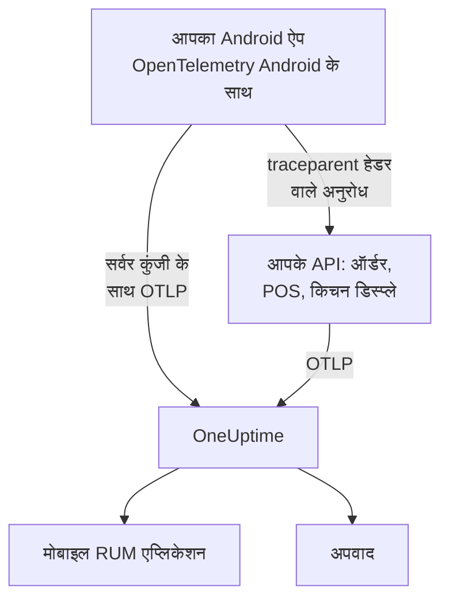

# Android सेटअप

किसी नेटिव Android ऐप को OpenTelemetry Android से इंस्ट्रुमेंट करें, ताकि वह OneUptime को मोबाइल RUM एप्लिकेशन के रूप में रिपोर्ट करे: उसके क्रैश और ANR, धीमे और फ़्रीज़ हुए फ़्रेम, ऐप स्टार्ट, स्क्रीन, सेशन और नेटवर्क अनुरोध, जो आपके बैकएंड तक ट्रेस होते हैं।

:::cards
- [OpenTelemetry Android जोड़ें](#opentelemetry-android-जोड़ें): एक Gradle डिपेंडेंसी, और ऐप शुरू होने पर कुछ पंक्तियाँ।
- [यह क्या रिपोर्ट करता है](#यह-क्या-रिपोर्ट-करता-है): क्रैश, ANR, फ़्रीज़ हुए फ़्रेम, स्टार्ट और सेशन, और हर एक कहाँ पहुँचता है।
- [अपने बैकएंड तक अनुरोध ट्रेस करें](#अपने-बैकएंड-तक-अनुरोध-ट्रेस-करें): हर OkHttp कॉल का एक स्पैन, और उस पर एक `traceparent`।
- [अपने खुद के वर्कफ़्लो ट्रेस करें](#अपने-खुद-के-वर्कफ़्लो-ट्रेस-करें): मेन्यू से किचन तक एक ऑर्डर, एक पेमेंट टर्मिनल, एक प्रिंटर।
- [कियोस्क और आपके अपने दूसरे डिवाइस](#कियोस्क-और-आपके-अपने-दूसरे-डिवाइस): हर डिवाइस को नाम दें, उसे अपने MDM से कॉन्फ़िगर करें, ऑफ़लाइन रहते हुए भी डेटा रखें।
:::

## यह कैसे काम करता है

OpenTelemetry Android आपके ऐप के अंदर चलता है। यह **सर्वर** इंजेशन कुंजी के साथ OTLP पर ट्रेस, लॉग और मेट्रिक्स OneUptime को भेजता है, और आपके ऐप के अनुरोधों में W3C `traceparent` हेडर जोड़ता है, ताकि आपके बैकएंड के स्पैन ऐप के ट्रेस से जुड़ जाएँ।



## शुरू करने से पहले

- एक Android ऐप, जिसका `minSdk` 23 या उससे ऊपर हो और जो `compileSdk` 34 या उससे ऊपर के साथ बिल्ड किया गया हो। `minSdk` 26 से कम हो, तो [कोर लाइब्रेरी डीशुगरिंग](https://developer.android.com/studio/write/java8-support#library-desugaring) चालू करें, Android Gradle Plugin 8.3.0 या उसके बाद के संस्करण के साथ, और `gradle.properties` में `android.useFullClasspathForDexingTransform=true` के साथ।
- एक **सर्वर** इंजेशन कुंजी, जो **प्रोजेक्ट सेटिंग्स → टेलीमेट्री और APM → इंजेशन कुंजियाँ** में **इंजेशन कुंजी बनाएँ** से बनाई गई हो। ऐप से आई **ब्राउज़र** कुंजी अस्वीकार हो जाती है: उसकी जाँच `Origin` हेडर से होती है, जिसे ऐप नहीं भेजता।
- ये OTLP सेटिंग्स। अगर आप OneUptime खुद होस्ट करते हैं, तो `https://oneuptime.com` को अपने होस्ट से बदलें।

| सेटिंग | मान |
| --- | --- |
| OTLP एंडपॉइंट | `https://oneuptime.com/otlp` |
| हेडर | `x-oneuptime-token: YOUR_TELEMETRY_INGESTION_TOKEN` |

> [!WARNING]
> कुंजी आपके ऐप के अंदर जाती है, और ऐप को खोला जा सकता है, इसलिए मान लें कि कोई इसे कॉपी करेगा। कुंजी के पेज पर **पिन किया गया सेवा नाम**, **Requests Per Minute Limit** और **इस समय समाप्त होता है** की तारीख सेट करें, और हर रिलीज़ के साथ कुंजी बदलें।

## OpenTelemetry Android जोड़ें

:::steps
### डिपेंडेंसी जोड़ें

```kotlin title="app/build.gradle.kts"
dependencies {
    implementation("io.opentelemetry.android:android-agent:1.8.1")
}
```

एजेंट अपने साथ क्रैश, ANR, धीमी रेंडरिंग, एक्टिविटी, फ़्रैगमेंट, नेटवर्क और सेशन इंस्ट्रुमेंटेशन लाता है। नए संस्करण के लिए [इसकी रिलीज़](https://github.com/open-telemetry/opentelemetry-android/releases) देखें।

### ऐप शुरू होते ही इसे शुरू करें

```kotlin title="KioskApplication.kt"
import android.app.Application
import io.opentelemetry.android.OpenTelemetryRum
import io.opentelemetry.android.agent.OpenTelemetryRumInitializer

class KioskApplication : Application() {
    lateinit var otelRum: OpenTelemetryRum

    override fun onCreate() {
        super.onCreate()

        otelRum = OpenTelemetryRumInitializer.initialize(this) {
            httpExport {
                baseUrl = "https://oneuptime.com/otlp"
                baseHeaders = mapOf("x-oneuptime-token" to BuildConfig.ONEUPTIME_TOKEN)
            }
            resource {
                put("service.name", "kiosk-ordering")
                put("deployment.environment.name", "production")
            }
        }
    }
}
```

`baseUrl` बिना सिग्नल वाला एंडपॉइंट है: एजेंट इसमें `/v1/traces`, `/v1/logs` और `/v1/metrics` खुद जोड़ता है। `service.name` सेट करें, वरना ऐप को उसके लॉन्चर लेबल का नाम मिलता है। यह OneUptime में एप्लिकेशन की पहचान है, इसलिए इसे हर रिलीज़ में एक जैसा रखें।

अपने मैनिफ़ेस्ट के `<application>` एलिमेंट के `android:name` में इस क्लास का नाम दें। `BuildConfig.ONEUPTIME_TOKEN` उस जगह के लिए है जहाँ आपका बिल्ड कुंजी रखता है; डिवाइसों का बेड़ा इसके बजाय इसे अपने MDM से पा सकता है, जैसा [कियोस्क और आपके अपने दूसरे डिवाइस](#कियोस्क-और-आपके-अपने-दूसरे-डिवाइस) में दिखाया गया है।

### ऐप चलाएँ और जाँचें कि डेटा पहुँचता है

```bash
curl -i https://oneuptime.com/otlp/v1/validate \
  -H "x-oneuptime-token: YOUR_TELEMETRY_INGESTION_TOKEN"
```

`"valid": true` के साथ `200` का मतलब है कि कुंजी स्वीकार है। फिर ऐप चलाएँ और थोड़ी देर इस्तेमाल करें: यह अपने `service.name` के नाम से **उत्पाद → संसाधन → वास्तविक उपयोगकर्ता मॉनिटरिंग** में दिखाई देता है। एजेंट टेलीमेट्री भेजने से पहले उसे डिस्क पर लिखता है, इसलिए पहले बैच को पहुँचने में एक मिनट लग सकता है।
:::

## यह क्या रिपोर्ट करता है

OpenTelemetry Android यह सब अपने आप रिकॉर्ड करता है। यह जो डिवाइस एट्रिब्यूट सेट करता है, `device.model.identifier`, `device.model.name` और `device.manufacturer`, वे ऐप को मोबाइल RUM एप्लिकेशन के रूप में दर्ज करवाते हैं और उसका **क्लाइंट्स** पेज भरते हैं। यह हर इंस्टॉल के लिए `os.name`, `os.version` और एक `app.installation.id` भी सेट करता है, और कोई `device.id` नहीं।

| क्या | एजेंट इसे कैसे भेजता है | OneUptime में यह कहाँ दिखता है |
| --- | --- | --- |
| क्रैश | अपवाद के प्रकार, संदेश और स्टैक ट्रेस के साथ एक `app.crash` इवेंट | **अपवाद**, अनहैंडल्ड के रूप में |
| ANR | मुख्य थ्रेड के स्टैक के साथ एक `device.anr` इवेंट, जब ऐप लगभग 5 सेकंड तक जवाब देना बंद कर दे | **अपवाद**, अनहैंडल्ड के रूप में, `ANR` प्रकार के अंतर्गत |
| धीमे और फ़्रीज़ हुए फ़्रेम | `app.jank.frame_count` के साथ एक `app.jank` इवेंट, यानी 16 मि.से. (`app.jank.threshold` का मान `0.016`) या 700 मि.से. (`0.7`) से धीमे फ़्रेमों की संख्या | **लॉग**, `@event.name:app.jank` के साथ |
| ऐप स्टार्ट | एक `AppStart` स्पैन, जिसमें `start.type` का मान `cold`, `warm` या `hot` होता है | **ट्रेस** |
| स्क्रीन | किसी एक्टिविटी या फ़्रैगमेंट के लाइफ़साइकल के हर चरण का एक स्पैन, और हर स्पैन और लॉग पर `app.screen.name` | **ट्रेस** |
| सेशन | हर स्पैन और लॉग पर `session.id`, और `session.start` और `session.end` इवेंट | **ट्रेस** और **लॉग**, `@session.id:` से खोजे गए |
| नेटवर्क बदलाव | एक `network.change` इवेंट, और हर स्पैन और लॉग पर `network.connection.type` | **लॉग** |

क्रैश और ANR **अपवाद** में अनहैंडल्ड के रूप में पहुँचते हैं, अपने स्टैक ट्रेस के हिसाब से समूहित होकर, उस सेशन के साथ जिसमें वे हुए। ऐप के क्रैश होते समय एजेंट क्रैश को डिस्क पर सहेज लेता है और वहीं से भेजता है, इसलिए ऑफ़लाइन रहते हुए हुआ क्रैश भी ऐप के फिर से नेटवर्क के साथ चलने पर पहुँच जाता है।

एप्लिकेशन का **अवलोकन** पेज ये सब आपके लिए दिखाता है: **सेशन**, **क्रैश-मुक्त सेशन**, **क्रैश**, **ANR**, **ऐप स्टार्ट**, **कोल्ड स्टार्ट (p95)** और **फ़्रीज़ हुए फ़्रेम**, और हर टाइल उन अपवादों, स्पैन या इवेंट को खोलती है जिन्हें वह गिनती है। जब तक ऐप से ऐप स्टार्ट या फ़्रेम नहीं आते, उनके चार्ट बताते हैं कि उन्हें कैसे चालू करें। इसका **सुझाव** पेज क्रैश, ANR, धीमे कोल्ड स्टार्ट, फ़्रीज़ हुए फ़्रेम और रिपोर्ट करना बंद कर देने वाले ऐप के लिए मॉनिटर पेश करता है।

सेशन बैकग्राउंड में 15 मिनट के बाद, या 4 घंटे के बाद खत्म होता है। जो ऐप कभी बैकग्राउंड में नहीं जाता, जैसे कोई कियोस्क, वह 4 घंटे तक एक ही सेशन रखता है, इसलिए हर ग्राहक की विज़िट को उसके अपने स्पैन के रूप में ट्रेस करें, जैसा [अपने खुद के वर्कफ़्लो ट्रेस करें](#अपने-खुद-के-वर्कफ़्लो-ट्रेस-करें) में दिखाया गया है।

जब आप नीचे दिए OkHttp मॉड्यूल के साथ `android-log-library` और `android-log-agent` जोड़ते हैं, तो आपके ऐप की अपनी `android.util.Log` कॉल भी लॉग बन जाती हैं: हर कॉल का टैग `android.log.tag` में जाता है, और throwable वाली कॉल **अपवाद** में एक अपवाद बन जाती है। OpenTelemetry Android Logcat नहीं पढ़ता।

## अपने बैकएंड तक अनुरोध ट्रेस करें

OkHttp इंस्ट्रुमेंटेशन जोड़ें, और वह ByteBuddy प्लगइन भी जिसके साथ यह बिल्ड होता है:

```kotlin title="app/build.gradle.kts"
plugins {
    // ...the plugins your app already applies, then:
    id("net.bytebuddy.byte-buddy-gradle-plugin") version "1.18.15"
}

dependencies {
    implementation("io.opentelemetry.android:android-agent:1.8.1")
    implementation("io.opentelemetry.android.instrumentation:okhttp3-library:1.8.1-alpha")
    byteBuddy("io.opentelemetry.android.instrumentation:okhttp3-agent:1.8.1-alpha")
}
```

प्लगइन खुद `OkHttpClient` क्लास को इंस्ट्रुमेंट करता है, इसलिए ऐप का हर क्लाइंट ट्रेस होता है, लाइब्रेरी जो क्लाइंट बनाती हैं वे भी। हर अनुरोध अपने मेथड के नाम वाला एक क्लाइंट स्पैन बनता है, जिसमें उसका URL, स्टेटस कोड और अवधि होती है, और वह W3C `traceparent` हेडर ले जाता है। [OpenTelemetry](/docs/telemetry/open-telemetry) से इंस्ट्रुमेंट किया गया बैकएंड उसी हेडर से ट्रेस आगे बढ़ाता है, इसलिए ऑर्डरिंग API, POS ब्रिज और किचन डिस्प्ले सेवा अपने स्पैन उसी ट्रेस में जोड़ती हैं जिसमें कियोस्क पर किया गया टैप है।

- `HttpURLConnection` के लिए भी मॉड्यूल की यही जोड़ी है: `httpurlconnection-library` और `httpurlconnection-agent`।
- प्लगइन के बिना, किसी क्लाइंट को खुद रैप करें: `OkHttpTelemetry.builder(otelRum.openTelemetry).build().createCallFactory(client)`, जो `io.opentelemetry.instrumentation:opentelemetry-okhttp-3.0` से आता है।
- आपके कोड में खोला गया स्पैन, जैसे अगले सेक्शन में, उसके अंदर किए गए अनुरोधों का पैरेंट होता है।

## अपने खुद के वर्कफ़्लो ट्रेस करें

एजेंट से एक ट्रेसर लें, और एक ग्राहक के ऑर्डर के लिए एक स्पैन बनाएँ, जिसमें उसके हर चरण का एक चाइल्ड स्पैन हो। तब हर चरण की अपनी अवधि और अपनी त्रुटियाँ होती हैं, और ऑर्डर बताता है कि वह कैसे खत्म हुआ:

```kotlin title="OrderTrace.kt"
import io.opentelemetry.api.trace.Span
import io.opentelemetry.api.trace.StatusCode
import io.opentelemetry.api.trace.Tracer
import io.opentelemetry.context.Context

class OrderTrace(private val tracer: Tracer) {
    // order.session: from the first tap to the order reaching the kitchen.
    private val order: Span = tracer.spanBuilder("order.session").startSpan()
    private val parent: Context = Context.current().with(order)

    // One step: menu.browse, cart.customize, payment.process, pos.inject.
    fun <T> step(name: String, block: (Span) -> T): T {
        val span = tracer.spanBuilder(name).setParent(parent).startSpan()
        return try {
            span.makeCurrent().use { block(span) }
        } catch (error: Throwable) {
            span.recordException(error)
            span.setStatus(StatusCode.ERROR)
            throw error
        } finally {
            span.end()
        }
    }

    fun complete() = finish("completed")

    fun abandon(reason: String) {
        order.setAttribute("order.abandon_reason", reason)
        finish("abandoned")
    }

    private fun finish(outcome: String) {
        order.setAttribute("order.outcome", outcome)
        order.end()
    }
}
```

```kotlin title="CheckoutFlow.kt"
val order = OrderTrace(otelRum.openTelemetry.getTracer("kiosk.ordering"))

order.step("cart.customize") { span ->
    span.setAttribute("cart.items", cart.size.toLong())
}
order.step("payment.process") { terminal.charge(cart.total) }
order.step("pos.inject") { posApi.submit(cart) } // its OkHttp span is a child
order.complete()
```

पेमेंट टर्मिनल, प्रिंटर, स्कैनर या NFC रीडर के SDK में की गई हर कॉल को इसी तरह रैप करें, और बताएँ कि वह कौन-सा डिवाइस था, ताकि धीमा या विफल होता डिवाइस एक धीमे या विफल स्पैन के रूप में दिखे:

```kotlin title="ReceiptPrinter.kt"
order.step("printer.print") { span ->
    span.setAttribute("peripheral.type", "printer")
    span.setAttribute("peripheral.model", printer.model)
    span.setAttribute("peripheral.connection", "usb")
    printer.print(receipt, timeoutMillis = 10_000)
}
```

एट्रिब्यूट के नाम आप खुद चुनते हैं: उन्हें हर ऐप में एक जैसा रखें, ताकि एक ही फ़िल्टर हर प्रिंटर ढूँढ ले। हर कॉल को एक टाइमआउट दें, क्योंकि स्पैन तभी खत्म होता है जब उसकी कॉल लौटती है। जो चरण कई स्क्रीन तक फैला हो, जैसे मेन्यू ब्राउज़ करना, वह ऐसा स्पैन है जिसे आप स्क्रीन खुलने पर शुरू करते हैं और बंद होने पर खत्म करते हैं, उसी पैरेंट के साथ। बिना अवधि वाले तथ्य के लिए, जैसे प्रिंटर में कागज़ खत्म होना, एक इवेंट भेजें: `otelRum.emitEvent("printer.paper_low")`।

**ट्रेस** में, किसी चरण के नाम पर फ़िल्टर करें ताकि दिखे कि उसमें कितना समय लगता है और वह कितनी बार विफल होता है, और `@order.outcome:abandoned` पर फ़िल्टर करें ताकि वे ऑर्डर मिलें जो कभी पूरे नहीं हुए।

## कियोस्क और आपके अपने दूसरे डिवाइस

### हर डिवाइस को नाम दें

OneUptime मोबाइल ऐप को एप्लिकेशन के हिसाब से दर्ज करता है, कभी डिवाइस के हिसाब से नहीं, इसलिए हज़ारों फ़ोन पर चलने वाला ऐप कभी अपने उपयोगकर्ताओं के फ़ोन की सूची नहीं बनाता। अपने स्वामित्व वाले डिवाइसों में से हर एक को `host.name` में नाम दें। तब हर डिवाइस **इन्वेंटरी** में एक होस्ट के रूप में आपकी दूसरी मशीनों के साथ दिखता है, एजेंट के रिपोर्ट किए निर्माता, मॉडल और OS संस्करण के साथ, नीचे आप जो जोड़ते हैं उसके साथ, और यह बताते हुए कि वह आखिरी बार कब देखा गया:

```kotlin title="KioskApplication.kt"
resource {
    put("service.name", "kiosk-ordering")
    put("host.name", deviceName)
    put("host.serial_number", serialNumber)
    put("device.type", "kiosk")
    put("device.location", "Store 0412")
}
```

ऐप की टेलीमेट्री उसके RUM एप्लिकेशन के साथ ही रहती है, और डिवाइस **होस्ट** में होस्ट नहीं बनता: ऐप कोई होस्ट मेट्रिक्स रिपोर्ट नहीं करता, इसलिए वहाँ दिखाने को कुछ नहीं होगा। **इन्वेंटरी** में डिवाइस का पेज उसके अपने लॉग, ट्रेस और अपवाद दिखाता है, और `@resource.host.name:` उन्हें **ट्रेस** और **लॉग** में ढूँढता है। जो डिवाइस 30 दिन तक कुछ नहीं भेजता, वह **इन्वेंटरी** से हट जाता है।

### अपने MDM से बेड़ा कॉन्फ़िगर करें

ऐप Android के मैनेज्ड कॉन्फ़िगरेशन पढ़ सकता है, जिन्हें हर डिवाइस प्रबंधन सेवा अपने डिवाइसों पर भेजती है। कुंजी और डिवाइस का नाम ऐप में बिल्ड करने के बजाय इन्हीं से पढ़ें:

```kotlin title="KioskApplication.kt"
import android.content.RestrictionsManager

val restrictions = (getSystemService(RESTRICTIONS_SERVICE) as RestrictionsManager)
    .applicationRestrictions
val token = restrictions.getString("oneuptime_token").orEmpty()
val deviceName = restrictions.getString("device_name") ?: android.os.Build.MODEL
val serialNumber = restrictions.getString("device_serial").orEmpty()
```

फिर `BuildConfig.ONEUPTIME_TOKEN` की जगह `token` को `baseHeaders` में दें, और `deviceName` और `serialNumber` को ऊपर वाले रिसोर्स में। Esper में, नीचे दिया कॉन्फ़िगरेशन किसी blueprint में ऐप के **Managed Configuration** के अंतर्गत पेस्ट करें। Esper Agent 8.00.0764 या उसके बाद के संस्करण के साथ, Esper हर डिवाइस पर प्लेसहोल्डर भर देता है:

```json title="Managed configuration"
{
  "oneuptime_token": "YOUR_TELEMETRY_INGESTION_TOKEN",
  "device_name": "${esper.deviceName}",
  "device_serial": "${esper.serialNumber}"
}
```

बदलाव के बाद डिवाइसों पर Converge चलाएँ, ताकि वे नए मान पढ़ें। अगर आपका MDM स्कीमा माँगता है, तो वही कुंजियाँ किसी `app_restrictions.xml` में घोषित करें। Esper ऐसा APK अस्वीकार करता है जिस पर v1 सिग्नेचर न हो, इसलिए रिलीज़ को v2 या v3 के साथ-साथ v1 स्कीम से भी साइन करें।

### Esper से बेड़ा आयात करें

अपने Esper टेनेंट को इन्वेंटरी से कनेक्ट करें, और Esper में नामांकित हर डिवाइस सूची में आ जाता है, उन डिवाइसों समेत जिनका ऐप कभी शुरू नहीं हुआ, उन जानकारियों के साथ जो सिर्फ़ Esper के पास हैं: उसका समूह, Android संस्करण, सुरक्षा पैच स्तर, क्रम संख्या, बैटरी, स्टोरेज, इंस्टॉल किए गए ऐप और अंतिम चेक-इन। जो डिवाइस चेक-इन करना बंद कर देता है, वह ऑफ़लाइन दिखता है, साथ में यह भी कि उसने पिछली बार कितनी देर पहले चेक-इन किया था। देखें [Esper से डिवाइस आयात करें](/docs/inventory/overview#esper-से-डिवाइस-आयात-करें)।

जिस डिवाइस को उसका ऐप ऊपर बताए तरीके से नाम देता है, वह ऐप की भेजी चीज़ों के साथ एक ही आइटम होता है: `host.name` Esper में उसका नाम है। OneUptime किसी डिवाइस का आइटम पहले `host.name` से ढूँढता है, फिर `host.serial_number` से, इसलिए हर डिवाइस को, उससे रिपोर्ट करने वाले हर ऐप में और Android Agent की `device_name` और `device_serial` सेटिंग में, एक ही नाम और क्रम संख्या दें।

### ऑफ़लाइन रहते हुए रिकॉर्ड किया गया डेटा रखें

एजेंट हर स्पैन, लॉग और मेट्रिक को भेजने से पहले डिस्क पर लिखता है। जब तक नेटवर्क बंद रहता है, वह उन्हें वहीं रखता है, और नेटवर्क लौटते ही उन्हें भेज देता है, 18 घंटे बाद तक भी। यह 10 MB रखता है; जो डिवाइस अक्सर ऑफ़लाइन रहता है, उसके लिए इसे बढ़ाएँ:

```kotlin title="KioskApplication.kt"
diskBuffering {
    maxCacheSize = 50 * 1024 * 1024
}
```

## समस्या निवारण

:::details ऐप वास्तविक उपयोगकर्ता मॉनिटरिंग के बजाय सेवाएं में दिखता है
OpenTelemetry Android `device.model.identifier` खुद सेट करता है, इसलिए ऐप किसी दूसरे SDK से सेट किया गया था, या उसका रिसोर्स `resource(Resource)` से बदल दिया गया, जो एजेंट के अपने एट्रिब्यूट हटा देता है। `resource { }` ब्लॉक इस्तेमाल करें, जो उनमें जोड़ता है। जो सेवा पहले ही बन चुकी है वह RUM एप्लिकेशन में नहीं बदलती, इसलिए RUM टेलीमेट्री आने के बाद उसे **उत्पाद → सेवाएं** में हटा दें।
:::

:::details कुछ नहीं पहुँचता, या कुंजी अस्वीकार होती है
[OpenTelemetry Android जोड़ें](#opentelemetry-android-जोड़ें) में दी गई कुंजी जाँच चलाएँ। `401` का मतलब है कि कुंजी अज्ञात, रद्द, बंद या समाप्त है। ऐप से आई **ब्राउज़र** कुंजी अस्वीकार हो जाती है: **सर्वर** कुंजी इस्तेमाल करें। जाँचें कि `baseUrl` `/otlp` पर खत्म होता है, `/v1/traces` के बिना: एजेंट पाथ खुद जोड़ता है।
:::

:::details कोई क्रैश या ANR अपवाद में नहीं है
क्रैश ऐप के क्रैश होते समय सहेजा जाता है, और ANR तब जब मुख्य थ्रेड लगभग 5 सेकंड तक अटका रहा हो। दोनों डिस्क पर तब तक इंतज़ार करते हैं जब तक डिवाइस उन्हें भेज न सके, इसलिए ऐप के नेटवर्क के साथ एक मिनट चलने के बाद फिर देखें। एजेंट को अपनी `Application` क्लास के `onCreate` में सबसे ऊपर, क्रैश हो सकने वाली किसी भी चीज़ से पहले शुरू करें, ताकि उसका क्रैश हैंडलर सबसे पहले अपनी जगह पर हो।
:::

:::details कोई डिवाइस इन्वेंटरी में नहीं है
केवल वही डिवाइस सूची में आता है जिसका ऐप `host.name` सेट करता है। किसी स्पैन के रिसोर्स एट्रिब्यूट में मान जाँचें: खाली मान किसी डिवाइस का नाम नहीं देता, और एक ही नाम वाले दो डिवाइस एक ही पंक्ति होते हैं।
:::

## अगले कदम

:::cards
- [मोबाइल सेटअप](/docs/rum/mobile-setup): iOS, React Native और दूसरे प्लेटफ़ॉर्म।
- [अपवाद](/docs/telemetry/exceptions): आपके ऐप के रिपोर्ट किए क्रैश और ANR छाँटें।
- [ट्रेस एक्सप्लोरर](/docs/telemetry/traces-explorer): कियोस्क से किचन तक किसी ऑर्डर का पीछा करें।
- [एप्लिकेशन प्रबंधित करना](/docs/rum/applications): नाम, लेबल, स्वामी और रिटेंशन।
:::
