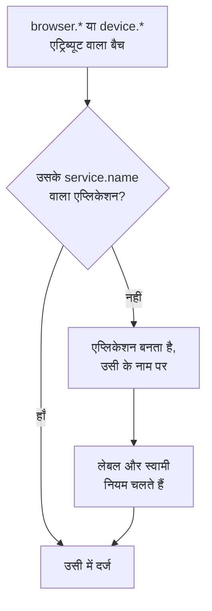

# एप्लिकेशन प्रबंधित करना

जब आपके ऐप की टेलीमेट्री पहली बार पहुँचती है, तो OneUptime एक RUM एप्लिकेशन बनाता है। यह पेज बताता है कि उसके बाद आप क्या प्रबंधित करते हैं: एप्लिकेशन का नाम, उसके लेबल और स्वामी, उसका डेटा कितने समय तक रखा जाता है, संग्रहित करना, उसे कौन देख सकता है, और अलर्ट।

:::cards
- [एप्लिकेशन कैसे बनता है](#एप्लिकेशन-कैसे-बनता-है): `service.name` से मिलान होता है, पहले बैच पर बनता है।
- [लेबल](#लेबल): एप्लिकेशन को समूहों में रखें और तय करें कि उन तक कौन पहुँच सकता है।
- [प्रतिधारण](#प्रतिधारण): टेलीमेट्री और रिकॉर्डिंग कितने समय तक रखी जाती हैं।
- [अनुमतियाँ](#अनुमतियाँ): एप्लिकेशन कौन देख सकता है, और रिकॉर्डिंग कौन चलाकर देख सकता है।
:::

## एप्लिकेशन कैसे बनता है

आपको RUM एप्लिकेशन बनाने की ज़रूरत नहीं है। जब ब्राउज़र या डिवाइस एट्रिब्यूट और एक `service.name` वाली टेलीमेट्री का बैच पहुँचता है, तो OneUptime उसे उसी `service.name` वाले एप्लिकेशन में दर्ज करता है, और अगर प्रोजेक्ट में ऐसा कोई एप्लिकेशन नहीं है, तो उसे बना देता है।



- `service.name` एप्लिकेशन की पहचान है, जिसकी तुलना बड़े-छोटे अक्षरों का ध्यान रखे बिना होती है: `Storefront-Web` और `storefront-web` एक ही एप्लिकेशन हैं।
- नया `service.name` एक नया एप्लिकेशन शुरू करता है। पुराना एप्लिकेशन अपना इतिहास रखता है और **डिस्कनेक्टेड** हो जाता है, नया खाली शुरू होता है, और दोनों कभी मर्ज नहीं होते।
- हर ऐप के लिए एक `service.name` इस्तेमाल करें, हर एनवायरनमेंट के लिए एक नहीं। एनवायरनमेंट को `oneuptime.label.env=production` जैसे लेबल से अलग पहचानें, ताकि वे एक ही एप्लिकेशन और एक ही इतिहास साझा करें।

### एप्लिकेशन का नाम बदलें

**प्रदर्शन नाम** शुरुआत में `service.name` होता है। इसे बदलने के लिए एप्लिकेशन का **सेटिंग्स** पेज खोलें और **एप्लिकेशन विवरण** कार्ड पर **विवरण संपादित करें** पर क्लिक करें, जहाँ आप उसका विवरण और लेबल भी संपादित करते हैं। टेलीमेट्री का मिलान **App नाम (service.name)** से होता है, जिसे कार्ड दिखाता है और जो कभी नहीं बदलता, इसलिए नाम बदलना सुरक्षित है।

### खुद एक एप्लिकेशन जोड़ें

जब आप चाहते हैं कि पहले विज़िटर के आने से पहले ही एप्लिकेशन के लेबल, स्वामी या रीप्ले पॉलिसी तैयार हों, तो एप्लिकेशन खुद बनाएँ।

:::steps
#### एप्लिकेशन सूची खोलें

**उत्पाद → संसाधन → वास्तविक उपयोगकर्ता मॉनिटरिंग** पर जाएँ और **RUM एप्लिकेशन बनाएँ** पर क्लिक करें।

#### ऐप का नाम दर्ज करें

**App नाम (service.name)** में वही `service.name` भरें जो आपका ऐप रिपोर्ट करेगा, ठीक वैसे ही जैसे ऐप उसे रिपोर्ट करता है।

#### नाम दें और सहेजें

एप्लिकेशन का नाम उसके ऐप नाम पर रखा जाता है, जैसे किसी खोजे गए एप्लिकेशन का रखा जाता है। कोई दूसरा नाम दिखाने के लिए **और फ़ील्ड** खोलें और **प्रदर्शन नाम** टाइप करें; विवरण और लेबल भी वहीं हैं। फिर फ़ॉर्म सहेजें।
:::

इसके बाद इसकी सेटअप गाइड अपने आप खुल जाती है, जिसमें ऐप नाम ही स्निपेट का `service.name` होता है। उसका आखिरी चरण, **कनेक्ट होने की प्रतीक्षा करें**, बताता है कि पहला डेटा कब आता है।

अगर प्रोजेक्ट में उस `service.name` वाला एप्लिकेशन पहले से है, चाहे वह खोजा गया हो, पहले जोड़ा गया हो या संग्रहीत हो, तो फ़ॉर्म दूसरा एप्लिकेशन बनाने के बजाय यह बता देता है।

## कनेक्शन स्थिति

जब तक टेलीमेट्री आती रहती है, एप्लिकेशन **कनेक्टेड** दिखाता है, और 15 मिनट तक कुछ न आने पर **डिस्कनेक्टेड**। OpenTelemetry टेलीमेट्री और सेशन रीप्ले ट्रैफ़िक, दोनों गिने जाते हैं।

**अंतिम बार देखा गया** हर बैच पर नहीं, बल्कि हर कुछ मिनट में रीफ़्रेश होता है, इसलिए यह लाइव ट्रैफ़िक से लगभग पाँच मिनट तक पीछे रह सकता है, और 15 मिनट में इसके लिए जगह छोड़ी गई है। जिस समय OneUptime खुद बंद था या अपनी इन्जेशन कतार पूरी कर रहा था, वह समय इनमें नहीं गिना जाता।

**डिस्कनेक्टेड** अपने आप में कोई त्रुटि नहीं है: रात भर बिना विज़िटर वाला कोई आंतरिक टूल सचमुच डिस्कनेक्टेड होता है। अगर लोग ऐप इस्तेमाल कर रहे हैं, तो [RUM समस्या निवारण](/docs/rum/troubleshooting) देखें।

## लेबल

लेबल सूचियों और फ़िल्टर में एप्लिकेशन को समूहों में रखते हैं। वे यह भी तय करते हैं कि कुछ लेबल तक सीमित सदस्य किस तक पहुँच सकता है: ऐसा सदस्य केवल वही एप्लिकेशन देखता है जिन पर उन लेबल में से कोई एक लगा हो। किसी एप्लिकेशन को उसके लेबल तीन तरीकों से मिलते हैं:

| कैसे | कहाँ |
| --- | --- |
| हाथ से | बनाने वाले फ़ॉर्म पर, **और फ़ील्ड** के नीचे, या बाद में एप्लिकेशन के **सेटिंग्स** पेज के **एप्लिकेशन विवरण** कार्ड पर **विवरण संपादित करें** से। एक साथ कई के लिए, उन्हें सूची में चुनें और **Add Labels** चुनें, जो **बल्क कार्रवाइयाँ** में है। |
| टेलीमेट्री से | `oneuptime.label.<name>` नाम का रिसोर्स एट्रिब्यूट लेबल `<name>:<value>` जोड़ता है, जैसा नीचे दिखाया गया है। |
| लेबल नियम से | नियम हर उस नए एप्लिकेशन में लेबल जोड़ता है जिससे उसका मिलान होता है। [लेबल नियम और स्वामी नियम](#लेबल-नियम-और-स्वामी-नियम) देखें। |

एट्रिब्यूट उसी रिसोर्स पर सेट करें जिस पर `service.name` है, उदाहरण के लिए [ब्राउज़र सेटअप](/docs/rum/browser-setup) की `src/telemetry.ts` फ़ाइल में:

```ts
const resource = defaultResource().merge(
  resourceFromAttributes({
    [ATTR_SERVICE_NAME]: "storefront-web",
    "oneuptime.label.team": "payments",
    "oneuptime.label.env": "production",
  }),
);
```

इससे लेबल `team:payments` और `env:production` जुड़ते हैं, और अगर वे प्रोजेक्ट में मौजूद नहीं हैं तो बन जाते हैं। एट्रिब्यूट का नाम लेबल में लिखने से `oneuptime.label.team=prod` और `oneuptime.label.env=prod` अलग-अलग रहते हैं। 100 अक्षरों से लंबा लेबल 100 तक काट दिया जाता है, और खाली या गैर-स्ट्रिंग मान कुछ नहीं जोड़ता।

## लेबल नियम और स्वामी नियम

नियम हर उस नए एप्लिकेशन में लेबल या स्वामी जोड़ता है जिससे उसका मिलान होता है। **वास्तविक उपयोगकर्ता मॉनिटरिंग → सेटिंग्स → लेबल नियम**, या **स्वामी नियम** खोलें, और नियम दो चरणों में बनाएँ:

1. **मिलान** पर, **सभी RUM एप्लिकेशन**, जिससे नया नियम शुरू होता है, हर एप्लिकेशन से मेल खाता है। इसे सीमित करने के लिए **केवल शर्तों से मेल खाने वाले RUM एप्लिकेशन** चुनें और **एप्लिकेशन लेबल** (आपके चुने हुए लेबल में से कोई भी, सभी या कोई नहीं), **एप्लिकेशन नाम** या **एप्लिकेशन विवरण** (बराबर है, शामिल है, इससे शुरू होता है, इससे समाप्त होता है, या किसी पैटर्न से मेल खाता है) पर शर्तें जोड़ें।
2. **लेबल** पर, या स्वामी नियम के लिए **मालिक** पर, चुनें कि नियम क्या जोड़ता है। नए नियम को कम से कम एक लेबल या स्वामी जोड़ना होता है। जब तक आप अपना नाम टाइप नहीं करते, **नाम** आपके चुनावों से भरा जाता है, जैसे _Add team:payments_ या _Add Payments as owners_। **विवरण**, और स्वामी नियम पर **स्वामियों को सूचित करें**, **और फ़ील्ड** के नीचे रहते हैं।

नियम तब चलते हैं जब कोई एप्लिकेशन बनता है, खोजे गए एप्लिकेशन भी शामिल हैं। किसी नियम को आपके पहले से मौजूद एप्लिकेशन पर लागू करने के लिए, उसकी पंक्ति पर **⋯** मेनू खोलें और **Run Now** चुनें: [मौजूदा संसाधनों पर नियम चलाना](/docs/configuration/run-rules-now) देखें। जिस नियम के पास किसी संपादन के बाद जोड़ने के लिए कुछ नहीं बचा, उसे सूची में **कुछ नहीं जोड़ता** के रूप में चिह्नित किया जाता है। [लेबल और स्वामी नियम](/docs/configuration/label-and-owner-rules) फ़ॉर्म को पूरी तरह समझाता है।

### स्वामी

स्वामी वे लोग और टीमें हैं जो किसी एप्लिकेशन के लिए ज़िम्मेदार हैं। स्वामी नियम उन्हें नए एप्लिकेशन में जोड़ते हैं। उन्हें हाथ से जोड़ने या हटाने के लिए, सूची में एप्लिकेशन चुनें और **Add Owner** या **Remove Owner** चुनें, जो **बल्क कार्रवाइयाँ** में हैं; API उन्हें `/rum-application-owner-user` और `/rum-application-owner-team` के ज़रिए जोड़ता है। **स्वामियों को सूचित करें** चालू होने पर, जो कि डिफ़ॉल्ट है, नियम द्वारा जोड़े गए हर स्वामी को इसकी सूचना दी जाती है। अगर किसी को सूचित नहीं किया जाना चाहिए, तो कई एप्लिकेशन पर नियम चलाने से पहले इसे बंद कर दें।

## प्रतिधारण

किसी एप्लिकेशन की टेलीमेट्री और उसकी रिकॉर्डिंग अलग-अलग समय तक रखी जाती हैं:

| डेटा | कितने समय तक | कहाँ सेट होता है |
| --- | --- | --- |
| लॉग, मेट्रिक्स, ट्रेस और प्रोफ़ाइल | प्रोजेक्ट का प्रतिधारण, जब तक एप्लिकेशन उसे ओवरराइड न करे | एप्लिकेशन का **सेटिंग्स** पेज |
| सेशन रीप्ले रिकॉर्डिंग | डिफ़ॉल्ट रूप से 7 दिन, या 1, 14, 30 या 90 दिन | **Replay Policy**, **Edit Policy → Limits** के साथ |

### टेलीमेट्री प्रतिधारण

डिफ़ॉल्ट रूप से किसी एप्लिकेशन की टेलीमेट्री प्रोजेक्ट के प्रतिधारण तक रखी जाती है, जो **प्रोजेक्ट सेटिंग्स → टेलीमेट्री और APM → डेटा प्रतिधारण** के अंतर्गत सेट होता है। एप्लिकेशन के **सेटिंग्स** पेज पर दो कार्ड इसे ओवरराइड करते हैं:

- **टेलीमेट्री डेटा प्रतिधारण** में **टेलीमेट्री डेटा को इतने (दिनों) तक रखें** होता है, जो एप्लिकेशन की पूरी टेलीमेट्री के लिए एक ही मान है। प्रोजेक्ट का प्रतिधारण इस्तेमाल करने के लिए इसे खाली छोड़ दें।
- **टेलीमेट्री प्रकार के अनुसार धारण** में लॉग, ट्रेस, मेट्रिक्स और प्रोफ़ाइल, हर एक के लिए एक डिफ़ॉल्ट होता है, और गंभीरता के अनुसार लॉग और स्थिति के अनुसार ट्रेस के लिए भी। खाली छोड़ा गया मान एप्लिकेशन के मान पर, फिर प्रोजेक्ट के मान पर लौट जाता है।

प्रतिधारण ओवरराइड [एंटरप्राइज़ संस्करण](/docs/self-hosted/enterprise) का हिस्सा हैं, और OneUptime Cloud पर Scale प्लान और उससे ऊपर के प्लान का। इनके बिना कार्ड दिखाते हैं कि प्लान क्या जोड़ता है, और एप्लिकेशन प्रोजेक्ट का प्रतिधारण बनाए रखता है।

किसी निचले Cloud प्लान पर, ट्रायल से बचा हुआ ओवरराइड नई टेलीमेट्री पर लागू होता रहता है। **सेटिंग्स** पेज इसे **धारण ओवरराइड** कार्ड पर **ओवरराइड हटाएँ** बटन के साथ दिखाता है, जो हर प्लान पर काम करता है: उसके बाद एप्लिकेशन प्रोजेक्ट का प्रतिधारण रखता है, और जो पहले से सहेजा जा चुका है, वह उसी प्रतिधारण के साथ रहता है जिसके साथ उसे सहेजा गया था। ओवरराइड फिर से सेट करने के लिए Scale प्लान चाहिए।

### सेशन रीप्ले प्रतिधारण

रिकॉर्डिंग का अपना प्रतिधारण होता है, जो एप्लिकेशन के **Replay Policy** पेज पर **Edit Policy → Limits** से सेट होता है: डिफ़ॉल्ट रूप से 7 दिन, या 1, 14, 30 या 90 दिन। यह जानबूझकर छोटा है, क्योंकि रिकॉर्डिंग किसी स्पैन से कहीं ज़्यादा संवेदनशील, और कहीं ज़्यादा बड़ी होती है। **सेटिंग्स** पेज पर **Session Replay Retention** कार्ड इसे दिखाता है (_Session replays are kept for 7 days._), और उसका **Replay Policy में संपादित करें** बटन पॉलिसी खोलता है।

लंबा टेलीमेट्री प्रतिधारण रिकॉर्डिंग को ज़्यादा समय तक नहीं रखता। किसी सेशन की गिनतियाँ, सिग्नल और डिवाइस उसकी फ़ुटेज के साथ समाप्त हो जाते हैं; केवल सेशन के लॉग, स्पैन और अपवाद टेलीमेट्री प्रतिधारण का पालन करते हैं। [प्रतिधारण और हटाना](/docs/telemetry/session-replay#प्रतिधारण-और-हटाना) देखें।

> [!TIP]
> RUM अक्सर किसी प्रोजेक्ट की सबसे व्यस्त टेलीमेट्री होती है, क्योंकि यह आपके सर्वरों के साथ नहीं, बल्कि आपके उपयोगकर्ताओं के साथ बढ़ती है। यहाँ छोटा प्रतिधारण, और आपकी बैकएंड सेवाओं पर लंबा प्रतिधारण, एक आम सेटअप है।

## संग्रहित करना और हटाना

**संग्रहित करें** किसी एप्लिकेशन को **सभी एप्लिकेशन** से छिपा देता है, जबकि वह टेलीमेट्री इकट्ठा करता रहता है। ऐसे ऐप को संग्रहित करें जिस पर अब आप नज़र नहीं रखते, लेकिन जिसका इतिहास आप रखना चाहते हैं।

- एप्लिकेशन के **सेटिंग्स** पेज पर **संग्रहित करें** पर क्लिक करें, या सूची में कई एप्लिकेशन चुनकर उन्हें एक साथ संग्रहित करें।
- संग्रहीत एप्लिकेशन **वास्तविक उपयोगकर्ता मॉनिटरिंग → उन्नत → संग्रहीत** के अंतर्गत हैं। साइड मेनू में **उन्नत** शुरू में बंद रहता है: **संग्रहीत** दिखाने के लिए उस पर क्लिक करें। वहाँ किसी एप्लिकेशन को, या एक साथ कई को, **अनसंग्रहीत करें**।

एप्लिकेशन के साइड मेनू के **उन्नत** सेक्शन में **एप्लिकेशन हटाएं** एप्लिकेशन को हमेशा के लिए हटा देता है। अगर ऐप अब भी टेलीमेट्री भेजता है, तो उसका अगला बैच एप्लिकेशन को फिर से बना देता है, उसकी किसी भी सेटिंग के बिना, इसलिए पहले इंस्ट्रुमेंटेशन बंद करें।

पूरे एप्लिकेशन के बजाय किसी एक व्यक्ति का डेटा मिटाने के लिए, मिटाने का अनुरोध दर्ज करें: [सेशन मिटाना](/docs/telemetry/session-replay#सेशन-मिटाना) देखें।

## अनुमतियाँ

प्रोजेक्ट की Viewer भूमिका वाला कोई भी व्यक्ति RUM एप्लिकेशन और उनकी टेलीमेट्री देख सकता है। सेशन रीप्ले जानबूझकर उस भूमिका का हिस्सा नहीं है: रिकॉर्डिंग सूचीबद्ध करना, किसी रिकॉर्डिंग को चलाकर देखना और यह पढ़ना कि किसने देखा, अलग-अलग अनुमतियाँ हैं। प्रोजेक्ट के स्वामी और एडमिन के पास ये सभी होती हैं। अनुमति पिकर हर अनुमति को उसके शीर्षक से सूचीबद्ध करते हैं, जो यहाँ इटैलिक में दिखाया गया है।

| अनुमति | सदस्य को यह करने देती है |
| --- | --- |
| `ReadRumApplication` (_Read RUM Application_) | एप्लिकेशन और उनके टेलीमेट्री पेज देखना। |
| `CreateRumApplication`, `EditRumApplication`, `DeleteRumApplication` | एप्लिकेशन जोड़ना, संपादित करना और हटाना। |
| `ReadRumSessionReplay` (_List Session Replays_) | रिकॉर्ड किए गए सेशन और उनके विवरण सूचीबद्ध करना, उन्हें चलाए बिना और यह जाने बिना कि उपयोगकर्ता कौन था। |
| `ReadRumSessionReplayPayload` (_Watch Session Replays_) | रिकॉर्डिंग चलाकर देखना, और पहचाने गए उपयोगकर्ता का रेफ़रेंस और ट्रेट्स पढ़ना। |
| `ReadRumSessionReplayAudit` (_Read Session Replay Audit_) | **Replay Access Log** पढ़ना: किसने कौन-सी रिकॉर्डिंग देखी। |
| `DeleteRumSessionReplay` (_Delete Session Replays_) | रिकॉर्डिंग हटाना। |
| `CreateRumSessionErasureRequest`, `ReadRumSessionErasureRequest` | मिटाने के अनुरोध दर्ज करना और उन पर नज़र रखना। |
| `ReadRumApplicationLabelRule`, `ReadRumApplicationOwnerRule` (और उनके Create, Edit और Delete) | लेबल नियम और स्वामी नियम प्रबंधित करना। |
| `ReadRumApplicationOwnerUser`, `ReadRumApplicationOwnerTeam` (और उनके Create, Edit और Delete) | API के ज़रिए स्वामी जोड़ना और हटाना। |

एक उपयोगी बँटवारा: सपोर्ट इंजीनियर को `ReadRumApplication` और `ReadRumSessionReplay` दें। वे किसी की स्क्रीन देखे बिना और यह जाने बिना कि उपयोगकर्ता कौन था, देख सकते हैं कि किन सेशन में त्रुटियाँ आईं। `ReadRumSessionReplayPayload` केवल उन लोगों को दें जिन्हें इसकी ज़रूरत है; तब `ReadRumSessionReplayAudit` वाले सदस्य एप्लिकेशन के **Replay Access Log** पेज पर हर प्लेबैक देखते हैं। [रिकॉर्डिंग कौन देख सकता है](/docs/telemetry/session-replay#रिकॉर्डिंग-कौन-देख-सकता-है) दिखाता है कि हर अनुमति सेशन सूची और प्लेयर में क्या खोलती है।

## RUM डेटा पर अलर्ट

RUM टेलीमेट्री सामान्य लॉग, मेट्रिक्स और ट्रेस ही है, इसलिए कोई अलग RUM मॉनिटर नहीं है: सामान्य मॉनिटर इस पर काम करते हैं। सबसे तेज़ शुरुआत एप्लिकेशन का **Recommendations** पेज है, जो पहले से एप्लिकेशन तक सीमित मॉनिटर पेश करता है:

| समूह | सुझाव |
| --- | --- |
| Core Web Vitals | Poor Largest Contentful Paint, Poor Interaction to Next Paint, Poor Cumulative Layout Shift, Slow First Contentful Paint और Slow Time to First Byte। [Core Web Vitals](/docs/rum/web-vitals) देखें। |
| त्रुटियाँ | Failed User Operations, और Unhandled Browser Exceptions। |
| सेशन रीप्ले | चार [स्टोरेज बजट अलर्ट](/docs/telemetry/session-replay#स्टोरेज-बजट-अलर्ट), जो प्रोजेक्ट की दैनिक सीमा या एप्लिकेशन का मासिक बजट खत्म होने से पहले चेतावनी देते हैं। एप्लिकेशन के कोई रीप्ले रिकॉर्ड कर लेने के बाद ये पेश किए जाते हैं, और मासिक जोड़ी तब, जब उसका मासिक बजट भी हो। |

अपना मॉनिटर बनाने के लिए, वह चुनें जो उस सिग्नल को पढ़ता है:

- [मेट्रिक्स मॉनिटर](/docs/monitor/metrics-monitor): कोई Core Web Vital, या आपका ऐप जो भी मेट्रिक भेजता है।
- [ट्रेस मॉनिटर](/docs/monitor/traces-monitor): क्लाइंट-साइड त्रुटि दर या लेटेंसी।
- [लॉग मॉनिटर](/docs/monitor/logs-monitor): ब्राउज़र लॉग में कोई पैटर्न।
- [अपवाद मॉनिटर](/docs/monitor/exceptions-monitor): नए या अचानक बढ़ते क्लाइंट-साइड अपवाद।

जो मॉनिटर आप बनाते हैं, उसे एप्लिकेशन तक सीमित करें, ताकि मिलते-जुलते सिग्नेचर वाली कोई बैकएंड सेवा उसे ट्रिगर न करे।

## अगले कदम

:::cards
- [सेशन रीप्ले](/docs/telemetry/session-replay): उपयोगकर्ताओं ने जो देखा उसे रिकॉर्ड करें, उसकी अपनी पॉलिसी और प्रतिधारण के साथ।
- [लेबल और स्वामी नियम](/docs/configuration/label-and-owner-rules): दोनों नियम फ़ॉर्म, चरण दर चरण।
- [मौजूदा संसाधनों पर नियम चलाना](/docs/configuration/run-rules-now): किसी नए नियम को आपके पहले से मौजूद एप्लिकेशन पर लागू करें।
- [RUM समस्या निवारण](/docs/rum/troubleshooting): जब कोई एप्लिकेशन गायब, खाली या डिस्कनेक्टेड हो।
:::
