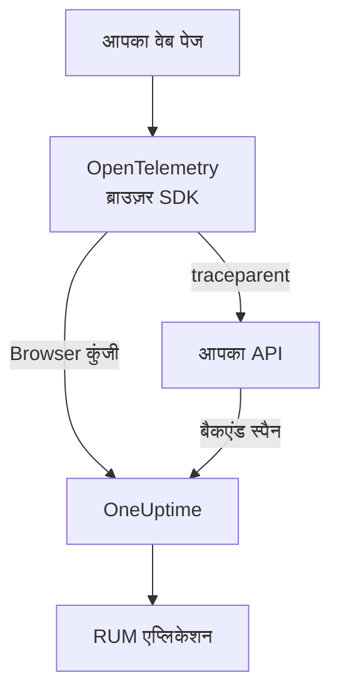

# ब्राउज़र सेटअप

OpenTelemetry ब्राउज़र SDK से किसी वेब ऐप को इंस्ट्रुमेंट करें, ताकि वह OneUptime को RUM एप्लिकेशन के रूप में रिपोर्ट करे। पेज लोड और अनुरोध ट्रेस के रूप में आते हैं, और यही सेटअप आपकी त्रुटियाँ, लॉग, मेट्रिक्स और Core Web Vitals भी ले जाता है।

:::cards
- [सेटअप करें](#सेटअप-करें): Browser कुंजी से आपके पहले पेज लोड तक छह चरण।
- [बैकएंड से जोड़ें](#अपने-बैकएंड-ट्रेस-से-जोड़ना): ब्राउज़र स्पैन को उन बैकएंड ट्रेस से जोड़ें जिन्हें वे शुरू करते हैं।
- [त्रुटियाँ रिपोर्ट करें](#अनकैच्ड-त्रुटियाँ-रिपोर्ट-करें): अनकैच्ड त्रुटियों को अपवाद व्यू में भेजें।
- [समस्या निवारण](#समस्या-निवारण): कुछ भी न आए तो क्या जाँचें।
:::

## यह कैसे काम करता है

SDK आपके विज़िटर के ब्राउज़र में चलता है। यह हर पेज लोड और अनुरोध के लिए एक स्पैन रिकॉर्ड करता है और उन्हें **Browser** इन्जेशन कुंजी से सीधे OneUptime को एक्सपोर्ट करता है, बीच में आपके अपने किसी कलेक्टर या प्रॉक्सी के बिना।



## शुरू करने से पहले

- एक वेब ऐप जिसका कोड आप बदलकर फिर से डिप्लॉय कर सकते हैं, और जिसकी डिपेंडेंसी npm से इंस्टॉल होती हैं।
- वे ओरिजिन जिनसे आपके पेज परोसे जाते हैं, जैसे `https://app.example.com`। Browser कुंजी केवल उन्हीं ओरिजिन से अनुरोध स्वीकार करती है जिन्हें आप उस पर सूचीबद्ध करते हैं।
- ऐसी भूमिका जो इन्जेशन कुंजियाँ बना सके: प्रोजेक्ट के स्वामी और एडमिन बना सकते हैं, और **Create Telemetry Ingestion Key** अनुमति वाला कोई भी व्यक्ति भी।

## सेटअप करें

:::steps
### Browser इन्जेशन कुंजी बनाएँ

1. **उत्पाद → प्रोजेक्ट सेटिंग्स** पर जाएँ।
2. साइड मेनू में **टेलीमेट्री और APM** खोलें और **इंजेशन कुंजियाँ** चुनें।
3. **इन्जेशन कुंजी बनाएँ** पर क्लिक करें, और **कुंजी प्रकार** के रूप में **Browser** चुनें।
4. **ब्राउज़र सेटिंग्स** चरण में अपने ओरिजिन **Allowed Origins** में JSON ऐरे के रूप में लिखें, जैसे `["https://app.example.com"]`, फिर कुंजी बनाएँ। OneUptime Cloud के Free प्लान पर, आखिरी **बिलिंग** चरण पहले टेलीमेट्री की कीमत दिखाता है।


नई कुंजी अपने पेज पर खुलती है। उसकी **सीक्रेट कुंजी** कॉपी करें: यही वह टोकन है जिसे SDK `x-oneuptime-token` के रूप में भेजता है।


### पैकेज इंस्टॉल करें

```bash
npm install @opentelemetry/api \
  @opentelemetry/sdk-trace-web \
  @opentelemetry/resources \
  @opentelemetry/semantic-conventions \
  @opentelemetry/opentelemetry-browser-detector \
  @opentelemetry/exporter-trace-otlp-http \
  @opentelemetry/context-zone \
  @opentelemetry/instrumentation \
  @opentelemetry/instrumentation-document-load \
  @opentelemetry/instrumentation-fetch \
  @opentelemetry/instrumentation-xml-http-request
```

### टेलीमेट्री फ़ाइल बनाएँ

`src/telemetry.ts` बनाएँ। `browserDetector` वे `browser.*` एट्रिब्यूट जोड़ता है जिनसे टेलीमेट्री RUM के रूप में दर्ज होती है, और `service.name` एप्लिकेशन का नाम तय करता है।

```ts title="src/telemetry.ts"
import {
  WebTracerProvider,
  BatchSpanProcessor,
} from "@opentelemetry/sdk-trace-web";
import { OTLPTraceExporter } from "@opentelemetry/exporter-trace-otlp-http";
import { ZoneContextManager } from "@opentelemetry/context-zone";
import { registerInstrumentations } from "@opentelemetry/instrumentation";
import { DocumentLoadInstrumentation } from "@opentelemetry/instrumentation-document-load";
import { FetchInstrumentation } from "@opentelemetry/instrumentation-fetch";
import { XMLHttpRequestInstrumentation } from "@opentelemetry/instrumentation-xml-http-request";
import {
  defaultResource,
  detectResources,
  resourceFromAttributes,
} from "@opentelemetry/resources";
import { browserDetector } from "@opentelemetry/opentelemetry-browser-detector";
import { ATTR_SERVICE_NAME } from "@opentelemetry/semantic-conventions";

const ONEUPTIME_URL = "https://oneuptime.com";
// Public: it ships in your page. It must be a Browser ingestion key.
const ONEUPTIME_TOKEN = "YOUR_TELEMETRY_INGESTION_TOKEN";

/*
 * browserDetector supplies the browser.* attributes. Without them this
 * telemetry is classified as a backend Service, not a RUM application.
 * The attributes set last win, so service.name here overrides the
 * "unknown_service" that defaultResource() provides.
 */
const resource = defaultResource()
  .merge(detectResources({ detectors: [browserDetector] }))
  .merge(
    resourceFromAttributes({
      [ATTR_SERVICE_NAME]: "storefront-web",
    }),
  );

const provider = new WebTracerProvider({
  resource: resource,
  spanProcessors: [
    new BatchSpanProcessor(
      new OTLPTraceExporter({
        url: `${ONEUPTIME_URL}/otlp/v1/traces`,
        headers: { "x-oneuptime-token": ONEUPTIME_TOKEN },
      }),
    ),
  ],
});

provider.register({
  contextManager: new ZoneContextManager(),
});

registerInstrumentations({
  instrumentations: [
    new DocumentLoadInstrumentation(),
    new FetchInstrumentation({
      // See "Linking to your backend traces" before widening this.
      propagateTraceHeaderCorsUrls: [/^https:\/\/api\.example\.com/],
    }),
    new XMLHttpRequestInstrumentation({
      propagateTraceHeaderCorsUrls: [/^https:\/\/api\.example\.com/],
    }),
  ],
});
```

### इसे सबसे पहले इम्पोर्ट करें

इसे अपने ऐप का पहला इम्पोर्ट बनाएँ। इंस्ट्रुमेंटेशन `fetch` और `XMLHttpRequest` को पैच करते हैं, और पैच से पहले किया गया अनुरोध ट्रेस नहीं होता।

```ts
// src/index.tsx (React), src/main.ts (Vue / Angular), etc.
import "./telemetry";
import React from "react";
// ... the rest of your app
```

### कुंजी जाँचें

कहीं और देखने से पहले OneUptime से पूछें कि वह कुंजी स्वीकार करता है या नहीं:

```bash
curl -i https://oneuptime.com/otlp/v1/validate \
  -H "x-oneuptime-token: YOUR_TELEMETRY_INGESTION_TOKEN"
```

`"valid": true` के साथ `200` का मतलब है कि कुंजी स्वीकार है; Browser कुंजी के लिए संदेश यह भी जोड़ता है कि यह केवल ब्राउज़र से, उसके अनुमत ओरिजिन में से किसी एक से काम करती है। `401` का मतलब है कि कुंजी अज्ञात, रद्द, बंद या समाप्त है।

### एक पेज लोड करें

अपनी साइट खोलें। एक मिनट के भीतर एप्लिकेशन अपने `service.name` के नाम से **उत्पाद → संसाधन → वास्तविक उपयोगकर्ता मॉनिटरिंग** में दिखाई देता है।
:::

## Browser कुंजी क्या अनुमति देती है

स्निपेट की हर चीज़ आपके विज़िटर तक पहुँचती है, इसलिए कोई भी आपके पेज से टोकन कॉपी कर सकता है। Browser कुंजी सीमित करती है कि कॉपी क्या कर सकती है:

| सेटिंग | यह क्या करती है |
| --- | --- |
| **Allowed Origins** | अनुरोध केवल इन ओरिजिन से स्वीकार होते हैं, हर एक अपनी स्कीम और पोर्ट (यदि हो) के साथ। होस्ट एक `*.` वाइल्डकार्ड से शुरू हो सकता है: `https://*.example.com` में `example.com` के सभी सबडोमेन आते हैं, लेकिन खुद `example.com` नहीं। |
| **Requests Per Minute Limit** | कुंजी इस्तेमाल करने वाले सभी विज़िटर के लिए एक ही सीमा: जब तक आप अपनी सीमा तय न करें, प्रति मिनट 6000 अनुरोध। |
| **Pinned Service Name** | कुंजी जो कुछ भी लिखती है उस पर `service.name` लागू करता है, ताकि कोई कॉपी अपनी टेलीमेट्री को आपकी किसी बैकएंड सेवा के रूप में न दिखा सके। |
| **इस समय समाप्त होता है** | इस तारीख के बाद कुंजी स्वीकार नहीं होती। |
| **सक्षम** | लीक हुई कुंजी को तुरंत रोकने के लिए इसे बंद करें। |

Browser कुंजी OTLP ट्रेस, लॉग और मेट्रिक्स, और सेशन रीप्ले लिखती है; बाकी हर इन्जेशन रूट इसे अस्वीकार करता है। ये सेटिंग्स आप कुंजी के अपने पेज पर बदलते हैं। कुंजी बनने के बाद कुंजी का प्रकार नहीं बदला जा सकता।

> [!WARNING]
> किसी पेज में कभी भी **सर्वर** कुंजी न रखें। सर्वर कुंजी बिना ओरिजिन जाँच के कहीं से भी हर तरह की टेलीमेट्री लिखती है, इसलिए आपका पेज पढ़ने वाला कोई भी आपके प्रोजेक्ट में लिख सकता है।

## डिटेक्टर के बिना `browser.*` सेट करना

`browserDetector` [UA Client Hints API](https://wicg.github.io/ua-client-hints/) पढ़ता है, जो केवल Chromium ब्राउज़रों में होता है। Safari और Firefox पर यह `browser.language` और `user_agent.original` सेट करता है, लेकिन `browser.platform`, `browser.brands` या `browser.mobile` नहीं।

टेलीमेट्री को RUM के रूप में दर्ज करने के लिए यह फिर भी काफ़ी है, क्योंकि अकेला `browser.language` ही बैच को ब्राउज़र RUM के रूप में चिह्नित कर देता है। फिर भी **क्लाइंट्स** पेज प्लेटफ़ॉर्म `browser.platform` से सूचीबद्ध करता है, इसलिए Safari और Firefox की विज़िट वहाँ कोई पंक्ति नहीं जोड़तीं।

डिटेक्टर छोड़ने के लिए, या हर ब्राउज़र को एक प्लेटफ़ॉर्म देने के लिए, एट्रिब्यूट खुद सेट करें:

```ts
const resource = defaultResource().merge(
  resourceFromAttributes({
    [ATTR_SERVICE_NAME]: "storefront-web",
    // browser.language or browser.platform marks the telemetry as browser RUM.
    "browser.language": navigator.language,
    "browser.platform":
      (navigator as any).userAgentData?.platform ?? "unknown",
    "browser.mobile": (navigator as any).userAgentData?.mobile ?? false,
    "user_agent.original": navigator.userAgent,
  }),
);
```

`browser.platform` को मोटे स्तर का रखें। हर अलग मान **क्लाइंट्स** पेज पर एक पंक्ति बनता है, इसलिए वहाँ पूरी user-agent स्ट्रिंग या हर उपयोगकर्ता का अलग मान रखने से सूची कभी खत्म नहीं होती, और यह गोपनीयता की समस्या भी है।

## रूट बदलाव ट्रेस करें

`DocumentLoadInstrumentation` केवल पहला लोड ट्रेस करता है। सिंगल-पेज ऐप में रूट बदलाव तब तक दिखाई नहीं देते जब तक आप उन्हें रिकॉर्ड न करें, जिसके लिए आपके राउटर में कुछ पंक्तियाँ काफ़ी हैं:

```ts
import { trace } from "@opentelemetry/api";

const tracer = trace.getTracer("app-router");

function onRouteChange(to: string): void {
  const span = tracer.startSpan("route-change", {
    attributes: { "app.route": to },
  });
  // End it when the route's data has loaded and the view has painted.
  requestAnimationFrame(() => {
    return span.end();
  });
}
```

क्लिक और दूसरे DOM इवेंट भी ट्रेस करने के लिए `@opentelemetry/instrumentation-user-interaction` जोड़ें। हर रूट पर INP के लिए [सिंगल-पेज ऐप्स](/docs/rum/web-vitals#सिंगल-पेज-ऐप्स) देखें।

## अपने बैकएंड ट्रेस से जोड़ना

`propagateTraceHeaderCorsUrls` तय करता है कि कौन-से क्रॉस-ओरिजिन अनुरोध W3C `traceparent` हेडर ले जाएँगे, जो ब्राउज़र स्पैन को उस बैकएंड ट्रेस से जोड़ता है जिसे उसने शुरू किया। आपके पेज के अपने ओरिजिन पर जाने वाले अनुरोध इसे बिना किसी कॉन्फ़िगरेशन के ले जाते हैं।

> [!WARNING]
> इसे `/.*/` पर सेट न करें। यह हेडर किसी साधारण क्रॉस-ओरिजिन अनुरोध को प्रीफ़्लाइट वाले अनुरोध में बदल देता है, इसलिए जो भी थर्ड-पार्टी API अपने `Access-Control-Allow-Headers` में `traceparent` नहीं रखता, वह विफल होने लगता है।

केवल वे ओरिजिन लिखें जिन्हें आप नियंत्रित करते हैं और जिन्हें आपने कॉन्फ़िगर किया है:

```ts
new FetchInstrumentation({
  propagateTraceHeaderCorsUrls: [
    /^https:\/\/api\.example\.com/,
    /^https:\/\/auth\.example\.com/,
  ],
});
```

[सेशन रीप्ले](/docs/telemetry/session-replay) इंस्टॉल होने पर आपके अपने ओरिजिन पर जाने वाले अनुरोध रीप्ले की सेशन ID भी ले जाते हैं, जिससे आपकी बैकएंड टेलीमेट्री रिकॉर्डिंग से जुड़ जाती है: [ट्रेस को सेशन रीप्ले से जोड़ना](#ट्रेस-को-सेशन-रीप्ले-से-जोड़ना) देखें।

## ट्रेस को सेशन रीप्ले से जोड़ना

अगर आप [सेशन रीप्ले](/docs/telemetry/session-replay) भी चलाते हैं, तो आपकी **बैकएंड** टेलीमेट्री यहाँ बिना किसी कोड के रिकॉर्डिंग से जुड़ जाती है। सेशन अपलोड होते समय रिकॉर्डर आपके पेज के अपने ओरिजिन पर भेजे गए अनुरोधों में सेशन ID वाला एक `tracestate` सदस्य जोड़ता है, और `traceparent` आपके `FetchInstrumentation` / `XMLHttpRequestInstrumentation` पर छोड़ देता है। W3C ट्रेस कॉन्टेक्स्ट आगे बढ़ाने वाली हर सेवा में आपके बैकएंड के स्पैन पर इन्जेशन के समय सेशन ID लग जाती है, और उसके लॉग और अपवाद ट्रेस ID से रिकॉर्डिंग से जुड़ते हैं। यह कैसे काम करता है, यह किसे कवर नहीं करता, और इसे बंद करने वाला स्विच, इनके लिए [अपनी बाकी टेलीमेट्री से संबंध जोड़ना](/docs/telemetry/session-replay#correlating-with-your-other-telemetry) देखें।

रिकॉर्डर आपके इंस्ट्रुमेंटेशन का सेट किया `traceparent` भी वापस पढ़ता है, चाहे कॉल URL (init ऑब्जेक्ट के साथ या उसके बिना) दे या `Request` ऑब्जेक्ट, इसलिए रीप्ले की हर अनुरोध पंक्ति अपने बैकएंड ट्रेस से लिंक होती है। किसी दूसरे ओरिजिन पर मौजूद API के लिए उसे ऊपर `propagateTraceHeaderCorsUrls` में लिखें; उसके अनुरोध कोई सेशन ID नहीं ले जाते और ट्रेस ID से रिकॉर्डिंग से जुड़ते हैं। इस SDK के *बिना* वाले पेजों के लिए एप्लिकेशन की रीप्ले पॉलिसी में **Trace propagation origins** यही काम करता है।

हेडर जिन तक नहीं पहुँचते, वे इस SDK के अपने ब्राउज़र स्पैन हैं: डॉक्यूमेंट लोड, रूट बदलाव और आपकी रिपोर्ट की गई त्रुटियाँ। इन्हें भी रिकॉर्डिंग से जोड़ने के लिए हर स्पैन के शुरू होते ही उस पर `session.id` लगाएँ। रिकॉर्डर आपको ID `onSessionChange` से बताता है, जो सेशन पहले से हो तो तुरंत चलता है, और फिर हर बार ID बदलने पर: जब विज़िटर 30 मिनट निष्क्रिय रहने के बाद लौटता है, 4 घंटे की सीमा पर, जब `identify()` किसी दूसरे उपयोगकर्ता का नाम देता है, या जब उसी विज़िटर का कोई दूसरा टैब इसे पहले बदल चुका हो।

```ts title="src/replaySession.ts"
import type { Context } from "@opentelemetry/api";
import type {
  ReadableSpan,
  Span,
  SpanProcessor,
} from "@opentelemetry/sdk-trace-web";

declare global {
  interface Window {
    OneUptimeReplayQueue?: Array<Array<unknown>>;
  }
}

let replaySessionId: string | null = null;

// The recorder script loads asynchronously. The queue is applied the
// moment it starts and stays live afterwards, so this works either way.
(window.OneUptimeReplayQueue = window.OneUptimeReplayQueue || []).push([
  "onSessionChange",
  (sessionId: string): void => {
    replaySessionId = sessionId;
  },
]);

export class ReplaySessionSpanProcessor implements SpanProcessor {
  public onStart(span: Span, _parentContext: Context): void {
    if (replaySessionId) {
      span.setAttribute("session.id", replaySessionId);
    }
  }

  public onEnd(_span: ReadableSpan): void {}

  public forceFlush(): Promise<void> {
    return Promise.resolve();
  }

  public shutdown(): Promise<void> {
    return Promise.resolve();
  }
}
```

फिर इसे `src/telemetry.ts` में प्रोवाइडर के स्पैन प्रोसेसरों में सबसे पहले रखें:

```ts
import { ReplaySessionSpanProcessor } from "./replaySession";

const provider = new WebTracerProvider({
  resource: resource,
  spanProcessors: [
    new ReplaySessionSpanProcessor(),
    new BatchSpanProcessor(
      new OTLPTraceExporter({
        url: `${ONEUPTIME_URL}/otlp/v1/traces`,
        headers: { "x-oneuptime-token": ONEUPTIME_TOKEN },
      }),
    ),
  ],
});
```

उसके बाद शुरू हुए स्पैन ID लेकर चलते हैं, रीप्ले प्लेयर का **ट्रेस** टैब उन्हें रिकॉर्डिंग की घड़ी पर दिखाता है, और डैशबोर्ड में उनमें से हर एक रीप्ले के उसी पल से लिंक होता है। स्पैन प्रोसेसर हर स्पैन पर वह ID लगाता है जो उसके शुरू होने के समय चालू थी; इसके बजाय ID को `resource.attributes` में लिखने से सेशन बदलने पर एक्सपोर्ट बैच में इंतज़ार कर रहे स्पैन का लेबल भी बदल जाता। लिसनर को ID रिकॉर्डर शुरू होते ही बता दी जाती है, सहमति या कैप्चर ट्रिगर से पहले, इसलिए अगर यह मायने रखता है, तो ID तभी लगाएँ जब आपके पेज को सहमति मिल जाए।

## Content Security Policy

अगर आपकी साइट Content Security Policy भेजती है, तो जब तक आप `connect-src` में OneUptime को अनुमति नहीं देते, ब्राउज़र एक्सपोर्टर के अनुरोध ब्लॉक करता है। कहीं भी ऐसी विफलता नहीं दिखती जिसे आप देख सकें: पेज बस कुछ रिपोर्ट नहीं करता।

```text
connect-src 'self' https://oneuptime.com;
```

इसे अपने मौजूदा `connect-src` डायरेक्टिव में मिलाएँ। अगर आप OneUptime खुद होस्ट करते हैं, तो अपना होस्ट इस्तेमाल करें।

## अनकैच्ड त्रुटियाँ रिपोर्ट करें

OpenTelemetry ब्राउज़र SDK अनकैच्ड त्रुटियाँ कैप्चर नहीं करता। उन्हें खुद रिपोर्ट करें, और वे आपकी बैकएंड त्रुटियों के साथ **अपवाद** में दिखाई देंगी:

```ts
import { trace, SpanStatusCode } from "@opentelemetry/api";

const tracer = trace.getTracer("app-errors");

window.addEventListener("error", (event: ErrorEvent) => {
  const span = tracer.startSpan("window.onerror");
  span.recordException(event.error ?? new Error(event.message));
  span.setStatus({ code: SpanStatusCode.ERROR });
  span.end();
});

window.addEventListener("unhandledrejection", (event: PromiseRejectionEvent) => {
  const span = tracer.startSpan("unhandledrejection");
  span.recordException(
    event.reason instanceof Error ? event.reason : new Error(String(event.reason)),
  );
  span.setStatus({ code: SpanStatusCode.ERROR });
  span.end();
});
```

[सेशन रीप्ले](/docs/telemetry/session-replay) के साथ रिकॉर्डर भी अनकैच्ड त्रुटियाँ कैप्चर करता है और उन्हें रीप्ले की टाइमलाइन पर चिह्नित करता है। फिर अपवाद के पेज पर **Watch what the user saw** कार्ड दिखता है, जो रीप्ले को त्रुटि से दस सेकंड पहले से खोलता है। डिफ़ॉल्ट पॉलिसी में हर सेशन रिकॉर्ड होता है, चाहे कुछ विफल हो या नहीं; त्रुटि केवल यह तय करती है कि कार्ड कहाँ से खुले।

## लॉग और मेट्रिक्स जोड़ें

अवलोकन भरने के लिए ट्रेस काफ़ी हैं। जब आप OneUptime में ब्राउज़र लॉग चाहें, या [Core Web Vitals](/docs/rum/web-vitals) भेजना चाहें, तब लॉग और मेट्रिक पाइपलाइन जोड़ें:

```bash
npm install @opentelemetry/api-logs @opentelemetry/sdk-logs \
  @opentelemetry/exporter-logs-otlp-http \
  @opentelemetry/sdk-metrics @opentelemetry/exporter-metrics-otlp-http
```

```ts
import { LoggerProvider, BatchLogRecordProcessor } from "@opentelemetry/sdk-logs";
import { OTLPLogExporter } from "@opentelemetry/exporter-logs-otlp-http";
import { MeterProvider, PeriodicExportingMetricReader } from "@opentelemetry/sdk-metrics";
import { OTLPMetricExporter } from "@opentelemetry/exporter-metrics-otlp-http";
import { logs } from "@opentelemetry/api-logs";
import { metrics } from "@opentelemetry/api";

const headers = { "x-oneuptime-token": ONEUPTIME_TOKEN };

logs.setGlobalLoggerProvider(
  new LoggerProvider({
    resource: resource,
    processors: [
      new BatchLogRecordProcessor({
        exporter: new OTLPLogExporter({
          url: `${ONEUPTIME_URL}/otlp/v1/logs`,
          headers,
        }),
      }),
    ],
  }),
);

metrics.setGlobalMeterProvider(
  new MeterProvider({
    resource: resource,
    readers: [
      new PeriodicExportingMetricReader({
        exporter: new OTLPMetricExporter({
          url: `${ONEUPTIME_URL}/otlp/v1/metrics`,
          headers,
        }),
        exportIntervalMillis: 30000,
      }),
    ],
  }),
);
```

इन्हें उसी `resource` ऑब्जेक्ट से बनाएँ। जिस लॉग या मेट्रिक पाइपलाइन के रिसोर्स में `browser.*` न हो, वह एक अलग बैकएंड सेवा के रूप में दर्ज होती है।

## एंडपॉइंट संदर्भ

| सिग्नल | एंडपॉइंट | हेडर |
| --- | --- | --- |
| ट्रेस | `POST {host}/otlp/v1/traces` | `x-oneuptime-token: <token>` |
| मेट्रिक्स | `POST {host}/otlp/v1/metrics` | `x-oneuptime-token: <token>` |
| लॉग | `POST {host}/otlp/v1/logs` | `x-oneuptime-token: <token>` |

`{host}` है `https://oneuptime.com`, या अगर आप OneUptime खुद चलाते हैं तो आपका अपना होस्ट; इसे OTLP URL में और Content Security Policy की एंट्री में बदलें। OneUptime OTLP/JSON और OTLP/protobuf स्वीकार करता है। एंडपॉइंट किसी भी ओरिजिन से आए क्रॉस-ओरिजिन अनुरोधों का जवाब देते हैं और `x-oneuptime-token` हेडर की अनुमति देते हैं, इसलिए ब्राउज़र सीधे उन्हें एक्सपोर्ट करता है।

## समस्या निवारण

:::details नेटवर्क टैब में OneUptime का कोई अनुरोध नहीं
अपने ब्राउज़र के डेवलपर टूल खोलें, नेटवर्क टैब में जाएँ और `otlp` से फ़िल्टर करें: आप `POST /otlp/v1/traces` ढूँढ रहे हैं। कोई भी अनुरोध न होने का मतलब है कि SDK कभी शुरू ही नहीं हुआ:

- `telemetry.ts` पहला इम्पोर्ट नहीं है, या आपके बंडलर ने इसे हटा दिया।
- बैच प्रोसेसर ने अभी एक्सपोर्ट नहीं किया है। यह बैच भरने के लिए कुछ सेकंड रुकता है, इसलिए यह मानने से पहले कि कुछ नहीं भेजा गया, रुकें या किसी दूसरे पेज पर जाएँ।
- बिल्ड के समय का कोई एनवायरनमेंट वेरिएबल `undefined` निकला, इसलिए एक्सपोर्टर का URL टूटा है। स्टार्टअप पर URL एक बार लॉग करें।
:::

:::details ब्राउज़र अनुरोध ब्लॉक करता है
- कंसोल में Content Security Policy त्रुटि का मतलब है कि `connect-src` अभी OneUptime को अनुमति नहीं देता: [Content Security Policy](#content-security-policy) देखें।
- CORS त्रुटि का लगभग हमेशा मतलब होता है कि अनुरोध OneUptime तक पहुँचा ही नहीं, जिसके एंडपॉइंट किसी भी ओरिजिन को अनुमति देते हैं: कंपनी का प्रॉक्सी, ऐड ब्लॉकर या होस्ट में टाइपो देखें।
:::

:::details OneUptime अनुरोध अस्वीकार करता है
- `Origin https://app.example.com is not allowed for this browser ingestion key.` के साथ `422` का मतलब है कि पेज का सटीक ओरिजिन (स्कीम, होस्ट और पोर्ट) कुंजी के **Allowed Origins** में नहीं है।
- `This telemetry ingestion key has been disabled.` के साथ `422` का मतलब है कि किसी ने कुंजी बंद कर दी। इसे फिर से चालू करें, या दूसरी कुंजी इस्तेमाल करें।
- `401` का मतलब है कि कुंजी अज्ञात, रद्द या समाप्त है। [सेटअप करें](#सेटअप-करें) में कुंजी की जाँच चलाएँ, फिर एक सक्रिय Browser कुंजी बनाएँ।
- `404` का मतलब है कि URL गलत है। ट्रेस एक्सपोर्टर को पूरा पाथ `/otlp/v1/traces` चाहिए।
:::

:::details ऐप वास्तविक उपयोगकर्ता मॉनिटरिंग के बजाय सेवाएं में दिखता है
रिसोर्स में कोई `browser.*` एट्रिब्यूट नहीं है, इसलिए टेलीमेट्री बैकएंड सेवा के रूप में दर्ज हुई। `browserDetector` जोड़ें, या [डिटेक्टर के बिना `browser.*` सेट करना](#डिटेक्टर-के-बिना-browser-सेट-करना) की तरह एट्रिब्यूट सेट करें।

आप क्या भेजते हैं, यह नेटवर्क टैब में अनुरोध के पेलोड में देखें: `resourceSpans[0].resource.attributes` वह सूची है जो इसे तय करती है। जो सेवा पहले ही बन चुकी है वह RUM एप्लिकेशन में नहीं बदलती, इसलिए RUM टेलीमेट्री आने के बाद उसे **उत्पाद → सेवाएं** में हटा दें।
:::

:::details Safari या Firefox पर क्लाइंट्स पेज खाली है
क्लाइंट पंक्तियाँ `browser.platform` से आती हैं, जिसे `browserDetector` केवल Chromium ब्राउज़रों पर सेट करता है। Safari और Firefox की विज़िट सूचीबद्ध करने के लिए इसे खुद सेट करें: [डिटेक्टर के बिना `browser.*` सेट करना](#डिटेक्टर-के-बिना-browser-सेट-करना) देखें।
:::

## अगले कदम

:::cards
- [Core Web Vitals](/docs/rum/web-vitals): उसी पेज से LCP, INP, CLS, FCP और TTFB भेजें।
- [सेशन रीप्ले](/docs/telemetry/session-replay): उपयोगकर्ता ने जो देखा उसे इन ट्रेस के साथ रिकॉर्ड करें।
- [एप्लिकेशन प्रबंधित करना](/docs/rum/applications): नाम, लेबल, स्वामी और रिटेंशन।
- [RUM समस्या निवारण](/docs/rum/troubleshooting): हर जाँच, उसी क्रम में जिसमें समस्याएँ आमतौर पर होती हैं।
:::
