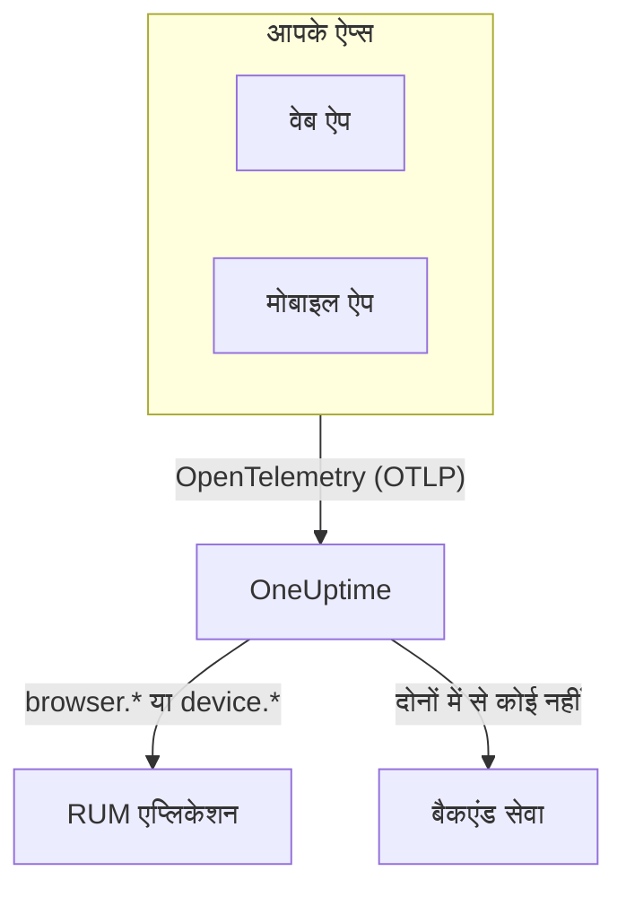

# RUM अवलोकन

वास्तविक उपयोगकर्ता मॉनिटरिंग (RUM) दिखाती है कि असली उपयोगकर्ता आपके वेब और मोबाइल ऐप्स में क्या अनुभव करते हैं: पेज लोड, अनुरोध, त्रुटियाँ और Core Web Vitals, जैसा ऐप खुद रिपोर्ट करता है, न कि कोई प्रोब। OneUptime उस टेलीमेट्री को एक RUM एप्लिकेशन में रखता है, जिस पर आप चार्ट बना सकते हैं, खोज सकते हैं और अलर्ट लगा सकते हैं।

:::cards
- [यह कैसे काम करता है](#यह-कैसे-काम-करता-है): एक OpenTelemetry पाइपलाइन, जो पहुँचते ही RUM के रूप में दर्ज होती है।
- [OneUptime RUM को कैसे पहचानता है](#oneuptime-rum-को-कैसे-पहचानता-है): वे रिसोर्स एट्रिब्यूट जो यह तय करते हैं।
- [आपको क्या मिलता है](#आपको-क्या-मिलता-है): अवलोकन, वाइटल्स, एक्सप्लोरर और रीप्ले।
- [शुरू करें](#शुरू-करें): इन्जेशन कुंजी से आपके पहले पेज लोड तक।
:::

## यह कैसे काम करता है

RUM वही OpenTelemetry पाइपलाइन इस्तेमाल करता है जो OneUptime का बाकी हिस्सा करता है। न कोई RUM एजेंट है और न ही उसका अपना कोई वायर फ़ॉर्मेट: आप OpenTelemetry का ब्राउज़र या मोबाइल SDK OneUptime की ओर करते हैं, और टेलीमेट्री पहुँचते ही RUM के रूप में दर्ज हो जाती है।

- **हर ऐप के लिए एक एप्लिकेशन।** इसकी पहचान वह `service.name` है जो आपका SDK रिपोर्ट करता है, और OneUptime टेलीमेट्री के पहले बैच पर एप्लिकेशन बनाता है।
- **कभी दो बार नहीं गिना जाता।** क्लाइंट टेलीमेट्री केवल अपने RUM एप्लिकेशन की होती है; उसे बैकएंड सेवा के रूप में भी सूचीबद्ध नहीं किया जाता।
- **सेशन रीप्ले एक अलग, वैकल्पिक परत है।** इसका अपना स्निपेट और गोपनीयता नियंत्रण है: [सेशन रीप्ले](/docs/telemetry/session-replay) देखें।

## इसे कहाँ पाएँ

**उत्पाद → संसाधन → वास्तविक उपयोगकर्ता मॉनिटरिंग** खोलें। **सभी एप्लिकेशन** आपके एप्लिकेशन को उनके **क्लाइंट प्रकार**, **स्थिति** और **अंतिम बार देखा गया** के साथ दिखाता है। साइड मेनू के दो और सेक्शन शुरू में बंद रहते हैं:

- **सेटिंग्स**: **स्वामी नियम**, **लेबल नियम** और पूरे प्रोजेक्ट का **सेशन रीप्ले** स्विच।
- **उन्नत**: **संग्रहीत**, यानी वे एप्लिकेशन जिन्हें आपने संग्रहीत किया।

एप्लिकेशन का अपना साइड मेनू उसके पेजों को इस तरह समूहित करता है; **सेटिंग्स**, **डेवलपर** और **उन्नत** शुरू में बंद रहते हैं:

| सेक्शन | पेज |
| --- | --- |
| **बेसिक** | **अवलोकन**, **सुझाव**, **दस्तावेज़ीकरण** |
| **अवलोकनीयता** | **मेट्रिक्स**, **लॉग**, **ट्रेस**, **क्लाइंट्स** |
| **सेशन रीप्ले** | **सेशन रीप्ले**, **User Flows**, **Replay Users**, **स्वास्थ्य**, **Replay Policy**, **रीप्ले एक्सेस लॉग**, **दस्तावेज़ीकरण** |
| **सेटिंग्स** | **सेटिंग्स** |
| **डेवलपर** | **Terraform**, **API**, **AI सहायक** |
| **उन्नत** | **एप्लिकेशन हटाएं** |

## OneUptime RUM को कैसे पहचानता है

"मेरा ऐप दिखाई नहीं देता" वाले ज़्यादातर सवालों का जवाब यहीं मिलता है। टेलीमेट्री का हर बैच पहुँचने पर OneUptime उस बैच के **रिसोर्स एट्रिब्यूट** से फ़ैसला करता है:

1. जिस बैच के रिसोर्स में `browser.platform`, `browser.language` या खाली न हो ऐसा `browser.brands` हो, वह **ब्राउज़र** RUM है।
2. अन्यथा, `device.id` या `device.model.identifier` वाला बैच **मोबाइल** RUM है।
3. अन्यथा, `device.manufacturer` वाला और बिना होस्ट पहचान (`host.name`, `host.id` या `k8s.node.name`) वाला बैच भी **मोबाइल** RUM है।
4. बाकी सब कुछ बैकएंड सेवा है।

बैकएंड SDK कभी `browser.*`, `device.id` या `device.model.identifier` सेट नहीं करते, इसलिए ये साफ़ संकेत हैं। `device.manufacturer` अपवाद है: होस्ट की इन्वेंटरी भी इसी से मशीन का निर्माता बताती है, इसलिए यह केवल बिना होस्ट पहचान वाले रिसोर्स पर गिना जाता है। [इन्वेंटरी एट्रिब्यूट](/docs/telemetry/host-otel-collector#इन्वेंटरी-एट्रिब्यूट-ip-mac-सीरियल-नंबर-निर्माता-मॉडल-फ़र्मवेयर) देखें।

| एट्रिब्यूट | ज़रूरी | यह क्या करता है |
| --- | --- | --- |
| `service.name` | **हाँ** | एप्लिकेशन की पहचान, जैसे `storefront-web`। इसके बिना कोई RUM एप्लिकेशन नहीं बनता। |
| `browser.platform`, `browser.language`, `browser.brands` | वेब पर इनमें से कोई एक | बैच को ब्राउज़र RUM के रूप में चिह्नित करता है। `browser.platform` **क्लाइंट्स** पेज भी भरता है। |
| `device.id`, `device.model.identifier` | मोबाइल पर इनमें से कोई एक | बैच को मोबाइल RUM के रूप में चिह्नित करता है। `device.model.identifier` **क्लाइंट्स** पेज भी भरता है। |
| `device.manufacturer` | नहीं | बैच को मोबाइल RUM के रूप में तभी चिह्नित करता है जब रिसोर्स में कोई होस्ट पहचान न हो। |
| `telemetry.sdk.language` | नहीं | अवलोकन पर दिखता है, जैसे `webjs` या `swift`। |
| `telemetry.sdk.version` | नहीं | SDK संस्करण के रूप में दिखता है; न होने पर `oneuptime.agent.version` पढ़ा जाता है। |
| `oneuptime.label.<name>` | नहीं | एप्लिकेशन में प्रोजेक्ट लेबल `<name>:<value>` जोड़ता है। |

OneUptime एप्लिकेशन को `service.name` से ढूँढता है, अक्षरों के छोटे-बड़े होने को अनदेखा करते हुए, और प्रोजेक्ट में न होने पर उसे बनाता है। नया `service.name` नया एप्लिकेशन शुरू करता है, इसलिए इसे स्थिर रखें, और परिवेशों को नए नाम के बजाय लेबल से अलग करें। नाम, लेबल, स्वामी और रिटेंशन [एप्लिकेशन प्रबंधित करना](/docs/rum/applications) में बताए गए हैं।

> [!IMPORTANT]
> OpenTelemetry ब्राउज़र SDK तब तक कोई `browser.*` एट्रिब्यूट नहीं जोड़ता, जब तक आप ब्राउज़र रिसोर्स डिटेक्टर न जोड़ें या उन्हें खुद सेट न करें। केवल `service.name` होने पर टेलीमेट्री RUM एप्लिकेशन नहीं, बल्कि बैकएंड सेवा बन जाती है। [ब्राउज़र सेटअप](/docs/rum/browser-setup) दोनों तरीके दिखाता है।

## आपको क्या मिलता है

| कहाँ | यह क्या दिखाता है |
| --- | --- |
| **अवलोकन** | **पेज लोड**, **पेज लोड समय (p95)**, **इवेंट**, **त्रुटि दर**, **Event duration (p95)**, **अपवाद**, **क्लाइंट्स** और **Sessions recorded** की टाइलें, और आपकी चुनी समय सीमा पर ट्रेंड चार्ट। |
| **Core Web Vitals** | अवलोकन पर एक कार्ड, जिसमें LCP, INP, CLS, FCP और TTFB हैं, हर एक Google की सीमाओं पर आँका गया, और सिंगल-पेज ऐप के हर रूट के लिए INP। [Core Web Vitals](/docs/rum/web-vitals) और [सिंगल-पेज ऐप्स](/docs/rum/web-vitals#सिंगल-पेज-ऐप्स) देखें। |
| **मेट्रिक्स**, **लॉग**, **ट्रेस** | टेलीमेट्री एक्सप्लोरर, जो केवल इस एप्लिकेशन का डेटा दिखाते हैं। |
| **क्लाइंट्स** | वे ब्राउज़र प्लेटफ़ॉर्म और डिवाइस मॉडल जिन पर एप्लिकेशन इस्तेमाल हुआ: प्लेटफ़ॉर्म के अनुसार छोटी सूची, कभी हर उपयोगकर्ता की एक पंक्ति नहीं। |
| **सेशन रीप्ले** | असली सेशन की रिकॉर्डिंग, उनकी त्रुटियों, ट्रेस और लॉग के साथ: [सेशन रीप्ले](/docs/telemetry/session-replay) देखें। |
| **सुझाव** | एप्लिकेशन के लिए तैयार मॉनिटर: खराब Core Web Vitals, विफल अनुरोध, ब्राउज़र अपवाद और, रिकॉर्डिंग शुरू होने के बाद, सेशन रीप्ले बजट। |

गिनती आपके इंस्ट्रुमेंटेशन के भेजे स्पैन से आती है। **पेज लोड** उस `documentLoad` स्पैन को गिनता है जिसे पेज-लोड इंस्ट्रुमेंटेशन हर पूरे लोड के लिए रिकॉर्ड करता है, इसलिए सिंगल-पेज ऐप के अंदर रूट बदलना पेज लोड नहीं है।

टेलीमेट्री आते रहने तक एप्लिकेशन **कनेक्टेड** दिखाता है, और 15 मिनट तक कुछ न आने पर **डिस्कनेक्टेड**। जब OneUptime खुद बंद था या अपनी इन्जेशन कतार निपटा रहा था, वह समय इन 15 मिनटों में नहीं गिना जाता।

## शुरू करें

:::steps
### इन्जेशन कुंजी बनाएँ

**प्रोजेक्ट सेटिंग्स → टेलीमेट्री और APM → इंजेशन कुंजियाँ** खोलें और **इन्जेशन कुंजी बनाएँ** पर क्लिक करें। वेब ऐप को **ब्राउज़र** कुंजी चाहिए, जो केवल आपके सूचीबद्ध ओरिजिन से काम करती है। मोबाइल ऐप को **सर्वर** कुंजी चाहिए, क्योंकि मोबाइल SDK कोई `Origin` हेडर नहीं भेजता।

### अपने ऐप को इंस्ट्रुमेंट करें

वेब ऐप के लिए [ब्राउज़र सेटअप](/docs/rum/browser-setup) का, या Android, iOS, React Native और दूसरे प्लेटफ़ॉर्म के लिए [मोबाइल सेटअप](/docs/rum/mobile-setup) का पालन करें।

### एक पेज खोलें

अपनी साइट का एक पेज लोड करें या अपना ऐप चलाएँ। टेलीमेट्री के पहले बैच पर एप्लिकेशन अपने `service.name` के नाम से **उत्पाद → संसाधन → वास्तविक उपयोगकर्ता मॉनिटरिंग** में दिखाई देता है। इसे पहले से बनाने की ज़रूरत नहीं है।

### वाइटल्स और रीप्ले जोड़ें

बुनियादी डेटा आने के बाद [Core Web Vitals](/docs/rum/web-vitals) भेजें और [सेशन रीप्ले](/docs/telemetry/session-replay) जोड़ें। दोनों वैकल्पिक हैं।
:::

अगर कुछ भी दिखाई न दे, तो [RUM समस्या निवारण](/docs/rum/troubleshooting) कारणों को उसी क्रम में जाँचता है जिसमें वे आमतौर पर होते हैं।

## अगले कदम

:::cards
- [ब्राउज़र सेटअप](/docs/rum/browser-setup): OpenTelemetry ब्राउज़र SDK से वेब ऐप को इंस्ट्रुमेंट करें।
- [मोबाइल सेटअप](/docs/rum/mobile-setup): Android, iOS, React Native और कोई भी दूसरा OpenTelemetry SDK।
- [Core Web Vitals](/docs/rum/web-vitals): LCP, INP, CLS, FCP और TTFB भेजें, और INP को रूट दर रूट पढ़ें।
- [सेशन रीप्ले](/docs/telemetry/session-replay): देखें कि उपयोगकर्ता ने क्या देखा, उनकी त्रुटियों और ट्रेस के साथ।
:::
