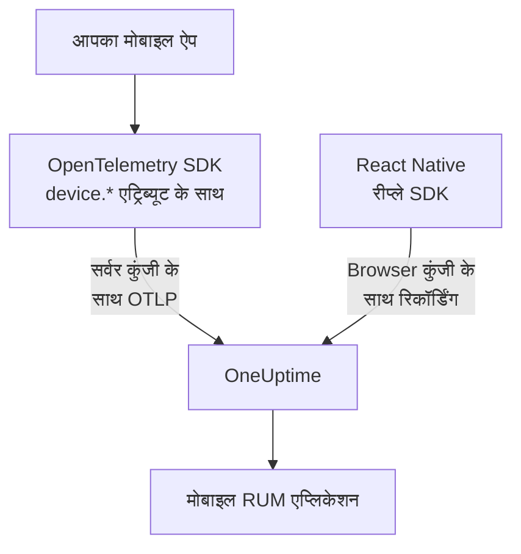

# मोबाइल सेटअप

OpenTelemetry से किसी Android, iOS या React Native ऐप को इंस्ट्रुमेंट करें, ताकि वह OneUptime को मोबाइल RUM एप्लिकेशन के रूप में रिपोर्ट करे। OpenTelemetry SDK वाला कोई भी दूसरा प्लेटफ़ॉर्म इसी तरह काम करता है।

:::cards
- [OneUptime को क्या चाहिए](#oneuptime-को-क्या-चाहिए): दो रिसोर्स एट्रिब्यूट, सर्वर कुंजी के साथ भेजे गए।
- [अपना प्लेटफ़ॉर्म सेट करें](#अपना-प्लेटफ़ॉर्म-सेट-करें): Android, iOS, React Native और बाकी।
- [जाँचें कि डेटा पहुँचता है](#जाँचें-कि-डेटा-पहुँचता-है): कुंजी जाँचें, फिर ऐप ढूँढें।
- [मोबाइल पर सेशन रीप्ले](#मोबाइल-पर-सेशन-रीप्ले): React Native ऐप्स की रिकॉर्डिंग।
:::

## यह कैसे काम करता है

आपका ऐप **सर्वर** इन्जेशन कुंजी के साथ OTLP सीधे OneUptime को एक्सपोर्ट करता है। उसके रिसोर्स पर मौजूद `device.*` एट्रिब्यूट ही उसे बैकएंड सेवा के बजाय मोबाइल RUM के रूप में दर्ज करवाते हैं।



## OneUptime को क्या चाहिए

आपका ऐप जो भी बैच एक्सपोर्ट करता है, उस हर बैच पर दो रिसोर्स एट्रिब्यूट:

| एट्रिब्यूट | यह क्या है |
| --- | --- |
| `service.name` | एप्लिकेशन की पहचान, जैसे `storefront-android`। |
| `device.id` या `device.model.identifier` | टेलीमेट्री को मोबाइल RUM के रूप में चिह्नित करता है। `device.model.identifier` **क्लाइंट्स** पेज भी भरता है। |

डिवाइस एट्रिब्यूट के बिना भी टेलीमेट्री आती है और आप उस पर क्वेरी कर सकते हैं, लेकिन वह RUM एप्लिकेशन के बजाय बैकएंड सेवा के रूप में दर्ज होती है।

`device.manufacturer` भी बैच को मोबाइल के रूप में चिह्नित करता है, लेकिन केवल ऐसे रिसोर्स पर जिसमें कोई होस्ट पहचान न हो, क्योंकि होस्ट की इन्वेंटरी भी इसी से मशीन का निर्माता बताती है। नीचे की हर रेसिपी की तरह `device.id` या `device.model.identifier` भी सेट करें, फिर इससे कभी फ़र्क नहीं पड़ता।

`device.id` को इंस्टॉल-स्तर का पहचानकर्ता बनाएँ, कभी विज्ञापन ID या ऐसा कुछ नहीं जो किसी व्यक्ति की पहचान करे। OneUptime इसे केवल मोबाइल टेलीमेट्री पहचानने के लिए पढ़ता है।

## शुरू करने से पहले

- OpenTelemetry SDK वाला एक ऐप: OpenTelemetry Java SDK या OpenTelemetry Android, opentelemetry-swift, या React Native के लिए OpenTelemetry JavaScript SDK।
- एक **सर्वर** इन्जेशन कुंजी, जो **प्रोजेक्ट सेटिंग्स → टेलीमेट्री और APM → इंजेशन कुंजियाँ** में **इन्जेशन कुंजी बनाएँ** से बनाई गई हो। मोबाइल ऐप से आई **ब्राउज़र** कुंजी अस्वीकार हो जाती है: उसकी जाँच `Origin` हेडर से होती है, जिसे मोबाइल SDK नहीं भेजते।
- ये OTLP सेटिंग्स। अगर आप OneUptime खुद होस्ट करते हैं, तो `https://oneuptime.com` को अपने होस्ट से बदलें।

| सेटिंग | मान |
| --- | --- |
| OTLP एंडपॉइंट | `https://oneuptime.com/otlp` |
| हेडर | `x-oneuptime-token: YOUR_TELEMETRY_INGESTION_TOKEN` |
| ट्रेस | `POST https://oneuptime.com/otlp/v1/traces` |
| मेट्रिक्स | `POST https://oneuptime.com/otlp/v1/metrics` |
| लॉग | `POST https://oneuptime.com/otlp/v1/logs` |

> [!WARNING]
> कुंजी आपके ऐप के अंदर जाती है, और ऐप को खोला जा सकता है, इसलिए मान लें कि कोई इसे कॉपी करेगा। कुंजी के पेज पर **पिन किया गया सेवा नाम** सेट करें ताकि कोई कॉपी आपकी बैकएंड सेवाओं के नाम से न लिख सके, **Requests Per Minute Limit** और **इस समय समाप्त होता है** की तारीख जोड़ें, और हर रिलीज़ के साथ कुंजी बदलें।

## अपना प्लेटफ़ॉर्म सेट करें

स्निपेट सेटअप का ढाँचा दिखाते हैं। मोबाइल OpenTelemetry SDK रिलीज़ के बीच अपने API बदलते हैं, इसलिए मेथड के नाम उस संस्करण से मिलाएँ जिसे आपने पिन किया है। OneUptime को जो चाहिए वह कभी नहीं बदलता: एंडपॉइंट, हेडर, `service.name` और एक `device.*` एट्रिब्यूट।

:::tabs
@tab Android
OpenTelemetry Java SDK और उसका OTLP एक्सपोर्टर इस्तेमाल करें, जो Android पर चलते हैं:

```kotlin title="app/build.gradle.kts"
dependencies {
    implementation(platform("io.opentelemetry:opentelemetry-bom:<latest>"))
    implementation("io.opentelemetry:opentelemetry-sdk")
    implementation("io.opentelemetry:opentelemetry-exporter-otlp")
}
```

```kotlin title="StorefrontApplication.kt"
import android.app.Application
import android.os.Build
import io.opentelemetry.exporter.otlp.http.trace.OtlpHttpSpanExporter
import io.opentelemetry.sdk.OpenTelemetrySdk
import io.opentelemetry.sdk.resources.Resource
import io.opentelemetry.sdk.trace.SdkTracerProvider
import io.opentelemetry.sdk.trace.export.BatchSpanProcessor

class StorefrontApplication : Application() {
    override fun onCreate() {
        super.onCreate()

        val resource = Resource.getDefault().toBuilder()
            .put("service.name", "storefront-android")
            .put("device.manufacturer", Build.MANUFACTURER)
            .put("device.model.identifier", Build.MODEL)
            .build()

        val exporter = OtlpHttpSpanExporter.builder()
            .setEndpoint("https://oneuptime.com/otlp/v1/traces")
            .addHeader("x-oneuptime-token", BuildConfig.ONEUPTIME_TOKEN)
            .build()

        OpenTelemetrySdk.builder()
            .setTracerProvider(
                SdkTracerProvider.builder()
                    .setResource(resource)
                    .addSpanProcessor(BatchSpanProcessor.builder(exporter).build())
                    .build()
            )
            .buildAndRegisterGlobal()
    }
}
```

[OpenTelemetry Android](https://github.com/open-telemetry/opentelemetry-android) एजेंट इसके ऊपर ऑटोमैटिक इंस्ट्रुमेंटेशन जोड़ता है, और अपने रिसोर्स पर डिवाइस एट्रिब्यूट सेट करता है। अगर आप इसे इस्तेमाल करते हैं, तो इसके एक्सपोर्टर को उसी एंडपॉइंट और हेडर पर लगाएँ, और जाँचें कि आपके संस्करण में `device.model.identifier` रिसोर्स तक पहुँचता है।
@tab iOS
[opentelemetry-swift](https://github.com/open-telemetry/opentelemetry-swift) इस्तेमाल करें, और डिवाइस एट्रिब्यूट खुद सेट करें: हर संस्करण अपने आप जो रिसोर्स जोड़ता है, वह रिलीज़ के बीच बदलता रहा है।

```swift
let resource = Resource(attributes: [
    "service.name": .string("storefront-ios"),
    "device.model.identifier": .string(UIDevice.current.model),
    "device.manufacturer": .string("Apple"),
    "telemetry.sdk.language": .string("swift"),
])

let exporter = OtlpHttpTraceExporter(
    endpoint: URL(string: "https://oneuptime.com/otlp/v1/traces")!,
    config: OtlpConfiguration(
        headers: [("x-oneuptime-token", oneUptimeToken)]
    )
)

OpenTelemetry.registerTracerProvider(
    tracerProvider: TracerProviderBuilder()
        .with(resource: resource)
        .add(spanProcessor: BatchSpanProcessor(spanExporter: exporter))
        .build()
)
```

`UIDevice.current.model` `iPhone` जैसा छोटा नाम देता है, जिससे **क्लाइंट्स** पेज पर हर तरह के डिवाइस की एक ही पंक्ति रहती है।
@tab React Native
React Native OpenTelemetry JavaScript SDK चलाता है, इसलिए प्रोवाइडर, OTLP एक्सपोर्टर और बैच प्रोसेसर [ब्राउज़र सेटअप](/docs/rum/browser-setup) की तरह बनाएँ, तीन बदलावों के साथ: **सर्वर** कुंजी से भेजें, `browserDetector` और `DocumentLoadInstrumentation` हटा दें, और डिवाइस एट्रिब्यूट खुद सेट करें।

```ts
import { Platform } from "react-native";
import * as Device from "expo-device"; // or react-native-device-info
import {
  defaultResource,
  resourceFromAttributes,
} from "@opentelemetry/resources";

const resource = defaultResource().merge(
  resourceFromAttributes({
    "service.name": "storefront-mobile",
    "device.manufacturer": Device.manufacturer ?? Platform.OS,
    "device.model.identifier":
      Device.modelId ?? Device.modelName ?? "unknown",
    "telemetry.sdk.language": "webjs",
  }),
);
```

`Device.modelId` केवल iOS पर सेट होता है, इसलिए Android पर `Device.modelName` इस्तेमाल होता है।
@tab दूसरे प्लेटफ़ॉर्म
Flutter, Unity, .NET MAUI, कोई एम्बेडेड क्लाइंट या आपका अपना OTLP राइटर, सब काम करते हैं, बशर्ते रिसोर्स में `service.name` और एक `device.*` एट्रिब्यूट हो। मानक OpenTelemetry एनवायरनमेंट वेरिएबल पढ़ने वाला SDK इन्हें जैसे के तैसे लेता है:

```bash
OTEL_EXPORTER_OTLP_ENDPOINT="https://oneuptime.com/otlp"
OTEL_EXPORTER_OTLP_HEADERS="x-oneuptime-token=YOUR_TELEMETRY_INGESTION_TOKEN"
OTEL_RESOURCE_ATTRIBUTES="service.name=storefront-mobile,device.manufacturer=Acme,device.model.identifier=AC-100"
```

SDK एंडपॉइंट में `/v1/traces`, `/v1/metrics` और `/v1/logs` खुद जोड़ता है।
:::

## जाँचें कि डेटा पहुँचता है

:::steps
### कुंजी जाँचें

SDK की सेटिंग्स खँगालने से पहले OneUptime से पूछें कि वह कुंजी स्वीकार करता है या नहीं:

```bash
curl -i https://oneuptime.com/otlp/v1/validate \
  -H "x-oneuptime-token: YOUR_TELEMETRY_INGESTION_TOKEN"
```

`"valid": true` के साथ `200` का मतलब है कि कुंजी स्वीकार है। Browser कुंजी भी `200` लौटाती है, लेकिन उसका संदेश कहता है कि यह केवल ब्राउज़र से काम करती है: मोबाइल ऐप को सर्वर कुंजी चाहिए। `401` का मतलब है कि कुंजी अज्ञात, रद्द, बंद या समाप्त है, और कोई भी SDK सेटिंग इसे ठीक नहीं करेगी।

### ऐप चलाएँ

ऐप चलाएँ और थोड़ी देर इस्तेमाल करें। टेलीमेट्री के पहले बैच पर यह अपने `service.name` के नाम से **उत्पाद → संसाधन → वास्तविक उपयोगकर्ता मॉनिटरिंग** में दिखाई देता है।

### क्लाइंट्स पेज खोलें

एप्लिकेशन का **क्लाइंट्स** पेज खोलें: `device.model.identifier` के हर डिवाइस मॉडल की एक पंक्ति होती है। अगर **ट्रेस** भरता रहे और यह पेज खाली रहे, तो डिवाइस एट्रिब्यूट रिसोर्स तक नहीं पहुँच रहे।
:::

## मोबाइल पर सेशन रीप्ले

React Native ऐप `@oneuptime/react-native-replay` से सेशन रिकॉर्ड कर सकते हैं। यह नेटिव व्यू ट्री को वायरफ़्रेम के रूप में रिकॉर्ड करता है, कभी स्क्रीनशॉट या स्क्रीन का टेक्स्ट नहीं, और इसकी रिकॉर्डिंग वेब रिकॉर्डिंग वाले प्लेयर में ही खुलती हैं। यह **ब्राउज़र** कुंजी से भेजता है, जिसके **अनुमत ऑरिजिन** में आपका ऐप `app://` के बाद उसकी Android एप्लिकेशन ID या iOS बंडल ID के रूप में दर्ज होता है: यह आपके OpenTelemetry SDK की सर्वर कुंजी से अलग कुंजी है। [React Native में इंस्टॉल करें](/docs/telemetry/session-replay#react-native-में-इंस्टॉल-करें) इसे चरण दर चरण बताता है।

नेटिव Android और iOS ऐप, और दूसरे प्लेटफ़ॉर्म, में कोई सेशन रिकॉर्डर नहीं है: उनका **सेशन रीप्ले** पेज खाली रहता है, जबकि ट्रेस, लॉग, मेट्रिक्स, अपवाद और **क्लाइंट्स** पेज सामान्य रूप से काम करते हैं।

## समस्या निवारण

:::details कुंजी जाँच 401 लौटाती है, या कुंजी अस्वीकार होती है
`401` का मतलब है कि कुंजी अज्ञात, रद्द, बंद या समाप्त है: एक सर्वर कुंजी बनाएँ और उसके साथ ऐप फिर से बिल्ड करें।

Browser कुंजी जाँच पास कर लेती है, लेकिन मोबाइल ऐप का हर एक्सपोर्ट `422` के साथ अस्वीकार होता है, जिसमें लिखा होता है `This request did not send an Origin header, so it cannot be checked against the allowed origins of this browser ingestion key. Use a server ingestion key for requests that are not sent by a browser.` **सर्वर** कुंजी इस्तेमाल करें।
:::

:::details ऐप वास्तविक उपयोगकर्ता मॉनिटरिंग के बजाय सेवाएं में दिखता है
रिसोर्स में न `device.id` है और न `device.model.identifier`, इसलिए टेलीमेट्री बैकएंड सेवा के रूप में दर्ज हुई। इन्हें [अपना प्लेटफ़ॉर्म सेट करें](#अपना-प्लेटफ़ॉर्म-सेट-करें) की तरह सेट करें।

जो सेवा पहले ही बन चुकी है वह RUM एप्लिकेशन में नहीं बदलती, इसलिए RUM टेलीमेट्री आने के बाद उसे **उत्पाद → सेवाएं** में हटा दें।
:::

:::details क्लाइंट्स पेज खाली है
क्लाइंट पंक्तियाँ केवल `device.model.identifier` से आती हैं। जो SDK केवल `device.id` या `device.manufacturer` सेट करता है, वह ऐप को मोबाइल RUM के रूप में दर्ज करवाता है, लेकिन कोई क्लाइंट नहीं दिखाता: `device.model.identifier` भी सेट करें।
:::

:::details लोग ऐप इस्तेमाल कर रहे हैं, फिर भी स्थिति डिस्कनेक्टेड दिखाती है
15 मिनट तक कोई टेलीमेट्री न आने पर स्थिति **डिस्कनेक्टेड** हो जाती है। अगर लोग ऐप इस्तेमाल कर रहे हैं:

- हो सकता है कोई सैंपलर सब कुछ छोड़ रहा हो: always-off सैंपलर, या बहुत कम अनुपात देखें।
- हो सकता है ऐप टेलीमेट्री केवल उन कार्रवाइयों के लिए भेजता हो जो उस समय में किसी ने नहीं कीं।
- हो सकता है रिलीज़ के बाद कुंजी रद्द हो गई हो या समाप्त हो गई हो: [जाँचें कि डेटा पहुँचता है](#जाँचें-कि-डेटा-पहुँचता-है) की तरह इसे जाँचें।
:::

## अगले कदम

:::cards
- [सेशन रीप्ले](/docs/telemetry/session-replay): React Native सेशन को उनके ट्रेस के साथ रिकॉर्ड करें।
- [एप्लिकेशन प्रबंधित करना](/docs/rum/applications): नाम, लेबल, स्वामी और रिटेंशन।
- [OpenTelemetry](/docs/telemetry/open-telemetry): OTLP एंडपॉइंट, सीमाएँ और त्रुटियाँ विस्तार से।
- [RUM समस्या निवारण](/docs/rum/troubleshooting): हर जाँच, उसी क्रम में जिसमें समस्याएँ आमतौर पर होती हैं।
:::
