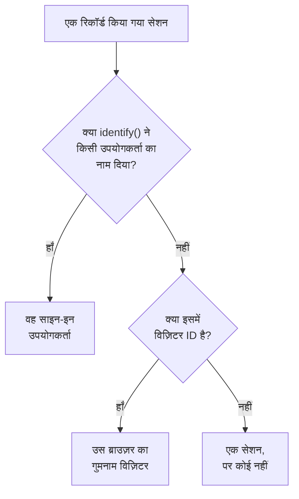

# प्रोडक्ट एनालिटिक्स

प्रोडक्ट एनालिटिक्स उन लोगों को गिनता है जो किसी RUM एप्लिकेशन का उपयोग करते हैं, और यह भी कि उनके सेशन कैसे चलते हैं: सक्रिय, नए, लौटने वाले, साइन-इन और निष्क्रिय उपयोगकर्ता, और डिवाइस, ब्राउज़र, देश और पेज के अनुसार सेशन। यह उन सेशन को गिनता है जिन्हें [सेशन रीप्ले](/docs/telemetry/session-replay) रिकॉर्ड करता है, इसलिए इसे अपने किसी स्निपेट की ज़रूरत नहीं है, और यह अपने आँकड़े 13 महीने तक रखता है, रिकॉर्डिंग की अवधि खत्म होने के बहुत बाद तक।

:::cards
- [लोगों को कैसे गिना जाता है](#लोगों-को-कैसे-गिना-जाता-है): साइन-इन उपयोगकर्ता एक बार, गुमनाम ब्राउज़र एक बार।
- [उपयोगकर्ता](#उपयोगकर्ता): सक्रिय, नए, लौटने वाले, साइन-इन, कुल और निष्क्रिय उपयोगकर्ता।
- [सेशन](#सेशन): कितने, कितने लंबे, और डिवाइस, ब्राउज़र, देश और पेज के अनुसार।
- [गोपनीयता और रखाव](#गोपनीयता-और-रखाव): 13 महीने, कोई नाम संग्रहीत नहीं, अनुरोध पर मिटाया जाता है।
:::

## लोगों को कैसे गिना जाता है

किसी एप्लिकेशन के साइड मेनू में **प्रोडक्ट एनालिटिक्स** सेक्शन है, जिसमें दो पेज हैं, **उपयोगकर्ता** और **सेशन**। दोनों उन सेशन को गिनते हैं जिन्हें सेशन रीप्ले रिकॉर्ड करता है, इसलिए वे तब शुरू होते हैं जब एप्लिकेशन का रिकॉर्डर शुरू होता है, और जिस सेशन को रीप्ले नीति रिकॉर्ड नहीं करती, वह नहीं गिना जाता। हर सेशन एक व्यक्ति के लिए गिना जाता है, या किसी के लिए नहीं:

- **साइन-इन उपयोगकर्ता एक बार गिना जाता है**, हर उस ब्राउज़र और डिवाइस पर जिसका वह उपयोग करता है: उसे उस संदर्भ के एकतरफ़ा हैश से पहचाना जाता है जो आपके पेज ने `identify()` को दिया था (देखें [अपने उपयोगकर्ताओं की पहचान करें](/docs/telemetry/session-replay#अपने-उपयोगकर्ताओं-की-पहचान-करें))।
- **गुमनाम ब्राउज़र एक बार गिना जाता है**, उसकी [गुमनाम विज़िटर ID](/docs/telemetry/session-replay#गुमनाम-विज़िटर) से। दो ब्राउज़र दो विज़िटर हैं, और किसी के उस ब्राउज़र पर साइन इन करने से पहले के उसके सेशन उसके विज़िटर के ही रहते हैं।
- **किसी पुराने रिकॉर्डर का सेशन**, जिसने विज़िटर ID नहीं भेजी, सेशन के रूप में गिना जाता है, पर व्यक्ति के रूप में नहीं।

दिन आपके अपने टाइम ज़ोन में गिने जाते हैं।

## उपयोगकर्ता

**उपयोगकर्ता** आपकी चुनी हुई समय-सीमा के लोगों को गिनता है:

| टाइल | यह क्या गिनती है |
| --- | --- |
| **सक्रिय उपयोगकर्ता** | समय-सीमा में आया हर व्यक्ति: हर साइन-इन उपयोगकर्ता एक बार, और हर गुमनाम ब्राउज़र एक बार। |
| **नए उपयोगकर्ता** | वे सक्रिय उपयोगकर्ता जिनकी पहली विज़िट समय-सीमा में थी। |
| **लौटने वाले उपयोगकर्ता** | वे सक्रिय उपयोगकर्ता जो समय-सीमा शुरू होने से पहले भी आ चुके थे। |
| **साइन-इन उपयोगकर्ता** | वे सक्रिय उपयोगकर्ता जिन्हें आपके ऐप ने `identify()` से साइन इन किया, और सभी सक्रिय उपयोगकर्ताओं में उनका हिस्सा। |
| **कुल उपयोगकर्ता** | हर वह व्यक्ति जिसे एप्लिकेशन ने पिछले 13 महीनों में देखा है। |
| **निष्क्रिय उपयोगकर्ता** | वे लोग जो पहले आए थे, पर पिछले 30 दिनों में, या आपके चुने हुए 7, 14, 60 या 90 दिनों में नहीं आए। |

पहले तीन यह भी बताते हैं कि पिछली अवधि की तुलना में वे कैसे बदले। टाइलों के नीचे, **सक्रिय उपयोगकर्ता** हर दिन के लिए उस दिन आए लोगों, उस दिन तक के 7 दिनों में आए लोगों और उस दिन तक के 30 दिनों में आए लोगों का चार्ट बनाता है, और **नए और लौटने वाले उपयोगकर्ता** हर दिन के लोगों को दो हिस्सों में बाँटता है।

**लोग** उन सभी लोगों की सूची दिखाता है जिन्हें टाइलें गिनती हैं, हर व्यक्ति की एक पंक्ति, सबसे हाल में देखे गए पहले, और इसका फ़िल्टर किसी एक टाइल के लोग, गुमनाम विज़िटर या सभी को दिखाता है। किसी व्यक्ति को खोलने पर उसकी पहली और आखिरी विज़िट और पिछले 13 महीनों का उसका हर सेशन दिखता है, और जिस सेशन की रिकॉर्डिंग अभी रखी गई है उस पर **देखें** होता है।

## सेशन

**सेशन** उन सेशन को गिनता है जो समय-सीमा में शुरू हुए: **सेशन**, **साइन-इन सेशन**, **सेशन अवधि की माध्यिका**, **प्रति सेशन पेज**, **त्रुटियों वाले सेशन** और **झुंझलाहट वाले सेशन**। टाइलों के नीचे:

- **डिवाइस के अनुसार सेशन** हर दिन के सेशन का चार्ट डेस्कटॉप, फ़ोन और टैबलेट के अनुसार बनाता है। किसी मोबाइल ऐप का ऐसी स्क्रीन पर सेशन, जिसकी छोटी भुजा 600 पॉइंट या उससे अधिक हो, टैबलेट का माना जाता है।
- **सेशन की अवधि** पूरे हो चुके सेशन को इस हिसाब से बाँटता है कि वे कितनी देर चले, 10 सेकंड से कम से लेकर 30 मिनट से अधिक तक। जो सेशन अभी रिकॉर्ड हो रहा है, उसकी अभी कोई अवधि नहीं होती।
- **विवरण** उपयोगकर्ताओं और सेशन को डिवाइस प्रकार, ब्राउज़र, ऑपरेटिंग सिस्टम, देश, ऐप संस्करण, एंट्री पेज या पेज के अनुसार क्रम में रखता है, सबसे अधिक उपयोगकर्ताओं वाले पहले।

## गोपनीयता और रखाव

- **13 महीने।** किसी महीने के आँकड़े उसके बाद के 13वें महीने के पहले दिन हटा दिए जाते हैं, इसलिए पिछले 12 पूरे महीने हमेशा मौजूद रहते हैं, चाहे रिकॉर्डिंग का अपना रखाव कुछ भी हो (डिफ़ॉल्ट रूप से 7 दिन)।
- **कोई नाम संग्रहीत नहीं।** आँकड़े साइन-इन उपयोगकर्ता की एकतरफ़ा कुंजी और ब्राउज़र की विज़िटर ID रखते हैं, संदर्भ, गुण या IP पता कभी नहीं। कोई पंक्ति किसी साइन-इन उपयोगकर्ता का नाम तभी दिखाती है जब उसकी कोई रिकॉर्डिंग अभी रखी गई हो, और केवल उस भूमिका को जो पहचान पढ़ सकती है; अन्यथा उसमें **साइन-इन उपयोगकर्ता** या **अनाम विज़िटर** और ID की शुरुआत दिखती है।
- **अनुरोध पर मिटाया जाता है।** मिटाने का अनुरोध यहाँ के मेल खाते आँकड़े भी हटा देता है (देखें [सेशन मिटाना](/docs/telemetry/session-replay#सेशन-मिटाना))।

## इसे कौन देख सकता है

दोनों पेज पढ़ने के लिए वही चाहिए जो सेशन सूची पढ़ने के लिए चाहिए: `ReadRumSessionReplay` (_List Session Replays_) या `ReadRumSessionReplayPayload` (_Watch Session Replays_), जो प्रोजेक्ट के स्वामियों और एडमिन के पास होती हैं। यह देखने के लिए कि कोई साइन-इन उपयोगकर्ता कौन है, और लोगों को नाम से खोजने के लिए, [रिकॉर्डिंग कौन देख सकता है](/docs/telemetry/session-replay#रिकॉर्डिंग-कौन-देख-सकता-है) में बताई गई पहचान की अनुमति चाहिए।

## अगले कदम

:::cards
- [सेशन रीप्ले](/docs/telemetry/session-replay): वे सेशन रिकॉर्ड करें जिन्हें ये पेज गिनते हैं, और उन्हें देखें।
- [एप्लिकेशन प्रबंधित करना](/docs/rum/applications): नाम, लेबल, स्वामी और रखाव।
- [RUM अवलोकन](/docs/rum/index): RUM एप्लिकेशन और क्या दिखाता है।
:::
