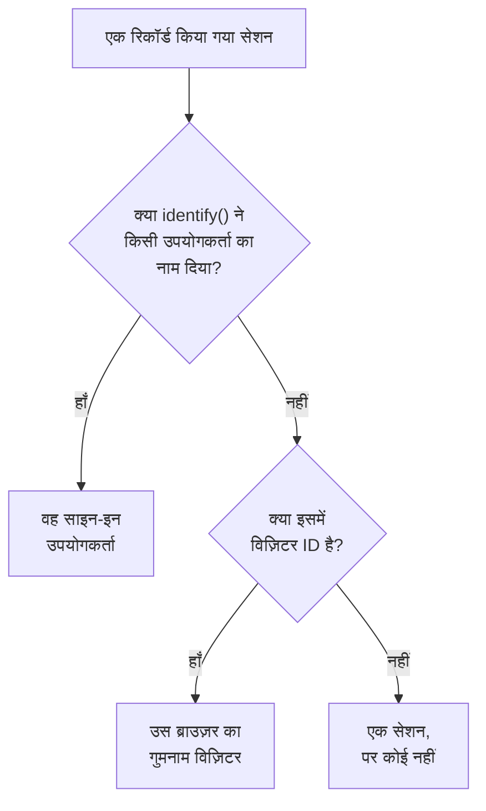

# प्रोडक्ट एनालिटिक्स

प्रोडक्ट एनालिटिक्स उन लोगों को गिनता है जो किसी RUM एप्लिकेशन का उपयोग करते हैं, यह भी कि उनके सेशन कैसे चलते हैं और वे क्या करते हैं: सक्रिय, नए, लौटने वाले, साइन-इन और निष्क्रिय उपयोगकर्ता, डिवाइस, ब्राउज़र, देश और पेज के अनुसार सेशन, और आपका ऐप जो इवेंट भेजता है, ट्रेंड, फ़नल और रिटेंशन के रूप में। यह उन सेशन को गिनता है जिन्हें [सेशन रीप्ले](/docs/telemetry/session-replay) रिकॉर्ड करता है और उन इवेंट को जो उसका रिकॉर्डर भेजता है, इसलिए इसे अपने किसी स्निपेट की ज़रूरत नहीं है, और यह अपने आँकड़े 13 महीने तक रखता है, रिकॉर्डिंग की अवधि खत्म होने के बहुत बाद तक।

:::cards
- [उपयोगकर्ता](#उपयोगकर्ता): सक्रिय, नए, लौटने वाले, साइन-इन, कुल और निष्क्रिय उपयोगकर्ता।
- [सेशन](#सेशन): कितने, कितने लंबे, और डिवाइस, ब्राउज़र, देश और पेज के अनुसार।
- [इवेंट और मेट्रिक्स भेजें](#इवेंट-और-मेट्रिक्स-भेजें): लोग क्या करते हैं, और आपका पेज कौन-सी संख्याएँ मापता है।
- [इवेंट](#इवेंट): कुछ कितनी बार हुआ, किसने किया और कहाँ।
- [फ़नल](#फ़नल): कौन कदम-दर-कदम आगे बढ़ा, और इसमें कितना समय लगा।
- [उपयोगकर्ता रिटेंशन](#उपयोगकर्ता-रिटेंशन): कौन लौटकर आया, कोहोर्ट-दर-कोहोर्ट।
:::

## लोगों को कैसे गिना जाता है

किसी एप्लिकेशन के साइड मेनू में **प्रोडक्ट एनालिटिक्स** सेक्शन है: **उपयोगकर्ता**, **सेशन**, **इवेंट**, **फ़नल**, **उपयोगकर्ता रिटेंशन**, **उपयोगकर्ता फ़्लो** और **एनालिटिक्स सेटिंग्स**। **उपयोगकर्ता** और **सेशन** उन सेशन को गिनते हैं जिन्हें सेशन रीप्ले रिकॉर्ड करता है, इसलिए वे तब शुरू होते हैं जब एप्लिकेशन का रिकॉर्डर शुरू होता है, और जिस सेशन को रीप्ले नीति रिकॉर्ड नहीं करती, वह नहीं गिना जाता। हर सेशन एक व्यक्ति के लिए गिना जाता है, या किसी के लिए नहीं:



- **साइन-इन उपयोगकर्ता एक बार गिना जाता है**, हर उस ब्राउज़र और डिवाइस पर जिसका वह उपयोग करता है: उसे उस संदर्भ के एकतरफ़ा हैश से पहचाना जाता है जो आपके पेज ने `identify()` को दिया था (देखें [अपने उपयोगकर्ताओं की पहचान करें](/docs/telemetry/session-replay#अपने-उपयोगकर्ताओं-की-पहचान-करें))।
- **गुमनाम ब्राउज़र एक बार गिना जाता है**, उसकी [गुमनाम विज़िटर ID](/docs/telemetry/session-replay#गुमनाम-विज़िटर) से। दो ब्राउज़र दो विज़िटर हैं, और किसी के उस ब्राउज़र पर साइन इन करने से पहले के उसके सेशन उसके विज़िटर के ही रहते हैं।
- **किसी पुराने रिकॉर्डर का सेशन**, जिसने विज़िटर ID नहीं भेजी, सेशन के रूप में गिना जाता है, पर व्यक्ति के रूप में नहीं।

**इवेंट**, **फ़नल** और **उपयोगकर्ता रिटेंशन** लोगों को इसी तरह गिनते हैं, उन इवेंट से जो रिकॉर्डर हर सेशन से भेजता है, चाहे वह रिकॉर्ड हुआ हो या नहीं (देखें [इवेंट और मेट्रिक्स भेजें](#इवेंट-और-मेट्रिक्स-भेजें))।

दिन आपके अपने टाइम ज़ोन में गिने जाते हैं।

## उपयोगकर्ता

**उपयोगकर्ता** आपकी चुनी हुई समय-सीमा के लोगों को गिनता है:

| टाइल | यह क्या गिनती है |
| --- | --- |
| **सक्रिय उपयोगकर्ता** | समय-सीमा में आया हर व्यक्ति: हर साइन-इन उपयोगकर्ता एक बार, और हर गुमनाम ब्राउज़र एक बार। |
| **नए उपयोगकर्ता** | वे सक्रिय उपयोगकर्ता जिनकी पहली विज़िट समय-सीमा में थी। |
| **लौटने वाले उपयोगकर्ता** | वे सक्रिय उपयोगकर्ता जो समय-सीमा शुरू होने से पहले भी आ चुके थे। |
| **साइन-इन उपयोगकर्ता** | वे सक्रिय उपयोगकर्ता जिन्हें आपके ऐप ने `identify()` से साइन इन किया, और सभी सक्रिय उपयोगकर्ताओं में उनका हिस्सा। |
| **कुल उपयोगकर्ता** | हर वह व्यक्ति जिसे एप्लिकेशन ने पिछले 13 महीनों में देखा है। |
| **निष्क्रिय उपयोगकर्ता** | वे लोग जो पहले आए थे, पर पिछले 30 दिनों में, या आपके चुने हुए 7, 14, 60 या 90 दिनों में नहीं आए। |

पहले तीन यह भी बताते हैं कि पिछली अवधि की तुलना में वे कैसे बदले। टाइलों के नीचे, **सक्रिय उपयोगकर्ता** हर दिन के लिए उस दिन आए लोगों, उस दिन तक के 7 दिनों में आए लोगों और उस दिन तक के 30 दिनों में आए लोगों का चार्ट बनाता है, और **नए और लौटने वाले उपयोगकर्ता** हर दिन के लोगों को दो हिस्सों में बाँटता है।

**लोग** उन सभी लोगों की सूची दिखाता है जिन्हें टाइलें गिनती हैं, हर व्यक्ति की एक पंक्ति, सबसे हाल में देखे गए पहले, और इसका फ़िल्टर किसी एक टाइल के लोग, गुमनाम विज़िटर या सभी को दिखाता है। किसी व्यक्ति को खोलने पर उसकी पहली और आखिरी विज़िट और पिछले 13 महीनों का उसका हर सेशन दिखता है, और जिस सेशन की रिकॉर्डिंग अभी रखी गई है उस पर **देखें** होता है।

## सेशन

**सेशन** उन सेशन को गिनता है जो समय-सीमा में शुरू हुए: **सेशन**, **साइन-इन सेशन**, **सेशन अवधि की माध्यिका**, **प्रति सेशन पेज**, **त्रुटियों वाले सेशन** और **झुंझलाहट वाले सेशन**। टाइलों के नीचे:

- **डिवाइस के अनुसार सेशन** हर दिन के सेशन का चार्ट डेस्कटॉप, फ़ोन और टैबलेट के अनुसार बनाता है। किसी मोबाइल ऐप का ऐसी स्क्रीन पर सेशन, जिसकी छोटी भुजा 600 पॉइंट या उससे अधिक हो, टैबलेट का माना जाता है।
- **सेशन की अवधि** पूरे हो चुके सेशन को इस हिसाब से बाँटता है कि वे कितनी देर चले, 10 सेकंड से कम से लेकर 30 मिनट से अधिक तक। जो सेशन अभी रिकॉर्ड हो रहा है, उसकी अभी कोई अवधि नहीं होती।
- **विवरण** उपयोगकर्ताओं और सेशन को डिवाइस प्रकार, ब्राउज़र, ऑपरेटिंग सिस्टम, देश, ऐप संस्करण, एंट्री पेज या पेज के अनुसार क्रम में रखता है, सबसे अधिक उपयोगकर्ताओं वाले पहले।

## इवेंट और मेट्रिक्स भेजें

इवेंट तब तक भेजे जाते हैं जब तक एप्लिकेशन के **एनालिटिक्स सेटिंग्स** पेज पर **प्रोडक्ट एनालिटिक्स इवेंट भेजें** चालू है। नए एप्लिकेशन के लिए यह शुरू से चालू होता है, और इसके आने से पहले बने एप्लिकेशन के लिए बंद, इसलिए इसे वहाँ चालू करें। एप्लिकेशन के लिए सेशन रीप्ले भी चालू होना चाहिए, क्योंकि इवेंट उसका रिकॉर्डर भेजता है; React Native रिकॉर्डर अभी कोई इवेंट नहीं भेजता।

जिस भी सेशन में ब्राउज़र रिकॉर्डर चलता है, वह अपनी शुरुआत और अपना देखा हर पेज अपने आप भेजता है, सिंगल-पेज ऐप के रूट बदलाव भी, चाहे रीप्ले का सैंपल और नीति उस सेशन को रिकॉर्ड करें या नहीं। आपके अपने इवेंट और संख्याएँ आपके पेज के कोड से आती हैं:

```js
OneUptimeReplay.track("Signed up", { plan: "pro" });
OneUptimeReplay.metric("cart.value", 42.5, { currency: "EUR" });
```

| कॉल | यह क्या भेजता है |
| --- | --- |
| `track(name, properties?)` | एक इवेंट जिसे **इवेंट**, **फ़नल** और **उपयोगकर्ता रिटेंशन** गिनते हैं, और सेशन रिकॉर्ड होने पर रीप्ले की टाइमलाइन पर एक मार्कर। `name` ≤ 64 अक्षर; स्ट्रिंग, संख्या या बूलियन मानों वाली ≤ 20 प्रॉपर्टी, कुंजी ≤ 40 अक्षर, मान ≤ 200 अक्षर। |
| `metric(name, value, attributes?)` | आपके पेज की मापी गई एक संख्या, एप्लिकेशन के किसी मेट्रिक के पॉइंट के रूप में (देखें [डैशबोर्ड और अलर्ट](#डैशबोर्ड-और-अलर्ट))। `name` ≤ 100 अक्षर, अक्षरों, अंकों, `_`, `.`, `-` और `/` से बना, किसी अक्षर से शुरू होता है और `oneuptime.` से नहीं; `value` एक परिमित संख्या; `attributes` `track()` की प्रॉपर्टी की तरह। |

रिकॉर्डर लोड होने से पहले, यही कॉल `window.OneUptimeReplayQueue` पर `["track", name, properties]` और `["metric", name, value, attributes]` के रूप में डालें (देखें [JavaScript API](/docs/telemetry/session-replay#javascript-api))।

- **हर सेशन, रिकॉर्ड हुआ हो या नहीं।** रीप्ले का सैंपल और अपलोड नीति तय करते हैं कि कौन-से सेशन रिकॉर्ड हों, यह नहीं कि कौन-से गिने जाएँ। Do Not Track या Global Privacy Control के तहत कुछ नहीं भेजा जाता, और जिस ऑरिजिन की एप्लिकेशन अनुमति नहीं देता, वहाँ से कुछ नहीं रखा जाता। जब नीति सहमति माँगती है, तो इवेंट `grantConsent()` का इंतज़ार करते हैं, अधिकतम 500, और `revokeConsent()` उन्हें हटा देता है।
- **रिकॉर्डिंग की तरह मास्क किए जाते हैं।** _Mask all text_ के तहत, प्रॉपर्टी और एट्रिब्यूट के मान पेज छोड़ने से पहले मास्क कर दिए जाते हैं। पेज अपने पाथ के रूप में भेजा जाता है, उसकी क्वेरी या फ़्रैगमेंट के बिना।
- **छोटे बैच में**, हर 5 सेकंड में और जब टैब छिप जाता है। जो इवेंट होने के 3 दिन से ज़्यादा बाद OneUptime तक पहुँचता है, उसे हटा दिया जाता है, और एक प्रोजेक्ट अपने सभी एप्लिकेशन मिलाकर हर मिनट 60,000 इवेंट और मेट्रिक पॉइंट भेज सकता है; उससे ज़्यादा होने पर रिकॉर्डर इंतज़ार करता है और उन्हें फिर से भेजता है।

`metric()` तब तक कुछ नहीं भेजता जब तक इवेंट बंद हैं, और `getDiagnostics().productAnalytics` बताता है कि वे चालू हैं या नहीं (देखें [`getDiagnostics()`](/docs/telemetry/session-replay#getdiagnostics))।

### उपयोगकर्ता प्रॉपर्टी

इवेंट को इस आधार पर बाँटने और सेगमेंट करने के लिए कि उन्हें किसने किया, **एनालिटिक्स सेटिंग्स** पर **एनालिटिक्स के लिए उपयोगकर्ता प्रॉपर्टी** में `identify()` के गुणों की कुंजियाँ सूचीबद्ध करें, जैसे `["plan", "role"]`, अधिकतम 20, जो जैसी लिखी हैं वैसी ही मिलाई जाती हैं। तब हर इवेंट साइन-इन उपयोगकर्ता के ये गुण साथ ले जाता है, जैसे आपके पेज ने उन्हें `identify()` को दिया था। बाकी गुण कभी पेज नहीं छोड़ते, और जब तक **अंतिम उपयोगकर्ता की पहचान कैप्चर करें** बंद है, कोई भी नहीं छोड़ता। ऐसे गुण सूचीबद्ध न करें जिनमें निजी डेटा हो, जैसे ईमेल पता।

## इवेंट

**इवेंट** एक बार में एक इवेंट दिखाता है: जब तक आप कोई दूसरा न चुनें, आपके ऐप का सबसे ज़्यादा होने वाला इवेंट, या जब तक ऐप कोई इवेंट नहीं भेजता, सबसे ज़्यादा देखा गया पेज। चुनने की सूची में **सेशन शुरू हुआ** और देखा गया हर पेज भी होता है, और नीचे **सभी इवेंट** समय-सीमा के हर इवेंट को इस गिनती के साथ दिखाता है कि वह कितनी बार हुआ और कितने लोगों ने उसे किया; ऊपर देखने के लिए किसी एक को चुनें।

- टाइलें इवेंट के **इवेंट** गिनती हैं, साथ में यह कि हर व्यक्ति ने औसतन कितने किए, उसके **उपयोगकर्ता** और उसके **सेशन**।
- **इवेंट और उपयोगकर्ता** हर दिन के लिए इवेंट की गिनती और उस दिन उसे करने वाले लोगों का चार्ट बनाता है।
- **विवरण** इवेंट को डिवाइस प्रकार, ब्राउज़र, ऑपरेटिंग सिस्टम, देश, ऐप संस्करण, पेज, इवेंट प्रॉपर्टी या उपयोगकर्ता प्रॉपर्टी के अनुसार क्रम में रखता है, हर मान के इवेंट, उपयोगकर्ता और हिस्से के साथ। केवल उसे दिखाने के लिए कोई मान चुनें।

**सेगमेंट** पेज को उन इवेंट तक सीमित करता है जिनके फ़ील्ड में आपके चुने हुए मान हों: **फ़िल्टर जोड़ें**, फिर एक फ़ील्ड और एक मान, जो बिल्कुल सटीक मिलाया जाता है। एक सेगमेंट में अधिकतम 5 फ़िल्टर होते हैं, और इवेंट को उन सभी से मेल खाना चाहिए। पेज का पता इवेंट, समय-सीमा, सेगमेंट और विवरण को बनाए रखता है, इसलिए कोई लिंक वही व्यू खोलता है।

## फ़नल

**फ़नल** लोगों को क्रम से 2 से 6 चरणों तक फ़ॉलो करता है, हर चरण एक इवेंट जैसा **इवेंट** उन्हें सूचीबद्ध करता है। समय-सीमा में पहला चरण करने वाले लोगों में से, यह गिनता है कि उसके बाद कितनों ने दूसरा किया, फिर तीसरा, सब उनके पहले चरण से आपके चुने हुए समय के भीतर: **1 घंटे के भीतर**, **1 दिन के भीतर**, **7 दिनों के भीतर**, **14 दिनों के भीतर** या **30 दिनों के भीतर**। **चरण जोड़ें** एक चरण जोड़ता है।

**कन्वर्ज़न** के नीचे हर चरण पूरा करने वाले लोगों का हिस्सा होता है, और हर चरण के लिए कितने लोग उस तक पहुँचे, यह पहले चरण के लोगों का कितना हिस्सा है, पिछले चरण के बाद कितने छूट गए, और उन्हें वहाँ से लगा माध्यिका समय। जिसने एक से ज़्यादा बार कोशिश की, वह एक बार गिना जाता है, उस कोशिश के आधार पर जो सबसे आगे पहुँची।

किसी फ़नल का सेगमेंट, और किसी रिटेंशन तालिका का भी, वे फ़ील्ड लेता है जो हर इवेंट में होते हैं और उपयोगकर्ता प्रॉपर्टी, किसी इवेंट की अपनी प्रॉपर्टी नहीं, क्योंकि उसके चरण अलग-अलग इवेंट होते हैं।

## उपयोगकर्ता रिटेंशन

**उपयोगकर्ता रिटेंशन** लोगों को समय-सीमा के उस दिन, सप्ताह या महीने के अनुसार समूहों में बाँटता है जिसमें उन्होंने पहली बार कोई एक इवेंट किया, **जिन लोगों ने किया**, और दिखाता है कि हर समूह के कितने हिस्से ने कोई दूसरा इवेंट किया, **और लौटकर किया**, उस अवधि में और उसके बाद की हर अवधि में। दोनों **सेशन शुरू हुआ** होते हैं जब तक आप दूसरे न चुनें।

**कोहोर्ट** अवधि तय करता है: **दिन के अनुसार**, **सप्ताह के अनुसार** या **महीने के अनुसार**। जब समय-सीमा में एक तालिका की दिखाई जा सकने वाली अवधियों से ज़्यादा अवधियाँ हों, यानी 32 दिन, 26 सप्ताह या 13 महीने, तो पेज कोहोर्ट को लंबा कर देता है और यह बताता है।

हर पंक्ति एक कोहोर्ट है और उसमें कितने लोग हैं, और हर सेल उनमें से उस अवधि में लौटे लोगों का हिस्सा, जितने ज़्यादा उतना गहरा। जो अवधि अभी शुरू नहीं हुई, वह खाली छोड़ी जाती है।

## डैशबोर्ड और अलर्ट

हर इवेंट को मिनट-दर-मिनट एप्लिकेशन के एक मेट्रिक के रूप में भी गिना जाता है, और हर `metric()` कॉल अपने दिए नाम वाले एक अलग मेट्रिक का पॉइंट है। उन्हें एप्लिकेशन के **मेट्रिक्स** पेज पर चार्ट करें, किसी डैशबोर्ड में जोड़ें, या मेट्रिक्स मॉनिटर से उन पर अलर्ट करें; **सभी इवेंट** के नीचे **मेट्रिक्स खोलें** वह पेज खोलता है।

| मेट्रिक | यह क्या गिनता है | किसके अनुसार |
| --- | --- | --- |
| `oneuptime.rum.product.events` | आपके `track()` इवेंट, हर मिनट | `event.name` |
| `oneuptime.rum.product.sessions` | शुरू हुए सेशन, हर मिनट | `device.type` |
| `oneuptime.rum.product.page.views` | देखे गए पेज, हर मिनट | `device.type` |

इन तीनों का बिल नहीं बनता, और `metric()` ऐसा नाम अस्वीकार करता है जो `oneuptime.` से शुरू हो, ताकि आपके पेज की भेजी कोई चीज़ इनमें से किसी की तरह न दिखे। आपके `metric()` पॉइंट एप्लिकेशन के दूसरे मेट्रिक्स की तरह रखे जाते हैं और उनका बिल बनता है।

## गोपनीयता और रखाव

- **13 महीने।** किसी महीने के आँकड़े उसके बाद के 13वें महीने के पहले दिन हटा दिए जाते हैं, इसलिए पिछले 12 पूरे महीने हमेशा मौजूद रहते हैं, चाहे रिकॉर्डिंग का अपना रखाव कुछ भी हो (डिफ़ॉल्ट रूप से 7 दिन)। इवेंट भी इसी तरह रखे जाते हैं।
- **कोई नाम संग्रहीत नहीं।** आँकड़े साइन-इन उपयोगकर्ता की एकतरफ़ा कुंजी और ब्राउज़र की विज़िटर ID रखते हैं, संदर्भ या IP पता कभी नहीं, और गुणों में से केवल वे उपयोगकर्ता प्रॉपर्टी जिन्हें आप सूचीबद्ध करते हैं। कोई पंक्ति किसी साइन-इन उपयोगकर्ता का नाम तभी दिखाती है जब उसकी कोई रिकॉर्डिंग अभी रखी गई हो, और केवल उस भूमिका को जो पहचान पढ़ सकती है; अन्यथा उसमें **साइन-इन उपयोगकर्ता** या **अनाम विज़िटर** और ID की शुरुआत दिखती है।
- **अनुरोध पर मिटाया जाता है।** मिटाने का अनुरोध यहाँ के मेल खाते आँकड़े और इवेंट भी हटा देता है (देखें [सेशन मिटाना](/docs/telemetry/session-replay#सेशन-मिटाना))।

## इसे कौन देख सकता है

इन पेजों को पढ़ने के लिए वही चाहिए जो सेशन सूची पढ़ने के लिए चाहिए: `ReadRumSessionReplay` (_List Session Replays_) या `ReadRumSessionReplayPayload` (_Watch Session Replays_), जो प्रोजेक्ट के स्वामियों और एडमिन के पास होती हैं। यह देखने के लिए कि कोई साइन-इन उपयोगकर्ता कौन है, और लोगों को नाम से खोजने के लिए, [रिकॉर्डिंग कौन देख सकता है](/docs/telemetry/session-replay#रिकॉर्डिंग-कौन-देख-सकता-है) में बताई गई पहचान की अनुमति चाहिए।

इवेंट चालू या बंद करने के लिए `EditRumApplication` (_Edit RUM Application_) या प्रोजेक्ट स्वामी, एडमिन या सदस्य की भूमिका चाहिए। उपयोगकर्ता प्रॉपर्टी सूचीबद्ध करने के लिए `EditRumApplication` या स्वामी या एडमिन की भूमिका चाहिए, क्योंकि इससे तय होता है कि साइन-इन लोगों के बारे में क्या रखा जाता है।

## अगले कदम

:::cards
- [सेशन रीप्ले](/docs/telemetry/session-replay): वे सेशन रिकॉर्ड करें जिन्हें ये पेज गिनते हैं, और उन्हें देखें।
- [एप्लिकेशन प्रबंधित करना](/docs/rum/applications): नाम, लेबल, स्वामी और रखाव।
- [RUM अवलोकन](/docs/rum/index): RUM एप्लिकेशन और क्या दिखाता है।
:::
