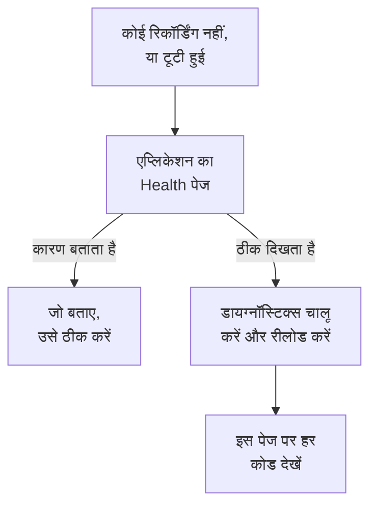

# सेशन रीप्ले समस्या निवारण

जब कोई रिकॉर्डिंग नहीं आती, या टूटी हुई आती है, तो यह पेज कारण ढूँढता है। सेशन रीप्ले डिफ़ॉल्ट रूप से हर सेशन रिकॉर्ड करता है और साथ-साथ अपलोड करता है, इसलिए एक ठीक पेज, जब उपयोगकर्ता कुछ कर रहा हो, लगभग हर 15 सेकंड में एक चंक भेजता है। निष्क्रिय टैब कोई इवेंट नहीं बनाता और कुछ नहीं भेजता, और पाँच मिनट तक कोई इनपुट न होने पर रिकॉर्डर पूरी तरह रुक जाता है (`recording-paused-idle`), इसलिए Network टैब से इंस्टॉल को परखने से पहले माउस हिलाएँ या क्लिक करें। अगर तब भी आपको OneUptime की ओर कोई अनुरोध नहीं दिखता, तो कारण नीचे दी गई बातों में से कोई है।

:::cards
- [डायग्नॉस्टिक्स चालू करें](#डायग्नॉस्टिक्स-चालू-करें): रिकॉर्डर से कंसोल में उसका हर फ़ैसला समझवाएँ।
- [कोड](#कोड): रिकॉर्डर जो भी पंक्ति प्रिंट करता है, और उसके बारे में क्या करें।
- [OneUptime के आगे का फ़ायरवॉल चंक अस्वीकार करता है](#oneuptime-के-आगे-का-फ़ायरवॉल-चंक-अस्वीकार-करता-है): जाँचने वाले नियम, और जोड़ने वाले एक्सक्लूज़न।
- [रीप्ले में चित्र, आइकन या स्टाइल गायब हैं](#रीप्ले-में-चित्र-आइकन-या-स्टाइल-गायब-हैं): ऐसी रिकॉर्डिंग जो चलती हैं, पर वैसी नहीं जैसी आपके उपयोगकर्ता ने देखीं।
:::



एकमात्र सेटिंग जिसमें चुप्पी सामान्य है, वह है _On error or frustration_ (`OnErrorOrFrustration`) पर अपलोड करना: तब रिकॉर्डर मेमोरी में एक रोलिंग बफ़र रखता है और केवल तब अपलोड करता है जब कुछ गड़बड़ होती है, जो किसी ट्रिगर के चलने तक बिल्कुल टूटे हुए इंस्टॉल जैसा दिखता है। कुछ और खोजने से पहले जाँच लें कि आप किस सेटिंग पर हैं: नीचे बताई गई `config-accepted` पंक्ति इसे प्रिंट करती है।

हो सके तो सर्वर की ओर से शुरू करें। एप्लिकेशन का **स्वास्थ्य** पेज, उसके साइड मेनू के **सेशन रीप्ले** सेक्शन में, कुछ न आने पर कारण बताता है: रिकॉर्डर कभी लोड नहीं हुआ, लोड हुआ पर कुछ अपलोड नहीं हुआ और क्यों, अपलोड अस्वीकार हो रहे हैं और किस कारण से, या बजट खत्म हो गया है। [रिकॉर्डिंग स्वास्थ्य](/docs/telemetry/session-replay#रिकॉर्डिंग-स्वास्थ्य) देखें। आगे ब्राउज़र की ओर की बात है: डायग्नॉस्टिक्स चालू करें, एक बार रीलोड करें, और कंसोल पढ़ें।

रिकॉर्डिंग आती हैं, पर टूटे चित्रों, गायब आइकनों या बिना स्टाइल वाले हिस्सों के साथ चलती हैं? यह प्लेबैक का सवाल है, जिसका जवाब [रीप्ले में चित्र, आइकन या स्टाइल गायब हैं](#रीप्ले-में-चित्र-आइकन-या-स्टाइल-गायब-हैं) में है।

## डायग्नॉस्टिक्स चालू करें

जो भी स्विच आपकी पहुँच में हो, उसे चुनें। ये सभी एक ही काम करते हैं।

:::tabs
@tab ब्राउज़र में
उसी ब्राउज़र में जिसमें समस्या है। इसके लिए दोबारा डिप्लॉय करने की ज़रूरत नहीं, यह प्रोडक्शन में काम करता है, और रीलोड के बाद भी बना रहता है:

```js
localStorage.setItem("oneuptime.sessionReplay.debug", "true");
// then reload the page
```

इसे फिर से बंद करने के लिए:

```js
localStorage.removeItem("oneuptime.sessionReplay.debug");
```
@tab लिंक से
किसी गैर-तकनीकी व्यक्ति के लिए, या ऐसे पेज के लिए जिस पर आप कंसोल नहीं खोल सकते, URL में `oneuptime_debug=1` जोड़ें। यह फ़्रैगमेंट में भी काम करता है, जो ऐसे सर्वर से भी बच निकलता है जो अनजान क्वेरी पैरामीटर हटा देता है:

```text
https://your-app.example.com/checkout?oneuptime_debug=1
https://your-app.example.com/checkout#oneuptime_debug=1
```
@tab स्क्रिप्ट टैग पर
स्टेजिंग एनवायरनमेंट के लिए, जहाँ आप इसे सभी के लिए चालू चाहते हैं:

```html
<script
  src="https://oneuptime.com/telemetry/session-replay/v1/recorder.js"
  data-oneuptime-token="YOUR_TELEMETRY_INGESTION_KEY"
  data-oneuptime-app-identifier="YOUR_RUM_APP_IDENTIFIER"
  data-oneuptime-debug="true"
  crossorigin="anonymous"
  async
></script>
```
@tab init ग्लोबल में
अगर आप रिकॉर्डर को init ग्लोबल से कॉन्फ़िगर करते हैं:

```js
window.__ONEUPTIME_SESSION_REPLAY__ = {
  host: "https://oneuptime.com",
  token: "YOUR_TELEMETRY_INGESTION_KEY",
  appIdentifier: "YOUR_RUM_APP_IDENTIFIER",
  debug: true,
};
```
@tab डिप्लॉयमेंट पर
OneUptime डिप्लॉयमेंट पर, यही एकमात्र स्विच है जिसके लिए किसी को समस्या वाले ब्राउज़र के पास होने की ज़रूरत नहीं। `SESSION_REPLAY_DEBUG=true` सेट करें और रीस्टार्ट करें। उसके बाद यह इंस्टेंस जो भी रिकॉर्डर परोसता है, वह हर उस पेज पर लॉग करता है जिस पर वह चलता है, इसलिए इसे चालू करें, एक रीलोड इकट्ठा करें, और बंद कर दें। यह कोई पॉलिसी नहीं बदलता: न सैंपलिंग, न मास्किंग, न सहमति। बाकी डिप्लॉयमेंट सेटिंग्स के लिए [सेल्फ़-होस्टेड नोट्स](/docs/telemetry/session-replay#सेल्फ़-होस्टेड-नोट्स) देखें।
@tab रनटाइम पर
रिकॉर्डर लोड हो जाने के बाद:

```js
OneUptimeReplay.setDebug(true);
```
:::

आउटपुट कुछ ऐसा दिखता है:

```text
[OneUptime Session Replay] loader-start: Loader running.
[OneUptime Session Replay] init-options-read: Init options read. {host: "https://oneuptime.com", appIdentifier: "checkout-web", …}
[OneUptime Session Replay] config-fetch-start: Requesting the policy. {url: "https://oneuptime.com/telemetry/session-replay/v1/config", …}
[OneUptime Session Replay] config-accepted: Policy accepted. {captureTrigger: "Always", samplePercentage: 100, …}
[OneUptime Session Replay] recording: Recording and uploading …
```

## पहले कुछ भी चालू किए बिना टाइमलाइन पाएँ

डायग्नॉस्टिक्स चालू हों या नहीं, रिकॉर्डर अपने पिछले 250 फ़ैसले रखता है। अगर समस्या पहले ही हो चुकी है, तो आपको लॉगिंग चालू करके उसे दोहराने की ज़रूरत नहीं — इसके बजाय यह माँगें:

```js
copy(JSON.stringify(OneUptimeReplay.getDiagnostics(), null, 2));
```

यह रिकॉर्डर का वर्ज़न, सेशन ID, उसकी `state` (`recording`, `uploading`, `not-sampled`, `stopped`…), अगर वह रुका तो क्यों रुका, `bootstrapDecision`, `decisions` के अंतर्गत हर गेट का जवाब (सैंपल हुआ या नहीं, सहमति की स्थिति, अपलोड की अनुमति है या नहीं और उन्हें क्या रोक रहा है, सर्वर का आखिरी निर्देश), रिकॉर्डर की `capabilities`, और पूरी रिकॉर्ड सूची लौटाता है — लोडर स्टब के रिकॉर्ड समेत, जो रिकॉर्डर आर्टिफ़ैक्ट के अस्तित्व में आने से पहले चलता है और जहाँ पीछे हटने के ज़्यादातर फ़ैसले होते हैं। बनावट के कारण ही इसमें कोई पेज सामग्री नहीं होती; [डायग्नॉस्टिक्स में कभी क्या नहीं होता](#डायग्नॉस्टिक्स-में-कभी-क्या-नहीं-होता) देखें। फ़ील्ड [`getDiagnostics()`](/docs/telemetry/session-replay#getdiagnostics) में बताए गए हैं।

**अगर `OneUptimeReplay is not defined` आए**, तो रिकॉर्डर आर्टिफ़ैक्ट कभी लोड नहीं हुआ — जो अपने आप में नीचे के आधे कोड का जवाब है, और ठीक वही समय है जब आपको टाइमलाइन की सबसे ज़्यादा ज़रूरत होती है। रिकॉर्ड फिर भी मौजूद हैं, एक ग्लोबल पर जिसमें लोडर स्टब आर्टिफ़ैक्ट के अस्तित्व में आने से पहले लिखता है:

```js
copy(JSON.stringify(window.__ONEUPTIME_SESSION_REPLAY_DEBUG__.records, null, 2));
```

इनमें से कोई भी अपने सपोर्ट टिकट में पेस्ट करें — या एप्लिकेशन के **स्वास्थ्य** पेज पर **Ask the browser** में, जो उसके हर कोड को समझाता है। अक्सर यही अपने आप में काफ़ी होता है।

## जब चुप्पी सामान्य है: एरर-ट्रिगर वाली पॉलिसी

यह सेक्शन तभी लागू होता है जब `config-accepted` ने `captureTrigger: "OnErrorOrFrustration"` प्रिंट किया हो। डिफ़ॉल्ट `Always` पॉलिसी में रिकॉर्डर रिकॉर्ड करते-करते भेजता है, और जिस पेज से उपयोगकर्ता इंटरैक्ट कर रहा है उस पर चुप्पी का मतलब है कि सचमुच कुछ गड़बड़ है — इस सेक्शन के आगे पढ़ते रहें।

अगर कंसोल यह कहता है:

```text
[OneUptime Session Replay] recording: Recording into memory. Nothing uploads until a trigger fires - call OneUptimeReplay.captureSession() to force one.
```

…तो रिकॉर्डर काम कर रहा है। एरर-ट्रिगर वाली पॉलिसी में एक ठीक पेज हर पेज लोड पर OneUptime को ठीक एक अनुरोध भेजता है (कॉन्फ़िग लाना) और तब तक कुछ और नहीं भेजता जब तक कोई त्रुटि, 5xx, फ़्रस्ट्रेशन सिग्नल या परफ़ॉर्मेंस बजट का उल्लंघन न हो।

पूरे रास्ते को शुरू से अंत तक साबित करने के लिए, अपलोड को मजबूर करें:

```js
OneUptimeReplay.captureSession("installation test");
```

आपको तुरंत Network टैब में एक `POST /telemetry/session-replay/v1/chunk` और कंसोल में एक `chunk-accepted` पंक्ति दिखनी चाहिए। अगर दिखती है, तो इंस्टॉलेशन सही है और रीप्ले लगभग एक मिनट में डैशबोर्ड में दिखेगा, उसकी टाइमलाइन पर आपके कारण के निशान के साथ।

देखने लायक जवाब `chunk-accepted` के साथ `202` है। `204` इसके बजाय `chunk-not-recorded` लॉग करता है: अनुरोध ठीक था और सर्वर ने उसे न सहेजने का फ़ैसला किया — बजट से ऊपर, सैंपल नहीं हुआ, या एप्लिकेशन बंद है। यह पॉलिसी का जवाब है, इंस्टॉलेशन की खराबी नहीं, और उसके बगल की `server-directive` पंक्ति बताती है कि इनमें से कौन-सा।

फिर से हर सेशन रिकॉर्ड करने के लिए, एप्लिकेशन के **Replay Policy** पेज पर **रिकॉर्डिंग कब अपलोड करें** को _Always_ पर और **सैंपल प्रतिशत** को 0 से ऊपर सेट करें। यही शिप किया गया डिफ़ॉल्ट है।

## कोड

हर पंक्ति में एक स्थिर `code` होता है। अपना कोड यहाँ खोजें।

### स्टार्टअप

| कोड | इसका मतलब |
| --- | --- |
| `loader-start` | रिकॉर्डर स्क्रिप्ट चली। अगर डायग्नॉस्टिक्स चालू होने पर भी यह नहीं दिखता, तो स्क्रिप्ट खुद कभी नहीं चली — Network टैब में `<script>` अनुरोध और अपने CSP का `script-src` जाँचें। |
| `init-options-read` | विकल्प मिल गए। विवरण में `host` और `appIdentifier` जाँचें: `appIdentifier` को RUM एप्लिकेशन से बिल्कुल मेल खाना चाहिए, और `host` आपका OneUptime ओरिजिन होना चाहिए, आपके अपने ऐप का नहीं। |
| `init-options-incomplete` | कोई ज़रूरी विकल्प गायब है। विवरण बताता है कि `hasHost` / `hasToken` / `hasAppIdentifier` में से कौन-सा false है। अगर `hasHost` false है, तो स्क्रिप्ट टैग में ऐसा कोई `src` नहीं है जिससे होस्ट निकाला जा सके — `data-oneuptime-host` जोड़ें। |
| `privacy-signal` | ब्राउज़र Do Not Track या Global Privacy Control भेजता है और उसका पालन हो रहा है — पेज द्वारा (स्क्रिप्ट टैग पर कुछ और नहीं लिखा है) या सर्वर पॉलिसी द्वारा। कुछ भी रिकॉर्ड नहीं होता; `stage: "before-config-fetch"` के साथ कोई कॉन्फ़िग अनुरोध भी नहीं होता। यह कोई खराबी नहीं है। `data-oneuptime-respect-do-not-track="false"` तभी सेट करें जब आपका कानूनी आधार सचमुच इस सिग्नल पर निर्भर न हो। |
| `init-options-missing` | पेज पर पढ़ने के लिए कुछ नहीं: न कोई `script[data-oneuptime-token]` टैग और न `window.__ONEUPTIME_SESSION_REPLAY__`। मार्कर एट्रिब्यूट की वर्तनी गलत है, स्निपेट किसी दूसरे डॉक्यूमेंट में चला गया, या किसी टैग मैनेजर ने उसे हटा दिया। |
| `loader-threw` | यह रिकॉर्डर में ही एक बग है, आपके कॉन्फ़िगरेशन में नहीं। कृपया डायग्नॉस्टिक्स आउटपुट के साथ इसकी रिपोर्ट करें। |

### पॉलिसी

| कोड | इसका मतलब |
| --- | --- |
| `config-fetch-start` | रिकॉर्डर पॉलिसी माँगने वाला है। विवरण में `url` सटीक URL है — जाँचें कि यह ब्राउज़र से खुलता है। |
| `config-fetch-rejected` | एंडपॉइंट ने 2xx के अलावा कोई जवाब दिया। नीचे [कॉन्फ़िग लाने की स्थितियाँ](#कॉन्फ़िग-लाने-की-स्थितियाँ) देखें। |
| `config-fetch-failed` | अनुरोध कभी पूरा ही नहीं हुआ: CSP `connect-src`, कोई ऐड ब्लॉकर, DNS, TLS, ऑफ़लाइन, या 5 सेकंड का टाइमआउट। ब्राउज़र आमतौर पर इसके बगल में अपनी पंक्ति लॉग करता है। |
| `config-body-unparseable` | एंडपॉइंट ने 2xx के साथ ऐसी बॉडी लौटाई जो बिल्कुल JSON नहीं है। यह `config-fetch-failed` से अलग है: अनुरोध पूरा *हुआ*, इसलिए रास्ते में किसी चीज़ ने — किसी प्रॉक्सी, कैप्टिव पोर्टल, SSO इंटरस्टीशियल ने — OneUptime की जगह जवाब दिया। |
| `config-unparseable` | बॉडी मान्य JSON *थी*, पर ऑब्जेक्ट नहीं — `null`, कोई स्ट्रिंग, कोई ऐरे। कोई रीराइट करने वाला प्रॉक्सी, या किसी दूसरे रूट पर जवाब देने वाला सर्वर। |
| `config-disabled` | सर्वर कहता है कि यहाँ रीप्ले बंद है। जवाब विवरण के `disabledReason` में है: नीचे [disabledReason](#disabledreason) देखें। |
| `config-recorder-version-invalid` | पॉलिसी ने सटीक, छोटे अक्षरों वाला `latest` नहीं बताया, इसलिए कोई आर्टिफ़ैक्ट URL नहीं बन सका। कोई रीराइट करने वाला प्रॉक्सी या छेड़छाड़ किया गया जवाब — बिना बिल्ड वाला डिप्लॉयमेंट इसके बजाय `recorder-not-built` के साथ `config-disabled` रिपोर्ट करता है। |
| `config-accepted` | पॉलिसी स्वीकार हो गई। विवरण पूरी पॉलिसी है — `captureTrigger`, `samplePercentage`, `consentMode`, `maskingMode`। |
| `config-field-defaulted` | सर्वर ने किसी पॉलिसी फ़ील्ड (विवरण में नामित) के लिए कोई मान नहीं भेजा, इसलिए इस रिकॉर्डर ने उसके लिए प्रोडक्ट का डिफ़ॉल्ट इस्तेमाल किया। केवल जानकारी के लिए: आमतौर पर सर्वर रिकॉर्डर से पुराना होता है। अगर डैशबोर्ड उस फ़ील्ड का कोई दूसरा मान दिखाता है, तो OneUptime अपग्रेड करें। |
| `config-value-unrecognised` | सर्वर ने ऐसा मान भेजा जिसे यह रिकॉर्डर बिल्ड नहीं जानता, इसलिए वह सबसे सुरक्षित मान पर लौट गया — जो शायद वह न हो जो आपका डैशबोर्ड दिखाता है। आमतौर पर कोई पेज अब भी पुराने डिप्लॉयमेंट का रिकॉर्डर चला रहा होता है। |
| `directive-stop` | सर्वर ने इस रिकॉर्डर को पीछे हटने को कहा। बजट, रेट लिमिट या किल स्विच के लिए एप्लिकेशन का रिकॉर्डिंग स्वास्थ्य देखें। |

#### कॉन्फ़िग लाने की स्थितियाँ

| स्थिति | समाधान |
| --- | --- |
| `401` | इन्जेशन टोकन गलत, रद्द, समाप्त या किसी दूसरे प्रोजेक्ट का है। **प्रोजेक्ट सेटिंग्स → टेलीमेट्री और APM → इंजेशन कुंजियाँ** के अंतर्गत एक बनाएँ और `GET /session-replay/v1/validate` से उसकी पुष्टि करें — कुंजी उसी तरह भेजें जैसे रिकॉर्डर भेजता है और `x-oneuptime-app-identifier` हेडर जोड़ें, तो जवाब में उस एप्लिकेशन के लिए `isSessionReplayEnabled`, रीप्ले बंद होने पर बंद स्विच का नाम बताने वाला `sessionReplayDisabledDetail`, `isIngestEnabledOnThisInstance` और `keyType` भी होते हैं। |
| `400` | `data-oneuptime-app-identifier` गायब है। |
| `403` | पेज का ओरिजिन इन्जेशन कुंजी की **अनुमत ऑरिजिन** में नहीं है। इसे जोड़ें, या ऐसी कुंजी इस्तेमाल करें जिसकी अनुमति सूची में यह पेज आता हो। |
| `404` | OneUptime ओरिजिन पर पाथ नहीं मिला। लगभग हमेशा यह गलत `data-oneuptime-host` होता है — या OneUptime के आगे का कोई रिवर्स प्रॉक्सी जो `/telemetry/*` आगे नहीं भेजता। |
| `5xx` | सर्वर की ओर की खराबी; OneUptime ऐप के लॉग जाँचें। |

#### disabledReason

| मान | क्या करें |
| --- | --- |
| `not-enabled-for-application` | इस RUM एप्लिकेशन के लिए सेशन रीप्ले बंद है, पहचानकर्ता किसी एप्लिकेशन से मेल नहीं खाता, या प्रोजेक्ट को रीप्ले की अनुमति नहीं है। `disabledDetail` बताता है कि कौन-सा: `application-not-enabled` (इस एप्लिकेशन का स्विच), `project-not-allowed` (पूरे प्रोजेक्ट का स्विच, **वास्तविक उपयोगकर्ता मॉनिटरिंग → सेटिंग्स → सेशन रीप्ले** के अंतर्गत), `application-unknown` (किसी एप्लिकेशन में यह `appIdentifier` नहीं है — एप्लिकेशन के **Replay Policy** पेज से वर्तनी मिलाएँ) या `project-killed` (इस डिप्लॉयमेंट पर ऑपरेटर का किल स्विच)। |
| `budget-exhausted` | प्रोजेक्ट का दैनिक बाइट बजट या एप्लिकेशन का मासिक बजट पहले ही खत्म हो चुका है, इसलिए रिकॉर्डरों से कहा जाता है कि वे ऐसे चंक अपलोड करने के बजाय, जो अस्वीकार हो जाते, रिकॉर्ड ही न करें। `disabledDetail` `project-daily-budget-exhausted` या `app-monthly-budget-exhausted` होता है, और `budgetResetsAt` बताता है कि यह कब हटेगा। **Replay Policy** पेज पर बजट बढ़ाएँ, या रीसेट का इंतज़ार करें। |
| `recorder-not-built` | **डिप्लॉयमेंट में कोई रिकॉर्डर आर्टिफ़ैक्ट नहीं है।** ग्राहक के पेज पर कुछ भी इसे ठीक नहीं कर सकता। `packages/App/FeatureSet/BrowserRecorder/public/dist/manifest.json` बनाने वाला बिल्ड नहीं चला, या उसका आउटपुट चल रही इमेज तक नहीं पहुँचा। OneUptime ऐप को दोबारा बिल्ड और डिप्लॉय करें। जिस सेल्फ़-होस्टेड इंस्टॉल पर रीप्ले ने कभी काम ही नहीं किया, वहाँ यही आम जवाब है। |
| `disabled-by-default` | इस डिप्लॉयमेंट पर `SESSION_REPLAY_ENABLED_BY_DEFAULT=false` है। इसे `true` पर सेट करें — और अगर आप सेल्फ़-होस्ट करते हैं तो पहले `SESSION_REPLAY_MAX_BYTES_PER_PROJECT_PER_DAY` सेट करें, क्योंकि रीप्ले आपकी सबसे भारी टेबल है। |
| `ingest-disabled` | इस डिप्लॉयमेंट पर `SESSION_REPLAY_INGEST_ENABLED=false` है। |
| `policy-unavailable` | सर्वर पॉलिसी तय नहीं कर सका — आमतौर पर Redis या Postgres की वजह से। यह जानबूझकर बंद की ओर विफल होता है। OneUptime ऐप के लॉग जाँचें। |
| `not-reported` | सर्वर इस फ़ील्ड से पुराना है। इसके बजाय डैशबोर्ड में **Replay Policy** पेज पर **Test your installation** पैनल इस्तेमाल करें। |

### आर्टिफ़ैक्ट

| कोड | इसका मतलब |
| --- | --- |
| `artifact-requested` | नवीनतम रिकॉर्डर बंडल इंजेक्ट किया जा रहा है। `url` सटीक पता है। |
| `artifact-load-failed` | यह लोड नहीं हुआ। संभावना के क्रम में: ऐसा CSP `script-src` जो आपके OneUptime ओरिजिन की अनुमति नहीं देता, SRI का मेल न खाना (कोई प्रॉक्सी बंडल को रीराइट कर रहा है), या 404, क्योंकि इस डिप्लॉयमेंट ने रिकॉर्डर बिल्ड नहीं किया। |
| `artifact-url-invalid` | पॉलिसी ने सटीक, छोटे अक्षरों वाला `latest` नहीं बताया, इसलिए कोई URL नहीं बना। छेड़छाड़ किया गया या प्रॉक्सी से बदला गया कॉन्फ़िग जवाब। |
| `artifact-api-missing` | बंडल लोड हुआ, पर उसने `window.OneUptimeReplay` प्रकाशित नहीं किया — पेज की किसी दूसरी स्क्रिप्ट ने उसे ओवरराइट कर दिया। |
| `bootstrap` | रिकॉर्डर आर्टिफ़ैक्ट शुरू हो रहा है। |
| `bootstrap-already-started` | एक पेज पर स्निपेट की दो कॉपी। एक हटाएँ। |
| `bootstrap-already-running` | रिकॉर्डर के पहले से चलते हुए `bootstrap()` फिर से कॉल हुआ। हानिरहित; आमतौर पर दोहराया गया इंटीग्रेशन। |
| `bootstrap-cancelled` | `window.OneUptimeReplayQueue` पर कतार में रखा गया `revokeConsent()` या `stop()` रिकॉर्डर शुरू होने से पहले चला, इसलिए यह सेशन रिकॉर्ड नहीं होता। अगर आपका बैनर पहले ही अस्वीकार किया जा चुका था, तो यह सही है। |
| `start-stopped` | सेल्फ़-होस्टेड बंडल वाले रास्ते पर `start()` को कोई इस्तेमाल लायक पॉलिसी नहीं मिली। सटीक कारण ठीक ऊपर की `config-*` पंक्ति में है। |
| `rrweb-did-not-start` | DOM रिकॉर्डर ने शुरू होने से इनकार किया। कृपया इसकी रिपोर्ट करें। |
| `rrweb-error` | DOM रिकॉर्डर को इस पेज पर एक आंतरिक त्रुटि मिली (त्रुटि का नाम विवरण में है; यह एक बार लॉग होती है)। रिकॉर्डिंग उस जगह के आसपास उछल या अटक सकती है, और ऐसी तीन त्रुटियों के बाद सेशन पर यह बताने वाला एक फ़िडेलिटी नोटिस होता है। कृपया पेज के फ़्रेमवर्क और त्रुटि के नाम के साथ इसकी रिपोर्ट करें। |

### रिकॉर्डिंग और अपलोड

| कोड | इसका मतलब |
| --- | --- |
| `not-sampled` | यह सेशन सैंपल ड्रॉ में हार गया, इसलिए कुछ भी रिकॉर्ड नहीं होता। सैंपलिंग सेशन ID से तय होती है, इसलिए रीलोड करने से इस सेशन को मदद नहीं मिलेगी। सैंपल प्रतिशत बढ़ाएँ। |
| `recording` | रिकॉर्डिंग जारी है। विवरण पढ़ें: डिफ़ॉल्ट `Always` ट्रिगर में `uploading: true` सामान्य स्थिति है। `captureTrigger: "OnErrorOrFrustration"` के साथ `uploading: false` दूसरी ठीक स्थिति है, जिसमें कोई अनुरोध नहीं होता। |
| `same-origin-propagation` | रिकॉर्डर के शुरू होने पर एक बार लॉग होता है: क्या वह पेज के अपने ओरिजिन पर जाने वाले अनुरोधों में ट्रेस कॉन्टेक्स्ट (`traceparent`, और सेशन ID वाला एक `tracestate`) जोड़ता है। `reason: "on"` के साथ `enabled: true` डिफ़ॉल्ट है। `reason: "policy-off"` का मतलब है कि एप्लिकेशन के **Replay Policy** पेज पर **समान-ओरिजिन ट्रेस प्रसार** बंद है; `reason: "opaque-origin"` का मतलब है कि पेज का अपना कोई ओरिजिन नहीं है (सैंडबॉक्स्ड iframe, `about:blank`, `srcdoc` या `file:`), इसलिए कुछ भी same-origin नहीं गिना जाता। चालू होने पर भी हेडर केवल उन अनुरोधों पर जाते हैं जो सेशन के अपलोड होते समय किए जाते हैं, और `/v1/traces`, `/v1/logs` या `/v1/metrics` पर खत्म होने वाले पाथ पर `POST` (पेज के अपने OpenTelemetry एक्सपोर्ट) पर कभी नहीं। यह एक बार और लॉग होता है, `reason: "agent-stand-down"` और एक `agent` फ़ील्ड (`DD_RUM`, `NREUM` या `elasticApm`) के साथ, जब किसी पेज लोड में पहली बार रिकॉर्डर किसी same-origin अनुरोध का `traceparent` उस एजेंट पर छोड़ता है, क्योंकि वह एजेंट उस अनुरोध को ट्रेस करने के लिए कॉन्फ़िगर है (Datadog RUM केवल उस सेशन में जिसे वह ट्रैक करता है); अनुरोध को फिर भी `tracestate` सदस्य मिलता है, और वह तभी जुड़ता है जब एजेंट सचमुच `traceparent` भेजे, जो Datadog केवल ट्रैक किए गए, ट्रेस-सैंपल किए गए Datadog सेशन में करता है। New Relic (`NREUM`) सदस्य की जगह अपना `tracestate` भेजता है, इसलिए उसके अनुरोध केवल ट्रेस ID से जुड़ते हैं ([लॉग और ट्रेस टैब खाली हैं](#प्लेयर-के-लॉग-और-ट्रेस-टैब-खाली-हैं) देखें)। [अपनी बाकी टेलीमेट्री से संबंध जोड़ना](/docs/telemetry/session-replay#अपनी-बाकी-टेलीमेट्री-से-संबंध-जोड़ना) देखें। |
| `same-origin-propagation-tripped` | जिस अनुरोध में रिकॉर्डर ने ट्रेस कॉन्टेक्स्ट जोड़ा था, वह नेटवर्क स्तर पर विफल हुआ, आमतौर पर ऐसा same-origin अनुरोध जो किसी ऐसे दूसरे ओरिजिन पर रीडायरेक्ट हुआ जो `traceparent` और `tracestate` की अनुमति नहीं देता। रिकॉर्डर ने इस पेज लोड के बाकी समय के लिए इन्हें जोड़ना बंद कर दिया। `retried: true` का मतलब है कि यह बिना बॉडी वाला `GET` या `HEAD` `fetch` था और ठीक वैसे ही एक बार और भेजा गया जैसे आपके पेज ने भेजा था; `false` का मतलब है कि इसे दोबारा नहीं भेजा जा सका और यह विफल हुआ: बिना बॉडी वाले `GET` या `HEAD` `fetch` के अलावा कुछ भी (कोई भी XHR, कोई भी दूसरा मेथड, बॉडी वाला कोई भी अनुरोध) दोबारा नहीं भेजा जाता। आपके पेज के अपने abort और टाइमआउट इसे ट्रिगर नहीं करते, और न ही ब्राउज़र के खुद को ऑफ़लाइन बताने के दौरान हुई कोई विफलता; अगला पेज लोड नए सिरे से शुरू होता है। [सेशन रीप्ले चालू करने के बाद डाउनलोड या रीडायरेक्ट विफल होते हैं](#सेशन-रीप्ले-चालू-करने-के-बाद-डाउनलोड-या-रीडायरेक्ट-विफल-होते-हैं) देखें। |
| `trigger` | रखने लायक कुछ हुआ। `reason` इनमें से एक है: `error`, `frustration`, `performance`, `sampled` या `manual`। |
| `upload-started` | बफ़र में रखा pre-roll फ़्लश हो रहा है। चंक POST यहीं से शुरू होते हैं। |
| `upload-blocked-consent` | ट्रिगर चला और कुछ अपलोड नहीं हुआ, क्योंकि सहमति कभी दी ही नहीं गई। सहमति मोड `RequireExplicit` में आपके बैनर के स्वीकार होते ही आपके पेज को `OneUptimeReplay.grantConsent()` कॉल करना होगा। |
| `chunk-discarded-consent` | वही कारण, एक परत नीचे: एक पूरा चंक फेंक दिया गया। |
| `chunk-accepted` | चंक पहुँचा और सहेजा गया। इंस्टॉलेशन काम करता है। |
| `chunk-not-recorded` | सर्वर ने अनुरोध लिया और जानबूझकर उसे रिकॉर्ड नहीं किया — बजट से ऊपर, सैंपल नहीं हुआ, एप्लिकेशन बंद है, या प्रति-सेशन चंक सीमा। उसके बगल की `server-directive` पंक्ति कारण बताती है। इंस्टॉलेशन सही है; पॉलिसी या बजट वैसा नहीं है जैसा आप सोचते हैं। |
| `chunk-post-failed` | POST कभी सर्वर तक नहीं पहुँचा, इससे पहले कि इस पेज ने कभी भी सफलतापूर्वक अपलोड किया हो। CSP `connect-src`, कोई ऐड ब्लॉकर, या इन्जेस्ट ओरिजिन पर CORS — या कोई पेज जिसका कनेक्शन उसके पहले अपलोड से पहले टूट गया। यह सर्किट ब्रेकर में गिना जाता है। |
| `chunk-held-offline` | ऑफ़लाइन मोड: डिवाइस का कोई कनेक्शन नहीं है (ब्राउज़र खुद को ऑफ़लाइन बताता है, या कोई अनुरोध ऐसे सर्वर तक कभी नहीं पहुँचा जिसने पहले जवाब दिया था)। रिकॉर्डिंग जारी रहती है और चंक इंतज़ार करता है; `queueDepth` बताता है कि कितने इंतज़ार में हैं और `retryInMs` कि अगली कोशिश कब होगी। इससे कोई स्ट्राइक नहीं लगती और कुछ नहीं खोता। |
| `back-online` | आउटेज के बाद का पहला अनुरोध सर्वर तक पहुँचा। कतार के चंक सबसे पुराने से शुरू करके अपलोड हो रहे हैं। |
| `browser-offline` | ब्राउज़र ने अपना `offline` इवेंट चलाया। रिकॉर्डिंग जारी रहती है; रिकॉर्डर अपना ऑफ़लाइन स्टोर खोलता है, ताकि अभी बंद किए गए टैब के चंक बचे रहें। |
| `browser-online` | ब्राउज़र ने अपना `online` इवेंट चलाया, और `queuedChunks` रीट्राई टाइमर का इंतज़ार किए बिना अभी अपलोड हो रहे हैं। |
| `offline-queue-full` | आउटेज अपलोड कतार (240 चंक या 4 MB) से ज़्यादा लंबा चला: सबसे नए चंक रखने के लिए सबसे पुराने `dropped` चंक फेंक दिए गए। सेशन में जहाँ वे थे, वहाँ खाली जगह दिखती है। |
| `offline-flush-stored` | ऑफ़लाइन रहते हुए पेज छिपाया या बंद किया गया, इसलिए उसके आखिरी चंक भेजे जाने के बजाय ब्राउज़र के IndexedDB में लिखे गए। `storeOpen: false` का मतलब है कि स्टोर अभी पूरी तरह खुला नहीं था और बंद होता टैब उन्हें अब भी खो सकता है। एप्लिकेशन का अगला पेज उन्हें अपलोड करता है। |
| `final-flush-deferred` | बंद होने वाला अनुरोध हर चंक नहीं ले जा सका, और बाकी (`kept`) फेंके जाने के बजाय अगले पेज के लिए IndexedDB में लिखे गए। |
| `offline-chunks-restored` | इस पेज को ऐसे `chunks` मिले जिन्हें किसी पिछले पेज ने ऑफ़लाइन रहते हुए रिकॉर्ड किया था और भेज नहीं सका, और यह उन्हें अपने चंक से पहले अपलोड कर रहा है। |
| `offline-chunk-claimed-elsewhere` | उसी एप्लिकेशन का कोई दूसरा टैब वह चंक पहले ही अपलोड कर चुका था जिसे इस टैब ने सहेजा था, इसलिए इस टैब ने उसे छोड़ दिया। कुछ भी गायब नहीं है। |
| `chunk-post-server-error` | सर्वर ने 5xx जवाब दिया। रिकॉर्डर दोबारा कोशिश करता है; विवरण में `maxFlushFailures` की तुलना में `consecutiveFailures` बताता है कि वह हार मानने के कितना करीब है। |
| `chunk-retry-scheduled` | दोबारा कोशिश के लायक किसी विफलता (नेटवर्क, 5xx, या सर्वर थ्रॉटल) ने चंक को रीट्राई कतार में डाल दिया; विवरण में `inMs` अगली कोशिश से पहले का विराम है, और `queueDepth` यह कि कितने चंक इंतज़ार में हैं। अभी तक कुछ नहीं खोया है। |
| `chunk-retry` | विराम खत्म हुआ और कतार के चंक फिर से भेजे जा रहे हैं। |
| `chunk-abandoned` | एक चंक बहुत बार विफल हुआ और फेंक दिया गया; अपलोड अगले चंक से जारी रहता है। सेशन में जहाँ वह था, वहाँ खाली जगह दिखेगी। कारण के लिए उससे पहले की `chunk-post-*` पंक्ति देखें। |
| `final-chunk-carried-queue` | पेज तब छिपाया या बंद किया गया जब चंक अब भी रीट्राई के लिए कतार में थे, और वे पेज छिपने पर भेजे गए उस एक अनुरोध के अतिरिक्त फ़्रेम बनकर चले गए: `frames` बताता है कि अनुरोध कितने ले गया, `bytes` उसका कुल आकार। कुछ नहीं खोया — जो समा नहीं सका, उसकी रिपोर्ट इसके बजाय `final-flush-partial` करता है। |
| `final-flush-truncated` | पेज के जाते समय बफ़र में उससे ज़्यादा था जितना एक keepalive अनुरोध ले जा सकता है, इसलिए समाने के लिए बंद होने वाले चंक के सबसे पुराने इवेंट फेंक दिए गए; `droppedEvents` बताता है कि कितने। सेशन का अंत — वह हिस्सा जिसे आप आमतौर पर ढूँढ रहे होते हैं — बचा रहता है। |
| `final-flush-partial` | बंद होने वाला अनुरोध उसे दिया गया हर चंक नहीं ले जा सका: `sent` फ़्रेम गए, `dropped` नहीं गए। सील करने वाला चंक पहले चुना जाता है, इसलिए जो खोता है वह कतार के पुराने चंक हैं, और सेशन में जहाँ वे थे वहाँ खाली जगह दिखती है। |
| `chunk-too-large` | कंप्रेशन के बाद भी एक चंक प्रति-अनुरोध सीमा से बड़ा था — किसी बहुत बड़े DOM का अविभाज्य, पूरे पेज का स्नैपशॉट। केवल उसका घोषित आकार भेजा जाता है, सर्वर 422 जवाब देता है, और सेशन विफल होने के बजाय उस स्नैपशॉट की जगह एक फ़िडेलिटी नोटिस रखता है। |
| `envelope-trimmed` | चंक का हेडर JSON सर्वर की 8 KB एनवेलप सीमा से बड़ा था, इसलिए समाने तक वैकल्पिक फ़ील्ड इस क्रम में हटाए गए: ट्रेस ID, रूट, ट्रेट्स, टैग, फ़िडेलिटी नोटिस (`shed` बताता है कि क्या हटा)। फ़ुटेज पर कोई असर नहीं; सेशन में कुछ कोरिलेशन या टैग डेटा गायब हो सकता है। आमतौर पर एक ही सेशन पर अपनी अधिकतम लंबाई वाले 20 टैग और 20 ट्रेट्स। |
| `final-chunk-too-large` | पेज के जाते समय भेजा गया एक चंक उन 56 KB से बड़ा था जो रिकॉर्डर पेज-हाइड फ़्लश के लिए खुद को देता है — जानबूझकर ब्राउज़र के 64 KB के संयुक्त keepalive कोटा से कम। `sealed: true` के साथ यह आखिरी चंक था: उसके इवेंट फेंक दिए गए, इसलिए रिकॉर्डिंग कुछ सेकंड पहले खत्म होती है, और उसकी जगह एक खाली आखिरी चंक जाता है, ताकि सेशन फिर भी टैब के साथ खत्म हो और चंक क्रम में कोई छेद न रहे। `sealed: false` के साथ यह आखिरी चंक नहीं था: इसे पूरा फेंक दिया गया, कुछ भी सील नहीं हुआ, और सेशन खुला रहता है, जहाँ वह चंक था वहाँ खाली जगह के साथ। दोनों स्थितियों में जो खोता है वह उस चंक के इवेंट हैं; जो कतार वाला चंक उसी अनुरोध में नहीं जा सका, उसकी रिपोर्ट अलग से `final-flush-partial` करता है। |
| `upload-blocked-transport` | ट्रिगर तब चला जब इस पेज के लिए अपलोड पहले ही बंद हो चुका था। उसके ऊपर की `transport-disabled` पंक्ति बताती है कि क्यों। |
| `chunk-rejected-terminal` | अपलोड हमेशा के लिए रुक गया है। `status: 401` गलत टोकन है; `status: 403` ऐसा ओरिजिन है जो एप्लिकेशन की या कुंजी की अनुमति सूची में नहीं है; `status: 404` गलत होस्ट है। ठीक करें और रीलोड करें — रिकॉर्डर अपने आप दोबारा कोशिश नहीं करता। पहले `answeredBy` पढ़ें: `"not-oneuptime"` का मतलब है कि अस्वीकृति OneUptime से आई ही नहीं — उसके आगे के किसी वेब एप्लिकेशन फ़ायरवॉल, CDN या प्रॉक्सी ने जवाब दिया, या होस्ट OneUptime नहीं है। [OneUptime के आगे का फ़ायरवॉल चंक अस्वीकार करता है](#oneuptime-के-आगे-का-फ़ायरवॉल-चंक-अस्वीकार-करता-है) देखें। |
| `chunk-refused` | एक चंक अस्वीकार हुआ (बहुत बड़ा, या पार्स न होने लायक) और रिकॉर्डिंग उसके बिना जारी रही। |
| `chunk-refused-terminal` | अपलोड रुक गया है, क्योंकि सर्वर इस रिकॉर्डर का हर चंक अस्वीकार करेगा: या तो विवरण का `error` ऐसा है जिसका सर्वर हर बार एक ही जवाब देता है (`unsupported-wire-version` — ऐसा रिकॉर्डर जिसे सर्वर अब स्वीकार नहीं करता; `app-identifier-mismatch` या `missing-app-identifier` — चंक उस एप्लिकेशन से अलग एप्लिकेशन बताता है जिसके लिए पॉलिसी लाई गई थी; `malformed-body` / `malformed-envelope` / `missing-envelope` — अनुरोध को रीराइट करता प्रॉक्सी), या हाल का हर चंक गलत बनावट के कारण अस्वीकार हुआ। OneUptime अपग्रेड करें ताकि प्रकाशित रिकॉर्डर सर्वर से मेल खाए, और अगर समस्या बनी रहे तो डायग्नॉस्टिक्स के साथ इसकी रिपोर्ट करें। |
| `chunk-throttled` | रेट लिमिट लगी। अपलोड रुकते हैं और अपने आप फिर शुरू होते हैं। |
| `transport-disabled` | बार-बार विफल होने के बाद सर्किट ब्रेकर ट्रिप हो गया। `reason` बताता है कि कौन-सी विफलता। |
| `server-directive` | सर्वर ने सेशन के बीच में बदल दिया कि रिकॉर्डर को क्या करना चाहिए। `reason` एक बंद शब्दावली से आता है — नीचे [चंक POST की स्थितियाँ](#चंक-post-की-स्थितियाँ) देखें। |
| `recorder-stopped-by-server` | सर्वर ने रिकॉर्डर को रुकने को कहा। आमतौर पर दैनिक बाइट बजट के कारण। |
| `recorder-throttled-by-server` | सर्वर ने रिकॉर्डर को धीमा होने को कहा। अपलोड अपने आप फिर शुरू होते हैं; कुछ करने की ज़रूरत नहीं। |
| `recorder-stopped-transport` | अपलोड स्थायी रूप से विफल हुआ, इसलिए रिकॉर्डिंग रुकी और बफ़र खाली कर दिया गया। `reason` वही है जो `transport-disabled` ने रिपोर्ट किया। |
| `recorder-stopped` | रिकॉर्डिंग खत्म हुई, सेशन के कुल योग के साथ: `droppedEvents`, `droppedChunks`, `flushFailures`। एक ठीक सेशन में तीनों 0 होने चाहिए। |
| `session-ended-idle` | पेज पर 30 मिनट तक कुछ नहीं हुआ, इसलिए सेशन खत्म हुआ — आखिरी गतिविधि के समय पर, न कि उस पल जब रिकॉर्डर ने ध्यान दिया (`idleForMs` बताता है कि वह कितनी देर पहले था)। उपयोगकर्ता के लौटने तक कुछ और अपलोड नहीं होता, और आपके अपने ओरिजिन पर जाने वाले अनुरोध कोई सेशन ID नहीं ले जाते; बिना किसी के खुला छोड़ा गया टैब हर आधे घंटे में नया सेशन शुरू नहीं करता। |
| `recording-paused-idle` | 5 मिनट तक किसी ने कीबोर्ड की कोई कुंजी नहीं दबाई, क्लिक नहीं किया, माउस नहीं हिलाया, व्हील से स्क्रॉल नहीं किया या पेज को छुआ नहीं, इसलिए रिकॉर्डिंग रुकी (`idleForMs` बताता है कि कितनी देर हो चुकी थी)। अगले इनपुट के उसी सेशन को फिर शुरू करने तक कुछ कैप्चर या अपलोड नहीं होता, और आपके अपने ओरिजिन पर जाने वाले अनुरोध कोई सेशन ID नहीं ले जाते — [निष्क्रिय समय](/docs/telemetry/session-replay#निष्क्रिय-समय) देखें। अकेले छोड़े गए किसी भी टैब पर यह सामान्य है। |
| `recording-resumed` | रिकॉर्डिंग रुकी रहने के दौरान उपयोगकर्ता लौट आया, इसलिए वह उसी सेशन में एक नए स्नैपशॉट पर फिर शुरू हुई (`pausedForMs` बताता है कि वह कितनी देर रुकी रही थी)। प्लेयर बीच के हिस्से को छोड़ देता है। |
| `session-rotated` | एक नया सेशन शुरू हुआ (उपयोगकर्ता 30 मिनट निष्क्रिय रहने के बाद लौटा, सेशन 4 घंटे तक पहुँच गया, `identify()` ने उस उपयोगकर्ता से अलग किसी उपयोगकर्ता का नाम दिया जिसका सेशन था — `rotationReason: "identity-change"` — या उसी विज़िटर के किसी दूसरे टैब ने पहले नया सेशन शुरू कर दिया — `rotationReason: "adopted"`)। रिकॉर्डिंग एक नई ID के तहत जारी रहती है, `onSessionChange` लिसनर को बताया जाता है, और तब से आपके अपने ओरिजिन पर जाने वाले अनुरोध नई ID ले जाते हैं। |
| `command-queue-not-an-array` | `window.OneUptimeReplayQueue` ऐरे नहीं है, इसलिए उस पर कतार में रखा हर कमांड नज़रअंदाज़ हुआ। यह `[command, ...arguments]` प्रविष्टियों का ऐरे होना चाहिए। |
| `command-queue-unknown-command` | कतार में रखे किसी कमांड का नाम पहचाना नहीं गया — [JavaScript API](/docs/telemetry/session-replay#javascript-api) से वर्तनी मिलाएँ। |
| `command-queue-command-failed` | कतार का एक कमांड लागू होते समय throw हुआ — `command` और त्रुटि का `name` विवरण में हैं। कतार का बाकी हिस्सा फिर भी चला। आमतौर पर गलत आकार का कोई आर्ग्युमेंट (जहाँ ट्रेट्स ऑब्जेक्ट चाहिए, वहाँ स्ट्रिंग)। |

#### चंक POST की स्थितियाँ

इन्जेस्ट एंडपॉइंट चंक `POST` का क्या जवाब देता है, जैसा आप उसे Network टैब में देखेंगे। केवल 429 के अलावा के 4xx का मतलब है कि इंस्टॉल गलत है।

| स्थिति | इसका मतलब |
| --- | --- |
| `202` | स्वीकार किया गया और सहेजने के लिए कतार में रखा गया। अगर इसके साथ `session-chunk-cap` कारण वाला `directive: "stop"` भी है, तो इस अनुरोध के जो चंक प्रति-सेशन सीमा के भीतर थे वे पहुँच गए और उनके बाद का कुछ भी कभी नहीं पहुँचेगा — यह लंबे समय से खुला टैब है जो एक सेशन की क्षमता के अंत तक पहुँच गया, कोई खराबी नहीं। |
| `204` | लिया गया और जानबूझकर सहेजा नहीं गया। 204 में कोई बॉडी नहीं होती, इसलिए निर्देश हेडर में जाता है: जब रिकॉर्डर को पीछे हट जाना चाहिए (रीप्ले बंद, सैंपल नहीं हुआ, बजट से ऊपर, सीमा पर) तो `x-oneuptime-replay-directive` `stop` होता है, या जब केवल यह अनुरोध अस्वीकार हुआ तो `continue`, और `x-oneuptime-replay-reason` कारण बताता है। `continue` के साथ लौटने वाला कारण `consent-required` है: सहमति मोड _Require explicit_ है और पेज ने अभी तक `grantConsent()` कॉल नहीं किया, इसलिए रिकॉर्डर रिकॉर्ड करता रहता है और फिर से कोशिश करता है। कारणों की शब्दावली है `ingest-disabled`, `instance-not-offering-replay`, `policy-unavailable`, `not-enabled`, `origin-not-allowed`, `session-chunk-cap`, `not-sampled`, `rate-limited`, `rate-counter-unavailable`, `budget-exhausted`, `budget-counter-unavailable`, `app-monthly-budget-exhausted` और `consent-required`, और **स्वास्थ्य** पेज इन्हें नाम से गिनता है। |
| `400` | फ़्रेम संभाला नहीं जा सका, और उसी बिल्ड का अगला फ़्रेम भी नहीं संभाला जाएगा, इसलिए बॉडी में `directive: "stop"` और एक स्थिर `error` कोड होता है: `empty-body`, `missing-envelope`, `envelope-too-large`, `malformed-envelope`, `malformed-body`, `unsupported-wire-version`, `truncated-payload`, `too-many-frames`, `app-identifier-mismatch`, `missing-app-identifier` या `chunk-index-malformed` (ऐसा `chunkIndex` जो गायब, ऋणात्मक, भिन्नात्मक या बेतुका हो)। इनमें से छह — `unsupported-wire-version`, `app-identifier-mismatch`, `missing-app-identifier`, `malformed-body`, `malformed-envelope`, `missing-envelope` — अपलोड को तुरंत रोक देते हैं (`chunk-refused-terminal`); कोई भी दूसरा 400 एक बार माफ़ होता है और लगातार तीन के बाद अपलोड रोक देता है। लगभग हमेशा अनुरोध को रीराइट करता कोई प्रॉक्सी, या अलग-अलग वर्ज़न के रिकॉर्डर और सर्वर। |
| `401` | इन्जेशन कुंजी गलत, रद्द, समाप्त या किसी दूसरे प्रोजेक्ट की है। |
| `403` | पेज का ओरिजिन इन्जेशन कुंजी की या एप्लिकेशन की अनुमति सूची में नहीं है। यह अंतिम है — रिकॉर्डर दोबारा कोशिश नहीं करता। जिस 403 की बॉडी कोई HTML पेज हो, या खाली हो, वह OneUptime से नहीं आया: किसी वेब एप्लिकेशन फ़ायरवॉल ने अनुरोध अस्वीकार किया — [OneUptime के आगे का फ़ायरवॉल चंक अस्वीकार करता है](#oneuptime-के-आगे-का-फ़ायरवॉल-चंक-अस्वीकार-करता-है) देखें। |
| `413` | बॉडी अनुरोध सीमा से बड़ी थी। रिकॉर्डर चंक को इससे काफ़ी नीचे बाँटता है, इसलिए यह कोई प्रॉक्सी है जिसने कंप्रेस की गई बॉडी को फिर से फुला दिया। वह एक चंक फेंक दिया जाता है; सेशन जारी रहता है। |
| `422` | `snapshot-too-large`: एक फ़्रेम ने सीमा से बड़ा पेलोड घोषित किया — पूरे पेज का अविभाज्य स्नैपशॉट जो समा नहीं सकता। यह प्रति-चंक है, अंतिम नहीं: सेशन बचा रहता है, उस स्नैपशॉट के गायब होने की बात बताने वाले फ़िडेलिटी नोटिस के साथ, और प्लेबैक अगले स्नैपशॉट से फिर शुरू होता है। DOM छोटा करें, या उस पेज लोड पर खाली जगह की उम्मीद रखें। |
| `429` | रेट लिमिट लगी। `Retry-After` बताता है कि कितनी देर; अपलोड रुकते हैं और अपने आप फिर शुरू होते हैं। |
| `503` | चंक स्टोर तक पहुँचा नहीं जा सका। रिकॉर्डर दोबारा कोशिश करता है। |

### आपके पेज की कॉल

ये रिकॉर्ड करते हैं कि आपके अपने कोड ने रिकॉर्डर से क्या करने को कहा। ये यह पुष्टि करने में काम आते हैं कि कोई सहमति बैनर या मैन्युअल कैप्चर सचमुच रिकॉर्डर तक पहुँचा, और कब।

| कोड | इसका मतलब |
| --- | --- |
| `api-capture-session` | `captureSession()` कॉल हुआ। `hasReason` बताता है कि उसके साथ टाइमलाइन के लिए कोई कारण था या नहीं। |
| `api-grant-consent` | `grantConsent()` कॉल हुआ। |
| `api-revoke-consent` | `revokeConsent()` कॉल हुआ। बफ़र की हर चीज़ फेंक दी गई और अपलोड रुक गया; रिकॉर्डर केवल मेमोरी में चलता रहता है, इसलिए बाद में `grantConsent()` एक नए सेशन पर जारी रखता है। |
| `api-stop` | `stop()` कॉल हुआ। आखिरी चंक अपलोड हुआ और सेशन सील हो गया; पेज के बाकी जीवन में कुछ रिकॉर्ड नहीं होता। |
| `api-no-recorder` | ऊपर की कोई कॉल तब चली जब कोई रिकॉर्डर सक्रिय नहीं था — आमतौर पर इसलिए कि वह रिकॉर्डर आर्टिफ़ैक्ट लोड होने से पहले चली। इसके बजाय `[command, ...arguments]` प्रविष्टियाँ `window.OneUptimeReplayQueue` पर पुश करें, और आर्टिफ़ैक्ट के आते ही वे लागू हो जाती हैं। |

## Network टैब में कोई अनुरोध ही नहीं

इस सूची को क्रम से देखें; यह इस हिसाब से क्रमबद्ध है कि हर कारण कितनी बार जवाब निकलता है।

1. **ऐप पहचानकर्ता के लिए नहीं, `session-replay` के लिए फ़िल्टर करें।** कॉन्फ़िग अनुरोध एक `GET` है, और यह वह एकमात्र अनुरोध है जो बिना ट्रिगर वाला एक ठीक सेशन करता है।
2. **क्या कोई `GET .../session-replay/v1/config` है?**
   - **नहीं, और कंसोल में `loader-start` भी नहीं** → स्क्रिप्ट कभी चली ही नहीं। जाँचें कि `<script>` एलिमेंट DOM में है, कि उसका अनुरोध सफल हुआ, और अपना CSP `script-src` जाँचें।
   - **नहीं, लेकिन कंसोल में `privacy-signal` है** → Do Not Track या GPC। यह उम्मीद के मुताबिक काम कर रहा है।
   - **हाँ, पर 2xx नहीं** → [कॉन्फ़िग लाने की स्थितियाँ](#कॉन्फ़िग-लाने-की-स्थितियाँ) देखें।
3. **कोई चंक `POST` नहीं है?** पहले पेज से इंटरैक्ट करें — निष्क्रिय टैब के पास भेजने को कुछ नहीं होता। फिर `recording` पंक्ति पढ़ें। डिफ़ॉल्ट `Always` ट्रिगर में `uploading` को `true` होना चाहिए और गतिविधि के दौरान लगभग हर 15 सेकंड में चंक भेजे जाने चाहिए; `OnErrorOrFrustration` में `uploading: false` सामान्य है — एक अपलोड मजबूर करने और रास्ते के काम करने की पुष्टि के लिए `OneUptimeReplay.captureSession()` कॉल करें।
4. **`captureSession()` के बाद भी कुछ नहीं?** `upload-blocked-consent` (`grantConsent()` कॉल करें), `not-sampled` या `transport-disabled` देखें।

## OneUptime के आगे का फ़ायरवॉल चंक अस्वीकार करता है

अगर रिकॉर्डर आपके अपने एज से होकर OneUptime तक पहुँचता है — Azure Front Door या Application Gateway जैसा कोई वेब एप्लिकेशन फ़ायरवॉल, Cloudflare, या ModSecurity या Coraza प्रॉक्सी — तो OneUptime के देखने से पहले वह फ़ायरवॉल हर चंक की जाँच करता है। जब वह किसी चंक को अस्वीकार करता है, तो आपको यह दिखेगा:

- चंक `POST` का जवाब OneUptime के JSON के बजाय HTML पेज या खाली बॉडी के साथ `403` (कभी-कभी `400` या `406`) में आता है;
- कंसोल में `answeredBy: "not-oneuptime"` के साथ `chunk-rejected-terminal`, और पेज के बाकी समय के लिए अपलोड बंद;
- फ़ायरवॉल के लॉग में `920420` (_Request content type is not allowed by policy_), `921110` (_HTTP Request Smuggling Attack_) और फिर `949110` (_Inbound Anomaly Score Exceeded_) जैसा कोई नियम ID।

सबसे तेज़ जाँच यह है कि अनुरोध कहाँ जाते हैं। अगर रिकॉर्डर का होस्ट आपका अपना डोमेन है (उदाहरण के लिए `https://app.example.com/telemetry/...`, जिसे आगे OneUptime तक प्रॉक्सी किया जाता है), तो आपका फ़ायरवॉल रास्ते में है। रिकॉर्डर को सीधे अपने OneUptime होस्ट से लोड करने पर आपका फ़ायरवॉल रास्ते से पूरी तरह हट जाता है।

### रिकॉर्डर क्या भेजता है

हर एक्सक्लूज़न ठीक इसी के लिए लिखें, इससे ज़्यादा व्यापक कुछ नहीं:

| क्या | कैसा दिखता है |
| --- | --- |
| अनुरोध | `GET /telemetry/session-replay/v1/config`, `POST /telemetry/session-replay/v1/chunk`, और हर एक के लिए ब्राउज़र का CORS preflight `OPTIONS`। `/telemetry` प्रीफ़िक्स के बिना वही पाथ भी चालू हैं। |
| `Content-Type` | `application/octet-stream`। इस बदलाव से पहले बने रिकॉर्डर `application/vnd.oneuptime.session-replay.v1` भेजते थे, जिसे नियम 920420 अस्वीकार करता है। |
| हेडर | दोनों अनुरोधों पर `x-oneuptime-token` और `x-oneuptime-app-identifier`; जब आपके पेज ने किसी उपयोगकर्ता की पहचान की हो, तो कॉन्फ़िग अनुरोध पर `x-oneuptime-user-ref`। कोई `Content-Encoding` नहीं। |
| बॉडी | JSON, फ़ॉर्म या XML नहीं: `<envelope JSON>` के बाद रिकॉर्डिंग वाले एक या अधिक फ़्रेम, आमतौर पर gzip से कंप्रेस किए हुए। फ़ायरवॉल इसे अपारदर्शी बाइट्स के रूप में पढ़ता है। |

इनसे अलग, रिकॉर्डर आपके पेज के अपने ओरिजिन पर जाने वाले अनुरोधों में `traceparent` और `tracestate` हेडर जोड़ता है ([अपनी बाकी टेलीमेट्री से संबंध जोड़ना](/docs/telemetry/session-replay#अपनी-बाकी-टेलीमेट्री-से-संबंध-जोड़ना) देखें)। वे आपके बैकएंड पर जाते हैं, OneUptime पर नहीं, इसलिए वे यहाँ तभी मायने रखते हैं जब आपकी अपनी साइट के आगे का फ़ायरवॉल अनजान हेडर अस्वीकार करता हो या हटा देता हो।

### OWASP Core Rule Set 3.3, और Azure का DRS 2.x

कुछ कॉन्फ़िगर करने की ज़रूरत नहीं। `application/octet-stream` रूल सेट की डिफ़ॉल्ट content-type अनुमति सूची में है, इसलिए 920420 उसे जाने देता है, और उस प्रकार की बॉडी कभी आर्ग्युमेंट में पार्स नहीं होती, इसलिए इंजेक्शन नियम उसके अंदर के पेज URL और ट्रेट मान कभी नहीं देखते। ऐसी बॉडी को कच्चे रूप में पढ़ने वाला एकमात्र नियम, 921110, HTTP अनुरोध पंक्ति जैसा दिखने वाला टेक्स्ट ढूँढता है: `get` जैसा कोई मेथड नाम, व्हाइटस्पेस, और फिर लाइन ब्रेक या `HTTP/1.1`। रिकॉर्डर हर चंक इस तरह लिखता है कि यह पैटर्न बन ही न सके — `%`, `&` और `http/` JSON एस्केप के रूप में जाते हैं, जिससे फ़ायरवॉल की URL और एंटिटी डिकोडिंग के पास लाइन ब्रेक में बदलने को कुछ नहीं बचता, और हर फ़्रेम के अपने लाइन ब्रेक से पहले एक स्पेस होता है। OneUptime चंक को ठीक पहले की तरह पढ़ता है।

Azure Front Door के DRS 2.1 और 2.2, CRS 3.3.2 और 3.3.4 पर आधारित हैं, इसलिए यह उन्हें भी कवर करता है।

अगर कोई पेज अब भी इस बदलाव से पहले का रिकॉर्डर चला रहा है — लंबे समय से खुला कोई टैब, या मोबाइल ऐप का कोई बिल्ड जो अपडेट नहीं हुआ — तो उसके चंक पुराना content type ले जाते हैं और रीलोड या अपडेट होने तक अस्वीकार होते हैं। Azure Front Door पर इस अंतराल को पाटने के लिए एक कस्टम नियम जोड़ें जो `/session-replay/v1/chunk` वाले `RequestUri` और `application/vnd.oneuptime.session-replay.v1` के बराबर `Content-Type` अनुरोध हेडर से मेल खाए, और जिसकी कार्रवाई _Allow_ हो। वे क्लाइंट चले जाने के बाद इसे हटा दें।

### OWASP Core Rule Set 4

CRS 4 ने अपनी डिफ़ॉल्ट अनुमति सूची से `application/octet-stream` हटा दिया, इसलिए जब तक आप उस प्रकार की अनुमति नहीं देते, 920420 चंक अस्वीकार करता है — केवल चंक रूट के लिए अनुमति दें, पूरी साइट के लिए नहीं:

```apache
# REQUEST-900-EXCLUSION-RULES-BEFORE-CRS.conf
SecRule REQUEST_FILENAME "@endsWith /session-replay/v1/chunk" \
    "id:1000100,phase:1,pass,nolog,ctl:ruleRemoveById=920420"
```

चंक बॉडी को और कुछ नहीं चाहिए: वही एन्कोडिंग CRS 4 में भी 921110 को शांत रखती है।

### आपके OpenTelemetry अनुरोध भी ब्लॉक होते हैं

OpenTelemetry ब्राउज़र SDK का OTLP/HTTP एक्सपोर्टर `application/json` भेजता है, जिसे फ़ायरवॉल पार्स करता है — और फिर हर स्पैन एट्रिब्यूट इंजेक्शन नियमों के लिए एक आर्ग्युमेंट बन जाता है। किसी स्पैन का क्वेरी स्ट्रिंग वाला `http.url` ही किसी नियम को ट्रिगर करने के लिए काफ़ी है; फ़ायरवॉल लॉग की जो पंक्ति `JsonValue:resourceSpans.scopeSpans.spans.attributes.value.stringValue` का नाम लेती है, वह यही है। OneUptime यह नहीं बदल सकता कि वह SDK क्या भेजता है, इसलिए समाधान फ़ायरवॉल पर है: केवल OTLP पाथ (`/otlp/v1/traces`, `/otlp/v1/logs`, `/otlp/v1/metrics`) पर OTLP पेलोड के मानों को जाँच से बाहर रखें। Azure Front Door पर, उन पाथ को परोसने वाले रूट से एक अलग WAF पॉलिसी जोड़ें, और उसमें managed-rule एक्सक्लूज़न जोड़ें, जिनका match variable _Request body JSON arg names_, operator _Starts with_ और selectors `resourceSpans`, `resourceLogs` और `resourceMetrics` हों, और जो उन्हीं नियमों या नियम समूहों तक सीमित हों जिन्हें आपका लॉग ट्रिगर होते दिखाता है।

## सेशन सूची "N chunks missing" कहती है, या प्लेयर खाली जगहें दिखाता है

रिकॉर्डिंग हर टैब के लिए क्रमांकित चंकों के क्रम के रूप में अपलोड होती है। फ़ाइनलाइज़र कभी न पहुँचे हर इंडेक्स को गायब चंक के रूप में रिपोर्ट करता है, सूची सेशन को गायब सेकंड के साथ **आंशिक** के रूप में दिखाती है, और प्लेयर जहाँ भी क्रम छूटता है वहाँ एक लेबल वाली खाली जगह बनाता है और उसके ऊपर से कूद जाता है — जानबूझकर, क्योंकि दूसरा विकल्प किसी छेद के पार म्यूटेशन चलाना और ऐसा DOM दिखाना है जो उपयोगकर्ता ने कभी नहीं देखा।

इसलिए संख्या हमेशा सच बताती है। इसका मतलब इस पर निर्भर करता है कि छेद कहाँ है:

- **बिल्कुल अंत में छेद** आम और हानिरहित है: फ़्लश के बीच ब्राउज़र बंद हुआ या किसी दूसरे पेज पर चला गया। कंसोल में `final-flush-partial` या `final-chunk-carried-queue` देखें। `sealed: true` वाला `final-chunk-too-large` चंक क्रम में खाली जगह छोड़े बिना आखिरी सेकंड खो देता है।
- **बीच में छेद** ऐसा चंक है जिसे सर्वर ने अस्वीकार किया या कभी पाया ही नहीं। कंसोल में `chunk-refused`, `chunk-abandoned`, `chunk-post-failed`, `chunk-not-recorded` और `sealed: false` वाला `final-chunk-too-large`, हर एक अलग कारण बताता है, और उनके बगल की `server-directive` पंक्ति सर्वर का कारण बताती है।
- **बड़े DOM वाले पेज पर हर सेशन में एक ही जगह एक ही खाली जगह** पुराने रिकॉर्डरों का एक दोष था, जिसे OneUptime के इस वर्ज़न द्वारा प्रकाशित रिकॉर्डर में ठीक कर दिया गया है। वे बिल्ड 256 KB की फ़्लश सीमा से बड़े rrweb पूरे-पेज स्नैपशॉट को `snapshotPart` टैग वाले टुकड़ों में काटते थे, जिन्हें पाने वाली ओर कुछ भी कभी फिर से नहीं जोड़ता था, इसलिए हर पेज लोड पर वह स्नैपशॉट — और उसके घेरे हर चंक इंडेक्स — फेंक दिए जाते थे, और ग्राहक के पेज पर कुछ भी इससे बच नहीं सकता था। मौजूदा रिकॉर्डर कभी स्नैपशॉट नहीं बाँटता। सर्वर जो अस्वीकार करता है उसे गिनता है, इसलिए पुराना रिकॉर्डर **स्वास्थ्य** पेज पर `snapshot-fragment-unsupported` कारण वाले ड्रॉप के रूप में दिखता है। ब्राउज़र कैश के बिना `latest` लाने के लिए प्रभावित पेज रीलोड करें; पहले ली गई रिकॉर्डिंग जैसी हैं वैसी ही रहती हैं।

खाली जगहें निष्क्रिय हिस्सों जैसी नहीं हैं: निष्क्रिय हिस्सा ऐसी फ़ुटेज है जिसमें कुछ नहीं हुआ, जो टाइमलाइन पर धूसर रंग में बनती है और छोड़ी जा सकती है; खाली जगह ऐसी फ़ुटेज है जो कभी पहुँची ही नहीं, जो एम्बर रंग में बनती है।

## प्लेयर Buffering दिखाता है, या कोई चंक लोड नहीं हुआ

प्लेहेड के पास आने पर प्लेयर फ़ुटेज को 15 सेकंड के चंक में लाता है। _Buffering_ का मतलब है कि अगला चंक अभी नहीं पहुँचा; आठ सेकंड बाद यह **फिर से प्रयास करें** पेश करता है। जो चंक हमेशा के लिए विफल हो जाता है, वह **फिर से प्रयास करें** और **Copy diagnostic** के साथ एक त्रुटि दिखाता है — बाद वाले में सेशन ID, टैब, चंक और जनरेशन होते हैं, जो सपोर्ट को चाहिए। जिस सेशन की फ़ुटेज की अवधि खत्म हो चुकी है, वह स्टेज की जगह एक स्पष्टीकरण दिखाता है, जबकि लॉग, ट्रेस और त्रुटियाँ टैब आपकी टेलीमेट्री से काम करते रहते हैं।

## रीप्ले में चित्र, आइकन या स्टाइल गायब हैं

रिकॉर्डिंग हर चित्र का, और रिकॉर्डर जिन स्टाइलशीट को पढ़ नहीं सका उनमें से हर एक का, फ़ाइल के बजाय पता रखती है, और प्लेयर आपके देखते समय उन्हें आपके ब्राउज़र में उन्हीं पतों से लोड करता है; [प्लेबैक के दौरान चित्र, स्टाइल और फ़ॉन्ट](/docs/telemetry/session-replay#प्लेबैक-के-दौरान-चित्र-स्टाइल-और-फ़ॉन्ट) देखें। जब इनमें से कोई लोड नहीं होता, तो रीप्ले वैसा नहीं दिखता जैसा आपके उपयोगकर्ता ने देखा था:

- टूटे चित्रों के आइकन, कभी-कभी उनके बगल में चित्र के alt टेक्स्ट के साथ, जैसे "web" या "close";
- गायब लोगो या प्रोडक्ट फ़ोटो;
- ऐसे हिस्से जिनकी स्टाइल चली गई: सादा टेक्स्ट, एक के ऊपर एक जमे लेआउट, ब्राउज़र के डिफ़ॉल्ट रूप वाले कंट्रोल;
- कोई बैनर या डायलॉग जिसे आपकी साइट आमतौर पर छिपाती है, दिखाई देना, क्योंकि उसे छिपाने वाला नियम ऐसी स्टाइलशीट में है जो लोड नहीं हुई। Power Pages पोर्टल की _You're offline. This is a read only version of the page._ पट्टी इसका एक उदाहरण है: यह हर पोर्टल पेज पर होती है, और `content.powerapps.com` की एक स्टाइलशीट से छिपी रहती है। यह पोर्टल का अपना एलिमेंट है, OneUptime का [ऑफ़लाइन मोड](/docs/telemetry/session-replay#ऑफ़लाइन-मोड) नहीं, और यह आपके उपयोगकर्ता के कनेक्शन के बारे में कुछ नहीं बताती;
- किसी दूसरे फ़ॉन्ट में टेक्स्ट, जिससे पंक्तियाँ टूटने की जगह बदल सकती है;
- आइकन फ़ॉन्ट जो खाली चौकोर के रूप में, या उन शब्दों के रूप में बनते हैं जिनके लिए वे हैं।

### पहले ये जाँचें

1. **प्लेयर के नीचे के कैप्चर नोट पढ़ें।** जब चित्र या स्टाइलशीट आपके ब्राउज़र में लोड नहीं हुए, तो पहला नोट यह बताता है — उदाहरण के लिए _2 images didn't load in this replay_ — और उन साइटों के नाम बताता है जिनसे वे आए थे। यह उस हर टैब को कवर करता है जिसे प्लेयर ने सेशन खोलने के बाद से चलाया है। **सेशन विवरण** (`I`) → **Fidelity** → **Missing assets** हर पता सूचीबद्ध करता है, पहले 200 तक। वेब फ़ॉन्ट, CSS बैकग्राउंड चित्र और ब्राउज़र में आपके पेज द्वारा बनाए गए चित्र (`blob:` पते) उस सूची में नहीं हैं; उन्हें DevTools में देखें (नीचे)।
2. **मास्किंग मोड जाँचें।** _Mask all text_ के तहत रिकॉर्ड हुआ सेशन बनावट के अनुसार न अपने चित्र लोड करता है न अपने वेब फ़ॉन्ट (पेज के पास `data:` URL के रूप में रहा चित्र रिकॉर्डिंग का हिस्सा है, और फिर भी दिखता है), और उसके कैप्चर नोट में _Images and web fonts are not loaded_ लिखा होता है। ऐसा ही उस सेशन के साथ होता है जिसका मास्किंग मोड रिपोर्ट नहीं हुआ, या ऐसा है जिसे डैशबोर्ड नहीं पहचानता। दोनों स्थितियों में स्टाइलशीट फिर भी लोड होती हैं। **सेशन विवरण** → **निजता** वह मोड दिखाता है जो सेशन रिपोर्ट करता है, यानी उसके सबसे हाल के पेज लोड का मोड।
3. **जाँचें कि क्या यह आपके उपयोगकर्ता के लिए भी विफल हुआ।** उस पल पर इवेंट रेल का **त्रुटियाँ** टैब खोलें: उसी फ़ाइल के लिए _Resource failed to load_ पंक्ति का मतलब है कि वह आपके उपयोगकर्ता की स्क्रीन पर भी टूटी थी, और रीप्ले उसे ईमानदारी से दिखा रहा है।

### DevTools में कारण खोजें

डैशबोर्ड टैब पर अपने ब्राउज़र के डेवलपर टूल्स खोलें (F12, या Mac पर Cmd+Option+I), **Network** चुनें, पेज रीलोड करें और वहाँ तक चलाएँ जहाँ कुछ गायब है। कैप्चर नोट में बताए गए होस्ट से, या प्रकार (**Img**, **CSS**, **Font**) से फ़िल्टर करें, और विफल फ़ाइल की स्थिति पढ़ें; **Console** शब्दों में बताता है कि ब्राउज़र ने उसे क्यों अस्वीकार किया। नीचे की स्ट्रिंग वे हैं जो Chrome और Edge दिखाते हैं; Firefox और Safari इन्हें अलग शब्दों में कहते हैं।

| आप क्या देखते हैं | फ़ाइल लोड क्यों नहीं हुई | क्या बदलें |
| --- | --- | --- |
| `401` या `403` | फ़ाइल को आपके उपयोगकर्ता के साइन-इन की ज़रूरत है, या उसका सर्वर उसे अस्वीकार करता है: कोई IP अनुमति सूची, कोई फ़ायरवॉल नियम, या हॉटलिंक सुरक्षा जो आपकी अपनी साइट से `Referer` पर ज़ोर देती है। समाप्त हो चुका साइन किया हुआ लिंक भी आमतौर पर `403` लौटाता है। | लोगो, आइकन और स्टाइलशीट जैसी स्थिर फ़ाइलें साइन-इन के बिना परोसें, और हॉटलिंक सुरक्षा को ऐसे अनुरोध स्वीकार करने दें जिनमें कोई `Referer` न हो, और ऐसे अनुरोध जिनका `Referer` आपका OneUptime ओरिजिन हो: CSS द्वारा किए गए अनुरोध, जैसे बैकग्राउंड चित्र और फ़ॉन्ट, Chrome और Edge में इसे भेजते हैं। ऐसी फ़ाइल जिसे केवल साइन-इन किया हुआ उपयोगकर्ता ला सकता है, रीप्ले में नहीं दिखाई जा सकती। |
| `404` या `410` | फ़ाइल अब नहीं है: किसी डिप्लॉय ने उसका हैश वाला नाम बदल दिया, या उसे हटा दिया गया। रीप्ले फ़ाइल को वैसा माँगता है जैसी वह अभी है, न कि जैसी वह तब थी जब आपके उपयोगकर्ता ने उसे देखा। | जब तक आप रिकॉर्डिंग रखते हैं, तब तक अपने पिछले डिप्लॉय की फ़ाइलें ऑनलाइन रखें। जो फ़ाइल पहले ही जा चुकी है, उसे वापस नहीं लाया जा सकता। |
| _CORS error_, और कंसोल में _No 'Access-Control-Allow-Origin' header is present on the requested resource_ | कोई वेब फ़ॉन्ट, या ऐसा चित्र जिसे आपका पेज `crossorigin` के साथ लोड करता है। ब्राउज़र इन्हें किसी दूसरी साइट पर केवल सर्वर की अनुमति से इस्तेमाल करता है, और रीप्ले OneUptime ओरिजिन पर चलता है। | उन फ़ाइलों के साथ `Access-Control-Allow-Origin: *`, या अपना OneUptime ओरिजिन, भेजें। |
| कंसोल में `ERR_BLOCKED_BY_RESPONSE.NotSameOrigin` या `ERR_BLOCKED_BY_RESPONSE.NotSameSite`, और Network पैनल में `(blocked:CORP not "same-origin")` या `(blocked:CORP not "same-site")` | सर्वर `Cross-Origin-Resource-Policy: same-origin` या `same-site` भेजता है, जो फ़ाइल को हर दूसरी साइट के लिए अस्वीकार करता है। | स्थिर फ़ाइलों पर `Cross-Origin-Resource-Policy: cross-origin` भेजें, या यह हेडर न भेजें। |
| `(blocked:mixed-content)`, और _This request has been blocked; the content must be served over HTTPS_ पर खत्म होने वाली कंसोल त्रुटि | `https` डैशबोर्ड पर `http://` वाली कोई स्टाइलशीट, फ़ॉन्ट, `srcset` उम्मीदवार या `<picture>` के अंदर का चित्र। दूसरे `http://` चित्र (कोई सादा ``, वीडियो पोस्टर, CSS बैकग्राउंड) इसके बजाय _Mixed Content_ चेतावनी के साथ `https://` में अपग्रेड होते हैं, और जहाँ होस्ट के पास `https` नहीं है वहाँ विफल होते हैं। | फ़ाइलें `https` पर परोसें। |
| `(blocked:csp)`, और कंसोल की एक पंक्ति जो कहती है कि फ़ाइल _violates the following Content Security Policy directive_ | पंक्ति उस डायरेक्टिव का नाम बताती है जिसने उसे अस्वीकार किया। `img-src data: blob:` या `font-src data:` रीप्ले की अपनी पॉलिसी है, उस सेशन के लिए जो अपने चित्रों और वेब फ़ॉन्ट के बिना चलता है (_Mask all text_, या ऐसा मास्किंग मोड जो रिपोर्ट नहीं हुआ या पहचाना नहीं गया), और `object-src 'none'` या `media-src 'none'` हर रिकॉर्डिंग में एम्बेड, वीडियो और ऑडियो के लिए उसकी पॉलिसी है: दोनों जानबूझकर हैं। कोई भी दूसरा डायरेक्टिव खुद OneUptime डैशबोर्ड के `Content-Security-Policy` से आता है, जो रीप्ले के अंदर भी लागू होता है; सेल्फ़-होस्टेड इंस्टॉल पर इसे आमतौर पर कोई रिवर्स प्रॉक्सी जोड़ता है। | रीप्ले की अपनी पॉलिसी के लिए कुछ नहीं। डैशबोर्ड की पॉलिसी के लिए, उसके `img-src`, `style-src` और `font-src` में `https:`, या आपके पेज जिन होस्ट का इस्तेमाल करते हैं, उनकी अनुमति दें। |
| `ERR_NAME_NOT_RESOLVED` या `ERR_CONNECTION_TIMED_OUT` जैसी नेटवर्क त्रुटि | आपका ब्राउज़र होस्ट तक नहीं पहुँच सकता: कोई इंट्रानेट नाम, केवल VPN से पहुँचने वाला होस्ट, ऐसी IP अनुमति सूची जिसमें आप शामिल नहीं हैं। | रीप्ले ऐसे नेटवर्क से देखें जो उस तक पहुँच सके। |
| कंसोल में `ERR_BLOCKED_BY_CLIENT`, और Network पैनल में `(blocked:other)` | आपके ब्राउज़र के किसी एक्सटेंशन ने, जैसे ऐड या ट्रैकर ब्लॉकर ने, फ़ाइल अस्वीकार की। हो सकता है आपके उपयोगकर्ता ने उसे देखा हो; कैप्चर नोट भी इस कारण का नाम बताता है। | उस एक्सटेंशन में साइट की अनुमति दें, या रीप्ले उसके बिना वाले ब्राउज़र प्रोफ़ाइल में देखें। आपकी साइट पर कुछ भी बदलने की ज़रूरत नहीं। |
| स्प्राइट फ़ाइल पर `(blocked:origin)`, जो **Other** प्रकार की होती है, इसलिए **Img** फ़िल्टर उसे छिपा देता है, और कंसोल में _Unsafe attempt to load URL … Domains, protocols and ports must match._ | आइकन किसी SVG स्प्राइट फ़ाइल (`<use href="/icons.svg#close">`) से बनाया जाता है। ब्राउज़र `<use>` को केवल पेज के अपने ओरिजिन की फ़ाइल की ओर इशारा करने देते हैं, और रीप्ले OneUptime के ओरिजिन पर चलता है, इसलिए ये कभी रेंडर नहीं होते, आपके अपने डोमेन से भी नहीं। | स्प्राइट को पेज में इनलाइन करें (`<use href="#close">`), या आइकन `` या इनलाइन `<svg>` से बनाएँ। |
| किसी `blob:` पते पर `(blocked:other)`, और कंसोल में _Not allowed to load local resource: blob:…_ | ऐसा चित्र जिसे आपके पेज ने ब्राउज़र में `URL.createObjectURL` से बनाया: अपलोड प्रीव्यू, या टोकन से लाया गया चित्र। `blob:` पते का मतलब केवल उसी टैब के भीतर होता है जिसने उसे बनाया, इसलिए ये रीप्ले में कभी लोड नहीं होते, और कैप्चर नोट इन्हें सूचीबद्ध नहीं करते। | कुछ नहीं: रीप्ले इन्हें नहीं दिखा सकता। |

### Power Pages पोर्टल

- ऑफ़लाइन पट्टी की स्टाइलशीट और उसके `web.png` और `close.png` आइकन `content.powerapps.com` से आते हैं, जो इन्हें किसी भी साइट को परोसता है, इसलिए प्लेयर इन्हें लोड करता है और पट्टी छिपी रहती है, जैसी आपके उपयोगकर्ता के लिए थी। अगर यह फिर भी दिखती है, तो कैप्चर नोट उस `content.powerapps.com` स्टाइलशीट का नाम बताते हैं जो आपके ब्राउज़र में लोड नहीं हुई। जाँचें कि आपका नेटवर्क, या सेल्फ़-होस्टेड डैशबोर्ड पर कोई पॉलिसी, आपको उस होस्ट तक पहुँचने देती है; `404` का मतलब है कि फ़ाइल का वह वर्ज़न अब परोसा नहीं जाता।
- पोर्टल अपने डोमेन से जो आइकन फ़ॉन्ट परोसता है, जैसे Glyphicons (`/fonts/glyphicons-halflings-regular.woff2`), वे तभी लोड होते हैं जब पोर्टल CORS के ज़रिए आपके OneUptime ओरिजिन की अनुमति देता है। इसे (उदाहरण के लिए `https://oneuptime.com`) Portal Management ऐप की `HTTP/Access-Control-Allow-Origin` साइट सेटिंग में, या Power Pages डिज़ाइन स्टूडियो में **Security** → **Advanced settings** → **CORS** के अंतर्गत जोड़ें।
- ऐसे पेज, वेब फ़ाइलें और चित्र जिनके लिए पोर्टल में साइन-इन चाहिए — पेज या टेबल अनुमतियों के पीछे, या किसी निजी साइट पर — रीप्ले में टूटे ही रहते हैं, क्योंकि आपके ब्राउज़र के पास आपके उपयोगकर्ता का पोर्टल सेशन नहीं है।

OneUptime के प्लेबैक के दौरान इन फ़ाइलों को लोड करना शुरू करने से पहले बनी पोर्टल की रिकॉर्डिंग, यानी वे जो हर रीप्ले में ऑफ़लाइन पट्टी दिखाती थीं, अब पट्टी को छिपाकर ही चलती हैं, जब तक उनकी बताई स्टाइलशीट अब भी परोसी जाती है: रिकॉर्डिंग में कुछ भी बदलने की ज़रूरत नहीं।

## RUM एप्लिकेशन "डिस्कनेक्टेड" दिखाता है

एप्लिकेशन के पेज पर स्थिति पिल और **अंतिम बार देखा गया** बताते हैं कि उस एप्लिकेशन के लिए टेलीमेट्री आखिरी बार कब आई। सेशन रीप्ले भी गिना जाता है: अपनी पॉलिसी लाता रिकॉर्डर और स्वीकार किया गया चंक, दोनों इसे ताज़ा करते हैं, इसलिए केवल रीप्ले स्निपेट से इंस्ट्रुमेंट किया गया एप्लिकेशन कनेक्टेड रहता है। पुराने वर्ज़न में यह केवल OpenTelemetry RUM टेलीमेट्री से होता था, इसलिए केवल रीप्ले वाला एप्लिकेशन "डिस्कनेक्टेड" दिखाता था, कई दिन पुराने अंतिम बार देखे गए समय के साथ, जबकि उसके रिकॉर्डर बिल्कुल ठीक काम कर रहे थे।

इसलिए "कनेक्टेड" का मतलब है कि *कुछ* रिपोर्ट कर रहा है — न कि सब कुछ। पेज व्यू, त्रुटि दर, p95 अवधि और क्लाइंट OpenTelemetry ब्राउज़र SDK से आते हैं, जो एक अलग इंस्टॉल है; जब रिकॉर्डिंग आ रही हों और ये शून्य दिखाएँ, तो एप्लिकेशन का अवलोकन पेज यह सीधे बताता है।

## RUM टेलीमेट्री अलग है

सेशन रीप्ले और RUM ट्रेस दो स्वतंत्र पाइपलाइन हैं, जिनके विफल होने के दो स्वतंत्र तरीके हैं। काम करते रिकॉर्डर का मतलब यह नहीं कि RUM टेलीमेट्री आ रही है, और रिकॉर्डर लोड होने के लिए काम करता हुआ RUM एप्लिकेशन ज़रूरी नहीं है।

अगर आपके OTLP अनुरोध Network टैब से गायब हैं, तो यह आपके पेज का OpenTelemetry ब्राउज़र SDK है, यह रिकॉर्डर नहीं — [RUM समस्या निवारण](/docs/rum/troubleshooting) देखें, जो SDK की ओर के कारणों को क्रम से बताता है।

## प्लेयर के लॉग और ट्रेस टैब खाली हैं

ये टैब रिकॉर्डिंग से जुड़ी आपकी बैकएंड टेलीमेट्री दिखाते हैं, आपकी ओर से बिना किसी कोड के: इन्जेशन के समय सेशन ID लगे स्पैन, उस `tracestate` से जिसे रिकॉर्डर आपके पेज के अपने ओरिजिन पर किए गए अनुरोधों में जोड़ता है, और उन्हीं ट्रेस पर लॉग और अपवाद, ट्रेस ID से जुड़े हुए। [अपनी बाकी टेलीमेट्री से संबंध जोड़ना](/docs/telemetry/session-replay#अपनी-बाकी-टेलीमेट्री-से-संबंध-जोड़ना) देखें। जब वे खाली रहें, तो इस सूची को क्रम से देखें:

1. **क्या रिकॉर्डर ने हेडर जोड़े?** डायग्नॉस्टिक्स चालू होने पर `same-origin-propagation` को `enabled: true` कहना चाहिए। `reason: "policy-off"` का मतलब है कि एप्लिकेशन के लिए **समान-ओरिजिन ट्रेस प्रसार** बंद है; `"opaque-origin"` का मतलब है कि पेज का अपना कोई ओरिजिन नहीं है। `same-origin-propagation-tripped` पंक्ति का मतलब है कि कोई अनुरोध विफल हुआ और रिकॉर्डर ने पेज लोड के बाकी समय के लिए इन्हें जोड़ना बंद कर दिया ([नीचे](#सेशन-रीप्ले-चालू-करने-के-बाद-डाउनलोड-या-रीडायरेक्ट-विफल-होते-हैं) देखें)। DevTools में, सेशन के अपलोड होते समय किया गया same-origin `fetch` `tracestate: oneuptime=sid:…` ले जाता है। _Require explicit_ में सहमति से पहले, या _On error or frustration_ में ट्रिगर से पहले, कुछ नहीं जोड़ा जाता।
2. **`tracestate` है, पर कोई `traceparent` नहीं?** ऐसा same-origin अनुरोध जो DevTools में `tracestate: oneuptime=…` दिखाता है पर कोई `traceparent` नहीं, उसका मतलब है कि पेज पर किसी दूसरे ट्रेसिंग एजेंट ने रिकॉर्डर को पीछे हटाया, और फिर खुद `traceparent` नहीं जोड़ा। आपका बैकएंड अकेले आए `tracestate` को फेंक देता है, इसलिए कुछ नहीं जुड़ता। डायग्नॉस्टिक्स चालू होने पर `reason: "agent-stand-down"` वाला `same-origin-propagation` देखें: उसका `agent` Datadog RUM (`DD_RUM`) या Elastic APM (`elasticApm`) का नाम बताता है। Datadog के साथ, यह आमतौर पर ऐसा सेशन होता है जिसे Datadog ट्रेस-सैंपल नहीं करता: 100 से कम `traceSampleRate` और डिफ़ॉल्ट `traceContextInjection: "sampled"` के साथ, यह अपने दूसरे सेशन में कोई `traceparent` नहीं भेजता। वह जिस भी सेशन को ट्रैक करता है, उसे जोड़ने के लिए `traceSampleRate: 100` सेट करें; `traceContextInjection: "all"` उन सेशन में भी `traceparent` भेजता है, पर not sampled के रूप में चिह्नित, इसलिए आपके बैकएंड का डिफ़ॉल्ट `ParentBased` सैंपलर उनके ट्रेस फिर भी फेंक देता है। Elastic APM के साथ, जाँचें कि उसका `disableInstrumentations` `fetch` या `xmlhttprequest` सूचीबद्ध नहीं करता। अन्यथा, उस एजेंट को अपने ओरिजिन पर W3C `traceparent` प्रोपेगेट करने के लिए कॉन्फ़िगर करें। OpenTelemetry ब्राउज़र SDK के साथ, जाँचें कि URL उसके इंस्ट्रुमेंटेशन के `ignoreUrls` में नहीं है। New Relic (`NREUM`) एक अलग लक्षण दिखाता है, जो चरण 5 में बताया गया है।
3. **क्या आपका API किसी दूसरे ओरिजिन पर है?** उसके अनुरोधों को तब तक कुछ नहीं मिलता जब तक ओरिजिन **ट्रेस प्रसार ओरिजिन** में न हो, और तब भी केवल एक `traceparent`, जिसका मिलान ट्रेस ID से होता है। अगर Network टैब पर अनुरोध की पंक्ति में भी कोई ट्रेस लिंक नहीं है, तो ओरिजिन सूचीबद्ध नहीं है और आपका पेज खुद `traceparent` सेट नहीं करता।
4. **क्या आपका बैकएंड W3C ट्रेस कॉन्टेक्स्ट आगे बढ़ाता है?** उसके OpenTelemetry प्रोपेगेटर में `tracecontext` होना चाहिए (Go का SDK `otel.SetTextMapPropagator(propagation.TraceContext{})` तक कुछ भी प्रोपेगेट नहीं करता), और उसके आगे के किसी प्रॉक्सी या CDN को `traceparent` और `tracestate` नहीं हटाने चाहिए। ऐसा बैकएंड ट्रेस जिसकी ID Network पंक्ति की ट्रेस ID से मेल खाती है, पर जिसके स्पैन टैब से गायब हैं, यहीं इशारा करता है।
5. **क्या अनुरोध पहले से `tracestate` ले जा रहा था?** Datadog RUM, Elastic RUM और कुछ OpenTelemetry सेटअप अपना खुद का भेजते हैं। रिकॉर्डर किसी दूसरे वेंडर के हेडर में नहीं लिखता, इसलिए उन स्पैन पर मुहर नहीं लगती और वे केवल ट्रेस ID से जुड़ते हैं। डिस्ट्रिब्यूटेड ट्रेसिंग चालू वाला New Relic (`agent-stand-down` `NREUM` का नाम बताता है) अपने जोड़े हर `traceparent` के साथ, सदस्य की जगह, अपना `tracestate` भेजता है: DevTools एक `traceparent` और बिना `oneuptime=` प्रविष्टि वाला एक `tracestate` दिखाता है। उसकी `XMLHttpRequest` कॉल और `Request` ऑब्जेक्ट से की गई उसकी `fetch` कॉल ट्रेस ID से जुड़ती हैं; जब New Relic पहले लोड होता है, तो URL से कॉल किया गया `fetch` बिल्कुल नहीं जुड़ता, क्योंकि New Relic अनुरोध के विकल्पों की एक कॉपी भेजता है जिसे रिकॉर्डर कभी नहीं देखता। कोई New Relic सेटिंग सदस्य को वापस नहीं लाती; केवल उसकी डिस्ट्रिब्यूटेड ट्रेसिंग बंद करने से वह लौटता है, और तब रिकॉर्डर खुद `traceparent` बनाता है।
6. **ट्रेस हैं, पर लॉग खाली?** लॉग ट्रेस ID से जुड़ते हैं, इसलिए आपके बैकएंड को उन्हें अनुरोध के स्पैन के अंदर लिखना होगा, ऐसी OpenTelemetry लॉगिंग के साथ जो सक्रिय ट्रेस ID रिकॉर्ड करे।
7. **सैंपलिंग में छूट गए?** जो ट्रेस आपका बैकएंड छोड़ देता है, वह कभी OneUptime तक नहीं पहुँचता; [ब्राउज़र से शुरू हुए ट्रेस की सैंपलिंग](/docs/telemetry/session-replay#ब्राउज़र-से-शुरू-हुए-ट्रेस-की-सैंपलिंग) देखें।

किसी अनुमति का नाम बताने वाले लॉक टैब का मतलब है कि आपकी भूमिका लॉग या ट्रेस नहीं पढ़ सकती। React Native रिकॉर्डिंग अपने आप कुछ नहीं जोड़तीं: SDK नेटवर्किंग को इंस्ट्रुमेंट नहीं करता, इसलिए `onSessionChange()` से `session.id` खुद लगाएँ।

## सेशन रीप्ले चालू करने के बाद डाउनलोड या रीडायरेक्ट विफल होते हैं

आपके अपने ओरिजिन पर गया ऐसा अनुरोध जिसे सर्वर किसी दूसरे ओरिजिन पर रीडायरेक्ट करता है (presigned S3, GCS या Azure Blob URL पर भेजा गया डाउनलोड, CDN से परोसा गया अवतार), रिकॉर्डर के जोड़े `traceparent` और `tracestate` हेडर साथ ले जाता है। तब ब्राउज़र को पहले CORS preflight से उस दूसरे ओरिजिन की अनुमति माँगनी पड़ती है, और अगर वह ओरिजिन इन हेडर की अनुमति नहीं देता, तो अनुरोध कंसोल में CORS त्रुटि के साथ विफल हो जाता है।

पहली ऐसी विफलता पर रिकॉर्डर एक ब्रेकर ट्रिप करता है। वह `same-origin-propagation-tripped` लॉग करता है, पेज लोड के बाकी समय के लिए हेडर जोड़ना बंद कर देता है, और बिना बॉडी वाले `GET` या `HEAD` `fetch` को ठीक वैसे ही एक बार दोबारा भेजता है जैसे आपके पेज ने भेजा था (विवरण में `retried: true`), इसलिए आपके पेज को दोबारा भेजे गए अनुरोध का नतीजा मिलता है। बिना बॉडी वाले `GET` या `HEAD` `fetch` के अलावा कुछ भी (कोई भी `XMLHttpRequest`, कोई भी दूसरा मेथड, बॉडी वाला कोई भी अनुरोध) दोबारा नहीं भेजा जाता, इसलिए वह एक अनुरोध फिर भी विफल होता है, और अगला पेज लोड हेडर फिर से जोड़ता है। इसे हमेशा के लिए ठीक करने के लिए, इनमें से एक करें:

- दूसरे ओरिजिन के CORS कॉन्फ़िगरेशन में `traceparent` और `tracestate` की अनुमति दें (S3 पर, बकेट के CORS का `AllowedHeaders`), या
- एप्लिकेशन के **Replay Policy** पेज पर **समान-ओरिजिन ट्रेस प्रसार** बंद करें, और अगर आपने अपना ओरिजिन **ट्रेस प्रसार ओरिजिन** में सूचीबद्ध किया है तो उसे वहाँ से हटाएँ, नहीं तो उसके अनुरोधों को `traceparent` मिलता रहेगा। तब बैकएंड टेलीमेट्री केवल **ट्रेस प्रसार ओरिजिन** के ओरिजिन के लिए, और उन अनुरोधों के लिए जुड़ती है जिन्हें आपका पेज खुद ट्रेस करता है।

[किसी दूसरे ओरिजिन पर रीडायरेक्ट](/docs/telemetry/session-replay#किसी-दूसरे-ओरिजिन-पर-रीडायरेक्ट) देखें।

## सूची का हर सेशन Anonymous या Visitor दिखाता है

रिकॉर्डर नहीं जानता कि आपका उपयोगकर्ता कौन है, जब तक आपका पेज उसे न बताए। जैसे ही आपको पता चले, `OneUptimeReplay.identify(userRef, traits)` कॉल करें, या स्क्रिप्ट लोड होने से पहले उसे `window.OneUptimeReplayQueue` पर कतार में रखें — [अपने उपयोगकर्ताओं की पहचान करें](/docs/telemetry/session-replay#अपने-उपयोगकर्ताओं-की-पहचान-करें) देखें। तब तक सूची एक ब्राउज़र के सेशन को _Visitor a1b2c3_ के नाम से समूहित करती है, जो रिकॉर्डर की हर ब्राउज़र के लिए अलग, रैंडम [विज़िटर ID](/docs/telemetry/session-replay#गुमनाम-विज़िटर) है, जो एक ब्राउज़र के साथ चलती है, किसी व्यक्ति के साथ डिवाइसों के पार कभी नहीं; **Replay Users** पेज और प्लेयर का दूसरे-सेशन मेनू इसी से काम करते हैं, `user:` खोज नहीं।

पंक्तियाँ आपको पाँच बातें बताती हैं:

- **हर पंक्ति पर _Visitor_** — रिकॉर्डर नवीनतम है और आपका पेज `identify()` कॉल नहीं कर रहा, या सेशन खत्म होने के बाद कॉल कर रहा है। ट्रेट्स के साथ कोई `identify()` रिकॉर्डर तक पहुँचते ही `getDiagnostics()` में `hasTraits` `true` हो जाता है।
- **_Visitor_ के बजाय _Anonymous_** — वे सेशन विज़िटर ID के अस्तित्व में आने से पहले बने रिकॉर्डर से आए। जाँचें कि `getDiagnostics().capabilities` में `visitor-id` दिखता है या नहीं; अगर नहीं, तो मौजूदा `latest` रिकॉर्डर लाने के लिए पेज रीलोड करें।
- **एक ही ब्राउज़र से हर पेज लोड पर अलग _Visitor_ ID** — रिकॉर्डर `localStorage` में नहीं लिख सका (प्राइवेट ब्राउज़िंग, ब्लॉक किया गया साइट डेटा), इसलिए उसने हर लोड पर नई ID बनाई। रिकॉर्डिंग फिर भी काम करती है; केवल विज़िट के पार समूहीकरण खो जाता है।
- **आपका पेज `identify()` कॉल करता है, फिर भी _Visitor_** — जाँचें कि एप्लिकेशन के लिए **अंतिम उपयोगकर्ता की पहचान कैप्चर करें** चालू है। बंद होने पर रेफ़रेंस बनावट के अनुसार कभी ब्राउज़र नहीं छोड़ता, और सेशन विज़िटर का ही रहता है। _Hidden_ दिखाने वाली पंक्ति फिर अलग बात है: पेज ने किसी की पहचान की और आपकी भूमिका यह नहीं पढ़ सकती कि वह कौन है।
- **साइन-इन किए उपयोगकर्ता के कुछ सेशन _Visitor_ दिखाते हैं, दूसरे उसका नाम** — जैसे ही किसी सेशन का कोई भी पेज `identify()` कॉल करता है, सेशन का नाम उस उपयोगकर्ता पर रखा जाता है, और तब से उस सेशन का हर पेज और टैब उपयोगकर्ता को साथ रखता है, उन पेजों समेत जो इसे खुद कभी कॉल नहीं करते ([अपने उपयोगकर्ताओं की पहचान करें](/docs/telemetry/session-replay#अपने-उपयोगकर्ताओं-की-पहचान-करें) देखें)। _Visitor_ पंक्ति ऐसा सेशन है जिसमें किसी पेज ने किसी की पहचान नहीं की: आमतौर पर खुला छोड़ा गया साइन-इन पेज, उपयोगकर्ता के साइन इन करने से पहले खत्म हुई विज़िट, या कोई नया सेशन — 30 मिनट निष्क्रिय रहने या 4 घंटे की सीमा के बाद — ऐसे पेज पर जिसने खुद `identify()` कॉल नहीं किया था। जहाँ भी आपका ऐप उपयोगकर्ता को जानता है, ऐसे हर पेज लोड पर `identify()` कॉल करना, न कि केवल साइन-इन के ठीक बाद, आखिरी स्थिति को कवर करता है। एक ही ब्राउज़र पर साइन आउट करने वाले एक उपयोगकर्ता और साइन इन करने वाले दूसरे उपयोगकर्ता को अपना-अपना सेशन मिलता है: अलग रेफ़रेंस के साथ `identify()` मौजूदा सेशन खत्म करके नया शुरू करता है।

## डायग्नॉस्टिक्स में कभी क्या नहीं होता

डायग्नॉस्टिक्स में कोई पेज सामग्री नहीं होती, और यह केवल वादा नहीं, बल्कि लागू की गई बात है:

- हर रिकॉर्ड का विवरण टाइप के स्तर पर स्ट्रिंग, नंबर, बूलियन और null तक सीमित है। बिना टाइप वाले JavaScript से दिया गया DOM नोड, Response या कोई भी दूसरा ऑब्जेक्ट रिकॉर्ड बनने से पहले ही `<object omitted>` से बदल दिया जाता है, न कि केवल प्रिंट होने से पहले।
- स्ट्रिंग मान छोटे कर दिए जाते हैं।
- रिकॉर्ड में दिखने वाले URL या तो OneUptime के अपने एंडपॉइंट होते हैं, या उन्हें उसी स्क्रबर ने क्वेरी स्ट्रिंग और फ़्रैगमेंट से पहले ही साफ़ कर दिया होता है जिसे रिकॉर्डिंग खुद इस्तेमाल करती है।

इसलिए `getDiagnostics()` का आउटपुट सपोर्ट टिकट में पेस्ट करना सुरक्षित है। प्रोडक्शन साइट के हर विज़िटर के लिए डायग्नॉस्टिक्स चालू छोड़ना ठीक नहीं है — गोपनीयता के कारण नहीं, बल्कि इसलिए कि यह आपके अंतिम उपयोगकर्ताओं के कंसोल में शोर है।

## अब भी अटके हुए हैं

मदद माँगने से पहले ये इकट्ठा करें:

- `OneUptimeReplay.getDiagnostics()` का आउटपुट।
- `session-replay/v1/config` अनुरोध की स्थिति।
- एप्लिकेशन का **स्वास्थ्य** पेज और **Replay Policy** पर **Test your installation** पैनल क्या कहते हैं। वे सर्वर की ओर से जवाब देते हैं, यानी वह आधा हिस्सा जिसे ब्राउज़र नहीं देख सकता।
- गायब चित्रों, आइकनों या स्टाइल के लिए: ऐसी फ़ाइल का पता जो लोड नहीं हुई (**Missing assets** उन्हें सूचीबद्ध करता है), और वह पंक्ति जो ब्राउज़र कंसोल ने उसके लिए प्रिंट की।

फिर support@oneuptime.com से संपर्क करें, या [GitHub](https://github.com/OneUptime/oneuptime) पर एक issue खोलें।

## अगले कदम

:::cards
- [सेशन रीप्ले](/docs/telemetry/session-replay): इंस्टॉल, पॉलिसी और इस पेज में बताई गई हर सेटिंग।
- [RUM समस्या निवारण](/docs/rum/troubleshooting): जब रिकॉर्डिंग के बजाय OpenTelemetry टेलीमेट्री गायब हो।
- [ब्राउज़र सेटअप](/docs/rum/browser-setup): इन्जेशन कुंजियाँ, अनुमत ओरिजिन और Content Security Policy।
:::
