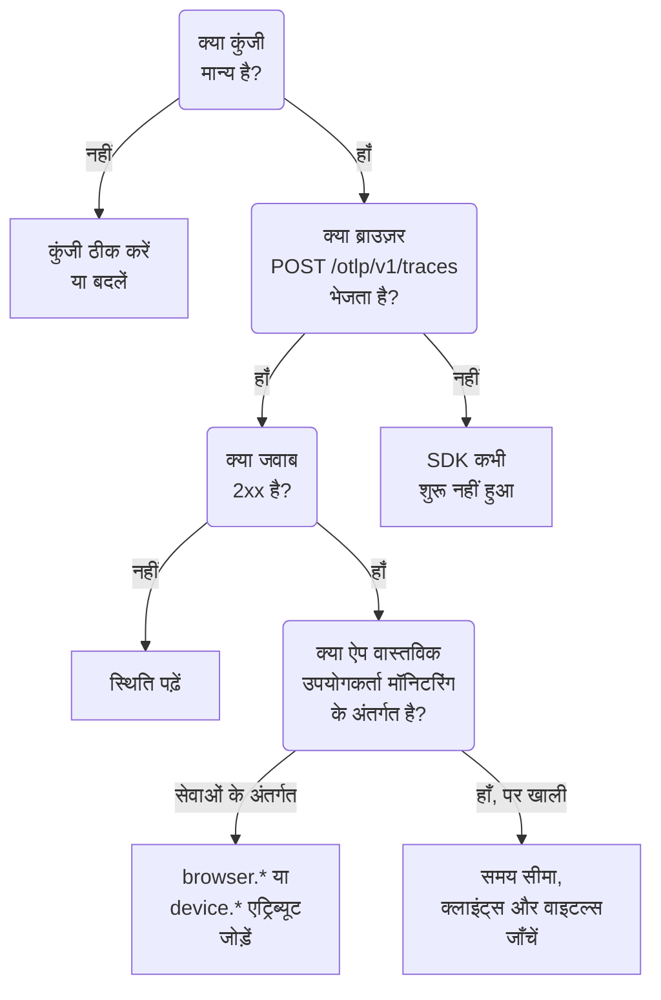

# RUM समस्या निवारण

जब कोई RUM एप्लिकेशन गायब, खाली या **डिस्कनेक्टेड** हो, तो इस पेज को क्रम से देखें। हर जाँच आपके ऐप से OneUptime तक के रास्ते के एक हिस्से को खारिज करती है, उसी क्रम में जिसमें ये समस्याएँ आमतौर पर होती हैं।

:::cards
- [कुंजी जाँचें](#कुंजी-जाँचें): सबसे तेज़ जाँच, और इसके बाद की हर चीज़ इसी पर निर्भर है।
- [देखें कि ब्राउज़र से क्या निकलता है](#देखें-कि-ब्राउज़र-से-क्या-निकलता-है): आपके ब्राउज़र के डेवलपर टूल्स में एक्सपोर्ट अनुरोध।
- [देखें कि टेलीमेट्री कहाँ पहुँचती है](#देखें-कि-टेलीमेट्री-कहाँ-पहुँचती-है): एक RUM एप्लिकेशन, या एक बैकएंड सेवा।
- [सेशन रीप्ले की समस्याएँ](#सेशन-रीप्ले-की-समस्याएँ): एक अलग पाइपलाइन, जिसका अपना पेज है।
:::

## RUM टेलीमेट्री कहाँ रुकती है

RUM एप्लिकेशन तक पहुँचते हुए टेलीमेट्री तीन जाँचों से गुज़रती है। पहली वह जाँच खोजें जो विफल होती है:



## कुंजी जाँचें

पहले कुंजी जाँचें। यह सबसे तेज़ जाँच है, और ऐसी कुंजी के बिना जिसे OneUptime स्वीकार करे, इसके बाद कुछ भी काम नहीं करता:

```bash
curl -i https://oneuptime.com/otlp/v1/validate \
  -H "x-oneuptime-token: YOUR_TELEMETRY_INGESTION_TOKEN"
```

| जवाब | इसका क्या मतलब है |
| --- | --- |
| `200` के साथ `"valid": true` | OneUptime कुंजी स्वीकार करता है। जवाब में उसका `keyType` और उसका `projectId` भी होता है। अगली जाँच पर जाएँ। |
| `401` के साथ `"valid": false` | कुंजी गायब, अज्ञात, रद्द, बंद या समाप्त है, और `message` बताता है कि इनमें से कौन-सी बात है। **प्रोजेक्ट सेटिंग्स → टेलीमेट्री और APM → इंजेशन कुंजियाँ** के अंतर्गत एक सक्रिय कुंजी बनाएँ। |

वेब ऐप को **ब्राउज़र** कुंजी चाहिए, और मोबाइल ऐप को **सर्वर** कुंजी: [ब्राउज़र सेटअप](/docs/rum/browser-setup) और [मोबाइल सेटअप](/docs/rum/mobile-setup) देखें। एक्सपोर्ट एंडपॉइंट भी खराब कुंजी को `401` से अस्वीकार करते हैं, जैसा OTLP स्पेसिफ़िकेशन कहता है, ताकि ठीक से बना SDK दोबारा कोशिश करने के बजाय अस्वीकृति को लॉग करे। ब्राउज़र कंसोल में वह पंक्ति आसानी से छूट जाती है, और यह जाँच सीधा जवाब देती है।

## देखें कि ब्राउज़र से क्या निकलता है

ऐप के पेज पर अपने ब्राउज़र के डेवलपर टूल्स खोलें, Network टैब चुनें और `otlp` के लिए फ़िल्टर करें। आप ऐसा `POST /otlp/v1/traces` ढूँढ रहे हैं जिसका जवाब `2xx` स्थिति के साथ आया हो।

### कोई अनुरोध ही नहीं

SDK कभी शुरू ही नहीं हुआ। लगभग हमेशा कारण इनमें से एक होता है:

- `telemetry.ts` आपके ऐप का पहला इम्पोर्ट नहीं है, या आपके बंडलर ने उसे हटा दिया। इंस्ट्रुमेंटेशन `fetch` और `XMLHttpRequest` को पैच करते हैं, इसलिए पैच से पहले किया गया अनुरोध ट्रेस नहीं होता, और बंडलर द्वारा हटाई गई फ़ाइल कुछ भी नहीं चलाती।
- बैच प्रोसेसर ने अभी तक एक्सपोर्ट नहीं किया है। `BatchSpanProcessor` बैच भरने के लिए कुछ सेकंड इंतज़ार करता है, इसलिए यह तय करने से पहले कि कुछ नहीं भेजा जा रहा, इंतज़ार करें या किसी दूसरे पेज पर जाएँ।
- बिल्ड के समय का कोई एनवायरनमेंट वेरिएबल `undefined` निकला, जिससे एक्सपोर्टर का URL टूट गया। स्टार्टअप पर एक बार URL लॉग करें।

### ब्राउज़र अनुरोध को ब्लॉक करता है

- **कंसोल में Content Security Policy त्रुटि।** आपके पेज की पॉलिसी अभी OneUptime को अनुमति नहीं देती। इसे अपने मौजूदा `connect-src` डायरेक्टिव में जोड़ें, या अगर आप OneUptime खुद चलाते हैं, तो अपना होस्ट इस्तेमाल करें:

  ```text
  connect-src 'self' https://oneuptime.com;
  ```

- **CORS त्रुटि।** OTLP एंडपॉइंट किसी भी ओरिजिन से अनुरोध स्वीकार करते हैं और `x-oneuptime-token` हेडर की अनुमति देते हैं, इसलिए असली CORS विफलता का लगभग हमेशा मतलब होता है कि अनुरोध कभी OneUptime तक पहुँचा ही नहीं: किसी कॉर्पोरेट प्रॉक्सी, ऐड ब्लॉकर या होस्ट में टाइपो को देखें। Network टैब में अनुरोध का URL जाँचें।

### अनुरोध को त्रुटि स्थिति मिलती है

**`401`.** कुंजी अज्ञात, रद्द या समाप्त है। [कुंजी जाँच](#कुंजी-जाँचें) चलाएँ, फिर एक सक्रिय कुंजी इस्तेमाल करें।

**`404`.** URL गलत है। ट्रेस एक्सपोर्टर को पूरा पाथ चाहिए, `/otlp/v1/traces`। एक आम गलती है ऐसे एक्सपोर्टर को बेस पता (`https://oneuptime.com/otlp`) देना जो पूरा URL चाहता है, या ऐसे एक्सपोर्टर को पूरा URL देना जो पाथ खुद जोड़ता है और `/otlp/v1/traces/v1/traces` पर पहुँच जाता है।

**`413`.** बैच उससे बड़ा था जितना कोई प्रॉक्सी अनुमति देता है। OneUptime का अपना इनग्रेस `/otlp` पर 4 MB तक स्वीकार करता है, लेकिन OneUptime के आगे आपके द्वारा चलाया जाने वाला प्रॉक्सी ज़्यादा सख्त हो सकता है — उदाहरण के लिए, ingress-nginx में `proxy-body-size` का डिफ़ॉल्ट 1 MB है — इसलिए अगर आपके पास ऐसा प्रॉक्सी है, तो `/otlp` के लिए उसकी सीमा भी बढ़ाएँ। दोनों ही स्थितियों में, `BatchSpanProcessor` पर छोटा `maxExportBatchSize` हर एक्सपोर्ट को छोटा करता है:

```ts
new BatchSpanProcessor(exporter, { maxExportBatchSize: 100 });
```

ब्राउज़र शायद ही कभी इतने बड़े बैच भेजता है, जब तक कि स्पैन में बड़े एट्रिब्यूट न हों, जैसे पूरा स्टैक ट्रेस या रिस्पॉन्स बॉडी। उन्हें छोटा करना बेहतर उपाय है।

**`422`.** OneUptime ने यहाँ कुंजी को अस्वीकार किया, और संदेश बताता है कि क्यों। `Origin https://app.example.com is not allowed for this browser ingestion key.` का मतलब है कि पेज का सटीक ओरिजिन, उसकी स्कीम और किसी भी पोर्ट के साथ, कुंजी की **अनुमत ऑरिजिन** में नहीं है। `This telemetry ingestion key has been disabled.` का मतलब है कि किसी ने कुंजी बंद कर दी।

**`429`.** कुंजी की **Requests Per Minute Limit** खत्म हो गई है: `Too many telemetry requests for this ingestion key. Please retry later.` जब तक आप कुंजी पर अपनी सीमा सेट नहीं करते, Browser कुंजी आपके सभी विज़िटर के लिए मिलाकर प्रति मिनट 6000 अनुरोधों की अनुमति देती है।

**`403` के साथ HTML पेज, या खाली बॉडी।** OneUptime हर अस्वीकृति का जवाब JSON में देता है, इसलिए यह जवाब उसके आगे की किसी चीज़ से आया है, आमतौर पर आपके अपने डोमेन पर लगे वेब एप्लिकेशन फ़ायरवॉल से, अगर आप OneUptime को उसके ज़रिए प्रॉक्सी करते हैं। फ़ायरवॉल OTLP/JSON को पार्स करता है और हर स्पैन एट्रिब्यूट को अपने इंजेक्शन नियमों से जाँचता है, इसलिए किसी स्पैन पर क्वेरी स्ट्रिंग वाला URL ही ब्लॉक होने के लिए काफ़ी है, और फ़ायरवॉल का लॉग नियम का नाम बताता है। केवल OTLP पाथ पर OTLP पेलोड को जाँच से बाहर रखें: [आपके OpenTelemetry अनुरोध भी ब्लॉक होते हैं](/docs/rum/session-replay-troubleshooting#आपके-opentelemetry-अनुरोध-भी-ब्लॉक-होते-हैं) बताता है कि कैसे, और उसी फ़ायरवॉल के पीछे के रीप्ले रिकॉर्डर को भी कवर करता है।

## देखें कि टेलीमेट्री कहाँ पहुँचती है

अनुरोध सफल होता है, लेकिन ऐप **उत्पाद → संसाधन → वास्तविक उपयोगकर्ता मॉनिटरिंग** के बजाय **उत्पाद → सेवाएं** के अंतर्गत दिखता है। यह सबसे आम शिकायत है, और कारण लगभग हमेशा बिना क्लाइंट एट्रिब्यूट वाला रिसोर्स होता है। OneUptime किसी बैच को RUM के रूप में तभी दर्ज करता है जब उसके रिसोर्स में इनमें से कोई एक हो:

| प्रकार | एट्रिब्यूट |
| --- | --- |
| ब्राउज़र | `browser.platform`, `browser.language`, या खाली न हो ऐसा `browser.brands` |
| मोबाइल | `device.id` या `device.model.identifier`, या बिना होस्ट पहचान (`host.name`, `host.id` या `k8s.node.name`) वाले रिसोर्स पर `device.manufacturer` |

अकेला `service.name` एक बैकएंड सेवा बनाता है। OpenTelemetry ब्राउज़र SDK तब तक कोई `browser.*` एट्रिब्यूट नहीं जोड़ता, जब तक आप ब्राउज़र रिसोर्स डिटेक्टर न जोड़ें या उन्हें खुद सेट न करें: [ब्राउज़र सेटअप](/docs/rum/browser-setup) देखें।

आप असल में क्या भेजते हैं, यह देखने के लिए Network टैब में OTLP अनुरोध खोलें और उसका पेलोड देखें: `resourceSpans[0].resource.attributes` वह सूची है जो इसका फ़ैसला करती है। अगर वहाँ कोई `browser.*` एट्रिब्यूट नहीं है, तो SDK उसे नहीं जोड़ रहा, चाहे उसका दस्तावेज़ कुछ भी कहे।

एट्रिब्यूट जोड़ें, और अगला बैच RUM एप्लिकेशन बना देता है। पहले बनी सेवा RUM एप्लिकेशन में नहीं बदलती, क्योंकि दोनों अलग रिकॉर्ड हैं, इसलिए RUM टेलीमेट्री आने के बाद उसे **उत्पाद → सेवाएं** के अंतर्गत हटा दें।

> [!NOTE]
> जिस रिसोर्स का एकमात्र क्लाइंट एट्रिब्यूट `device.manufacturer` है, और जिसकी होस्ट पहचान भी है, उसे फ़ोन के बजाय मशीन माना जाता है, क्योंकि होस्ट की इन्वेंटरी उसी एट्रिब्यूट से अपना निर्माता बताती है। `device.id` या `device.model.identifier` जोड़ें, और बैच मोबाइल RUM के रूप में दर्ज होता है, चाहे उसमें और कुछ भी हो।

## एप्लिकेशन खाली है

एप्लिकेशन मौजूद है, लेकिन उसके पेज कुछ नहीं दिखाते।

- **समय सीमा जाँचें।** अवलोकन डिफ़ॉल्ट रूप से पिछला एक घंटा दिखाता है, इसलिए आज सुबह का टेस्ट बैच उसके बाहर है।
- **कुछ मिनट इंतज़ार करें।** इन्जेशन कतार में होता है, और **अंतिम बार देखा गया** हर बैच पर नहीं, बल्कि हर कुछ मिनट में रीफ़्रेश होता है।
- **प्रोजेक्ट जाँचें।** कुंजी अपने ही प्रोजेक्ट में लिखती है, इसलिए किसी दूसरे प्रोजेक्ट की कुंजी से भेजी गई टेलीमेट्री वहाँ है, यहाँ नहीं।

## क्लाइंट्स पेज खाली है

**क्लाइंट्स** पेज वेब पर `browser.platform` और मोबाइल पर `device.model.identifier` सूचीबद्ध करता है। बाकी सब काम करते हुए भी इसके खाली रहने के दो कारण:

- **Safari और Firefox।** `browserDetector` UA Client Hints API पढ़ता है, जो केवल Chromium ब्राउज़र में है। बाकी जगह यह `browser.language` सेट करता है, जो टेलीमेट्री को RUM के रूप में दर्ज करने के लिए काफ़ी है, लेकिन `browser.platform` नहीं। उन क्लाइंट्स को सूचीबद्ध करने के लिए `browser.platform` खुद सेट करें।
- **ऐसा मोबाइल SDK जो केवल `device.manufacturer` सेट करता है।** वह टेलीमेट्री को मोबाइल RUM के रूप में दर्ज करता है, लेकिन **क्लाइंट्स** पेज को `device.model.identifier` चाहिए।

## Core Web Vitals में "No web vitals reported yet" दिखता है

कार्ड केवल उन मेट्रिक्स से भरता है जो आपका ऐप भेजता है, इसलिए सिर्फ़ ट्रेस उसे कभी नहीं भरते। जाँचें कि आप मेट्रिक्स एक्सपोर्ट करते भी हैं या नहीं, कि मेट्रिक नाम वही हैं जिन्हें OneUptime पढ़ता है, और कि वे एप्लिकेशन के **मेट्रिक्स** पेज पर हैं। [कार्ड कहता है "No web vitals reported yet"](/docs/rum/web-vitals#समस्या-निवारण) हर जाँच से गुज़रता है, उन मानों समेत जो तब खो जाते हैं जब कोई विज़िटर अगले एक्सपोर्ट से पहले टैब बंद कर देता है।

## लोग ऐप इस्तेमाल कर रहे हैं, फिर भी स्थिति डिस्कनेक्टेड है

15 मिनट तक कोई टेलीमेट्री न आने पर एप्लिकेशन **डिस्कनेक्टेड** हो जाता है। अगर लोग ऐप इस्तेमाल कर रहे हैं:

- **हो सकता है कोई सैंपलर सब कुछ छोड़ रहा हो।** जाँचें कि आपने always-off सैंपलर, या बहुत कम अनुपात, सेट नहीं किया है।
- **हो सकता है ऐप केवल कुछ इंटरैक्शन पर टेलीमेट्री भेजता हो**, और उस दौरान किसी ने उन्हें इस्तेमाल नहीं किया।
- **हो सकता है डिप्लॉय करने के बाद कुंजी रद्द या बंद कर दी गई हो**: [कुंजी जाँच](#कुंजी-जाँचें) फिर से चलाएँ।

रात भर बिना विज़िटर वाला कोई आंतरिक या कम ट्रैफ़िक वाला ऐप सचमुच डिस्कनेक्टेड होता है। यह कोई खराबी नहीं है।

## सेशन रीप्ले की समस्याएँ

सेशन रीप्ले एक अलग पाइपलाइन है जिसकी अपनी समस्याएँ हैं: रिकॉर्डर स्क्रिप्ट, ओरिजिन अनुमति सूचियाँ, सहमति, Content Security Policy और मास्किंग। [सेशन रीप्ले समस्या निवारण](/docs/rum/session-replay-troubleshooting) इन्हें कवर करता है। वहीं से शुरू करें, और रिकॉर्डर का डायग्नॉस्टिक्स चालू करके शुरू करें, क्योंकि इसकी ज़्यादातर विफलताएँ जानबूझकर चुपचाप होती हैं:

```js
localStorage.setItem("oneuptime.sessionReplay.debug", "true");
// then reload the page
```

एप्लिकेशन का **स्वास्थ्य** पेज, उसके **सेशन रीप्ले** सेक्शन में, और **Replay Policy** पर **Test your installation** पैनल, सर्वर की ओर से कुंजी, अनुमति सूचियों और पॉलिसी की जाँच करते हैं, और बताते हैं कि कुछ क्यों नहीं आ रहा। ब्राउज़र का कंसोल आपको वह आधा हिस्सा बताता है जिसे सर्वर नहीं देख सकता।

डिफ़ॉल्ट पॉलिसी में, जब उपयोगकर्ता पेज से इंटरैक्ट कर रहा होता है, तो रिकॉर्डर लगभग हर 15 सेकंड में एक चंक भेजता है। निष्क्रिय टैब के पास भेजने को कुछ नहीं होता, इसलिए पहले क्लिक करें या माउस हिलाएँ; उसके बाद भी कोई चंक अनुरोध न होने का मतलब है कि कुछ गड़बड़ है। अगर एप्लिकेशन केवल _On error or frustration_ पर अपलोड करता है, तो कुछ गड़बड़ होने तक चुप्पी अपेक्षित है। दोनों ही स्थितियों में अपलोड को मजबूर करने और रास्ता साबित करने के लिए `OneUptimeReplay.captureSession()` कॉल करें।

दोनों पाइपलाइन स्वतंत्र हैं। रिकॉर्डर लोड होने के लिए काम करता हुआ RUM एप्लिकेशन ज़रूरी नहीं है, और काम करते रिकॉर्डर का मतलब यह नहीं कि RUM टेलीमेट्री आ रही है: हर एक अकेले विफल हो सकता है।

## अब भी अटके हुए हैं

मदद माँगने से पहले ये इकट्ठा करें। इनसे एक चक्कर बचता है:

- किसी असली OTLP अनुरोध के पेलोड से `resource.attributes` सूची।
- उस अनुरोध की HTTP स्थिति।
- वह सटीक `service.name` जो आप भेजते हैं, और यह कि प्रोजेक्ट में उस नाम का कोई एप्लिकेशन या सेवा है या नहीं।
- डिप्लॉय किए गए बिल्ड की कुंजी के लिए `/otlp/v1/validate` `200` लौटाता है या नहीं।

फिर support@oneuptime.com से संपर्क करें, या [GitHub](https://github.com/OneUptime/oneuptime) पर एक issue खोलें।

## अगले कदम

:::cards
- [ब्राउज़र सेटअप](/docs/rum/browser-setup): वह सेटअप जिसे ये जाँचें मानकर चलती हैं, चरण दर चरण।
- [मोबाइल सेटअप](/docs/rum/mobile-setup): वह कुंजी और एट्रिब्यूट जिनकी मोबाइल ऐप को ज़रूरत होती है।
- [एप्लिकेशन प्रबंधित करना](/docs/rum/applications): नाम, लेबल, प्रतिधारण और स्थिति।
- [सेशन रीप्ले समस्या निवारण](/docs/rum/session-replay-troubleshooting): रिकॉर्डर का हर कोड, और उसके बारे में क्या करें।
:::
