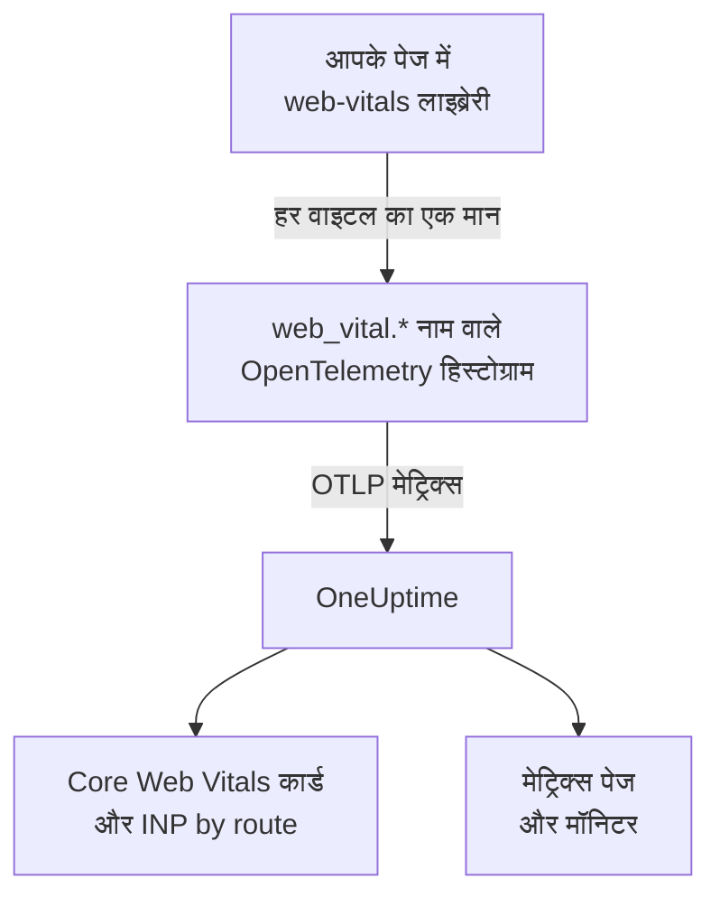
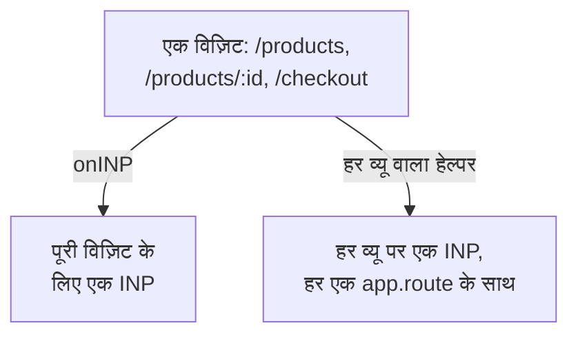

# Core Web Vitals

RUM एप्लिकेशन के अवलोकन पर **Core Web Vitals** कार्ड LCP, INP, CLS, FCP और TTFB दिखाता है, हर एक Google की सीमाओं पर आँका गया। OneUptime इनमें से किसी को खुद नहीं मापता: कार्ड केवल उन मेट्रिक्स से भरता है जो आपका ब्राउज़र इंस्ट्रुमेंटेशन रिपोर्ट करता है, और यह पेज बताता है कि उन्हें कैसे भेजें।

:::cards
- [इन्हें भेजें](#इन्हें-अपने-ऐप-से-भेजें): web-vitals लाइब्रेरी के मानों को OpenTelemetry मेट्रिक्स के रूप में आगे भेजें।
- [OneUptime कौन-से नाम पढ़ता है](#oneuptime-कौन-से-मेट्रिक-नाम-पहचानता-है): वे मेट्रिक नाम जिनके तहत हर वाइटल आ सकता है।
- [सिंगल-पेज ऐप्स](#सिंगल-पेज-ऐप्स): हर व्यू के लिए INP, न कि हर पेज लोड पर एक मान।
- [वाइटल पर अलर्ट](#वाइटल-पर-अलर्ट): खराब वाइटल्स के लिए तैयार मॉनिटर।
:::

## यह कैसे काम करता है

[`web-vitals`](https://github.com/GoogleChrome/web-vitals) लाइब्रेरी पेज में हर वाइटल मापती है; यह वही लाइब्रेरी है जिसे Chrome के अपने टूल इस्तेमाल करते हैं। आपका कोड हर मान को एक OpenTelemetry हिस्टोग्राम पर रिकॉर्ड करता है, और ब्राउज़र की मेट्रिक पाइपलाइन उसे OneUptime को एक्सपोर्ट करती है।



OpenTelemetry में अभी web vitals के नामों की कोई अंतिम परिपाटी नहीं है, इसलिए OneUptime हर वाइटल को कई नामों के तहत ढूँढता है और डेटा वाला पहला नाम इस्तेमाल करता है। नए इंस्ट्रुमेंटेशन के लिए `web_vital.*` नाम इस्तेमाल करें।

## शुरू करने से पहले

- [ब्राउज़र सेटअप](/docs/rum/browser-setup) की तरह सेट किया गया एक वेब ऐप, उसकी मेट्रिक पाइपलाइन के साथ: इन मानों को [लॉग और मेट्रिक्स जोड़ें](/docs/rum/browser-setup#लॉग-और-मेट्रिक्स-जोड़ें) वाला `MeterProvider` एक्सपोर्ट करता है।

## इन्हें अपने ऐप से भेजें

:::steps
### लाइब्रेरी इंस्टॉल करें

```bash
npm install web-vitals
```

### हर वाइटल को एक हिस्टोग्राम पर रिकॉर्ड करें

`src/web-vitals.ts` बनाएँ। हर वाइटल एक हिस्टोग्राम है, ताकि **मेट्रिक्स** पेज बाद में पर्सेंटाइल निकाल सके; बकेट की सीमाएँ Google की अच्छी और खराब सीमाओं पर रखी गई हैं।

```ts title="src/web-vitals.ts"
// Import after ./telemetry
import { metrics } from "@opentelemetry/api";
import { onCLS, onFCP, onINP, onLCP, onTTFB, type Metric } from "web-vitals";

const meter = metrics.getMeter("web-vitals");

// Histograms, so the Metrics tab can compute percentiles later. The bucket
// edges sit on each vital's good / poor limits: a percentile is read from
// the buckets, and the defaults are far too coarse for these ranges.
const buckets = (...edges: number[]) => ({ advice: { explicitBucketBoundaries: edges } });

const lcp = meter.createHistogram("web_vital.lcp", { unit: "ms", ...buckets(0, 1000, 1500, 2000, 2500, 3000, 3500, 4000, 5000, 7500, 10000) });
const inp = meter.createHistogram("web_vital.inp", { unit: "ms", ...buckets(0, 50, 100, 150, 200, 250, 300, 400, 500, 750, 1000, 2000) });
const fcp = meter.createHistogram("web_vital.fcp", { unit: "ms", ...buckets(0, 600, 1200, 1800, 2400, 3000, 4000, 6000, 10000) });
const ttfb = meter.createHistogram("web_vital.ttfb", { unit: "ms", ...buckets(0, 200, 400, 600, 800, 1200, 1800, 2500, 4000) });
const cls = meter.createHistogram("web_vital.cls", { unit: "1", ...buckets(0, 0.025, 0.05, 0.1, 0.15, 0.2, 0.25, 0.4, 0.6, 1) });

function record(
  histogram: { record: (v: number, a?: Record<string, string>) => void },
) {
  return (metric: Metric): void => {
    histogram.record(metric.value, {
      // Keep attributes low-cardinality. Never put a full URL or a user id here.
      "web_vital.rating": metric.rating,
    });
  };
}

onLCP(record(lcp));
onINP(record(inp));
onCLS(record(cls));
onFCP(record(fcp));
onTTFB(record(ttfb));
```

### इसे अपने टेलीमेट्री सेटअप के बाद इम्पोर्ट करें

```ts
import "./telemetry";
import "./web-vitals";
```

### मेट्रिक्स पेज जाँचें

कुछ पेज लोड करें, फिर एप्लिकेशन के **मेट्रिक्स** पेज पर `web_vital.lcp` खोजें। मेट्रिक्स वहाँ दिखते ही **Core Web Vitals** कार्ड आपकी चुनी समय सीमा के लिए भर जाता है।
:::

## पेज बंद होने से पहले आखिरी मान भेजें

`onINP` और `onCLS` विज़िट के दौरान नहीं, बल्कि पेज छिपने पर रिपोर्ट करते हैं। [ब्राउज़र सेटअप](/docs/rum/browser-setup) के 30 सेकंड के एक्सपोर्ट अंतराल के साथ, आखिरी मान के ठीक बाद टैब बंद करने वाला विज़िटर उसके एक्सपोर्ट होने से पहले जा सकता है। अगर पूर्णता मायने रखती है, तो `exportIntervalMillis` घटाएँ, या `telemetry.ts` में बनाया `MeterProvider` रखें और पेज छिपने पर उसे फ़्लश करें:

```ts
// In telemetry.ts, export the provider you created:
export const meterProvider = new MeterProvider({ /* ... */ });

// Anywhere after setup:
import { meterProvider } from "./telemetry";

document.addEventListener("visibilitychange", () => {
  if (document.visibilityState === "hidden") {
    void meterProvider.forceFlush();
  }
});
```

## OneUptime कौन-से मेट्रिक नाम पहचानता है

OneUptime नामों को इसी क्रम में आज़माता है, और चुनी समय सीमा में डेटा वाला पहला नाम चुना जाता है।

| वाइटल | मेट्रिक नाम, इनमें से कोई एक | इकाई |
| --- | --- | --- |
| LCP: Largest Contentful Paint | `web_vital.lcp`, `browser.largest_contentful_paint`, `largest_contentful_paint`, `web.vitals.lcp` | मि.से. |
| INP: Interaction to Next Paint | `web_vital.inp`, `browser.interaction_to_next_paint`, `interaction_to_next_paint`, `web.vitals.inp` | मि.से. |
| CLS: Cumulative Layout Shift | `web_vital.cls`, `browser.cumulative_layout_shift`, `cumulative_layout_shift`, `web.vitals.cls` | स्कोर |
| FCP: First Contentful Paint | `web_vital.fcp`, `browser.first_contentful_paint`, `first_contentful_paint`, `web.vitals.fcp` | मि.से. |
| TTFB: Time to First Byte | `web_vital.ttfb`, `browser.time_to_first_byte`, `time_to_first_byte`, `web.vitals.ttfb` | मि.से. |

बाकी नाम इसलिए हैं ताकि जो ऐप पहले से किसी सामुदायिक परिपाटी से भेज रहा है, वह बिना बदलाव के दिखाई दे।

## रेटिंग सीमाएँ

कार्ड हर मान को Google की प्रकाशित Core Web Vitals सीमाओं से आँकता है:

| वाइटल | **Good** | **Needs work** | **Poor** |
| --- | --- | --- | --- |
| LCP | 2500 मि.से. से कम | 2500 से 4000 मि.से. | 4000 मि.से. या अधिक |
| INP | 200 मि.से. से कम | 200 से 500 मि.से. | 500 मि.से. या अधिक |
| CLS | 0.1 से कम | 0.1 से 0.25 | 0.25 या अधिक |
| FCP | 1800 मि.से. से कम | 1800 से 3000 मि.से. | 3000 मि.से. या अधिक |
| TTFB | 800 मि.से. से कम | 800 से 1800 मि.से. | 1800 मि.से. या अधिक |

कार्ड चुनी समय सीमा का **औसत** दिखाता है, न कि वह 75वाँ पर्सेंटाइल जो Google के फ़ील्ड टूल रिपोर्ट करते हैं। यह जानबूझकर है: OneUptime हिस्टोग्राम के पर्सेंटाइल उसके बकेट से पढ़ता है, इसलिए पर्सेंटाइल उतना ही सटीक होता है जितने बकेट, जबकि औसत हिस्टोग्राम के सटीक योग और गिनती से आता है। OpenTelemetry के डिफ़ॉल्ट बकेट (`0, 5, 10, 25, 50, …`) के साथ हर CLS मान पहले बकेट में गिरता है, और लगभग न खिसकने वाले पेज के लिए भी 75वाँ पर्सेंटाइल 2.5 दिखाता।

> [!TIP]
> कार्ड को एक रुझान की तरह पढ़ें। 75वें पर्सेंटाइल के लिए ऊपर की बकेट सीमाओं के साथ रिकॉर्ड करें, फिर **मेट्रिक्स** पेज पर **P75** एग्रीगेशन से मेट्रिक का चार्ट बनाएँ। मेट्रिक्स मॉनिटर भी यही विकल्प देता है।

## सिंगल-पेज ऐप्स

`onINP` INP को उसी तरह मापता है जैसे ब्राउज़र उसे परिभाषित करता है: **हर पेज लोड पर एक मान**। सिंगल-पेज ऐप एक बार लोड होता है और फिर `history.pushState` से रूट बदलता है, इसलिए `/products`, `/products/42` और `/checkout` की एक विज़िट पूरी विज़िट के लिए एक ही INP देती है। हर व्यू के इंटरैक्शन उसी एक संख्या के लिए होड़ करते हैं, और उस पर लगा रूट एट्रिब्यूट उस पेज का नाम बताता है जो रिपोर्ट के समय दिख रहा था, न कि उस पेज का जो धीमा था।



हर व्यू का INP देखने के लिए उसे हर व्यू पर मापें: हर रूट बदलाव मौजूदा व्यू खत्म करके नया शुरू करता है, और हर व्यू अपना INP रिपोर्ट करता है। नीचे का हेल्पर यह ब्राउज़र के Event Timing API से करता है, वही डेटा जो `onINP` इस्तेमाल करता है, और उस हिस्से को सँभालता है जिसमें गलती आसान है: जिस क्लिक ने नेविगेशन **शुरू किया**, वह रूट बदल जाने के बाद पहुँचता है, लेकिन वह उसी पेज का है जिस पर क्लिक किया गया था।

```ts title="src/inp-per-route.ts"
// INP for each view of a single-page app.
type Report = (inpMs: number, route: string) => void;

interface View {
  route: string;
  path: string; // the URL path it was opened for
  start: number; // performance.now() when the view began
  latencies: Map<number, number>; // interactionId -> its slowest entry
}

// Long enough for the click that navigated to be delivered: its entry
// arrives after the next paint, i.e. after the route has changed.
const SETTLE_MS = 1000;

let views: Array<View> = [];
let report: Report = () => {};

// The path, plus the hash when a hash router keeps the route there.
const currentPath = (): string =>
  location.pathname + (location.hash.startsWith("#/") ? location.hash : "");

function close(view: View): void {
  if (!views.includes(view)) return; // already reported
  views = views.filter((v) => v !== view);

  const sorted = [...view.latencies.values()].sort((a, b) => b - a);
  if (sorted.length === 0) return; // nobody interacted: no INP, not 0

  // web-vitals' p98: skip one outlier for every 50 interactions.
  report(sorted[Math.min(sorted.length - 1, Math.floor(sorted.length / 50))]!, view.route);
}

function record(entries: PerformanceEntryList): void {
  for (const entry of entries as Array<PerformanceEventTiming & { interactionId?: number }>) {
    if (!entry.interactionId) continue; // hovers, scrolls: not interactions

    // The view the interaction STARTED in, so the click that navigated
    // counts towards the page it was clicked on.
    const view = [...views].reverse().find((v) => entry.startTime >= v.start);
    if (!view) continue;

    const slowest = view.latencies.get(entry.interactionId) ?? 0;
    view.latencies.set(entry.interactionId, Math.max(slowest, entry.duration));
  }
}

export function observeInpPerRoute(route: string, onReport: Report): void {
  if (typeof PerformanceObserver === "undefined" || !PerformanceObserver.supportedEntryTypes?.includes("event")) return;

  report = onReport;
  views = [{ route, path: currentPath(), start: 0, latencies: new Map() }];

  const observer = new PerformanceObserver((list) => record(list.getEntries()));
  observer.observe({ type: "event", durationThreshold: 40, buffered: true } as PerformanceObserverInit);

  // The tab may never come back: report every view now, then keep
  // measuring the current route as a fresh view.
  document.addEventListener("visibilitychange", () => {
    if (document.visibilityState !== "hidden") return;
    record(observer.takeRecords());
    const current = views[views.length - 1]?.route ?? route;
    [...views].forEach(close);
    views = [{ route: current, path: currentPath(), start: performance.now(), latencies: new Map() }];
  });
}

// Call after every navigation, with the route PATTERN ("/products/:id").
// Safe to call when nothing changed (a router's initial navigation, a
// query-string update): the view only ends when the path does.
export function startView(route: string): void {
  const closing = views[views.length - 1];
  if (!closing || closing.path === currentPath()) return;

  views.push({ route, path: currentPath(), start: performance.now(), latencies: new Map() });
  setTimeout(() => close(closing), SETTLE_MS);
}
```

दोनों फ़ंक्शन रूट का **पैटर्न** लेते हैं, कभी URL नहीं: `/products/42` और `/products/7` एक ही रूट होने चाहिए, वरना हर प्रोडक्ट अपनी अलग सीरीज़ बन जाता है। जहाँ आपके राउटर के पास पैटर्न हो, उसे इस्तेमाल करें; वरना ID को खुद समेटें:

```ts
// "/products/42" -> "/products/:id", also for UUIDs.
export const toRoutePattern = (path: string): string =>
  path.replace(/\/(\d+|[0-9a-f]{8}-[0-9a-f-]{27})(?=\/|$)/gi, "/:id");
```

हेल्पर जो रिपोर्ट करता है उसे उसी `web_vital.inp` हिस्टोग्राम पर, रूट को `app.route` के रूप में रखकर रिकॉर्ड करें, और ऊपर के स्निपेट से **`onINP` हटा दें**: दोनों रखने से हर इंटरैक्शन दो बार गिना जाएगा।

```ts
// src/web-vitals.ts, in place of onINP(record(inp))
import { observeInpPerRoute } from "./inp-per-route";

observeInpPerRoute(toRoutePattern(location.pathname), (inpMs, route) => {
  inp.record(inpMs, {
    "app.route": route,
    "web_vital.rating": inpMs <= 200 ? "good" : inpMs <= 500 ? "needs-improvement" : "poor",
  });
});
```

फिर जहाँ भी आपका राउटर पूरा हुआ नेविगेशन बताता है, वहाँ `startView` कॉल करें। जब URL पाथ नहीं बदला हो तो यह कॉल को अनदेखा करता है, इसलिए जो राउटर पहला लोड या क्वेरी-स्ट्रिंग अपडेट भी बताता है, वह व्यू को नहीं बाँटता:

:::tabs
@tab Vue Router
```ts
router.afterEach((to) => startView(to.matched[to.matched.length - 1]?.path ?? toRoutePattern(to.path)));
```
@tab React Router
```tsx
// In a component that stays mounted inside the router
const { pathname } = useLocation();
useEffect(() => startView(toRoutePattern(pathname)), [pathname]);
```
:::

आपको क्या मिलता है:

- अवलोकन पर **INP by route**, `app.route` के अनुसार सबसे धीमा पहले; OneUptime OpenTelemetry का `url.template` भी पढ़ता है।
- अलर्ट के लिए रूट फ़िल्टर: किसी एक फ़्लो, जैसे `/checkout`, पर अलग से नज़र रखने के लिए मेट्रिक्स मॉनिटर में `web_vital.inp` को `app.route` से फ़िल्टर करें।
- **Core Web Vitals** कार्ड पर पूरे ऐप का INP काम करता रहता है: यह वही मेट्रिक है, बस अब हर पेज लोड के बजाय हर व्यू पर एक मान के साथ।

इसके लिए ज़रूरी इंटरैक्शन ID Chromium ब्राउज़र रिपोर्ट करते हैं। Safari कोई रिपोर्ट नहीं करता, और इसीलिए `onINP` भी वहाँ कुछ रिपोर्ट नहीं करता। Chrome का प्रायोगिक Soft Navigations API इसे नेटिव रूप से करने का लक्ष्य रखता है, लेकिन यह आम तौर पर उपलब्ध नहीं है; यह हेल्पर आज काम करता है।

> [!NOTE]
> [सेशन रीप्ले](/docs/telemetry/session-replay) रिकॉर्डर बिना किसी कोड के पहले से हर व्यू का INP मापता है: हर रिकॉर्डिंग उस हर रूट के लिए एक INP पंक्ति दिखाती है जिस पर उपयोगकर्ता ने इंटरैक्ट किया, धीमे एलिमेंट के साथ, और यह भी कि उसका समय इनपुट देरी, प्रोसेसिंग और प्रेज़ेंटेशन में कैसे बँटा।

## कार्डिनैलिटी को काबू में रखना

मेट्रिक एट्रिब्यूट गुणा होते हैं। `web_vital.rating` के तीन संभावित मान हैं, जो ठीक है, और रूट या पेज-प्रकार का एट्रिब्यूट आमतौर पर फ़ायदेमंद होता है:

```ts
histogram.record(metric.value, {
  "web_vital.rating": metric.rating,
  "app.route": routePattern, // "/product/:id" — the PATTERN, not "/product/8842"
});
```

रूट पैटर्न के बजाय असली URL रिकॉर्ड करने से हर प्रोडक्ट पेज की एक टाइम सीरीज़ बनती है, जिससे **मेट्रिक्स** पेज धीमा और स्टोरेज का बिल बड़ा हो जाता है। उपयोगकर्ता ID, सेशन ID और स्क्रीन आकार पर भी यही लागू होता है।

## वाइटल पर अलर्ट

एप्लिकेशन का **Recommendations** पेज हर वाइटल के लिए एक तैयार मॉनिटर देता है। हर मॉनिटर अपनी मेट्रिक का पाँच मिनट का औसत पढ़ता है और Google की खराब सीमा तक पहुँचने पर ट्रिगर होता है:

| सिफ़ारिश | मेट्रिक | कब ट्रिगर होता है | गंभीरता |
| --- | --- | --- | --- |
| **Poor Largest Contentful Paint** | `web_vital.lcp` | 4000 मि.से. | **गंभीर** |
| **Poor Interaction to Next Paint** | `web_vital.inp` | 500 मि.से. | **गंभीर** |
| **Poor Cumulative Layout Shift** | `web_vital.cls` | 0.25 | **गंभीर** |
| **Slow First Contentful Paint** | `web_vital.fcp` | 3000 मि.से. | **Warning** |
| **Slow Time to First Byte** | `web_vital.ttfb` | 1800 मि.से. | **Warning** |

ये मॉनिटर केवल `web_vital.*` नाम पढ़ते हैं। अगर आपका ऐप कोई वाइटल दूसरे नाम से भेजता है, तो बनाए गए मॉनिटर की मेट्रिक बदलें। किसी एक रूट पर अलर्ट के लिए मॉनिटर में `app.route` फ़िल्टर जोड़ें। आप इनमें से किसी भी मेट्रिक पर अपना मॉनिटर भी बना सकते हैं: [मेट्रिक्स मॉनिटर](/docs/monitor/metrics-monitor) देखें।

## समस्या निवारण

:::details कार्ड पर "No web vitals reported yet" लिखा है
कार्ड केवल उन मेट्रिक्स से भरता है जो आपका ऐप भेजता है। इस क्रम में जाँचें:

1. क्या आपके पास मेट्रिक पाइपलाइन है भी: अकेले ट्रेस से यह कार्ड कभी नहीं भरता।
2. क्या मेट्रिक नाम वही हैं जो OneUptime पढ़ता है: [OneUptime कौन-से मेट्रिक नाम पहचानता है](#oneuptime-कौन-से-मेट्रिक-नाम-पहचानता-है) देखें।
3. क्या मेट्रिक्स एप्लिकेशन के **मेट्रिक्स** पेज पर हैं। अगर हैं, तो एक्सपोर्ट काम कर रहा है, और समस्या नाम या समय सीमा में है।
4. INP और CLS पेज छिपने पर रिपोर्ट होते हैं, इसलिए छोटी विज़िट अगले एक्सपोर्ट से पहले खत्म हो सकती है: [पेज बंद होने से पहले आखिरी मान भेजें](#पेज-बंद-होने-से-पहले-आखिरी-मान-भेजें) देखें।

अगर इनमें से कुछ भी मदद न करे, तो [RUM समस्या निवारण](/docs/rum/troubleshooting) पूरी पाइपलाइन जाँचता है।
:::

:::details INP रिपोर्ट होता है, लेकिन रूट के अनुसार नहीं
**INP by route** कार्ड को `web_vital.inp` पर `app.route` एट्रिब्यूट, या `url.template`, चाहिए। [सिंगल-पेज ऐप्स](#सिंगल-पेज-ऐप्स) की तरह हर मान के साथ रूट पैटर्न रिकॉर्ड करें।
:::

:::details मान Google की रिपोर्ट से अलग हैं
कार्ड आपकी चुनी समय सीमा का औसत दिखाता है, और Google अपने विज़िटर का 75वाँ पर्सेंटाइल रिपोर्ट करता है। एक जैसी चीज़ों की तुलना के लिए **मेट्रिक्स** पेज पर **P75** का चार्ट बनाएँ।
:::

## अगले कदम

:::cards
- [ब्राउज़र सेटअप](/docs/rum/browser-setup): वह ट्रेस, लॉग और मेट्रिक्स पाइपलाइन जिस पर ये वाइटल्स चलते हैं।
- [मेट्रिक्स मॉनिटर](/docs/monitor/metrics-monitor): किसी भी वाइटल पर अलर्ट, पूरे ऐप के लिए या एक रूट के लिए।
- [सेशन रीप्ले](/docs/telemetry/session-replay): रिकॉर्डिंग में हर व्यू का INP देखें, बिना किसी कोड के।
- [RUM समस्या निवारण](/docs/rum/troubleshooting): हर जाँच, उसी क्रम में जिसमें समस्याएँ आमतौर पर होती हैं।
:::
