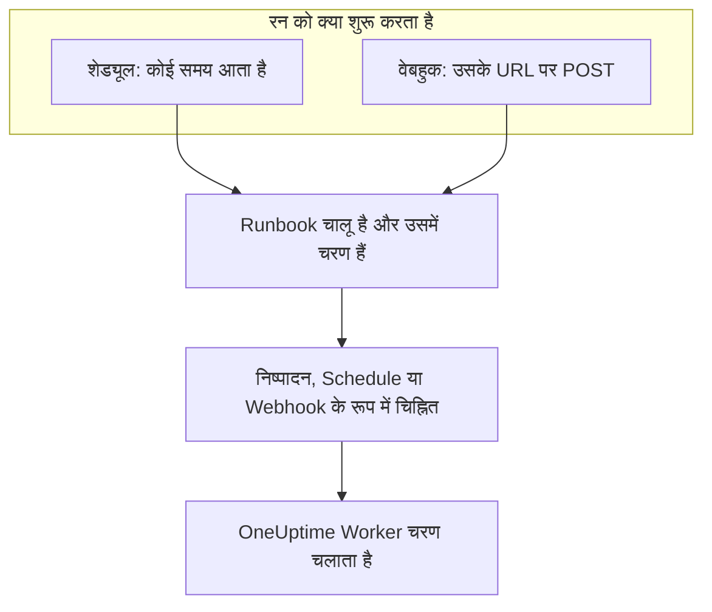

# Runbook ट्रिगर

कोई Runbook अपने आप शुरू हो सकता है: शेड्यूल पर, या जब कोई दूसरा टूल उसका वेबहुक URL कॉल करे। रोज़मर्रा के काम के लिए शेड्यूल का इस्तेमाल करें, जैसे रात की सफ़ाई या हर हफ़्ते सर्टिफ़िकेट की जाँच, और किसी अलर्टिंग सिस्टम, CI पाइपलाइन या स्क्रिप्ट से Runbook शुरू करने के लिए वेबहुक का। दोनों Runbook के **ट्रिगर** पेज पर सेट किए जाते हैं।

:::cards
- [शेड्यूल पर चलाएँ](#शेड्यूल-पर-चलाएँ): हर कुछ मिनट में, हर दिन, सप्ताह के चुने हुए दिनों पर, या cron एक्सप्रेशन से।
- [वेबहुक कॉल करें](#वेबहुक-कॉल-करें): Runbook के URL पर POST अनुरोध भेजकर रन शुरू करें।
- [वेबहुक कॉल जो मान भेजता है](#वेबहुक-कॉल-जो-मान-भेजता-है): कॉल करने वाले का भेजा JSON चरण कैसे पढ़ते हैं।
- [समस्या निवारण](#समस्या-निवारण): ऐसा शेड्यूल जो नहीं चलता, ऐसी कॉल जो अस्वीकार हो जाती है।
:::

## ट्रिगर रन कैसे शुरू करता है



ट्रिगर रन को वैसे ही शुरू करता है जैसे **अभी चलाएँ** करता है: रन Runbook के मौजूदा चरणों का निष्पादन है और किसी घटना, अलर्ट या शेड्यूल किए गए रखरखाव इवेंट से जुड़ा नहीं होता। हर रन दर्ज करता है कि उसे किसने शुरू किया। Runbook के **निष्पादन** और **रनबुक → निष्पादन** इसे **द्वारा ट्रिगर किया गया** में दिखाते हैं, साथ में शेड्यूल किए गए रन का तय समय या वेबहुक को कॉल करने वाला पता, और दोनों सूचियों को इसके आधार पर फ़िल्टर किया जा सकता है।

## शुरू करने से पहले

- कम से कम एक चरण वाला Runbook, जिसकी **सेटिंग्स** पेज पर **इस Runbook को चलाएं** स्विच चालू हो।
- Runbook को संपादित करने और चलाने की अनुमति। देखें [कौन ट्रिगर सेट कर सकता है](#कौन-ट्रिगर-सेट-कर-सकता-है)।

## शेड्यूल पर चलाएँ

:::steps
### Runbook का ट्रिगर पेज खोलें
**रनबुक** से Runbook खोलें, और उसके साइड मेनू में **सेटिंग्स → ट्रिगर** पर क्लिक करें। **सेटिंग्स** शुरू में बंद रहता है: **ट्रिगर** दिखाने के लिए उस पर क्लिक करें।

### शेड्यूल सेट करें
**शेड्यूल सेट करें** पर क्लिक करें। **यह कब चलता है** में एक **दोहराएँ** चुनें और उसके लिए ज़रूरी चीज़ें। जैसे-जैसे आप इसे बदलते हैं, डायलॉग शेड्यूल को एक वाक्य में बताता है, जैसे "हर कार्यदिवस 09:00 बजे चलता है", और उसके अगले रन दिखाता है।

### समय क्षेत्र जाँचें
**समय क्षेत्र** आपके अपने समय क्षेत्र से शुरू होता है। शेड्यूल के समय इसी क्षेत्र की घड़ी के अनुसार पढ़े जाते हैं।

### सहेजें
**शेड्यूल सहेजें** पर क्लिक करें। शेड्यूल चालू हो जाता है, और कार्ड उसे एक वाक्य में उसके **अगले रन** के साथ दिखाता है।
:::

| **दोहराएँ** | आप क्या चुनते हैं | उदाहरण |
| --- | --- | --- |
| **हर कुछ मिनटों में** | **हर**: 1, 2, 3, 4, 5, 6, 10, 12, 15, 20 या 30 मिनट | हर 15 मिनट |
| **हर कुछ घंटों में** | **हर**: 1, 2, 3, 4, 6, 8 या 12 घंटे, और **घंटे के बाद के मिनट** | हर 2 घंटे में :30 पर |
| **हर दिन** | **दिन का समय** | हर दिन 09:00 बजे |
| **चुने हुए दिनों पर** | **इन दिनों में**, शॉर्टकट के रूप में **कार्यदिवस** और **हर दिन** के साथ, और **दिन का समय** | हर कार्यदिवस 09:00 बजे |
| **कस्टम (cron एक्सप्रेशन)** | **cron एक्सप्रेशन** | `0 2 1 * *`: हर महीने की 1 तारीख़ को 02:00 बजे |

cron एक्सप्रेशन में पाँच फ़ील्ड होते हैं: मिनट, घंटा, महीने का दिन, महीना और सप्ताह का दिन। Runbook अधिकतम एक मिनट में एक बार चलते हैं, इसलिए सेकंड का फ़ील्ड नहीं है। डायलॉग ऐसा एक्सप्रेशन समझाता है जिसे वह पढ़ नहीं सकता, या जो कभी नहीं चलता, जैसे `0 0 31 2 *`, और जब तक वह चल न सके तब तक कुछ नहीं सहेजता।

इसके बाद कार्ड शेड्यूल, क्षेत्र की घड़ी के अनुसार उसके अगले तीन रन, कोई रन चलते रहने या कोई समय छूट जाने पर वह क्या करता है, और **रन देखें** के साथ **पिछला शेड्यूल किया गया रन** दिखाता है। **शेड्यूल संपादित करें** वही डायलॉग खोलता है, और **इस शेड्यूल पर चलाएँ** स्विच शेड्यूल को खोए बिना रोक देता है।

### अगर कोई रन अब भी चल रहा है

कोई रन तब तक चल रहा माना जाता है जब तक वह कतार में है, चल रहा है, या किसी के चरण पूरा करने या स्वीकृत करने की प्रतीक्षा कर रहा है, चाहे वह कैसे भी शुरू हुआ हो। डायलॉग में **और फ़ील्ड** के नीचे मुड़ी हुई शेड्यूल की **अगर कोई रन अब भी चल रहा है** सेटिंग तय करती है कि उस समय आने वाला समय क्या करे:

| सेटिंग | क्या होता है |
| --- | --- |
| **वह समय छोड़ें** (डिफ़ॉल्ट) | कुछ शुरू नहीं होता। शेड्यूल अपने अगले समय की प्रतीक्षा करता है। |
| **उसके खत्म होने पर चलाएँ** | एक रन प्रतीक्षा करता है, और चल रहे रन के खत्म होने पर शुरू होता है। इस बीच आने वाले और समय कुछ शुरू नहीं करते। |

### अगर OneUptime से कोई समय छूट गया

अगर शेड्यूल किए गए समय पर OneUptime बंद था या अपग्रेड हो रहा था, तो 5 मिनट से ज़्यादा देर होते ही वह समय छूटा हुआ माना जाता है। **अगर OneUptime से कोई समय छूट गया** तय करता है कि OneUptime के वापस आने पर क्या हो:

| सेटिंग | क्या होता है |
| --- | --- |
| **OneUptime के वापस आने पर एक बार चलाएँ** (डिफ़ॉल्ट) | एक रन शुरू होता है, चाहे कितने भी समय छूटे हों, और उसे "OneUptime से छूटे समयों की भरपाई के लिए एक बार चलाया गया" के रूप में चिह्नित किया जाता है। |
| **छूटे हुए समय छोड़ें** | अगले समय तक कुछ शुरू नहीं होता। |

शेड्यूल या Runbook बंद रहने के दौरान बीते समय छूटे हुए नहीं माने जाते: इनमें से किसी को फिर से चालू करने पर अगले समय से शुरुआत होती है।

### समय क्षेत्र और डेलाइट सेविंग टाइम

समय पूरे साल क्षेत्र की घड़ी के अनुसार पढ़े जाते हैं। Europe/London में 09:00 का शेड्यूल सर्दी और गर्मी दोनों में लंदन के समय से 09:00 बजे चलता है। जिस रात घड़ियाँ आगे की जाती हैं, उस रात मौजूद न रहने वाला समय घड़ी पर एक घंटा बाद चलता है। जब घड़ियाँ पीछे की जाती हैं और कोई घंटा दो बार आता है, तो हर घंटे चलने वाला शेड्यूल दोनों में चलता है, और कोई भी दूसरा शेड्यूल एक बार, पहले में चलता है।

## वेबहुक कॉल करें

:::steps
### वेबहुक चालू करें
Runbook के **ट्रिगर** पेज पर **जब यह URL कॉल हो, तब चलाएँ** चालू करें। Runbook को अपना URL मिल जाता है।

### URL कॉपी करें
**वेबहुक URL** छिपा हुआ है: देखने के लिए **दिखाएं** पर क्लिक करें, या पूरा कॉपी करने के लिए **URL कॉपी करें** पर। **आज़माएं** में शुरुआत के लिए एक `curl` कमांड है।

### अपने टूल से कॉल करें
URL पर `POST` अनुरोध भेजें, बॉडी में JSON ऑब्जेक्ट के साथ, या बिना बॉडी के:

```bash
curl -X POST "https://oneuptime.com/runbook/webhook/RUNBOOK_ID/SECRET_KEY" \
  -H "Content-Type: application/json" \
  -d '{"host": "web-1", "reason": "Disk almost full"}'
```

### रन जाँचें
जवाब शुरू किए गए रन का नाम बताता है: `{"runbookExecutionId": "...", "status": "Scheduled"}`। रन Runbook के **निष्पादन** में दिखता है, जहाँ **द्वारा ट्रिगर किया गया** में **वेबहुक** लिखा होता है, और उसका पेज **इनपुट** में दिखाता है कि कॉल ने क्या भेजा।
:::

**टेस्ट अनुरोध भेजें** आपकी लिखी बॉडी के साथ URL पर `POST` भेजता है, जैसे कोई दूसरा टूल भेजता, और शुरू हुए रन का लिंक देता है। यह Runbook का असली रन है।

### कॉल को क्या जवाब मिलता है

| जवाब | कब |
| --- | --- |
| `200` | रन शुरू हो गया। बॉडी उसका नाम बताती है। |
| `400` | बॉडी JSON ऑब्जेक्ट नहीं है, 32 से ज़्यादा स्तरों तक नेस्टेड है, या उसमें NUL कैरेक्टर है, या Runbook में कोई चरण नहीं है। |
| `403` | वेबहुक या Runbook बंद है। |
| `404` | इस URL पर कोई Runbook वेबहुक जवाब नहीं देता: Runbook ID या कुंजी गलत है, या URL रीसेट हो गया है। |
| `405` | अनुरोध `GET` है। `GET` कभी रन शुरू नहीं करता, इसलिए किसी चैट ऐप में लिंक प्रीव्यू इसे गलती से नहीं चला सकता। |
| `413` | बॉडी 64 KB से बड़ी है। |
| `429` | वेबहुक ने पिछले एक मिनट में 30 रन शुरू किए, उसके 10 रन अब भी चल रहे हैं, या किसी एक पते ने एक मिनट में Runbook वेबहुक को 120 से ज़्यादा बार कॉल किया, या एक IPv6 /64 के पतों ने मिलकर 1200 से ज़्यादा बार। जहाँ संभव हो, `Retry-After` हेडर बताता है कि फिर कब कोशिश करें। |
| `503` | OneUptime अभी कॉल गिन नहीं पा रहा है। एक मिनट बाद फिर कोशिश करें। |

अस्वीकार की गई कॉल कुछ शुरू नहीं करती, और उसकी बॉडी एक वाक्य में कारण बताती है, जैसे "This runbook is turned off, so it was not started. Turn it on with Run this runbook, under the runbook's Settings."

### URL को निजी रखें

URL में Runbook की गुप्त कुंजी होती है: जिसके पास यह है, वह Runbook शुरू कर सकता है। कुंजी 43 यादृच्छिक कैरेक्टर की होती है, उसकी तुलना स्थिर समय में होती है, और गलत कुंजी को वही जवाब मिलता है जो ऐसा Runbook न होने पर मिलता।

अगर URL लीक हो जाए, तो **URL रीसेट करें** पर क्लिक करें। Runbook को नया URL मिलता है और पुराना तुरंत काम करना बंद कर देता है, इसलिए नया URL हर उस टूल को दें जो उसे कॉल करता है। वेबहुक को बंद करके फिर से चालू करने पर URL वही रहता है।

## वेबहुक कॉल जो मान भेजता है

बॉडी के शीर्ष-स्तर के मान रन के इनपुट बन जाते हैं। वे चरणों तक डेटा के रूप में पहुँचते हैं, कभी भी किसी स्क्रिप्ट या कमांड में चिपकाए गए टेक्स्ट के रूप में नहीं:

| चरण का प्रकार | यह इनपुट कैसे पढ़ता है |
| --- | --- |
| Bash और kubectl | एनवायरनमेंट वेरिएबल: हर शीर्ष-स्तर के मान के लिए एक `ONEUPTIME_INPUT_<NAME>`, पूरे ऑब्जेक्ट को JSON के रूप में रखने वाला `ONEUPTIME_INPUTS`, और रन को शुरू करने वाली चीज़ बताने वाला `ONEUPTIME_TRIGGER`, जैसे `Webhook` या `Schedule`। |
| JavaScript | `args.inputs`, यानी भेजा गया ऑब्जेक्ट, और `args.trigger`। |
| AI | अपने प्रॉम्प्ट में, OneUptime के बाहर से आए डेटा के रूप में चिह्नित, जब **ट्रिगर का संदर्भ शामिल करें** चालू हो। |
| HTTP request और SSH | बिलकुल नहीं। उनका URL, स्क्रिप्ट और लक्ष्य वही हैं जो Runbook में लिखे हैं, और कॉल करने वाले का भेजा कुछ भी उन्हें नहीं बदलता। |

वेरिएबल का नाम मान का नाम बड़े अक्षरों में होता है, जिसमें अक्षर या अंक के अलावा हर कैरेक्टर `_` लिखा जाता है: `host-name` बनता है `ONEUPTIME_INPUT_HOST_NAME`। टेक्स्ट जैसा है वैसा भेजा जाता है, संख्याएँ और `true` या `false` जैसे लिखे हैं, और ऑब्जेक्ट और सूचियाँ JSON के रूप में। किसी चरण को ऐसे अधिकतम 100 वेरिएबल मिलते हैं, और 100 कैरेक्टर से लंबा नाम कोई वेरिएबल नहीं बनता; हर मान फिर भी `ONEUPTIME_INPUTS` में रहता है। हर नाम `ONEUPTIME_` से शुरू होता है, इसलिए कॉल करने वाला न `PATH` सेट कर सकता है, न कोई और वेरिएबल जिसे Runner पढ़ता है।

ये मान कॉल करने वाला तय करता है, इसलिए उन पर अमल करने से पहले उन्हें जाँचें:

```bash
set -euo pipefail
case "$ONEUPTIME_INPUT_HOST" in
  web-1|web-2|web-3) ;;
  *) echo "Unknown host: $ONEUPTIME_INPUT_HOST"; exit 1 ;;
esac
curl -fsS -X POST "http://$ONEUPTIME_INPUT_HOST.internal:8080/restart"
```

```javascript
const host = args.inputs.host;
if (!["web-1", "web-2", "web-3"].includes(host)) {
  throw new Error(`Unknown host: ${host}`);
}
console.log(`Started by ${args.trigger} for ${host}`);
return { host };
```

## कौन ट्रिगर सेट कर सकता है

शेड्यूल या वेबहुक बिना किसी के मौजूद रहे रन शुरू करता है, इसलिए इन्हें सेट करने के लिए Runbook को संपादित करने और चलाने की अनुमति चाहिए: Project Owner, Project Admin या Runbook Admin, या **Edit Runbook** के साथ Project Member, Runbook Member या **Create Runbook Execution**। किसी भूमिका तक सीमित लेबल गिने जाते हैं, जैसे **अभी चलाएँ** के लिए। वेबहुक URL देखने या रीसेट करने के लिए भी यही चाहिए।

शेड्यूल या वेबहुक को बंद करना कुछ शुरू नहीं करता, इसलिए इसके लिए केवल Runbook को संपादित करने की अनुमति चाहिए। जो Runbook को संपादित कर सकता है पर चला नहीं सकता, उसे **ट्रिगर** पेज पर **शेड्यूल सेट करें** लॉक दिखता है, और बताया जाता है कि वेबहुक URL कौन देख सकता है।

## समस्या निवारण

:::details शेड्यूल पर कुछ नहीं चलता
Runbook बंद है, या उसमें कोई चरण नहीं है: कार्ड बताता है कि कौन-सा। Runbook के **सेटिंग्स** पेज पर **इस Runbook को चलाएं** चालू करें, या उसके **चरण** पेज पर चरण जोड़ें। अगर कार्ड कहता है कि शेड्यूल रुका हुआ है, तो **इस शेड्यूल पर चलाएँ** चालू करें।
:::

:::details किसी शेड्यूल किए गए समय ने कुछ शुरू नहीं किया
कोई रन अब भी चल रहा था और शेड्यूल ऐसे समय छोड़ देता है, या OneUptime से समय छूट गया और शेड्यूल छूटे समय छोड़ देता है। देखें [अगर कोई रन अब भी चल रहा है](#अगर-कोई-रन-अब-भी-चल-रहा-है) और [अगर OneUptime से कोई समय छूट गया](#अगर-oneuptime-से-कोई-समय-छूट-गया)।
:::

:::details शेड्यूल सहेजना "You do not have permission to set up this runbook's schedule or webhook." के साथ विफल होता है
ट्रिगर सेट करने के लिए Runbook को संपादित करने के साथ-साथ चलाने की अनुमति भी चाहिए। Runbook Admin माँगें, या **Edit Runbook** के साथ Runbook Member या **Create Runbook Execution** माँगें।
:::

:::details कॉल को जवाब मिलता है "No runbook webhook answers at this URL."
URL रीसेट हो गया है, या गलत कॉपी हुआ है। इसे Runbook के **ट्रिगर** पेज से फिर से कॉपी करें।
:::

:::details कॉल को जवाब मिलता है "This runbook's webhook is turned off, so the runbook was not started."
Runbook के **ट्रिगर** पेज पर **जब यह URL कॉल हो, तब चलाएँ** चालू करें। URL पहले जैसा ही है।
:::

## अगले कदम

:::cards
- [Runbook चलाना](/docs/runbooks/running): रन क्या दिखाता है, और उसे आगे कैसे बढ़ाएँ।
- [Runbook लिखना](/docs/runbooks/authoring): वे चरण लिखें जिन्हें ट्रिगर चलाता है।
- [Runbook कॉन्फ़िगरेशन और सुरक्षा](/docs/runbooks/configuration): सीमाएँ, अनुमतियाँ और हार्डनिंग।
:::
