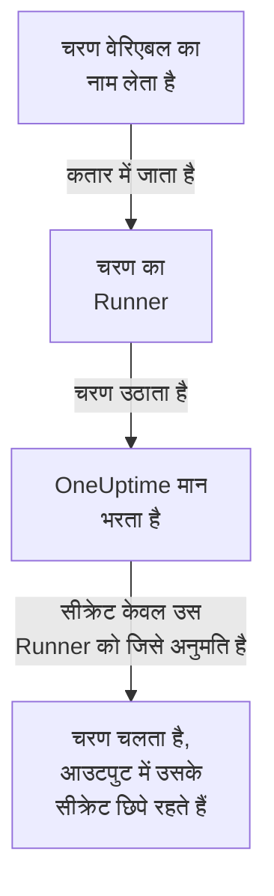

# Runbook वेरिएबल

Runbook वेरिएबल एक ऐसा मान है जिसे आपके चरण ख़ुद रखने के बजाय नाम से इस्तेमाल करते हैं: कोई होस्ट, namespace या URL, या कोई सीक्रेट जैसे SSH कुंजी, पासवर्ड, kubeconfig या API टोकन। मान को एक बार बदलें, और उसे नाम से लेने वाला हर चरण अगली बार चलने पर नया मान इस्तेमाल करता है। सीक्रेट एन्क्रिप्ट रहता है, फिर कभी दिखाया नहीं जाता, और चरणों के आउटपुट में छिपा रहता है।

:::cards
- [वेरिएबल बनाएँ](#वेरिएबल-बनाएँ): एक सादा मान, या एक सीक्रेट और वे Runner जो इसे इस्तेमाल कर सकते हैं।
- [किसी चरण में वेरिएबल इस्तेमाल करें](#किसी-चरण-में-वेरिएबल-इस्तेमाल-करें): स्क्रिप्ट या HTTP अनुरोध में, या SSH चरण के साइन-इन और kubectl चरण के kubeconfig के रूप में।
- [सीक्रेट किसे मिलता है](#सीक्रेट-किसे-मिलता-है): आपके Runner, ग्लोबल Runner जब आप अनुमति दें, और HTTP अनुरोध चरण के लिए ख़ुद OneUptime।
:::

## वेरिएबल किसी चरण तक कैसे पहुँचता है



चरण में वेरिएबल का नाम रहता है, उसका मान कभी नहीं। जब चरण का Runner उसे उठाता है, तो OneUptime मान भरता है - स्क्रिप्ट में, SSH चरण की मशीन और साइन-इन में, या kubectl चरण के kubeconfig में - और उसे केवल उसी Runner को देता है। जो चरण किसी ऐसे वेरिएबल का नाम लेता है जो उसे नहीं मिल सकता, वह मान की जगह नाम के साथ चलने के बजाय कारण बताकर विफल हो जाता है।

Bash, JavaScript, SSH, kubectl और HTTP अनुरोध चरण वेरिएबल इस्तेमाल करते हैं। AI चरण उन्हें नहीं भरते। HTTP अनुरोध चरण OneUptime ख़ुद भेजता है, बिना किसी Runner के, इसलिए चरण को हर वह वेरिएबल मिलता है जिसका वह नाम लेता है, सीक्रेट भी, और वह जो जवाब दर्ज करता है उसमें उन्हें छिपा देता है।

## ग्लोबल वेरिएबल और runbook वेरिएबल

| | ग्लोबल वेरिएबल | किसी runbook के अपने वेरिएबल |
| --- | --- | --- |
| कहाँ प्रबंधित होते हैं | **रनबुक → सेटिंग्स → ग्लोबल वेरिएबल** | runbook की **सेटिंग्स → वेरिएबल** |
| कौन इस्तेमाल करता है | प्रोजेक्ट का हर runbook | केवल उस runbook के चरण |
| चरण में कैसे लिखें | `{{global.variables.NAME}}` | `{{local.variables.NAME}}` |

कोई नाम, अक्षरों के छोटे-बड़े होने की परवाह किए बिना, प्रोजेक्ट के ग्लोबल वेरिएबल में एक बार और किसी runbook के अपने वेरिएबल में एक बार इस्तेमाल होता है। किसी runbook का वेरिएबल किसी ग्लोबल वेरिएबल जैसा नाम रख सकता है: दोनों अपने-अपने तरीक़े से लिखे जाते हैं।

## शुरू करने से पहले

- **वेरिएबल प्रबंधित करने वाली भूमिका।** Project Owner और Project Admin, या **Create Runbook Variable** अनुमति। Runbook Admin वेरिएबल पढ़ता है, ताकि अपने लिखे चरणों में उन्हें चुन सके, पर उन्हें बदलता नहीं।
- **ऐसा प्लान जिसमें ये शामिल हों।** OneUptime Cloud पर runbook वेरिएबल के लिए **Growth** या उससे ऊपर का प्लान चाहिए।

## वेरिएबल बनाएँ

:::steps
### वेरिएबल खोलें

**रनबुक → सेटिंग्स → ग्लोबल वेरिएबल** या किसी runbook की **सेटिंग्स → वेरिएबल** खोलें, और **वेरिएबल बनाएँ** पर क्लिक करें।

### नाम दें और मान दर्ज करें

**वेरिएबल** चरण में एक **नाम** दर्ज करें: अक्षर, अंक, हाइफ़न और अंडरस्कोर, 100 वर्णों तक, जैसे `PROD_DB_SSH_KEY`। **रहस्य** शुरू में चालू रहता है: कुंजी, पासवर्ड, टोकन या kubeconfig को **सीक्रेट मान** में चिपकाएँ और **अगला** पर क्लिक करें। ऐसे मान के लिए जिसे कोई भी पढ़ सकता है, जैसे कोई होस्ट, **रहस्य** बंद करें, उसे **मान** में दर्ज करें और **वेरिएबल बनाएँ** पर क्लिक करें। **और फ़ील्ड** के नीचे एक वैकल्पिक **विवरण** भी है।

### चुनें कि सीक्रेट कौन इस्तेमाल कर सकता है

**कौन इसका इस्तेमाल कर सकता है** चरण में, **आपके Runner जो इसका इस्तेमाल कर सकते हैं** के नीचे अपने Runner चुनें। [ग्लोबल Runner](/docs/runbooks/agents#ग्लोबल-runner) वाले सर्वर पर, **ग्लोबल Runner इसका इस्तेमाल कर सकते हैं** इस प्रोजेक्ट के उन चरणों को भी सीक्रेट इस्तेमाल करने देता है जो किसी ग्लोबल Runner पर चलते हैं: जब तक प्रोजेक्ट ग्लोबल Runner इस्तेमाल करता है, यह शुरू में चालू रहता है। सीक्रेट को इनमें से एक चाहिए। **वेरिएबल बनाएँ** पर क्लिक करें।
:::

कोई वेरिएबल सीक्रेट है या नहीं, यह बाद में बदला नहीं जा सकता। इसके बजाय उसे हटाएँ और उसी नाम से फिर बनाएँ: चरण वेरिएबल को नाम से लेते हैं, इसलिए वे काम करते रहते हैं। किसी क्लस्टर का इन-क्लस्टर Runner, जिसे Kubernetes एजेंट चार्ट इंस्टॉल करता है, कभी कोई सीक्रेट नहीं पाता।

## सीक्रेट मान केवल लिखे जा सकते हैं

सीक्रेट का मान स्टोरेज में एन्क्रिप्ट रहता है और API उसे **कभी नहीं लौटाता**: न डैशबोर्ड को, न किसी वर्कफ़्लो को, न किसी एक्सपोर्ट को। सूची वहाँ **रहस्य** दिखाती है जहाँ सादा वेरिएबल अपना मान दिखाता है, और उसका **Runbook एजेंट** कॉलम बताता है कि हर सीक्रेट किन Runner को मिलता है। उसे बदलने के लिए, उसकी पंक्ति में **मान बदलें** पर क्लिक करें: नया मान एन्क्रिप्ट होता है, पुराना हमेशा के लिए चला जाता है, और चरणों को अगली बार चलने पर नया मान मिलता है।

जब कोई चरण उसे दिया गया सीक्रेट प्रिंट करता है, तो Runner आउटपुट के उसके होस्ट से निकलने से पहले उसे `[REDACTED]` से बदल देता है, और OneUptime आउटपुट सहेजने से पहले फिर से ऐसा करता है। निजी कुंजी की कोई पंक्ति, या kubeconfig का टोकन, भी छिपाया जाता है। 4 वर्णों से छोटा सीक्रेट खोजा नहीं जाता।

## किसी चरण में वेरिएबल इस्तेमाल करें

:::tabs
@tab स्क्रिप्ट में
Bash, JavaScript, SSH या kubectl स्क्रिप्ट में, जहाँ मान जाना है वहाँ संदर्भ लिखें:

```bash
curl -s -X POST \
  -H "Authorization: Bearer {{global.variables.CDN_API_TOKEN}}" \
  "https://api.cdn.example.com/v1/purge"
```
@tab HTTP अनुरोध में
[HTTP अनुरोध चरण](/docs/runbooks/authoring#http-request) के URL, हेडर या बॉडी में संदर्भ लिखें:

```json
{ "Authorization": "Bearer {{global.variables.API_TOKEN}}" }
```
@tab SSH साइन-इन
[SSH चरण](/docs/runbooks/authoring#ssh) अपनी निजी कुंजी या पासवर्ड वाला सीक्रेट वेरिएबल **इससे साइन इन करें** में चुनता है, और अपनी कुंजी का पासफ़्रेज़ **और फ़ील्ड → की पासफ़्रेज़** में। मान ही बताता है कि वह कुंजी है या पासवर्ड।
@tab Kubeconfig
[kubectl चरण](/docs/runbooks/authoring#kubectl) क्लस्टर के kubeconfig वाला सीक्रेट वेरिएबल **Kubeconfig** में चुनता है, या Runner की एक्सेस इस्तेमाल करने के लिए **Runner की अपनी एक्सेस** चुनता है।
:::

किसी runbook के **चरण** पेज पर, हर स्क्रिप्ट और हर HTTP अनुरोध के नीचे **वेरिएबल — कॉपी करने के लिए क्लिक करें** में वे वेरिएबल दिखते हैं जिन्हें उसका चरण इस्तेमाल कर सकता है, और एडिटर बताता है जब कोई चरण ऐसे वेरिएबल का नाम लेता है जो मौजूद नहीं है, या ऐसा सीक्रेट जिसे उसका Runner इस्तेमाल नहीं कर सकता।

## सीक्रेट किसे मिलता है

| चरण कौन चलाता है | सादा वेरिएबल | सीक्रेट |
| --- | --- | --- |
| आपका कोई Runner | हमेशा | जब सीक्रेट उसे **आपके Runner जो इसका इस्तेमाल कर सकते हैं** में सूचीबद्ध करता है |
| कोई ग्लोबल Runner | हमेशा | जब **ग्लोबल Runner इसका इस्तेमाल कर सकते हैं** चालू हो, सीक्रेट के अपने प्रोजेक्ट के चरण के लिए |
| ख़ुद OneUptime, HTTP अनुरोध चरण के लिए | हमेशा | हमेशा |

जो चरण ऐसे सीक्रेट का नाम लेता है जिसे उसका Runner इस्तेमाल नहीं कर सकता, वह सीक्रेट और बदलने वाली बात बताते हुए विफल होता है, और कुछ भी नहीं दिया जाता।

## Runbook सीक्रेट और क्रेडेंशियल वेरिएबल बन गए

Runbook वेरिएबल ने runbook सीक्रेट की जगह ली, और उन क्रेडेंशियल की भी जिनका नाम SSH और Kubernetes चरण लेते थे। OneUptime के अपग्रेड होने पर हर प्रोजेक्ट के पास जो था वह एक बार ले जाया गया, ताकि हर runbook पहले की तरह चले:

- हर runbook सीक्रेट उसी नाम, उसी मान, उन्हीं Runner और ग्लोबल Runner के उसी स्विच वाला एक सीक्रेट ग्लोबल वेरिएबल बन गया;
- स्क्रिप्ट में `{{runbookSecrets.NAME}}` को `{{global.variables.NAME}}` में बदल दिया गया, और पुराना रूप अब भी ग्लोबल वेरिएबल `NAME` पढ़ता है;
- हर क्रेडेंशियल जिसका नाम कोई चरण लेता था, उन्हीं Runner वाले सीक्रेट ग्लोबल वेरिएबल बन गया, जिनके नाम उसी से बने: `<name>-ssh-key` (और पासफ़्रेज़ वाली कुंजी के लिए `<name>-ssh-key-passphrase`), `<name>-ssh-password` या `<name>-kubeconfig`;
- हर SSH चरण जो कोई क्रेडेंशियल लेता था, उनसे अपनी मशीन पर साइन इन करता है और अपना कमांड अपनी स्क्रिप्ट के रूप में चलाता है, और हर Kubernetes चरण एक kubectl चरण बन गया जो वही `kubectl patch` चलाता है जो उसकी कार्रवाई करती थी, और उसे चरण की पहले की एक्सेस से ज़्यादा नहीं चाहिए।

इस रिलीज़ (14.0.79) से पुराना Runner kubectl स्क्रिप्ट नहीं चला सकता: वह kubectl चरण को विफल कर देता है और बताता है कि Runner को अपडेट करना है। इस तरह बदले गए हर Kubernetes चरण ने पहले ऐसे Runner के लिए अपनी स्क्रिप्ट के साथ अपना क्रेडेंशियल और अपनी कार्रवाई भी रखी थी; वे Runbook क्रेडेंशियल के साथ चले गए, इसलिए हर kubectl चरण को 14.0.79 या उसके बाद का Runner चाहिए।

Runbook क्रेडेंशियल बाद में हटा दिए गए, और जो चरण तब भी किसी क्रेडेंशियल का नाम लेता था, उसे पहले इसी तरह बदला गया। जो चरण किसी क्रेडेंशियल का नाम लेता है, वह अब नहीं चलता, और उसका चरणों वाला पेज **स्क्रिप्ट चरण में बदलें** देता है; API या Terraform से किया गया ऐसा सहेजना जो किसी चरण को कोई क्रेडेंशियल देता है, अस्वीकार कर दिया जाता है। [Runbook क्रेडेंशियल हटा दिए गए हैं](/docs/installation/upgrading#runbook-क्रेडेंशियल-हटा-दिए-गए-हैं) देखें।

## अगले कदम

:::cards
- [Runbook लिखना](/docs/runbooks/authoring): वेरिएबल इस्तेमाल करने वाले SSH और kubectl चरण लिखें।
- [Runbook एजेंट](/docs/runbooks/agents): वह Runner इंस्टॉल करें जिसे सीक्रेट दिया जाता है।
- [Runbook कॉन्फ़िगरेशन और सुरक्षा](/docs/runbooks/configuration): पूरे runbook स्टैक के लिए अनुमतियाँ और हार्डनिंग।
:::
