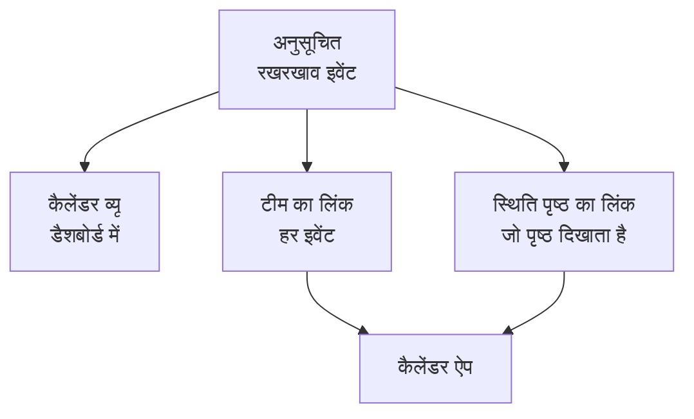

# रखरखाव कैलेंडर

रखरखाव कैलेंडर आपके अनुसूचित रखरखाव को तारीख के हिसाब से दिखाता है: डैशबोर्ड में अपने अलग पेज पर, एक गुप्त लिंक के ज़रिए आपकी टीम के अपने कैलेंडर ऐप में, और उन लोगों के कैलेंडर में जो आपके स्थिति पृष्ठों को फ़ॉलो करते हैं। इसके पेज पर, प्रोजेक्ट के बाहर के कैलेंडर, जैसे सार्वजनिक छुट्टियाँ या बदलाव रोक, आपके इवेंट के साथ दिखाए जा सकते हैं। यह पेज कैलेंडर पेज, बाहरी कैलेंडर, टीम के कैलेंडर लिंक, किसी स्थिति पृष्ठ के कैलेंडर और हर कैलेंडर इवेंट में क्या होता है, यह समझाता है।

:::cards
- [कैलेंडर पेज](#कैलेंडर-पेज): हर इवेंट एक महीने, एक सप्ताह या एक दिन पर, उसकी स्थिति के रंग में।
- [बाहरी कैलेंडर](#बाहरी-कैलेंडर): सार्वजनिक छुट्टियाँ, बदलाव रोक या किसी दूसरी टीम का रखरखाव, आपके इवेंट के साथ।
- [टीम का कैलेंडर लिंक](#टीम-का-कैलेंडर-लिंक): प्रोजेक्ट का हर इवेंट Google कैलेंडर, Outlook या Apple कैलेंडर में।
- [स्थिति पृष्ठ का कैलेंडर](#स्थिति-पृष्ठ-का-कैलेंडर): स्थिति पृष्ठ जो दिखाता है, वह उसके विज़िटर के कैलेंडर में।
- [कैलेंडर इवेंट में क्या होता है](#कैलेंडर-इवेंट-में-क्या-होता-है): शीर्षक, समय-सीमा, स्थिति और वापस जाने का लिंक।
:::



## कैलेंडर पेज

साइड मेनू के **कैलेंडर** सेक्शन में **अनुसूचित रखरखाव → रखरखाव कैलेंडर** खोलें। **सभी इवेंट** वही इवेंट एक सूची के रूप में दिखाता है।

- कैलेंडर इस महीने पर खुलता है, आज का दिन चिह्नित होता है। **महीना**, **सप्ताह** और **दिन** यह बदलते हैं कि वह कितना दिखाए; तीरों से आगे-पीछे जाएँ और **आज** से वापस आएँ। समय आपके अपने समय क्षेत्र में होते हैं।
- हर इवेंट उसकी स्थिति के रंग का एक ब्लॉक है, और स्थितियों के रंगों के नाम कैलेंडर के नीचे लिखे होते हैं। किसी इवेंट को खोलने के लिए उस पर क्लिक करें।
- कैलेंडर के ऊपर के फ़िल्टर वैसे ही काम करते हैं जैसे सूची पर: केवल वे इवेंट देखने के लिए कोई स्थिति, लेबल या मालिक चुनें।
- जो दिन अभी आना है, उस पर **+** दिखता है जब आप उसके सप्ताह पर पॉइंटर ले जाते हैं। वह **अनुसूचित रखरखाव इवेंट बनाएँ** खोलता है, जिसमें **शुरू होता है** उसी दिन पर होता है, उस घंटे पर जिसे फ़ॉर्म आज चुनता। यह आपको तभी दिखता है जब आप इवेंट बना सकते हैं।
- एक व्यू में 500 तक इवेंट दिखते हैं। ज़्यादा भरा महीना यह बता देता है: फ़िल्टर से उसे छोटा करें, या एक सप्ताह देखें।

**सभी इवेंट** पहले एक सूची और एक कैलेंडर के बीच बदलता था। अगर आपके ब्राउज़र ने उसे आखिरी बार कैलेंडर पर छोड़ा था, तो **सभी इवेंट** एक बार **रखरखाव कैलेंडर** खोलता है, और उसके बाद सूची ही रहता है।

## बाहरी कैलेंडर

कैलेंडर पेज प्रोजेक्ट के बाहर के कैलेंडर के इवेंट भी दिखा सकता है: सार्वजनिक छुट्टियाँ, किसी दूसरे कैलेंडर में रखी गई आपकी कंपनी की बदलाव रोक, या किसी दूसरी टीम का रखरखाव। OneUptime हर कैलेंडर को उसके iCalendar (`.ics`) लिंक से पढ़ता है और उसके इवेंट आपके इवेंट के साथ, हल्के रंग में और कैलेंडर के अपने रंग में दिखाता है। ये केवल पढ़ने के लिए हैं: ये कभी रखरखाव इवेंट नहीं बनते, इनके बारे में किसी को सूचना नहीं जाती, और ये कभी प्रोजेक्ट के अपने कैलेंडर लिंक में नहीं आते।

:::steps
### कैलेंडर जोड़ें

कैलेंडर के **⋯** मेनू में **बाहरी कैलेंडर जोड़ें** चुनें, या साइड मेनू के **सेटिंग्स** सेक्शन में **अनुसूचित रखरखाव → कैलेंडर सेटिंग्स** खोलें और **बाहरी कैलेंडर जोड़ें** पर क्लिक करें। **नाम** भरें और लिंक को **कैलेंडर लिंक** में पेस्ट करें। **और फ़ील्ड** में उसका **रंग** और **रिफ्रेश** है, यानी उसे कितनी बार पढ़ा जाए: जब तक आप कुछ और न चुनें, **हर घंटे**।

### जाँचें कि उसे पढ़ा गया

OneUptime नया कैलेंडर तुरंत पढ़ता है। पढ़े जाने पर उसकी **स्थिति** में **काम कर रहा है** दिखता है, और **पिछली रीडिंग** बताती है कि कब पढ़ा गया और कितने इवेंट रखे गए। विफल रीडिंग पर **काम नहीं कर रहा** दिखता है, कारण और करने लायक कदम के साथ।

### उसे दिखाएँ या छिपाएँ

हर बाहरी कैलेंडर के लिए कैलेंडर के नीचे उसके नाम वाला एक टॉगल होता है। किसी को छिपाने पर वह सिर्फ़ आपके लिए छिपता है; आपका ब्राउज़र प्रोजेक्ट के लिए यह पसंद याद रखता है।
:::

लिंक कैलेंडर की अपनी शेयरिंग सेटिंग्स से कॉपी करें: Google कैलेंडर में उसका iCal फ़ॉर्मैट वाला गुप्त पता, Outlook में प्रकाशित कैलेंडर का ICS लिंक, और किसी भी दूसरे ऐप में उसका `.ics` या `webcal://` लिंक। लिंक निजी हो सकता है: OneUptime उसे एन्क्रिप्ट करके रखता है, उसे फिर कभी नहीं दिखाता, और **लिंक बदलें** उसे बदल देता है।

| कार्रवाई | क्या होता है |
| --- | --- |
| **अभी पढ़ें** | कैलेंडर को अगली रीडिंग के बजाय अभी पढ़ता है। |
| **लिंक बदलें** | उसका लिंक बदलता है। पुराने लिंक के इवेंट भुला दिए जाते हैं, और नया लिंक तुरंत पढ़ा जाता है। |
| **बंद करें** | उसे पढ़ना बंद करता है और **चालू करें** तक उसके इवेंट सभी से छिपाता है। |

हर कैलेंडर 90 दिन पहले से लेकर एक साल आगे तक के अपने इवेंट रखता है, 2,000 तक, आज के सबसे नज़दीकी पहले। 5 MB से बड़ा कैलेंडर नहीं पढ़ा जाता। दोहराए जाने वाले इवेंट, उनके अपवाद और उनके टाइम ज़ोन वैसे ही पढ़े जाते हैं जैसे कैलेंडर ऐप ने उन्हें लिखा था, और पूरे दिन का इवेंट हर टाइम ज़ोन में अपनी तारीख पर ही रहता है। एक प्रोजेक्ट में 20 तक बाहरी कैलेंडर हो सकते हैं, और कैलेंडर का एक व्यू उनके 500 तक इवेंट दिखाता है।

जो रोल अनुसूचित रखरखाव इवेंट बनाते, संपादित करते और हटाते हैं, वही बाहरी कैलेंडर जोड़ते, बदलते और हटाते हैं, और जो भी इवेंट पढ़ सकता है वह उन्हें कैलेंडर पर देखता है। OneUptime कभी अपने सर्वर का कोई पता या क्लाउड मेटाडेटा पता नहीं पढ़ता, और OneUptime Cloud निजी नेटवर्क के पते अस्वीकार करता है। सेल्फ़-होस्टेड सर्वर आपके अपने नेटवर्क का कैलेंडर पढ़ सकता है, जब तक `DATA_SOURCE_BLOCK_PRIVATE_ADDRESSES` का मान `true` न हो।

## टीम का कैलेंडर लिंक

कैलेंडर के नीचे **कैलेंडर की सदस्यता लें** प्रोजेक्ट का कैलेंडर लिंक खोलता है: एक गुप्त iCalendar (`.ics`) लिंक जो प्रोजेक्ट के हर अनुसूचित रखरखाव इवेंट को Google कैलेंडर, Outlook, Apple कैलेंडर या ऐसे किसी भी ऐप में ले आता है जो URL से कैलेंडर की सदस्यता लेता है।

:::steps
### लिंक प्रकाशित करें

**लिंक प्रकाशित करें** पर क्लिक करें। एक प्रोजेक्ट का पूरी टीम के लिए एक ही लिंक होता है, इसलिए यह सिर्फ़ एक बार करना होता है।

### इसे अपने कैलेंडर ऐप में जोड़ें

**Google कैलेंडर** Google कैलेंडर खोलता है, जो पूछता है कि कैलेंडर जोड़ना है या नहीं। **Apple कैलेंडर / Outlook** लिंक को आपके कंप्यूटर या फ़ोन के कैलेंडर ऐप में खोलता है। **लिंक कॉपी करें** उसे किसी भी दूसरे ऐप के लिए कॉपी करता है।

### जाँचें कि यह काम करता है

**स्थिति** पैनल बताता है कि किसी कैलेंडर ऐप ने लिंक आख़िरी बार कब पढ़ा, और कौन-से ऐप ने। नया लिंक तब तक **पहले सिंक की प्रतीक्षा** दिखाता है जब तक कोई ऐप उसे पढ़ न ले।
:::

लिंक ऐसा दिखता है:

```text
https://<your host>/api/scheduled-maintenance-calendar/project/<token>/maintenance.ics
```

> [!WARNING]
> जिसके पास भी यह लिंक है, वह बिना साइन इन किए प्रोजेक्ट का हर अनुसूचित रखरखाव इवेंट देखता है। इसे पासवर्ड की तरह रखें, और गलती से साझा हो जाए तो इसे फिर से बनाएँ।

### लिंक कौन देख सकता है

लिंक प्रोजेक्ट का हर इवेंट दिखाता है, इसलिए डायलॉग इसे सिर्फ़ उन्हीं लोगों को दिखाता है जो हर इवेंट पढ़ सकते हैं। जिसकी भूमिका उसे कुछ इवेंट तक सीमित रखती है, लेबल के हिसाब से या उन इवेंट तक जिनका वह मालिक है, उसे इसके बजाय कारण बताया जाता है।

| कार्रवाई | कौन कर सकता है |
| --- | --- |
| लिंक कॉपी करना | हर वह व्यक्ति जो प्रोजेक्ट का हर अनुसूचित रखरखाव इवेंट पढ़ सकता है |
| **लिंक प्रकाशित करें** | हर वह व्यक्ति जो अनुसूचित रखरखाव इवेंट बना भी सकता है |
| **लिंक फिर से बनाएँ**, **लिंक अक्षम करें** | हर वह व्यक्ति जो अनुसूचित रखरखाव इवेंट संपादित भी कर सकता है |

### लिंक प्रबंधित करें

**लिंक फिर से बनाएँ** और **लिंक अक्षम करें** डायलॉग के ऊपर **⋯** मेनू में हैं।

| कार्रवाई | क्या होता है |
| --- | --- |
| **लिंक फिर से बनाएँ** | नया लिंक बनाता है। 30 दिनों तक पुराना लिंक खाली कैलेंडर देता है, ताकि जिन ऐप में वह है वे अपनी कॉपी साफ़ कर दें; उसके बाद वह नहीं मिलता। नए लिंक से फिर से सदस्यता लें। |
| **लिंक अक्षम करें** | लिंक बना रहता है, लेकिन **लिंक सक्षम करें** तक वह खाली कैलेंडर देता है। |

कैलेंडर में 90 दिन पहले से लेकर एक साल आगे तक का हर इवेंट होता है, 1,000 इवेंट तक।

## स्थिति पृष्ठ का कैलेंडर

जो लोग किसी स्थिति पृष्ठ को फ़ॉलो करते हैं, वे उसके अनुसूचित रखरखाव को अपने कैलेंडर में रख सकते हैं। स्थिति पृष्ठ के अनुसूचित इवेंट वाले पेज पर **कैलेंडर की सदस्यता लें** Google कैलेंडर, उनके डिवाइस का कैलेंडर ऐप, या कॉपी करने के लिए लिंक देता है। लिंक पृष्ठ का पता है जिसके बाद `/maintenance.ics` आता है, जैसे `https://status.example.com/maintenance.ics`।

- **इसमें क्या होता है।** ठीक वही जो पृष्ठ दिखाता है: पृष्ठ की इतिहास अवधि के इवेंट, हर आने वाला इवेंट और हर चल रहा इवेंट, जब तक **स्थिति पृष्ठ पर दृश्यमान** चालू है, और अगर आपने कोई **प्रकाशित करने का समय** चुना हो तो उसी समय से। हर इवेंट जिसे प्रभावित करता है, उसका नाम वैसे ही लिखा जाता है जैसे पृष्ठ अपने संसाधनों को नाम देता है, कभी आपके मॉनिटरों के अपने नामों से नहीं।
- **निजी पृष्ठ।** कैलेंडर ऐप साइन इन नहीं कर सकता, इसलिए निजी पृष्ठ पर **कैलेंडर की सदस्यता लें** नहीं मिलता, और उसका लिंक एक खाली कैलेंडर देता है जो बताता है कि पृष्ठ निजी है।
- **एक इवेंट।** किसी इवेंट के पेज पर **कैलेंडर में जोड़ें** सिर्फ़ उसी इवेंट को जोड़ता है: Google कैलेंडर उसे भरा हुआ खोलता है, या वह एक फ़ाइल के रूप में डाउनलोड होता है जिसे डिवाइस का कैलेंडर ऐप खोलता है। यह साइन इन किए हुए विज़िटर के लिए निजी पृष्ठ पर भी काम करता है, और इवेंट खत्म होने के बाद नहीं दिखता।

## कैलेंडर इवेंट में क्या होता है

हर कैलेंडर, टीम का भी और स्थिति पृष्ठ का भी, इवेंट को एक ही तरह लिखता है।

| हिस्सा | इसमें क्या होता है |
| --- | --- |
| शीर्षक | इवेंट का शीर्षक |
| शुरुआत और अंत | उसकी योजनाबद्ध समय-सीमा, UTC में; कैलेंडर ऐप उसे आपके अपने समय क्षेत्र में दिखाता है |
| विवरण | उसका विवरण सादे टेक्स्ट में, उसकी स्थिति, वह किसे प्रभावित करता है, और इवेंट का लिंक; टीम का लिंक उसके स्थिति पृष्ठों के नाम भी देता है |
| दर्जा | रद्द, जब इवेंट रद्द कर दिया गया हो: कभी चालू हुए बिना पूरा किया गया |
| खाली या व्यस्त | खाली, ताकि रखरखाव की अवधि कभी आपकी उपलब्धता न रोके |
| श्रेणियाँ | उसके लेबल; स्थिति पृष्ठ का कैलेंडर उन्हें तभी दिखाता है जब पृष्ठ लेबल दिखाता है |

OneUptime में बदला गया इवेंट हर उस कैलेंडर में अपनी जगह पर अपडेट हो जाता है जिसमें वह है, और जो इवेंट हटाया जाता है या किसी स्थिति पृष्ठ से हटा दिया जाता है, वह अगले रीफ़्रेश पर कैलेंडर से चला जाता है।

## कैलेंडर कितनी बार रीफ़्रेश होते हैं

कैलेंडर ऐप सदस्यता वाले लिंक को अपने समय से पढ़ते हैं। Google कैलेंडर ऐसा हर कुछ घंटों में करता है, कभी-कभी दिन में सिर्फ़ एक बार; Apple कैलेंडर और Outlook आम तौर पर हर घंटे। OneUptime किसी कैलेंडर को ज़्यादा से ज़्यादा पाँच मिनट रखता है, इसलिए जो इंतज़ार आपको दिखता है वह कैलेंडर ऐप का है। हर ऐप के चरण [कैलेंडर फ़ीड](/docs/on-call/calendar-feeds#अपने-कैलेंडर-ऐप-में-सदस्यता-लें) पर हैं, जो ऑन-कॉल शिफ्टों के लिए भी इसी तरह काम करते हैं।

## समस्या निवारण

:::details कैलेंडर ऐप ने नए इवेंट दिखाना बंद कर दिया
लिंक फिर से बनाया गया या अक्षम किया गया: उसकी स्थिति देखने के लिए **कैलेंडर की सदस्यता लें** खोलें। फिर से बने लिंक की नए लिंक से दोबारा सदस्यता लेनी होती है; अक्षम किया गया लिंक **लिंक सक्षम करें** से वापस आता है।
:::

:::details Google कैलेंडर लिंक नहीं जोड़ पाता
Google कैलेंडर लिंक को Google के सर्वरों से पढ़ता है, इसलिए OneUptime सर्वर इंटरनेट से पहुँच में होना चाहिए। सेल्फ़-होस्टेड सर्वर के लिए [कैलेंडर फ़ीड](/docs/on-call/calendar-feeds#समस्या-निवारण) देखें।
:::

:::details स्थिति पृष्ठ के कैलेंडर में कोई इवेंट नहीं है
पृष्ठ के कैलेंडर में वही होता है जो पृष्ठ दिखाता है। जाँचें कि इवेंट उस पृष्ठ का नाम लेता है, कि उसकी **सेटिंग्स** में **स्थिति पृष्ठ पर दृश्यमान** चालू है, कि उसका **प्रकाशित करने का समय**, अगर हो, आ चुका है, और कि वह पृष्ठ की इतिहास अवधि के भीतर शुरू हुआ था।
:::

:::details कोई बाहरी कैलेंडर काम नहीं कर रहा दिखाता है
कारण उसकी **स्थिति** में **काम नहीं कर रहा** के नीचे होता है: लिंक पर कोई कैलेंडर नहीं, ऐसा लिंक जिसे साइन-इन चाहिए या जो अब शेयर नहीं है, उसके सर्वर की त्रुटि, 5 MB से बड़ा कैलेंडर, या ऐसा कैलेंडर जो इवेंट इतनी बार दोहराता है कि उसे प्रोसेस नहीं किया जा सकता। **लिंक बदलें** से लिंक ठीक करें, या कैलेंडर वापस आने पर **अभी पढ़ें** इस्तेमाल करें। तब तक कैलेंडर अपनी पिछली सफल रीडिंग के इवेंट दिखाता है।
:::

## अगले कदम

:::cards
- [रखरखाव इवेंट बनाना](/docs/scheduled-maintenance/creating-events): फ़ॉर्म, एक-एक फ़ील्ड, और उसके बाद क्या होता है।
- [सब्सक्राइबर और घोषणाएँ](/docs/status-pages/subscribers#अनुसूचित-रखरखाव-इवेंट): स्थिति पृष्ठ के सब्सक्राइबरों को रखरखाव के बारे में क्या बताया जाता है।
- [कैलेंडर फ़ीड](/docs/on-call/calendar-feeds): उसी तरह का लिंक, ऑन-कॉल शिफ्टों के लिए।
:::
