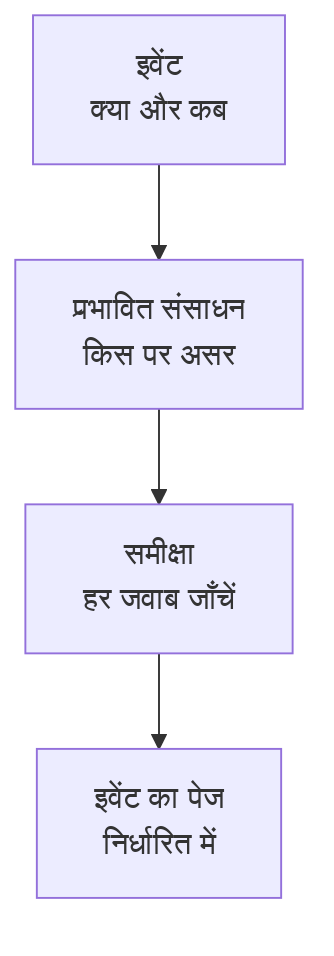

# रखरखाव इवेंट बनाना

रखरखाव को दो छोटे चरणों में शेड्यूल करें: बताएँ कि क्या हो रहा है और कब, फिर यह कि इसका असर किस पर होगा और किसे इसकी जानकारी मिलनी चाहिए। केवल शीर्षक टाइप करना ज़रूरी है; बाकी सब एक समझदार डिफ़ॉल्ट से शुरू होता है। यह पेज फ़ॉर्म के बारे में बताता है, यह कि इवेंट बनाते ही क्या होता है, उसे बाद में कैसे बदलें, और कोड से इवेंट कैसे बनाएँ।

:::cards
- [इवेंट बनाएँ](#इवेंट-बनाएँ): दो चरण और एक समीक्षा।
- [बनाने पर क्या होता है](#बनाने-पर-क्या-होता-है): उसका नंबर, नियम, मालिक और पहले संदेश।
- [इवेंट को बाद में बदलें](#इवेंट-को-बाद-में-बदलें): उसकी समय-सीमा, संसाधन, स्थिति पृष्ठ और नोट।
- [कोड से इवेंट बनाएँ](#कोड-से-इवेंट-बनाएँ): API, Terraform, वर्कफ़्लो और चैट।
:::

## यह कैसे काम करता है

फ़ॉर्म दो सवाल पूछता है, हर चरण में एक, फिर इवेंट बनाने से पहले सब कुछ एक समीक्षा में दिखाता है। इवेंट आपकी निर्धारित स्थिति में शुरू होता है, और उसका पेज खुल जाता है।



## शुरू करने से पहले

- **आपकी भूमिका।** इवेंट बनाने के लिए **प्रोजेक्ट स्वामी**, **प्रोजेक्ट एडमिन**, **प्रोजेक्ट सदस्य**, **अनुसूचित रखरखाव एडमिन** या **अनुसूचित रखरखाव सदस्य**, या **Create Scheduled Maintenance** वाली कोई कस्टम भूमिका चाहिए।
- **आपके स्थिति पृष्ठ।** ग्राहकों को बताने के लिए आपको ऐसा स्थिति पृष्ठ चाहिए जो अनुसूचित रखरखाव इवेंट दिखाता हो। देखें [स्थिति पृष्ठ अवलोकन](/docs/status-pages/index)।

## इवेंट बनाएँ

:::steps
### फ़ॉर्म खोलें

**अनुसूचित रखरखाव → सभी इवेंट** पर जाएँ और **अनुसूचित रखरखाव इवेंट बनाएँ** पर क्लिक करें। फ़ॉर्म अपने पहले चरण, **इवेंट**, पर खुलता है।

### बताएँ कि क्या हो रहा है और कब

एक **शीर्षक** टाइप करें, और अगर मदद मिले तो **विवरण** जोड़ें: यह Markdown में है, और आपके स्थिति पृष्ठों पर दिखता है। **शुरू होता है** पहले से आपकी घड़ी का अगला पूरा घंटा है, और **समाप्त होता है** उसके एक घंटे बाद; इन्हें केवल तभी बदलें जब ये ग़लत हों। **शुरू होता है** को खिसकाने पर **समाप्त होता है** भी साथ खिसकता है, ताकि समय-सीमा की लंबाई बनी रहे। **मालिक** और **लेबल** बंद **और फ़ील्ड** के नीचे इंतज़ार करते हैं।

### चुनें कि इसका असर किस पर है

**प्रभावित संसाधन** तक पहुँचने के लिए **अगला** पर क्लिक करें। वे **मॉनिटर** चुनें जिन्हें काम छूता है। एक चुनते ही उनके नीचे **मॉनिटर स्थिति बदलकर करें** दिखता है: वह स्थिति जिसमें इवेंट शुरू होने पर मॉनिटर बदल जाते हैं। फिर कोई भी **अन्य प्रभावित संसाधन** चुनें, जैसे होस्ट, क्लस्टर, डेटाबेस, नेटवर्क साइटें या सेवाएँ।

### चुनें कि इसके बारे में किसे पता चलेगा

**इन स्थिति पृष्ठों पर इवेंट दिखाएं** के अंतर्गत स्थिति पृष्ठ चुनें। बंद **सब्सक्राइबर सूचनाएँ** एक पंक्ति में बताता है कि किसे और कब बताया जाएगा; **जब इवेंट शेड्यूल होता है**, **जब इवेंट शुरू होता है**, **जब इवेंट समाप्त होता है** या **इवेंट से पहले रिमाइंडर** बदलने के लिए इसे खोलें।

### इसे बनाएँ

समीक्षा देखने के लिए **अगला** पर क्लिक करें, उसे जाँचें, फिर **अनुसूचित रखरखाव इवेंट बनाएँ** पर क्लिक करें। इवेंट का अपना पेज खुल जाता है।
:::

जब तक आप स्थिति पृष्ठ नहीं चुनते, कुछ नहीं भेजा जाता: जो इवेंट किसी स्थिति पृष्ठ पर नहीं दिखता, वह किसी सब्सक्राइबर को नहीं बताता।

## फ़ॉर्म के फ़ील्ड

| फ़ील्ड                               | चरण                | शुरुआती मान                     | यह क्या करता है                                                                  |
| ------------------------------------ | ------------------ | ------------------------------- | -------------------------------------------------------------------------------- |
| **शीर्षक**                           | **इवेंट**          | खाली, और ज़रूरी                 | हर जगह इवेंट का नाम, आपके स्थिति पृष्ठों पर भी।                                  |
| **विवरण**                            | **इवेंट**          | खाली                            | आपके ग्राहकों को काम के बारे में Markdown में समझाता है।                         |
| **शुरू होता है**                     | **इवेंट**          | अगला पूरा घंटा                  | इवेंट कब अपने आप शुरू होता है।                                                   |
| **समाप्त होता है**                   | **इवेंट**          | **शुरू होता है** के एक घंटे बाद | इवेंट कब अपने आप समाप्त होता है। यह **शुरू होता है** के बाद होना चाहिए।           |
| **मालिक**                            | **इवेंट**          | कोई नहीं                        | वे लोग और टीमें जो इवेंट के मालिक हैं और जिन्हें इसके बारे में बताया जाता है।     |
| **लेबल**                             | **इवेंट**          | कोई नहीं                        | लेबल जिन पर नियम और फ़िल्टर मिलान कर सकते हैं।                                   |
| **मॉनिटर**                           | **प्रभावित संसाधन** | कोई नहीं                       | वे मॉनिटर जो इवेंट चलने के दौरान जाँचे नहीं जाते।                                |
| **मॉनिटर स्थिति बदलकर करें**         | **प्रभावित संसाधन** | कोई बदलाव नहीं                 | इवेंट के दौरान वे मॉनिटर जो स्थिति दिखाते हैं। मॉनिटर चुनते ही पूछा जाता है।      |
| **अन्य प्रभावित संसाधन**             | **प्रभावित संसाधन** | कोई नहीं                       | होस्ट, क्लस्टर, डेटाबेस, नेटवर्क साइटें, सेवाएँ और भी बहुत कुछ।                  |
| **इन स्थिति पृष्ठों पर इवेंट दिखाएं** | **प्रभावित संसाधन** | कोई नहीं                      | वे स्थिति पृष्ठ जो इवेंट दिखाते हैं और अपने सब्सक्राइबर को बताते हैं।             |
| **सब्सक्राइबर सूचनाएँ**              | **प्रभावित संसाधन** | तीनों समय चालू, कोई रिमाइंडर नहीं | उन पृष्ठों के सब्सक्राइबर को कब बताया जाता है।                               |

आगे बढ़ते हुए दो चीज़ें आपके लिए फ़ॉर्म भर देती हैं:

- **जुड़े हुए संसाधन।** जब आप कोई मॉनिटर चुनते हैं, तो उससे जुड़े होस्ट, क्लस्टर, सेवाएँ और अन्य संसाधन **अन्य प्रभावित संसाधन** के अंतर्गत जुड़ जाते हैं, और फ़ील्ड के नीचे एक पंक्ति उनके नाम बताती है। जो आप नहीं चाहते, उन्हें हटा दें। क्लाउड संसाधन नहीं जोड़े जाते: रखरखाव इवेंट में वे नहीं रखे जाते।
- **सुझाए गए स्थिति पृष्ठ।** **इन स्थिति पृष्ठों पर इवेंट दिखाएं** के अंतर्गत वे पृष्ठ सुझाए जाते हैं जो आपके मॉनिटर दिखाते हैं: किसी पृष्ठ को जोड़ने के लिए उसके नाम पर क्लिक करें, या **सभी जोड़ें** पर। आपके लिए कुछ भी अपने आप नहीं चुना जाता। देखें [अनुसूचित रखरखाव इवेंट](/docs/status-pages/subscribers#अनुसूचित-रखरखाव-इवेंट)।

## किसी संसाधन या टेम्पलेट से शुरू करें

किसी होस्ट, Kubernetes, Proxmox, Ceph या Docker Swarm क्लस्टर, Docker या Podman होस्ट, vCenter, स्टोरेज ऐरे, IoT फ़्लीट, डेटाबेस, सेवा या नेटवर्क साइट के **अनुसूचित रखरखाव** टैब पर, **अनुसूचित रखरखाव इवेंट बनाएँ** वही फ़ॉर्म खोलता है जिसमें वह संसाधन **अन्य प्रभावित संसाधन** के अंतर्गत पहले से चुना होता है, और टैब उसे प्रभावित करने वाले इवेंट की सूची दिखाता है। किसी इन्वेंटरी आइटम का टैब वह होस्ट, सेवा या Kubernetes क्लस्टर चुनता है जिसकी ओर आइटम इशारा करता है।

बनाने वाले बटन के बगल में **टेम्पलेट से बनाएँ** आपसे **अनुसूचित रखरखाव टेम्पलेट चुनें** करने को कहता है, फिर टेम्पलेट से भरा हुआ फ़ॉर्म खोलता है। देखें [टेम्पलेट और आवर्ती इवेंट](/docs/scheduled-maintenance/templates)।

## बनाने पर क्या होता है

जिस पल आप **अनुसूचित रखरखाव इवेंट बनाएँ** पर क्लिक करते हैं, OneUptime इन चरणों से इसी क्रम में गुज़रता है:

1. **इसे एक नंबर और एक स्थिति मिलती है।** नंबर हर प्रोजेक्ट के एक काउंटर से आता है और आपके उपसर्ग के साथ दिखता है (`SM-42`)। अनुरोध चाहे कोई भी स्थिति बताए, इवेंट आपकी निर्धारित स्थिति में शुरू होता है।
2. **आपके चैट टूल को इसकी ख़बर मिलती है।** **वर्कस्पेस** के अंतर्गत Slack और Microsoft Teams के नियम इसे अपने चैनलों में पोस्ट करते हैं, और कोई नियम इवेंट के लिए चैनल भी बना सकता है। इसकी फ़ीड दर्ज करती है कि यह बनाया गया।
3. **इसकी स्थिति टाइमलाइन शुरू होती है।** इसकी **स्थिति टाइमलाइन** की पहली पंक्ति आपकी निर्धारित स्थिति होती है।
4. **मालिक और लेबल जोड़े जाते हैं**: पहले वे जो आपने चुने, फिर मेल खाने वाले स्वामी और लेबल नियमों के।
5. **Runbook नियम शुरू करते हैं** इवेंट से मेल खाने वाली रनबुक।
6. **रिमाइंडर शेड्यूल होते हैं**, जब कोई रिमाइंडर नियम मेल खाता है, इसके मालिकों के लिए।

एक मिनट के भीतर, इसके स्थिति पृष्ठों के सब्सक्राइबर को बताया जाता है कि यह शेड्यूल हो गया है, जब तक कि आपने **जब इवेंट शेड्यूल होता है** बंद न किया हो। **On Create Scheduled Maintenance Event** वर्कफ़्लो ट्रिगर उस पर बने हर वर्कफ़्लो को शुरू करता है, और इसके मालिकों को इसकी ख़बर मिलती है अगर उन्होंने वह सूचना चालू की हो: देखें [सूचना सेटिंग्स](/docs/notifications/notification-settings)।

## इवेंट को बाद में बदलें

फ़ॉर्म की हर चीज़ इवेंट के अपने पेजों पर बदली जा सकती है, सिवाय सब्सक्राइबर को बताने के तीन समयों के, जो इवेंट बनाते समय एक बार तय होते हैं।

| क्या बदलना है                               | कहाँ जाएँ                                                                      |
| ------------------------------------------- | ------------------------------------------------------------------------------ |
| शीर्षक, समय-सीमा या लेबल                    | उसके **अवलोकन** के **Maintenance Details** कार्ड पर **संपादित करें**, चरण **इवेंट** |
| स्थिति पृष्ठ या रिमाइंडर                    | वही **संपादित करें**, चरण **स्थिति पृष्ठ**                                      |
| मॉनिटर, उनकी स्थिति या अन्य संसाधन          | **प्रभावित संसाधन** कार्ड पर **संपादित करें**                                  |
| विवरण                                       | उसके साइड मेनू में **विवरण**                                                   |
| मालिक                                       | उसके साइड मेनू में **मालिक**                                                   |

**मॉनिटर स्थिति बदलकर करें** को इवेंट शुरू होने तक बदला जा सकता है। उसके बाद कार्ड इसे केवल पढ़ने के लिए दिखाता है, क्योंकि मॉनिटर पहले से उस स्थिति में हैं। हर संपादन **अनुसूचित रखरखाव फ़ीड** में एक प्रविष्टि जोड़ता है जो बताती है कि क्या बदला; बिना कुछ बदले सहेजने पर कोई प्रविष्टि नहीं जुड़ती।

## काम चलते हुए नोट पोस्ट करें

- **सार्वजनिक नोट** आपके ग्राहकों के लिए अपडेट हैं: वे इवेंट के स्थिति पृष्ठों पर दिखते हैं, और हर एक **Notify status page subscribers** से उनके सब्सक्राइबर को बता सकता है।
- **निजी नोट** सिर्फ़ आपकी टीम के लिए हैं।

इवेंट के **सार्वजनिक नोट** या **निजी नोट** पेज पर, या **अनुसूचित रखरखाव फ़ीड** के **क्रियाएँ** मेनू से **Add Public Note** या **निजी नोट जोड़ें** के ज़रिए नोट लिखें। वही मेनू **Execute Runbook** से रनबुक चलाता है। नोट टेम्पलेट वह टेक्स्ट भर देता है जो आपकी टीम अक्सर लिखती है: देखें [रखरखाव नियम और सेटिंग्स](/docs/scheduled-maintenance/settings#नोट-टेम्पलेट)।

## कोड से इवेंट बनाएँ

इवेंट मॉडल में एक मानक API है, इसलिए `POST /api/scheduled-maintenance` एक इवेंट बनाता है। **प्रोजेक्ट सेटिंग्स → उन्नत → API कुंजियाँ** से मिली API कुंजी से प्रमाणीकरण करें, जिसे `apikey` हेडर में भेजा जाता है; कुंजी प्रोजेक्ट तय करती है।

```bash
curl -X POST https://oneuptime.com/api/scheduled-maintenance \
  -H "apikey: $ONEUPTIME_API_KEY" \
  -H "Content-Type: application/json" \
  -d '{
    "data": {
      "title": "Database upgrade",
      "description": "Writes pause for a few minutes while the primary restarts.",
      "startsAt": "2030-06-01T02:00:00Z",
      "endsAt": "2030-06-01T04:00:00Z"
    }
  }'
```

| फ़ील्ड                                                | टिप्पणियाँ                                                                                |
| ----------------------------------------------------- | ----------------------------------------------------------------------------------------- |
| `title`, `startsAt`, `endsAt`                          | ज़रूरी, जैसे फ़ॉर्म में।                                                                  |
| `monitors`, `statusPages`, `labels`                   | इवेंट के मॉनिटर, स्थिति पृष्ठ और लेबल, सभी API कुंजी के प्रोजेक्ट से।                    |
| `changeMonitorStatusToId`                             | वह मॉनिटर स्थिति जिसमें इसके मॉनिटर इसके शुरू होने पर बदल जाते हैं।                      |
| `currentScheduledMaintenanceStateId`                  | अनदेखा किया जाता है: हर इवेंट आपकी निर्धारित स्थिति में शुरू होता है।                    |
| `shouldStatusPageSubscribersBeNotifiedOnEventCreated` | **जब इवेंट शेड्यूल होता है** स्विच। बाकी दो समयों के अपने फ़ील्ड हैं।                     |

कोड के रूप में वही इवेंट Terraform संसाधन `oneuptime_scheduled_maintenance_event` है: देखें [उदाहरण](/docs/terraform/examples#निर्धारित-रखरखाव)। कोई वर्कफ़्लो अपने **Create One Scheduled Maintenance Event** चरण से इवेंट बनाता है, और `/oneuptime maintenance` Slack में फ़ॉर्म खोलता है: देखें [Slack](/docs/workspace-connections/slack#slack-से-घटनाएं-और-रखरखाव-बनाना)।

## समस्या निवारण

:::details समाप्त होता है कहता है कि यह शुरू होता है के बाद होना चाहिए
समय-सीमा क्रम में होनी चाहिए: इवेंट शुरू होने के बाद समाप्त होता है। पहले **शुरू होता है** को खिसकाएँ, क्योंकि **समाप्त होता है** उसके साथ चलता है, फिर **समाप्त होता है** सेट करें।
:::

:::details फ़ॉर्म में मॉनिटर स्थिति बदलकर करें नहीं है
यह तभी पूछा जाता है जब इवेंट में कोई मॉनिटर हो। **मॉनिटर** के अंतर्गत एक चुनें, और यह ठीक उनके नीचे दिखेगा।
:::

:::details मॉनिटर स्थिति बदलकर करें अब बदला नहीं जा सकता
इवेंट शुरू हो चुका है, और इसके मॉनिटर पहले से उस स्थिति में हैं। यह स्थिति इवेंट शुरू होने के पल से उसके समाप्त होने तक लागू रहती है।
:::

## आगे के कदम

:::cards
- [रखरखाव की स्थितियाँ](/docs/scheduled-maintenance/states): इवेंट को क्या शुरू और समाप्त करता है, और उसे हाथ से कैसे आगे बढ़ाएँ।
- [टेम्पलेट और आवर्ती इवेंट](/docs/scheduled-maintenance/templates): फ़ॉर्म के जवाब अगली बार के लिए सहेजें।
- [सब्सक्राइबर और घोषणाएँ](/docs/status-pages/subscribers#अनुसूचित-रखरखाव-इवेंट): ठीक-ठीक किसे और कब बताया जाता है।
- [रखरखाव नियम और सेटिंग्स](/docs/scheduled-maintenance/settings): मालिक, लेबल और रिमाइंडर अपने आप जोड़ें।
:::
