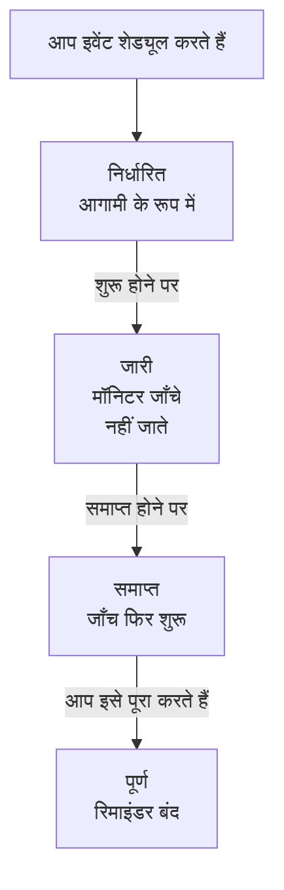

# अनुसूचित रखरखाव का अवलोकन

अनुसूचित रखरखाव इवेंट योजनाबद्ध काम के बारे में सभी को पहले से बताता है: डेटाबेस अपग्रेड, नेटवर्क में बदलाव, नए सर्वरों पर स्थानांतरण। OneUptime इवेंट को समय पर शुरू और समाप्त करता है, काम चलने तक प्रभावित मॉनिटरों की जाँच रोक देता है और इवेंट को आपके स्थिति पृष्ठों पर दिखाता है, ताकि योजनाबद्ध डाउनटाइम कभी आउटेज जैसा न लगे। यह पेज बताता है कि इवेंट कैसे आगे बढ़ता है, डैशबोर्ड में सब कुछ कहाँ है, और इवेंट OneUptime के बाकी हिस्सों में क्या बदलता है।

:::cards
- [इवेंट कैसे आगे बढ़ता है](#इवेंट-कैसे-आगे-बढ़ता-है): निर्धारित से पूर्ण तक, ज़्यादातर अपने आप।
- [इवेंट कहाँ से आते हैं](#इवेंट-कहाँ-से-आते-हैं): बनाने का फ़ॉर्म, टेम्पलेट, शेड्यूल, फ़ॉर्म, चैट और कोड।
- [इवेंट किन चीज़ों पर असर डालता है](#इवेंट-किन-चीज़ों-पर-असर-डालता-है): मॉनिटर, स्थिति पृष्ठ, सब्सक्राइबर और अलर्ट।
- [इवेंट के अपने पेज](#इवेंट-के-अपने-पेज): उसका अवलोकन, टाइमलाइन, नोट और सेटिंग्स।
:::

## इवेंट कैसे आगे बढ़ता है

हर इवेंट की एक योजनाबद्ध समय-सीमा होती है, यानी उसके **शुरू होता है** और **समाप्त होता है** समय, और वह आपकी रखरखाव स्थितियों की सूची में नीचे की ओर बढ़ता है। हर मिनट चलने वाला एक जॉब समय-सीमा के दोनों सिरों पर उसे आगे बढ़ाता है, इसलिए आप काम एक बार शेड्यूल करते हैं और बाकी OneUptime संभाल लेता है।

नया इवेंट **निर्धारित** में शुरू होता है। अपने **शुरू होता है** समय पर वह **जारी** में चला जाता है: OneUptime उसके मॉनिटरों की जाँच रोक देता है और, अगर आपने उनके लिए कोई स्थिति चुनी है, तो उन्हें उसी स्थिति में दिखाता है। अपने **समाप्त होता है** समय पर वह **समाप्त** में चला जाता है: जाँच फिर से शुरू होती है और हर मॉनिटर वापस चालू स्थिति में आ जाता है। **पूर्ण** आख़िरी चरण है, और कोई भी चीज़ इसे अपने आप नहीं लेती: कोई व्यक्ति, चैट बटन या API काम को स्वीकृत के रूप में चिह्नित करता है, जिससे मालिकों को जाने वाले रिमाइंडर भी रुक जाते हैं।

आप किसी इवेंट को जल्दी शुरू या समाप्त कर सकते हैं, या इन चार के बीच अपनी स्थितियाँ जोड़ सकते हैं। देखें [रखरखाव की स्थितियाँ](/docs/scheduled-maintenance/states)।

## रखरखाव और घोषणाएँ

दोनों ही आपके स्थिति पृष्ठों के आगंतुकों को कुछ बताते हैं। शुरुआत और अंत वाले काम के लिए रखरखाव इवेंट का उपयोग करें, और बाकी हर उस चीज़ के लिए घोषणा का जिसे उन्हें पढ़ना चाहिए।

|                              | अनुसूचित रखरखाव                                                         | घोषणा                                          |
| ---------------------------- | ----------------------------------------------------------------------- | ---------------------------------------------- |
| **यह क्या है**               | समय-सीमा वाला योजनाबद्ध काम                                             | आपके स्थिति पृष्ठ के आगंतुकों के लिए एक संदेश  |
| **इसके मॉनिटर**              | चलते समय जाँचे नहीं जाते, और आपकी चुनी स्थिति में दिखते हैं              | कोई बदलाव नहीं                                 |
| **यह कैसे आगे बढ़ता है**     | आपकी रखरखाव स्थितियों से होकर, समय पर                                   | अपने शुरू होने के समय से समाप्ति के समय तक दिखती है, अगर समाप्ति समय हो |
| **सब्सक्राइबर को कब बताया जाता है** | जब यह शेड्यूल होता है, शुरू होता है और समाप्त होता है, और चाहें तो शुरू होने से पहले | एक बार, जब यह दिखना शुरू होती है |
| **नए प्रोजेक्ट में नंबर**    | `SM-42`                                                                 | कोई नहीं                                       |

घोषणाओं के बारे में [सब्सक्राइबर और घोषणाएँ](/docs/status-pages/subscribers#घोषणाएँ) पर बताया गया है।

## इवेंट कहाँ से आते हैं

- **बनाने का फ़ॉर्म।** इवेंट की सूची में, या किसी होस्ट, क्लस्टर, सेवा, नेटवर्क साइट या किसी अन्य संसाधन के **अनुसूचित रखरखाव** टैब पर **अनुसूचित रखरखाव इवेंट बनाएँ** पर क्लिक करें; संसाधन के टैब से खोलने पर वह संसाधन आपके लिए पहले से चुना होता है। देखें [रखरखाव इवेंट बनाना](/docs/scheduled-maintenance/creating-events)।
- **टेम्पलेट।** **टेम्पलेट से बनाएँ** फ़ॉर्म को उस टेम्पलेट से भरता है जिसे आपने बार-बार होने वाले काम के लिए सहेजा है। देखें [टेम्पलेट और आवर्ती इवेंट](/docs/scheduled-maintenance/templates)।
- **शेड्यूल।** आवर्ती टेम्पलेट किसी शेड्यूल पर नया इवेंट बनाता है, जैसे हर हफ़्ते या हर महीने, बिना किसी के फ़ॉर्म खोले।
- **फ़ॉर्म।** ऐसा फ़ॉर्म जिसके सबमिशन रखरखाव इवेंट बनाते हैं, किसी बदलाव अनुरोध को इवेंट में बदल देता है। देखें [सबमिशन क्या बनाता है](/docs/forms/on-submit#सबमिशन-अनुसूचित-रखरखाव-इवेंट-कैसे-बनता-है)।
- **चैट।** Slack में `/oneuptime maintenance`, या Microsoft Teams में OneUptime बॉट को लिखा गया `maintenance`, आपके चैट टूल में फ़ॉर्म खोलता है। देखें [Slack](/docs/workspace-connections/slack#slack-से-घटनाएं-और-रखरखाव-बनाना)।
- **कोड।** `/api/scheduled-maintenance` पर API, Terraform संसाधन `oneuptime_scheduled_maintenance_event`, और वर्कफ़्लो का **Create One Scheduled Maintenance Event** चरण।

## डैशबोर्ड में रखरखाव कहाँ है

ऊपरी बार के **उत्पाद** मेनू से **अनुसूचित रखरखाव** खोलें। इवेंट की सूची `/dashboard/{projectId}/scheduled-maintenance-events` पर है, और उसके साइड मेनू में रखरखाव से जुड़ी हर चीज़ है:

| सेक्शन        | आप वहाँ क्या करते हैं                                                                                                      |
| ------------- | -------------------------------------------------------------------------------------------------------------------------- |
| **अवलोकन**    | **सभी इवेंट** और **चालू कार्यक्रम**, जिसका बैज अभी चल रहे इवेंट गिनता है।                                                   |
| **कैलेंडर** | **रखरखाव कैलेंडर**: हर इवेंट एक महीने, एक सप्ताह या एक दिन पर, आपके जोड़े गए प्रोजेक्ट के बाहर के कैलेंडर के साथ। |
| **वर्कस्पेस** | **Slack** और **Microsoft Teams**, जो भी प्रोजेक्ट ने कनेक्ट किया हो, या दोनों में से कोई न होने पर **Slack या Teams कनेक्ट करें**। |
| **नियम**      | **स्वामी नियम**, **Runbook नियम**, **लेबल नियम**, **Reminder Rules**।                                                       |
| **सेटिंग्स**  | **इवेंट स्थिति**, **इवेंट टेम्पलेट**, **नोट टेम्पलेट**, **कस्टम फ़ील्ड**, **माप**, **कैलेंडर सेटिंग्स**, **क्रमांकन**।                       |

**अवलोकन** और **कैलेंडर** खुले रहते हैं; **वर्कस्पेस**, **नियम**, **सेटिंग्स** और **डेवलपर** बंद (फ़ोल्ड) होकर शुरू होते हैं, और जब आप किसी सेक्शन के किसी पेज पर होते हैं तो वह सेक्शन अपने आप खुल जाता है। **डेवलपर** में कोड से रखरखाव संभालने के लिए **Terraform**, **API** और **AI सहायक** हैं। रखरखाव से जुड़ी हर चीज़ यहीं है, **प्रोजेक्ट सेटिंग्स** में नहीं।

सूची में **अनुसूचित रखरखाव संख्या**, **शीर्षक**, **वर्तमान स्थिति**, **प्रभावित संसाधन**, **स्थिति पृष्ठ पर दिखाया गया**, **शुरू होता है**, **अवधि**, **समाप्त होता है**, **लेबल** और **मालिक** दिखते हैं। एक साथ कई इवेंट पर काम करने के लिए उन्हें चुनें: **{{state}} के रूप में चिह्नित करें**, **स्थिति बदलें**, **मुझे असाइन करें**, **स्वामी जोड़ें**, **स्वामी हटाएँ**, **लेबल जोड़ें**, **लेबल हटाएँ** या **हटाएं**। हर इवेंट की पंक्ति के अंत में **⋯** मेनू यही काम सिर्फ़ उसी इवेंट के लिए करता है: **{{state}} के रूप में चिह्नित करें** कदम जब तक इवेंट उन्हें उठा सकता है, **स्थिति बदलें**, **मुझे असाइन करें** जब तक आप उसके मालिक नहीं हैं, और **स्वामी जोड़ें**।

**कैलेंडर** सेक्शन में **रखरखाव कैलेंडर** वही इवेंट किसी महीने, सप्ताह या दिन पर दिखाता है, और उनके साथ प्रोजेक्ट के बाहर के कैलेंडर भी दिखा सकता है। देखें [रखरखाव कैलेंडर](/docs/scheduled-maintenance/calendar)।

## इवेंट किन चीज़ों पर असर डालता है

जब तक इवेंट चल रहा है, OneUptime उसके द्वारा योजनाबद्ध आउटेज को अपेक्षित मानता है:

- **इसके मॉनिटर जाँचे नहीं जाते।** **मॉनिटर** के अंतर्गत हर मॉनिटर की जाँच रुक जाती है, और हर मॉनिटर के पेज पर **यह मॉनिटर अक्षम है** दिखता है। अगर आपने **मॉनिटर स्थिति बदलकर करें** चुना है, तो मॉनिटर वही स्थिति दिखाते हैं, आपके स्थिति पृष्ठों पर भी। इवेंट समाप्त होने या हटाए जाने पर जाँच फिर शुरू होती है और हर मॉनिटर वापस चालू स्थिति में आ जाता है, जब तक कि कोई दूसरा चल रहा इवेंट उसे अब भी न रोके हुए हो।
- **इसके अन्य संसाधन शांत रहते हैं।** कई होस्ट, क्लस्टर, डेटाबेस या सेवाओं पर नज़र रखने वाला टेलीमेट्री मॉनिटर, हर एक के लिए एक सीरीज़ के साथ, उस सीरीज़ के लिए कोई घटना या अलर्ट नहीं बनाता जिसके संसाधन को इवेंट कवर करता है, जबकि बाकी सीरीज़ अलर्ट करती रहती हैं।
- **नेटवर्क साइटें और SLO रुके रहते हैं।** इवेंट जिस नेटवर्क साइट को कवर करता है, वह अपने योजनाबद्ध आउटेज को अपने ऊपर की साइटों के खिलाफ़ गिनना बंद कर देती है, और जब तक किसी SLO का कोई मॉनिटर रखरखाव में है, उसके बर्न रेट नियम कुछ नहीं बनाते। देखें [नेटवर्क साइटें](/docs/monitor/network-sites#नेटवर्क-साइटों-के-लिए-अनुसूचित-रखरखाव) और [बर्न रेट अलर्ट और घटनाएँ](/docs/slo/burn-rate-alerts#निर्धारित-रखरखाव)।
- **आपके स्थिति पृष्ठ इसे दिखाते हैं।** इवेंट आपके चुने स्थिति पृष्ठों पर पहले आगामी, फिर जारी, फिर समाप्त के रूप में दिखता है, जब तक उसकी **सेटिंग्स** में **स्थिति पृष्ठ पर दृश्यमान** चालू है। शुरू होने के बाद, उन पृष्ठों पर उसके मॉनिटर जिस भी संसाधन पर हैं, उसका अपटाइम इतिहास उसे हर उस दिन दिखाता है जिसे उसकी समय-सीमा छूती है, और जब तक वह चलता है, उन संसाधनों पर "रखरखाव में" लिखा रहता है; डैशबोर्ड में मॉनिटर का अपटाइम इतिहास भी उसे इसी तरह दिखाता है। देखें [अपटाइम प्रतिशत और इतिहास चार्ट](/docs/status-pages/resources-and-groups#अपटाइम-प्रतिशत-और-इतिहास-चार्ट)।
- **सब्सक्राइबर को इसकी ख़बर मिलती है।** डिफ़ॉल्ट रूप से, उन पृष्ठों के सब्सक्राइबर को तब बताया जाता है जब यह शेड्यूल होता है, जब यह शुरू होता है और जब यह समाप्त होता है, और अगर आप रिमाइंडर सेट करते हैं तो शुरू होने से पहले याद भी दिलाया जाता है। देखें [अनुसूचित रखरखाव इवेंट](/docs/status-pages/subscribers#अनुसूचित-रखरखाव-इवेंट)।
- **आपकी टीम को इसकी ख़बर मिलती है।** इसके मालिकों को उनकी [सूचना सेटिंग्स](/docs/notifications/notification-settings) के अनुसार बताया जाता है, और **वर्कस्पेस** के अंतर्गत Slack और Microsoft Teams के नियम इसे आपके चैनलों में पोस्ट करते हैं।

## इवेंट के अपने पेज

किसी इवेंट के पेज देखने के लिए उसे सूची से खोलें। उसके साइड मेनू में ये हैं:

| साइड मेनू सेक्शन  | पेज                                                                                           |
| ----------------- | --------------------------------------------------------------------------------------------- |
| **अवलोकन** | **अवलोकन**, **स्थिति टाइमलाइन**, **विवरण**, **रनबुक** |
| **टीम** | **मालिक** |
| **सूचनाएं**           | **सूचना लॉग** और **AI लॉग**: इवेंट के बारे में भेजा गया हर संदेश, और AI ने उसके लिए क्या किया |
| **नोट**           | **निजी नोट** और **सार्वजनिक नोट**                                                              |
| **डेवलपर**        | **Terraform**, **API** और **AI सहायक**: कोड से संभाला जाने वाला इवेंट                          |
| **उन्नत**         | **कस्टम फ़ील्ड**, **सेटिंग्स**, **ऑडिट लॉग**, **इवेंट हटाएं**                                  |

**अवलोकन**, **टीम** और **नोट** खुले रहते हैं; बाकी सेक्शन तब तक बंद रहते हैं जब तक आप उन पर क्लिक न करें।

- **अवलोकन** — हेडर इवेंट का नंबर, शीर्षक और स्थिति दिखाता है, शुरू होने में कितना समय बाकी है या यह कितनी देर से चल रहा है, इसके मालिक कौन हैं, यह किन स्टेटस पेजों पर दिखता है और इसे किसने बनाया, और वे बटन जो इसे आगे बढ़ाते हैं। उसके नीचे **शुरू होता है**, **समाप्त होता है** और **अवधि** योजनाबद्ध समय-सीमा को आपके समय क्षेत्र में दिखाते हैं। **अनुसूचित रखरखाव फ़ीड** इवेंट के साथ हुई हर बात दर्ज करता है, उसके बगल में **Maintenance Details** और **प्रभावित संसाधन** कार्ड हैं, और अगर आपके प्रोजेक्ट में हों तो **माप** और **कस्टम फ़ील्ड** कार्ड भी।
- **स्थिति टाइमलाइन** — हर वह स्थिति जिसमें इवेंट रहा है, कब और कितनी देर। देखें [रखरखाव की स्थितियाँ](/docs/scheduled-maintenance/states#स्थिति-टाइमलाइन)।
- **सार्वजनिक नोट** — आपके स्थिति पृष्ठों और उनके सब्सक्राइबर के लिए अपडेट। **निजी नोट** सिर्फ़ आपकी टीम के लिए हैं।
- **सेटिंग्स** — **स्थिति पृष्ठ पर दृश्यमान**, जो इवेंट को उसके स्थिति पृष्ठों पर दिखाता या छिपाता है, और **रिमाइंडर भेजें**, जो पूर्ण होने तक उसके मालिकों को उसकी याद दिलाता है। हर स्विच उसी पल सहेजा जाता है जब आप उसे बदलते हैं।

## समस्या निवारण

:::details इवेंट अपने शुरू होने के समय पर शुरू नहीं हुआ
इवेंट शुरू करने वाला जॉब हर मिनट चलता है, इसलिए एक मिनट रुकें। अगर हेडर पर **शुरुआत में देरी हो गई** दिखता है, तो इवेंट अपनी शुरुआत से दो मिनट से ज़्यादा चूक गया है: हेडर के बटन से उसे शुरू करें, जो वह सब करता है जो जॉब करता है, और यह देखने के लिए उसकी **स्थिति टाइमलाइन** खोलें कि वह कहाँ था।
:::

:::details रखरखाव के दौरान भी एक मॉनिटर की जाँच होती रही
केवल वे मॉनिटर जाँचे जाना बंद होते हैं जिन्हें इवेंट **मॉनिटर** के अंतर्गत नामित करता है, और केवल तब तक जब तक इवेंट चल रहा है। किसी होस्ट या सेवा का मॉनिटर, जिसे इवेंट **अन्य प्रभावित संसाधन** के अंतर्गत नामित करता है, अब भी जाँचा जाता है। मॉनिटर जोड़ने के लिए इवेंट का **प्रभावित संसाधन** कार्ड संपादित करें।
:::

:::details इवेंट मेरे स्थिति पृष्ठ पर नहीं है
जाँचें कि इवेंट **इन स्थिति पृष्ठों पर इवेंट दिखाएं** के अंतर्गत उस पृष्ठ को नामित करता है, और इवेंट की **सेटिंग्स** में **स्थिति पृष्ठ पर दृश्यमान** चालू है। फिर स्वयं स्थिति पृष्ठ जाँचें: उसे अनुसूचित रखरखाव इवेंट दिखाने चाहिए, और जो इवेंट पृष्ठ की इतिहास अवधि से पहले शुरू हुआ था, जो 14 दिन है जब तक आपने उसे न बदला हो, वह अब सूची में नहीं दिखता।
:::

## आगे के कदम

:::cards
- [रखरखाव इवेंट बनाना](/docs/scheduled-maintenance/creating-events): फ़ॉर्म, एक-एक फ़ील्ड करके, और उसके बाद क्या होता है।
- [रखरखाव की स्थितियाँ](/docs/scheduled-maintenance/states): इवेंट को क्या शुरू और समाप्त करता है, और आपकी अपनी स्थितियाँ।
- [टेम्पलेट और आवर्ती इवेंट](/docs/scheduled-maintenance/templates): किसी इवेंट को दोबारा इस्तेमाल करें, या उसे हर हफ़्ते शेड्यूल करें।
- [रखरखाव नियम और सेटिंग्स](/docs/scheduled-maintenance/settings): मालिक, लेबल, रनबुक और रिमाइंडर, अपने आप।
:::
