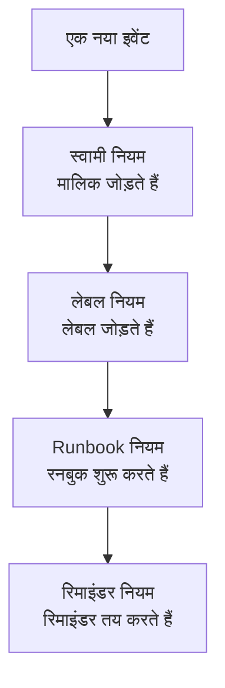

# रखरखाव नियम और सेटिंग्स

रखरखाव का कॉन्फ़िगरेशन **अनुसूचित रखरखाव** के अंदर है, **प्रोजेक्ट सेटिंग्स** में नहीं: वे नियम जो हर नए इवेंट पर काम करते हैं, और वे सेटिंग्स जो प्रोजेक्ट के हर इवेंट को आकार देती हैं। यह पेज उनमें से हर एक का, और उन्हें कौन बदल सकता है इसका, संदर्भ है।

:::cards
- [वे नियम जिनसे नया इवेंट गुज़रता है](#वे-नियम-जिनसे-नया-इवेंट-गुज़रता-है): क्रम में, और हर एक क्या करता है।
- [रिमाइंडर नियम](#रिमाइंडर-नियम): इवेंट पूर्ण होने तक मालिकों को याद दिलाएँ।
- [सेटिंग्स](#सेटिंग्स): नोट टेम्पलेट, कस्टम फ़ील्ड, माप और क्रमांकन।
- [इन्हें कौन बदल सकता है](#इन्हें-कौन-बदल-सकता-है): रखरखाव भूमिकाएँ, और प्लान।
:::

## रखरखाव सेटिंग्स कहाँ हैं

ऊपरी बार के **उत्पाद** मेनू से **अनुसूचित रखरखाव** खोलें। इसके साइड मेनू के **नियम** और **सेटिंग्स** सेक्शन बंद होकर शुरू होते हैं, इसलिए पहले उन्हें खोलें। यहाँ का हर पेज पूरे प्रोजेक्ट पर लागू होता है, `/dashboard/{projectId}/scheduled-maintenance-events/settings/` से शुरू होने वाले पते पर।

| नियम पेज           | यह क्या करता है                                                     |
| ------------------ | ------------------------------------------------------------------- |
| **स्वामी नियम**    | मेल खाने वाले इवेंट में मालिक जोड़ता है।                            |
| **Runbook नियम**   | मेल खाने वाले इवेंट के लिए रनबुक शुरू करता है।                      |
| **लेबल नियम**      | मेल खाने वाले इवेंट में लेबल जोड़ता है।                             |
| **Reminder Rules** | इवेंट पूर्ण होने तक एक अंतराल पर मालिकों को याद दिलाता है।          |

**सेटिंग्स** सेक्शन में **इवेंट स्थिति** है, जिसके बारे में [रखरखाव की स्थितियाँ](/docs/scheduled-maintenance/states) पर बताया गया है, **इवेंट टेम्पलेट**, जिसके बारे में [टेम्पलेट और आवर्ती इवेंट](/docs/scheduled-maintenance/templates) पर बताया गया है, फिर **नोट टेम्पलेट**, **कस्टम फ़ील्ड**, **माप**, **कैलेंडर सेटिंग्स** और **क्रमांकन**। **कैलेंडर सेटिंग्स** के बारे में [रखरखाव कैलेंडर](/docs/scheduled-maintenance/calendar#बाहरी-कैलेंडर) पर बताया गया है, बाकी के बारे में नीचे।

**वर्कस्पेस** सेक्शन में Slack और Microsoft Teams के वे नियम हैं जो इवेंट को चैनलों में पोस्ट करते हैं। देखें [Slack](/docs/workspace-connections/slack#सूचना-नियम) और [Microsoft Teams](/docs/workspace-connections/microsoft-teams#सूचना-नियम)।

## वे नियम जिनसे नया इवेंट गुज़रता है

कई मिलान होने पर नियम अलग-अलग तरह से तय होते हैं:

- **स्वामी नियम**, **लेबल नियम** और **Runbook नियम** मेल खाने पर सभी काम करते हैं। कई नियमों के जोड़े गए मालिक और लेबल एक ही बार जोड़े जाते हैं।
- **Reminder Rules** अपनी सूची में ऊपर से नीचे जाँचे जाते हैं, और पहला मिलान जीतता है। किसी नियम की जगह बदलने के लिए उसे खींचें; नया नियम आख़िर में जाता है।

नया नियम सक्षम होकर शुरू होता है; उसे रोकने के लिए उसके संपादन फ़ॉर्म में **सक्षम** बंद करें, और सूची हर नियम के लिए हरा **सक्षम** या लाल **अक्षम** दिखाती है। स्वामी, लेबल और Runbook नियम उन इवेंट पर काम करते हैं जो उन्हें सहेजने के बाद बनते हैं। अपने मौजूदा इवेंट पर स्वामी या लेबल नियम लागू करने के लिए **अभी चलाएँ** का उपयोग करें: देखें [मौजूदा संसाधनों पर नियम चलाना](/docs/configuration/run-rules-now)।

## स्वामी और लेबल नियम

**स्वामी नियम** मेल खाने वाले नए इवेंट में मालिक उपयोगकर्ता और टीमें जोड़ते हैं, और **लेबल नियम** लेबल जोड़ते हैं। एक नियम बनाने में दो चरण लगते हैं: **मिलान**, यानी शर्तें, फिर **मालिक** या **लेबल**, यानी नियम क्या जोड़ता है।

| शर्त                                                            | किससे मेल खाती है                                                          |
| --------------------------------------------------------------- | -------------------------------------------------------------------------- |
| **मॉनिटर**, **ईवेंट लेबल**, **मॉनिटर लेबल**                     | ऐसे इवेंट जिनमें आपके चुने मॉनिटरों या लेबलों में से कोई हो।                |
| **ईवेंट शीर्षक**, **इवेंट विवरण**, **मॉनिटर नाम**, **मॉनिटर विवरण** | एक पैटर्न, रेगुलर एक्सप्रेशन के रूप में, बड़े-छोटे अक्षरों का भेद किए बिना। |

नियम तभी मेल खाता है जब आपकी भरी हर शर्त सही हो; खाली छोड़ी गई शर्त छोड़ दी जाती है।

- **नियम इनहेरिट कर सकता है।** **स्वामी इनहेरिट करें** या **लेबल इनहेरिट करें** के नीचे बंद छह स्विच इवेंट के मॉनिटरों, होस्ट, Kubernetes क्लस्टर, Docker होस्ट, Podman होस्ट और सेवाओं के मालिक या लेबल आगे बढ़ाते हैं।
- **नए नियम को कुछ जोड़ना ही चाहिए**: कम से कम एक मालिक या लेबल चुनें, या कोई स्विच चालू करें।
- स्वामी नियम पर **और फ़ील्ड** के अंतर्गत **स्वामियों को सूचित करें** तय करता है कि जोड़े गए लोगों को बताया जाए या नहीं।

[लेबल और स्वामी नियम](/docs/configuration/label-and-owner-rules) हर प्रकार के संसाधन के लिए फ़ॉर्म को चरण-दर-चरण समझाता है।

## Runbook नियम

**Runbook नियम** किसी नए इवेंट के मेल खाने पर रनबुक शुरू करते हैं, जैसे हर डेटाबेस अपग्रेड से पहले की जाँच-सूची। वे उन्हीं चीज़ों पर मेल खाते हैं जिन पर स्वामी और लेबल नियम; इवेंट की कोई गंभीरता नहीं होती, इसलिए रखरखाव के Runbook नियम गंभीरता नहीं पूछते। रन इवेंट से जुड़ जाता है, उसके **रनबुक** पेज पर। देखें [Runbook नियम](/docs/runbooks/rules)।

## रिमाइंडर नियम

**अनुसूचित रखरखाव → नियम → Reminder Rules** काम के स्वीकृत होने तक इवेंट के मालिकों को याद दिलाता है। हर इवेंट को सूची में ऊपर से नीचे पहला मेल खाने वाला नियम मिलता है।

:::steps
### चुनें कि किन इवेंट के बारे में याद दिलाना है

**Scheduled Maintenance Reminder Rule बनाएँ** पर क्लिक करें। हर इवेंट के बारे में याद दिलाने के लिए **मिलान** पर **सभी अनुसूचित रखरखाव इवेंट** चुना रहने दें, या **केवल शर्तों से मेल खाने वाले अनुसूचित रखरखाव इवेंट** चुनें और फिर वे **लेबल** चुनें जिन पर यह लागू होता है।

### अंतराल सेट करें

**रिमाइंडर** पर **रिमाइंडर अंतराल (मिनट)** सेट करें, यानी मालिकों को कितनी बार याद दिलाया जाए, और **मालिकों को याद दिलाएँ** में चुनें कि कब। जब तक आप अपना नाम नहीं लिखते, इसका **नाम** दोनों के साथ बदलता है, जैसे "चलने के दौरान हर 30 मिनट में याद दिलाएँ", और **विवरण** के लिए **और फ़ील्ड** खोलें। फिर नियम बनाएँ।
:::

| जवाब | मालिकों को कब याद दिलाया जाता है |
| --- | --- |
| **चलने के दौरान** | इवेंट शुरू होने से लेकर उसके खत्म होने तक। नया नियम इसी जवाब से शुरू होता है। |
| **शुरू होने से पहले** | इवेंट शेड्यूल होने से लेकर उसके शुरू होने तक। |
| **शुरू होने से पहले और चलने के दौरान** | इवेंट शेड्यूल होने से लेकर उसके खत्म होने तक। |

API या Terraform से सहेजा गया ऐसा नियम, जो इवेंट शुरू होने का इंतज़ार करता है और शुरू होते ही रुक जाता है, कभी रिमाइंडर नहीं भेजता: सूची उसे **कभी याद नहीं दिलाता** के रूप में दिखाती है, और उसका फ़ॉर्म आपसे एक जवाब चुनने को कहता है।

मालिकों को हर रिमाइंडर **Maintenance reminder** के रूप में मिलता है, जो हर नए सदस्य के लिए ईमेल पर चालू रहता है। रिमाइंडर नियम को सहेजने, बदलने या हटाने पर हर उस इवेंट का फिर से मिलान होता है जो पूर्ण नहीं हुआ है। किसी एक इवेंट के रिमाइंडर रोकने के लिए उसके **सेटिंग्स** पेज पर **रिमाइंडर भेजें** बंद करें; स्विच बदलते ही यह सहेजा जाता है।

ये रिमाइंडर आपकी टीम के लिए हैं। आपके स्थिति पृष्ठ के सब्सक्राइबर को इवेंट शुरू होने से पहले मिलने वाले रिमाइंडर स्वयं इवेंट पर, **इवेंट से पहले रिमाइंडर** के अंतर्गत सेट होते हैं।

## सेटिंग्स

### नोट टेम्पलेट

**अनुसूचित रखरखाव → सेटिंग्स → नोट टेम्पलेट** में रखरखाव अपडेट के लिए पहले से लिखा टेक्स्ट रहता है। **अनुसूचित रखरखाव कार्यक्रमों के लिए सार्वजनिक या निजी नोट टेम्पलेट** कार्ड उन्हें दिखाता है; **अनुसूचित रखरखाव नोट टेम्पलेट बनाएँ** एक **टेम्पलेट नाम**, एक **टेम्पलेट विवरण** और **नोट** पूछता है। जब कोई इवेंट पर सार्वजनिक या निजी नोट लिखता है, और जब वह उसकी स्थिति बदलता है, तब टेम्पलेट दिया जाता है, और पोस्ट होने से पहले उसका टेक्स्ट संपादित किया जा सकता है। घटना नोट टेम्पलेट के विपरीत, रखरखाव नोट टेम्पलेट कोई वेरिएबल नहीं भरते।

### कस्टम फ़ील्ड

**अनुसूचित रखरखाव → सेटिंग्स → कस्टम फ़ील्ड** हर इवेंट में आपके अपने फ़ील्ड जोड़ता है, जैसे कोई बदलाव टिकट या ग्राहक स्तर। उन्हें इवेंट के **कस्टम फ़ील्ड** पेज पर भरें, या API के ज़रिए `customFields` के रूप में। कोई फ़ील्ड टाइप किए जाने के बजाय किसी मॉनिटर कस्टम फ़ील्ड से अपना मान कॉपी कर सकता है: देखें [मॉनिटर से कॉपी होने वाले फ़ील्ड](/docs/incidents/settings#मॉनिटर-से-कॉपी-होने-वाले-फ़ील्ड), जो इवेंट के लिए भी उसी तरह काम करता है।

### माप

**अनुसूचित रखरखाव → सेटिंग्स → माप** हर इवेंट पर चीज़ों में लगने वाला समय मापता है। **शुरुआत में देरी** चुनें, योजनाबद्ध शुरुआत से इवेंट के शुरू होने तक, **समय से ज़्यादा**, योजनाबद्ध अंत से इसके समाप्त होने तक, या **रखरखाव की अवधि**, इसके शुरू होने से समाप्त होने तक; या **कुछ और** से अपने दो पल चुनें। हर माप इवेंट के पेज पर दिखता है और `oneuptime.scheduled-maintenance.measurement.<key>` के रूप में चार्ट होता है। देखें [माप](/docs/incidents/settings#माप), जो इवेंट के लिए भी उसी तरह काम करता है।

### क्रमांकन

**अनुसूचित रखरखाव → सेटिंग्स → क्रमांकन** इवेंट नंबरों के आगे का टेक्स्ट सेट करता है: नए प्रोजेक्ट में `SM-`, या कोई उपसर्ग न होने पर `#`। **अपडेट करें** **अनुसूचित रखरखाव संख्या उपसर्ग** पूछता है, और टाइप करते समय नंबर का पूर्वावलोकन दिखाता है। केवल बाद में बने इवेंट को नया उपसर्ग मिलता है; मौजूदा इवेंट अपने नंबर रखते हैं। उपसर्ग के नियम [संख्या उपसर्ग](/docs/incidents/settings#संख्या-उपसर्ग) पर हैं।

उसके नीचे का **अगली संख्या** कार्ड वह संख्या तय करता है जो अगले इवेंट को मिलती है, ताकि किसी दूसरे टूल की संख्याएँ आगे जारी रहें: **अपडेट करें** से **अगली अनुसूचित रखरखाव संख्या** खुलती है, जो अब तक की सबसे बड़ी संख्या से बड़ी होनी चाहिए। [अगली संख्याएँ](/docs/incidents/settings#अगली-संख्याएँ) देखें।

> [!NOTE]
> OneUptime Cloud पर, कस्टम फ़ील्ड के लिए **Growth** या उससे ऊपर का प्लान चाहिए, और यही रखरखाव स्थितियाँ और टेम्पलेट जोड़ने और बदलने पर भी लागू होता है।

## वर्कफ़्लो

हर रखरखाव मॉडल के अपने नाम पर वर्कफ़्लो ट्रिगर और क्रियाएँ हैं: **On Create Scheduled Maintenance Event**, **On Update Scheduled Maintenance Event**, **On Create or Update Scheduled Maintenance Event** और **On Delete Scheduled Maintenance Event**, यही **Scheduled Maintenance State Timeline** और बाकी के लिए, और **Create One Scheduled Maintenance Event** और **Update One Scheduled Maintenance Event** जैसी क्रियाएँ। कस्टम फ़ील्ड परिभाषाएँ और माप मान अपवाद हैं: उनके कोई वर्कफ़्लो चरण नहीं हैं। देखें [वर्कफ़्लो अवलोकन](/docs/workflows/index)।

## इन्हें कौन बदल सकता है

| भूमिका                            | यह क्या कर सकती है                                                                                   |
| --------------------------------- | ---------------------------------------------------------------------------------------------------- |
| **अनुसूचित रखरखाव दर्शक**  | इवेंट पढ़ती है, और कुछ नहीं बदलती।                                                                   |
| **अनुसूचित रखरखाव सदस्य**  | इवेंट को उनके नोट, स्थिति टाइमलाइन और मालिकों के साथ बनाती, बदलती और हटाती है, और दोनों तरह के टेम्पलेट भी। |
| **अनुसूचित रखरखाव एडमिन**   | सदस्य जो कुछ करता है वह सब, और रखरखाव स्थितियाँ भी बनाती, बदलती और हटाती है।                         |

नियमों, कस्टम फ़ील्ड और माप के लिए **प्रोजेक्ट स्वामी** या **प्रोजेक्ट एडमिन**, या उस पेज की अपनी अनुमति वाली कस्टम भूमिका चाहिए, जैसे **Create Scheduled Maintenance Owner Rule**। Runbook नियम **रनबुक एडमिन** को भी स्वीकार करते हैं। **प्रोजेक्ट सदस्य** **अनुसूचित रखरखाव सदस्य** की तरह इवेंट और टेम्पलेट के साथ काम करता है। देखें [उपयोगकर्ता, टीमें और अनुमतियाँ](/docs/permissions/index)।

## समस्या निवारण

:::details किसी स्वामी नियम ने नए इवेंट में किसी को नहीं जोड़ा
नियम खोलें और उसकी शर्तें जाँचें: आपकी भरी हर शर्त सही होनी चाहिए। शीर्षक पैटर्न एक रेगुलर एक्सप्रेशन है, इसलिए `db upgrade` "DB-Upgrade" से मेल नहीं खाता; `db.upgrade` लिखें। नियम केवल उन इवेंट पर काम करता है जो उसके सहेजे जाने के बाद बने: जो इवेंट पहले से हैं उनके लिए **अभी चलाएँ** का उपयोग करें।
:::

:::details मालिकों को कोई रिमाइंडर नहीं मिला
जाँचें कि कोई रिमाइंडर नियम इवेंट के लेबल से मेल खाता है, इवेंट का **रिमाइंडर भेजें** चालू है, और मालिकों की सूचना सेटिंग्स में **Maintenance reminder** चालू है। **चलने के दौरान** वाला नियम इवेंट शुरू होने से पहले कुछ नहीं भेजता।
:::

## आगे के कदम

:::cards
- [रखरखाव की स्थितियाँ](/docs/scheduled-maintenance/states): इवेंट स्थिति पेज, और हर स्थिति क्या करती है।
- [टेम्पलेट और आवर्ती इवेंट](/docs/scheduled-maintenance/templates): इवेंट टेम्पलेट पेज, विस्तार से।
- [लेबल और स्वामी नियम](/docs/configuration/label-and-owner-rules): नियम फ़ॉर्म, चरण-दर-चरण।
- [सूचना सेटिंग्स](/docs/notifications/notification-settings): हर मालिक कैसे चुनता है कि उस तक क्या पहुँचे।
:::
