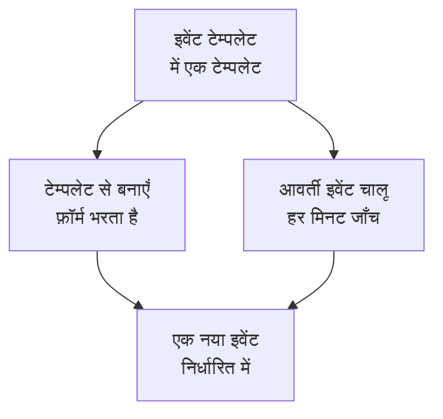

# टेम्पलेट और आवर्ती इवेंट

अनुसूचित रखरखाव टेम्पलेट उस इवेंट को सहेजता है जिसे आप अक्सर शेड्यूल करते हैं: उसका शीर्षक और विवरण, वे मॉनिटर जिन्हें वह रोकता है, वे स्थिति पृष्ठ जिन पर वह दिखता है, और किसे बताया जाता है। फ़ॉर्म को एक क्लिक में भरने के लिए इसका उपयोग करें, या इसे आवर्ती बनाएँ ताकि OneUptime आपके लिए इवेंट को हर हफ़्ते, हर महीने या आपके चुने किसी भी अंतराल पर शेड्यूल करे।

:::cards
- [टेम्पलेट बनाएँ](#टेम्पलेट-बनाएँ): फ़ॉर्म के चरण, शुरू में नाम और अंत में शेड्यूल के साथ।
- [टेम्पलेट का उपयोग करें](#टेम्पलेट-का-उपयोग-करें): इससे एक नया इवेंट भरें।
- [आवर्ती इवेंट](#आवर्ती-इवेंट): OneUptime को इवेंट अपने आप शेड्यूल करने दें।
- [टेम्पलेट बदलें या रोकें](#टेम्पलेट-बदलें-या-रोकें): इसे संपादित करें, इसका शेड्यूल रोकें, या इसे हटाएँ।
:::

## यह कैसे काम करता है

टेम्पलेट एक शुरुआती बिंदु है। इससे बना इवेंट अपने मानों वाली एक प्रति है: बाद में टेम्पलेट बदलने से केवल उसके बाद बने इवेंट बदलते हैं।

## शुरू करने से पहले

- **आपका प्लान।** OneUptime Cloud पर टेम्पलेट के लिए **Growth** या उससे ऊपर का प्लान चाहिए।
- **आपकी भूमिका।** टेम्पलेट बनाने के लिए **प्रोजेक्ट स्वामी**, **प्रोजेक्ट एडमिन**, **प्रोजेक्ट सदस्य**, **अनुसूचित रखरखाव एडमिन** या **अनुसूचित रखरखाव सदस्य**, या कोई ऐसी कस्टम भूमिका चाहिए जो अनुसूचित रखरखाव टेम्पलेट बना सके।

## टेम्पलेट बनाएँ

:::steps
### टेम्पलेट खोलें

**अनुसूचित रखरखाव → सेटिंग्स → इवेंट टेम्पलेट** पर जाएँ। साइड मेनू में **सेटिंग्स** बंद होकर शुरू होता है: पहले उसे खोलें। **अनुसूचित रखरखाव टेम्पलेट बनाएँ** पर क्लिक करें।

### टेम्पलेट को नाम दें

**टेम्पलेट जानकारी** पर इसे एक **टेम्पलेट नाम** और एक **टेम्पलेट विवरण** दें, ताकि आपकी टीम जाने कि इसका उपयोग कब करना है। दोनों ज़रूरी हैं।

### इवेंट का वर्णन करें

**इवेंट** पर वह **शीर्षक** और **विवरण** भरें जिनसे इससे बना हर इवेंट शुरू होता है। **मालिक** और **लेबल** **और फ़ील्ड** के नीचे इंतज़ार करते हैं।

### चुनें कि इसका असर किस पर है

**प्रभावित संसाधन** पर **मॉनिटर**, उनके लिए **मॉनिटर स्थिति बदलकर करें**, कोई भी **अन्य प्रभावित संसाधन**, **इन स्थिति पृष्ठों पर इवेंट दिखाएं** के अंतर्गत स्थिति पृष्ठ, और **सब्सक्राइबर सूचनाएँ** चुनें।

### तय करें कि यह दोहराया जाए या नहीं

**आवर्ती** पर, हाथ से इस्तेमाल होने वाले टेम्पलेट के लिए **आवर्ती इवेंट** बंद रहने दें, या उसे चालू करें और उसका शेड्यूल भरें। समीक्षा जाँचने के लिए **अगला** पर क्लिक करें, फिर टेम्पलेट बनाएँ।
:::

टेम्पलेट **मॉनिटर स्थिति बदलकर करें** तब भी पूछता है जब वह किसी मॉनिटर का नाम नहीं लेता: यह स्थिति उन मॉनिटरों पर भी लागू होती है जिन्हें आप इससे इवेंट शेड्यूल करते समय जोड़ते हैं। **अन्य प्रभावित संसाधन** के अंतर्गत टेम्पलेट होस्ट, Kubernetes क्लस्टर, Docker होस्ट, Podman होस्ट और सेवाएँ लेता है।

## टेम्पलेट क्या भरता है

| इवेंट का हिस्सा                                   | टेम्पलेट से बनाएँ                    | आवर्ती इवेंट                    |
| ------------------------------------------------- | ------------------------------------ | ------------------------------- |
| **शीर्षक** और **विवरण**                           | भरे हुए, और आप उन्हें बदल सकते हैं   | कॉपी किए गए                     |
| **मॉनिटर** और **मॉनिटर स्थिति बदलकर करें**        | भरे हुए                              | कॉपी किए गए                     |
| **अन्य प्रभावित संसाधन**                          | भरे हुए                              | कॉपी किए गए                     |
| स्थिति पृष्ठ और **सब्सक्राइबर सूचनाएँ**           | भरे हुए                              | कॉपी किए गए                     |
| **मालिक** और **लेबल**                             | भरे हुए                              | कॉपी किए गए                     |
| **शुरू होता है** और **समाप्त होता है**            | अगला पूरा घंटा, एक घंटे के लिए       | शेड्यूल से निकाले गए            |

## टेम्पलेट का उपयोग करें

:::steps
### टेम्पलेट चुनें

**अनुसूचित रखरखाव → सभी इवेंट** पर **टेम्पलेट से बनाएँ** पर क्लिक करें, और **अनुसूचित रखरखाव टेम्पलेट चुनें** के अंतर्गत एक टेम्पलेट चुनें।

### फ़ॉर्म जाँचें

**टेम्पलेट से बनाएँ** पर क्लिक करें। बनाने का फ़ॉर्म टेम्पलेट के जवाबों से भरा हुआ खुलता है। समय-सीमा सेट करें, और इस इवेंट को जो चाहिए वह बदलें।

### इवेंट बनाएँ

**अगला** से चरणों से गुज़रें, फिर समीक्षा पर **अनुसूचित रखरखाव इवेंट बनाएँ** पर क्लिक करें।
:::

जब प्रोजेक्ट में अभी कोई टेम्पलेट नहीं होता, तो **टेम्पलेट से बनाएँ** यह बताता है, और **इवेंट टेम्पलेट** का लिंक देता है।

## आवर्ती इवेंट

आवर्ती टेम्पलेट एक शेड्यूल पर इवेंट बनाता है। आप तय करते हैं कि पहला इवेंट कब बनेगा, कब शुरू होगा और कब समाप्त होगा; हर बाद वाला इवेंट वही दूरियाँ रखता है, एक अंतराल बाद।

| फ़ील्ड                                                   | इसका क्या मतलब है                                                                                  |
| -------------------------------------------------------- | -------------------------------------------------------------------------------------------------- |
| **आवर्ती इवेंट**                                         | शेड्यूल चालू करता है।                                                                              |
| **पहली घटना अनुसूचित है**                                | OneUptime पहला इवेंट कब बनाता है, यानी इसके सब्सक्राइबर को कब बताया जाता है कि यह शेड्यूल हुआ है। |
| **पहली घटना शुरू होती है**                               | पहला इवेंट कब शुरू होता है।                                                                        |
| **पहली घटना समाप्त होती है**                             | पहला इवेंट कब समाप्त होता है।                                                                      |
| **आप इस इवेंट को कितनी बार दोहराना चाहेंगे?**            | एक संख्या और एक इकाई: घंटे, दिन, हफ़्ते, महीने या साल।                                            |

उदाहरण के लिए, एक साप्ताहिक समय-सीमा जिसका पहला इवेंट सोमवार को उसके बाद वाले शनिवार के लिए बनता है:

| इवेंट        | बना                | शुरू               | समाप्त             |
| ------------ | ------------------ | ------------------ | ------------------ |
| पहला         | `2030-06-03 09:00` | `2030-06-08 02:00` | `2030-06-08 04:00` |
| दूसरा        | `2030-06-10 09:00` | `2030-06-15 02:00` | `2030-06-15 04:00` |

**पहली घटना अनुसूचित है** को शुरुआत से उतना पहले सेट करें जितना पहले आप चाहते हैं कि आपके ग्राहकों को काम के बारे में पता चले। टेम्पलेट बनाते समय तीनों समय भविष्य में होने चाहिए, इवेंट शुरू और समाप्त होने से पहले बनना चाहिए, और समाप्त होने से पहले शुरू होना चाहिए; फ़ॉर्म बताता है कि कोई समय कौन-सा नियम तोड़ता है।

एक जॉब हर मिनट आवर्ती टेम्पलेट जाँचता है। जब किसी टेम्पलेट का अगला समय आता है, तो वह उस समय को एक अंतराल आगे बढ़ाता है और इवेंट बनाता है। टेम्पलेट सूची वह समय अपने **आवर्ती इवेंट** कॉलम में दिखाती है, और जो टेम्पलेट दोहराया नहीं जाता उसके लिए **नहीं** दिखाती है। शेड्यूल से बना इवेंट किसी भी दूसरे इवेंट जैसा होता है: इसके नियम चलते हैं, इसके मालिक जोड़े जाते हैं, और इसके सब्सक्राइबर को बताया जाता है कि यह शेड्यूल हुआ है।

## टेम्पलेट बदलें या रोकें

किसी टेम्पलेट का पेज देखने के लिए उसे सूची से खोलें:

- **अनुसूचित रखरखाव टेम्पलेट विवरण** दिखाता है कि नए इवेंट किससे शुरू होते हैं। इसका **संपादित करें** **टेम्पलेट जानकारी**, **इवेंट**, **स्थिति पृष्ठ** और **आवर्ती** से होकर गुज़रता है।
- **प्रभावित संसाधन** में इसके **मॉनिटर**, उनका **मॉनिटर स्थिति बदलकर करें** और इसके **अन्य प्रभावित संसाधन** हैं, अपने **संपादित करें** के साथ।
- **मालिक** उन लोगों और टीमों की सूची है जो इससे शेड्यूल हुए हर इवेंट के मालिक हैं।

बदलाव उन इवेंट पर लागू होते हैं जो आपके सहेजने के बाद बनते हैं; पहले से बने इवेंट अपने मान रखते हैं। शेड्यूल रोकने के लिए **संपादित करें** में **आवर्ती इवेंट** बंद करें, या टेम्पलेट हटा दें। बंद किया गया टेम्पलेट अपना शेड्यूल रखता है: उसे फिर से चालू करें, तो वह शेड्यूल के अगले समय से चलता है और बंद रहने के समय छोड़ देता है। टेम्पलेट हटाने पर उसके बनाए इवेंट बने रहते हैं।

## समस्या निवारण

:::details आवर्ती टेम्पलेट बनाते समय कहा जाता है कि कोई समय भविष्य में होना चाहिए
टेम्पलेट बनाते समय तीनों पहले समय अभी के बाद होने चाहिए। उन्हें आगे खिसकाएँ: उसके बाद शेड्यूल पहले इवेंट से आगे चलता है।
:::

:::details किसी आवर्ती टेम्पलेट ने कोई इवेंट नहीं बनाया
जाँचें कि **आवर्ती इवेंट** अब भी चालू है, और सूची के **आवर्ती इवेंट** कॉलम में समय देखें: इवेंट उसी समय बनता है, अपनी शुरुआत पर नहीं। जॉब हर मिनट चलता है, इसलिए एक मिनट रुकें।
:::

:::details टेम्पलेट से बने इवेंट में मेरा चुना एक संसाधन नहीं है
**अन्य प्रभावित संसाधन** के अंतर्गत टेम्पलेट होस्ट, Kubernetes क्लस्टर, Docker होस्ट, Podman होस्ट और सेवाएँ लेता है। दूसरे प्रकार के संसाधन स्वयं इवेंट में जोड़ें, उसके **प्रभावित संसाधन** कार्ड पर **संपादित करें** से।
:::

## आगे के कदम

:::cards
- [रखरखाव इवेंट बनाना](/docs/scheduled-maintenance/creating-events): वह फ़ॉर्म जिसे टेम्पलेट भरता है।
- [रखरखाव की स्थितियाँ](/docs/scheduled-maintenance/states): बनने के बाद हर इवेंट कैसे आगे बढ़ता है।
- [रखरखाव नियम और सेटिंग्स](/docs/scheduled-maintenance/settings): हर नए इवेंट में मालिक और लेबल अपने आप जोड़ें।
- [अनुसूचित रखरखाव का अवलोकन](/docs/scheduled-maintenance/index): बाकी रखरखाव में टेम्पलेट कहाँ फ़िट होते हैं।
:::
