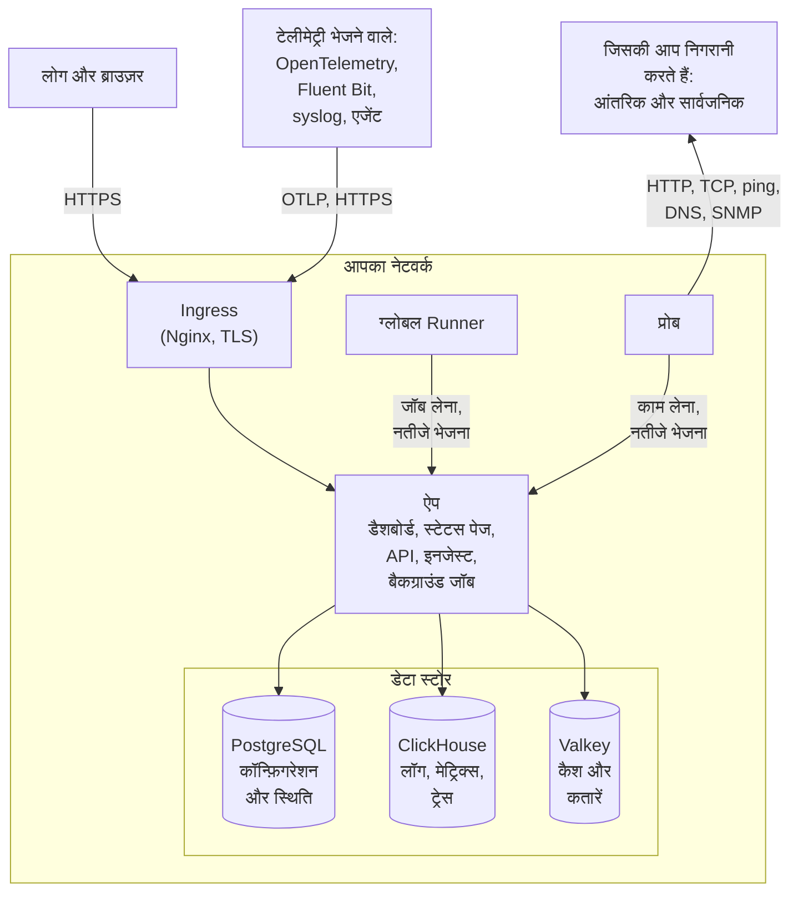

# वास्तुकला

सेल्फ-होस्टेड OneUptime इंस्टॉल कुछ ही कंटेनरों से बना होता है: एक ingress जिससे हर अनुरोध अंदर आता है, एक ऐप इमेज जो काम करती है, प्रोब जो आपके मॉनिटरों की जाँचें चलाते हैं, और तीन डेटा स्टोर। यह पृष्ठ दिखाता है कि ये आपस में कैसे जुड़ते हैं, हर एक क्या करता है, और कौन-से कनेक्शन आपके नेटवर्क की सीमा पार करते हैं।

## यह क्या दिखाता है

- लोग **ingress** के ज़रिए OneUptime तक पहुँचते हैं, जो TLS समाप्त करता है और हर अनुरोध को ऐप तक भेजता है: Dashboard, स्टेटस पेज, API, और हर वह इनजेस्ट एंडपॉइंट जिस पर टेलीमेट्री भेजी जाती है।
- **ऐप** अपनी स्थिति PostgreSQL में पढ़ता और लिखता है, टेलीमेट्री ClickHouse में रखता है, और कैश के लिए तथा उन कतारों के लिए Valkey (Redis 7.2 का BSD-लाइसेंस वाला फ़ोर्क) का उपयोग करता है जिन पर उसके बैकग्राउंड जॉब काम करते हैं।
- **प्रोब** आपके क्लस्टर के अंदर (अनुशंसित) और/या आपके नेटवर्क में कहीं और चल सकते हैं। वे इनकी निगरानी कर सकते हैं:
  - आपके फ़ायरवॉल के पीछे की आंतरिक/निजी सेवाएँ।
  - इंटरनेट पर बाहरी/सार्वजनिक संसाधन।
- प्रोब के नतीजे ऐप को भेजे जाते हैं, Valkey में कतार में रखे जाते हैं, और बैकग्राउंड जॉब उन्हें प्रोसेस करके आपके डेटा स्टोर में लिखते हैं। आपके नेटवर्क में कहीं और रखा प्रोब ingress के ज़रिए, आपके OneUptime URL पर, ऐप तक पहुँचता है।
- टेलीमेट्री (मेट्रिक्स, ट्रेस, लॉग और भी बहुत कुछ) वही ऐप ग्रहण करता है और ClickHouse में संग्रहीत करता है।

> [!NOTE]
> अगर आप अंतर्निहित की जगह बाहरी PostgreSQL, Valkey (या Redis) या ClickHouse का उपयोग करते हैं, तो ऐप इसके बजाय आपके बाहरी एंडपॉइंट से जुड़ता है। तार्किक प्रवाह वही रहता है।

## घटक

| घटक | Docker Compose सेवा | Helm चार्ट | यह क्या करता है |
| --- | --- | --- | --- |
| Ingress | `ingress` | `nginx` | TLS समाप्त करता है, आपके होस्टनाम और स्टेटस पेज डोमेन को सर्व करता है, और हर अनुरोध को ऐप तक भेजता है। |
| ऐप | `app` | `app` | Dashboard, स्टेटस पेज, API और इनजेस्ट एंडपॉइंट, और, जब तक आप उन्हें अलग न करें, बैकग्राउंड जॉब। |
| Worker | `app` का हिस्सा | `worker` (डिफ़ॉल्ट रूप से बंद) | बैकग्राउंड जॉब, अपने अलग पॉड में, ताकि भारी कतार प्रोसेसिंग कभी API अनुरोधों से होड़ न करे। |
| Telemetry writer | `app` का हिस्सा | `telemetryWriter` (डिफ़ॉल्ट रूप से बंद) | एक निश्चित आकार की परत जो ClickHouse में हर इन्सर्ट करती है, ताकि worker चाहे जितने स्केल हों, इन्सर्ट सीमा में रहें। |
| प्रोब | `probe-1` | `probes` | मॉनिटर जाँचें चलाता है और नतीजे वापस भेजता है। हर साथ आने वाला प्रोब एक वैश्विक प्रोब है जिसे सभी प्रोजेक्ट उपयोग कर सकते हैं। |
| ग्लोबल Runner | `global-runner` | `globalRunner` | एक [ग्लोबल Runner](/docs/runbooks/agents#ग्लोबल-runner): यह हर उस प्रोजेक्ट के JavaScript चरण चलाता है जो अपना कोई Runner नहीं चुनता, हर एक ऐसे सैंडबॉक्स में जो केवल इंटरनेट तक पहुँचता है, और हर उस कोड रिपॉजिटरी में OneUptime AI के कोड सुधार जो कोई Runner नहीं चुनती। इसके पास अपनी कुंजी होती है और सर्वर का और कुछ नहीं। Bash, SSH और kubectl चरण उन [Runners](/docs/runbooks/agents) पर चलते हैं जिन्हें आप वहाँ इंस्टॉल करते हैं जहाँ उन्हें चलना चाहिए। |
| PostgreSQL | `postgres` | `postgresql`, या `postgresOperator.cnpg` | प्रोजेक्ट, मॉनिटर, घटनाएँ, उपयोगकर्ता और बाकी हर सेटिंग और स्थिति। |
| ClickHouse | `clickhouse` | `clickhouse`, या `clickhouseOperator.altinity` | लॉग, मेट्रिक्स, ट्रेस, अपवाद, प्रोफ़ाइल और मॉनिटर लॉग। |
| Valkey | `valkey` | `valkey` | कैश, जॉब कतारें और अल्पकालिक स्थिति, जैसे लंबित पुश रसीदें। |

ऐप की सभी भूमिकाएँ एक ही इमेज हैं: Docker Compose उन्हें एक ही `app` कंटेनर में चलाता है, और Helm चार्ट worker और telemetry writer को अपने अलग डिप्लॉयमेंट के रूप में चला सकता है। हर परत का आकार तय करने के लिए [आकार निर्धारण और क्षमता नियोजन](/docs/installation/sizing) देखें।

## आपके नेटवर्क से बाहर जाने वाले कनेक्शन

जब तक आप कोई सेटिंग नहीं बदलते, चार कनेक्शन बनते हैं:

- दिन में एक बार ऐप GitHub के API (`api.github.com`) से पूछता है कि क्या कोई नई रिलीज़ आई है। यह OneUptime की प्रकाशित सुरक्षा एडवाइज़री भी पढ़ता है, ताकि जब कोई एडवाइज़री आपके चलाए जा रहे वर्शन को प्रभावित करे, तो आपके मास्टर एडमिन को बताया जाए ([अपडेट और सुरक्षा जाँच](/docs/self-hosted/update-checks))। इसे बंद करने के लिए Helm चार्ट में `updateCheck.disabled: true` सेट करें, या Docker Compose पर `config.env` में `DISABLE_UPDATE_CHECK=true` सेट करें।
- दिन में एक बार ऐप `oneuptime.com` को आपके इंस्टॉल का पता और उस पर चल रहा वर्शन बताता है, ताकि OneUptime जान सके कि कौन-से इंस्टॉल अब भी सुरक्षा समस्या वाली रिलीज़ चला रहे हैं। आपके उपयोगकर्ताओं, प्रोजेक्ट या मॉनिटरिंग डेटा के बारे में कुछ भी नहीं भेजा जाता। इसे बंद करने के लिए Helm चार्ट में `instanceCheckIn.disabled: true` सेट करें, या Docker Compose पर `config.env` में `DISABLE_INSTANCE_CHECK_IN=true` सेट करें।
- “मुझे सुरक्षा पैच और नई रिलीज के बारे में सूचित करें” पर टिक लगाकर साइन अप करने पर, जैसा कि शुरू में लगा रहता है, उस व्यक्ति का नाम और ईमेल, उसकी दी हुई कोई भी कंपनी और फ़ोन नंबर, और आपके इंस्टॉल का पता और वर्शन `oneuptime.com` को भेजे जाते हैं। इंटरनेट एक्सेस के बिना वाले नेटवर्क पर इसका टिक हटा दें।
- Kubernetes पर, प्रोब आपके क्लस्टर के अपने DNS के बाद सार्वजनिक रिज़ॉल्वर `8.8.8.8` और `1.1.1.1` का सहारा लेते हैं। हर लुकअप को अपने ही DNS पर रखने के लिए `dnsConfig.nameservers` को `[]` पर सेट करें।

बाकी सब कुछ तभी बाहर जुड़ता है जब आप उसे चालू करते हैं, और हर एक का एक पृष्ठ है जो अनुमति देने के लिए सटीक पते बताता है:

| बाहर जाने वाला कनेक्शन | किसके लिए | और पढ़ें |
| --- | --- | --- |
| ईमेल (SMTP, या SendGrid का API) | सूचनाएँ और आमंत्रण | [SMTP](/docs/emails/smtp) |
| Twilio | SMS और फ़ोन कॉल | [Twilio इंटीग्रेशन](/docs/self-hosted/twilio-integration) |
| OneUptime का पुश रिले, या Expo | मोबाइल पुश सूचनाएँ | [पुश सूचनाएँ](/docs/self-hosted/push-notifications) |
| Slack और Microsoft Teams | वर्कस्पेस सूचनाएँ और कार्रवाइयाँ | [Slack इंटीग्रेशन](/docs/self-hosted/slack-integration) |
| कोई LLM प्रदाता, जैसे OpenAI, Anthropic, Microsoft Foundry, या कोई मॉडल जिसे आप स्वयं चलाते हैं | OneUptime AI | [LLM प्रदाता](/docs/ai/llm-provider) |
| `oneuptime.com` | Enterprise लाइसेंस को ऑनलाइन सक्रिय करना | [एंटरप्राइज़ संस्करण](/docs/self-hosted/enterprise) |

दूसरी दिशा के कनेक्शन - SendGrid का आने वाला ईमेल पहुँचाना, Slack और Microsoft Teams का वापस कॉल करना - के लिए ingress का इंटरनेट से पहुँच योग्य होना ज़रूरी है। ऐप और प्रोब किन निजी पतों तक पहुँच सकते हैं, यह आप तय करते हैं: देखें [निजी नेटवर्क पहुँच](/docs/self-hosted/private-network-access)।

OneUptime का लोगो उसके भेजे हर ईमेल के अंदर ही जाता है, इसलिए वह बिना इंटरनेट पहुँच वाले नेटवर्क पर भी दिखता है, और ईमेल खोलने पर किसी दूसरे होस्ट से कुछ नहीं माँगा जाता। आप खुद जो लोगो अपलोड करते हैं, जैसे आपका अपना लोगो या किसी स्थिति पृष्ठ का लोगो, वह भी ईमेल के अंदर ही जाता है, अगर वह 512 KB या उससे छोटी PNG, JPEG या GIF इमेज है। आप जो कोई और इमेज अपलोड करते हैं, वह आपके OneUptime URL से दिखाई जाती है, इसलिए इन ईमेल को पढ़ने वालों का उस तक पहुँच पाना ज़रूरी है।

## अगले कदम

:::cards
- [Docker Compose](/docs/installation/docker-compose): सभी घटकों को एक ही मशीन पर इंस्टॉल करें।
- [आकार निर्धारण और क्षमता नियोजन](/docs/installation/sizing): हर परत को कितना CPU, मेमोरी और डिस्क चाहिए।
- [कस्टम प्रोब](/docs/probe/custom-probe): किसी दूसरे नेटवर्क के अंदर प्रोब चलाएँ।
- [एंटरप्राइज़ संस्करण](/docs/self-hosted/enterprise): Enterprise इमेज क्या जोड़ती हैं, और लाइसेंसिंग कैसे काम करती है।
:::
