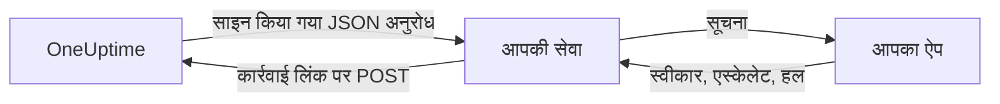

# कस्टम सूचना चैनल

कस्टम चैनल ऑन-कॉल पेज को आपकी चलाई जाने वाली किसी सेवा पर भेजता है: आपकी कंपनी का अपना ऐप, कोई पेजर सिस्टम, या कोई गेटवे जो जाँचता है कि आपके नेटवर्क से क्या बाहर जाता है। आप इसे पूरे सर्वर के लिए एक बार जोड़ते हैं, और कुछ भी सेट किए बिना हर किसी को इसके ज़रिए पेज किया जा सकता है। Admin Dashboard में इन्हें **Custom Channels** कहा जाता है।

> [!NOTE]
> कस्टम चैनल [OneUptime Enterprise Edition](/docs/self-hosted/enterprise) का हिस्सा हैं और इनके लिए ऐसा Enterprise लाइसेंस चाहिए जिसमें ये शामिल हों। Community Edition में **Custom Channels** पेज नहीं है और वह किसी चैनल को कुछ नहीं भेजता। देखें [लाइसेंस के बिना](#लाइसेंस-के-बिना)।

:::cards
- [चैनल जोड़ना](#चैनल-जोड़ना): एक नाम, एक URL और एक साइनिंग सीक्रेट।
- [आपकी सेवा को क्या मिलता है](#आपकी-सेवा-को-क्या-मिलता-है): हर पेज पर हर व्यक्ति के लिए एक साइन किया गया JSON अनुरोध।
- [पेज पर कार्रवाई करना](#पेज-पर-कार्रवाई-करना): अपने ही ऐप से स्वीकार, एस्केलेट या हल करें।
- [डिलीवरी और दोबारा कोशिशें](#डिलीवरी-और-दोबारा-कोशिशें): जब आपकी सेवा बंद हो, तब क्या होता है।
- [दूसरी सूचनाएँ](#दूसरी-सूचनाएँ): मालिकों की सूचनाएँ, नोट और शिफ्टें, उन लोगों के लिए जो इन्हें चाहते हैं।
- [लाइसेंस के बिना](#लाइसेंस-के-बिना): क्या रुकता है, और क्या रखा जाता है।
:::

## यह कैसे काम करता है



जब कोई ऑन-कॉल नीति किसी को पेज करती है और उसका ऑन-कॉल नियम यह चैनल इस्तेमाल करता है, तो OneUptime चैनल के URL पर एक अनुरोध भेजता है। उसमें बताया जाता है कि पेज किसके लिए है (उसका नाम और ईमेल), किस बारे में है, और उसमें वे लिंक होते हैं जिन्हें आपकी सेवा तब कॉल करती है जब व्यक्ति आपके ऐप में उसे स्वीकार, एस्केलेट या हल करता है।

## चैनल जोड़ना

1. Admin Dashboard में **सेटिंग्स**, फिर **Custom Channels** खोलें, और **Add** चुनें।
2. **Channel** चरण में भरें:
   - **नाम**: लोग अपनी सूचना विधियों और ऑन-कॉल नियमों में जो देखते हैं, जैसे `CorpoApp`।
   - **Webhook URL**: जहाँ OneUptime हर पेज भेजता है। यह आपके निजी नेटवर्क पर हो सकता है।
   - **Signing Secret**: OneUptime आपके लिए एक बनाता है। इसे अपनी सेवा में कॉपी करें, जो हर अनुरोध को इसी से जाँचती है। चैनल संपादित करके आप इसे फिर से देख सकते हैं।
3. **Delivery** चरण में सहेजें, फिर अपनी सेवा को एक [परीक्षण अनुरोध](#परीक्षण-अनुरोध) भेजने के लिए **Send test** चुनें।

**Delivery** चरण में **Page everyone through this channel** चालू रहता है। तब OneUptime चैनल को हर प्रोजेक्ट में सबके ऑन-कॉल नियमों में जोड़ता है, और बाद में किसी प्रोजेक्ट से जुड़ने वाले हर व्यक्ति के नियमों में भी, और जिस रेस्पॉन्डर के पास ट्रिगर हुई चीज़ के लिए कोई नियम नहीं है, उस तक पहुँचने के लिए इसका इस्तेमाल करता है। लोगों को खुद अपने नियमों में चैनल जोड़ने देने के लिए इसे बंद करें।

लोग चैनल को **उपयोगकर्ता सेटिंग्स**, फिर **सूचना विधियां**, फिर **Custom Channels** में **Send test** बटन के साथ देखते हैं, और अपने ऑन-कॉल नियमों में इसे `Custom Channel: CorpoApp` के रूप में चुनते हैं। उन्हें कुछ सेट नहीं करना होता: आपकी सेवा को बताया जाता है कि हर पेज किसके लिए है।

किसी के नियम बदले बिना भेजना रोकने के लिए, चैनल संपादित करें और **चालू** बंद करें। जो पेज इस चैनल पर जाते, वे ऑन-कॉल लॉग में न भेजे गए के रूप में दर्ज होते हैं। चैनल मिटाने से वे सभी ऑन-कॉल नियम मिट जाते हैं जो इसका इस्तेमाल करते हैं।

## आपकी सेवा को क्या मिलता है

हर पेज JSON बॉडी वाला एक `POST` अनुरोध होता है:

| हेडर | इसमें क्या होता है |
| --- | --- |
| `Content-Type` | `application/json` |
| `X-OneUptime-Event` | इवेंट, जैसे `on-call.incident.created` |
| `X-OneUptime-Signature` | `sha256=` और रॉ बॉडी का हेक्स HMAC-SHA256, जो चैनल के साइनिंग सीक्रेट से बना होता है |

```json title="An incident page"
{
  "version": 1,
  "event": "on-call.incident.created",
  "notificationId": "5f2c8a1e-6b1d-4c3a-9e7f-2a4b6c8d0e1f",
  "sentAt": "2026-10-27T03:14:15.000Z",
  "channel": { "id": "0b7e…", "name": "CorpoApp" },
  "title": "New Incident INC-42: API latency high",
  "message": "A new incident has been created: INC-42 (API latency high) in Agency A. Click to view details.",
  "project": { "id": "8d1f…", "name": "Agency A" },
  "team": { "id": "2c9a…", "name": "SRE" },
  "user": { "id": "4e6b…", "name": "Jane Tan", "email": "jane@example.com" },
  "recordType": "incident",
  "record": {
    "id": "9a3c…",
    "number": "INC-42",
    "title": "API latency high",
    "description": "p95 latency above 2 seconds for 5 minutes.",
    "severity": "Critical",
    "state": "Created",
    "url": "https://oneuptime.example.com/dashboard/8d1f…/incidents/9a3c…"
  },
  "onCallPolicy": { "id": "1d4e…", "name": "Primary" },
  "escalationRule": { "id": "7b2f…", "name": "Level 1" },
  "isPageAgain": false,
  "actions": {
    "acknowledge": "https://oneuptime.example.com/api/custom-notification-channel/page/5f2c…/acknowledge?token=…",
    "escalate": "https://oneuptime.example.com/api/custom-notification-channel/page/5f2c…/escalate?token=…",
    "resolve": "https://oneuptime.example.com/api/custom-notification-channel/page/5f2c…/resolve?token=…"
  }
}
```

| फ़ील्ड | यह क्या है |
| --- | --- |
| `version` | `1`। इस संस्करण में फ़ील्ड सिर्फ़ जोड़े जाते हैं। |
| `event` | `on-call.incident.created`, `on-call.alert.created`, `on-call.incidentEpisode.created`, `on-call.alertEpisode.created`, [दूसरी सूचनाओं](#दूसरी-सूचनाएँ) के लिए `notification`, या `test` |
| `notificationId` | हर पेज पर हर व्यक्ति के लिए एक। पहले से संभाले गए अनुरोध को छोड़ने के लिए इसका इस्तेमाल करें। |
| `title`, `message` | दिखाने के लिए तैयार, जैसे कोई पुश सूचना उन्हें दिखाती |
| `user` | पेज किसके लिए है। अपने ऐप में उसका खाता `email` या `id` से ढूँढें। |
| `team` | वह टीम जिसके ज़रिए उन्हें पेज किया गया, या सीधे पेज किए जाने पर `null` |
| `recordType`, `record` | पेज किस बारे में है: कोई `incident`, `alert`, `incidentEpisode` या `alertEpisode` |
| `onCallPolicy`, `escalationRule` | वह नीति और स्तर जिसने उन्हें पेज किया |
| `isPageAgain` | `true` जब रिकॉर्ड कुछ समय पहले स्वीकार किया गया था और अब भी हल नहीं हुआ है |
| `actions` | वे लिंक जिन्हें आपकी सेवा [पेज पर कार्रवाई करने](#पेज-पर-कार्रवाई-करना) के लिए कॉल करती है |

कई लोगों के लिए एक पेज, हर व्यक्ति के लिए एक अनुरोध होता है, हर एक में उसी व्यक्ति के अपने लिंक होते हैं, ताकि OneUptime जान सके कि किसने जवाब दिया। शीर्षक, संदेश और विवरण मिलाकर 16,384 वर्णों तक सीमित हैं; लंबा विवरण काट दिया जाता है और "… (truncated — see OneUptime for the full text)" पर ख़त्म होता है।

### सिग्नेचर जाँचना

अनुरोध की रॉ बॉडी को पार्स करने से पहले उसका HMAC निकालें, और उसकी तुलना हेडर से करें:

```javascript title="Node.js"
const crypto = require("crypto");

function isFromOneUptime(rawBody, signatureHeader, secret) {
  const expected =
    "sha256=" + crypto.createHmac("sha256", secret).update(rawBody).digest("hex");
  const received = String(signatureHeader || "");

  return (
    received.length === expected.length &&
    crypto.timingSafeEqual(Buffer.from(received), Buffer.from(expected))
  );
}
```

## पेज पर कार्रवाई करना

जब व्यक्ति आपके ऐप में कोई बटन दबाता है, तो आपकी सेवा `actions` में मेल खाने वाले लिंक पर एक `POST` अनुरोध भेजती है। इसके लिए किसी API कुंजी की ज़रूरत नहीं होती: हर लिंक में उसी एक पेज के लिए एक टोकन होता है, जो 7 दिन तक मान्य है, और कार्रवाई उसी व्यक्ति के द्वारा की गई दर्ज होती है जिसे पेज किया गया था।

| कार्रवाई | यह क्या करती है |
| --- | --- |
| `acknowledge` | उनका पेज स्वीकार करती है, और उसके साथ घटना, अलर्ट या एपिसोड को भी |
| `escalate` | वे इसे नहीं ले सकते: ऑन-कॉल नीति के अगले स्तर को अभी पेज करती है और उन्हें पेज करना बंद कर देती है |
| `resolve` | घटना, अलर्ट या एपिसोड को हल करती है, अगर उनकी अपनी अनुमतियाँ इसकी इजाज़त दें |

```bash title="Acknowledge a page"
curl -X POST "https://oneuptime.example.com/api/custom-notification-channel/page/5f2c…/acknowledge?token=…"
```

जवाब बताता है कि क्या हुआ, ऐसे शब्दों में जिन्हें आपका ऐप जैसे के तैसे दिखा सकता है:

```json title="The answer"
{
  "action": "acknowledge",
  "result": "acknowledged",
  "message": "Acknowledged."
}
```

`result` इनमें से एक होता है: `acknowledged`, `alreadyAcknowledged`, `escalated`, `notEscalated`, `resolved` और `alreadyResolved`। समाप्त या गलत लिंक को 4xx स्टेटस और एक संदेश के साथ अस्वीकार कर दिया जाता है।

## दूसरी सूचनाएँ

पेज ही लोगों को मिलने वाली अकेली सूचनाएँ नहीं हैं: OneUptime उन्हें तब भी बताता है जब उनके स्वामित्व वाली किसी घटना की स्थिति बदलती है, जब कोई नोट पोस्ट होता है, जब उनकी ऑन-कॉल शिफ्ट शुरू होती है, और भी बहुत कुछ। हर व्यक्ति **उपयोगकर्ता सेटिंग्स > सूचना सेटिंग्स** में चुनता है कि इनमें से हर एक कहाँ जाए, जिसमें किसी चैनल के चालू रहने तक **Custom Channels** कॉलम होता है। यह सबके लिए तब तक बंद रहता है जब तक वे इसे चालू न करें।

एक सूचना हर चालू चैनल पर जाती है, हर चैनल के लिए एक अनुरोध के रूप में, जिसमें `event` का मान `notification` होता है:

```json title="A notification"
{
  "version": 1,
  "event": "notification",
  "notificationId": null,
  "sentAt": "2026-10-27T03:20:00.000Z",
  "channel": { "id": "0b7e…", "name": "CorpoApp" },
  "title": "Incident INC-42 acknowledged",
  "message": "Incident INC-42 (API latency high) was acknowledged in Agency A.",
  "project": { "id": "8d1f…", "name": "Agency A" },
  "team": null,
  "user": { "id": "4e6b…", "name": "Jane Tan", "email": "jane@example.com" },
  "recordType": null,
  "record": null,
  "onCallPolicy": null,
  "escalationRule": null,
  "isPageAgain": false,
  "actions": null,
  "notificationType": "Send incident state changed notification when I am the owner of the incident",
  "url": "https://oneuptime.example.com/dashboard/8d1f…/incidents/9a3c…"
}
```

`title` और `message` वही हैं जो व्यक्ति की पुश सूचना कहती। `notificationType` उस सेटिंग का नाम बताता है जिसके लिए यह भेजी गई, और `url` उस चीज़ से लिंक करता है जिसके बारे में यह है, या `null` होता है। इस पर कोई कार्रवाई नहीं करनी होती, इसलिए `actions` का मान `null` होता है।

## डिलीवरी और दोबारा कोशिशें

कोई अनुरोध तब डिलीवर माना जाता है जब आपकी सेवा 10 सेकंड के भीतर 2xx स्टेटस के साथ जवाब देती है। जिस अनुरोध का उसने जवाब नहीं दिया, या 408, 429 या 5xx स्टेटस के साथ जवाब दिया, उसे 1 सेकंड बाद और फिर 4 सेकंड और बाद दोबारा भेजा जाता है: कुल तीन कोशिशें। किसी भी दूसरे 4xx स्टेटस पर उसे दोबारा नहीं भेजा जाता।

हर कोशिश का नतीजा व्यक्ति के ऑन-कॉल लॉग में होता है, चैनल के नाम और आपकी सेवा के दिए स्टेटस के साथ, URL कभी नहीं। जो पेज डिलीवर नहीं होता, वह ऑन-कॉल नीति को नहीं रोकता: अगर कोई स्वीकार नहीं करता, तो वह हमेशा की तरह एस्केलेट होती है। अगर आपकी सेवा ही लोगों तक पहुँचने का अकेला तरीका है, तो अपने नियमों में आगे कोई ईमेल या SMS नियम रखें।

## परीक्षण अनुरोध

**Send test**, Admin Dashboard के पेज पर या किसी व्यक्ति की सूचना विधियों में, एक ऐसा अनुरोध भेजता है जिसमें `event` का मान `test` होता है, बटन दबाने वाला व्यक्ति `user` होता है, और `notificationId`, `record` और `actions` का मान `null` होता है। असली पेज आने से पहले अपनी सेवा को आज़माने के लिए इसका इस्तेमाल करें।

## लाइसेंस के बिना

कस्टम चैनल Enterprise Edition के 14 दिन के ट्रायल के दौरान और लाइसेंस समाप्त होने के बाद 30 दिन की ग्रेस अवधि में काम करते हैं। उसके बाद, या ऐसे लाइसेंस के साथ जिसमें ये शामिल नहीं हैं:

- **किसी कस्टम चैनल पर कुछ नहीं भेजा जाता।** जो पेज किसी चैनल पर जाता, वह व्यक्ति के ऑन-कॉल लॉग में न भेजे गए के रूप में दर्ज होता है, और परीक्षण भी।
- **चैनल अब पेश नहीं किए जाते।** वे लोगों की सूचना विधियों, ऑन-कॉल नियमों और सूचना सेटिंग्स से हट जाते हैं, और ऑन-कॉल तैयारी और फ़ॉलबैक उन्हें गिनना बंद कर देते हैं।
- **पेज केवल-पढ़ने योग्य हो जाता है।** आप चैनल देख और मिटा सकते हैं, लेकिन जोड़ या बदल नहीं सकते, और कोई भी किसी नियम या सूचना सेटिंग को किसी चैनल की ओर नहीं मोड़ सकता।
- **कुछ नहीं मिटाया जाता।** चैनल, और उनका इस्तेमाल करने वाले ऑन-कॉल नियम और सेटिंग्स, रखे जाते हैं।

लाइसेंस सक्रिय होते ही सब कुछ बिना रीस्टार्ट के फिर से शुरू हो जाता है। जो लोग कस्टम चैनल रुके रहने के दौरान किसी प्रोजेक्ट से जुड़े, उनके नियमों में सबको पेज करने वाला चैनल नहीं जुड़ता: वे इसे खुद जोड़ सकते हैं।
