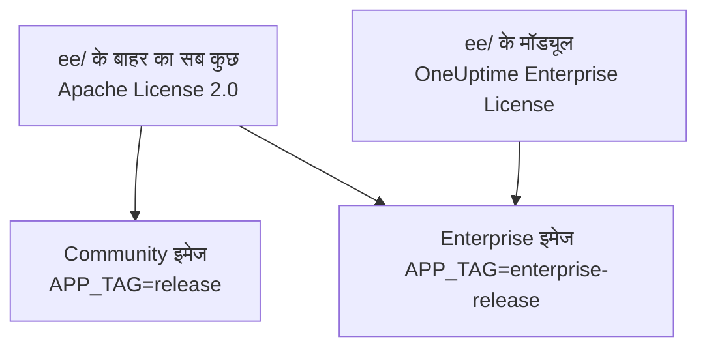
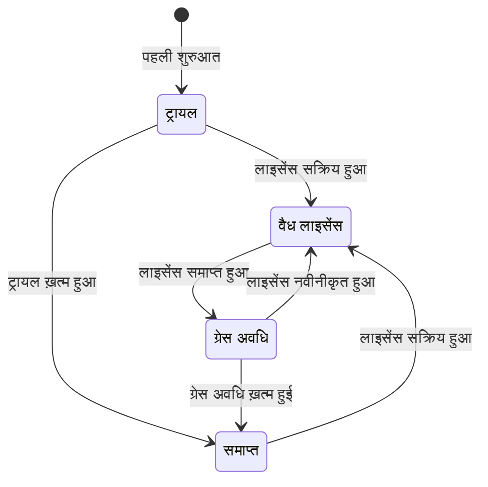

# एंटरप्राइज़ संस्करण

OneUptime एक ही रिपॉज़िटरी से बनता है और दो संस्करणों में आता है:

- **Community Edition**: मॉनिटरिंग, इंसिडेंट और ऑब्ज़र्वेबिलिटी का पूरा प्लेटफ़ॉर्म, जिसमें SAML और OpenID Connect सिंगल साइन-ऑन भी शामिल है। यह Apache License 2.0 के तहत ओपन सोर्स है और किसी भी पैमाने पर ख़ुद होस्ट करने के लिए मुफ़्त है।
- **Enterprise Edition**: Community Edition के साथ रिपॉज़िटरी की [`ee/`](https://github.com/OneUptime/oneuptime/tree/master/ee) डायरेक्टरी के एंटरप्राइज़ मॉड्यूल। ये मॉड्यूल SCIM प्रोविजनिंग और गवर्नेंस तथा इंस्टेंस-प्रशासन की सुविधाएँ जोड़ते हैं। ये [OneUptime Enterprise License](https://github.com/OneUptime/oneuptime/blob/master/ee/LICENSE) के तहत लाइसेंस किए गए हैं, और प्रोडक्शन में इस्तेमाल के लिए आपके उपयोगकर्ताओं की संख्या के हिसाब से Enterprise लाइसेंस चाहिए।

दोनों संस्करण अलग-अलग कंटेनर इमेज हैं। Community इमेज में `ee/` का कोई कोड नहीं है। OneUptime Cloud, Enterprise Edition पर चलता है, और क्लाउड पर आपका प्लान तय करता है कि इनमें से कौन-सी सुविधाएँ आपको मिलेंगी।



> [!NOTE]
> **सिंगल साइन-ऑन हर संस्करण में है।** प्रोजेक्ट और स्टेटस पेज के लिए SAML और OIDC साइन-इन, ग्लोबल SSO और "Require SSO for login" Community Edition का हिस्सा हैं, और कोई भी लाइसेंस स्थिति इन्हें बंद नहीं करती।

यह पृष्ठ बताता है कि हर संस्करण में क्या शामिल है, Enterprise Edition कैसे चलाएँ, लाइसेंसिंग कैसे काम करती है, और संस्करण बदलने पर क्या होता है।

:::cards
- [संस्करणों की तुलना करें](#हर-संस्करण-में-क्या-शामिल-है): Enterprise Edition क्या जोड़ता है।
- [Enterprise इमेज चलाएँ](#enterprise-edition-चलाना): Kubernetes या Docker Compose पर, बस एक सेटिंग।
- [लाइसेंस सक्रिय करें](#लाइसेंसिंग): कुंजी से ऑनलाइन, या हस्ताक्षरित टोकन से ऑफ़लाइन।
- [जब लाइसेंस समाप्त हो](#जब-लाइसेंस-समाप्त-हो-जाए-या-न-हो): क्या रुकता है, क्या कभी नहीं रुकता, और सब कैसे लौटता है।
:::

## हर संस्करण में क्या शामिल है

| सुविधा | Community | Enterprise | OneUptime Cloud |
| --- | --- | --- | --- |
| मॉनिटरिंग, अलर्ट, इंसिडेंट, ऑन-कॉल, स्टेटस पेज, लॉग, मेट्रिक्स, ट्रेस, एक्सेप्शन, डैशबोर्ड, वर्कफ़्लो, AI सुविधाएँ, API और Terraform | हाँ | हाँ | हर प्लान |
| पासवर्ड से साइन-इन, दो-कारक प्रमाणीकरण, टीमें, भूमिकाएँ और API कुंजियाँ | हाँ | हाँ | हर प्लान |
| प्रोजेक्ट साइन-इन के लिए [SAML SSO और OpenID Connect](/docs/identity/sso) | हाँ | हाँ | Scale प्लान और उससे ऊपर |
| निजी स्टेटस पेज साइन-इन के लिए SAML SSO और OpenID Connect | हाँ | हाँ | Scale प्लान और उससे ऊपर |
| [ग्लोबल (पूरे इंस्टेंस के लिए) SSO और OIDC](/docs/identity/global-sso) | हाँ | हाँ | लागू नहीं |
| प्रोजेक्ट और स्टेटस पेज के लिए [SCIM प्रोविजनिंग](/docs/identity/scim) | नहीं | हाँ | Scale प्लान और उससे ऊपर |
| टीम अनुपालन सेटिंग्स | नहीं | हाँ | Scale प्लान और उससे ऊपर |
| ऑडिट लॉग | नहीं | हाँ | Enterprise प्लान |
| रिटेंशन ओवरराइड: टेलीमेट्री के प्रकार के अनुसार रिटेंशन (लॉग, ट्रेस, मेट्रिक्स, प्रोफ़ाइल, लॉग की गंभीरता और ट्रेस की स्थिति के नियमों के साथ), और हर सेवा और हर संसाधन के लिए रिटेंशन | नहीं | हाँ | Scale प्लान और उससे ऊपर |
| एडमिन के **Health** डैशबोर्ड: इंस्टेंस का अवलोकन, बैकग्राउंड कतारें, इंस्टेंस लॉग, PostgreSQL, Valkey, ClickHouse क्लस्टर, डायग्नोस्टिक लॉग और टेलीमेट्री इनजेशन | नहीं | हाँ | लागू नहीं |
| एडमिन का **Query Console** | नहीं | हाँ | उपलब्ध नहीं |
| PostgreSQL और Valkey (Redis) हेल्थ अलर्ट | नहीं | हाँ | लागू नहीं |
| ClickHouse क्षमता दृश्य, क्षमता अलर्ट और डिस्क की स्वचालित सफ़ाई | हाँ | हाँ | लागू नहीं |
| एडमिन डैशबोर्ड में माइग्रेशन स्थिति, सपोर्ट बंडल और ग्लोबल प्रोब | हाँ | हाँ | लागू नहीं |
| Enterprise लाइसेंस, सीट और इंस्टेंस प्रबंधन | नहीं | हाँ | लागू नहीं |

सिंगल साइन-ऑन में दोनों संस्करणों में प्रोजेक्ट, निजी स्टेटस पेज और पूरे इंस्टेंस के लिए "Require SSO for login" शामिल है।

हर संस्करण में प्रोजेक्ट का डिफ़ॉल्ट टेलीमेट्री रिटेंशन होता है, जो **प्रोजेक्ट सेटिंग्स > टेलीमेट्री और APM > डेटा प्रतिधारण** पर है। रिटेंशन ओवरराइड वह है जो Enterprise Edition इसके ऊपर जोड़ता है।

OneUptime Cloud पर किसी भी प्लान में सशुल्क सुविधा को हमेशा बंद किया जा सकता है। जो रिटेंशन ओवरराइड किसी ट्रायल (या निचले प्लान पर जाने) के बाद सेट रह गया, वह नई टेलीमेट्री पर लागू होता रहता है, इसलिए Scale प्लान से नीचे रिटेंशन पेज उसे अपग्रेड कार्ड के नीचे **ओवरराइड हटाएँ** बटन के साथ दिखाते हैं। हटाना हर प्लान पर काम करता है; उसे फिर से सेट करने के लिए Scale प्लान चाहिए। पहले से संग्रहीत टेलीमेट्री उसी रिटेंशन के साथ रहती है जिसके साथ वह संग्रहीत हुई थी। इसी तरह, जब तक प्रोजेक्ट अब भी SSO अनिवार्य करता है, **प्रोजेक्ट सेटिंग्स > सुरक्षा > SSO** अपने अपग्रेड कार्ड के नीचे **लॉगिन के लिए SSO अनिवार्य करें** स्विच दिखाता है, ताकि उसे बंद किया जा सके।

"लागू नहीं" वाली पंक्तियाँ इंस्टेंस-प्रशासन की सुविधाएँ हैं। OneUptime Cloud पर इंस्टेंस को OneUptime आपके लिए चलाता है।

## Enterprise Edition चलाना

दोनों संस्करण एक ही कॉन्फ़िगरेशन, एक ही डेटाबेस और एक ही डेटा इस्तेमाल करते हैं। संस्करण बदलने से सिर्फ़ वह इमेज बदलती है जो आप चलाते हैं, और कुछ नहीं। किसी भी दिशा में माइग्रेशन की ज़रूरत नहीं है।

:::tabs
@tab Kubernetes
अपनी `values.yaml` में इमेज का प्रकार सेट करें:

```yaml title="values.yaml"
image:
  type: enterprise-edition
```

फिर हमेशा की तरह अपग्रेड करें:

```bash
helm upgrade my-oneuptime oneuptime/oneuptime -f values.yaml
```

इसके बाद चार्ट हर इमेज टैग का `enterprise-` संस्करण खींचता है, उदाहरण के लिए `oneuptime/app:enterprise-release`, या जब आप `image.tag` पिन करते हैं तो `enterprise-<version>`। Community Edition चलाने के लिए `image.type: community-edition` (डिफ़ॉल्ट) सेट करें।
@tab Docker Compose
अपनी `config.env` में `APP_TAG` सेट करें:

```bash title="config.env"
APP_TAG=enterprise-release
```

किसी रिलीज़ को पिन करने के लिए `enterprise-<version>` इस्तेमाल करें। फिर इमेज खींचें और रीस्टार्ट करें:

```bash
npm run update
```

Community Edition पर लौटने के लिए `APP_TAG=release` **और** `IS_ENTERPRISE_EDITION=false` सेट करें। जब तक `IS_ENTERPRISE_EDITION=true` सेट है, `npm run update` `APP_TAG` को वापस `enterprise-release` कर देता है, और Community इमेज शुरू होने से मना कर देती है।
:::

### `IS_ENTERPRISE_EDITION` अप्रचलित है

संस्करण वह इमेज तय करती है जो आप चलाते हैं। `IS_ENTERPRISE_EDITION` अब एंटरप्राइज़ सुविधाएँ चालू नहीं करता, और इसे किसी आने वाली रिलीज़ में हटा दिया जाएगा। आप इसे सेट किए बिना छोड़ सकते हैं।

Community इमेज पर `IS_ENTERPRISE_EDITION=true` सेट करने से एंटरप्राइज़ सुविधाएँ चालू **नहीं** होतीं। इसके बजाय ऐप **शुरू होने से मना कर देता है**, ताकि Community इमेज पर पहुँचने वाला अपग्रेड कभी चुपचाप SCIM प्रोविजनिंग (डीप्रोविजनिंग सहित) और ऑडिट लॉगिंग को न रोक सके। त्रुटि बताती है कि क्या सेट करना है: Enterprise Edition बनाए रखने के लिए `APP_TAG=enterprise-<version>`, या Community Edition चलाने के लिए `IS_ENTERPRISE_EDITION=false`। Helm के साथ ऐसा नहीं हो सकता: चार्ट इस वेरिएबल को `image.type` से निकालता है।

`ONEUPTIME_EDITION=community` से Enterprise इमेज Community Edition की तरह चलती है। डाउनग्रेड करने से पहले उसे आज़माने के लिए यह उपयोगी है। Enterprise इमेज `ONEUPTIME_EDITION=enterprise` ख़ुद सेट करती है; इसे `community` के अलावा किसी और मान से ओवरराइड न करें।

## लाइसेंसिंग

रिपॉज़िटरी के रूट की [`LICENSE`](https://github.com/OneUptime/oneuptime/blob/master/LICENSE) फ़ाइल तय करती है कि कौन-सा लाइसेंस किस पर लागू होता है: `ee/` डायरेक्टरी की हर चीज़ [OneUptime Enterprise License](https://github.com/OneUptime/oneuptime/blob/master/ee/LICENSE) के तहत है, तीसरे पक्ष के कंपोनेंट उन्हीं लाइसेंसों के तहत रहते हैं जिनके तहत उनके मालिक उन्हें देते हैं, और बाकी सब Apache License 2.0 के तहत है।

नया Enterprise Edition इंस्टॉल **14 दिन के ट्रायल** के रूप में चलता है, जिसकी गिनती उस समय से होती है जब इंस्टॉल पहली बार Enterprise Edition शुरू करता है। ट्रायल मूल्यांकन के लिए है: Enterprise Edition को प्रोडक्शन में इस्तेमाल करने के लिए OneUptime Enterprise License के तहत सब्सक्रिप्शन चाहिए। ट्रायल समाप्त होने से पहले लाइसेंस सक्रिय करें: उसके बाद SCIM, ऑडिट लॉगिंग और रिटेंशन ओवरराइड रुक जाते हैं और एंटरप्राइज़ कॉन्फ़िगरेशन केवल-पढ़ने योग्य हो जाता है ([जब लाइसेंस समाप्त हो जाए या न हो](#जब-लाइसेंस-समाप्त-हो-जाए-या-न-हो) देखें)। लाइसेंस पाने के लिए [sales@oneuptime.com](mailto:sales@oneuptime.com) से संपर्क करें।

लाइसेंस का प्रबंधन **संस्करण लेबल** से होता है, जिसे मास्टर एडमिन एडमिन डैशबोर्ड के हेडर में और Dashboard के फ़ुटर में देखते हैं। यह लाइसेंस की स्थिति, सीटों का उपयोग और, मास्टर एडमिन के लिए, इंस्टेंस ID दिखाता है।

### ऑनलाइन सक्रियण (लाइसेंस कुंजी)

:::steps
1. मास्टर एडमिन के रूप में साइन इन करें और संस्करण लेबल खोलें।
2. अपनी लाइसेंस कुंजी दर्ज करें और उसे मान्य करें।
:::

इंस्टॉल OneUptime से कुंजी जाँचता है और मिला हुआ लाइसेंस संग्रहीत करता है। उसके बाद वह रोज़ाना सिंक से लाइसेंस को अद्यतन रखता है। अतिरिक्त सीटों या नवीनीकरण जैसे बदलाव तुरंत लाने के लिए संस्करण लेबल पर **Refresh license** इस्तेमाल करें।

ऑनलाइन सक्रियण के लिए OneUptime सर्वर से `https://oneuptime.com` तक आउटबाउंड HTTPS चाहिए। अगर सर्वर इंटरनेट तक सिर्फ़ किसी रिले के ज़रिए पहुँचता है, तो `ENTERPRISE_LICENSE_SERVER_URL` को रिले के `https://` पते पर सेट करें। रिले को `/api/enterprise-license/` को oneuptime.com पर आगे भेजना होगा।

### ऑफ़लाइन सक्रियण (एयर-गैप्ड इंस्टॉल)

जिस इंस्टॉल का इंटरनेट तक कोई रास्ता नहीं है, वह कुंजी के बजाय **हस्ताक्षरित लाइसेंस टोकन** इस्तेमाल कर सकता है:

:::steps
1. मास्टर एडमिन के रूप में साइन इन करें, संस्करण लेबल खोलें और **इंस्टेंस ID** नोट करें।
2. OneUptime ([sales@oneuptime.com](mailto:sales@oneuptime.com)) से उस इंस्टेंस ID के लिए ऑफ़लाइन लाइसेंस टोकन माँगें।
3. टोकन को संस्करण लेबल के टोकन फ़ील्ड में चिपकाएँ और उसे सक्रिय करें।
:::

इंस्टॉल आपकी रिलीज़ में बनी OneUptime हस्ताक्षर कुंजियों से टोकन की जाँच ख़ुद करता है। वह कभी OneUptime से संपर्क नहीं करता। किसी एक इंस्टेंस ID के लिए जारी टोकन को हर दूसरा इंस्टॉल अस्वीकार करता है, और बिना इंस्टेंस ID के जारी टोकन (जैसे वह टोकन जो ऑनलाइन सक्रिय किए गए इंस्टॉल को मिलता है) भी अस्वीकार होता है। नवीनीकरण करने या सीटें जोड़ने के लिए, मौजूदा टोकन समाप्त होने से पहले नया टोकन सक्रिय करें।

> [!IMPORTANT]
> **ऑफ़लाइन सक्रियण के लिए ऐसी रिलीज़ चाहिए जो OneUptime की लाइसेंस हस्ताक्षर कुंजी पर भरोसा करती हो।** अगर आपकी रिलीज़ में वह कुंजी अभी नहीं है, तो सक्रियण "this build does not trust the key that signed this token" के साथ विफल होता है। ऐसे में ऑनलाइन सक्रिय करें, या उस रिलीज़ पर अपग्रेड करें जिसमें कुंजी शामिल है।

### रोज़ाना लाइसेंस सिंक क्या भेजता है

ऑनलाइन सक्रिय किया गया इंस्टॉल दिन में एक बार OneUptime को एक रिपोर्ट भेजता है। इसमें होता है:

- लाइसेंस कुंजी;
- इंस्टेंस ID (इंस्टॉल द्वारा बनाया गया एक रैंडम पहचानकर्ता) और वह होस्ट नाम जिसके साथ इंस्टॉल कॉन्फ़िगर है (`HOST`);
- इंस्टॉल जिस OneUptime संस्करण पर चलता है;
- इंस्टॉल पर उपयोगकर्ताओं की संख्या;
- हर उपयोगकर्ता के ईमेल पते का, छोटे अक्षरों में बदलकर बनाया गया **SHA-256 हैश**। OneUptime इन हैश से आपके कई इंस्टॉल पर खाते रखने वाले व्यक्ति को एक ही सीट गिनता है। सामान्य उपयोगकर्ताओं के असली ईमेल पते कभी नहीं भेजे जाते;
- इंस्टॉल के **मास्टर एडमिन** के ईमेल पते, ताकि OneUptime नवीनीकरण और सीट सीमाओं के बारे में आपसे संपर्क कर सके।

जवाब में वह लाइसेंस होता है जैसा OneUptime उस दिन उसे जानता है: कंपनी का नाम, समाप्ति, सीट सीमा, आपके सभी इंस्टॉल में मिलाकर उपयोगकर्ताओं की संख्या, और लाइसेंस पर पंजीकृत इंस्टॉल। इंस्टॉल की दूसरी प्रतिकृतियाँ लगभग एक मिनट के भीतर बदलाव ले लेती हैं।

जब आप लाइसेंस सक्रिय या रीफ़्रेश करते हैं, तो इंस्टॉल सिर्फ़ लाइसेंस कुंजी, इंस्टेंस ID, होस्ट नाम और संस्करण भेजता है।

इसके अलावा कुछ नहीं भेजा जाता। कोई मॉनिटरिंग डेटा, टेलीमेट्री, लॉग या कॉन्फ़िगरेशन इंस्टॉल से बाहर नहीं जाता। Community Edition इनमें से कुछ नहीं भेजता, और न ही ऑफ़लाइन सक्रिय किया गया इंस्टॉल।

### जब लाइसेंस समाप्त हो जाए या न हो

हर एंटरप्राइज़ सुविधा 14 दिन के ट्रायल के दौरान, और लाइसेंस समाप्त होने के बाद 30 दिन तक (ग्रेस अवधि) काम करती है। इनमें से किसी के भी ख़त्म होने से पहले संस्करण लेबल चेतावनी देता है। उसके बाद, जब तक लाइसेंस सक्रिय न हो, **SCIM, ऑडिट लॉगिंग और रिटेंशन ओवरराइड रुक जाते हैं**, बिल्कुल Community Edition की तरह, और एंटरप्राइज़ कॉन्फ़िगरेशन केवल-पढ़ने योग्य हो जाता है। सिंगल साइन-ऑन कोई एंटरप्राइज़ सुविधा नहीं है: SAML और OIDC साइन-इन, ग्लोबल SSO और "Require SSO for login" हर लाइसेंस स्थिति में एक जैसे काम करते हैं।



| स्थिति | क्या होता है |
| --- | --- |
| **वैध लाइसेंस** | हर एंटरप्राइज़ सुविधा काम करती है। लाइसेंस वाली सीटों की संख्या से ज़्यादा नए उपयोगकर्ता नहीं जोड़े जा सकते। मौजूदा उपयोगकर्ता कभी नहीं हटाए जाते। |
| **ट्रायल या ग्रेस अवधि** (बिना लाइसेंस वाले इंस्टॉल के पहले 14 दिन, या लाइसेंस समाप्त होने के बाद 30 दिन), या ऐसा इंस्टॉल जिसके पास ऐसा लाइसेंस है जिसकी समाप्ति कभी दर्ज नहीं हुई | हर एंटरप्राइज़ सुविधा काम करती है, और संस्करण लेबल एक चेतावनी दिखाता है। समाप्ति के बाद की ग्रेस अवधि में सीट सीमा अब भी लागू रहती है। बिना दर्ज समाप्ति वाले लाइसेंस वाला इंस्टॉल बिना लाइसेंस वाले इंस्टॉल जैसा ही 14 दिन का ट्रायल चलाता है, और सीट सीमा लागू नहीं होती, क्योंकि उसके पास जो लाइसेंस रिकॉर्ड है वह पहले से अधूरा है। |
| **ट्रायल या ग्रेस अवधि के बाद** (समाप्त, अनुपस्थित या अमान्य लाइसेंस, या ऐसा लाइसेंस जिसमें वह सुविधा शामिल नहीं है) | SCIM प्रोविजनिंग, ऑडिट लॉगिंग और रिटेंशन ओवरराइड **रुक जाते हैं** (नीचे देखें)। एंटरप्राइज़ कॉन्फ़िगरेशन **केवल-पढ़ने योग्य** हो जाता है: आप उसे देख और हटा सकते हैं, लेकिन बना या बदल नहीं सकते। एक बदलाव हमेशा काम करता है, ताकि आप किसी इंसिडेंट पर प्रतिक्रिया दे सकें: SCIM बियरर टोकन बदलना। जब बाकी सब केवल-पढ़ने योग्य हो, तब भी SCIM सेटिंग पेज यह विकल्प देते हैं: SCIM कॉन्फ़िगरेशन पर **Bearer टोकन रीसेट करें**, जो नया टोकन एक बार दिखाता है। API के ज़रिए सिर्फ़ `bearerToken` भेजें (कम से कम 32 वर्ण)। ऑडिट लॉगिंग को न चालू किया जा सकता है, न उसका दायरा बढ़ाया जा सकता है। एंटरप्राइज़ Health डैशबोर्ड और Query Console लॉक हो जाते हैं। सीट सीमा अब लागू नहीं होती। |

लाइसेंस समाप्त होने पर क्या रुकता है:

- **SCIM प्रोविजनिंग रुक जाती है।** आपके आइडेंटिटी प्रोवाइडर के SCIM अनुरोध डीप्रोविजनिंग सहित अस्वीकार हो जाते हैं, और SCIM टीम लॉक हटा दिए जाते हैं, ताकि SCIM पुश ग्रुप द्वारा प्रबंधित टीमों को हाथ से संपादित किया जा सके।
- **ऑडिट लॉगिंग रिकॉर्ड करना बंद कर देती है।** अब तक रिकॉर्ड किए गए ऑडिट लॉग रखे जाते हैं।
- **रिटेंशन ओवरराइड लागू होना बंद हो जाते हैं।** नई टेलीमेट्री प्रोजेक्ट के डिफ़ॉल्ट रिटेंशन तक रखी जाती है। पहले से संग्रहीत टेलीमेट्री उसी रिटेंशन के साथ रहती है जिसके साथ वह लिखी गई थी। आप API के ज़रिए अब भी किसी ओवरराइड को हटा सकते हैं, लेकिन सेट नहीं कर सकते।

क्या **नहीं** रुकता:

- **सिंगल साइन-ऑन।** प्रोजेक्ट, निजी स्टेटस पेज, पूरे इंस्टेंस (ग्लोबल SSO) और मोबाइल ऐप के लिए SAML और OIDC साइन-इन, और "Require SSO for login", हर संस्करण का हिस्सा हैं। समाप्त लाइसेंस इनमें से कुछ नहीं बदलता, और सिंगल साइन-ऑन कॉन्फ़िगरेशन संपादन योग्य रहता है।
- **मुख्य मॉनिटरिंग पर कभी असर नहीं पड़ता**: मॉनिटर, अलर्ट, इंसिडेंट, ऑन-कॉल, स्टेटस पेज और टेलीमेट्री सब काम करते रहते हैं।
- **मास्टर एडमिन हमेशा अपने पासवर्ड से साइन इन कर सकते हैं।**
- **कुछ भी नहीं हटाया जाता।** SCIM कॉन्फ़िगरेशन, ऑडिट लॉग और रिटेंशन ओवरराइड जैसे हैं वैसे ही रहते हैं।

**लाइसेंस सक्रिय होते ही सब कुछ फिर शुरू हो जाता है**, बिना रीस्टार्ट के: SCIM प्रोविजनिंग, ऑडिट लॉगिंग और रिटेंशन ओवरराइड आपके मौजूदा कॉन्फ़िगरेशन के साथ लौट आते हैं। OneUptime इन्हें सिर्फ़ तब बंद करता है जब उसे पता हो कि लाइसेंस समाप्त हो गया है। जब तक वह लाइसेंस की स्थिति नहीं पढ़ पाता, उदाहरण के लिए सर्वर शुरू होते समय एक पल के लिए, SCIM, ऑडिट लॉगिंग और रिटेंशन ओवरराइड चालू रहते हैं।

> [!WARNING]
> **अगर आपका आइडेंटिटी प्रोवाइडर SCIM के ज़रिए उपयोगकर्ताओं को डीप्रोविज़न करता है, तो ट्रायल या ग्रेस अवधि ख़त्म होने से पहले लाइसेंस सक्रिय करें।** उसके बाद SCIM उन लोगों को डीप्रोविज़न नहीं करता जिन्हें आप अपने आइडेंटिटी प्रोवाइडर से हटाते हैं: उनके OneUptime खाते बने रहते हैं, और जब तक उन पर "Require SSO for login" लागू न हो, ऐसे खाते के ईमेल इनबॉक्स तक अब भी पहुँच रखने वाला कोई भी व्यक्ति पासवर्ड सेट करके साइन इन कर सकता है। अगर आप लाइसेंस को समाप्त होने देते हैं, तो उन उपयोगकर्ताओं को OneUptime में ख़ुद हटाएँ।

## Enterprise से Community पर जाना

आपका कॉन्फ़िगरेशन डेटाबेस में रहता है। जब तक इंस्टॉल के पास वैध लाइसेंस है या वह अब भी ट्रायल या ग्रेस अवधि में है, Enterprise इमेज पर लौटने से सब कुछ पहले जैसा बहाल हो जाता है। सिंगल साइन-ऑन नहीं बदलता: SAML और OIDC साइन-इन, ग्लोबल SSO और "Require SSO for login" दोनों इमेज पर एक जैसे काम करते हैं। Community इमेज पर:

- **SCIM रुक जाता है।** इसके प्रोविजनिंग एंडपॉइंट अब मौजूद नहीं रहते, इसलिए IdP से चलाए गए SCIM कॉल विफल हो जाते हैं। इसमें SCIM डीप्रोविजनिंग भी शामिल है।
- **SCIM टीम लॉक हटा दिए जाते हैं**, ताकि जिन टीमों को SCIM पुश ग्रुप प्रबंधित करते थे उन्हें हाथ से संपादित किया जा सके। शुरू होते समय सर्वर लॉग करता है कि किन प्रोजेक्ट के SCIM टीम लॉक हटाए गए।
- **ऑडिट लॉगिंग रुक जाती है।** अब तक रिकॉर्ड किए गए ऑडिट लॉग रखे जाते हैं, लेकिन ऑडिट लॉग पेज अपग्रेड का संकेत दिखाते हैं।
- **रिटेंशन ओवरराइड लागू होना बंद हो जाते हैं।** नई टेलीमेट्री प्रोजेक्ट के डिफ़ॉल्ट रिटेंशन तक रखी जाती है, और **प्रोजेक्ट सेटिंग्स > टेलीमेट्री और APM > डेटा प्रतिधारण** पर और हर सेवा और हर संसाधन के सेटिंग पेज पर रिटेंशन कार्ड अपग्रेड का संकेत दिखाते हैं। ओवरराइड डेटाबेस में रहते हैं और वापस लौटने पर फिर से लागू होते हैं।
- **एंटरप्राइज़ सेटिंग पेज अपग्रेड का संकेत दिखाते हैं।** API के ज़रिए आप अब भी एंटरप्राइज़ कॉन्फ़िगरेशन पढ़ और हटा सकते हैं और SCIM बियरर टोकन रीसेट कर सकते हैं, लेकिन और कुछ बना या बदल नहीं सकते। ऑडिट लॉगिंग चालू नहीं की जा सकती।
- **एंटरप्राइज़ Health डैशबोर्ड, Query Console, और PostgreSQL और Valkey हेल्थ अलर्ट रुक जाते हैं।** ClickHouse क्षमता मॉनिटरिंग और सफ़ाई, माइग्रेशन स्थिति और सपोर्ट बंडल काम करते रहते हैं।

> [!CAUTION]
> **जिस इंस्टॉल का आइडेंटिटी प्रोवाइडर SCIM के ज़रिए उपयोगकर्ताओं को डीप्रोविज़न करता है, उसे Community इमेज पर ले जाने से पहले जाँच लें कि किसके पास पहुँच है।** SCIM के बिना, जिन लोगों को आप अपने आइडेंटिटी प्रोवाइडर से हटाते हैं, वे अपने OneUptime खाते रखे रहते हैं, और जब तक उन पर "Require SSO for login" लागू न हो, ऐसे खाते के ईमेल इनबॉक्स तक अब भी पहुँच रखने वाला कोई भी व्यक्ति पासवर्ड सेट करके साइन इन कर सकता है। पहले उन उपयोगकर्ताओं को हटाएँ।

## समस्या निवारण

:::details अपग्रेड के बाद ऐप शुरू होने से मना करता है
Community इमेज पर `IS_ENTERPRISE_EDITION=true` सेट है। Enterprise Edition बनाए रखने के लिए `APP_TAG=enterprise-<version>`, या Community Edition चलाने के लिए `IS_ENTERPRISE_EDITION=false` सेट करें, फिर `npm run update` दोबारा चलाएँ।
:::

:::details ऑफ़लाइन सक्रियण "this build does not trust the key that signed this token" के साथ विफल होता है
आपकी रिलीज़ OneUptime की लाइसेंस हस्ताक्षर कुंजी पर भरोसा करने से पहले बनी थी। ऑनलाइन सक्रिय करें, या उस रिलीज़ पर अपग्रेड करें जिसमें कुंजी शामिल है।
:::

:::details आपके आइडेंटिटी प्रोवाइडर के SCIM अनुरोध अस्वीकार होते हैं
Enterprise इमेज पर लाइसेंस समाप्त हो गया है: एक लाइसेंस सक्रिय करें, और प्रोविजनिंग बिना रीस्टार्ट के फिर शुरू हो जाती है। Community इमेज पर SCIM एंडपॉइंट मौजूद ही नहीं हैं।
:::

## अगले कदम

:::cards
- [अपग्रेड करना](/docs/installation/upgrading): नई रिलीज़ पर जाएँ, और संस्करणों की इमेज के बीच बदलें।
- [SSO](/docs/identity/sso): सिंगल साइन-ऑन, हर संस्करण में।
- [ग्लोबल SSO](/docs/identity/global-sso): पूरे इंस्टेंस के लिए एक आइडेंटिटी प्रोवाइडर।
- [SCIM](/docs/identity/scim): अपने आइडेंटिटी प्रोवाइडर से उपयोगकर्ताओं और टीमों को प्रोविज़न करें।
:::
