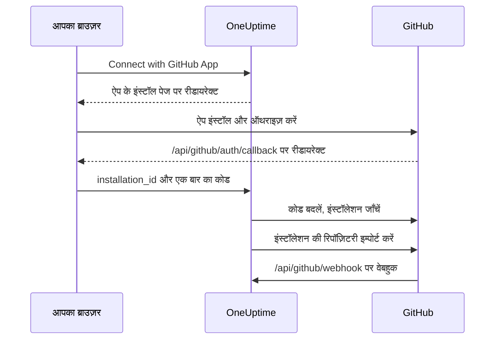

# GitHub एकीकरण

अपने सेल्फ़-होस्टेड OneUptime को अपने ख़ुद के GitHub App से GitHub से जोड़ें। OneUptime से ऐप इंस्टॉल होने के बाद, इंस्टॉलेशन की रिपॉज़िटरी आपके प्रोजेक्ट में इम्पोर्ट होती हैं और सिंक रहती हैं, AI फ़िक्स टास्क pull request खोलते हैं, और आपकी टीम GitHub में ऐप का ज़िक्र करके उसे काम सौंप सकती है।

यह पेज उनके लिए है जो OneUptime सर्वर चलाते हैं: आप ऐप एक बार बनाते हैं, और फिर हर प्रोजेक्ट उसे **कोड रिपॉजिटरीज़** से जोड़ता है।

:::cards
- [GitHub App बनाएँ](#github-app-बनाएँ): सही URL, अनुमतियों और इवेंट के साथ ऐप रजिस्टर करें।
- [OneUptime कॉन्फ़िगर करें](#oneuptime-कॉन्फ़िगर-करें): सर्वर को ऐप के छह मान दें।
- [रिपॉज़िटरी जोड़ें](#रिपॉज़िटरी-जोड़ें): OneUptime से ऐप इंस्टॉल करें।
- [समस्या निवारण](#समस्या-निवारण): कोड रिपॉजिटरीज़ के संदेशों का क्या मतलब है।
:::

## यह कैसे काम करता है

इंस्टॉल करना GitHub पर नहीं, OneUptime में शुरू होता है: OneUptime जिस लिंक के साथ आपको GitHub पर भेजता है, वही इंस्टॉलेशन को आपके प्रोजेक्ट से जोड़ता है।



- ब्राउज़र रीडायरेक्ट में इंस्टॉलेशन और एक बार इस्तेमाल होने वाला OAuth कोड होता है। OneUptime यह पुष्टि करने के लिए कोड बदलता है कि ऐप इंस्टॉल करने वाला GitHub खाता उस इंस्टॉलेशन का प्रबंधन करता है, फिर उसकी रिपॉज़िटरी इम्पोर्ट करता है।
- वेबहुक रिपॉज़िटरी की सूची सिंक रखते हैं और ऐप को काम सौंपते हैं: मेंशन, असाइनमेंट, ट्रिगर लेबल और रिव्यू अनुरोध। GitHub हर वेबहुक को webhook secret से साइन करता है, और OneUptime वह हर वेबहुक अस्वीकार करता है जिसे वह सत्यापित नहीं कर पाता।

## शुरू करने से पहले

- एक GitHub खाता जो उस संगठन या उपयोगकर्ता के लिए GitHub Apps बना सके जिस पर ऐप इंस्टॉल होगा। किसी संगठन पर इंस्टॉल करने के लिए आपको उसका मालिक होना चाहिए, या किसी मालिक से अनुरोध स्वीकृत कराना चाहिए।
- OneUptime के लिए एक सार्वजनिक HTTPS होस्टनेम जिस तक GitHub वेबहुक के लिए पहुँच सके। देखें [नेटवर्क एक्सेस](#सेल्फ़-होस्टेड-डिप्लॉयमेंट-के-लिए-नेटवर्क-एक्सेस)।
- सर्वर के कॉन्फ़िगरेशन तक पहुँच: Docker Compose के लिए `config.env`, या Kubernetes के लिए आपकी Helm values।

## GitHub App बनाएँ

:::steps
### GitHub App की सेटिंग्स खोलें

- **किसी संगठन के लिए:** `https://github.com/organizations/YOUR_ORG/settings/apps`
- **किसी निजी खाते के लिए:** `https://github.com/settings/apps`

**New GitHub App** चुनें।

### रजिस्ट्रेशन फ़ॉर्म भरें

| फ़ील्ड | मान |
| --- | --- |
| **GitHub App name** | कोई भी अनोखा नाम, जैसे `OneUptime`। इसे ठीक-ठीक नोट करें: यही `GITHUB_APP_NAME` है। |
| **Homepage URL** | `https://your-oneuptime-domain.com` |
| **Callback URL** | `https://your-oneuptime-domain.com/api/github/auth/callback` |
| **Request user authorization (OAuth) during installation** | चालू। **यह ज़रूरी है**: नीचे दी गई टिप्पणी देखें। |
| **Setup URL** | अगर GitHub दर्ज करने दे, तो `https://your-oneuptime-domain.com/api/github/auth/callback` (नीचे देखें)। |
| **Redirect on update** | वैकल्पिक। GitHub पर कोई इंस्टॉलेशन बदलने के बाद, OneUptime उस व्यक्ति को **कोड रिपॉजिटरीज़** पर ले जाता है। |
| **Webhook URL** | `https://your-oneuptime-domain.com/api/github/webhook`, वेबहुक को **Active** रखते हुए। |
| **Webhook secret** | एक लंबी रैंडम स्ट्रिंग। इसे नोट करें: यही `GITHUB_APP_WEBHOOK_SECRET` है। **ज़रूरी**: OneUptime बिना साइन वाले वेबहुक अस्वीकार करता है, इसलिए `GITHUB_APP_WEBHOOK_SECRET` सेट न करने पर असत्यापित पेलोड स्वीकार होने के बजाय रिपॉज़िटरी का सिंक रुक जाता है। |

GitHub के दस्तावेज़ों के अनुसार, **Request user authorization (OAuth) during installation** चालू होने पर [आप Setup URL दर्ज नहीं कर सकते](https://docs.github.com/en/apps/creating-github-apps/registering-a-github-app/about-the-setup-url): ऐप इंस्टॉल करने के बाद उपयोगकर्ता इसके बजाय Callback URL पर भेजे जाते हैं। दोनों एक ही OneUptime पते की ओर इशारा करते हैं, इसलिए रीडायरेक्ट हर हाल में सही जगह पहुँचता है।

> [!IMPORTANT]
> **"Request user authorization (OAuth) during installation" क्यों ज़रूरी है।** इंस्टॉल के बाद, GitHub URL में एक `installation_id` के साथ वापस रीडायरेक्ट करता है। सिर्फ़ यह संख्या इस बारे में कुछ साबित नहीं करती कि इंस्टॉलेशन का मालिक कौन है — कोई भी दूसरी संख्या टाइप कर सकता है। यह विकल्प चालू होने पर GitHub एक बार इस्तेमाल होने वाला OAuth `code` भी लौटाता है, जो इंस्टॉल करने वाले GitHub खाते से बँधा होता है, और OneUptime उसे बदलकर पुष्टि करता है कि वह खाता सचमुच उस इंस्टॉलेशन का प्रबंधन करता है, उसके बाद ही उसे आपके प्रोजेक्ट से जोड़ता है।
>
> इसके बिना OneUptime इंस्टॉलेशन जोड़ने से इनकार करता है, और डैशबोर्ड एक त्रुटि दिखाता है जो आपसे यह सेटिंग चालू करने को कहती है। यह जानबूझकर है: इंस्टॉलेशन ID को बिना सत्यापन के मान लेने से एक OneUptime प्रोजेक्ट किसी दूसरे संगठन की रिपॉज़िटरी पर दावा कर सकता था।

### अनुमतियाँ सेट करें

**Permissions & events** के नीचे ये **Repository permissions** सेट करें:

| अनुमति | एक्सेस | OneUptime इसका किस लिए इस्तेमाल करता है |
| --- | --- | --- |
| Contents | Read and write | रिपॉज़िटरी की फ़ाइलें पढ़ना, और AI फ़िक्स pull request की ब्रांच push करना |
| Pull requests | Read and write | pull request खोलना और अपडेट करना, और रिव्यू पोस्ट करना |
| Issues | Read and write | ऐप की टिप्पणियाँ पोस्ट करना — **pull request पर भी**, जिनकी बातचीत GitHub issues API से होकर भेजता है |
| Checks | Read-only | वैकल्पिक। फ़िक्स pull request का CI नतीजा पढ़ना। इसके बिना उनका CI स्टेटस असत्यापित रहता है |
| Metadata | Read-only | रिपॉज़िटरी का बुनियादी मेटाडेटा (GitHub के लिए ज़रूरी) |

**ऐप को इंटरैक्टिव Issues: Read and write ही बनाता है।** इसके बिना मेंशन मिल तो जाते हैं, पर ऐप जवाब देने की कोशिश करते ही चुपचाप विफल हो जाते हैं — GitHub pull request की बातचीत की टिप्पणियाँ issues API से देता है, इसलिए ऐप का हर जवाब इसी एक अनुमति पर निर्भर है। देखें [GitHub से OneUptime के साथ काम करना](/docs/ai/github-app)।

OneUptime को संगठन या खाते की कोई अनुमति नहीं चाहिए।

### वेबहुक इवेंट सब्सक्राइब करें

OneUptime इवेंट के दो समूह इस्तेमाल करता है, और दोनों अलग-अलग काम करते हैं।

**रिपॉज़िटरी सिंक** — `installation` और `installation_repositories`। GitHub Apps को ये अपने आप मिलते हैं; ये जुड़ी हुई रिपॉज़िटरी के सेट को उससे मेल में रखते हैं जहाँ ऐप इंस्टॉल है।

**इंटरैक्टिव ऐप** — इन्हें स्पष्ट रूप से सब्सक्राइब करना होता है, और हर इवेंट ऐप को काम सौंपने का एक ख़ास तरीक़ा चालू करता है:

| इवेंट | क्या संभव बनाता है |
| --- | --- |
| **Issue comment** | issue **और** pull request पर `@mention` कमांड |
| **Issues** | किसी issue को ऐप को असाइन करना, और रिपॉज़िटरी का ट्रिगर लेबल |
| **Pull request** | ऐप से रिव्यू माँगना |
| **Pull request review** | सबमिट किए गए रिव्यू के टेक्स्ट में लिखा मेंशन |
| **Pull request review comment** | diff की किसी इनलाइन टिप्पणी में मेंशन |

अगर इनमें से कोई भी सब्सक्राइब नहीं है, तब भी GitHub App रिपॉज़िटरी जोड़ता है और OneUptime से फ़िक्स pull request खोलता है — बस GitHub में लिखी किसी भी बात का जवाब कभी नहीं देता। "बॉट मुझे अनदेखा करता है" की यही सबसे आम वजह है। कमांड क्या हैं और उन्हें कौन दे सकता है, इसके लिए [GitHub से OneUptime के साथ काम करना](/docs/ai/github-app) देखें।

बाक़ी इवेंट (**Push**, **Workflow run**) स्वीकार करके अनदेखे कर दिए जाते हैं; इन्हें सब्सक्राइब करने से सूचनाएँ या CI/CD ऑटोमेशन चालू नहीं होते।

### चुनें कि ऐप कहाँ इंस्टॉल हो सकता है

**Where can this GitHub App be installed?** के नीचे चुनें:

- **Only on this account** - निजी/अंदरूनी इस्तेमाल के लिए
- **Any account** - अगर आप चाहते हैं कि दूसरे भी आपका ऐप इंस्टॉल करें

### ऐप बनाएँ और उसकी ID नोट करें

**Create GitHub App** चुनें। GitHub ऐप का सेटिंग्स पेज खोलता है। पेज के ऊपर दी गई **App ID** और **About** सेक्शन में दी गई **Client ID** नोट करें।

### client secret बनाएँ

**Client secrets** के नीचे **Generate a new client secret** चुनें। इसे तुरंत कॉपी करें: GitHub इसे सिर्फ़ एक बार दिखाता है।

### प्राइवेट की बनाएँ

**Private keys** के नीचे **Generate a private key** चुनें। GitHub एक `.pem` फ़ाइल डाउनलोड करता है। इसे सुरक्षित रखें: इसी से OneUptime ऐप के रूप में प्रमाणीकरण करता है।
:::

## OneUptime कॉन्फ़िगर करें

:::tabs
@tab Docker Compose
`config.env` में हर पंक्ति में एक मान होता है, इसलिए प्राइवेट की को base64 में एन्कोड करके एक ही पंक्ति में दें। OneUptime उसे डीकोड करता है:

```bash
base64 < private-key.pem | tr -d '\n'
```

```bash title="config.env"
GITHUB_APP_ID=YOUR_APP_ID
GITHUB_APP_NAME=YOUR_APP_NAME
GITHUB_APP_CLIENT_ID=YOUR_CLIENT_ID
GITHUB_APP_CLIENT_SECRET=YOUR_CLIENT_SECRET
GITHUB_APP_PRIVATE_KEY=YOUR_BASE64_ENCODED_PRIVATE_KEY
GITHUB_APP_WEBHOOK_SECRET=YOUR_WEBHOOK_SECRET
```

बदलाव `npm run start` से लागू करें, जो कंटेनर फिर से बनाता है। `docker compose restart` `config.env` दोबारा नहीं पढ़ता।
@tab Kubernetes
```yaml title="values.yaml"
gitHubApp:
  id: "YOUR_APP_ID"
  name: "YOUR_APP_NAME" # The exact name of your GitHub App
  clientId: "YOUR_CLIENT_ID"
  clientSecret: "YOUR_CLIENT_SECRET"
  privateKey: "<BASE64_ENCODED_PRIVATE_KEY_CONTENT>"
  webhookSecret: "YOUR_WEBHOOK_SECRET"
```

`privateKey` में PEM को सीधे भी, कई पंक्तियों वाले ब्लॉक (`privateKey: |`) के रूप में दिया जा सकता है। बदलाव `helm upgrade` से लागू करें।
:::

OneUptime के वापस चालू होने पर, **कोड रिपॉजिटरीज़** में **GitHub App is not configured on this server** की जगह **Connect with GitHub App** दिखता है।

### एनवायरनमेंट वेरिएबल संदर्भ

| Docker Compose (`config.env`) | Helm (`values.yaml`) | मान |
| --- | --- | --- |
| `GITHUB_APP_ID` | `gitHubApp.id` | **App ID**। ऐप के रूप में प्रमाणीकरण के लिए। |
| `GITHUB_APP_NAME` | `gitHubApp.name` | ऐप का सटीक नाम। इंस्टॉल लिंक और ऐप का `@mention` हैंडल (छोटे अक्षरों में, स्पेस की जगह हाइफ़न) इसी से बनते हैं। इसके बिना **कोड रिपॉजिटरीज़** कनेक्ट नहीं कर सकता। |
| `GITHUB_APP_CLIENT_ID` | `gitHubApp.clientId` | **Client ID**। यह जाँचने के लिए ज़रूरी कि ऐप किसने इंस्टॉल किया। |
| `GITHUB_APP_CLIENT_SECRET` | `gitHubApp.clientSecret` | आपका बनाया client secret। client ID के साथ ज़रूरी। |
| `GITHUB_APP_PRIVATE_KEY` | `gitHubApp.privateKey` | प्राइवेट की: PEM, या base64 में एन्कोड किया PEM। |
| `GITHUB_APP_WEBHOOK_SECRET` | `gitHubApp.webhookSecret` | webhook secret। हर वेबहुक इसी से सत्यापित होता है, और इसके बिना कोई भी स्वीकार नहीं होता। |

छहों ज़रूरी हैं।

## रिपॉज़िटरी जोड़ें

कनेक्शन GitHub पर ऐप के पेज से नहीं, OneUptime से शुरू करें: OneUptime जिस लिंक के साथ आपको GitHub पर भेजता है, वही इंस्टॉलेशन को आपके प्रोजेक्ट से जोड़ता है।

:::steps
1. अपने OneUptime डैशबोर्ड में लॉग इन करें
2. **उत्पाद** > **कार्य** > **कोड रिपॉजिटरीज़** पर जाएँ
3. **Connect with GitHub App** पर क्लिक करें। OneUptime आपको GitHub पर ले जाता है
4. वह संगठन या खाता चुनें जिस पर ऐप इंस्टॉल करना है, और चुनें कि वह किन रिपॉज़िटरी तक पहुँच सकता है: **All repositories** (हर मौजूदा और भविष्य की रिपॉज़िटरी) या **Only select repositories**
5. **Install** पर क्लिक करें (या **Save** पर, अगर ऐप वहाँ पहले से इंस्टॉल है)
6. GitHub आपको **कोड रिपॉजिटरीज़** पर वापस भेजता है, और इंस्टॉलेशन की हर रिपॉज़िटरी इम्पोर्ट हो जाती है। बाद में इंस्टॉलेशन में जोड़ी या उससे हटाई गई रिपॉज़िटरी अपने आप सिंक रहती हैं।
:::

**कौन जोड़ सकता है।** जोड़ने से इंस्टॉलेशन की रिपॉज़िटरी प्रोजेक्ट में इम्पोर्ट होती हैं, इसलिए इसके लिए कोड रिपॉज़िटरी जोड़ने की अनुमति चाहिए: **Project Owner**, **Project Admin**, **Project Member**, **Settings Admin**, **Settings Member**, या **Create Code Repository** वाली कोई टीम। जो टीम यह अनुमति ब्लॉक करती है, वह इसे छीन लेती है। OneUptime Cloud पर कोड रिपॉज़िटरी के लिए Growth प्लान या उससे ऊपर चाहिए। बाक़ी सबके लिए कार्ड लॉक रहता है और बताता है कि क्या चाहिए।

**15 मिनट के भीतर, उसी ब्राउज़र में पूरा करें।** लिंक एक बार, 15 मिनट तक, उसी ब्राउज़र में काम करता है जिसमें वह शुरू हुआ था। GitHub के वापस भेजने पर, OneUptime कुछ भी इम्पोर्ट करने से पहले अनुमति फिर से जाँचता है।

## सेल्फ़-होस्टेड डिप्लॉयमेंट के लिए नेटवर्क एक्सेस

### ट्रैफ़िक की दिशा और एंडपॉइंट

| ट्रैफ़िक | ज़रूरी एक्सेस |
| --- | --- |
| OneUptime से GitHub | GitHub App टोकन और रिपॉज़िटरी API कॉल के लिए DNS और `api.github.com` तक TCP 443 पर आउटबाउंड HTTPS, और OAuth टोकन एक्सचेंज और HTTPS Git ऑपरेशन के लिए `github.com` |
| GitHub से OneUptime | इंस्टॉलेशन और रिपॉज़िटरी एक्सेस के सिंक, और इंटरैक्टिव ऐप के लिए `POST /api/github/webhook` तक TCP 443 पर सार्वजनिक HTTPS |
| उपयोगकर्ता के ब्राउज़र से OneUptime | डैशबोर्ड एक्सेस और इंस्टॉलेशन/ऑथराइज़ेशन रीडायरेक्ट के लिए `GET /api/github/auth/callback`; ये उपयोगकर्ता के VPN के ज़रिए ही पहुँच योग्य रह सकते हैं |

callback एक [ब्राउज़र रीडायरेक्ट](https://docs.github.com/en/apps/creating-github-apps/registering-a-github-app/about-the-user-authorization-callback-url) है, जबकि वेबहुक GitHub के सर्वरों से आने वाला अनुरोध है। किसी उपयोगकर्ता का VPN कनेक्शन GitHub को वेबहुक तक पहुँच नहीं देता। ऊपर के डोमेन एकीकरण के मुख्य अनुरोधों को कवर करते हैं; रिपॉज़िटरी के अतिरिक्त टूल, डाउनलोड, LFS या पैकेज के लिए दूसरे गंतव्य चाहिए हो सकते हैं। ये सेटिंग्स GitHub.com के बारे में हैं; फ़ायरवॉल बदलने से GitHub Enterprise Server होस्टनेम का समर्थन कॉन्फ़िगर नहीं होता।

### निजी डिप्लॉयमेंट और कॉलबैक की सुरक्षा

`/api/github/webhook` को एक सार्वजनिक गेटवे से प्रकाशित करें, जिसमें सार्वजनिक DNS, पूरी चेन वाला सार्वजनिक रूप से भरोसेमंद HTTPS सर्टिफ़िकेट और OneUptime के ingress तक एक निजी रूट हो। गेटवे तक इनबाउंड TCP 443 की अनुमति दें और सार्वजनिक फ़ॉरवर्डिंग को इसी POST रूट तक सीमित रखें। अगर उपयोगकर्ता VPN से पहुँचते हैं, तो डैशबोर्ड और ब्राउज़र callback को निजी ingress पर रखें; स्प्लिट DNS एक ही होस्टनेम को अंदर और बाहर दोनों तरफ़ दे सकता है।

`config.env` में `HOST=oneuptime.example.com` और `HTTP_PROTOCOL=https` सेट करें, या Helm में `host: oneuptime.example.com` और `httpProtocol: https`। कॉन्फ़िगरेशन लागू करें और OneUptime के रीस्टार्ट होने तक रुकें। ये मान URL बनाते हैं; ये DNS, TLS या नेटवर्क एक्सेस उपलब्ध नहीं कराते। अगर होस्टनेम बदलता है, तो GitHub App के webhook, callback, setup और homepage URL अपडेट करें।

मेथड, मूल पाथ, क्वेरी स्ट्रिंग, बॉडी, `Content-Type`, `X-Hub-Signature-256`, `X-GitHub-Event` और `X-GitHub-Delivery` बनाए रखें। भरोसेमंद प्रॉक्सी हेडर के ज़रिए सार्वजनिक होस्ट और HTTPS स्कीम बनाए रखें। वेबहुक को ब्राउज़र SSO, CAPTCHA और प्रॉक्सी के लॉगिन पेजों से छूट दें। GitHub का SSL सत्यापन चालू रखें और दोनों सिस्टम में एक ही `GITHUB_APP_WEBHOOK_SECRET` कॉन्फ़िगर करें: OneUptime बिना साइन वाले अनुरोध अस्वीकार करता है और इस सीक्रेट के बिना वेबहुक सत्यापित नहीं कर सकता। GitHub का [वेबहुक सत्यापन मार्गदर्शन](https://docs.github.com/en/webhooks/using-webhooks/validating-webhook-deliveries) देखें।

अगर आप वेबहुक के स्रोत IP भी सीमित करते हैं, तो GitHub की Meta API से मौजूदा `hooks` रेंज इस्तेमाल करें और उन्हें नियमित रूप से रीफ़्रेश करें; उनकी जगह GitHub Actions रनर की रेंज न रखें और सिग्नेचर सत्यापन न छोड़ें। GitHub चेतावनी देता है कि [उसके पते बदलते रहते हैं और प्रकाशित सूची पूरी नहीं है](https://docs.github.com/en/authentication/keeping-your-account-and-data-secure/about-githubs-ip-addresses)।

### एक्सेस सत्यापित करें और सीमाएँ समझें

:::steps
1. **कोड रिपॉजिटरीज़** से एक इंस्टॉलेशन जोड़ें।
2. GitHub App की सेटिंग्स में **Advanced** खोलें और **Recent Deliveries** देखें। किसी डिलीवरी को फिर से भेजें और पुष्टि करें कि गेटवे उसे आगे भेजता है और OneUptime उसे स्वीकार करता है।
3. इंस्टॉलेशन में कोई टेस्ट रिपॉज़िटरी जोड़ें या हटाएँ, और जाँचें कि OneUptime में रिपॉज़िटरी की सूची भी बदलती है।
:::

GitHub [डिलीवरी निदान](https://docs.github.com/en/webhooks/testing-and-troubleshooting-webhooks/viewing-webhook-deliveries) दस्तावेज़ करता है और [दस सेकंड के भीतर 2xx पुष्टि](https://docs.github.com/en/webhooks/using-webhooks/best-practices-for-using-webhooks) माँगता है। ब्राउज़र से वेबहुक पर भेजा गया GET किसी साइन किए गए POST की जाँच नहीं करता।

> [!WARNING]
> इनबाउंड एक्सेस के बिना ब्राउज़र ऑथराइज़ेशन और आउटबाउंड API और Git ऑपरेशन काम कर सकते हैं, लेकिन वेबहुक OneUptime तक नहीं पहुँच सकते: हटाए गए इंस्टॉलेशन और रिपॉज़िटरी एक्सेस के बदलाव सिंक नहीं होते, और ऐप मेंशन, असाइनमेंट या रिव्यू अनुरोधों का कभी जवाब नहीं देता।

[निजी नेटवर्क पहुँच सेटिंग](/docs/self-hosted/private-network-access) निजी गंतव्यों को जाने वाले आउटबाउंड अनुरोधों को नियंत्रित करती है और वेबहुक को GitHub के लिए पहुँच योग्य नहीं बनाती।

## समस्या निवारण

### कनेक्ट करना पूरा नहीं हुआ

जब GitHub आपको वापस भेजता है और इंस्टॉलेशन नहीं जुड़ा होता, तो **कोड रिपॉजिटरीज़** पेज पर **GitHub कनेक्ट नहीं हुआ** दिखता है, साथ में आपकी भाषा में एक वाक्य जो वजह बताता है। पेज का बाक़ी हिस्सा हमेशा की तरह लोड होता है, इसलिए आप वहीं फिर से जोड़ सकते हैं। GitHub ने ख़ुद क्या जवाब दिया, यह पेज कभी नहीं दिखाता: वह वजह के साथ OneUptime सर्वर के लॉग में होता है।

| पेज कहता है | क्या करें |
| --- | --- |
| **"यह कनेक्शन लिंक अमान्य है, इसकी समय-सीमा समाप्त हो गई है, या इसका पहले ही उपयोग हो चुका है। कृपया फिर से शुरू करें।"** | लिंक एक बार, 15 मिनट तक, उसी ब्राउज़र में काम करता है जिसमें वह शुरू हुआ था। **कोड रिपॉजिटरीज़** से फिर से शुरू करें और उसी ब्राउज़र में 15 मिनट के भीतर GitHub पर पूरा करें। GitHub पर ऐप के पेज से इंस्टॉल करने से वह किसी प्रोजेक्ट से नहीं जुड़ता। |
| **"आपको इस प्रोजेक्ट में कोड रिपॉजिटरी जोड़ने की अनुमति नहीं है।"** | जोड़ने के लिए कोड रिपॉज़िटरी जोड़ने की अनुमति चाहिए (देखें [रिपॉज़िटरी जोड़ें](#रिपॉज़िटरी-जोड़ें))। किसी प्रोजेक्ट एडमिन से यह अनुमति देने को कहें। GitHub के वापस भेजने पर यह फिर से जाँची जाती है, इसलिए बीच में हटाई गई अनुमति भी यहाँ कनेक्शन ख़त्म कर देती है। |
| **"GitHub जोड़ने के लिए ... प्लान चाहिए।"** | OneUptime Cloud पर कोड रिपॉज़िटरी के लिए वह प्लान चाहिए जिसका नाम वाक्य में है। प्रोजेक्ट का प्लान अपग्रेड करें, फिर से जोड़ें। |
| **"GitHub ने यह पुष्टि नहीं की कि ऐप किसने इंस्टॉल किया, इसलिए इंस्टॉलेशन की जाँच नहीं हो सकी।"** | GitHub App की सेटिंग्स में **Request user authorization (OAuth) during installation** चालू करें (देखें [GitHub App बनाएँ](#github-app-बनाएँ)), फिर से जोड़ें। |
| **"OneUptime यह पुष्टि नहीं कर सका कि आपका GitHub खाता इस इंस्टॉलेशन को प्रबंधित कर सकता है।"** | इंस्टॉलेशन पूरा करने वाला GitHub खाता उसका प्रबंधन नहीं करता। ऐप ऐसे खाते से इंस्टॉल करें जो उस संगठन या उपयोगकर्ता का मालिक हो जिस पर वह इंस्टॉल है, या किसी मालिक से कहें। |
| **"GitHub ने कोई इंस्टॉलेशन वापस नहीं भेजा।"** | जब संगठन का कोई सदस्य ऐप इंस्टॉल करने के बजाय उसका अनुरोध करता है, तो संगठन के किसी मालिक को पहले अनुरोध स्वीकृत करना होता है। स्वीकृति के बाद फिर से जोड़ें। |
| **"इस OneUptime सर्वर पर GitHub App सेट अप नहीं है।"** | `GITHUB_APP_CLIENT_ID` और `GITHUB_APP_CLIENT_SECRET` दोनों सेट करें (देखें [OneUptime कॉन्फ़िगर करें](#oneuptime-कॉन्फ़िगर-करें)) और OneUptime को रीस्टार्ट करें। |
| **"OneUptime कनेक्ट करना पूरा नहीं कर सका। कृपया फिर से कोशिश करें।"** | GitHub ने त्रुटि के साथ जवाब दिया, या पूरा करते समय कोई अनुरोध या राइट विफल हुआ। OneUptime सर्वर का लॉग बताता है कि कौन-सा। फिर से कोशिश करें; अगर यह होता रहे, तो लॉग और GitHub App की सेटिंग्स जाँचें। |

### अन्य समस्याएँ

:::details कोड रिपॉजिटरीज़ कहता है "GitHub App is not configured on this server"
`GITHUB_APP_NAME` सेट नहीं है। इसे बाक़ी पाँच मानों के साथ ऐप के सटीक नाम पर सेट करें और OneUptime को रीस्टार्ट करें।
:::

:::details ऐप इंस्टॉल करने के बाद मुझे OneUptime पर वापस नहीं भेजा जाता
जाँचें कि ऐप का **Callback URL** `https://your-oneuptime-domain.com/api/github/auth/callback` है, और अगर **Setup URL** सेट है तो वह भी। दोनों को `HOST` वाले होस्टनेम पर एक ही `/api/github/auth/callback` एंडपॉइंट की ओर इशारा करना चाहिए।
:::

:::details GitHub की Recent Deliveries में "Invalid webhook signature" दिखता है
GitHub App का webhook secret और `GITHUB_APP_WEBHOOK_SECRET` अलग हैं, `GITHUB_APP_WEBHOOK_SECRET` सेट नहीं है, या किसी प्रॉक्सी ने अनुरोध की बॉडी बदल दी। दोनों में एक ही सीक्रेट सेट करें, OneUptime को रीस्टार्ट करें, और पक्का करें कि गेटवे बॉडी बिना बदले आगे भेजता है।
:::

:::details वेबहुक इवेंट नहीं मिल रहे
जाँचें कि वेबहुक URL HTTPS पर सार्वजनिक रूप से पहुँच योग्य है, फिर हर कोशिश और उसके जवाब के लिए GitHub App की सेटिंग्स में **Advanced > Recent Deliveries** देखें। जब तक `GITHUB_APP_WEBHOOK_SECRET` सेट नहीं है, वेबहुक अस्वीकार होते हैं।
:::

:::details रिपॉज़िटरी या फ़िक्स टास्क प्रमाणीकरण त्रुटि के साथ विफल होते हैं
OneUptime `GITHUB_APP_ID` और `GITHUB_APP_PRIVATE_KEY` से ऐप के रूप में प्रमाणीकरण करता है। जाँचें कि App ID सही है और की पूरा PEM है, अपनी `BEGIN` और `END` पंक्तियों समेत, या वही PEM base64 में एन्कोड किया हुआ। अगर ऐप GitHub से अनइंस्टॉल हो गया था, तो उसे **कोड रिपॉजिटरीज़** से फिर से जोड़ें।
:::

:::details इंस्टॉलेशन के बाद रिपॉज़िटरी ग़ायब हैं
GitHub पर इंस्टॉलेशन की सेटिंग्स में जाँचें कि इंस्टॉलेशन किन रिपॉज़िटरी तक पहुँच सकता है। वहाँ जोड़ी गई रिपॉज़िटरी अपने आप इम्पोर्ट होती हैं, बशर्ते वेबहुक OneUptime तक पहुँचें।
:::

:::details ऐप GitHub में मेंशन को अनदेखा करता है
ऐप को **Issues: Read and write** दें और उसे [वेबहुक इवेंट सब्सक्राइब करें](#वेबहुक-इवेंट-सब्सक्राइब-करें) के इंटरैक्टिव इवेंट से सब्सक्राइब करें। साथ ही, मेंशन सिर्फ़ `GITHUB_APP_NAME` से बने हैंडल से मेल खाते हैं, इसलिए उसे ऐप के असली नाम पर सेट करें।
:::

## सुरक्षा के सर्वोत्तम तरीक़े

- **सीक्रेट नियमित रूप से बदलें।** समय-समय पर नए client secret और प्राइवेट की बनाएँ।
- **webhook secret सेट रखें।** OneUptime ऐसे वेबहुक अस्वीकार करता है जिन्हें वह सत्यापित नहीं कर पाता।
- **रिपॉज़िटरी एक्सेस सीमित रखें।** इंस्टॉलेशन को सिर्फ़ वही रिपॉज़िटरी दें जिन्हें जोड़ना ज़रूरी है।
- **वेबहुक डिलीवरी पर नज़र रखें।** विफल डिलीवरी या संदिग्ध गतिविधि के लिए नियमित रूप से जाँच करें।
- **प्राइवेट की को वर्ज़न कंट्रोल से बाहर रखें।**

## अगले कदम

:::cards
- [GitHub से OneUptime के साथ काम करना](/docs/ai/github-app): वे कमांड जो ऐप को दिए जा सकते हैं, और उन्हें कौन दे सकता है।
- [फ़िक्स टास्क](/docs/ai/ai-agent): AI एजेंट फ़िक्स pull request कैसे खोलता है।
- [निजी नेटवर्क पहुँच](/docs/self-hosted/private-network-access): वर्कफ़्लो और वेबहुक को अंदरूनी टूल तक पहुँचने दें।
:::
