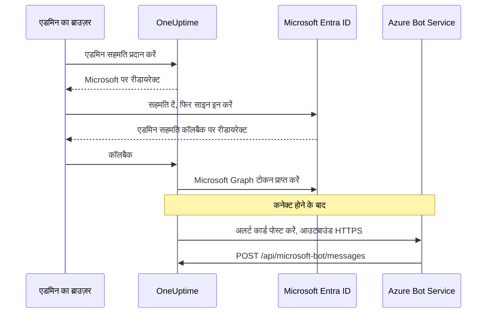
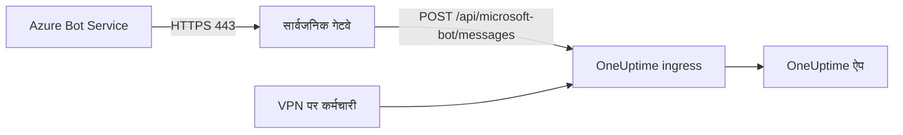

# Microsoft Teams एकीकरण

अपने सेल्फ-होस्टेड OneUptime को Microsoft Teams से जोड़ें। आप Microsoft Entra ID में एक ऐप पंजीकृत करते हैं, उसके लिए एक Azure Bot बनाते हैं, OneUptime को ऐप के क्रेडेंशियल देते हैं और आपका सर्वर जो Teams ऐप पैकेज बनाता है उसे इंस्टॉल करते हैं। इसके बाद OneUptime आपके चैनलों और चैट में अलर्ट और इंसिडेंट पोस्ट करता है, और आपकी टीम सीधे Teams से उन पर कार्रवाई करती है।

यह पेज उनके लिए है जो OneUptime सर्वर चलाते हैं। Teams जुड़ जाने के बाद सूचना नियम हर प्रोजेक्ट के लिए अलग से सेट किए जाते हैं: [Microsoft Teams](/docs/workspace-connections/microsoft-teams) देखें।

:::cards
- [एकीकरण सेट अप करें](#एकीकरण-सेट-अप-करें): Azure पोर्टल से आपकी पहली टीम तक, नौ चरण।
- [एनवायरनमेंट वेरिएबल](#एनवायरनमेंट-वेरिएबल): वे तीन मान जो OneUptime को ऐप पंजीकरण से चाहिए।
- [नेटवर्क एक्सेस](#नेटवर्क-एक्सेस): बॉट का वह एंडपॉइंट जिस तक Microsoft को पहुँचना चाहिए।
- [समस्या निवारण](#समस्या-निवारण): पहुँच से बाहर एंडपॉइंट, छूटे हुए इंस्टॉलेशन और विफल कनेक्शन।
:::

## यह कैसे काम करता है

OneUptime अपने Teams एकीकरण के लिए एक Azure Bot का उपयोग करता है। ट्रैफ़िक दोनों दिशाओं में चलता है, और दोनों दिशाएँ एक-दूसरे से स्वतंत्र हैं: संदेश पोस्ट करने के लिए OneUptime, Microsoft को कॉल करता है, और जब कोई बटन दबाता है, बॉट को संदेश भेजता है या उसे किसी चैट में जोड़ता है, तब Azure Bot Service आपके सर्वर को कॉल करती है।



Incoming Webhook या Teams वर्कफ़्लो URL इस बॉट के मैसेजिंग एंडपॉइंट की जगह नहीं ले सकते।

वीडियो कॉल (किसी इंसिडेंट के लिए Teams मीटिंग) इस बॉट का उपयोग नहीं करते: उन्हें अपना अलग ऐप पंजीकरण चाहिए, जिसका वर्णन [वीडियो कॉल](/docs/workspace-connections/video-calls#सेल्फ़-होस्टेड-सर्वर-पर-एक-क्लिक-में-कनेक्ट-करना) में है।

## शुरू करने से पहले

- Azure Bot संसाधन के लिए एक Azure सदस्यता।
- एक खाता जो Microsoft Entra ID में ऐप पंजीकरण बना सके, और एक Microsoft 365 एडमिन जो एडमिन सहमति दे सके।
- OneUptime के लिए एक सार्वजनिक HTTPS होस्टनेम जिस तक Azure Bot Service पहुँच सके। [नेटवर्क एक्सेस](#नेटवर्क-एक्सेस) देखें।
- सर्वर कॉन्फ़िगरेशन तक पहुँच: Docker Compose पर `config.env`, या Kubernetes पर आपकी Helm values।
- किसी प्रोजेक्ट को जोड़ने के लिए, उसमें **Project Owner**, **Project Admin** या **Project Member** भूमिका।

## एकीकरण सेट अप करें

:::steps
### चरण 1: Azure ऐप पंजीकरण बनाएँ

[Azure पोर्टल](https://portal.azure.com) में **App registrations** खोलें और **New registration** चुनें। फ़ॉर्म भरें:

- **Name:** oneuptime
- **Supported account types:** Accounts in this organizational directory only (Single tenant)
- **Redirect URI:** Web - `https://your-oneuptime-domain.com/api/microsoft-teams/auth`

**Register** चुनें, फिर दूसरा Web रीडायरेक्ट URI जोड़ें: `https://your-oneuptime-domain.com/api/microsoft-teams/admin-consent/callback`। **Application (client) ID** और **Directory (tenant) ID** नोट कर लें: आगे दोनों की ज़रूरत होगी।

> [!NOTE]
> **एक ही टेनेंट क्यों:** सेल्फ-होस्टेड OneUptime एक संगठन की सेवा करता है, और उसका बॉट उसी एक टेनेंट के लिए पंजीकृत होता है जिसे आप `MICROSOFT_TEAMS_APP_TENANT_ID` (चरण 6) में सेट करते हैं। ऐप को मल्टी-टेनेंट के रूप में पंजीकृत करने से यह दायरा नहीं बढ़ता, बल्कि विफलता का एक नया रास्ता खुलता है: जिन गेस्ट / B2B उपयोगकर्ताओं का होम Microsoft टेनेंट आपसे अलग है, वे अपनी टेनेंट ID के साथ बॉट तक पहुँचते हैं, जिसे OneUptime आपके प्रोजेक्ट से नहीं मिला सकता। अगर आपने पहले ही मल्टी-टेनेंट ऐप पंजीकृत किया है, तो वह काम करता रहेगा; बस यह सुनिश्चित करें कि `MICROSOFT_TEAMS_APP_TENANT_ID` आपका अपना टेनेंट हो, और मानकर चलें कि गेस्ट खातों को बॉट इस्तेमाल करने के लिए आपके टेनेंट में खाता चाहिए होगा।

### चरण 2: ऐप अनुमतियाँ कॉन्फ़िगर करें

अपने ऐप पंजीकरण में **API permissions** खोलें, **Add a permission** चुनें और **Microsoft Graph** चुनें।

**प्रत्यायोजित अनुमतियाँ जोड़ें** (जब ऐप साइन इन किए हुए उपयोगकर्ता की ओर से काम करता है):

- **User.Read** - OAuth फ़्लो के दौरान प्रमाणित उपयोगकर्ता की प्रोफ़ाइल जानकारी (प्रदर्शन नाम, ईमेल) पाने के लिए ज़रूरी
- **Team.ReadBasic.All** - कौन-सी टीम जोड़नी है यह चुनते समय, उपयोगकर्ता जिन टीमों का सदस्य है उनकी सूची बनाने के लिए ज़रूरी
- **Channel.ReadBasic.All** - चैनल की जानकारी पढ़ने और सूचनाएँ पहुँचाने के लिए टीमों के चैनलों की सूची बनाने के लिए ज़रूरी
- **ChannelMessage.Send** - Teams चैनलों में अलर्ट और इंसिडेंट की सूचनाएँ भेजने के लिए ज़रूरी

**एप्लिकेशन अनुमतियाँ जोड़ें** (जब ऐप बिना किसी साइन इन किए हुए उपयोगकर्ता के, स्वयं के रूप में काम करता है):

- **Team.ReadBasic.All** - एडमिन सहमति मिलने के बाद संगठन की सभी टीमों की सूची बनाने के लिए ज़रूरी
- **Channel.ReadBasic.All** - यह जाँचने के लिए कि चैनल मौजूद हैं, और उनका विवरण पाने के लिए ज़रूरी
- **TeamsAppInstallation.ReadForTeam.All** - निदान के लिए ज़रूरी। इससे OneUptime पढ़ पाता है कि किसी टीम में वास्तव में कौन-सा ऐप पैकेज इंस्टॉल है और उसकी तुलना इस डिप्लॉयमेंट की क्लाइंट ID से कर पाता है, ताकि भेजना विफल होने पर वह बता सके कि संभावित कारणों में से *कौन-सा* कारण है। इसके बिना OneUptime "इंस्टॉल नहीं है" और "इंस्टॉल है, पर किसी और का पैकेज है" में अंतर नहीं कर पाता, और बस वही बता देता है जो Microsoft ने कहा; इसी वजह से इस एकीकरण को डीबग करने में मिनटों की जगह दिन लग जाते हैं। इसे प्रदान करें।
- **Chat.ReadBasic.WhereInstalled** - वैकल्पिक। इससे OneUptime हर उस चैट का नाम पढ़ पाता है जिसमें OneUptime ऐप है। इसके बिना हर चैट यह क्षमता मैनिफेस्ट की **ChatSettings.Read.Chat** अनुमति (नीचे) से देती है, और पुराने मैनिफेस्ट से जोड़ी गई चैट को यह अनुमति तभी मिलती है जब उसमें ऐप अपडेट हो जाए।

`ChannelMessage.Send` केवल प्रत्यायोजित अनुमति है; [Microsoft Graph अनुमति संदर्भ](https://learn.microsoft.com/en-us/graph/permissions-reference#channelmessagesend) में इसका कोई एप्लिकेशन-अनुमति संस्करण नहीं है। इसे ऊपर की प्रत्यायोजित अनुमतियों की सूची में ही रखें।

फिर अपने संगठन के लिए **Grant admin consent** चुनें।

बॉट स्वयं Teams ऐप मैनिफेस्ट में परिभाषित संसाधन-विशिष्ट सहमति (RSC) अनुमतियों का उपयोग करता है। ये Entra ID में नहीं, बल्कि तब दी जाती हैं जब ऐप किसी टीम या चैट में इंस्टॉल या अपडेट होता है:

- **ChannelMessage.Send.Group** - बॉट को टीम चैनलों में संदेश भेजने देती है
- **ChannelMessage.Read.Group** - इंटरैक्टिव कमांड के लिए बॉट को चैनल संदेश पढ़ने देती है
- **Channel.Create.Group** - ज़रूरत पड़ने पर बॉट को चैनल बनाने देती है
- **ChatMessage.Read.Chat** - बॉट को उन चैट के संदेश पढ़ने देती है जिनमें उसे जोड़ा गया है (इंटरैक्टिव कमांड के लिए)
- **ChatMember.Read.Chat** - बॉट को उन चैट के सदस्य पढ़ने देती है जिनमें उसे जोड़ा गया है (OneUptime में चैट को नाम देने के लिए)
- **ChatSettings.Read.Chat** - OneUptime को उन ग्रुप चैट का नाम पढ़ने देती है जिनमें ऐप जोड़ा गया है। Teams ग्रुप चैट का नाम बॉट को भरोसेमंद ढंग से नहीं भेजता, इसलिए इसके बिना नाम वाली ग्रुप चैट उसके सदस्यों के नामों से दिखती है
- **TeamsAppInstallation.Read.Group** - OneUptime को यह पुष्टि करने देती है कि जिस टीम में वह पोस्ट करने वाला है उसमें ऐप इंस्टॉल है

अगर आपने ये अनुमतियाँ आने से पहले ऐप मैनिफेस्ट अपलोड किया था, तो उसे **प्रोजेक्ट सेटिंग्स > वर्कस्पेस > Microsoft Teams** से फिर से डाउनलोड करें और OneUptime ऐप के अपडेट के रूप में Teams में अपलोड करें। Teams टीम और चैट की अनुमतियाँ तब देता है जब ऐप उस टीम या चैट में इंस्टॉल या अपडेट होता है, इसलिए जिन टीमों और चैट में ऐप पहले से है, उन सभी में अपडेट स्वीकार करें। चैट के लिए [ग्रुप चैट उसके सदस्यों के नामों से दिखती है](#ग्रुप-चैट-उसके-सदस्यों-के-नामों-से-दिखती-है) देखें।

### चरण 3: क्लाइंट सीक्रेट बनाएँ

अपने ऐप पंजीकरण में **Certificates & secrets** खोलें और **New client secret** चुनें। विवरण जोड़ें, समाप्ति अवधि चुनें (24 महीने एक समझदारी भरा विकल्प है) और **Add** चुनें। सीक्रेट का मान तुरंत कॉपी करें: Azure इसे केवल एक बार दिखाता है।

> [!IMPORTANT]
> सीक्रेट का **Value** कॉपी करें, उसका **Secret ID** नहीं। मान वाली स्ट्रिंग लंबी होती है।

### चरण 4: Bot Service बनाएँ

Azure पोर्टल में एक **Azure Bot** संसाधन बनाएँ:

- **Bot handle:** oneuptime-bot
- **Subscription** और **Resource group:** आपके अपने
- **Pricing tier:** परीक्षण के लिए F0 (Free) काफ़ी है
- **Type of App:** Single Tenant, मौजूदा ऐप पंजीकरण के साथ: चरण 1 का उसका **Application (client) ID** और **Directory (tenant) ID**

**Review + create** चुनें, फिर **Create**। बॉट डिप्लॉय हो जाने पर उसका **Configuration** पेज खोलें, **Messaging endpoint** को `https://your-oneuptime-domain.com/api/microsoft-bot/messages` पर सेट करें और सहेजें।

**आगे बढ़ने से पहले एंडपॉइंट जाँचें।** Azure Bot Service इस URL को सार्वजनिक इंटरनेट से कॉल करती है, इसलिए इसे अपने नेटवर्क के बाहर कहीं से जाँचें: क्लस्टर के अंदर से नहीं, और न ही ऐसे VPN से जो होस्ट को देख लेता है जबकि Azure नहीं देख पाता:

```bash
curl -sS -i https://your-oneuptime-domain.com/api/microsoft-bot/messages
```

केवल स्टेटस कोड देखने के बजाय `-i` का उपयोग करें: 404 मिलने पर **बॉडी ही एकमात्र चीज़ है जो बताती है कि उसे किसने बनाया**, और यही अंतर पूरा निदान है।

- **405** सही जवाब है और इसका मतलब है कि आपका काम हो गया। एंडपॉइंट केवल POST स्वीकार करता है, इसलिए GET को `Allow: POST` और एंडपॉइंट के विवरण के साथ `405 Method Not Allowed` मिलता है। उस तक पहुँचना ही वह चीज़ है जिसकी जाँच हो रही है।
- **JSON बॉडी `{"message":"Page not found - /api/microsoft-bot/messages"}` वाला 404** OneUptime से आता है, इसलिए अनुरोध *पहुँचा* है। या तो यह डिप्लॉयमेंट ऊपर के 405 जवाब से पुराना है (पुराने संस्करण यह रूट केवल POST के लिए देते थे, इसलिए GET सामान्य "not found" हैंडलर में चला जाता था), या OneUptime के आगे कोई चीज़ पाथ को बदलकर ऐप तक पहुँचने से पहले `/api` उपसर्ग हटा देती है (आम तौर पर दोषी `rewrite-target: /` वाला Kubernetes ingress होता है)।
- nginx, आपके ingress या लोड बैलेंसर से आया **HTML त्रुटि पेज वाला 404** इसका उल्टा बताता है: अनुरोध कभी OneUptime तक नहीं पहुँचा, और आगे लगी चीज़ `/api` को ऐप तक रूट नहीं करती।
- **TLS त्रुटि, टाइमआउट या अस्वीकृत कनेक्शन** का मतलब है कि Azure भी नहीं पहुँच पाएगा। नीचे [मैसेजिंग एंडपॉइंट समस्या निवारण](#कार्ड-के-बटन-unable-to-reach-app-दिखाते-हैं-और-चैट-कभी-नहीं-दिखतीं) देखें।

### चरण 5: बॉट में Microsoft Teams चैनल जोड़ें

अपने Azure Bot संसाधन में **Channels** खोलें और **Microsoft Teams** जोड़ें। जब तक कोई ख़ास ज़रूरत न हो, डिफ़ॉल्ट मैसेजिंग विकल्प रहने दें, और सहेजें। इस चैनल के बिना बॉट कभी Teams बातचीत में प्रोविज़न नहीं होता।

### चरण 6: OneUptime एनवायरनमेंट वेरिएबल कॉन्फ़िगर करें

OneUptime को ऐप के क्रेडेंशियल दें:

:::tabs
@tab Docker Compose
```bash title="config.env"
MICROSOFT_TEAMS_APP_CLIENT_ID=YOUR_TEAMS_APP_CLIENT_ID
MICROSOFT_TEAMS_APP_CLIENT_SECRET=YOUR_TEAMS_APP_CLIENT_SECRET
MICROSOFT_TEAMS_APP_TENANT_ID=YOUR_MICROSOFT_TENANT_ID
```

बदलाव को `npm run start` से लागू करें, जो कंटेनर दोबारा बनाता है। `docker compose restart` से `config.env` दोबारा नहीं पढ़ा जाता।
@tab Kubernetes
```yaml title="values.yaml"
microsoftTeamsApp:
  clientId: YOUR_TEAMS_APP_CLIENT_ID
  clientSecret: YOUR_TEAMS_APP_CLIENT_SECRET
  tenantId: YOUR_MICROSOFT_TENANT_ID
```

मानों को अपने प्रबंधित Kubernetes Secret में रखने के लिए, इसके बजाय `microsoftTeamsApp.existingSecret` सेट करें: उसका `name` और कुंजियाँ `clientIdKey`, `clientSecretKey` और `tenantIdKey`। बदलाव को `helm upgrade` से लागू करें।
:::

OneUptime दोबारा चालू होने पर **प्रोजेक्ट सेटिंग्स > वर्कस्पेस > Microsoft Teams** सेटअप गाइड की जगह **एडमिन सहमति प्रदान करें** कार्ड दिखाता है।

### चरण 7: OneUptime में एडमिन सहमति दें

**प्रोजेक्ट सेटिंग्स > वर्कस्पेस > Microsoft Teams** खोलें और **एडमिन सहमति प्रदान करें** चुनें। Microsoft 365 एडमिन के रूप में Microsoft में साइन इन करें और अनुमतियाँ स्वीकार करें। Microsoft आपको उसी पेज पर वापस भेजता है, और कार्ड पर **Admin Consent Completed** दिखता है: अब प्रोजेक्ट आपके टेनेंट से जुड़ गया है।

फिर अपना खाता जोड़ने के लिए **Connect my account with Microsoft Teams** चुनें। प्रोजेक्ट के बाकी सदस्य **उपयोगकर्ता सेटिंग्स > वर्कस्पेस > Microsoft Teams** से यही करते हैं।

### चरण 8: Teams ऐप मैनिफेस्ट अपलोड करें

एडमिन सहमति के बाद **प्रोजेक्ट सेटिंग्स > वर्कस्पेस > Microsoft Teams** पर **Action Required: Install This Deployment's App on Microsoft Teams** कार्ड दिखता है। **ऐप मैनिफेस्ट Zip डाउनलोड करें** चुनें: पैकेज में इस डिप्लॉयमेंट की बॉट ID होती है।

Microsoft Teams में **Apps > Manage your apps** खोलें, **Upload an app** चुनें, फिर **Upload a custom app**, और डाउनलोड की हुई zip फ़ाइल चुनें।

> [!WARNING]
> सेल्फ-होस्टेड डिप्लॉयमेंट के लिए Microsoft Teams स्टोर से "OneUptime" इंस्टॉल न करें। स्टोर वाला ऐप OneUptime Cloud के बॉट की ओर इशारा करता है, इसलिए Teams उसे स्वीकार कर लेता है और फिर इस डिप्लॉयमेंट के भेजे हर संदेश को अस्वीकार कर देता है।

### चरण 9: हर टीम में OneUptime जोड़ें (ज़रूरी)

मैनिफेस्ट अपलोड करने से ऐप **आपके** लिए इंस्टॉल होता है। इससे बॉट को किसी भी टीम के चैनलों तक पहुँच **नहीं** मिलती। Microsoft केवल उसी टीम में संदेश स्वीकार करता है जिसमें ऐप जोड़ा गया हो, इसलिए जिन-जिन टीमों में आपको सूचनाएँ चाहिए, उन सब में यह करना होगा:

1. Microsoft Teams में **टीम के नाम** (चैनल के नाम नहीं) के पास "..." पर क्लिक करें
2. **Manage team** > **Apps** > **More apps** चुनें
3. **OneUptime** खोजें और **Add** पर क्लिक करें

नोट:

- OneUptime को अपने लिए इंस्टॉल करना, या उसे किसी चैट में जोड़ना, एक **अलग** इंस्टॉलेशन है। दोनों में से कोई भी उसे टीम के चैनलों में पोस्ट नहीं करने देता।
- **निजी चैनलों** में ऐप चैनल में ही इंस्टॉल होना चाहिए: चैनल खोलें > "..." > **Manage channel** > **Apps** > **Add an app**। टीम-स्तर का इंस्टॉलेशन निजी चैनलों को कवर नहीं करता।
- **साझा चैनलों** को सूचनाएँ बिल्कुल नहीं मिल सकतीं: Microsoft Teams साझा चैनलों में बॉट का समर्थन नहीं करता। OneUptime उन्हें चैनल पिकर में छिपा देता है।
- अगर **Manage team > Apps > More apps** खाली है या धूसर दिखता है, तो आपकी Teams ऐप सेटअप नीति कस्टम ऐप को ब्लॉक कर रही है। इसे Teams एडमिन सेंटर में **Teams apps > Manage apps** और **Setup policies** के अंतर्गत ठीक करें।
:::

## एनवायरनमेंट वेरिएबल

| Docker Compose (`config.env`) | Helm (`values.yaml`) | मान |
| --- | --- | --- |
| `MICROSOFT_TEAMS_APP_CLIENT_ID` | `microsoftTeamsApp.clientId` | **Application (client) ID**। यही Teams ऐप पैकेज में बॉट ID भी है, इसलिए यह GUID होना चाहिए। |
| `MICROSOFT_TEAMS_APP_CLIENT_SECRET` | `microsoftTeamsApp.clientSecret` | क्लाइंट सीक्रेट का **Value**, उसकी ID नहीं। |
| `MICROSOFT_TEAMS_APP_TENANT_ID` | `microsoftTeamsApp.tenantId` | **Directory (tenant) ID**। बॉट इस टेनेंट में सिंगल-टेनेंट ऐप के रूप में प्रमाणीकरण करता है। |
| `HOST` | `host` | आपका सार्वजनिक होस्टनेम। रीडायरेक्ट URI, मैसेजिंग एंडपॉइंट और Teams ऐप पैकेज इसी से बनते हैं। |
| `HTTP_PROTOCOL` | `httpProtocol` | `https`। Azure Bot Service केवल HTTPS एंडपॉइंट को कॉल करती है। |

तीनों `MICROSOFT_TEAMS_APP_*` मान ज़रूरी हैं:

- क्लाइंट ID के बिना Microsoft Teams पेज **एडमिन सहमति प्रदान करें** की जगह सेटअप गाइड दिखाता है।
- क्लाइंट ID या सीक्रेट के बिना कनेक्ट करना **"इस OneUptime सर्वर पर Microsoft Teams सेट अप नहीं है।"** संदेश पर ख़त्म होता है।
- टेनेंट ID के बिना बॉट प्रमाणीकरण नहीं कर पाता, इसलिए पोस्ट करना और बॉट एंडपॉइंट दोनों विफल होते हैं।

## नेटवर्क एक्सेस

Microsoft को [सेल्फ-होस्टेड बॉट के लिए सार्वजनिक रूप से पहुँच योग्य HTTPS एंडपॉइंट](https://learn.microsoft.com/en-us/azure/bot-service/bot-service-resources-faq-security?view=azure-bot-service-4.0) चाहिए। निजी IP पता, आंतरिक DNS नाम या किसी कर्मचारी का VPN कनेक्शन Azure Bot Service को OneUptime तक पहुँच नहीं देता।

| दिशा | गंतव्य | उद्देश्य |
| --- | --- | --- |
| OneUptime से Microsoft | TCP 443 पर HTTPS से Microsoft Graph, Microsoft पहचान और Bot Framework सेवाएँ | टोकन विनिमय, टीम और चैनल की खोज, और सूचनाओं की डिलीवरी |
| Microsoft से OneUptime | `POST /api/microsoft-bot/messages` | बॉट संदेश, बातचीत में इंस्टॉलेशन इवेंट और कार्ड की कार्रवाइयाँ |
| उपयोगकर्ता के ब्राउज़र से OneUptime | `/api/microsoft-teams/auth` और `/api/microsoft-teams/admin-consent/callback` | साइन-इन और एडमिन सहमति के रीडायरेक्ट |

ऐप पंजीकरण के `/api/microsoft-teams/auth` और `/api/microsoft-teams/admin-consent/callback` वाले रीडायरेक्ट उपयोगकर्ता के ब्राउज़र से होकर लौटते हैं। उस ब्राउज़र को OneUptime तक पहुँचना चाहिए, उदाहरण के लिए आपके कॉर्पोरेट नेटवर्क या VPN से। बॉट संदेश और कार्ड की कार्रवाइयाँ Microsoft के सर्वरों से आती हैं और उन्हें अपना अलग पहुँच योग्य ingress चाहिए। सिर्फ़ आउटबाउंड अलर्ट डिलीवरी से इनबाउंड कनेक्टिविटी की पुष्टि नहीं होती।

### निजी डिप्लॉयमेंट से बॉट एंडपॉइंट प्रकाशित करें



:::steps
1. अपने OneUptime होस्टनेम के सार्वजनिक DNS को इंटरनेट की ओर खुले रिवर्स प्रॉक्सी या लोड बैलेंसर पर पॉइंट करें। इनबाउंड TCP 443 की अनुमति दें और पूरी चेन के साथ सार्वजनिक रूप से विश्वसनीय TLS सर्टिफ़िकेट दें।
2. गेटवे को OneUptime के निजी ingress से सीधे, या अपने साइट-टू-साइट VPN / निजी लिंक से जोड़ें, और ऑरिजिन के सर्विस पोर्ट की अनुमति दें। Kubernetes `ClusterIP` सर्विस को गेटवे से पहुँच योग्य ingress या कोई दूसरा रूट चाहिए। डेटाबेस और दूसरी आंतरिक सेवाओं को निजी रखें।
3. उस गेटवे से `/api/microsoft-bot/messages` प्रकाशित करें और चरण 4 वाले Azure Bot के **Messaging endpoint** को पूरे सार्वजनिक HTTPS URL पर सेट करें। मेथड, `/api` उपसर्ग, क्वेरी स्ट्रिंग, बॉडी और `Authorization` हेडर को ज्यों का त्यों रखें। सार्वजनिक `Host` को बनाए रखें और सार्वजनिक होस्ट तथा HTTPS स्कीम के लिए विश्वसनीय फ़ॉरवर्डिंग हेडर सेट करें। इस रूट पर रीडायरेक्ट, ब्राउज़र SSO, CAPTCHA या प्रॉक्सी साइन-इन न जोड़ें; OneUptime के Bot Framework एडैप्टर को अनुरोध प्राप्त करके उसे प्रमाणित करना होता है।
4. ज़रूरत हो तो बाकी रूट निजी रखें। स्प्लिट DNS से कर्मचारी कॉर्पोरेट नेटवर्क या VPN के ज़रिए उसी होस्टनेम को निजी ingress पर रिज़ॉल्व कर सकते हैं। उस ingress को भी होस्टनेम के लिए मान्य सर्टिफ़िकेट के साथ HTTPS देना चाहिए और ऊपर की तालिका वाले ब्राउज़र रीडायरेक्ट की अनुमति देनी चाहिए। ऑरिजिन तक पहुँच को गेटवे और अधिकृत आंतरिक क्लाइंट तक सीमित रखें।
5. Docker Compose के `config.env` में `HOST=oneuptime.example.com` और `HTTP_PROTOCOL=https`, या Helm values में `host: oneuptime.example.com` और `httpProtocol: https` सेट करें। उदाहरण को अपने डोमेन से बदलें, डिप्लॉयमेंट अपडेट लागू करें और ऐप के दोबारा शुरू होने की प्रतीक्षा करें। ये मान केवल URL बनाते हैं; ये DNS, TLS या नेटवर्क एक्सेस का प्रावधान नहीं करते। होस्टनेम बदलने पर Azure Bot एंडपॉइंट और ऐप पंजीकरण के रीडायरेक्ट अपडेट करें, और Teams मैनिफेस्ट को फिर से डाउनलोड करके अपलोड करें।
:::

OneUptime की [निजी नेटवर्क पहुँच सेटिंग्स](/docs/self-hosted/private-network-access) आंतरिक सेवाओं को जाने वाले आउटबाउंड अनुरोधों को नियंत्रित करती हैं। `ALLOW_PRIVATE_NETWORK_WEBHOOKS` चालू करने से बॉट एंडपॉइंट Microsoft के लिए पहुँच योग्य नहीं बनता।

### आउटबाउंड एक्सेस और IP प्रतिबंध

OneUptime ऐप से DNS रिज़ॉल्यूशन और आउटबाउंड HTTPS की अनुमति दें। `graph.microsoft.com`, `login.microsoftonline.com`, Bot Framework के प्रमाणीकरण और चैनल एंडपॉइंट, और किसी बातचीत के लिए दिया गया कनेक्टर सर्विस URL उपयोग करें। कमर्शियल क्लाउड का फ़ॉलबैक कनेक्टर `https://smba.trafficmanager.net/teams/` है; बातचीत के सर्विस URL अलग हो सकते हैं। [Microsoft का फ़ायरवॉल मार्गदर्शन](https://learn.microsoft.com/en-us/azure/bot-service/bot-service-resources-faq-security?view=azure-bot-service-4.0) लागू करें और परीक्षण के दौरान ब्लॉक हुए ट्रैफ़िक की जाँच करें; यह होस्टनेम की पूरी सूची नहीं है।

Microsoft इनबाउंड Bot Framework ट्रैफ़िक के लिए निश्चित IP अनुमति-सूचियों का समर्थन नहीं करता, क्योंकि उसके स्रोत पते बदलते रहते हैं। Teams क्लाइंट की मीडिया IP रेंज बॉट वेबहुक के स्रोत नहीं बतातीं। स्रोत IP को पहचान का प्रमाण मानने के बजाय Bot Framework प्रमाणीकरण चालू रखें।

### बिना इनबाउंड एक्सेस के परीक्षण और डिप्लॉयमेंट

अपने नेटवर्क और VPN के बाहर से सार्वजनिक DNS, TLS और रूटिंग की जाँच के लिए चरण 4 का उपयोग करें। फिर Teams कनेक्ट करें, एक परीक्षण सूचना भेजें, बॉट को संदेश भेजें और किसी कार्ड का बटन दबाएँ। OneUptime में कार्रवाई की पुष्टि करें, और Microsoft के डिलीवरी निदान को गेटवे और ऐप के लॉग से मिलाएँ। पहुँच योग्य GET रूट या डिलीवर हुई सूचना अपने-आप में प्रमाणित इनबाउंड बॉट POST की पुष्टि नहीं करती।

डेवलपमेंट के लिए, [Teams बॉट को लोकल रूप से परखने की Microsoft गाइड](https://learn.microsoft.com/en-us/microsoftteams/platform/bots/how-to/authentication/add-authentication#testing-the-bot-locally-in-teams) बताती है कि टनल से लोकल सर्विस कैसे उजागर करें। ऐसे प्रॉक्सी पर फ़ॉरवर्ड करें जो बॉट एंडपॉइंट की अनुमति देता हो, और Microsoft के उदाहरण पाथ `/api/messages` के बजाय `/api/microsoft-bot/messages` का उपयोग करें। जब भी टनल का सार्वजनिक URL बदले, कॉन्फ़िगर किया गया होस्टनेम और Azure Bot एंडपॉइंट अपडेट करें, परीक्षण के बाद टनल बंद करें, और प्रोडक्शन में स्थिर ingress का उपयोग करें। टनल भी इनबाउंड एक्सेस खोलता है।

> [!WARNING]
> अगर कोई नीति इनबाउंड कनेक्टिविटी पर रोक लगाती है, तो पूरा Teams बॉट एकीकरण काम नहीं कर सकता: कमांड, कार्ड की कार्रवाइयाँ और बातचीत की खोज, सब इस पर निर्भर हैं कि Microsoft, OneUptime तक पहुँचे। Azure Bot Private Endpoint इस ज़रूरत को हल नहीं करता। Microsoft के [नेटवर्क आइसोलेशन निर्देश](https://learn.microsoft.com/en-us/azure/bot-service/dl-network-isolation-how-to?view=azure-bot-service-4.0) Direct Line आइसोलेशन का वर्णन करते हैं और बताते हैं कि सार्वजनिक नेटवर्क एक्सेस बंद करने से Teams चैनलों का कॉन्फ़िगरेशन टूट जाता है। पूरी तरह कटा हुआ इंस्टॉलेशन Teams का उपयोग नहीं कर सकता।

## समस्या निवारण

इन जाँचों से शुरू करें:

- ऐप पंजीकरण में ऊपर दी गई अनुमतियाँ हैं, और एडमिन सहमति दी जा चुकी है।
- रीडायरेक्ट URI बिल्कुल मेल खाते हैं (`your-oneuptime-domain.com` को अपने असली डोमेन से बदलें)।
- एनवायरनमेंट वेरिएबल सेट हैं, और उन्हें सेट करने के बाद OneUptime दोबारा शुरू किया गया है।
- बॉट का मैसेजिंग एंडपॉइंट इंटरनेट से पहुँच योग्य है, और बॉट में Microsoft Teams चैनल है।
- आपने जो Teams ऐप पैकेज अपलोड किया है, वह इसी डिप्लॉयमेंट से डाउनलोड किया गया है।

### कार्ड के बटन "Unable to reach app" दिखाते हैं और चैट कभी नहीं दिखतीं

इन लक्षणों का आम तौर पर मतलब है कि **Azure Bot Service आपके मैसेजिंग एंडपॉइंट तक प्रमाणित गतिविधियाँ नहीं पहुँचा पा रही**। रूटिंग, बॉट प्रमाणीकरण और प्रोजेक्ट कॉन्फ़िगरेशन जाँचें।

उलझन यह है कि अलर्ट कार्ड अब भी Teams तक पहुँचते हैं, जिससे एकीकरण लगभग ठीक लगता है। ऐसा नहीं है: दोनों दिशाएँ स्वतंत्र हैं, और उनमें से केवल एक काम कर रही है:

| दिशा | यह कैसे जाता है | क्या Azure को आप तक पहुँचना होगा? |
| --- | --- | --- |
| OneUptime किसी चैनल में अलर्ट कार्ड पोस्ट करता है | OneUptime आपके क्लाइंट सीक्रेट से प्रमाणीकरण करके Microsoft को कॉल करता है | **नहीं** |
| आप उस कार्ड पर कोई बटन दबाते हैं | Azure Bot Service `/api/microsoft-bot/messages` पर POST भेजती है | **हाँ** |
| आप बॉट को `help` भेजते हैं | Azure Bot Service `/api/microsoft-bot/messages` पर POST भेजती है | **हाँ** |
| कोई चैट **Microsoft Teams Chats** में दर्ज होती है | Azure Bot Service बॉट गतिविधि को `/api/microsoft-bot/messages` पर POST करती है | **हाँ** |

इसलिए पहुँचा हुआ अलर्ट केवल उस आउटबाउंड भेजने की पुष्टि करता है; वह हर Graph अनुमति या इनबाउंड बॉट एंडपॉइंट की पुष्टि नहीं करता। इंटरैक्टिव सुविधाओं के लिए ज़रूरी है कि इनबाउंड बॉट गतिविधियाँ सफलतापूर्वक प्रोसेस हों।

OneUptime चैट को बॉट गतिविधियों से दर्ज करता है, जैसे ऐप का इंस्टॉलेशन, बातचीत में बॉट का जुड़ना, या उस चैट में बॉट को भेजा गया संदेश। ये सभी एक ही इनबाउंड एंडपॉइंट से आती हैं। ऐप जोड़ने और उसे संदेश भेजने के बाद भी अगर **Microsoft Teams Chats** सूची खाली है, तो उस प्रोजेक्ट के लिए कोई चैट दर्ज नहीं हुई है; इनबाउंड अनुरोध, प्रमाणीकरण त्रुटियाँ और टेनेंट-से-प्रोजेक्ट मैपिंग जाँचें। **Refresh Chats** पर क्लिक करने से OneUptime अपनी सहेजी हुई चैट दोबारा पढ़ता है, और हर सहेजी हुई ग्रुप चैट का नाम Microsoft से दोबारा पढ़ता है।

**इस क्रम में निदान करें:**

1. **POST खोजें, 404 नहीं।** ज़्यादातर जाँचें यहीं ग़लत दिशा में चली जाती हैं:

   ```bash
   grep 'POST /api/microsoft-bot/messages' <your access log>
   ```

   अगर कोई POST लाइन नहीं है, तो पुष्टि करें कि सही एक्सेस लॉग अनुरोध दर्ज कर रहा है, फिर Azure में कॉन्फ़िगर किया गया एंडपॉइंट और नेटवर्क पाथ जाँचें। अगर POST आ रहे हैं, तो उनके जवाब और OneUptime की प्रमाणीकरण या प्रोजेक्ट-मैपिंग त्रुटियाँ देखें। 404 लौटाने वाली `GET` लाइनें एक अलग जाँच हैं; नीचे का नोट देखें।

2. **अपने नेटवर्क के बाहर से एंडपॉइंट को कॉल करें,** जैसा चरण 4 में किया था, बॉडी देखने के लिए `curl -i` के साथ। `405` साबित करता है कि रूट चालू है और जहाँ से आपने कमांड चलाई वहाँ से पहुँच योग्य है। TLS त्रुटि, टाइमआउट या अस्वीकृत कनेक्शन ही आपका जवाब है।

3. **सर्टिफ़िकेट चेन जाँचें।** Azure को पूरी चेन के साथ दिए गए सार्वजनिक रूप से विश्वसनीय सर्टिफ़िकेट वाला HTTPS चाहिए। सेल्फ़-साइन्ड सर्टिफ़िकेट, आंतरिक CA या छूटा हुआ इंटरमीडिएट सर्टिफ़िकेट OneUptime के अनुरोध देखने से पहले ही TLS हैंडशेक विफल कर देता है, इसलिए आपका एक्सेस लॉग खाली रहता है और लगता है कि Azure ने कभी कोशिश ही नहीं की:

   ```bash
   openssl s_client -connect your-oneuptime-domain.com:443 -servername your-oneuptime-domain.com -verify_return_error </dev/null
   ```

4. **जाँचें कि होस्ट सार्वजनिक रूप से रिज़ॉल्व होता है।** निजी DNS नाम, स्प्लिट-होराइज़न रिकॉर्ड या केवल-आंतरिक ingress आप तक और आपके VPN तक पहुँचते हैं, पर Azure के लिए अदृश्य रहते हैं। उसे ऐसे नेटवर्क से रिज़ॉल्व करें जिसकी आपके नेटवर्क तक पहुँच न हो।

5. **Azure Bot संसाधन में एंडपॉइंट की पुष्टि करें**: स्कीम और पाथ सहित, उसे इस डिप्लॉयमेंट से बिल्कुल मेल खाना चाहिए: `https://your-oneuptime-domain.com/api/microsoft-bot/messages`।

**`GET /api/microsoft-bot/messages` पर 404 न तो ख़राबी है, न इस बात का सबूत कि Azure आप तक नहीं पहुँच सका।** यह एंडपॉइंट हमेशा से केवल POST स्वीकार करता आया है, इसलिए इस संस्करण से पहले ब्राउज़र का GET, OneUptime के सामान्य "not found" हैंडलर में जाकर `{"message":"Page not found - /api/microsoft-bot/messages"}` के रूप में लौटता था। यह किसी ग़ायब रूट जैसा दिखता है और एक से ज़्यादा एडमिन को ऐसे रिग्रेशन की तलाश में भेज चुका है जो था ही नहीं; पर देखिए यह वास्तव में क्या साबित करता है: वह जवाब OneUptime ने बनाया, इसलिए अनुरोध ऐप तक पहुँचा। उसका आकार 58 बाइट है, इसीलिए एक्सेस लॉग में वह `"GET /api/microsoft-bot/messages HTTP/1.1" 404 58` के रूप में दिखता है।

यह संस्करण GET का जवाब `405 Method Not Allowed` और अपने विवरण के साथ देता है, इसलिए अब इस अंतर को समझाने की ज़रूरत नहीं रही। अगर आप अब भी पुराने संस्करण पर हैं, तो 404 को उसकी बॉडी से परखें: OneUptime का JSON मतलब अनुरोध पहुँचा; आपके प्रॉक्सी का HTML त्रुटि पेज मतलब नहीं पहुँचा।

### ग्रुप चैट उसके सदस्यों के नामों से दिखती है

Teams ग्रुप चैट का नाम बॉट को भरोसेमंद ढंग से नहीं भेजता, इसलिए OneUptime उसे Microsoft Graph से पढ़ता है। इसके लिए मैनिफेस्ट की **ChatSettings.Read.Chat** अनुमति चाहिए, जिसे हर चैट तब देती है जब उसमें OneUptime ऐप इंस्टॉल या अपडेट होता है। जिन चैट में ऐप पुराने मैनिफेस्ट से जोड़ा गया था उनके पास यह अनुमति नहीं होती, और **Refresh Chats** उन्हें चिह्नित करता है। इसे इन दो में से किसी एक तरीके से ठीक करें:

1. **प्रोजेक्ट सेटिंग्स > वर्कस्पेस > Microsoft Teams** से मैनिफेस्ट फिर से डाउनलोड करें, उसे OneUptime ऐप के अपडेट के रूप में Teams में अपलोड करें, ऐसी हर चैट में अपडेट स्वीकार करें, फिर **Refresh Chats** पर क्लिक करें।
   - Teams अपलोड को अपडेट के रूप में तभी स्वीकार करता है जब उसका संस्करण इंस्टॉल किए गए संस्करण से ऊँचा हो। रिलीज़ इमेज इसे `APP_VERSION` से सेट करती हैं। `APP_VERSION` के बिना बनी बिल्ड एक तय फ़ॉलबैक मान उपयोग करती है, जो तभी बदलता है जब OneUptime मैनिफेस्ट बदलता है; अगर Teams कहे कि पैकेज नया नहीं है, तो अपलोड करने से पहले मैनिफेस्ट का `version` बढ़ाएँ।
   - अगर आपका टेनेंट चैट अनुमतियाँ केवल पूर्व-स्वीकृत ऐप को देता है, तो पहले OneUptime की पूर्व-स्वीकृति नीति में **ChatSettings.Read.Chat** जोड़ें (उदाहरण के लिए `Update-MgBetaTeamAppPreapproval -TeamsAppId <app id> -ResourceSpecificApplicationPermissionsAllowedForChats @('ChatMember.Read.Chat','ChatMessage.Read.Chat','ChatSettings.Read.Chat')`), नहीं तो अपडेट किया गया ऐप चैट में नहीं जोड़ा जा सकेगा।
2. या ऐप पंजीकरण को एडमिन सहमति के साथ एप्लिकेशन अनुमति **Chat.ReadBasic.WhereInstalled** (चरण 2) दें, फिर **Refresh Chats** पर क्लिक करें। इससे हर चैट को अलग-अलग अपडेट किए बिना, जिन चैट में ऐप है वे सब एक बार में कवर हो जाती हैं। OneUptime अपना मौजूदा Microsoft Graph टोकन उसकी समय-सीमा ख़त्म होने तक इस्तेमाल करता रहता है, इसलिए नई दी गई अनुमति को प्रभावी होने में एक घंटे तक लग सकता है।

जिस ग्रुप चैट का Teams में कोई नाम नहीं है, वह जानबूझकर उसके सदस्यों के नामों से दिखती है। Teams में नाम बदली गई चैट को नया नाम तब मिलता है जब अगली बार कोई **Refresh Chats** पर क्लिक करता है।

### इस डिप्लॉयमेंट का बॉट कॉन्फ़िगरेशन जाँचें

```bash
curl -sS https://your-oneuptime-domain.com/api/microsoft-bot/test | jq
```

यह बताता है कि OneUptime स्थानीय रूप से क्या देख सकता है: `MICROSOFT_TEAMS_APP_CLIENT_ID` और `MICROSOFT_TEAMS_APP_CLIENT_SECRET` सेट हैं या नहीं, यह डिप्लॉयमेंट किस मैसेजिंग एंडपॉइंट की अपेक्षा करता है, और सबसे काम की बात, आपके Teams ऐप पैकेज में कौन-सी **बॉट ID** होनी चाहिए।

यह केवल एनवायरनमेंट वेरिएबल पढ़ता है, और कुछ नहीं। यह Azure को कॉल नहीं करता, इसलिए यह नहीं बता सकता कि Azure Bot संसाधन मौजूद है या नहीं, उसका मैसेजिंग एंडपॉइंट यहाँ की ओर है या नहीं, Teams चैनल चालू है या नहीं, सीक्रेट अब भी मान्य है या नहीं, या Azure आप तक पहुँच सकता है या नहीं। जवाब ख़ुद यह बताता है, यह सूची देकर कि उसने क्या जाँचा और क्या नहीं, ताकि उसे कभी हरी झंडी न समझा जाए।

इससे संभव होने वाली एकमात्र निर्णायक जाँच: इसके लौटाए `botId` की तुलना Teams में इंस्टॉल किए गए OneUptime ऐप की बॉट ID से करें। अगर दोनों अलग हैं, तो वह पैकेज इस डिप्लॉयमेंट से संदेश नहीं पा सकता; चरण 8 देखें।

### "The OneUptime app is not installed in the Microsoft Teams team ..."

OneUptime ने Microsoft Graph से इसकी जाँच की और ऐप सचमुच उस टीम में (या निजी चैनल के मामले में, उस चैनल में) नहीं है। ऊपर का **चरण 9** पूरा करें। Graph की एप्लिकेशन अनुमतियों से OneUptime आपके टेनेंट का हर चैनल सूचीबद्ध कर सकता है, पर *पोस्ट* केवल उन्हीं टीमों में कर सकता है जिनका ऐप सदस्य है।

### "Microsoft Teams refused the message ... because the OneUptime bot is not a member of that conversation"

Microsoft ने पोस्ट अस्वीकार किया (उसके अपने शब्दों में `BotNotInConversationRoster`) और OneUptime यह पुष्टि **नहीं** कर सका कि ऐप ग़ायब है, इसलिए ऐसा मानकर न चलें। नीचे दिए क्रम में कारण जाँचें; Teams से देखने पर पहले दो कारण बिल्कुल सही सेटअप जैसे दिखते हैं।

1. **टीम में मौजूद ऐप कोई दूसरा पैकेज है।** **Manage team > Apps** में "OneUptime" नाम का आइकन दिखना काफ़ी नहीं है: मायने यह रखता है कि उस पैकेज की बॉट ID *इसी* डिप्लॉयमेंट का `MICROSOFT_TEAMS_APP_CLIENT_ID` है या नहीं। Teams स्टोर का सार्वजनिक OneUptime ऐप OneUptime Cloud के बॉट की ओर इशारा करता है और आपके सेल्फ-होस्टेड डिप्लॉयमेंट की पोस्ट कभी स्वीकार नहीं करेगा। केवल **प्रोजेक्ट सेटिंग्स > वर्कस्पेस > Microsoft Teams** (चरण 8) से डाउनलोड किया गया मैनिफेस्ट आपके डिप्लॉयमेंट के लिए बना है। संदेह हो तो टीम से ऐप हटाएँ, अपना मैनिफेस्ट फिर से अपलोड करें और उसे जोड़ें।
2. **Azure Bot में Microsoft Teams चैनल नहीं है।** **चरण 5** पूरा करें। इसके बिना बॉट कभी Teams बातचीत में प्रोविज़न नहीं होता, इसलिए वह किसी भी चैनल की सदस्य सूची में नहीं होता, भले ही ऐप बिना किसी दिक़्क़त के इंस्टॉल हो जाए और ऐप सूची सही दिखे।
3. **ऐप आपके लिए, या किसी चैट में, इंस्टॉल है, पर टीम में नहीं।** **चरण 9** पूरा करें।
4. **चैनल निजी है।** टीम-स्तर का इंस्टॉलेशन निजी चैनलों को कवर नहीं करता; चरण 9 के नोट देखें।

**TeamsAppInstallation.ReadForTeam.All** (चरण 2) प्रदान करें, ताकि OneUptime इन्हें सूचीबद्ध करने के बजाय बता सके कि इनमें से कौन-सा कारण है।

### सूचनाएँ एक टीम में काम करती हैं, पर दूसरी में नहीं

इंस्टॉलेशन हर टीम के लिए अलग होता है। एक टीम में OneUptime जोड़ने से दूसरी टीम पर कोई असर नहीं पड़ता, और एकीकरण कनेक्ट करने से भी नहीं: वह पूरे टेनेंट में Graph की *पढ़ने* की पहुँच देता है, इसीलिए चैनल पिकर आपको उन टीमों के चैनल भी दिखा सकता है जिनमें बॉट पोस्ट नहीं कर सकता। जिन-जिन टीमों में आपको सूचनाएँ चाहिए, उन सब में **चरण 9** पूरा करें।

### "परीक्षण नियम" काम करता है, पर असली सूचनाएँ कभी नहीं पहुँचतीं

जाँचें कि नियम में वास्तव में कौन-से गंतव्य चालू हैं। नियम केवल उसी को परखता है जिसके लिए वह सेट है: **Create Microsoft Teams Channel** चालू होने पर परीक्षण एक चैनल बनाकर उसमें पोस्ट करता है, जो केवल यह साबित करता है कि बॉट *उस टीम में पोस्ट कर सकता है जिसमें वह चैनल बना*, किसी दूसरी टीम के बारे में कुछ नहीं। **प्रोजेक्ट सेटिंग्स > सूचनाएं > सूचना लॉग** हर परीक्षण भेजने को दर्ज करता है, और विफल होने पर Microsoft की हूबहू त्रुटि भी।

### "Sorry, I couldn't find your project configuration"

बॉट गतिविधि जिस Microsoft टेनेंट से आई, वह किसी भी OneUptime प्रोजेक्ट से जुड़ा टेनेंट नहीं है। अपने सर्वर लॉग में टेनेंट ID देखें:

```bash
grep "Project auth not found for tenant ID" <your app logs>
```

उसकी तुलना प्रोजेक्ट के लिए सहेजे गए टेनेंट से करें:

```sql
SELECT "projectId", "workspaceProjectId"
FROM "WorkspaceProjectAuthToken"
WHERE "workspaceType" = 'MicrosoftTeams';
```

अगर ये मेल नहीं खाते, तो बॉट को संदेश भेजने वाला उपयोगकर्ता किसी दूसरे Microsoft टेनेंट में साइन इन है (अक्सर ऐसा गेस्ट / B2B खाता जिसका होम टेनेंट आपका नहीं है)। उनसे कहें कि जुड़े हुए टेनेंट के खाते का उपयोग करें, या 1:1 चैट के बजाय जुड़ी हुई टीम के किसी चैनल में बॉट को @-मेंशन करें।

### "This Microsoft 365 organization is connected to more than one OneUptime project"

दो या उससे ज़्यादा OneUptime प्रोजेक्ट ने एक ही Microsoft टेनेंट को जोड़ा है। बॉट संदेश में केवल टेनेंट ID होती है, इसलिए OneUptime नहीं जान सकता कि आपका आशय किस प्रोजेक्ट से है, और अनुमान लगाने के बजाय मना कर देता है। एक को छोड़कर बाकी सभी प्रोजेक्ट से Microsoft Teams को डिस्कनेक्ट करें।

### "Microsoft Teams App Client ID must be a valid GUID"

जब `MICROSOFT_TEAMS_APP_CLIENT_ID` GUID नहीं होता, तो **ऐप मैनिफेस्ट Zip डाउनलोड करें** पैकेज बनाने से मना कर देता है, क्योंकि Teams को ऐप और बॉट ID के लिए GUID चाहिए। ऐप पंजीकरण के ओवरव्यू पेज से **Application (client) ID** फिर से कॉपी करें, उसे सेट करें और कॉन्फ़िगरेशन लागू करें।

### कनेक्ट करना पूरा नहीं हुआ

जब Microsoft आपको वापस भेजता है और कनेक्शन नहीं बना (एडमिन सहमति देते समय या Microsoft से साइन इन करते समय), तो जिस Microsoft Teams पेज से आपने शुरुआत की थी (**प्रोजेक्ट सेटिंग्स > वर्कस्पेस > Microsoft Teams**, या अगर आप अपना खाता जोड़ रहे थे तो आपकी अपनी **उपयोगकर्ता सेटिंग्स > वर्कस्पेस > Microsoft Teams**) वह **Microsoft Teams कनेक्ट नहीं हुआ** दिखाता है, साथ में आपकी भाषा में एक वाक्य जो कारण बताता है। पेज का बाकी हिस्सा सामान्य रूप से लोड होता है, इसलिए आप वहीं दोबारा कोशिश कर सकते हैं। वह कभी नहीं दिखाता कि Microsoft ने ख़ुद क्या जवाब दिया (उदाहरण के लिए कोई `AADSTS` कोड): वह कारण के साथ OneUptime के सर्वर लॉग में होता है।

| पेज पर लिखा है | क्या करें |
| --- | --- |
| **"यह कनेक्शन लिंक अमान्य है, इसकी समय-सीमा समाप्त हो गई है, या इसका पहले ही उपयोग हो चुका है। कृपया फिर से शुरू करें।"** | लिंक एक बार, 15 मिनट तक, उसी ब्राउज़र में काम करता है जिसने उसे शुरू किया। Microsoft Teams पेज से फिर से शुरू करें और उसी ब्राउज़र में 15 मिनट के भीतर पूरा करें। |
| **"आपको इस प्रोजेक्ट को Microsoft Teams से कनेक्ट करने की अनुमति नहीं है।"** | प्रोजेक्ट के लिए एडमिन सहमति देने के लिए **Project Owner**, **Project Admin** या **Project Member** चाहिए। Microsoft के वापस भेजने पर इसकी फिर से जाँच होती है। |
| **"आप अब इस प्रोजेक्ट के सदस्य नहीं हैं।"** | अपना Microsoft खाता जोड़ने के लिए, Microsoft के वापस भेजने के समय आपको प्रोजेक्ट का सदस्य होना चाहिए। |
| **"आपने उस Microsoft 365 संगठन से अलग संगठन में साइन इन किया है जिसके लिए यह कनेक्शन है।"** | उस Microsoft 365 संगठन के खाते से साइन इन करें जिसने एडमिन सहमति दी, या जिससे प्रोजेक्ट जुड़ा है। |
| **"आपके Microsoft 365 संगठन में अभी कोई टीम नहीं है।"** | Microsoft Teams में एक टीम बनाएँ, फिर दोबारा एडमिन सहमति दें। |
| **"कनेक्शन रद्द कर दिया गया, इसलिए कुछ भी नहीं बदला गया।"** | Microsoft में सहमति नहीं दी गई। फिर से शुरू करें और उसे स्वीकार करें। |
| **"इस OneUptime सर्वर पर Microsoft Teams सेट अप नहीं है।"** | Microsoft Teams ऐप की क्लाइंट ID और सीक्रेट सेट करें ([चरण 6](#चरण-6-oneuptime-एनवायरनमेंट-वेरिएबल-कॉन्फ़िगर-करें) देखें) और OneUptime दोबारा शुरू करें। |
| **"OneUptime कनेक्ट करना पूरा नहीं कर सका। कृपया फिर से कोशिश करें।"** | Microsoft ने त्रुटि के साथ जवाब दिया, या पूरा करते समय कोई अनुरोध या लेखन विफल हुआ। OneUptime का सर्वर लॉग बताता है कि कौन-सा। फिर से कोशिश करें; अगर ऐसा होता रहे, तो लॉग और ऐप पंजीकरण की सेटिंग्स जाँचें। |

हम इस एकीकरण को बेहतर बनाना चाहते हैं, इसलिए [hello@oneuptime.com](mailto:hello@oneuptime.com) पर आपकी प्रतिक्रिया का स्वागत है।

## अगले कदम

:::cards
- [Microsoft Teams](/docs/workspace-connections/microsoft-teams): प्रोजेक्ट के लिए सूचना नियम और सारांश बनाएँ।
- [Slack एकीकरण](/docs/self-hosted/slack-integration): अपने सर्वर पर Slack ऐप भी सेट अप करें।
- [निजी नेटवर्क पहुँच](/docs/self-hosted/private-network-access): वर्कफ़्लो और वेबहुक को आंतरिक टूल तक पहुँचने दें।
:::
