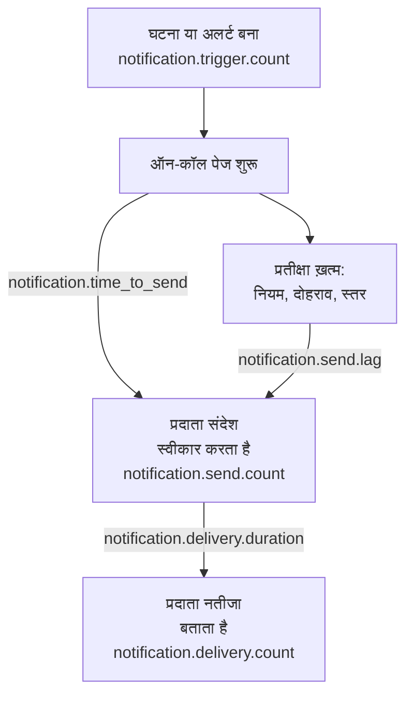

# सूचना डिलीवरी मेट्रिक्स

OneUptime दर्ज करता है कि उसकी भेजी सूचनाओं का क्या हुआ: कितनी घटनाओं और अलर्ट को उनकी ज़रूरत पड़ी, हर संदेश अपने प्रदाता तक पहुँचा या नहीं, एक ऑन-कॉल पेज को निकलने में कितना समय लगा, और वह फ़ोन तक पहुँचा या नहीं। अपने इंस्टॉलेशन से सेवा पाने वाले लोगों के लिए डिलीवरी के लक्ष्य तय करने और उन पर खरे उतरने की जाँच के लिए, OneUptime की अपनी टेलीमेट्री किसी OneUptime प्रोजेक्ट या किसी भी OpenTelemetry बैकएंड को भेजें।

:::cards
- [इन्हें चालू करें](#इन्हें-चालू-करें): दो सेटिंग्स, और इनके बिना कुछ भी दर्ज नहीं होता।
- [मेट्रिक्स](#मेट्रिक्स): ट्रिगर से फ़ोन तक, सात मेट्रिक्स।
- [पेज का समय कैसे मापा जाता है](#पेज-का-समय-कैसे-मापा-जाता-है): भेजने तक का समय और भेजने की देरी कहाँ से गिनी जाती है।
- [शुरुआत के लिए SLO](#शुरुआत-के-लिए-slo): चार लक्ष्य, क्वेरी दर क्वेरी।
:::

## यह कैसे काम करता है



हर संदेश `notification.send.count` में गिना जाता है, हर चैनल पर, सिर्फ़ ऑन-कॉल पेज ही नहीं। दो समय, `notification.time_to_send` और `notification.send.lag`, केवल ऑन-कॉल पेज को कवर करते हैं।

## इन्हें चालू करें

जब तक OneUptime के पास OpenTelemetry एक्सपोर्टर नहीं होता, कुछ भी दर्ज नहीं होता: उसके बिना मेट्रिक्स की कोई लागत नहीं होती और वे कहीं नहीं रखे जाते। इसे उसी प्रोजेक्ट की Server [इंजेशन कुंजी](/docs/telemetry/ingestion-keys) के साथ किसी OneUptime प्रोजेक्ट की ओर, या HTTP पर OTLP लेने वाले किसी भी बैकएंड की ओर इंगित करें।

:::tabs
@tab Kubernetes
```yaml
openTelemetryExporter:
  endpoint: https://oneuptime.example.com/otlp
  headers: x-oneuptime-token=YOUR_INGESTION_KEY
```
`app` और `worker` डिप्लॉयमेंट इन्हें भेजते हैं: `app.disableTelemetryCollection` और `worker.disableTelemetryCollection` को उनके डिफ़ॉल्ट `false` पर ही रहने दें।
@tab Docker Compose
```bash
OPENTELEMETRY_EXPORTER_OTLP_ENDPOINT=https://oneuptime.example.com/otlp
OPENTELEMETRY_EXPORTER_OTLP_HEADERS=x-oneuptime-token=YOUR_INGESTION_KEY
DISABLE_TELEMETRY_FOR_APP=false
```
इन्हें `config.env` में सेट करें, फिर `npm start` चलाएँ। `DISABLE_TELEMETRY_FOR_APP` डिफ़ॉल्ट रूप से `true` होता है, और तब कुछ भी नहीं भेजा जाता।
:::

OneUptime को एंडपॉइंट और हेडर दोनों चाहिए: हेडर के बिना वह कुछ नहीं भेजता। हर हेडर को `name=value` के रूप में लिखें, और कई हेडर को `;` से अलग करें। किसी मान में `=` हो सकता है। OneUptime एंडपॉइंट में `/v1/metrics` ख़ुद जोड़ता है, और यही सेटिंग्स उसके अपने ट्रेस और लॉग भी भेजती हैं। हर मेट्रिक तब दिखता है जब OneUptime उसे पहली बार दर्ज करता है: `notification.send.count` पहला संदेश भेजे जाने पर।

### OneUptime प्रोजेक्ट को डेल्टा भेजें

OneUptime काउंटर और हिस्टोग्राम उसी तरह भेजता है जैसे OpenTelemetry डिफ़ॉल्ट रूप से भेजता है: हर पॉइंट में उस सर्वर प्रोसेस के शुरू होने के बाद का चालू योग होता है। मेट्रिक्स एक्सप्लोरर चार्ट के हर स्टेप के पॉइंट जोड़ता है, इसलिए वह किसी समय सीमा की गिनती और पर्सेंटाइल ठीक-ठीक सिर्फ़ डेल्टा से पढ़ता है, यानी ऐसे पॉइंट जिनमें पिछले पॉइंट के बाद हुआ हिस्सा होता है। जब मेट्रिक्स किसी OneUptime प्रोजेक्ट में जाते हैं, तो डेल्टा भेजें:

:::tabs
@tab Kubernetes
```yaml
extraEnv:
  - name: OTEL_EXPORTER_OTLP_METRICS_TEMPORALITY_PREFERENCE
    value: delta
```
किसी सर्विस की अपनी सूची पूरे चार्ट वाली सूची की जगह ले लेती है: अगर आप `app.extraEnv` या `worker.extraEnv` सेट करते हैं, तो इसे वहाँ भी जोड़ें।
@tab Docker Compose
```yaml title="docker-compose.override.yml"
services:
  app:
    environment:
      OTEL_EXPORTER_OTLP_METRICS_TEMPORALITY_PREFERENCE: delta
```
इसे `docker-compose.yml` के बगल में बनाएँ, या इसे अपनी मौजूदा फ़ाइल में जोड़ें, फिर `npm start` चलाएँ।
:::

यह हर उस मेट्रिक पर लागू होता है जो OneUptime अपने बारे में भेजता है। जो बैकएंड चालू योग ख़ुद पढ़ता है, जैसे Prometheus, उसमें कोई बदलाव नहीं चाहिए।

## मेट्रिक्स

| मेट्रिक | प्रकार | इकाई | यह किसका जवाब देता है |
| --- | --- | --- | --- |
| `notification.trigger.count` | काउंटर | `1` | कितने रिकॉर्ड को सूचनाओं की ज़रूरत पड़ी |
| `notification.send.count` | काउंटर | `1` | प्रदाता को सौंपे गए हर संदेश का क्या हुआ |
| `notification.send.duration` | हिस्टोग्राम | `ms` | प्रदाता को उसे लेने में कितना समय लगा |
| `notification.time_to_send` | हिस्टोग्राम | `ms` | अपने ट्रिगर के कितनी देर बाद पेज अपने प्रदाता तक पहुँचा |
| `notification.send.lag` | हिस्टोग्राम | `ms` | बाद में भेजी गई सूचना अपने नियत समय के कितनी देर बाद अपने प्रदाता तक पहुँची |
| `notification.delivery.count` | काउंटर | `1` | प्रदाताओं के स्वीकार किए संदेश कैसे ख़त्म हुए |
| `notification.delivery.duration` | हिस्टोग्राम | `ms` | प्रदाता के स्वीकार करने के कितनी देर बाद संदेश ख़त्म हुआ |

हर एट्रिब्यूट में कुछ तय मानों में से एक होता है, कभी कोई प्रोजेक्ट, व्यक्ति, फ़ोन नंबर या रिकॉर्ड नहीं। एकमात्र अपवाद कस्टम चैनल की ID और नाम है: किसी इंस्टॉलेशन में ऐसे गिने-चुने होते हैं, और उन्हें अलग-अलग पहचानना ही असल मक़सद है।

### लोगों को सूचित करने वाले रिकॉर्ड

`notification.trigger.count` हर घटना, अलर्ट, घटना एपिसोड और अलर्ट एपिसोड को उसके बनते ही गिनता है।

| एट्रिब्यूट | मान |
| --- | --- |
| `notification.trigger.type` | `incident`, `alert`, `incident_episode`, `alert_episode` |
| `notification.trigger.source` | `automatic` जब OneUptime ने उसे किसी मॉनिटर या नियम से बनाया; `manual` जब किसी व्यक्ति या API ने बनाया |
| `monitor.type` | घटना या अलर्ट बनाने वाले मॉनिटर का प्रकार, जैसे `Incoming Request`, `Logs` या `Metrics`; जब किसी मॉनिटर ने नहीं बनाया तो छोड़ दिया जाता है |

### प्रदाता को सौंपे गए संदेश

`notification.send.count` प्रदाता को सौंपे गए हर संदेश को गिनता है, और `notification.send.duration` प्रदाता की कॉल का समय मापता है। दोनों में ये एट्रिब्यूट होते हैं:

| एट्रिब्यूट | मान |
| --- | --- |
| `notification.channel` | `email`, `sms`, `call`, `whatsapp`, `telegram`, `push`, `webhook`, `slack`, `microsoft_teams`, `mattermost`, `custom_channel` |
| `notification.provider` | `twilio`, `sms_and_call_gateway`, `smtp`, `sendgrid`, `amazon_ses`, `mailgun`, `postmark`, `resend`, `microsoft_graph`, `expo`, `push_relay`, `web_push`, `meta_whatsapp`, `telegram_bot_api`, `slack`, `microsoft_teams`, `mattermost`, `webhook`, `custom_channel`, या `none` जब किसी को कुछ नहीं सौंपा गया |
| `notification.provider.config` | इंस्टॉलेशन के अपने खाते और सेटिंग्स के लिए `global`; किसी प्रोजेक्ट के अपने Twilio खाते, SMTP सर्वर, वेबहुक या वर्कस्पेस कनेक्शन के लिए `project`, जिनकी विफलताएँ ठीक करना प्रोजेक्ट का काम है |
| `notification.on_call_page` | ऑन-कॉल पेज की सूचना के लिए `true`, वरना `false` |
| `outcome` | `success`, `failure` या `not_sent`, जैसा नीचे है |
| `notification.destination` | Slack, Microsoft Teams और Mattermost: एक व्यक्ति को `direct_message`, किसी चैनल या Teams ग्रुप चैट में पोस्ट के लिए `channel`, इनकमिंग वेबहुक के लिए `incoming_webhook`, जैसे किसी स्टेटस पेज सब्सक्राइबर का। वेबहुक: किसी स्टेटस पेज सब्सक्राइबर के अपने वेबहुक के लिए `status_page_subscriber`। किसी व्यक्ति के वेबहुक और बाक़ी सभी चैनलों पर यह नहीं होता |
| `notification.custom_channel.id`, `notification.custom_channel.name` | सिर्फ़ कस्टम चैनल: चैनल की ID, और 100 अक्षरों तक काटा गया उसका नाम |

- `success`: प्रदाता ने संदेश स्वीकार किया।
- `failure`: प्रदाता ने उसे ठुकरा दिया या उस तक पहुँचा नहीं जा सका, या उसे भेजना विफल हुआ। जो चैट चैनल नहीं मिला, वह बिना अवधि वाली विफलता है।
- `not_sent`: जान-बूझकर नहीं भेजा गया। प्रोजेक्ट ने चैनल बंद किया, उसका बैलेंस बहुत कम है या वह ब्लॉक है, इस सर्वर पर पुश बंद है, या कोई कस्टम चैनल बंद, हटाया गया या लाइसेंस के दायरे से बाहर है। सफलता दर इन्हें शामिल नहीं करती: ये सेटिंग्स का काम है, प्लेटफ़ॉर्म की विफलता नहीं।

किसी स्टेटस पेज सब्सक्राइबर के अपने वेबहुक को भेजा गया संदेश एक बार गिना जाता है, चाहे उसे कितनी भी बार आज़माया गया हो: `success` जब एंडपॉइंट ने 2xx स्टेटस से जवाब दिया, और `failure` जब उसने किसी दूसरे स्टेटस से जवाब दिया, उस तक पहुँचा नहीं जा सका, या उसके पते की अनुमति नहीं है।

### फ़ोन तक क्या पहुँचा

`notification.delivery.count` गिनता है कि प्रदाता के स्वीकार किए हर संदेश का अंत कैसे हुआ, जैसा प्रदाता बाद में बताता है, हर संदेश के लिए एक बार। `notification.delivery.duration` मापता है कि प्रदाता के स्वीकार करने के कितनी देर बाद। दोनों में `notification.channel`, `notification.provider`, `notification.provider.config`, `notification.on_call_page` और `outcome`, यानी अंतिम स्थिति, होते हैं:

| चैनल | प्रदाता | `outcome` | अवधि |
| --- | --- | --- | --- |
| `sms` | `twilio` | `delivered`, `undelivered`, `failed` | जब तक Twilio स्थिति न बताए |
| `call` | `twilio` | `answered`, `not_answered`, `failed` | जब तक कॉल उठाई न जाए, वरना ख़त्म न हो |
| `push` | `expo`, `push_relay` | `delivered`, `undelivered`, `failed` | मापा नहीं जाता: रसीद बताती है कि Apple या Google ने पुश लिया या नहीं, कब यह नहीं |
| `whatsapp` | `meta_whatsapp` | `delivered`, `failed` | जब तक Meta स्थिति न बताए |

जो कॉल बजकर रह गई, व्यस्त थी या अस्वीकार हुई, वह `not_answered` है। जो ऐप अब मौजूद नहीं, उसे भेजा पुश `undelivered` है, और पढ़ा गया WhatsApp संदेश डिलीवर गिना जाता है। `notification.provider.config` केवल किसी प्रोजेक्ट के अपने Twilio खाते पर SMS और कॉल के लिए `project` होता है।

स्थितियाँ सिर्फ़ वहीं आती हैं जहाँ प्रदाता उन्हें बता सकता है:

- SMS और कॉल: Twilio के ज़रिए, जब Twilio आपके सर्वर तक उसके `HOST` पर पहुँच सके ([Twilio इंटीग्रेशन](/docs/self-hosted/twilio-integration#3-नेटवर्क-एक्सेस-कॉन्फ़िगर-करें) देखें)। SMS और कॉल गेटवे कोई स्थिति नहीं बताता।
- WhatsApp: जब Meta का वेबहुक आपके इंस्टॉलेशन के लिए सेट हो।
- पुश: Expo की रसीदों से, जिन्हें OneUptime पुश के लगभग 15 मिनट बाद पढ़ता है, पुश रिले के ज़रिए भी। पुश भेजने वाला इंस्टॉलेशन उसे गिनता है।
- ईमेल, Telegram, वेबहुक, चैट और कस्टम चैनल कोई अंतिम स्थिति नहीं बताते।

## पेज का समय कैसे मापा जाता है

### भेजने तक का समय

`notification.time_to_send` पेज के ट्रिगर से लेकर उसके प्रदाता के सूचना स्वीकार करने तक चलता है। यह सिर्फ़ उन सूचनाओं का समय मापता है जो पेज शुरू होते ही नियत होती हैं: पहले एस्केलेशन नियम के लोग, उनके उन ऑन-कॉल नियमों से जो किसी चीज़ का इंतज़ार नहीं करते, और हर वह स्तर जिस पर पेज किसी तक न पहुँचने के कारण तुरंत बढ़ जाता है। ऑन-कॉल कॉन्फ़िगरेशन जो प्रतीक्षा माँगता है, वह प्लेटफ़ॉर्म की देरी नहीं है, इसलिए उसे बाहर रखा जाता है: वह [भेजने की देरी](#भेजने-की-देरी) में है। सिर्फ़ वही सूचनाएँ मापी जाती हैं जिन्हें उनके प्रदाता ने स्वीकार किया; विफलता `notification.send.count` में दिखती है।

| एट्रिब्यूट | मान |
| --- | --- |
| `notification.channel` | जैसा `notification.send.count` पर |
| `notification.page.start` | समय कहाँ से चलता है, जैसा नीचे है |
| `notification.trigger.type` | वह रिकॉर्ड जिसके लिए पेज है: `incident`, `alert`, `incident_episode`, `alert_episode` |
| `notification.custom_channel.id`, `notification.custom_channel.name` | सिर्फ़ कस्टम चैनल |

| `notification.page.start` | समय यहाँ से चलता है |
| --- | --- |
| `monitor_data_received` | जब OneUptime को वह डेटा मिला जिसने मॉनिटर को ट्रिगर किया: कोई इनकमिंग अनुरोध, सर्वर एजेंट की रिपोर्ट, इनकमिंग ईमेल, प्रोब की जाँच, SNMP ट्रैप या नेटवर्क डिवाइस पोल। इसमें वह समय शामिल है जो डेटा ने मूल्यांकन के लिए कतार में इंतज़ार किया। |
| `record_created` | जब घटना, अलर्ट या एपिसोड बना: किसी टेलीमेट्री मॉनिटर, नियम या व्यक्ति द्वारा, और अनुपस्थिति की जाँच के लिए, जैसे रुक गई हार्टबीट। |
| `page_started` | जब पेज बाद में शुरू हुआ: किसी व्यक्ति, वर्कफ़्लो या अब मेल खाने वाले नियम ने उसे शुरू किया, या वह सीधा पेज है। जिस पेज को उसके ऑन-कॉल नियम या OneUptime AI ने रोके रखा, उसके लिए जब उसका होल्ड ख़त्म हुआ, या जब वह शुरू हुआ अगर वह पहले था। दोबारा पेज के लिए, जब स्वीकृति के बाद टाइमआउट ख़त्म हुआ। इसलिए जो वर्कर इनमें से किसी तक देर से पहुँचा, वह इस समय में दिखता है। |

इनकमिंग अनुरोध के लिए समय एंडपॉइंट को मिले सबसे ताज़ा अनुरोध से चलता है, इसलिए यह थोड़ा कम दिख सकता है।

### भेजने की देरी

`notification.send.lag` उस पल से चलता है जब बाद में भेजी गई सूचना नियत हुई, उसके प्रदाता के उसे स्वीकार करने तक। इन्हें दो वर्कर भेजते हैं, हर एक मिनट में एक बार, इसलिए समय पर चल रहा वर्कर लगभग एक मिनट तक दिखाता है, और पीछे छूटा वर्कर दिखाता है कि कितना पीछे है।

| `notification.schedule` | कब नियत |
| --- | --- |
| `rule_wait` | किसी व्यक्ति का प्रतीक्षा करने वाला ऑन-कॉल नियम, जैसे "मुझे 10 मिनट बाद कॉल करो": व्यक्ति को पेज किए जाने के उतनी देर बाद। कभी भी उस समय से पहले नहीं जब वर्कर ने पिछली बार उनके नियम देखे, इसलिए बाद में जोड़ा या बदला गया नियम तब से नियत होता है। |
| `repeat` | किसी के स्वीकार करने तक दोहराया जाने वाला पुश: हर बार जब उसका अंतराल ख़त्म होता है। |
| `escalation` | बाद का एस्केलेशन स्तर: जब उससे पहले के स्तर ने अपनी प्रतीक्षा पूरी की, या तुरंत जब कोई व्यक्ति पेज आगे बढ़ा देता है। |
| `policy_repeat` | नीति का अपने पहले स्तर से फिर शुरू होना: जब उसके अंतिम स्तर की प्रतीक्षा ख़त्म हुई। |

इसमें `notification.channel`, `notification.trigger.type` और, कस्टम चैनलों के लिए, `notification.custom_channel.id` और `notification.custom_channel.name` भी होते हैं। जो सूचना अपने पेज के शुरू होते ही नियत होती है, वह इसमें कभी नहीं होती, तब भी नहीं जब किसी वर्कर ने पेज देर से शुरू किया, होल्ड के बाद या दोबारा पेज के रूप में: वह भेजने तक के समय में है।

### हिस्टोग्राम बकेट

हर हिस्टोग्राम की अपनी बकेट सीमाएँ हैं, मिलीसेकंड में, जो इस तरह तय की गई हैं कि किसी लक्ष्य को सीमा पर पढ़ा जा सके:

| हिस्टोग्राम | बकेट सीमाएँ, मिलीसेकंड में |
| --- | --- |
| `notification.send.duration` | `5, 10, 25, 50, 100, 250, 500, 1000, 2500, 5000, 10000, 30000, 60000, 120000` |
| `notification.time_to_send` | `250, 500, 1000, 2000, 5000, 10000, 15000, 30000, 60000, 120000, 300000, 600000, 1800000, 3600000` |
| `notification.send.lag` | `1000, 5000, 10000, 15000, 30000, 45000, 60000, 75000, 90000, 120000, 180000, 300000, 600000, 1800000, 3600000` |
| `notification.delivery.duration` | `500, 1000, 2000, 5000, 10000, 15000, 30000, 60000, 120000, 300000, 600000, 1800000, 3600000, 14400000, 86400000` |

पर्सेंटाइल बकेट से निकाला जाता है, और जिस बकेट में वह आता है उसके बीच के रूप में बनाया जाता है। इसलिए उसकी तुलना बकेट की सीमा से करें: `notification.time_to_send` का P95 अगर 30000 या उससे नीचे है, तो इसका मतलब है कि 95% पेज में 30 सेकंड या उससे कम लगे।

## शुरुआत के लिए SLO

चार लक्ष्य जिनका वादा ज़्यादातर इंस्टॉलेशन कर सकते हैं, हर एक मेट्रिक्स पाने वाले प्रोजेक्ट के मेट्रिक्स एक्सप्लोरर में एक या दो क्वेरी से बना। जब मेट्रिक्स डेल्टा के रूप में आते हैं, तो वे समय सीमा ठीक-ठीक पढ़ते हैं: [OneUptime प्रोजेक्ट को डेल्टा भेजें](#oneuptime-प्रोजेक्ट-को-डेल्टा-भेजें) देखें।

### मेट्रिक्स एक्सप्लोरर में एक बनाएँ

:::steps
1. प्रोजेक्ट का [मेट्रिक्स एक्सप्लोरर](/docs/telemetry/metrics-explorer) खोलें, और लक्ष्य के पहले मेट्रिक पर क्लिक करें। उसकी क्वेरी `a` है।
2. **Aggregate by** के नीचे उसका एग्रीगेशन चुनें। फिर **Filters & grouping** खोलें, और उसकी हर शर्त **Filter by attributes** के नीचे जोड़ें।
3. दूसरी क्वेरी के लिए **मीट्रिक जोड़ें** पर क्लिक करें, और `b` को उसी तरह सेट करें।
4. फ़ॉर्मूले के लिए **सूत्र जोड़ें** पर क्लिक करें, और उसे **सूत्र** में लिखें।
5. लक्ष्य चूकने पर ख़बर पाने के लिए **क्रियाएँ → इस व्यू से मॉनिटर बनाएँ** पर क्लिक करें, और मान के लक्ष्य से आगे जाने पर अलर्ट करें: [मेट्रिक्स मॉनिटर](/docs/monitor/metrics-monitor) देखें।
:::

किसी लक्ष्य को एरर बजट के साथ 30 दिनों तक देखने के लिए, उस मॉनिटर को किसी [SLO](/docs/slo/introduction) से जोड़ें: वह उस समय को गिनता है जब लक्ष्य चूका।

### ऑन-कॉल SMS Twilio तक पहुँचते हैं

इंस्टॉलेशन के अपने Twilio खाते से भेजे गए ऑन-कॉल SMS में से ज़्यादा से ज़्यादा 1% विफल होते हैं, यानी 99% स्वीकार होते हैं।

| क्वेरी | मेट्रिक | एग्रीगेशन | शर्तें |
| --- | --- | --- | --- |
| `a` | `notification.send.count` | **योग** | `notification.channel = sms`, `notification.on_call_page = true`, `notification.provider.config = global`, `outcome != not_sent` |
| `b` | `notification.send.count` | **योग** | वही, `outcome = failure` के साथ |

फ़ॉर्मूला `$b / $a * 100` विफल हिस्सेदारी है, और लक्ष्य तब तक बना रहता है जब तक यह 1 या उससे नीचे रहे। बिना विफलता वाला स्टेप कोई पॉइंट नहीं बनाता, क्योंकि `b` के पास कोई नहीं होता। `outcome != not_sent` वह बाहर रखता है जो प्रोजेक्ट की अपनी सेटिंग्स ने रोका, और `global` प्रोजेक्ट के अपने Twilio खाते। जो इंस्टॉलेशन SMS अपने SMS और कॉल गेटवे से भेजता है, उस पर यही क्वेरी गेटवे को मापती हैं। किसी दूसरे चैनल के लिए `sms` बदलें: `call`, `push` या `email`।

### पेज 30 सेकंड के भीतर निकलते हैं

95% ऑन-कॉल पेज अपने ट्रिगर के 30 सेकंड के भीतर अपने प्रदाता तक पहुँचते हैं।

| क्वेरी | मेट्रिक | एग्रीगेशन | शर्तें |
| --- | --- | --- | --- |
| `a` | `notification.time_to_send` | **P95** | `notification.page.start != page_started` |

लक्ष्य तब तक बना रहता है जब तक `a` 30000 या उससे नीचे रहे। बाद में शुरू हुए पेज ट्रिगर से नहीं, अपने शुरू होने या नियत होने के समय से मापे जाते हैं, इसलिए उन्हें बाहर रखा जाता है। मॉनिटरों की कतार (`monitor_data_received`) को बाक़ी से अलग देखने के लिए `notification.page.start` से ग्रुप करें, या धीमा चैनल ढूँढने के लिए `notification.channel` से।

### बाद में भेजी गई सूचनाएँ 90 सेकंड के भीतर निकलती हैं

प्रतीक्षा के बाद भेजी गई 99% सूचनाएँ नियत होने के 90 सेकंड के भीतर अपने प्रदाता तक पहुँचती हैं।

| क्वेरी | मेट्रिक | एग्रीगेशन | शर्तें |
| --- | --- | --- | --- |
| `a` | `notification.send.lag` | **P99** | — |

लक्ष्य तब तक बना रहता है जब तक `a` 90000 या उससे नीचे रहे। कौन-सा वर्कर पीछे छूटा, यह देखने के लिए `notification.schedule` से ग्रुप करें: `rule_wait` और `repeat` एक वर्कर के हैं, `escalation` और `policy_repeat` दूसरे के।

### ऑन-कॉल SMS फ़ोन तक पहुँचते हैं

इंस्टॉलेशन के अपने खाते के लिए Twilio ने जो ऑन-कॉल SMS स्वीकार किए, उनमें से ज़्यादा से ज़्यादा 5% डिलीवर नहीं होते।

| क्वेरी | मेट्रिक | एग्रीगेशन | शर्तें |
| --- | --- | --- | --- |
| `a` | `notification.delivery.count` | **योग** | `notification.channel = sms`, `notification.on_call_page = true`, `notification.provider.config = global` |
| `b` | `notification.delivery.count` | **योग** | वही, `outcome != delivered` के साथ |

फ़ॉर्मूला `$b / $a * 100` डिलीवर न हुई हिस्सेदारी है। इसका एक हिस्सा कैरियर और बंद फ़ोन तय करते हैं, इसलिए कुछ हफ़्तों में जो दिखे उसके आधार पर लक्ष्य तय करें। कॉल के लिए `call` और `outcome != answered` इस्तेमाल करें। Twilio का आपके सर्वर तक पहुँच पाना ज़रूरी है: [फ़ोन तक क्या पहुँचा](#फ़ोन-तक-क्या-पहुँचा) देखें।

## समस्या निवारण

:::details कोई सूचना मेट्रिक्स नहीं आते
जाँचें कि `OPENTELEMETRY_EXPORTER_OTLP_ENDPOINT` और `OPENTELEMETRY_EXPORTER_OTLP_HEADERS` दोनों सेट हैं, और Docker Compose में `DISABLE_TELEMETRY_FOR_APP` `false` है, फिर OneUptime को रीस्टार्ट करें। शुरू होते समय, जब OneUptime कोई हेडर नहीं पढ़ पाता या कुछ नहीं भेजता, तो वह लॉग में एक चेतावनी लिखता है। कोई मेट्रिक तभी दिखता है जब कुछ दर्ज हो, इसलिए पहले एक सूचना भेजें।
:::

:::details गिनती बस बढ़ती ही जाती है, या पर्सेंटाइल मुश्किल से हिलता है
मेट्रिक्स चालू योग के रूप में आ रहे हैं। डेल्टा भेजें: [OneUptime प्रोजेक्ट को डेल्टा भेजें](#oneuptime-प्रोजेक्ट-को-डेल्टा-भेजें) देखें।
:::

:::details कोई अंतिम स्थिति नहीं आती
अंतिम स्थितियाँ प्रदाताओं से बाद में आती हैं, और सिर्फ़ वहीं जहाँ वे उन्हें बता सकते हैं: [फ़ोन तक क्या पहुँचा](#फ़ोन-तक-क्या-पहुँचा) देखें। जिस इंस्टॉलेशन तक Twilio नहीं पहुँच सकता, वहाँ SMS और कॉल भेजे गए गिने जाते हैं, पर कभी डिलीवर नहीं।
:::

## अगले कदम

:::cards
- [मेट्रिक्स एक्सप्लोरर](/docs/telemetry/metrics-explorer): किसी भी मेट्रिक का चार्ट बनाएँ, उन्हें मिलाएँ और तुलना करें।
- [मेट्रिक्स मॉनिटर](/docs/monitor/metrics-monitor): लक्ष्य चूकने पर अलर्ट करें।
- [Twilio इंटीग्रेशन](/docs/self-hosted/twilio-integration): Twilio को बताने दें कि फ़ोन तक क्या पहुँचा।
- [एस्केलेशन नियम](/docs/on-call/escalation-rules): वे प्रतीक्षाएँ जिनसे भेजने की देरी गिनी जाती है।
:::
