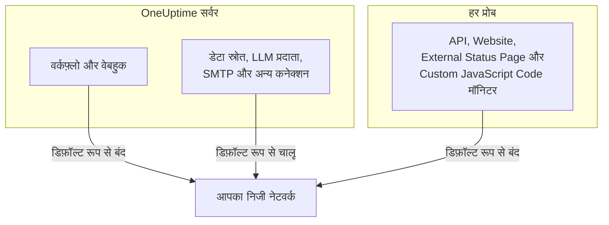

# निजी नेटवर्क पहुँच

OneUptime कुछ आउटबाउंड अनुरोधों को उन होस्ट पर भेजने से मना करता है जो किसी निजी, लूपबैक या लिंक-लोकल रेंज में रिज़ॉल्व होते हैं। अगर आपने किसी वर्कफ़्लो को किसी आंतरिक टूल की ओर मोड़ने की कोशिश की है, तो आपने यह संदेश देखा होगा:

> Webhook URL resolves to a private, loopback, or link-local address and is not allowed

होस्ट किए गए उत्पाद के लिए यह डिफ़ॉल्ट सही है, जहाँ कोई भी साइन अप कर सकता है और वेबहुक का लक्ष्य अविश्वसनीय इनपुट होता है। सेल्फ-होस्टेड इंस्टेंस पर यह एक साधारण काम के आड़े आता है: किसी सेल्फ-होस्टेड Mattermost, Jira या टिकटिंग सिस्टम पर अलर्ट भेजना जो सिर्फ़ आपके अपने नेटवर्क पर मौजूद है।

यह पृष्ठ बताता है कि इसे सोच-समझकर और सीमित दायरे में कैसे अनुमति दें। इसका फ़ैसला तीन स्विच करते हैं, हर एक अपने तरह के कनेक्शन के लिए, और इन्हें अलग-अलग मशीनों पर कॉन्फ़िगर किया जाता है:

| आप आंतरिक रूप से किस तक पहुँचना चाहते हैं | सेटिंग कहाँ रहती है | सेल्फ-होस्टेड इंस्टॉल पर डिफ़ॉल्ट |
| --- | --- | --- |
| वर्कफ़्लो, प्रोजेक्ट वेबहुक, ऑन-कॉल उपयोगकर्ता वेबहुक | **API सर्वर** का एनवायरनमेंट | निजी पते अस्वीकृत |
| डेटा स्रोत, LLM प्रदाता, SMTP सर्वर, OIDC डिस्कवरी और अन्य कनेक्शन | **API सर्वर** का एनवायरनमेंट | निजी पते अनुमत |
| API, Website, External Status Page और Custom JavaScript Code **मॉनिटर** | **प्रोब** का अपना एनवायरनमेंट | निजी पते अस्वीकृत |



Ping, Port, SSL प्रमाणपत्र, DNS, DNSSEC, SNMP / नेटवर्क डिवाइस, SQL क्वेरी, डेटाबेस स्वास्थ्य, Synthetic और Network Path जैसे नेटवर्क-नेटिव मॉनिटर प्रकार अपने अलग ट्रांसपोर्ट इस्तेमाल करते हैं। इस पृष्ठ की सेटिंग उन HTTP ट्रांसपोर्ट को नियंत्रित करती है जो किसी प्रोजेक्ट को मनमाना रिस्पॉन्स कंटेंट लौटाते हैं: API, Website, External Status Page और Custom JavaScript Code मॉनिटर।

:::cards
- [वेबहुक और वर्कफ़्लो](#वेबहुक-और-वर्कफ़्लो): किसी वेबहुक को अपने नेटवर्क के भीतर पोस्ट करने दें।
- [अन्य आउटबाउंड कनेक्शन](#अन्य-आउटबाउंड-कनेक्शन): डेटा स्रोत, LLM प्रदाता और मेल सर्वर।
- [प्रोब और मॉनिटर](#प्रोब-और-मॉनिटर): किसी प्रोब को निजी साइटें जाँचने दें।
- [जाँचें कि यह काम करता है](#जाँचें-कि-यह-काम-करता-है): पढ़ें कि अस्वीकृति किस स्विच का नाम लेती है।
:::

## क्या ब्लॉक है, और क्या अनब्लॉक किया जा सकता है

ब्लॉक किए गए लक्ष्य दो स्तरों में आते हैं।

| स्तर | रेंज | क्या इसकी अनुमति दी जा सकती है? |
| --- | --- | --- |
| **निजी** | RFC-1918 (`10.0.0.0/8`, `172.16.0.0/12`, `192.168.0.0/16`), CGNAT (`100.64.0.0/10`), IPv6 यूनिक-लोकल (`fc00::/7`) और साइट-लोकल (`fec0::/10`) | हाँ |
| **वर्जित** | लूपबैक (`127.0.0.0/8`, `::1`), अनिर्दिष्ट पता, लिंक-लोकल (`169.254.0.0/16`, `fe80::/10`), मल्टीकास्ट, आरक्षित, ब्रॉडकास्ट, और नाम `localhost` तथा `metadata.google.internal` | केवल वेबहुक अनुमति सूची में सटीक होस्ट या CIDR का नाम लिखकर। मॉनिटर के लिए कभी नहीं। |

क्लाउड मेटाडेटा एंडपॉइंट `169.254.169.254` किसी वजह से वर्जित स्तर में है। क्लाउड VM पर यह इंस्टेंस के IAM क्रेडेंशियल हर उस चीज़ को दे देता है जो उस मशीन से HTTP अनुरोध कर सकती है, इसलिए कोई भी व्यापक सेटिंग इसे कभी नहीं खोलेगी।

IPv6 के वे रूप जिनके भीतर IPv4 लक्ष्य होता है — IPv4-मैप्ड (`::ffff:10.0.0.5`), NAT64, 6to4, Teredo — उस IPv4 पते के अनुसार वर्गीकृत होते हैं जिस तक वे पहुँचते हैं, इसलिए इनका इस्तेमाल करके किसी वर्जित पते को निजी-स्तर की अनुमति के पार चोरी-छिपे नहीं पहुँचाया जा सकता।

## वेबहुक और वर्कफ़्लो

ये गंतव्य इसके दायरे में आते हैं, क्योंकि लक्ष्य एक URL है जिसे आपके प्रोजेक्ट के किसी प्रमाणित सदस्य ने लिखा है:

- वर्कफ़्लो के **API** कंपोनेंट (GET / POST / PUT / PATCH / DELETE)
- वर्कफ़्लो के **Custom JavaScript** कंपोनेंट से किए गए HTTP अनुरोध
- प्रोजेक्ट वेबहुक सूचनाएँ (इंसिडेंट, अलर्ट, मॉनिटर, ऑन-कॉल, शेड्यूल्ड मेंटेनेंस, स्टेटस पेज इवेंट)
- ऑन-कॉल **उपयोगकर्ता वेबहुक**

दायरे में **नहीं** हैं, और कभी नहीं होंगे: **स्टेटस पेज सब्सक्राइबर वेबहुक**। किसी सार्वजनिक स्टेटस पेज पर आने वाला कोई भी व्यक्ति ऐसा वेबहुक रजिस्टर कर सकता है, इसलिए उस गंतव्य में ढील देने से इंटरनेट पर कोई भी आपके सर्वर से आपके निजी नेटवर्क में POST करवा सकेगा। यह कॉन्फ़िगर नहीं किया जा सकता।

जो आउटबाउंड कनेक्शन वेबहुक नहीं हैं — बाहरी डेटा स्रोत, LLM प्रदाता, SMTP सर्वर (प्रोजेक्ट की SMTP सेटिंग्स और वर्कफ़्लो का **Email** कंपोनेंट), SMTP OAuth टोकन एंडपॉइंट, OIDC डिस्कवरी और रनबुक HTTP स्टेप — उन्हें अलग से `DATA_SOURCE_BLOCK_PRIVATE_ADDRESSES` नियंत्रित करता है, और सेल्फ-होस्टेड इंस्टॉल पर वे पहले से निजी रेंज की अनुमति देते हैं। [अन्य आउटबाउंड कनेक्शन](#अन्य-आउटबाउंड-कनेक्शन) देखें।

### API सर्वर कॉन्फ़िगर करना

API सर्वर पर इनमें से एक या दोनों सेट करें और रीस्टार्ट करें। ये डिफ़ॉल्ट रूप से बंद हैं, इसलिए जो इंस्टेंस इनमें से कोई भी सेट नहीं करता, वह ठीक पहले जैसा व्यवहार करता है।

| वेरिएबल | Helm वैल्यू | यह किसकी अनुमति देता है |
| --- | --- | --- |
| `ALLOW_PRIVATE_NETWORK_WEBHOOKS` | `webhooks.allowPrivateNetwork` | `true` पर सेट होने पर पूरे निजी स्तर की। |
| `PRIVATE_NETWORK_WEBHOOK_ALLOWLIST` | `webhooks.privateNetworkAllowlist` | इसमें लिखे होस्ट और CIDR की, उनका स्तर चाहे जो हो। |

:::tabs
@tab Docker Compose
```bash title="config.env"
ALLOW_PRIVATE_NETWORK_WEBHOOKS=true
PRIVATE_NETWORK_WEBHOOK_ALLOWLIST=mattermost.internal,*.svc.cluster.local,10.20.0.0/16
```
@tab Kubernetes
```yaml title="values.yaml"
webhooks:
  allowPrivateNetwork: true
  privateNetworkAllowlist: "mattermost.internal,10.20.0.0/16"
```
:::

Docker Compose पर `config.env` में एक `ALLOW_PRIVATE_NETWORK_WEBHOOKS=false` लाइन है: दूसरी लाइन जोड़ने के बजाय उसी को बदलें, फिर `npm run start` चलाएँ। Kubernetes पर रिलीज़ अपग्रेड करें।

अनुमति सूची की प्रविष्टियाँ कॉमा, स्पेस या नई लाइन से अलग की जा सकती हैं, और हर प्रविष्टि इनमें से कुछ हो सकती है:

- एक होस्टनेम — `mattermost.internal`
- एक वाइल्डकार्ड — `*.svc.cluster.local` (सबडोमेन से मेल खाता है, अकेले सफ़िक्स से नहीं)
- एक IPv4 या IPv6 पता — `10.20.30.40`, `fd00::1`
- एक CIDR — `10.20.0.0/16`, `fd12:3456::/32`

किसी प्रविष्टि में स्कीम, पोर्ट, पाथ या userinfo हो तो उसे हटा दिया जाता है, इसलिए आपके पास पहले से मौजूद वेबहुक URL चिपकाना भी काम करता है।

अनुमति सूची में लिखे होस्टनेम पर **DNS जाँच के बिना** भरोसा किया जाता है — उसका नाम लिखने का मतलब ही यही है, क्योंकि उम्मीद यही है कि वह किसी ऐसी जगह रिज़ॉल्व होगा जिसे ब्लॉकलिस्ट अस्वीकार कर देती। पते वाली प्रविष्टि का मिलान URL में लिखे लिटरल से और DNS उसके लिए जो भी पते लौटाता है, उन सब से किया जाता है।

> [!CAUTION]
> **`169.254.169.254`, या उसे शामिल करने वाली कोई भी रेंज, कभी भी अनुमति सूची में न डालें।** क्लाउड VM पर इससे प्रोजेक्ट के हर सदस्य को आपके इंस्टेंस के IAM क्रेडेंशियल मिल जाते हैं।

## अन्य आउटबाउंड कनेक्शन

एक दूसरा सुरक्षा उपाय उन आउटबाउंड कनेक्शनों पर लागू होता है जिनका लक्ष्य प्रोजेक्ट का कोई सदस्य चुनता है लेकिन जो वेबहुक नहीं हैं:

- बाहरी डेटा स्रोत (PostgreSQL, MySQL, SQL Server, ClickHouse, Elasticsearch और REST API कनेक्शन), Splunk जैसे सिक्योरिटी इवेंट कनेक्शन, और थ्रेट इंटेल फ़ीड
- LLM प्रदाता, जिनमें सेल्फ-होस्टेड Ollama या vLLM भी शामिल है
- SMTP सर्वर — प्रोजेक्ट की SMTP सेटिंग्स और वर्कफ़्लो का **Email** कंपोनेंट — और SMTP तथा वर्कफ़्लो के OAuth टोकन URL
- सिंगल साइन-ऑन के लिए OIDC डिस्कवरी
- स्टेटस पेज और डैशबोर्ड के कस्टम डोमेन का सत्यापन
- रनबुक HTTP स्टेप
- वह Grafana OnCall API URL जिससे इंपोर्ट पढ़ता है (**प्रोजेक्ट सेटिंग्स** > **बेसिक** > **किसी दूसरे टूल से इंपोर्ट करें**)

यह सुरक्षा उपाय वेबहुक सेटिंग्स से उलटे तरीके से काम करता है। सेल्फ-होस्टेड इंस्टॉल पर यह डिफ़ॉल्ट रूप से निजी स्तर की **अनुमति देता है**, क्योंकि ये जिस डेटाबेस, मेल सर्वर या मॉडल सर्वर से जुड़ते हैं, वह आम तौर पर आपके अपने नेटवर्क पर होता है। वर्जित स्तर — लूपबैक, लिंक-लोकल और क्लाउड मेटाडेटा एंडपॉइंट — हर हाल में अस्वीकृत रहता है, और उसके लिए कोई अनुमति सूची नहीं है।

`DATA_SOURCE_BLOCK_PRIVATE_ADDRESSES` इसे कड़ा करता है। इन कनेक्शनों के लिए भी निजी स्तर अस्वीकार करने के लिए इसे `true` पर सेट करें, उदाहरण के लिए जब आपके इंस्टेंस के प्रोजेक्ट ऐसे लोगों के हों जिन्हें आपके आंतरिक नेटवर्क तक नहीं पहुँचना चाहिए:

:::tabs
@tab Docker Compose
```bash title="config.env"
DATA_SOURCE_BLOCK_PRIVATE_ADDRESSES=true
```
@tab Kubernetes
```yaml title="values.yaml"
outboundConnections:
  blockPrivateNetwork: true
```
:::

यह सेटिंग किसी वैश्विक LLM प्रदाता पर लागू नहीं होती, जिसे कोई प्रोजेक्ट नहीं बल्कि एडमिनिस्ट्रेटर कॉन्फ़िगर करता है (`GLOBAL_LLM_PROVIDER_*` वेरिएबल से, Helm चार्ट की `vllm.globalProvider` से, या एडमिन डैशबोर्ड में **सेटिंग्स** > **वैश्विक LLM प्रदाता** के तहत): ऐसा प्रदाता अब भी निजी पतों तक पहुँच सकता है, हालाँकि लूपबैक और लिंक-लोकल उसके लिए भी अस्वीकृत रहते हैं।

इसे केवल सटीक वैल्यू `true` चालू करती है। `BILLING_ENABLED=true` वाले इंस्टेंस पर यह हमेशा चालू रहती है, आप चाहे जो सेट करें। यह इस बात को नहीं बदलती कि ऊपर की वेबहुक सेटिंग्स या नीचे की प्रोब सेटिंग किन लक्ष्यों की अनुमति देती हैं; हर गेट अलग से कॉन्फ़िगर होता है। लेकिन यह अस्वीकृतियों की भाषा बदल देती है, वेबहुक और वर्कफ़्लो अनुरोधों के लिए भी: इसके चालू रहने पर, अस्वीकृत होस्टनेम की रिपोर्ट यह बताए बिना की जाती है कि वह किस पते पर रिज़ॉल्व हुआ ([जाँचें कि यह काम करता है](#जाँचें-कि-यह-काम-करता-है) देखें)।

Docker Compose पर `config.env` में एक `DATA_SOURCE_BLOCK_PRIVATE_ADDRESSES=false` लाइन है (अगर आपकी `config.env` उससे पुरानी है तो इसे जोड़ें)। दूसरी लाइन जोड़ने के बजाय उसी लाइन को `true` में बदलें, फिर `npm run start` चलाएँ ताकि कंटेनर नई वैल्यू के साथ दोबारा बनें; `docker compose restart` `config.env` को दोबारा नहीं पढ़ता। Kubernetes पर इसे अपनी values फ़ाइल में सेट करें और रिलीज़ अपग्रेड करें; चार्ट इसे app और worker पॉड तक पहुँचाता है।

इसके चालू रहने पर, अस्वीकृत होस्टनेम की रिपोर्ट यह बताए बिना की जाती है कि वह किस पते पर रिज़ॉल्व हुआ, उदाहरण के लिए _"LLM provider host ollama.internal could not be reached."_ जो नाम बिल्कुल रिज़ॉल्व नहीं होता, उसे भी यही संदेश मिलता है, ताकि प्रोजेक्ट के सदस्य इन फ़ील्ड का इस्तेमाल यह पता लगाने के लिए न कर सकें कि कौन-से आंतरिक नाम मौजूद हैं। IP के रूप में लिखा गया पता अब भी कारण के साथ बताया जाता है, उदाहरण के लिए _"LLM provider host 10.0.4.12 is not allowed: private network address."_ `LOG_LEVEL=DEBUG` के साथ ऐप लॉग करता है कि हर अस्वीकृत नाम किस पते पर रिज़ॉल्व हुआ।

## प्रोब और मॉनिटर

चार मॉनिटर प्रकार प्रभावित होते हैं: **API**, **वेबसाइट**, **External Status Page** और **Custom JavaScript Code**। सामान्य प्रोब पर ये सार्वजनिक HTTP(S) लक्ष्यों तक पहुँच सकते हैं, लेकिन निजी एड्रेस स्पेस को अस्वीकार करते हैं। API, Website और External Status Page मॉनिटर हर कनेक्शन के लिए DNS परिणामों को सत्यापित और पिन करते हैं और हर रीडायरेक्ट को दोबारा सत्यापित करते हैं; Custom JavaScript Code अपने सैंडबॉक्स ब्रिज में वही एड्रेस नीति लागू करता है।

स्विच को **प्रोब प्रोसेस अपने एनवायरनमेंट से** पढ़ता है, API सर्वर के एनवायरनमेंट से नहीं, और हर प्रोब इसे पढ़ता है: Docker Compose के साथ आने वाले प्रोब, Helm चार्ट द्वारा डिप्लॉय किए गए प्रोब, और कोई भी [कस्टम प्रोब](/docs/probe/custom-probe) जिसे आप ख़ुद चलाते हैं। जो प्रोब डिप्लॉय करता है, वही उसके एनवायरनमेंट को नियंत्रित करता है और वही जानता है कि वह प्रोब कौन-सा नेटवर्क देख सकता है — कस्टम प्रोब आम तौर पर एक अलग मशीन होती है, जिसे अक्सर कोई दूसरा व्यक्ति चलाता है, और वह API सर्वर का कॉन्फ़िगरेशन कभी नहीं पढ़ता।

:::tabs
@tab Docker Compose
`config.env` में पहले से एक `PROBE_ALLOW_PRIVATE_NETWORK_MONITORS=false` लाइन है: दूसरी लाइन जोड़ने के बजाय उसी लाइन को `true` में बदलें, क्योंकि जब कोई वेरिएबल दो बार आता है तो बाद वाली लाइन मान्य होती है। फिर `npm run start` चलाएँ, जो कंटेनरों को नई वैल्यू के साथ दोबारा बनाता है; `docker compose restart` `config.env` को दोबारा नहीं पढ़ता। साथ आने वाला हर प्रोब वही एक लाइन पढ़ता है, इसलिए यह `probe-1` पर लागू होती है और, जहाँ आपका स्टैक दूसरा प्रोब चलाता है, `probe-2` पर भी।

```bash title="config.env"
PROBE_ALLOW_PRIVATE_NETWORK_MONITORS=true
```
@tab Kubernetes
इसे अपनी values फ़ाइल में हर प्रोब के लिए अलग से सेट करें और रिलीज़ अपग्रेड करें। `probes:` के नीचे की हर प्रविष्टि एक अलग प्रोब है, इसलिए इसे हर उस प्रोब पर सेट करें जिसे निजी पतों तक पहुँचना चाहिए:

```yaml title="values.yaml"
probes:
  one:
    allowPrivateNetworkMonitors: true
```
:::

कस्टम प्रोब पर, उस प्रोब के अपने एनवायरनमेंट में `PROBE_ALLOW_PRIVATE_NETWORK_MONITORS=true` सेट करें और उसे रीस्टार्ट करें। वैल्यू ठीक-ठीक `true` होनी चाहिए; कोई और वैल्यू, जैसे `TRUE` या `1`, स्विच को बंद ही रखती है और प्रोब स्टार्टअप चेतावनी में यह बताता है, `LOG_LEVEL` चाहे जिस पर सेट हो।

साथ आने वाले प्रोब **वैश्विक प्रोब** हैं: वे इंस्टेंस की `REGISTER_PROBE_KEY` से ख़ुद को रजिस्टर करते हैं, और इंस्टेंस का हर प्रोजेक्ट उन्हें चुन सकता है। इसलिए साथ आने वाले प्रोब पर स्विच चालू करने से **इंस्टेंस के हर प्रोजेक्ट** के मॉनिटर उसके ज़रिए निजी पतों तक पहुँच सकते हैं। एक ही टीम वाले इंस्टॉल को आम तौर पर यही चाहिए होता है। जहाँ प्रोजेक्ट्स को यह पहुँच साझा नहीं करनी चाहिए — अलग-अलग टीमें, या ग्राहक जिन्हें आप होस्ट करते हैं — वहाँ साथ आने वाले प्रोब पर इसे बंद रखें और इसके बजाय हर नेटवर्क के भीतर एक निजी (कस्टम) प्रोब डिप्लॉय करें, जो सिर्फ़ वहीं चालू हो।

एक अपवाद है। जो प्रोब `REGISTER_PROBE_KEY` से ख़ुद को रजिस्टर करता है और जिसके अपने एनवायरनमेंट में `BILLING_ENABLED=true` है — होस्ट किए गए, खुले साइनअप वाले उत्पाद का वैश्विक प्रोब, जहाँ कोई भी साइन अप कर सकता है और हर प्रोजेक्ट वैश्विक प्रोब साझा करता है — वह स्विच चालू होने पर भी सिर्फ़ सार्वजनिक लक्ष्यों तक सीमित रहता है, और स्टार्टअप पर चेतावनी लॉग करता है कि वह इसे अनदेखा कर रहा है। Docker Compose और Helm चार्ट के साथ आने वाले प्रोब को इंस्टेंस का `BILLING_ENABLED` अपने-आप मिलता है; ऐसे इंस्टेंस के लिए आप जो भी दूसरा `REGISTER_PROBE_KEY` प्रोब चलाते हैं, उसे भी यह दें। प्रोब किसी और तरीके से नहीं जान सकता कि वह वैश्विक है, इसलिए एडमिन डैशबोर्ड में बनाया गया और `PROBE_ID` तथा `PROBE_KEY` के साथ चलाया गया वैश्विक प्रोब किसी निजी प्रोब की तरह स्विच का पालन करता है: अगर प्रोजेक्ट्स को उस प्रोब का नेटवर्क साझा नहीं करना चाहिए, तो वहाँ इसे चालू न करें। निजी प्रोब किसी भी इंस्टेंस पर स्विच का पालन करता है।

हर प्रोब शुरू होते समय अपनी प्रभावी निजी-नेटवर्क नीति लॉग करता है: निजी नेटवर्क मॉनिटरिंग चालू है या बंद, और क्यों। अनदेखी की जा रही वैल्यू, और ऐसा वैश्विक प्रोब जिसे स्विच हर प्रोजेक्ट के लिए खोल देता है, किसी भी `LOG_LEVEL` पर चेतावनी के रूप में लॉग होते हैं। सामान्य चालू या बंद वाली लाइन, और "Probe environment" JSON जो वही फ़ैसला `privateNetworkMonitors` के तहत दर्ज करता है, `LOG_LEVEL=INFO` पर लॉग होते हैं, जो Helm चार्ट का डिफ़ॉल्ट है; Docker Compose `LOG_LEVEL=ERROR` के साथ आता है, इसलिए वहाँ इन्हें देखने के लिए `LOG_LEVEL=INFO` सेट करें। जिस प्रोब को आपने अभी बदला है, उस पर कोई मॉनिटर अब भी अस्वीकृत हो, तो सबसे पहले वह लॉग देखें।

इसे चालू करने से लूपबैक, लिंक-लोकल या क्लाउड मेटाडेटा एंडपॉइंट **नहीं** खुलते। ये हर प्रोब पर अस्वीकृत रहते हैं, जो सबसे ज़्यादा उन प्रोब के लिए मायने रखता है जो ऐसे नेटवर्क में चलते हैं जिसका मालिक मॉनिटर का लेखक नहीं है।

> [!WARNING]
> जिन प्रोब को आप दूसरे लोगों की ओर से चलाते हैं, उन पर इसे बंद ही रखें।

## जाँचें कि यह काम करता है

वर्कफ़्लो या मॉनिटर फिर से चलाएँ। अगर वह अब भी अस्वीकृत होता है, तो त्रुटि संदेश बताता है कि कौन-सा गेट बंद है:

- _"...points to a private network address and is not allowed. Self-hosted instances can allow this by setting `ALLOW_PRIVATE_NETWORK_WEBHOOKS`..."_ — API सर्वर की सेटिंग मौजूद नहीं है।
- _"...private network address... Set PROBE_ALLOW_PRIVATE_NETWORK_MONITORS=true on the probe running this monitor to allow it."_ — मॉनिटर किसी निजी (कस्टम) प्रोब ने चलाया, और उसका स्विच बंद है। ध्यान दें कि यह प्रोब पर सेट होता है, API सर्वर पर नहीं।
- _"...private network address... Set PROBE_ALLOW_PRIVATE_NETWORK_MONITORS=true on the probe running this monitor to allow it (probes.<name>.allowPrivateNetworkMonitors in the Helm chart). This is a global probe, so that allows it for every project on this instance; otherwise, select a private probe deployed on that network."_ — मॉनिटर साथ आने वाले (वैश्विक) प्रोब ने चलाया, और उसका स्विच बंद है। अगर इंस्टेंस का हर प्रोजेक्ट उस नेटवर्क तक पहुँच सकता है, तो ऊपर बताए अनुसार उस प्रोब के लिए इसे चालू करें; वरना मॉनिटर पर कोई निजी प्रोब चुनें।
- _"...Global probes cannot monitor private network addresses. Deploy and select a private probe for this target."_ — मॉनिटर ऐसे वैश्विक प्रोब ने चलाया जिसके एनवायरनमेंट में `BILLING_ENABLED=true` है। वहाँ अपने-आप रजिस्टर हुए वैश्विक प्रोब सिर्फ़ सार्वजनिक लक्ष्यों तक सीमित रहते हैं, उनका स्विच चाहे जो कहे; लक्ष्य के नेटवर्क के भीतर एक निजी प्रोब डिप्लॉय करें और मॉनिटर पर उसे चुनें।
- _"Monitor target host ... could not be reached."_ — जिस API, Website या External Status Page मॉनिटर का लक्ष्य एक **होस्टनेम** है, वह यह संदेश तब भी देता है जब नाम किसी अस्वीकृत पते पर रिज़ॉल्व होता है और तब भी जब DNS विफल होता है, ताकि मॉनिटर का इस्तेमाल यह पता लगाने के लिए न हो सके कि कौन-से आंतरिक नाम मौजूद हैं। इसके साथ दिखने वाले त्रुटि विवरण दोनों ही स्थितियों में `PROBE_ALLOW_PRIVATE_NETWORK_MONITORS` का ज़िक्र करते हैं; वे यह नहीं बताते कि कौन-सी स्थिति लागू हुई। अगर नाम किसी निजी पते की ओर इशारा करता है, तो प्रोब के स्टार्टअप लॉग में उसकी निजी-नेटवर्क नीति देखें; अगर वह बंद है, तो समाधान ऊपर के संदेशों जैसा ही है। `LOG_LEVEL=DEBUG` के साथ प्रोब हर अस्वीकृत नाम का सटीक कारण भी लॉग करता है।
- _"Request URL could not be reached."_ — **Custom JavaScript Code** मॉनिटर के लिए भी यही नियम: जो स्क्रिप्ट किसी **होस्टनेम** का अनुरोध करती है, उसे यह संदेश तब भी मिलता है जब नाम किसी अस्वीकृत पते पर रिज़ॉल्व होता है और तब भी जब DNS विफल होता है। `LOG_LEVEL=DEBUG` के साथ प्रोब सटीक कारण लॉग करता है।
- _"Webhook URL could not be reached."_ या, किसी वर्कफ़्लो से, _"Request URL could not be reached."_ — इंस्टेंस `DATA_SOURCE_BLOCK_PRIVATE_ADDRESSES=true` (या `BILLING_ENABLED=true`) के साथ चलता है, इसलिए अस्वीकृत **होस्टनेम** का कारण नहीं बताया जाता: वह या तो किसी अस्वीकृत पते पर रिज़ॉल्व हुआ या बिल्कुल रिज़ॉल्व नहीं हुआ। `LOG_LEVEL=DEBUG` के साथ app या worker लॉग करता है कि दोनों में से क्या हुआ, और पता भी।
- _"...points to a private, loopback, or link-local address and is not allowed."_ — लक्ष्य वर्जित स्तर में है। वेबहुक के लिए, अगर सचमुच ज़रूरत हो तो `PRIVATE_NETWORK_WEBHOOK_ALLOWLIST` में सटीक होस्ट या CIDR लिखें। मॉनिटर के लिए कोई छूट नहीं है।
- _"...hostname could not be resolved via DNS."_ — कंटेनर नाम रिज़ॉल्व नहीं कर पा रहा। जाँचें कि वह लक्ष्य के साथ एक नेटवर्क साझा करता है।

## सुरक्षा नोट्स

इसे खोलना इस बात में वास्तविक बदलाव है कि आपके OneUptime इंस्टेंस से किन चीज़ों तक पहुँच करवाई जा सकती है, इसलिए यह सोच-समझकर करना ठीक है:

- **व्यापक बूलियन के बजाय अनुमति सूची को प्राथमिकता दें।** `mattermost.internal` का नाम लिखना हर RFC-1918 पते को खोलने की तुलना में कहीं छोटी अनुमति है।
- **जो भी वर्कफ़्लो, या API, Website, External Status Page या Custom JavaScript Code मॉनिटर बना सकता है, वह हर उस चीज़ तक पहुँच सकता है जिसकी आपने अनुमति दी है।** उन प्रोजेक्ट्स की सदस्यता को उसी हिसाब से देखें।
- **रिस्पॉन्स बॉडी वापस आती है।** वर्कफ़्लो का API कंपोनेंट स्टेटस, हेडर और बॉडी को वर्कफ़्लो लॉग में लौटाता है, इसलिए अनुमत होस्ट को सिर्फ़ लिखा ही नहीं, पढ़ा भी जा सकता है।
- **वेबहुक अनुरोधों पर रीडायरेक्ट कभी फ़ॉलो नहीं किए जाते**, इसलिए कोई अनुमत सार्वजनिक होस्ट दूसरे हॉप पर सर्वर को किसी आंतरिक होस्ट की ओर नहीं मोड़ सकता।
- **जहाँ संभव हो, पूरे इंस्टेंस के बजाय प्रोब के स्तर पर दायरा तय करें।** एक नेटवर्क के भीतर डिप्लॉय किया गया प्रोब, API सर्वर का आउटबाउंड ट्रैफ़िक खोलने की तुलना में संकरी अनुमति है।

## अगले कदम

:::cards
- [कस्टम प्रोब](/docs/probe/custom-probe): जिस नेटवर्क को जाँचना है, उसी के भीतर प्रोब चलाएँ।
- [वर्कफ़्लो कॉन्फ़िगरेशन](/docs/workflows/configuration): वर्कफ़्लो स्टेप किन चीज़ों तक पहुँच सकते हैं और क्या कर सकते हैं।
- [LLM प्रदाता](/docs/ai/llm-provider): OneUptime AI को अपने नेटवर्क के किसी मॉडल से जोड़ें।
- [वास्तुकला](/docs/self-hosted/architecture): सेल्फ-होस्टेड इंस्टॉल का कौन-सा हिस्सा कौन-सा कनेक्शन बनाता है।
:::
