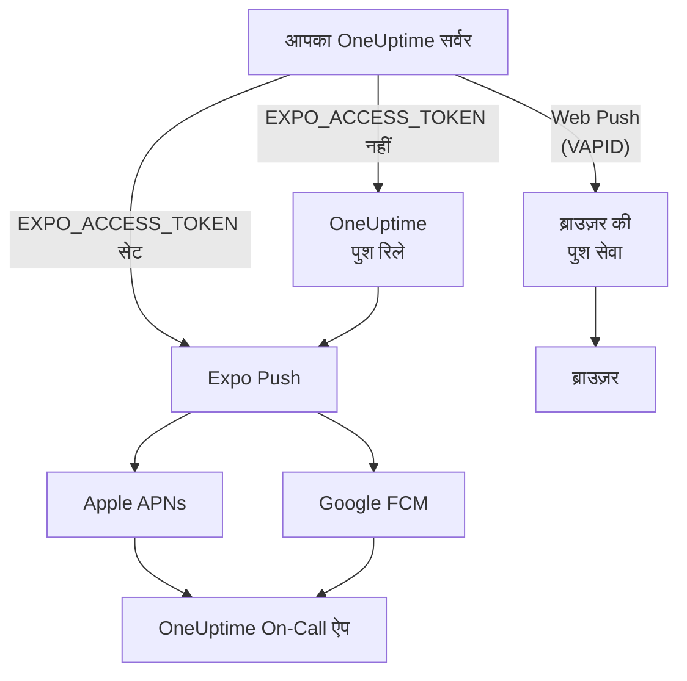
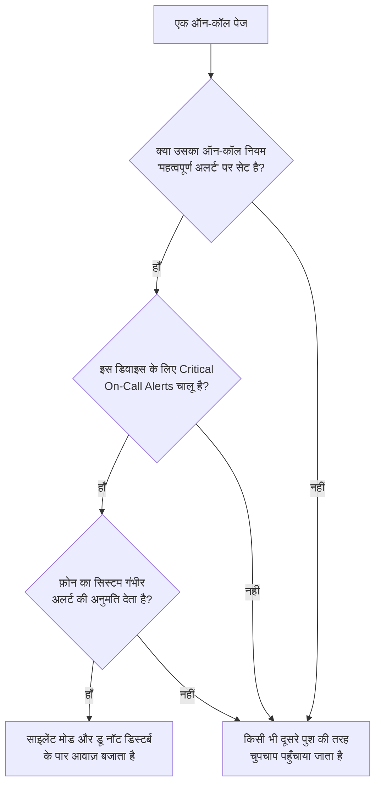

# पुश सूचनाएँ

OneUptime लोगों को फ़ोन पर **OneUptime On-Call** मोबाइल ऐप के ज़रिए, और ब्राउज़र में Web Push के ज़रिए पेज करता है। मोबाइल पुश **Expo Push** से चलते हैं: सेल्फ-होस्टेड इंस्टेंस डिफ़ॉल्ट रूप से उन्हें OneUptime के पुश रिले के ज़रिए भेजता है, इसलिए उसे रिले तक बाहर जाने वाली नेटवर्क पहुँच चाहिए और Expo, Apple या Google के अपने किसी क्रेडेंशियल की ज़रूरत नहीं होती।

:::cards
- [चुनें कि पुश कैसे भेजे जाएँ](#सेल्फ-होस्टेड-सेटअप): पुश रिले, या आपका अपना Expo एक्सेस टोकन।
- [फ़ायरवॉल खोलें](#नेटवर्क-पहुँच): वे पते जिन तक आपका सर्वर और आपके लोगों के डिवाइस पहुँचते हैं।
- [साइलेंट मोड के पार बजाएँ](#गंभीर-ऑन-कॉल-अलर्ट-साइलेंट-मोड-को-ओवरराइड-करना): म्यूट फ़ोन पर भी ऑन-कॉल पेज बजने दें।
- [कभी न पहुँचने वाले पुश ठीक करें](#समस्या-निवारण): Expo की हर त्रुटि का क्या अर्थ है।
- [पुश बंद करें](#पूरे-सर्वर-के-लिए-पुश-बंद-करना): Expo, रिले या ब्राउज़र के ज़रिए कुछ भी न भेजें।
:::

## यह कैसे काम करता है



OneUptime मोबाइल ऐप बैकएंड के पास एक Expo Push टोकन पंजीकृत करता है। बैकएंड सूचनाएँ OneUptime के पुश रिले के ज़रिए भेजता है, या `EXPO_ACCESS_TOKEN` कॉन्फ़िगर होने पर सीधे Expo को। Expo संदेशों को डिवाइस तक पहुँचाने के लिए Apple APNs या Google FCM को आगे भेजता है।

वेब पुश सूचनाएँ अब भी VAPID कुंजियों और Web Push प्रोटोकॉल का उपयोग करती हैं।

## सेल्फ-होस्टेड सेटअप

आधिकारिक मोबाइल ऐप और डिफ़ॉल्ट रिले के साथ सर्वर पर Expo क्रेडेंशियल की ज़रूरत नहीं होती। सीधे Expo से डिलीवरी के लिए, `EXPO_ACCESS_TOKEN` को अपने ऐप के Expo प्रोजेक्ट के उपयुक्त क्रेडेंशियल से कॉन्फ़िगर करें। Web Push के लिए `VAPID_PUBLIC_KEY`, `VAPID_PRIVATE_KEY` और `VAPID_SUBJECT` चाहिए।

| वेरिएबल | Helm मान | डिफ़ॉल्ट | यह क्या करता है |
| --- | --- | --- | --- |
| `PUSH_NOTIFICATION_RELAY_URL` | `pushNotification.relayUrl` | `https://oneuptime.com/api/notification/push-relay/send` | जब तक `EXPO_ACCESS_TOKEN` सेट नहीं है, मोबाइल पुश कहाँ जाते हैं। |
| `EXPO_ACCESS_TOKEN` | `expo.accessToken` | खाली | आपके Expo प्रोजेक्ट के टोकन से मोबाइल पुश सीधे Expo को भेजता है। |
| `PUSH_NOTIFICATION_RELAY_SERVER_ENABLED` | `pushNotification.relayServerEnabled` | खाली | इस सर्वर के `EXPO_ACCESS_TOKEN` से दूसरे OneUptime सर्वरों के मोबाइल पुश रिले करता है। खाली का मतलब बंद है, जब तक `BILLING_ENABLED` `true` न हो। |
| `VAPID_PUBLIC_KEY` | `vapid.publicKey` | खाली | कुंजी जोड़ी का सार्वजनिक आधा हिस्सा, जिससे ब्राउज़र सब्सक्राइब करते हैं। |
| `VAPID_PRIVATE_KEY` | `vapid.privateKey` | खाली | निजी आधा हिस्सा, जो हर वेब पुश पर हस्ताक्षर करता है। |
| `VAPID_SUBJECT` | `vapid.subject` | `mailto:support@oneuptime.com` | एक संपर्क पता जिस पर ब्राउज़र की पुश सेवाएँ आपसे संपर्क कर सकें। |

`npx web-push generate-vapid-keys` से एक बार VAPID कुंजी जोड़ी बनाएँ, और उसे सँभालकर रखें: जिन ब्राउज़रों ने किसी कुंजी जोड़ी से सब्सक्राइब किया है, वे उसके बदलने पर पुश पाना बंद कर देते हैं।

:::tabs
@tab Docker Compose
```bash title="config.env"
VAPID_PUBLIC_KEY=your-public-key
VAPID_PRIVATE_KEY=your-private-key
VAPID_SUBJECT=mailto:oncall@example.com
# Leave unset to send mobile pushes through the push relay.
EXPO_ACCESS_TOKEN=
```
@tab Kubernetes
```yaml title="values.yaml"
vapid:
  publicKey: your-public-key
  privateKey: your-private-key
  subject: mailto:oncall@example.com
# Leave empty to send mobile pushes through the push relay.
expo:
  accessToken:
```

:::details निजी कुंजी को Secret में रखें
`vapid.privateKey` निजी कुंजी को रिलीज़ के मानों में रखता है, जिन्हें Helm हर रिविज़न के साथ सहेजता है। निजी कुंजी को उनसे बाहर रखने के लिए उसे OneUptime के नेमस्पेस में किसी Kubernetes Secret में, `privateKey` के अंतर्गत, रखें, और इसके बजाय उस Secret का नाम दें:

```bash
kubectl create secret generic oneuptime-vapid \
  --namespace oneuptime \
  --from-literal=privateKey=your-private-key
```

```yaml title="values.yaml"
vapid:
  publicKey: your-public-key
  existingSecret:
    name: oneuptime-vapid
  subject: mailto:oncall@example.com
```

`vapid.privateKey` या `vapid.existingSecret.name` सेट करें, दोनों नहीं: चार्ट दोनों को एक साथ अस्वीकार करता है। अगर आपका Secret निजी कुंजी को किसी दूसरी कुंजी के अंतर्गत रखता है, तो उस कुंजी का नाम `vapid.existingSecret.privateKeyKey` में दें। सार्वजनिक कुंजी `vapid.publicKey` में ही रहती है: हर ब्राउज़र को यह दी जाती है।
:::
:::

## नेटवर्क पहुँच

| दिशा | गंतव्य | प्रोटोकॉल / पोर्ट | कब ज़रूरी है |
| --- | --- | --- | --- |
| OneUptime → डिफ़ॉल्ट पुश रिले | `https://oneuptime.com/api/notification/push-relay/send`, `https://oneuptime.com/api/notification/push-relay/receipts` | HTTPS / TCP 443 | मोबाइल पुश, जब `EXPO_ACCESS_TOKEN` सेट नहीं है। |
| OneUptime → Expo | `https://exp.host/--/api/v2/push/send`, `https://exp.host/--/api/v2/push/getReceipts` | HTTPS / TCP 443 | सीधा मोबाइल पुश, जब `EXPO_ACCESS_TOKEN` सेट है। |
| OneUptime → ब्राउज़र पुश सेवा | ब्राउज़र के पुश सब्सक्रिप्शन में सहेजा गया HTTPS एंडपॉइंट | HTTPS / आम तौर पर TCP 443 | Web Push। |
| मोबाइल ऐप या ब्राउज़र → OneUptime | आपका OneUptime होस्टनाम | HTTPS / TCP 443 | साइन इन करना, डिवाइस पंजीकृत करना और सूचना लिंक खोलना। |

अगर आप `PUSH_NOTIFICATION_RELAY_URL` बदलते हैं, तो उसके गंतव्य होस्टनाम और कॉन्फ़िगर किए गए पोर्ट को अनुमति दें। कस्टम रिले को OneUptime का रिले API लागू करना होगा। ये डिफ़ॉल्ट और रिले तथा सीधी डिलीवरी के बीच का बदलाव [OneUptime के कॉन्फ़िगरेशन](https://github.com/OneUptime/oneuptime/blob/master/config.example.env) और [पुश सेवा](https://github.com/OneUptime/oneuptime/blob/master/packages/Common/Server/Services/PushNotificationService.ts) में परिभाषित हैं। सीधे Expo को भेजे गए अनुरोध [Expo की भेजने वाली गाइड](https://docs.expo.dev/push-notifications/sending-notifications/) में बताए गए एंडपॉइंट का उपयोग करते हैं। OneUptime रिले से डिलीवरी रसीदें उसी पते पर, `/send` की जगह `/receipts` लगाकर, पढ़ता है। उस रूट के बिना रिले भी पुश पहुँचाता है; तब जिस डिवाइस से ऐप हटा दिया गया हो, उसका पता तभी चलता है जब उस पर भेजा गया कोई बाद का पुश अस्वीकार हो जाए।

कोई सेल्फ-होस्टेड OneUptime सर्वर दूसरे सर्वरों के पुश केवल `PUSH_NOTIFICATION_RELAY_SERVER_ENABLED=true` और अपने `EXPO_ACCESS_TOKEN` के साथ रिले करता है; इस सेटिंग के बिना वह उस पते पर 404 लौटाता है। इसे केवल उसी सर्वर पर चालू करें जिसके ज़रिए आपके दूसरे OneUptime सर्वर भेजते हैं, और केवल उन्हीं सर्वरों को उस पते तक पहुँचने दें।

Web Push के लिए, आपकी टीम जिन ब्राउज़रों का उपयोग करती है उनके असली सब्सक्रिप्शन एंडपॉइंट होस्ट को अनुमति दें। OneUptime `fcm.googleapis.com`, `android.googleapis.com`, `push.services.mozilla.com`, `notify.windows.com` और `push.apple.com` को, उनके सबडोमेन सहित, स्वीकार करता है। आम उदाहरण हैं `updates.push.services.mozilla.com` और `web.push.apple.com`। गंतव्य [ब्राउज़र का पुश सब्सक्रिप्शन](https://developer.mozilla.org/en-US/docs/Web/API/PushSubscription) देता है; केवल Expo या OneUptime के रिले को अनुमति देने से Web Push सक्षम नहीं होता।

सूचनाएँ भेजने वाली OneUptime प्रक्रिया से DNS रिज़ॉल्यूशन और बाहर जाने वाले TLS की अनुमति दें। उसके ट्रस्ट स्टोर को गंतव्य का प्रमाणपत्र मान्य करना होगा, और प्रॉक्सी को API अनुरोध बिना इंटरैक्टिव प्रमाणीकरण के आगे जाने देने होंगे। पुश प्रदाता आपके OneUptime सर्वर पर कोई वेबहुक कॉल नहीं करते, इसलिए जब उपयोगकर्ताओं के डिवाइस VPN या किसी अन्य निजी कनेक्शन से उस तक पहुँच सकते हों, तो सर्वर निजी रह सकता है। जिस सर्वर की अपने रिले या बाहरी पुश सेवाओं तक पहुँच नहीं है, वह ये सूचनाएँ नहीं पहुँचा सकता।

डिवाइस की कनेक्टिविटी एक अलग आवश्यकता है। iOS डिवाइस को APNs तक पहुँच चाहिए, आम तौर पर TCP 5223 और विकल्प के रूप में TCP 443; गंतव्य रेंज के लिए [Apple की मौजूदा नेटवर्क आवश्यकताएँ](https://support.apple.com/en-us/102266) देखें। Android डिवाइस को TCP 5228–5230 और 443 पर FCM तक पहुँच चाहिए; [Google का मौजूदा होस्ट और फ़ायरवॉल मार्गदर्शन](https://firebase.google.com/docs/cloud-messaging/network-configuration) उपयोग करें। इन डिवाइस पोर्ट को OneUptime पर इनबाउंड खोलने की ज़रूरत नहीं है, और सर्वर का मोबाइल प्रवाह सीधे APNs/FCM से जुड़ने के बजाय रिले या Expo का उपयोग करता है।

:::steps
1. सूचनाएँ भेजने वाले कंटेनर या पॉड से अपने डिलीवरी मोड के गंतव्य तक DNS और HTTPS जाँचें: रिले, Expo या किसी ब्राउज़र की पुश सेवा।
2. **उपयोगकर्ता सेटिंग्स > सूचना विधियां > Push Notifications** से **परीक्षण सूचना** के साथ एक परीक्षण भेजें, और पुष्टि करें कि वह किसी पंजीकृत डिवाइस पर पहुँचता है। Web Push के लिए हर ब्राउज़र का अलग से परीक्षण करें।
3. OneUptime लॉग में रिले, Expo या वेब पुश की त्रुटियाँ जाँचें; केवल API को सफलतापूर्वक भेज देना डिवाइस पर डिलीवरी की पुष्टि नहीं करता।
:::

मोबाइल पुश के लिए OneUptime हर पुश के लगभग 15 मिनट बाद Expo की डिलीवरी रसीद भी पढ़ता है: जो पुश कभी डिवाइस तक नहीं पहुँचा, वह तब पुश लॉग में डिलीवर नहीं हुआ दिखता है और, ऑन-कॉल पेज के लिए, ऑन-कॉल टाइमलाइन पर भी।

## पूरे सर्वर के लिए पुश बंद करना

अगर आपके नेटवर्क से Expo, पुश रिले या किसी ब्राउज़र की पुश सेवा के ज़रिए कुछ भी बाहर नहीं जाना चाहिए, तो कोई मास्टर एडमिन **Admin Dashboard > सेटिंग्स > Push Notifications** में पुश बंद कर सकता है: **Send push notifications** बंद करें और पुष्टि करें।

जब तक पुश बंद है:

- किसी भी प्रोजेक्ट में फ़ोन या ब्राउज़र पर कुछ भी पुश नहीं किया जाता।
- कोई डिवाइस पंजीकृत नहीं किया जा सकता। **उपयोगकर्ता सेटिंग्स > सूचना विधियां** में हर व्यक्ति का **Push Notifications** टैब बताता है कि पुश बंद है, और ऑन-कॉल नियम कोई पुश डिवाइस पेश नहीं करते।
- पुश नियम के ज़रिए जाने वाला पेज नहीं भेजा जाता। उस व्यक्ति के ऑन-कॉल लॉग में लिखा होता है `Push notification not sent: Push notifications are turned off on this server.`
- ऑन-कॉल तैयारी पुश डिवाइस को अनुपयोगी मानती है, और फ़ॉलबैक उन्हें छोड़ देता है। जिस व्यक्ति की एकमात्र सत्यापित विधि कोई पुश डिवाइस है, वह पहुँच से बाहर दिखता है।

फ़ोन पर लोगों तक पहुँचते रहने के लिए, अपने खुद के ऐप या गेटवे के लिए एक [कस्टम चैनल](/docs/self-hosted/custom-notification-channels) जोड़ें। हर OneUptime सर्वर किसी बदलाव के 10 सेकंड के भीतर स्विच को फिर से पढ़ता है। पुश फिर से चालू होने पर, डिवाइस अगली बार मोबाइल ऐप शुरू होने पर उससे, या ब्राउज़र से, फिर से पंजीकृत होते हैं।

## गंभीर ऑन-कॉल अलर्ट (साइलेंट मोड को ओवरराइड करना)

डिफ़ॉल्ट रूप से पुश सूचना हैंडसेट की बात मानती है: साइलेंट पर रखा फ़ोन चुप रहता है, और डू नॉट डिस्टर्ब सूचना को रोक लेता है। ऑन-कॉल रेस्पॉन्डर के लिए रात 3 बजे यह गलत डिफ़ॉल्ट है, इसलिए मोबाइल ऐप हर डिवाइस के लिए एक सेटिंग देता है – **Settings > Notifications > Critical On-Call Alerts** – जो *केवल ऑन-कॉल पेज* को दोनों के पार आवाज़ बजाने देती है।

दायरा जान-बूझकर सीमित है। केवल वे पेज योग्य हैं जिन्हें कोई ऑन-कॉल सूचना नियम बनाता है। मालिकों के सब्सक्रिप्शन, नोट पोस्ट होने की सूचनाएँ, स्थिति-बदलाव अपडेट और मॉनिटर सूचनाएँ कभी एस्केलेट नहीं होतीं, यह सेटिंग चाहे जो कहे।



किसी पेज के साइलेंट मोड को ओवरराइड करने के लिए चारों बातें सच होनी चाहिए। अगर कोई एक भी नहीं है, तो पेज फिर भी पहुँचाया जाता है - बस चुपचाप।

1. **रेस्पॉन्डर ने उस डिवाइस के लिए इसे चालू किया है।** हर डिवाइस के लिए अलग, डिफ़ॉल्ट रूप से बंद, `UserPush.isCriticalAlertEnabled` में संग्रहीत। किसी रेस्पॉन्डर का फ़ोन और टैबलेट अलग-अलग निर्णय हैं। 1.6.0 के बाद के ऐप संस्करण इसे हर बार खुलने पर फिर से बताते हैं, और जब तक फ़ोन की अपनी सेटिंग्स गंभीर अलर्ट की अनुमति नहीं देतीं तब तक इसे बंद बताते हैं, ताकि डिवाइस सूची वही दिखाए जो फ़ोन सच में करेगा।
2. **पेज भेजने वाला ऑन-कॉल नियम इसकी माँग करता है।** **उपयोगकर्ता सेटिंग्स > ऑन-कॉल नियम** में, फ़ोन को सूचित करने वाला हर नियम या तो डिफ़ॉल्ट 'महत्वपूर्ण अलर्ट' पर सेट होता है, या 'सामान्य' पर, जो फ़ोन की साउंड सेटिंग्स का पालन करता है - ताकि रेस्पॉन्डर को किसी गंभीर घटना पर जगाया जा सके और किसी छोटी घटना पर चुपचाप सूचित किया जा सके। हर नियम के लिए `UserNotificationRule.pushNotificationLevel` में संग्रहीत।
3. **सर्वर पेज को गंभीर चिह्नित करता है।** यह iOS के लिए APNs का गंभीर साउंड पेलोड और `interruptionLevel: critical` भेजता है, और Android के लिए एक गंभीर सूचना चैनल को लक्ष्य करता है: `oncall_critical`, या चुने गए अलार्म का अपना चैनल ([अलार्म ध्वनि चुनना](#अलार्म-ध्वनि-चुनना) देखें)।
4. **ऑपरेटिंग सिस्टम इसकी अनुमति देता है**, और यहीं दोनों प्लेटफ़ॉर्म अलग हैं।

:::tabs
@tab iOS
iOS पर गंभीर अलर्ट के लिए `com.apple.developer.usernotifications.critical-alerts` एंटाइटलमेंट चाहिए, जिसे Apple अनुरोध करने पर, प्रति डेवलपर खाते, उन ऐप को देता है जो लोगों को आपात घटनाओं की सूचना देते हैं। इसके लिए [Apple के Critical Alerts अनुरोध फ़ॉर्म](https://developer.apple.com/contact/request/notifications-critical-alerts-entitlement/) पर अनुरोध करें।

App Store पर आधिकारिक **OneUptime On-Call** ऐप में यह एंटाइटलमेंट **संस्करण 1.5.0** से है। इससे पहले के संस्करणों में यह नहीं है, और iOS उन्हें कभी गंभीर अलर्ट नहीं देता, इसलिए सेटिंग चालू करने से पहले ऐप अपडेट करें।

अगर आप ऐप ख़ुद बनाते हैं, तो एंटाइटलमेंट वैकल्पिक है। कोई प्रोविज़निंग प्रोफ़ाइल ऐसा एंटाइटलमेंट नहीं रख सकती जो टीम को दिया नहीं गया है, और जो बिल्ड ऐसा एंटाइटलमेंट घोषित करता है जिसे वह रख नहीं सकता, वह **साइन नहीं हो पाता**। इसे केवल `packages/MobileApp/eas.json` में `production` प्रोफ़ाइल चालू करती है, क्योंकि Apple ने इसे आधिकारिक ऐप प्रकाशित करने वाली टीम को दिया है। जो फ़ोर्क अपनी Apple टीम से साइन करता है, उसे वह `env` प्रविष्टि तब तक हटानी होगी जब तक Apple उस टीम को भी यह एंटाइटलमेंट न दे दे। मिल जाने के बाद, बिल्ड करते समय इसे चालू करें:

```bash
EXPO_IOS_CRITICAL_ALERTS_ENTITLEMENT=true npx expo prebuild
```

या `packages/MobileApp/eas.json` में बिल्ड प्रोफ़ाइल के `env` ब्लॉक में `EXPO_IOS_CRITICAL_ALERTS_ENTITLEMENT: "true"` जोड़ें।

डिवाइस पर, ऐप में **Settings > Notifications > Critical On-Call Alerts** चालू करें, और iOS के पूछने पर गंभीर अलर्ट की अनुमति दें। iOS, ऐप के लिए **Critical Alerts** स्विच को iOS सेटिंग्स में **Settings > Notifications > OneUptime On-Call** के अंतर्गत तभी जोड़ता है जब ऐप अनुमति माँग चुका हो, इसलिए ऐप में सेटिंग चालू करने से पहले वह स्विच वहाँ नहीं होता। अगर आप प्रॉम्प्ट अस्वीकार कर देते हैं, तो बाद में iOS सेटिंग्स में उसी स्विच से गंभीर अलर्ट की अनुमति दे सकते हैं।

एंटाइटलमेंट के बिना बने बिल्ड पर iOS न प्रॉम्प्ट दिखाता है न स्विच, और ऐप की सेटिंग्स स्क्रीन बताती है कि ऐप का यह संस्करण गंभीर अलर्ट नहीं पा सकता। यह रेस्पॉन्डर को ऐसा स्विच खोजने नहीं भेजती जिसे iOS दिखा ही नहीं रहा।
@tab Android
Android में विक्रेता की मंज़ूरी का कोई चरण नहीं है, लेकिन डू नॉट डिस्टर्ब को बायपास करने की अनुमति उपयोगकर्ता ऐप के भीतर के प्रॉम्प्ट के बजाय सिस्टम स्क्रीन पर देता है। जब कोई रेस्पॉन्डर सेटिंग चालू करता है, तो ऐप उसके लिए **Settings > Notifications > Do Not Disturb access** खोलता है और उसके लौटने पर फिर से जाँचता है।

यहाँ दो तंत्र काम करते हैं, और वे अलग-अलग मामलों को कवर करते हैं:

- हर गंभीर सूचना चैनल - `oncall_critical` और हर अलार्म ध्वनि का अपना चैनल - `bypassDnd` माँगता है, जो डू नॉट डिस्टर्ब को कवर करता है और उसे ऊपर बताई गई पहुँच चाहिए।
- ये सभी चैनल **अलार्म** ऑडियो स्ट्रीम का उपयोग करते हैं, जो उस फ़ोन पर भी सुनाई देती है जिसकी रिंगर बस म्यूट है। इस आधे हिस्से को किसी अनुमति की ज़रूरत नहीं है।

Android किसी चैनल की सेटिंग्स को चैनल पहली बार बनने पर फ़्रीज़ कर देता है, इसलिए उन्हें ऐप अपडेट से नहीं बदला जा सकता - केवल नई चैनल id जारी करके।
:::

यह काम करता है या नहीं, यह जाँचने के लिए **उपयोगकर्ता सेटिंग्स > सूचना विधियां > Push Notifications** से डिवाइस पर एक परीक्षण सूचना भेजें। जब डिवाइस पर गंभीर अलर्ट सक्षम हों, तो परीक्षण भी गंभीर अलर्ट के रूप में भेजा जाता है - इसलिए पहले फ़ोन को साइलेंट करें, और आप सुन लेंगे कि कोई असली पेज आप तक पहुँचेगा या नहीं। उसी सूची में दिखता है कि हर डिवाइस पर गंभीर अलर्ट चालू हैं या नहीं, और जिस फ़ोन पर बंद हैं उस पर उन्हें कैसे चालू करें।

### अलार्म ध्वनि चुनना

गंभीर पेज फ़ोन की अपनी गंभीर अलर्ट ध्वनि बजाता है, जब तक कि रेस्पॉन्डर कोई दूसरी न चुने। ऐप में **Settings > Notifications > Alarm sound**, जो Critical On-Call Alerts चालू होने पर दिखता है, लोगों को जगाने के लिए बनाए गए पाँच ज़्यादा तेज़ अलार्म देता है: Klaxon, Siren, Digital alarm, Smoke alarm और Rising alarm, जो धीमे से शुरू होकर लगातार तेज़ होता जाता है। हर एक को चुनने से पहले बजाकर सुना जा सकता है। यह चुनाव डिवाइस का होता है और `UserPush.criticalAlertSound` में संग्रहीत होता है, और परीक्षण सूचना भी इसे ही बजाती है।

- **iOS**: पेज ध्वनि का नाम बताता है, और iOS उसे ऐप से साइलेंट मोड के पार उसी स्क्रीन पर चुने गए वॉल्यूम पर बजाता है: 25%, 50%, 75% या 100%, जो डिफ़ॉल्ट है। वॉल्यूम `UserPush.criticalAlertVolume` में संग्रहीत होता है।
- **Android**: हर अलार्म का अपना सूचना चैनल होता है (`oncall_critical_klaxon`, `oncall_critical_siren` आदि), क्योंकि Android किसी चैनल की ध्वनि चैनल बनते समय तय कर देता है। सर्वर पेज को चुने गए अलार्म के चैनल पर भेजता है, और वह फ़ोन के अलार्म वॉल्यूम पर बजता है।

कोई डिवाइस तब तक सिस्टम ध्वनि ही रखता है जब तक उस पर ऐप का ऐसा संस्करण न चले जो यह विकल्प देता हो, इसलिए किसी पुराने ऐप को कभी ऐसा अलार्म नहीं भेजा जाता जो उसके पास नहीं है।

### स्वीकार किए जाने तक पेज दोहराना

कोई पुश नियम अपना पेज तब तक दोबारा भेज सकता है जब तक कोई उसे स्वीकार न कर ले। **उपयोगकर्ता सेटिंग्स > ऑन-कॉल नियम** में, पुश नियम जोड़ते समय **स्वीकार किए जाने तक दोहराएं** सेट करें, या बाद में नियम की पंक्ति में बदलें: हर मिनट, या हर 2, 3, 5, 10, 15 या 30 मिनट। पेज उसी अंतराल पर दोबारा भेजा जाता है, अधिकतम 10 बार और, और घटना, अलर्ट या एपिसोड स्वीकार होते ही रुक जाता है। हर नियम के लिए `UserNotificationRule.repeatEveryMinutes` में संग्रहीत, जहाँ 0, जो डिफ़ॉल्ट है, पेज को एक ही बार भेजता है।

## समस्या निवारण

### पुश सूचनाएँ नहीं पहुँच रहीं

- सुनिश्चित करें कि मोबाइल ऐप EAS Build से बनाया गया था (Expo Go पुश सूचनाओं का समर्थन नहीं करता)
- सत्यापित करें कि डिवाइस आपके डेटाबेस की `UserPush` तालिका में पंजीकृत है
- Expo Push API की त्रुटियों के लिए OneUptime सर्वर लॉग जाँचें
- पुष्टि करें कि डिवाइस पर सक्रिय इंटरनेट कनेक्शन है और सूचना की अनुमतियाँ सक्षम हैं
- **उपयोगकर्ता सेटिंग्स > सूचना विधियां > Push Notifications** जाँचें: **सूचनाएँ नहीं मिल रहीं** चिह्नित डिवाइस ने उन्हें पाना बंद कर दिया है और उसे फिर से पंजीकृत करना होगा (नीचे देखें)

### iOS सेटिंग्स में Critical Alerts स्विच नहीं है

- App Store से OneUptime On-Call अपडेट करें। 1.5.0 से पहले के संस्करण Apple के गंभीर अलर्ट एंटाइटलमेंट के बिना बनाए गए थे, और iOS उनके लिए कोई Critical Alerts स्विच दिखाता ही नहीं
- ऐप में **Settings > Notifications > Critical On-Call Alerts** चालू करें। iOS अपनी सेटिंग्स में यह स्विच तभी जोड़ता है जब ऐप अनुमति माँग चुका हो, और ऐप यह सेटिंग चालू होने पर अनुमति माँगता है
- ऑन-कॉल सूचना नियमों या पुश डिवाइसों को हटाकर फिर से जोड़ने से यह नहीं बदलता। यह सेटिंग डिवाइस पर मौजूद ऐप की है, किसी नियम की नहीं

### गंभीर अलर्ट साइलेंट मोड को ओवरराइड नहीं करते

- जाँचें कि स्विच **उस** डिवाइस के लिए चालू है - सेटिंग हर डिवाइस के लिए अलग है, और दोबारा इंस्टॉल करने या शुरू से सेट किए गए नए फ़ोन पर नया डिवाइस पंजीकरण बनता है (पुराने फ़ोन के बैकअप से सेट किया गया फ़ोन, पुराने फ़ोन के सूचनाएँ पाना बंद करते ही, ऐप की उसी सेटिंग के साथ पुराने फ़ोन का पंजीकरण ले लेता है)
- उस गंभीरता का ऑन-कॉल नियम **उपयोगकर्ता सेटिंग्स > ऑन-कॉल नियम** में जाँचें: 'सामान्य' पर सेट पुश नियम फ़ोन की साउंड सेटिंग्स का पालन करता है, डिवाइस का स्विच चाहे जो कहे
- **iOS**: पुष्टि करें कि बिल्ड में Apple का गंभीर अलर्ट एंटाइटलमेंट है (ऊपर देखें), और iOS Settings > Notifications > OneUptime On-Call के अंतर्गत Critical Alerts की अनुमति है
- **Android**: पुष्टि करें कि ऐप के पास Settings > Notifications > Do Not Disturb access के अंतर्गत डू नॉट डिस्टर्ब की पहुँच है
- **Android**: अगर आपने कोई अलार्म ध्वनि चुनी है, तो उसके अपने सूचना चैनल को भी डू नॉट डिस्टर्ब को ओवरराइड करने की अनुमति होनी चाहिए; ऐसा न होने पर ऐप की Alarm sound स्क्रीन बताती है
- सेटिंग्स स्क्रीन बताती है कि इनमें से क्या कमी है; वह ऐप के पिछले अनुरोध पर भरोसा करने के बजाय OS से मौजूदा स्थिति वापस पढ़ती है, और जो पाती है वह सर्वर को बताती है

### "डिलीवर नहीं हुआ" चिह्नित पुश

Expo का कोई पुश स्वीकार करना यह नहीं बताता कि वह डिवाइस तक पहुँच गया: Apple या Google अब भी उसे अस्वीकार कर सकते हैं। OneUptime हर मोबाइल पुश की डिलीवरी रसीद भेजने के लगभग 15 मिनट बाद पढ़ता है, और `EXPO_ACCESS_TOKEN` सेट न होने पर पुश रिले के ज़रिए। जब रसीद कोई त्रुटि बताती है, तो पुश लॉग और पेज की ऑन-कॉल टाइमलाइन भेजा गया से बदलकर **Push notification not delivered** हो जाते हैं, Expo के त्रुटि कोड के साथ:

- `DeviceNotRegistered`: मोबाइल ऐप डिवाइस से हटा दिया गया है, या उसका पुश टोकन अब मान्य नहीं है। अगला भाग देखें।
- `MessageRateExceeded`: कम समय में डिवाइस को बहुत अधिक सूचनाएँ भेजी गईं। उस पर बाद के पुश सामान्य रूप से भेजे जाते हैं।
- `MessageTooBig`: सूचना पुश सेवाओं की स्वीकार्य सीमा से बड़ी थी। OneUptime सूचनाओं को फ़िट करने के लिए छोटा करता है, इसलिए ऐसा नहीं होना चाहिए; अगर हो, तो कृपया बताएँ।
- `InvalidCredentials` या `MismatchSenderId`: पुश भेजने वाले Expo प्रोजेक्ट के पुश क्रेडेंशियल मान्य नहीं हैं। `EXPO_ACCESS_TOKEN` के साथ अपने Expo प्रोजेक्ट के पुश क्रेडेंशियल जाँचें; डिफ़ॉल्ट रिले के साथ OneUptime सहायता से संपर्क करें।

जब Expo किसी पुश को तुरंत अस्वीकार कर देता है, तो पुश लॉग तुरंत कारण बताता है। पुश रिले के ज़रिए भी यही होता है: रिले सर्वर त्रुटि से जवाब देने के बजाय Expo का त्रुटि कोड आगे भेजता है।

### लॉग में "DeviceNotRegistered" त्रुटियाँ

Expo `DeviceNotRegistered` तब बताता है जब मोबाइल ऐप डिवाइस से हटा दिया गया हो या डिवाइस का पुश टोकन अब मान्य न हो। आम तौर पर यह किसी पुश की डिलीवरी रसीद में बताया जाता है, जिसे OneUptime पुश के लगभग 15 मिनट बाद पढ़ता है, और कभी-कभी Expo पुश को तुरंत अस्वीकार कर देता है। दोनों ही तरह से OneUptime उस डिवाइस पर भेजना बंद कर देता है। उसे हटाने के बजाय सूचनाएँ न पाने वाला चिह्नित किया जाता है, इसलिए उसके सूचना नियम बने रहते हैं, और न पहुँचे पेज का पुश लॉग और ऑन-कॉल टाइमलाइन इसका कारण बताते हैं। **उपयोगकर्ता सेटिंग्स > सूचना विधियां > Push Notifications** उसे **सूचनाएँ नहीं मिल रहीं** के रूप में दिखाता है। उसके मालिक के दूसरे डिवाइस और सूचना विधियाँ अब भी पेज होती हैं।

डिवाइस को वापस लाने के लिए, साइन इन रहते हुए उस पर मोबाइल ऐप खोलें। ऐप फिर से पंजीकृत होता है, जिससे Expo के पास उसका पुश टोकन नवीनीकृत होता है, और डिवाइस अपने नियमों के साथ फिर से सूचनाएँ पाने लगता है। अगर ऐप हटा दिया गया था, तो उसे फिर से इंस्टॉल करें और साइन इन करें। ऐप के फिर से पंजीकृत होने से पहले भेजे गए पुश की रसीद डिवाइस को चिह्नित नहीं करती। जब किसी अद्यतन मोबाइल ऐप को पुराने फ़ोन के बैकअप से नए फ़ोन पर सेट किया जाता है, तो वह OneUptime को अपना पहले वाला पुश टोकन बताता है; अगर पुराने फ़ोन का डिवाइस अब सूचनाएँ नहीं पाता, तो नया फ़ोन उसके नियमों के साथ उसे ले लेता है।

पुश रिले के ज़रिए (कोई `EXPO_ACCESS_TOKEN` नहीं) भी यह इसी तरह काम करता है: पुश भेजते समय रिले `DeviceNotRegistered` बताता है, और आपका इंस्टेंस जिन डिलीवरी रसीदों के बारे में पूछता है उन्हें पढ़ता है।

अगर इनमें से कुछ भी मदद न करे, तो अपने OneUptime लॉग की त्रुटियों के साथ [hello@oneuptime.com](mailto:hello@oneuptime.com) पर हमसे संपर्क करें।

## अगले कदम

:::cards
- [मोबाइल ऐप](/docs/mobile-desktop-apps/index): OneUptime On-Call ऐप इंस्टॉल करें और साइन इन करें।
- [मोबाइल ऐप समस्या निवारण](/docs/mobile-desktop-apps/faq-troubleshooting): फ़ोन पर साइन-इन और सूचना की समस्याएँ ठीक करें।
- [एस्केलेशन नियम](/docs/on-call/escalation-rules): तय करें कि किसे और कब पेज किया जाए।
- [निजी नेटवर्क पहुँच](/docs/self-hosted/private-network-access): आपका सर्वर आपके अपने नेटवर्क में किन चीज़ों तक पहुँच सकता है।
:::
