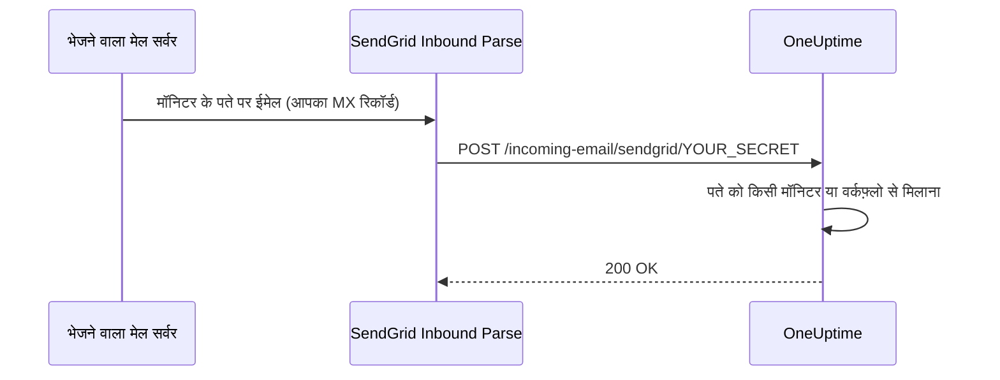

# SendGrid आने वाला ईमेल

OneUptime का **Incoming Email Monitor** आपको हर मॉनिटर के लिए अलग, अनोखे ईमेल पतों पर भेजे गए ईमेल के आधार पर अलर्ट बनाने और सुलझाने देता है। यह पुराने सिस्टम, अलर्टिंग टूल या ईमेल भेज सकने वाली किसी भी सेवा को जोड़ने के लिए उपयोगी है।

यही सेटअप वर्कफ़्लो को भी ईमेल पाने देता है: **Incoming Email** ट्रिगर वाले वर्कफ़्लो को उसी डोमेन पर अपना पता मिलता है, और उस पर आने वाला हर ईमेल वर्कफ़्लो शुरू करता है। देखें [ट्रिगर](/docs/workflows/triggers#incoming-email)।

यह गाइड बताती है कि आने वाले ईमेल को आपके सेल्फ-होस्टेड OneUptime इंस्टेंस तक भेजने के लिए SendGrid Inbound Parse कैसे सेट करें। OneUptime Cloud को इसमें से कुछ नहीं चाहिए: वहाँ पते शुरू से ही काम करते हैं।

:::cards
- [शुरू करने से पहले](#पूर्व-आवश्यकताएँ): एक SendGrid खाता, एक डोमेन और एक सार्वजनिक HTTPS पता।
- [इसे सेट करें](#सेटअप-निर्देश): MX रिकॉर्ड से लेकर टेस्ट ईमेल तक सात चरण।
- [एनवायरनमेंट वेरिएबल](#एनवायरनमेंट-वेरिएबल-संदर्भ): तीन सेटिंग्स और उनके डिफ़ॉल्ट मान।
- [समस्या निवारण](#समस्या-निवारण): ईमेल जो कभी नहीं पहुँचते, और वेबहुक जो विफल होते हैं।
:::

## यह कैसे काम करता है



1. आप OneUptime में एक **Incoming Email Monitor** बनाते हैं
2. OneUptime उस मॉनिटर के लिए एक अनोखा ईमेल पता बनाता है (जैसे, `monitor-abc123@inbound.yourdomain.com`)
3. जब उस पते पर कोई ईमेल भेजा जाता है, तो SendGrid उसे प्राप्त करता है और वेबहुक के ज़रिए OneUptime को भेज देता है
4. OneUptime आपके कॉन्फ़िगर किए गए मानदंडों के आधार पर ईमेल का मूल्यांकन करके अलर्ट बनाता या सुलझाता है

## पूर्व-आवश्यकताएँ

- Inbound Parse की पहुँच वाला एक SendGrid खाता
- आपके नियंत्रण वाला एक डोमेन, जिसकी DNS सेटिंग्स तक आपकी पहुँच हो
- एक सार्वजनिक HTTPS एंडपॉइंट जो SendGrid के वेबहुक आपके OneUptime इंस्टेंस तक भेजे

## नेटवर्क पहुँच

Inbound Parse में SendGrid ही OneUptime से कनेक्शन शुरू करता है। OneUptime को केवल बाहर जाने वाली इंटरनेट पहुँच देना काफ़ी नहीं है।

| दिशा | गंतव्य | प्रोटोकॉल / पोर्ट | उद्देश्य |
| --- | --- | --- | --- |
| SendGrid → OneUptime | `https://your-oneuptime-domain.com/incoming-email/sendgrid/YOUR_SECRET` | HTTPS / TCP 443 | पार्स किए गए ईमेल को multipart POST के रूप में पहुँचाना। |
| भेजने वाले मेल सर्वर → SendGrid | `mx.sendgrid.net`, आपके इनबाउंड डोमेन के सार्वजनिक MX रिकॉर्ड से चुना गया | SMTP / TCP 25 | SendGrid पर ईमेल प्राप्त करना; यह कनेक्शन आपके OneUptime सर्वर तक नहीं जाता। |
| OneUptime → SendGrid, केवल तब जब SendGrid प्रदाता से ईमेल भेजना अलग से कॉन्फ़िगर किया गया हो | `api.sendgrid.com` | HTTPS / TCP 443 | Mail Send API से सूचना ईमेल भेजना। |

वेबहुक होस्टनाम के लिए DNS प्रकाशित करें और ऐसा प्रमाणपत्र दें जिस पर सार्वजनिक क्लाइंट भरोसा करते हों। निजी OneUptime डिप्लॉयमेंट केवल वेबहुक पाथ को किसी ऐसे सार्वजनिक रिवर्स प्रॉक्सी या गेटवे के ज़रिए खोल सकता है जो अंदर से OneUptime तक पहुँच सके। पाथ, सीक्रेट, कंटेंट टाइप और multipart अनुरोध बॉडी को वैसा ही रखें, और POST को बिना इंटरैक्टिव लॉगिन या ब्राउज़र चैलेंज के गुज़रने दें। OneUptime सर्वर को आने वाले SMTP लिसनर की ज़रूरत नहीं है। देखें [SendGrid का Inbound Parse सेटअप](https://www.twilio.com/docs/sendgrid/for-developers/parsing-email/setting-up-the-inbound-parse-webhook)।

`INBOUND_EMAIL_WEBHOOK_SECRET` को एक मज़बूत यादृच्छिक मान पर सेट करें और URL में `YOUR_SECRET` को उसी मान से बदलें। रूट के लिए आख़िरी पाथ सेगमेंट ज़रूरी है। सीक्रेट कॉन्फ़िगर होने पर OneUptime उसका मान जाँचता है; वेरिएबल खाली छोड़ने पर यह जाँच बंद हो जाती है। पूरा URL और मॉनिटरों के ईमेल पते गोपनीय रखें, प्रॉक्सी लॉग में भी। OneUptime अभी SendGrid के हस्ताक्षरित Inbound Parse हेडर या OAuth टोकन की जाँच नहीं करता। अगर आपको ये तंत्र चाहिए, तो [SendGrid के वेबहुक सुरक्षा दस्तावेज़](https://www.twilio.com/docs/sendgrid/for-developers/parsing-email/securing-your-parse-webhooks) के अनुसार एक ऐसा गेटवे कॉन्फ़िगर करें जो OneUptime तक भेजने से पहले उनकी जाँच करे।

SendGrid, Inbound Parse के लिए स्थिर स्रोत IP की कोई भरोसेमंद सूची नहीं देता। SendGrid के ईमेल भेजने वाले IP और `mx.sendgrid.net` के लिए रिज़ॉल्व होने वाले पते वेबहुक की अनुमति-सूची नहीं हैं। किसी मौजूदा DNS नतीजे को स्थायी करने के बजाय [SendGrid का फ़ायरवॉल मार्गदर्शन](https://support.sendgrid.com/hc/en-us/articles/44375457225371-How-to-Configure-Firewall-Settings-for-SendGrid-Webhook-and-Inbound-Parse-IPs) अपनाएँ।

Inbound Parse बाहर जाने वाले ईमेल भेजने से अलग है। मॉनिटर ईमेल पाने के लिए OneUptime को SendGrid API कॉल करने की ज़रूरत नहीं है। अगर आप सूचनाएँ भेजने के लिए भी SendGrid चुनते हैं, तो DNS रिज़ॉल्यूशन और `api.sendgrid.com` तक बाहर जाने वाला HTTPS अनुमत करें; [Mail Send](https://www.twilio.com/docs/sendgrid/api-reference/mail-send/mail-send) को भेजने के लिए किसी आने वाले कॉलबैक की ज़रूरत नहीं होती। अगर आप इसके बजाय SMTP उपयोग करते हैं, तो OneUptime में कॉन्फ़िगर किया गया SMTP सर्वर और पोर्ट अनुमत करें।

## सेटअप निर्देश

:::steps
### अपना इनबाउंड ईमेल डोमेन चुनें

OneUptime के लिए ईमेल पाने के लिए समर्पित एक सबडोमेन चुनें, जैसे `inbound.yourdomain.com`, `email.yourdomain.com` या `monitor.yourdomain.com`। इसका उपयोग केवल OneUptime मॉनिटरों और वर्कफ़्लो के ईमेल के लिए होता है, इसलिए इस पर आपका कोई मेलबॉक्स नहीं रहता।

### इसके MX रिकॉर्ड को SendGrid की ओर इंगित करें

एक MX रिकॉर्ड जोड़ें जो सबडोमेन के ईमेल को SendGrid तक भेजे:

| प्रकार | होस्ट/नाम | प्राथमिकता | मान |
| --- | --- | --- | --- |
| MX | inbound | 10 | mx.sendgrid.net |

अगर आपका डोमेन `example.com` है और आप `inbound.example.com` उपयोग कर रहे हैं, तो रिकॉर्ड ऐसा होगा:

```text
inbound.example.com.  IN  MX  10  mx.sendgrid.net.
```

DNS बदलावों को फैलने में 48 घंटे तक लग सकते हैं, लेकिन आम तौर पर वे कुछ ही घंटों में पूरे हो जाते हैं।

### SendGrid में डोमेन प्रमाणित करें

प्राप्त करने वाला डोमेन आपके [SendGrid में प्रमाणित डोमेन](https://www.twilio.com/docs/sendgrid/ui/account-and-settings/inbound-parse) में से किसी एक का होना चाहिए। [SendGrid डैशबोर्ड](https://app.sendgrid.com) में **Settings** > **Sender Authentication** पर जाएँ, **Authenticate Your Domain** पर क्लिक करें, और माँगे गए DNS रिकॉर्ड जोड़ें (DKIM के लिए CNAME रिकॉर्ड)।

### Inbound Parse वेबहुक जोड़ें

SendGrid डैशबोर्ड में **Settings** > **Inbound Parse** पर जाएँ और **Add Host & URL** पर क्लिक करें। इसे नीचे दिए अनुसार भरें, फिर **Add** पर क्लिक करें:

| फ़ील्ड | मान |
| --- | --- |
| **Receiving Domain** | आपका इनबाउंड सबडोमेन (जैसे, `inbound.yourdomain.com`) |
| **Destination URL** | `https://your-oneuptime-domain.com/incoming-email/sendgrid/YOUR_SECRET` |
| **Check incoming emails for spam** | वैकल्पिक - चाहें तो सक्षम करें |
| **Send raw, full MIME message** | बिना चुने छोड़ दें (आवश्यक नहीं) |
| **POST the raw, full MIME message** | बिना चुने छोड़ दें (आवश्यक नहीं) |

### OneUptime कॉन्फ़िगर करें

इनबाउंड ईमेल वेरिएबल सेट करें, उसी सीक्रेट के साथ जो Destination URL में है:

:::tabs
@tab Docker Compose
```bash title="config.env"
INBOUND_EMAIL_PROVIDER=SendGrid
INBOUND_EMAIL_DOMAIN=inbound.yourdomain.com
INBOUND_EMAIL_WEBHOOK_SECRET=replace-with-a-strong-random-secret
```
@tab Kubernetes
```yaml title="values.yaml"
inboundEmail:
  provider: "SendGrid"
  domain: "inbound.yourdomain.com"
  webhookSecret: "replace-with-a-strong-random-secret"
```
:::

फिर इन्हें लागू करें: Docker Compose पर `npm run start` चलाएँ, जो नए मानों के साथ कंटेनर फिर से बनाता है, या Kubernetes पर Helm रिलीज़ अपग्रेड करें।

### एक Incoming Email मॉनिटर बनाएँ

[एक Incoming Email मॉनिटर बनाएँ](/docs/monitor/incoming-email-monitor#आने-वाले-ईमेल-मॉनिटर-बनाएं)। इसका **अवलोकन** पृष्ठ इसका पता दिखाता है, जैसे `monitor-abc123def456@inbound.yourdomain.com`, और इसके मानदंड तय करते हैं कि कौन-से ईमेल अलर्ट बनाते हैं और कौन-से उसे सुलझाते हैं।

वर्कफ़्लो भी इसी डोमेन का उपयोग करते हैं। किसी वर्कफ़्लो में **Incoming Email** ट्रिगर जोड़ें और उस पर क्लिक करें: उसका पता (`workflow-…@inbound.yourdomain.com`) उसकी सेटिंग्स में सबसे ऊपर होता है। जब तक ऊपर के इनबाउंड ईमेल वेरिएबल सेट नहीं होते, ट्रिगर बताता है कि सर्वर ईमेल पाने के लिए सेट नहीं है।

### एक टेस्ट ईमेल भेजें

मॉनिटर के पते पर ऐसे विषय वाला ईमेल भेजें जो उसके मानदंडों से मेल खाता हो। मॉनिटर का सारांश ईमेल दिखाता है, और मानदंड मेल खाने पर एक अलर्ट बनता है।
:::

## एनवायरनमेंट वेरिएबल संदर्भ

| वेरिएबल | Helm मान | विवरण | आवश्यक | डिफ़ॉल्ट |
| --- | --- | --- | --- | --- |
| `INBOUND_EMAIL_PROVIDER` | `inboundEmail.provider` | इनबाउंड ईमेल प्रदाता। केवल SendGrid उपलब्ध है। | नहीं | `SendGrid` |
| `INBOUND_EMAIL_DOMAIN` | `inboundEmail.domain` | इनबाउंड ईमेल के लिए कॉन्फ़िगर किया गया सबडोमेन। इसके सेट होने तक आने वाला ईमेल बंद रहता है। | हाँ | खाली |
| `INBOUND_EMAIL_WEBHOOK_SECRET` | `inboundEmail.webhookSecret` | वह सीक्रेट जिसकी तुलना वेबहुक URL के आख़िरी सेगमेंट `/incoming-email/sendgrid/YOUR_SECRET` से की जाती है। सार्वजनिक एंडपॉइंट के लिए इसे कॉन्फ़िगर करें; खाली मान जाँच बंद कर देता है। | अनुशंसित | खाली |

कोई Incoming Email मॉनिटर किन चीज़ों पर मिलान कर सकता है - विषय, भेजने वाला, मुख्य भाग, प्राप्तकर्ता, और यह कि ईमेल समय पर पहुँचा या नहीं - यह [उपलब्ध फ़िल्टर प्रकार](/docs/monitor/incoming-email-monitor#उपलब्ध-फ़िल्टर-प्रकार) में है।

## समस्या निवारण

:::details ईमेल प्राप्त नहीं हो रहे
1. **DNS प्रसार जाँचें:** `dig MX inbound.yourdomain.com` को `mx.sendgrid.net` लौटाना चाहिए।
2. **SendGrid Inbound Parse सेटिंग्स सत्यापित करें:** SendGrid डैशबोर्ड में **Settings** > **Inbound Parse** के अंतर्गत अपना डोमेन और वेबहुक URL जाँचें।
3. **OneUptime लॉग जाँचें:** OneUptime की `app` सेवा के लॉग में आने वाले ईमेल के वेबहुक अनुरोध और कोई भी त्रुटि खोजें। SendGrid, Inbound Parse के विस्तृत लॉग नहीं रखता, इसलिए यही लॉग इस बात का रिकॉर्ड हैं कि क्या पहुँचा।
:::

:::details वेबहुक विफल हो रहे हैं
1. **सार्वजनिक वेबहुक रूट जाँचें:** सीक्रेट सहित पूरा URL इंटरनेट से OneUptime तक पहुँचना चाहिए। अपने आख़िरी सीक्रेट सेगमेंट के बिना URL रूट से मेल नहीं खाता।
2. **फ़ायरवॉल नियम जाँचें:** वेबहुक पाथ पर HTTPS POST अनुरोधों को लॉगिन रीडायरेक्ट या ब्राउज़र चैलेंज के बिना अनुमति दें, और SendGrid के ईमेल भेजने वाले IP को वेबहुक स्रोत की अनुमति-सूची के रूप में उपयोग न करें।
3. **SSL प्रमाणपत्र सत्यापित करें:** वेबहुक होस्टनाम के लिए एक मान्य, सार्वजनिक रूप से विश्वसनीय प्रमाणपत्र उपयोग करें और उसकी प्रमाणपत्र शृंखला शामिल करें।
:::

:::details मॉनिटर अलर्ट नहीं बनाता
1. **मानदंड सत्यापित करें:** जाँचें कि अलर्ट बनाने के आपके मानदंड ईमेल की सामग्री से मेल खाते हैं, और पैटर्न मिलान उपयोग करने से पहले सटीक स्ट्रिंग से परीक्षण करें।
2. **मॉनिटर जाँचें:** सुनिश्चित करें कि यह अक्षम नहीं है, और इसका प्रकार Incoming Email है।
3. **मॉनिटर का सारांश देखें:** जाँचें कि ईमेल प्राप्त और प्रोसेस हुआ या नहीं, और मूल्यांकन लॉग में पढ़ें कि मानदंड कैसे मेल खाए।
:::

:::details ट्रिगर बताता है कि सर्वर ईमेल पाने के लिए सेट नहीं है
सर्वर पर `INBOUND_EMAIL_DOMAIN` खाली है। इसे सेट करें, बदलाव लागू करें, और वर्कफ़्लो का ट्रिगर फिर से खोलें।
:::

## सुरक्षा के सर्वोत्तम तरीके

1. **HTTPS उपयोग करें:** अपने वेबहुक एंडपॉइंट के लिए हमेशा HTTPS उपयोग करें
2. **वेबहुक सीक्रेट:** `INBOUND_EMAIL_WEBHOOK_SECRET` कॉन्फ़िगर करें और अतिरिक्त जाँच के लिए इसे अपने वेबहुक URL में शामिल करें (जैसे, `/incoming-email/sendgrid/your-secret`)
3. **डोमेन सत्यापन:** बेहतर ईमेल सुरक्षा के लिए SendGrid में अपना डोमेन सत्यापित करें
4. **पहुँच सीमित करें:** केवल भरोसेमंद ईमेल स्रोतों के लिए मॉनिटर बनाएँ
5. **लॉग की निगरानी करें:** संदिग्ध गतिविधि के लिए आने वाले ईमेल के लॉग नियमित रूप से देखें

## अगले कदम

:::cards
- [Incoming Email Monitor](/docs/monitor/incoming-email-monitor): मानदंड, पते के प्रारूप और उदाहरण।
- [वर्कफ़्लो ट्रिगर](/docs/workflows/triggers): किसी ईमेल से वर्कफ़्लो शुरू करें।
- [निजी नेटवर्क पहुँच](/docs/self-hosted/private-network-access): आपका सर्वर आपके अपने नेटवर्क में किन चीज़ों तक पहुँच सकता है।
- [वास्तुकला](/docs/self-hosted/architecture): सेल्फ-होस्टेड इंस्टॉल में वेबहुक कहाँ पहुँचता है।
:::
