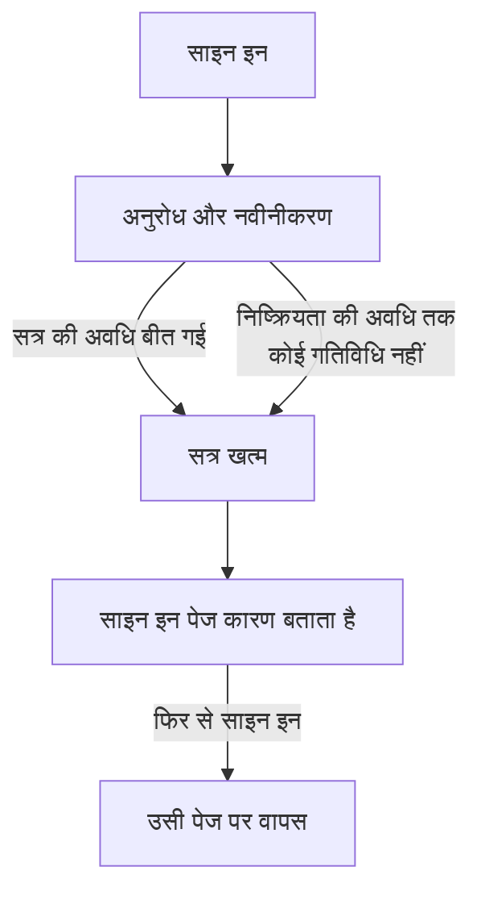

# सत्र की अवधि

चुनें कि लोग फिर से साइन इन करने से पहले OneUptime में कितनी देर तक साइन इन रहें: साइन इन करने के बाद एक तय समय, बिना उपयोग का एक समय, या दोनों। यह डैशबोर्ड, Admin Dashboard और मोबाइल ऐप के हर साइन इन पर लागू होता है, चाहे पासवर्ड, पासकी, Microsoft से साइन इन या सिंगल साइन-ऑन से हो। SSO साइन इन की अपनी अलग अवधि हो सकती है।

> [!NOTE]
> सत्र की अवधि [OneUptime Enterprise Edition](/docs/self-hosted/enterprise) का हिस्सा है। Community Edition में **सत्र की अवधि** पेज नहीं है, और हर साइन इन वैसे ही चलता है जैसा [कोई सीमा नहीं](#कोई-सीमा-नहीं) बताता है।

:::cards
- [सत्र की अवधि सेट करें](#सत्र-की-अवधि-सेट-करें): Admin Dashboard में दो सेटिंग।
- [सत्र कैसे खत्म होता है](#सत्र-कैसे-खत्म-होता-है): सर्वर क्या गिनता है, और कब।
- [SSO साइन इन](#sso-साइन-इन): सिंगल साइन-ऑन की अपनी अवधि।
- [क्या साइन इन नहीं है](#क्या-साइन-इन-नहीं-है): API कुंजियाँ, MCP कनेक्शन और स्टेटस पेज के पाठक।
:::

## कोई सीमा नहीं

जब तक आप कोई अवधि सेट नहीं करते, साइन इन की कोई सीमा नहीं होती। इसका एक्सेस टोकन 15 मिनट तक चलता है और बैकग्राउंड में एक रीफ़्रेश टोकन से नवीनीकृत होता है, जो 30 दिन तक चलता है और हर उपयोग पर फिर से शुरू होता है। जो हर 30 दिनों में कम से कम एक बार OneUptime खोलता है, वह साइन इन रहता है; जो नहीं खोलता, वह फिर से साइन इन करता है।

## सत्र की अवधि सेट करें

:::steps
### सत्र की अवधि खोलें
Admin Dashboard में **सेटिंग्स** खोलें, फिर साइड मेनू में **सत्र की अवधि** खोलें।

### अवधि चुनें
- **इतने समय बाद साइन आउट करें**: किसी के साइन इन करने के पल से साइन इन कितनी देर चलता है, चाहे वे कितने भी सक्रिय हों।
- **इतनी देर निष्क्रियता के बाद साइन आउट करें**: कोई OneUptime में क्लिक, टाइप या स्क्रॉल किए बिना कितनी देर रह सकता है।

हर चुनाव चुनते ही सहेज लिया जाता है।

### पुष्टि करें कि कौन साइन आउट होगा
छोटी अवधि अभी साइन इन किए हुए सभी लोगों पर लागू होती है। जब इससे लोग तुरंत साइन आउट होते हैं, तो OneUptime पहले बताता है कि कितने, और क्या आप उनमें शामिल हैं। आगे बढ़ने के लिए **सहेजें और उन्हें साइन आउट करें** चुनें।
:::

| सेटिंग | विकल्प | डिफ़ॉल्ट |
| --- | --- | --- |
| **इतने समय बाद साइन आउट करें** | 1 घंटे से 90 दिन तक | **कोई सीमा नहीं** |
| **इतनी देर निष्क्रियता के बाद साइन आउट करें** | 15 मिनट से 14 दिन तक | 30 दिन, जो सबसे लंबा है |

API के ज़रिए, सर्वर के ग्लोबल कॉन्फ़िगरेशन में `sessionLengthInMinutes` 15 से 525600 (एक साल) तक मिनटों की कोई भी पूर्ण संख्या लेता है और `sessionIdleTimeoutInMinutes` 15 से 43200 (30 दिन) तक। खाली छोड़ना डिफ़ॉल्ट है।

## सत्र कैसे खत्म होता है

- सर्वर दोनों अवधियाँ सत्र से ही गिनता है: उसने कब साइन इन किया, और उसका व्यक्ति आखिरी बार कब सक्रिय था। वह इन्हें हर अनुरोध, हर नवीनीकरण और हर लाइव अपडेट पर जाँचता है, और साइन आउट कभी ब्राउज़र पर नहीं छोड़ता।
- निष्क्रियता की अवधि डैशबोर्ड या Admin Dashboard के किसी भी टैब में आखिरी क्लिक, कुंजी दबाने या स्क्रॉल से गिनी जाती है। खुला छोड़ा गया टैब सत्र को चालू नहीं रखता।
- मोबाइल ऐप हर बार उपयोग होने पर सक्रिय माना जाता है।
- जब कोई सत्र खत्म होता है, तो ब्राउज़र साइन इन पेज पर जाता है, जो कारण बताता है। फिर से साइन इन करने के बाद, व्यक्ति उसी पेज पर लौट आता है जहाँ वह था।

| बदलाव | अभी साइन इन किए हुए लोगों के साथ क्या होता है |
| --- | --- |
| छोटी सत्र अवधि या निष्क्रियता की अवधि | जो इसे पार कर चुके हैं वे तुरंत साइन आउट होते हैं, बाकी तब जब वे इस तक पहुँचते हैं |
| लंबी अवधि, या कोई नहीं | कोई साइन आउट नहीं होता, और सत्र अपने अगले नवीनीकरण से ज़्यादा देर चलते हैं |

## SSO साइन इन

सिंगल साइन-ऑन के ज़रिए साइन इन भी इन्हीं दो सेटिंग का पालन करते हैं। उन्हें अपनी अलग अवधि देने के लिए, **सत्र की अवधि** पेज पर **और सेटिंग्स** खोलें और **SSO साइन इन के लिए अलग अवधि** चालू करें। तब इसके नीचे की दो सेटिंग किसी प्रोजेक्ट के SAML या OpenID Connect प्रदाता, या सर्वर के अपने [ग्लोबल SSO](/docs/identity/global-sso) के ज़रिए साइन इन पर लागू होती हैं, और पेज के ऊपर की दो सेटिंग बाकी सभी साइन इन पर।

इसके अलावा, SSO की ज़रूरत वाला प्रोजेक्ट किसी सत्र को तभी तक अंदर आने देता है जब तक उसका SSO साइन इन चलता है, और वह कभी उस अवधि से लंबा नहीं होता जिसका SSO साइन इन पालन करते हैं।

API के ज़रिए, स्विच `useSeparateSsoSessionLengths` है, और SSO साइन इन की अवधियाँ `ssoSessionLengthInMinutes` और `ssoSessionIdleTimeoutInMinutes` हैं, उन्हीं सीमाओं के साथ।

## क्या साइन इन नहीं है

- **API कुंजियाँ** वही समाप्ति बनाए रखती हैं जो आप उन्हें देते हैं।
- **MCP कनेक्शन**, यानी OAuth से जुड़े AI सहायक, अपनी खुद की अवधि बनाए रखते हैं। SSO की ज़रूरत वाले प्रोजेक्ट में, कोई कनेक्शन कभी उस SSO साइन इन से ज़्यादा नहीं चलता जिससे उसे मंज़ूरी मिली थी।
- **निजी स्टेटस पेज** के पास अपने पाठकों के लिए अपनी अवधि होती है: देखें [निजी उपयोगकर्ता](/docs/status-pages/index#निजी-उपयोगकर्ता)।

## लाइसेंस के बिना

परीक्षण या छूट अवधि के बाद, मान्य लाइसेंस के बिना या ऐसे लाइसेंस के साथ जिसमें सत्र की अवधि शामिल नहीं है, अवधि सेट या बदली नहीं जा सकती। पहले से सेट की गई अवधि अब भी लोगों को साइन आउट करती है, और आप उसे अब भी हटा सकते हैं। Community Edition इमेज पर कोई अवधि लागू नहीं होती: मान डेटाबेस में बने रहते हैं और वापस बदलने पर फिर से लागू होते हैं।

## अगले कदम

:::cards
- [SSO](/docs/identity/sso): अपने पहचान प्रदाता से लोगों को साइन इन कराएँ।
- [ग्लोबल SSO](/docs/identity/global-sso): पूरे सर्वर के लिए एक पहचान प्रदाता।
- [Enterprise Edition](/docs/self-hosted/enterprise): Enterprise Edition क्या जोड़ता है, और इसका लाइसेंस।
:::
