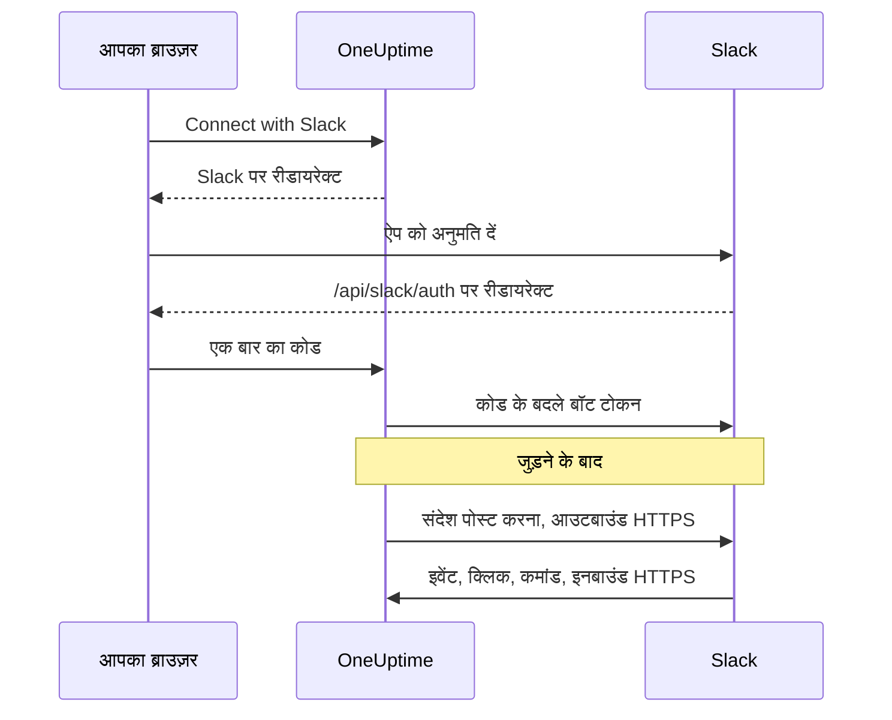
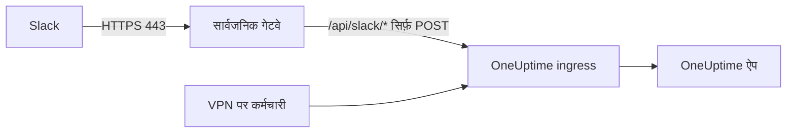

# Slack एकीकरण

अपने सेल्फ़-होस्टेड OneUptime को Slack से जोड़ें। आप अपने सर्वर के बनाए मैनिफ़ेस्ट से एक Slack ऐप बनाते हैं, OneUptime को ऐप के क्रेडेंशियल देते हैं, और हर प्रोजेक्ट को एक वर्कस्पेस से जोड़ते हैं। इसके बाद OneUptime आपके चैनलों में इंसिडेंट, अलर्ट और शेड्यूल्ड मेंटेनेंस पोस्ट करता है, और आपकी टीम Slack से ही उन पर कार्रवाई करती है।

यह पेज उनके लिए है जो OneUptime सर्वर चलाते हैं। Slack जुड़ जाने के बाद, सूचना नियम हर प्रोजेक्ट के लिए अलग से सेट होते हैं: देखें [Slack](/docs/workspace-connections/slack)।

:::cards
- [Slack ऐप सेट अप करें](#slack-ऐप-सेट-अप-करें): अपने मैनिफ़ेस्ट से ऐप बनाएँ और एक प्रोजेक्ट जोड़ें।
- [एनवायरनमेंट वेरिएबल](#एनवायरनमेंट-वेरिएबल): वे तीन मान जो OneUptime को ऐप से चाहिए।
- [नेटवर्क एक्सेस](#सेल्फ़-होस्टेड-डिप्लॉयमेंट-के-लिए-नेटवर्क-एक्सेस): वे कॉलबैक जिन तक Slack का पहुँच पाना ज़रूरी है।
- [समस्या निवारण](#समस्या-निवारण): Slack पेज के संदेशों का क्या मतलब है, और क्या करें।
:::

## यह कैसे काम करता है

Slack ऐप आपका अपना है: यह आपके वर्कस्पेस में इंस्टॉल होता है और सिर्फ़ आपके सर्वर से बात करता है। ट्रैफ़िक दोनों दिशाओं में जाता है, और हर दिशा को अपना नेटवर्क एक्सेस चाहिए।



- **आउटबाउंड**: OneUptime संदेश पोस्ट करने, चैनल बनाने और इमेज अपलोड करने के लिए Slack की Web API को कॉल करता है।
- **इनबाउंड**: Slack इवेंट, बटन क्लिक, मेन्यू और स्लैश कमांड के लिए आपके सर्वर के चार रूट को कॉल करता है। हर अनुरोध ऐप के signing secret से साइन होता है। OneUptime ऐसा अनुरोध अस्वीकार करता है जिसका सिग्नेचर मेल नहीं खाता या जिसका टाइमस्टैम्प पाँच मिनट से पुराना है।

## शुरू करने से पहले

- एक Slack वर्कस्पेस जिसमें आप ऐप बना और इंस्टॉल कर सकें।
- OneUptime के लिए एक सार्वजनिक HTTPS होस्टनेम जिस तक Slack पहुँच सके। देखें [नेटवर्क एक्सेस](#सेल्फ़-होस्टेड-डिप्लॉयमेंट-के-लिए-नेटवर्क-एक्सेस)।
- सर्वर के कॉन्फ़िगरेशन तक पहुँच: Docker Compose के लिए `config.env`, या Kubernetes के लिए आपकी Helm values।
- किसी प्रोजेक्ट को जोड़ने के लिए, उसमें **Project Owner**, **Project Admin** या **Project Member** भूमिका।

## Slack ऐप सेट अप करें

:::steps
### सार्वजनिक URL सेट करें

OneUptime ऐप मैनिफ़ेस्ट और हर कॉलबैक URL `HOST` और `HTTP_PROTOCOL` से बनाता है। इन्हें उस होस्टनेम पर सेट करें जिसे Slack HTTPS पर कॉल करेगा:

:::tabs
@tab Docker Compose
```bash title="config.env"
HOST=oneuptime.example.com
HTTP_PROTOCOL=https
```
@tab Kubernetes
```yaml title="values.yaml"
host: oneuptime.example.com
httpProtocol: https
```
:::

ये मान सिर्फ़ URL बनाते हैं। ये DNS रिकॉर्ड, सर्टिफ़िकेट या फ़ायरवॉल नियम नहीं बनाते।

### ऐप मैनिफ़ेस्ट कॉपी करें

**प्रोजेक्ट सेटिंग्स > वर्कस्पेस > Slack** खोलें। जब तक सर्वर पर Slack सेट अप नहीं होता, पेज आपके होस्टनेम के लिए बने मैनिफ़ेस्ट के साथ **Integrating Slack with your OneUptime Project** दिखाता है। यह `https://oneuptime.example.com/api/slack/app-manifest` पर भी मिलता है।

जाँचें कि मैनिफ़ेस्ट का हर URL आपके सार्वजनिक होस्टनेम से शुरू होता है। अगर नहीं, तो पहले `HOST` और `HTTP_PROTOCOL` ठीक करें और बदलाव लागू करें।

### Slack ऐप बनाएँ

[api.slack.com/apps](https://api.slack.com/apps) पर मैनिफ़ेस्ट से एक नया ऐप बनाएँ, अपना वर्कस्पेस चुनें और मैनिफ़ेस्ट पेस्ट करें। हमेशा वही मैनिफ़ेस्ट इस्तेमाल करें जो आपका अपना सर्वर बनाता है, ताकि उसके URL आपके होस्टनेम से मेल खाएँ।

### ऐप के क्रेडेंशियल कॉपी करें

ऐप के **Basic Information** पेज पर, **App Credentials** के नीचे, **Client ID**, **Client Secret** और **Signing Secret** कॉपी करें।

### क्रेडेंशियल OneUptime में जोड़ें

:::tabs
@tab Docker Compose
```bash title="config.env"
SLACK_APP_CLIENT_ID=YOUR_SLACK_APP_CLIENT_ID
SLACK_APP_CLIENT_SECRET=YOUR_SLACK_APP_CLIENT_SECRET
SLACK_APP_SIGNING_SECRET=YOUR_SLACK_APP_SIGNING_SECRET
```
@tab Kubernetes
```yaml title="values.yaml"
slackApp:
  clientId: "YOUR_SLACK_APP_CLIENT_ID"
  clientSecret: "YOUR_SLACK_APP_CLIENT_SECRET"
  signingSecret: "YOUR_SLACK_APP_SIGNING_SECRET"
```

मानों को अपने ख़ुद के प्रबंधित Kubernetes Secret में रखने के लिए, इसके बजाय `slackApp.existingSecret` सेट करें: उसका `name`, और कुंजियाँ `clientIdKey`, `clientSecretKey` और `signingSecretKey`।
:::

### कॉन्फ़िगरेशन लागू करें

:::tabs
@tab Docker Compose
```bash
npm run start
```

यह नए `config.env` के साथ कंटेनर फिर से बनाता है। `docker compose restart` इसे दोबारा नहीं पढ़ता।
@tab Kubernetes
```bash
helm upgrade my-oneuptime oneuptime/oneuptime -f values.yaml
```
:::

OneUptime के वापस चालू होने पर, **प्रोजेक्ट सेटिंग्स > वर्कस्पेस > Slack** मैनिफ़ेस्ट की जगह **Connect with Slack** बटन दिखाता है।

### इवेंट का अनुरोध URL सत्यापित करें

Slack ऐप के **Event Subscriptions** में अनुरोध URL सत्यापित करें। OneUptime Slack के challenge का जवाब तभी देता है जब signing secret सेट हो, इसलिए अगर ऐप बनाते समय यह विफल हुआ था, तो फिर से कोशिश करें।

### प्रोजेक्ट जोड़ें

**प्रोजेक्ट सेटिंग्स > वर्कस्पेस > Slack** में **Connect with Slack** चुनें और Slack में ऐप को अनुमति दें। Slack आपको उसी पेज पर वापस भेजता है, जो अब आपके वर्कस्पेस का नाम दिखाता है।

### अपना ख़ुद का Slack खाता जोड़ें

बटन, फ़ॉर्म और कमांड उस OneUptime उपयोगकर्ता के रूप में काम करते हैं जो उन्हें इस्तेमाल करने वाले Slack खाते से जुड़ा है। हर व्यक्ति **उपयोगकर्ता सेटिंग्स > वर्कस्पेस > Slack** खोलता है और **Connect my account with Slack** चुनता है। जिसने खाता नहीं जोड़ा है, उसे ऐप से एक डायरेक्ट मैसेज मिलता है जो उससे खाता जोड़ने को कहता है।
:::

## एनवायरनमेंट वेरिएबल

| Docker Compose (`config.env`) | Helm (`values.yaml`) | ज़रूरी | मान |
| --- | --- | --- | --- |
| `SLACK_APP_CLIENT_ID` | `slackApp.clientId` | हाँ | ऐप का **Client ID**। इसके बिना Slack पेज **Connect with Slack** की जगह सेटअप गाइड दिखाता है। |
| `SLACK_APP_CLIENT_SECRET` | `slackApp.clientSecret` | हाँ | ऐप का **Client Secret**, जिससे Slack का लौटाया कोड टोकन से बदला जाता है। |
| `SLACK_APP_SIGNING_SECRET` | `slackApp.signingSecret` | हाँ | ऐप का **Signing Secret**। Slack से आने वाले हर अनुरोध की जाँच इसी से होती है। |
| `HOST` | `host` | हाँ | आपका सार्वजनिक होस्टनेम, स्कीम के बिना। |
| `HTTP_PROTOCOL` | `httpProtocol` | हाँ | `https`। Slack सिर्फ़ HTTPS URL को कॉल करता है। |

## ऐप क्या कर सकता है

मैनिफ़ेस्ट ये सुविधाएँ सेट अप करता है। हर सुविधा दिखाए गए रूट पर आपके सर्वर तक पहुँचती है, इसलिए वह तभी काम करती है जब Slack उस रूट तक पहुँच सके।

| सुविधा | क्या करती है | रूट |
| --- | --- | --- |
| `/incident` और **Create New Incident** शॉर्टकट | Slack से इंसिडेंट घोषित करना | `POST /api/slack/interactive` |
| `/maintenance` और **Create Scheduled Event** शॉर्टकट | Slack से मेंटेनेंस शेड्यूल करना | `POST /api/slack/interactive` |
| `/oneuptime` | अपने लॉग, ट्रेस, मेट्रिक्स, इंसिडेंट और मॉनिटर के बारे में OneUptime AI से पूछना | `POST /api/slack/command` |
| OneUptime संदेशों पर बटन और फ़ॉर्म | स्वीकार करना, हल करना, नोट जोड़ना, स्थिति बदलना, ऑन-कॉल नीति चलाना | `POST /api/slack/interactive` और `POST /api/slack/options-load` |
| इवेंट | मेंशन, संदेश, रिएक्शन और पिन, जैसे किसी संदेश को नोट के रूप में सहेजना | `POST /api/slack/events` |

### संदेशों में इमेज

इंसिडेंट और अलर्ट के विवरण में स्क्रीनशॉट हो सकते हैं, जैसे किसी सिंथेटिक मॉनिटर का (देखें [स्क्रीनशॉट दिखाना](/docs/monitor/incident-alert-templating#स्क्रीनशॉट-दिखाना))। OneUptime हर स्क्रीनशॉट को निजी फ़ाइल के रूप में आपके वर्कस्पेस में अपलोड करके Slack संदेशों में दिखाता है, जिसके लिए बॉट स्कोप `files:write` चाहिए। बने हुए मैनिफ़ेस्ट में यह शामिल है।

अगर आपने अपना Slack ऐप किसी पुराने मैनिफ़ेस्ट से बनाया था, तो **OAuth & Permissions > Bot Token Scopes** के नीचे `files:write` जोड़ें (या मौजूदा मैनिफ़ेस्ट से ऐप अपडेट करें)। फिर **प्रोजेक्ट सेटिंग्स > वर्कस्पेस > Slack** में फिर से **Connect with Slack** चुनें, ताकि नया स्कोप मिल जाए। तब तक हर स्क्रीनशॉट अपने वैकल्पिक टेक्स्ट के रूप में दिखता है।

## सेल्फ़-होस्टेड डिप्लॉयमेंट के लिए नेटवर्क एक्सेस

### ट्रैफ़िक की दिशा और एंडपॉइंट

| ट्रैफ़िक | ज़रूरी एक्सेस |
| --- | --- |
| OneUptime से Slack | Web API कॉल और OAuth टोकन एक्सचेंज के लिए DNS और `slack.com` तक TCP 443 पर आउटबाउंड HTTPS; इस्तेमाल होने पर, कमांड के रिस्पॉन्स URL और इनकमिंग वेबहुक सूचनाओं के लिए `hooks.slack.com` |
| Slack से OneUptime | पूरे एकीकरण के लिए नीचे के चार POST रूट तक TCP 443 पर सार्वजनिक HTTPS |
| उपयोगकर्ता के ब्राउज़र से OneUptime | डैशबोर्ड एक्सेस और `/api/slack/auth/:projectId/:userId` और `/api/slack/auth/:projectId/:userId/user` पर OAuth रीडायरेक्ट; ये उपयोगकर्ता के VPN के ज़रिए ही पहुँच योग्य रह सकते हैं |

आउटबाउंड डोमेन OneUptime के Slack एकीकरण के बारे में हैं, Slack क्लाइंट या हर Slack सुविधा के लिए पूरी अनुमति-सूची नहीं। Slack का *इनकमिंग वेबहुक* Slack होस्ट करता है: OneUptime उसे भेजता है, इसलिए वह आपके सर्वर पर कोई इनबाउंड एंडपॉइंट नहीं है। Slack की [इनकमिंग वेबहुक गाइड](https://docs.slack.dev/messaging/sending-messages-using-incoming-webhooks/) देखें।

इन कॉलबैक को OneUptime के ingress के ज़रिए उस तक भेजें:

| मेथड और पाथ | उद्देश्य |
| --- | --- |
| `POST /api/slack/events` | Events API सत्यापन, रिएक्शन, पिन, मेंशन और संदेश |
| `POST /api/slack/interactive` | बटन, शॉर्टकट, मोडल सबमिशन, `/incident` और `/maintenance` |
| `POST /api/slack/options-load` | इंटरैक्टिव मेन्यू के विकल्पों के अनुरोध |
| `POST /api/slack/command` | `/oneuptime` कमांड |

OAuth एक [ब्राउज़र रीडायरेक्ट है, जिसके बाद सर्वर की ओर से टोकन एक्सचेंज होता है](https://docs.slack.dev/authentication/installing-with-oauth/)। मैनिफ़ेस्ट `/api/slack/auth` को रीडायरेक्ट URL के प्रीफ़िक्स के रूप में रजिस्टर करता है, और OneUptime ऑथराइज़ेशन शुरू करते समय प्रोजेक्ट और उपयोगकर्ता के पाथ जोड़ता है। सिर्फ़ ब्राउज़र एक्सेस से Slack इवेंट या बटन क्लिक नहीं पहुँचा सकता।

### निजी डिप्लॉयमेंट और कॉलबैक की सुरक्षा



सार्वजनिक DNS और ऐसा गेटवे इस्तेमाल करें जिसमें सार्वजनिक रूप से भरोसेमंद HTTPS सर्टिफ़िकेट, पूरी सर्टिफ़िकेट चेन और आपके OneUptime ingress तक एक निजी रूट हो। गेटवे तक इनबाउंड TCP 443 की अनुमति दें और ऊपर के सिर्फ़ चार कॉलबैक रूट आगे भेजें। निजी `ClusterIP`, अंदरूनी DNS नाम या किसी कर्मचारी का VPN कनेक्शन Slack की पहुँच में नहीं होता। स्प्लिट DNS से उसी होस्टनेम के तहत डैशबोर्ड और OAuth रूट निजी रह सकते हैं।

होस्टनेम बदलने के बाद मैनिफ़ेस्ट फिर से बनाएँ और Slack ऐप अपडेट करें।

गेटवे से गुज़रते हुए ये बनाए रखें:

- मेथड, पाथ, क्वेरी स्ट्रिंग और मूल बॉडी;
- `Content-Type`, `X-Slack-Signature` और `X-Slack-Request-Timestamp`;
- भरोसेमंद प्रॉक्सी हेडर के ज़रिए सार्वजनिक होस्ट और HTTPS स्कीम।

कॉलबैक रूट को ब्राउज़र SSO, CAPTCHA और प्रॉक्सी के लॉगिन पेजों से छूट दें, और OneUptime की signing secret और टाइमस्टैम्प जाँच बनाए रखें। सर्वर की घड़ी सिंक रखें: पाँच मिनट से ज़्यादा अंतर वाला अनुरोध अस्वीकार हो जाता है। Slack [अनुरोध के सिग्नेचर का सत्यापन](https://docs.slack.dev/authentication/verifying-requests-from-slack/) दस्तावेज़ करता है; स्रोत IP की जाँच उसकी जगह नहीं ले सकती।

### एक्सेस सत्यापित करें और सीमाएँ समझें

:::steps
1. Slack ऐप के **Event Subscriptions** में अनुरोध URL सत्यापित करें। Slack एक [POST challenge भेजता है और TLS जाँचता है](https://docs.slack.dev/apis/events-api/using-http-request-urls/)।
2. एक टेस्ट सूचना भेजें, एक स्लैश कमांड चलाएँ, किसी इंसिडेंट संदेश पर बटन दबाएँ और कोई सब्सक्राइब किया हुआ इवेंट ट्रिगर करें।
3. सीक्रेट लॉग किए बिना, विफल डिलीवरी के लिए गेटवे और OneUptime के लॉग जाँचें।
:::

Slack तुरंत पुष्टि की उम्मीद करता है, जिसमें [इंटरैक्शन के लिए तीन सेकंड के भीतर जवाब](https://docs.slack.dev/interactivity/handling-user-interaction/) शामिल है। ब्राउज़र का GET या सफलतापूर्वक भेजा गया आउटबाउंड संदेश इन POST कॉलबैक को सत्यापित नहीं करता।

> [!WARNING]
> अगर हर इनबाउंड कनेक्शन प्रतिबंधित है, तो पहले से ऑथराइज़ किया गया ऐप आउटबाउंड HTTPS से संदेश भेज सकता है, लेकिन इवेंट, बटन, शॉर्टकट और कमांड काम नहीं कर सकते। OneUptime का मैनिफ़ेस्ट HTTP कॉलबैक इस्तेमाल करता है और Socket Mode बंद रखता है; Slack का Socket Mode चालू करना इन रूट का समर्थित विकल्प नहीं है।

[निजी नेटवर्क पहुँच सेटिंग्स](/docs/self-hosted/private-network-access) निजी गंतव्यों को जाने वाले आउटबाउंड अनुरोधों को नियंत्रित करती हैं। ये कॉलबैक को Slack के लिए खुला नहीं करतीं।

## समस्या निवारण

### कनेक्ट करना पूरा नहीं हुआ

जब Slack आपको वापस भेजता है और कनेक्शन नहीं बना होता, तो जिस Slack पेज से आपने शुरू किया था (**प्रोजेक्ट सेटिंग्स > वर्कस्पेस > Slack**, या अपना खाता जोड़ते समय आपकी अपनी **उपयोगकर्ता सेटिंग्स > वर्कस्पेस > Slack**) वह **Slack कनेक्ट नहीं हुआ** दिखाता है, साथ में आपकी भाषा में एक वाक्य जो वजह बताता है। पेज का बाक़ी हिस्सा हमेशा की तरह लोड होता है, इसलिए आप वहीं फिर से जोड़ सकते हैं। Slack ने ख़ुद क्या जवाब दिया, यह पेज कभी नहीं दिखाता: वह वजह के साथ OneUptime सर्वर के लॉग में होता है।

| पेज कहता है | क्या करें |
| --- | --- |
| **"यह कनेक्शन लिंक अमान्य है, इसकी समय-सीमा समाप्त हो गई है, या इसका पहले ही उपयोग हो चुका है। कृपया फिर से शुरू करें।"** | लिंक एक बार, 15 मिनट तक, उसी ब्राउज़र में काम करता है जिसमें वह शुरू हुआ था। Slack पेज से फिर से शुरू करें और उसी ब्राउज़र में 15 मिनट के भीतर Slack में पूरा करें। |
| **"आपको इस प्रोजेक्ट को Slack से कनेक्ट करने की अनुमति नहीं है।"** | OneUptime को Slack में इंस्टॉल करने के लिए **Project Owner**, **Project Admin** या **Project Member** चाहिए। Slack के वापस भेजने पर यह फिर से जाँचा जाता है, इसलिए बीच में हटाई गई भूमिका भी यहाँ कनेक्शन ख़त्म कर देती है। |
| **"आप अब इस प्रोजेक्ट के सदस्य नहीं हैं।"** | अपना ख़ुद का Slack खाता जोड़ने के लिए, Slack के वापस भेजते समय आपका प्रोजेक्ट का सदस्य होना ज़रूरी है। |
| **"यह प्रोजेक्ट अभी किसी Slack workspace से कनेक्ट नहीं है।"** | पहले **प्रोजेक्ट सेटिंग्स > वर्कस्पेस > Slack** से OneUptime को Slack में इंस्टॉल करें, फिर अपना खाता जोड़ें। |
| **"आपने उस Slack workspace से अलग workspace में साइन इन किया है जिससे यह प्रोजेक्ट कनेक्ट है।"** | अपना खाता उस Slack वर्कस्पेस में साइन इन रहते हुए जोड़ें जिसमें प्रोजेक्ट इंस्टॉल है। |
| **"कनेक्शन रद्द कर दिया गया, इसलिए कुछ भी नहीं बदला गया।"** | Slack में अनुरोध की अनुमति नहीं दी गई। फिर से शुरू करें और अनुमति दें। |
| **"इस OneUptime सर्वर पर Slack सेट अप नहीं है।"** | `SLACK_APP_CLIENT_ID` और `SLACK_APP_CLIENT_SECRET` सेट करें (देखें [एनवायरनमेंट वेरिएबल](#एनवायरनमेंट-वेरिएबल)) और OneUptime को रीस्टार्ट करें। |
| **"OneUptime कनेक्ट करना पूरा नहीं कर सका। कृपया फिर से कोशिश करें।"** | Slack ने त्रुटि के साथ जवाब दिया, या पूरा करते समय कोई अनुरोध या राइट विफल हुआ। OneUptime सर्वर का लॉग बताता है कि कौन-सा। फिर से कोशिश करें; अगर यह होता रहे, तो लॉग और Slack ऐप की सेटिंग्स जाँचें। |

### अन्य समस्याएँ

:::details Slack इवेंट का अनुरोध URL सत्यापित नहीं कर पाता
OneUptime Slack के challenge का जवाब तभी देता है जब `SLACK_APP_SIGNING_SECRET` सेट हो और अनुरोध उस तक पहुँचे। signing secret सेट करें, कॉन्फ़िगरेशन लागू करें और सत्यापन फिर से करें। अगर फिर भी विफल हो, तो जाँचें कि `POST /api/slack/events` इंटरनेट से सार्वजनिक रूप से भरोसेमंद सर्टिफ़िकेट के साथ पहुँच योग्य है।
:::

:::details बटन और स्लैश कमांड कुछ नहीं करते, लेकिन सूचनाएँ आती हैं
सूचनाएँ आउटबाउंड होती हैं, इसलिए वे इनबाउंड एक्सेस के बिना काम करती हैं। बटन, शॉर्टकट और कमांड इनबाउंड होते हैं: जाँचें कि Slack `POST /api/slack/interactive` और `POST /api/slack/command` तक पहुँच सकता है, और गेटवे बॉडी और `X-Slack-Signature` और `X-Slack-Request-Timestamp` हेडर बनाए रखता है।
:::

:::details ऐप कहता है कि मेरा Slack खाता OneUptime से जुड़ा नहीं है
बटन, फ़ॉर्म और कमांड के लिए आपका Slack खाता आपके OneUptime उपयोगकर्ता से जुड़ा होना चाहिए। **उपयोगकर्ता सेटिंग्स > वर्कस्पेस > Slack** खोलें और **Connect my account with Slack** चुनें। अगर आपको प्रोजेक्ट से हटा दिया गया है, तो ऐप इसके बजाय यही बताता है, और Slack से की गई कार्रवाइयाँ अस्वीकार हो जाती हैं।
:::

:::details स्क्रीनशॉट टेक्स्ट के रूप में दिखते हैं
Slack ऐप में `files:write` स्कोप नहीं है। देखें [संदेशों में इमेज](#संदेशों-में-इमेज)।
:::

## अगले कदम

:::cards
- [Slack](/docs/workspace-connections/slack): प्रोजेक्ट के लिए सूचना नियम और सारांश बनाएँ।
- [Microsoft Teams एकीकरण](/docs/self-hosted/microsoft-teams-integration): अपने सर्वर पर Teams बॉट भी सेट अप करें।
- [निजी नेटवर्क पहुँच](/docs/self-hosted/private-network-access): वर्कफ़्लो और वेबहुक को अंदरूनी टूल तक पहुँचने दें।
:::
