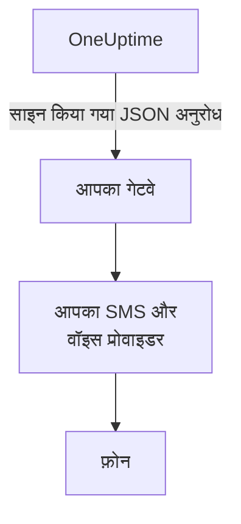

# SMS और कॉल गेटवे

OneUptime अपने SMS और कॉल Twilio के बजाय आपके चलाए गेटवे से भेज सकता है। इसका इस्तेमाल तब करें जब आपके नियमों के अनुसार हर संदेश को आपके अपने SMS और वॉइस प्रोवाइडर से होकर जाना हो, या किसी ऐसे सिस्टम से जो उसे आपके नेटवर्क से बाहर जाने से पहले जाँचता है। OneUptime हर SMS और कॉल को एक साइन किए गए JSON अनुरोध के रूप में आपके गेटवे पर भेजता है, और आपका गेटवे उसे पहुँचाता है।

:::cards
- [गेटवे सेट अप करना](#गेटवे-सेट-अप-करना): एक URL, और आपके लिए बनाया गया साइनिंग सीक्रेट।
- [आपके गेटवे को क्या मिलता है](#आपके-गेटवे-को-क्या-मिलता-है): हर SMS या कॉल के लिए एक साइन किया गया JSON अनुरोध।
- [पेज पर कार्रवाई करना](#पेज-पर-कार्रवाई-करना): कॉल या जवाब से स्वीकार, एस्केलेट या हल करें।
- [डिलीवरी और दोबारा कोशिशें](#डिलीवरी-और-दोबारा-कोशिशें): आपका गेटवे बंद होने पर क्या होता है।
:::

## यह कैसे काम करता है



गेटवे सर्वर के अपने Twilio खाते की जगह लेता है, उन सभी चीज़ों के लिए जो उससे होकर जातीं: ऑन-कॉल पेज, सूचनाएँ, सत्यापन कोड और स्टेटस पेज के सब्सक्राइबर को जाने वाले SMS। जो प्रोजेक्ट **प्रोजेक्ट सेटिंग्स > सूचनाएं > सूचना सेटिंग्स** में **Twilio कॉन्फ़िगरेशन** कार्ड पर अपना खुद का Twilio कॉन्फ़िगरेशन जोड़ते हैं, वे अब भी उसी कॉन्फ़िगरेशन से भेजते हैं। हर प्रोजेक्ट के SMS और कॉल स्विच, और जहाँ बिलिंग चालू है वहाँ उसका बैलेंस, वैसे ही जाँचे जाते हैं जैसे Twilio के लिए।

## गेटवे सेट अप करना

:::steps
1. Admin Dashboard में **सेटिंग्स > कॉल और एसएमएस** पर जाएँ, और **SMS and Call Provider** कार्ड पर **Edit Provider** पर क्लिक करें।
2. **Your own gateway** चुनें, और **Gateway URL** डालें। गेटवे आपके निजी नेटवर्क पर हो सकता है।
3. सहेजें। OneUptime आपके लिए एक साइनिंग सीक्रेट बनाता है। उसे कार्ड से कॉपी करके अपने गेटवे में डालें।
4. **Send Test** पर क्लिक करें। आपके गेटवे को 2xx स्टेटस के साथ जवाब देना चाहिए और कुछ नहीं भेजना चाहिए।
:::

सीक्रेट बदलने के लिए, **और फ़ील्ड** में **Signing Secret** खाली करें और सहेजें: OneUptime एक नया सीक्रेट बनाता है। Twilio पर वापस जाने के लिए, **Twilio** चुनें और सहेजें।

## आपके गेटवे को क्या मिलता है

हर SMS और कॉल एक `POST` अनुरोध है, जिसमें JSON बॉडी और ये हेडर होते हैं:

| हेडर | मान |
| --- | --- |
| `Content-Type` | `application/json` |
| `X-OneUptime-Event` | `sms`, `call` या `test` |
| `X-OneUptime-Signature` | `sha256=` के बाद बॉडी का HMAC-SHA256, hex में, साइनिंग सीक्रेट को कुंजी बनाकर |
| `User-Agent` | `OneUptime-CallAndSmsGateway/1.0` |

```json title="An on-call page by SMS"
{
  "version": 1,
  "event": "sms",
  "id": "7c5b0d0e-3e5f-4d1a-9a4f-2b8e6c1d9f00",
  "sentAt": "2026-10-27T09:30:00.000Z",
  "to": "+15551234567",
  "message": "OneUptime: A new alert has been created. Alert #42: Database is down…",
  "isSensitive": false,
  "project": {
    "id": "0f6b8c3a-1d2e-4f5a-8b9c-0d1e2f3a4b5c",
    "name": "Production"
  },
  "actions": {
    "acknowledge": "https://oneuptime.example.com/api/custom-notification-channel/page/5f2c…/acknowledge?token=…",
    "escalate": "https://oneuptime.example.com/api/custom-notification-channel/page/5f2c…/escalate?token=…",
    "resolve": "https://oneuptime.example.com/api/custom-notification-channel/page/5f2c…/resolve?token=…"
  }
}
```

| फ़ील्ड | यह क्या है |
| --- | --- |
| `version` | इस रूप के लिए हमेशा `1`। इसमें फ़ील्ड सिर्फ़ जोड़े ही जाते हैं। |
| `event` | `sms`, `call` या `test`, जैसा `X-OneUptime-Event` में है। |
| `id` | इस संदेश के लिए अनोखा, और उसे पहुँचाने की हर कोशिश में एक जैसा: इससे ऐसे संदेश को अनदेखा करें जिसे आप पहले ही भेज चुके हैं। |
| `sentAt` | OneUptime ने इसे कब भेजा, ISO 8601 में। |
| `to` | फ़ोन नंबर, E.164 रूप में। टेस्ट में `null`। |
| `message` | SMS, या कॉल में कही जाने वाली बात। एक SMS ज़्यादा से ज़्यादा 1,600 वर्णों का होता है, और कॉल का टेक्स्ट ज़्यादा से ज़्यादा 16,384 वर्णों का। इससे लंबा टेक्स्ट काट दिया जाता है और उसके अंत में एक नोट होता है कि बाकी OneUptime में है। |
| `isSensitive` | सत्यापन कोड के लिए `true`। संदेश को अपने लॉग से बाहर रखें। |
| `project` | प्रोजेक्ट का `id` और `name`, या `null` जब इसे किसी प्रोजेक्ट ने नहीं भेजा। |
| `actions` | ऑन-कॉल पेज के लिए, वे लिंक जो उस पर कार्रवाई करते हैं। बाकी मामलों में `null`। |

कॉल की स्क्रिप्ट नहीं, बल्कि उसका विवरण भेजा जाता है: `message` वह है जो कॉल में कहा जाता है, Twilio के "स्वीकार करने के लिए 1 दबाएँ" के बिना। कार्रवाइयाँ अपने तरीक़े से दें, जैसे कुंजी दबाकर, और संबंधित लिंक को कॉल करें।

### सिग्नेचर जाँचना

अनुरोध की रॉ बॉडी को पार्स करने से पहले उसका HMAC निकालें, और उसकी तुलना हेडर से करें। यह जाँच [कस्टम चैनल](/docs/self-hosted/custom-notification-channels#सिग्नेचर-जाँचना) जैसी ही है, इसलिए एक ही वेरिफ़ायर दोनों के काम आता है:

```javascript title="Node.js"
const crypto = require("crypto");

function isFromOneUptime(rawBody, signatureHeader, secret) {
  const expected =
    "sha256=" + crypto.createHmac("sha256", secret).update(rawBody).digest("hex");
  const received = String(signatureHeader || "");

  return (
    received.length === expected.length &&
    crypto.timingSafeEqual(Buffer.from(received), Buffer.from(expected))
  );
}
```

## पेज पर कार्रवाई करना

जब व्यक्ति कॉल के दौरान या जवाब भेजकर प्रतिक्रिया देता है, तो आपका गेटवे `actions` में संबंधित लिंक पर `POST` अनुरोध भेजता है। ये लिंक कस्टम चैनल के लिंक की तरह ही काम करते हैं: इन्हें किसी API कुंजी की ज़रूरत नहीं होती, हर लिंक में सिर्फ़ उसी पेज के लिए एक टोकन होता है जो 7 दिनों तक मान्य रहता है, और कार्रवाई उसी व्यक्ति के नाम दर्ज होती है जिसे पेज किया गया था। हर कार्रवाई और जवाब के लिए [पेज पर कार्रवाई करना](/docs/self-hosted/custom-notification-channels#पेज-पर-कार्रवाई-करना) देखें।

```bash title="Acknowledge a page"
curl -X POST "https://oneuptime.example.com/api/custom-notification-channel/page/5f2c…/acknowledge?token=…"
```

## डिलीवरी और दोबारा कोशिशें

अनुरोध तब डिलीवर माना जाता है जब आपका गेटवे 10 सेकंड के भीतर 2xx स्टेटस के साथ जवाब देता है। जिस अनुरोध का उसने जवाब नहीं दिया, या 408, 429 या 5xx स्टेटस के साथ जवाब दिया, वह 1 सेकंड बाद और फिर 4 सेकंड और बाद दोबारा भेजा जाता है: कुल तीन कोशिशें। किसी भी दूसरे 4xx स्टेटस पर उसे दोबारा नहीं भेजा जाता।

SMS या कॉल लॉग में, और ऑन-कॉल पेज के लिए व्यक्ति के ऑन-कॉल लॉग में, `Sent to the SMS and call gateway (HTTP 200).` या डिलीवर न होने की वजह लिखी होती है, URL कभी नहीं। OneUptime को पता नहीं चलता कि संदेश फ़ोन तक पहुँचा या नहीं, इसलिए आपका गेटवे SMS स्वीकार करते ही वह भेजा गया दिखता है, और जिस नंबर से वह गया वह खाली छोड़ दिया जाता है।

## परीक्षण अनुरोध

**Send test** एक ऐसा अनुरोध भेजता है जिसमें `event` का मान `test` होता है, और `to`, `project` और `actions` का मान `null`। इसका जवाब 2xx स्टेटस के साथ दें और कुछ न भेजें।

## अगले कदम

:::cards
- [कस्टम सूचना चैनल](/docs/self-hosted/custom-notification-channels): अपने खुद के ऐप से लोगों को पेज करें।
- [पुश सूचनाएँ](/docs/self-hosted/push-notifications): पूरे सर्वर के लिए पुश बंद करें।
- [Twilio इंटीग्रेशन](/docs/self-hosted/twilio-integration): इसके बजाय Twilio से भेजें।
- [निजी नेटवर्क पहुँच](/docs/self-hosted/private-network-access): आपका सर्वर आपके अपने नेटवर्क पर किन चीज़ों तक पहुँच सकता है।
:::
