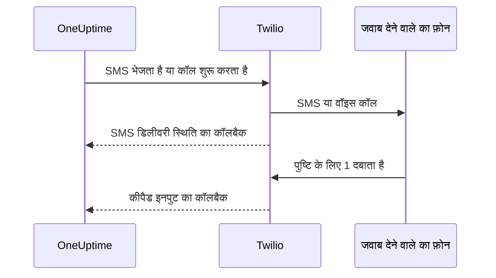

# Twilio इंटीग्रेशन

स्व-होस्टेड OneUptime आपके अपने Twilio खाते से SMS और वॉइस अलर्ट भेजता है, और आप सीधे Twilio को भुगतान करते हैं। Twilio क्रेडेंशियल आप OneUptime के डैशबोर्ड में सहेजते हैं, एनवायरनमेंट वेरिएबल में नहीं: सूचना भेजने की प्रक्रिया सहेजा गया कॉन्फ़िगरेशन पढ़ती है, और Helm चार्ट में Twilio क्रेडेंशियल के कोई मान नहीं हैं।

> [!NOTE]
> एक पुराने माइग्रेशन ने `TWILIO_ACCOUNT_SID`, `TWILIO_AUTH_TOKEN` और `TWILIO_PHONE_NUMBER` इंपोर्ट किए थे; इन वेरिएबल को बदलना किसी मौजूदा इंस्टॉलेशन के क्रेडेंशियल अपडेट करने का तरीका नहीं है।

:::cards
- [अपना Twilio खाता तैयार करें](#1-अपना-twilio-खाता-तैयार-करें): क्रेडेंशियल, एक फ़ोन नंबर और खाते की सीमाएँ।
- [क्रेडेंशियल सहेजें](#2-oneuptime-में-क्रेडेंशियल-सहेजें): एक प्रोजेक्ट के लिए, या पूरे इंस्टॉलेशन के लिए।
- [नेटवर्क एक्सेस कॉन्फ़िगर करें](#3-नेटवर्क-एक्सेस-कॉन्फ़िगर-करें): Twilio को आपके सर्वर पर क्या और कब पहुँचना चाहिए।
- [फ़ोन नंबर सत्यापित करें](#5-टीम-सदस्यों-के-फ़ोन-नंबर-सत्यापित-करें): टीम सदस्यों के नंबर कैसे सत्यापित होते हैं।
:::

## 1. अपना Twilio खाता तैयार करें

:::steps
### अपने क्रेडेंशियल कॉपी करें

[Twilio Console](https://console.twilio.com/) खोलें और अपना **Account SID** और **Auth Token** कॉपी करें।

### एक फ़ोन नंबर लें

ऐसा Twilio फ़ोन नंबर लें जिसमें आपकी ज़रूरत की SMS और/या वॉइस क्षमताएँ हों। भेजने वाले और पाने वाले नंबरों के लिए देश कोड सहित E.164 फ़ॉर्मेट इस्तेमाल करें।

### खाते की सीमाएँ जाँचें

खाते का बैलेंस, गंतव्य देशों की अनुमतियाँ और लागू होने वाली प्रेषक पंजीकरण की ज़रूरतें जाँचें। ट्रायल खातों पर प्राप्तकर्ता, भौगोलिक और अन्य पाबंदियाँ होती हैं जो OneUptime के असली अलर्ट को काम करने से रोक सकती हैं; टेस्ट करने से पहले [Twilio के खाते और ट्रायल का दस्तावेज़](https://www.twilio.com/docs/usage/tutorials/how-to-use-your-free-trial-account) पढ़ें। प्रोडक्शन के लिए अपग्रेड किया हुआ खाता इस्तेमाल करें।
:::

## 2. OneUptime में क्रेडेंशियल सहेजें

क्रेडेंशियल एक प्रोजेक्ट के लिए सहेजें, या पूरे इंस्टॉलेशन के लिए एक बार:

| | प्रोजेक्ट कॉन्फ़िगरेशन | पूरे इंस्टॉलेशन का कॉन्फ़िगरेशन |
| --- | --- | --- |
| कहाँ | **प्रोजेक्ट सेटिंग्स > सूचनाएं > सूचना सेटिंग्स** में **Twilio कॉन्फ़िगरेशन** कार्ड | **Admin Dashboard > सेटिंग्स > कॉल और एसएमएस** |
| कौन सेट कर सकता है | **Project Owner**, **Project Admin**, या कस्टम भूमिका में **Create Call and SMS** | एक मास्टर एडमिन |
| किसके लिए इस्तेमाल होता है | जब तक यह प्रोजेक्ट का डिफ़ॉल्ट है, प्रोजेक्ट के सदस्यों को SMS और कॉल, जिन स्टेटस पेजों को यह सौंपा गया है, और जो आने वाली कॉल नीतियाँ इसे इस्तेमाल करती हैं | किसी भी ऐसे प्रोजेक्ट के सदस्यों को SMS और कॉल जिसका कोई डिफ़ॉल्ट कॉन्फ़िगरेशन नहीं है |

प्रोजेक्ट कॉन्फ़िगरेशन जोड़ने के लिए:

:::steps
1. **प्रोजेक्ट सेटिंग्स > सूचनाएं > सूचना सेटिंग्स** पर जाएँ।
2. **Twilio कॉन्फ़िगरेशन** में **Twilio कॉन्फ़िगरेशन बनाएँ** चुनें।
3. एक नाम, **Twilio Account SID**, **Twilio Auth Token** और **Twilio प्राथमिक फ़ोन नंबर** दर्ज करें। चाहें तो दूसरे देशों के लिए कॉमा से अलग किए गए **Twilio द्वितीयक फ़ोन नंबर** दर्ज करें।
4. प्रोजेक्ट के पहले कॉन्फ़िगरेशन के लिए **प्रोजेक्ट डिफ़ॉल्ट के रूप में सेट करें** चालू रहता है, इसलिए प्रोजेक्ट के सदस्यों को जाने वाले SMS और कॉल, ऑन-कॉल सूचनाओं सहित, सहेजते ही इसी से जाते हैं। अगर यह खाता सिर्फ़ स्टेटस पेजों या आने वाली कॉल के लिए है, तो इसे बंद करें। बाद का कॉन्फ़िगरेशन स्विच बंद के साथ शुरू होता है: उन संदेशों को उस पर ले जाने के लिए स्विच चालू करें, या कॉन्फ़िगरेशन की पंक्ति के मेनू से **प्रोजेक्ट डिफ़ॉल्ट के रूप में सेट करें** चुनें। जो API अनुरोध `isProjectDefault` छोड़ देता है, उसके साथ भी यही होता है।
5. सहेजें। सिर्फ़ एक कॉन्फ़िगरेशन प्रोजेक्ट का डिफ़ॉल्ट हो सकता है। स्टेटस पेज वह कॉन्फ़िगरेशन इस्तेमाल करते हैं जो हर स्टेटस पेज को स्पष्ट रूप से सौंपा गया है।

> [!IMPORTANT]
> हर प्रोजेक्ट में **SMS** और **फ़ोन कॉल** शुरू में बंद रहते हैं, और जब तक वे चालू नहीं होते, प्रोजेक्ट में कोई भी उनके लिए फ़ोन नंबर नहीं जोड़ सकता। प्रोजेक्ट का मालिक, कोई **Billing Admin** या **Manage Billing** वाला कोई व्यक्ति उन्हें उसी पेज के **सूचना चैनल** कार्ड में चालू करता है।
:::

पूरे इंस्टॉलेशन के डिफ़ॉल्ट के लिए, कोई एडमिन इसके बजाय **Admin Dashboard > सेटिंग्स > कॉल और एसएमएस** खोलकर Twilio क्रेडेंशियल और फ़ोन नंबर संपादित करके सहेज सकता है। जब सदस्यों के प्रोजेक्ट का कोई डिफ़ॉल्ट नहीं होता, तो उनकी सूचनाएँ इसी ग्लोबल कॉन्फ़िगरेशन का इस्तेमाल करती हैं। Auth Token को गोपनीय रखें।

## 3. नेटवर्क एक्सेस कॉन्फ़िगर करें

भेजना सिर्फ़ आउटबाउंड एक्सेस से काम करता है। डिलीवरी अपडेट, कीपैड से पुष्टि और आने वाली कॉल के लिए Twilio का आपके सर्वर तक पहुँचना ज़रूरी है।

निजी डिप्लॉयमेंट को SMS और कॉल भेजने के लिए DNS रेज़ॉल्यूशन और TCP 443 पर Twilio तक आउटबाउंड HTTPS चाहिए। Twilio सलाह देता है कि `*.twilio.com` तक आउटबाउंड HTTPS की अनुमति दें, क्योंकि उसके API पते बदलते रहते हैं; [Twilio IP पते](https://help.twilio.com/articles/115015934048-All-About-Twilio-IP-Addresses) देखें। इसे OneUptime एप्लिकेशन वर्कलोड के आउटबाउंड ट्रैफ़िक पर लागू करें, जिसमें Kubernetes NetworkPolicies और बाहरी फ़ायरवॉल शामिल हैं।

इनबाउंड एक्सेस सुविधा पर निर्भर करता है:

| सुविधा | क्या Twilio को OneUptime तक पहुँचना होगा? |
| --- | --- |
| SMS भेजना | नहीं। हालाँकि डिलीवरी स्थिति के अपडेट के लिए कॉलबैक चाहिए। |
| एक सामान्य टेस्ट वॉइस कॉल | नहीं। OneUptime बोले जाने वाले निर्देश आउटबाउंड API अनुरोध के साथ भेजता है। |
| ऑन-कॉल अलर्ट की पुष्टि के लिए 1 दबाना | हाँ। Twilio कीपैड इनपुट OneUptime को भेजता है। |
| आने वाली कॉल नीतियाँ | हाँ। Twilio कॉल के निर्देश माँगता है और डायल के नतीजे बताता है। |

ये OneUptime के Nginx गेटवे से होकर जाने वाले बाहरी पाथ हैं। प्लेसहोल्डर हर सूचना में अलग होते हैं:

| मेथड | पाथ | उद्देश्य |
| --- | --- | --- |
| POST | `/notification/sms/status-callback/:smsLogId/:token` | SMS डिलीवरी स्थिति |
| POST | `/api/user-notification-log-timeline/call/gather-input/:itemId?token=...` | कीपैड से पुष्टि |
| POST | `/notification/incoming-call/voice` | वैकल्पिक: आने वाली कॉल के निर्देश |
| POST | `/notification/incoming-call/dial-status/:callLogId/:callLogItemId` | वैकल्पिक: आने वाली कॉल की रूटिंग के नतीजे |

SMS और पुष्टि के URL OneUptime अपने आप बनाता है। उनके टोकन को किसी स्थिर वेबहुक URL से न बदलें। आने वाली कॉल के लिए [आने वाली कॉल नीतियाँ](/docs/on-call/incoming-call-policy) देखें, जो नंबर जोड़ते समय उस नंबर का वेबहुक कॉन्फ़िगर करती हैं।

Twilio को [सार्वजनिक रूप से पहुँच योग्य वेबहुक URL](https://www.twilio.com/docs/usage/webhooks/webhooks-overview) चाहिए। सार्वजनिक रूप से भरोसेमंद TLS सर्टिफ़िकेट इस्तेमाल करें, और प्रॉक्सी से गुज़रते हुए मूल होस्ट, प्रोटोकॉल, पाथ, क्वेरी पैरामीटर, बॉडी और `X-Twilio-Signature` हेडर बनाए रखें। आने वाली कॉल के हैंडलर Twilio के सिग्नेचर की जाँच करते हैं; SMS डिलीवरी हर संदेश के लिए एक URL टोकन इस्तेमाल करती है, और कीपैड से पुष्टि एक साइन किया हुआ क्वेरी टोकन। टोकन को साझा लॉग या स्क्रीनशॉट में न दिखाएँ। [Twilio वेबहुक सुरक्षा](https://www.twilio.com/docs/usage/webhooks/webhooks-security) देखें।

### निजी डिप्लॉयमेंट से कॉलबैक प्रकाशित करें

:::steps
1. अपने OneUptime होस्टनेम, उदाहरण के लिए `oneuptime.example.com`, का DNS प्रकाशित करें, जो इंटरनेट से पहुँचने योग्य किसी रिवर्स प्रॉक्सी या लोड बैलेंसर की ओर इशारा करे। इनबाउंड TCP 443 की अनुमति दें और पूरी चेन के साथ सार्वजनिक रूप से भरोसेमंद सर्टिफ़िकेट कॉन्फ़िगर करें। निजी IP, सिर्फ़ अंदरूनी DNS या किसी एडमिन का VPN कनेक्शन Twilio को कनेक्टिविटी नहीं देता।
2. उस गेटवे को OneUptime के निजी ingress तक नेटवर्क रूट दें, सीधे या आपके अपने साइट-टू-साइट VPN/निजी लिंक से। अपस्ट्रीम सेवा पोर्ट की अनुमति दें। Kubernetes की `ClusterIP` सेवा के लिए एक पहुँच योग्य ingress या गेटवे से कोई दूसरा रूट चाहिए। डेटाबेस और दूसरी अंदरूनी सेवाएँ निजी रखें।
3. ऊपर की तालिका के सिर्फ़ वे कॉलबैक पाथ प्रकाशित करें जिन्हें आप इस्तेमाल करते हैं। उन्हें OneUptime के Nginx गेटवे से आगे भेजें, जो बाहरी `/notification` प्रीफ़िक्स को एप्लिकेशन से जोड़ता है। कीपैड वाले रूट पर `/api` बनाए रखें। HTTP मेथड और अनुरोध का डेटा बनाए रखें; किसी दूसरे URL पर रीडायरेक्ट न करें। सार्वजनिक `Host` बनाए रखें और अपनी प्रॉक्सी पर सार्वजनिक होस्ट और HTTPS स्कीम के लिए भरोसेमंद फ़ॉरवर्डिंग हेडर सेट करें।
4. इन रूट को ब्राउज़र SSO, CAPTCHA और प्रॉक्सी के लॉगिन पेजों से छूट दें। OneUptime का कॉलबैक प्रमाणीकरण चालू रखें। निजी ओरिजिन तक पहुँच को गेटवे और अधिकृत अंदरूनी क्लाइंट तक सीमित रखें।
5. Docker Compose के `config.env` में `HOST=oneuptime.example.com` और `HTTP_PROTOCOL=https` सेट करें, या Helm values में `host: oneuptime.example.com` और `httpProtocol: https`। डिप्लॉयमेंट में बदलाव लागू करें और एप्लिकेशन के फिर से शुरू होने तक रुकें। ये सेटिंग्स URL बनाती हैं; ये DNS, सर्टिफ़िकेट या फ़ायरवॉल नियम नहीं बनातीं। OneUptime में Twilio कॉलबैक होस्टनेम की कोई अलग सेटिंग नहीं है। अगर होस्टनेम बदलता है, तो मौजूदा Twilio फ़ोन नंबरों का वेबहुक भी अपडेट करें।
:::

डैशबोर्ड किसी निजी ingress पर रह सकता है: स्प्लिट DNS के साथ कर्मचारी कंपनी नेटवर्क या VPN से उसी होस्टनेम को उस ingress पर रेज़ॉल्व करते हैं, जबकि Twilio उसे गेटवे पर रेज़ॉल्व करता है। दोनों रास्तों पर उस होस्टनेम के लिए मान्य सर्टिफ़िकेट दें। OneUptime की [निजी नेटवर्क पहुँच सेटिंग्स](/docs/self-hosted/private-network-access) अंदरूनी सेवाओं को जाने वाले आउटबाउंड अनुरोधों को नियंत्रित करती हैं; `ALLOW_PRIVATE_NETWORK_WEBHOOKS` कोई इनबाउंड एंडपॉइंट प्रकाशित नहीं करता।

### IP प्रतिबंध और बिना इनबाउंड एक्सेस वाले डिप्लॉयमेंट

Twilio के सामान्य वेबहुक के स्रोत पते बदलते रहते हैं, इसलिए SIP या मीडिया IP रेंज को कॉलबैक की अनुमति-सूची के रूप में इस्तेमाल न करें। योग्य Twilio संस्करण [Static Proxy for Webhooks](https://www.twilio.com/docs/iam/twilio-editions/twilio-static-proxy) देते हैं। पुष्टि करें कि आपका संस्करण योग्य है और कौन से उत्पाद समर्थित हैं, और Twilio की मौजूदा प्रकाशित रेंज से अपना फ़ायरवॉल कॉन्फ़िगर करें; इसे इस्तेमाल करते समय भी कॉलबैक की जाँच जारी रखें।

> [!WARNING]
> अगर नीति इनबाउंड कनेक्शन मना करती है, तो SMS भेजना और साधारण इनलाइन वॉइस प्लेबैक आउटबाउंड HTTPS से काम कर सकते हैं। SMS डिलीवरी अपडेट, कीपैड से पुष्टि और आने वाली कॉल की रूटिंग पहुँच योग्य कॉलबैक के बिना काम नहीं कर सकते। पूरी तरह कटा हुआ इंस्टॉलेशन Twilio इस्तेमाल नहीं कर सकता।

डेवलपमेंट के लिए, Twilio की [वेबहुक टेस्टिंग गाइड](https://www.twilio.com/docs/usage/webhooks/webhook-testing) सार्वजनिक टनल का इस्तेमाल बताती है: इसे ऐसी प्रॉक्सी पर भेजें जो सिर्फ़ ज़रूरी रूट की अनुमति दे, मिले हुए होस्टनेम को ऊपर बताए तरीक़े से कॉन्फ़िगर करें, और टेस्ट के बाद इसे बंद कर दें। टनल भी इनबाउंड एक्सेस खोलता है।

## 4. डिलीवरी और कॉलबैक का अलग-अलग परीक्षण करें

:::steps
1. कंपनी नेटवर्क और VPN के बाहर से जाँचें कि कॉलबैक होस्टनेम सार्वजनिक गेटवे पर रेज़ॉल्व होता है और मान्य TLS सर्टिफ़िकेट देता है। ब्राउज़र का GET इन POST कॉलबैक को नहीं परखता।
2. प्रोजेक्ट के Twilio कॉन्फ़िगरेशन पर **परीक्षण SMS भेजें** और **परीक्षण कॉल भेजें** इस्तेमाल करें। गंतव्य फ़ोन पर प्राप्ति की पुष्टि करें। दोनों के लिए Twilio कॉन्फ़िगरेशन जोड़ने की अनुमति चाहिए: **Project Owner**, **Project Admin**, या कस्टम भूमिका में **Create Call and SMS** और **Read Call and SMS**।
3. उपयोगकर्ता का सत्यापित SMS/कॉल संपर्क और सूचना नियम सेट करें, फिर एक नियंत्रित ऑन-कॉल अलर्ट ट्रिगर करें। 1 दबाएँ और OneUptime में पुष्टि देखें। अगर आप आने वाली कॉल नीतियाँ इस्तेमाल करते हैं, तो कॉन्फ़िगर किए गए नंबर पर कॉल करें और उसकी रूटिंग और कॉल लॉग जाँचें।
4. OneUptime और Twilio के संदेश लॉग में SMS की डिलीवरी स्थिति की पुष्टि करें। स्वीकार किया गया भेजना डिलीवरी का सबूत नहीं है; [Twilio बाद के स्थिति बदलाव कॉलबैक से बताता है](https://www.twilio.com/docs/messaging/guides/track-outbound-message-status)।
:::

| लक्षण | कहाँ देखें |
| --- | --- |
| कुछ भी नहीं भेजा जाता | क्रेडेंशियल, नंबर की क्षमताएँ, खाते की पाबंदियाँ और आउटबाउंड कनेक्टिविटी। |
| SMS या कॉल पहुँचता है, पर उसकी स्थिति या पुष्टि अपडेट नहीं होती | कॉलबैक URL और सार्वजनिक ingress के लॉग। Twilio की [HTTP रिट्रीवल विफलता गाइड](https://www.twilio.com/docs/api/errors/11200) पहुँच से बाहर कॉलबैक, TLS समस्याओं और HTTP त्रुटियों का निदान करने में मदद करती है। |

सिर्फ़ एक सफल टेस्ट कॉल से यह साबित नहीं होता कि कॉलबैक पहुँच योग्य हैं।

## 5. टीम सदस्यों के फ़ोन नंबर सत्यापित करें

SMS या कॉल के लिए फ़ोन नंबर जोड़ते ही उसका सत्यापन कोड भेज दिया जाता है, और सत्यापन डायलॉग खुल जाता है। यह दिखाता है कि कोड कब भेजा गया और कब तक मान्य है, और माँगने पर नया कोड भेजता है, ज़्यादा से ज़्यादा मिनट में एक बार। सत्यापन से पहले कुछ भी दोबारा भेजने की ज़रूरत नहीं है।

जब कोई कोड नहीं भेजा जा सकता, तो डायलॉग यह दावा करने के बजाय कि कोड भेजा गया, उसकी वजह बताता है: उदाहरण के लिए, कि कोई Twilio खाता सेट नहीं है, जब तक कि प्रोजेक्ट का डिफ़ॉल्ट कॉन्फ़िगरेशन या ऊपर बताया गया पूरे इंस्टॉलेशन का कॉन्फ़िगरेशन मौजूद न हो। जिस नंबर का पहला कोड नहीं भेजा जा सकता, वह जोड़ा नहीं जाता, और फ़ॉर्म वजह दिखाता है, जैसे Twilio का किसी गंतव्य देश को मना करना।

SMS के लिए सत्यापित नंबर बिना दूसरे कोड के कॉल के लिए भी सत्यापित होता है। कॉल से सत्यापन SMS को सत्यापित नहीं करता, क्योंकि कॉल लेने वाला नंबर, जैसे लैंडलाइन, हमेशा टेक्स्ट संदेश नहीं पा सकता। अगर Twilio कोई ऐसा कोड स्वीकार कर लेता है जो कभी पहुँचता नहीं, तो प्रोजेक्ट का SMS लॉग उसकी डिलीवरी स्थिति दिखाता है।

## अगले कदम

:::cards
- [आने वाली कॉल नीति](/docs/on-call/incoming-call-policy): कॉल करने वालों को किसी Twilio नंबर से आपके ऑन-कॉल इंजीनियरों तक पहुँचने दें।
- [एस्केलेशन नियम](/docs/on-call/escalation-rules): तय करें कि हर स्तर पर किसे SMS, कॉल या किसी दूसरे तरीक़े से सूचित किया जाए।
- [SMTP](/docs/emails/smtp): ईमेल भी अपने खुद के मेल सर्वर से भेजें।
- [निजी नेटवर्क पहुँच](/docs/self-hosted/private-network-access): वर्कफ़्लो और वेबहुक को अंदरूनी टूल तक पहुँचने दें।
:::
