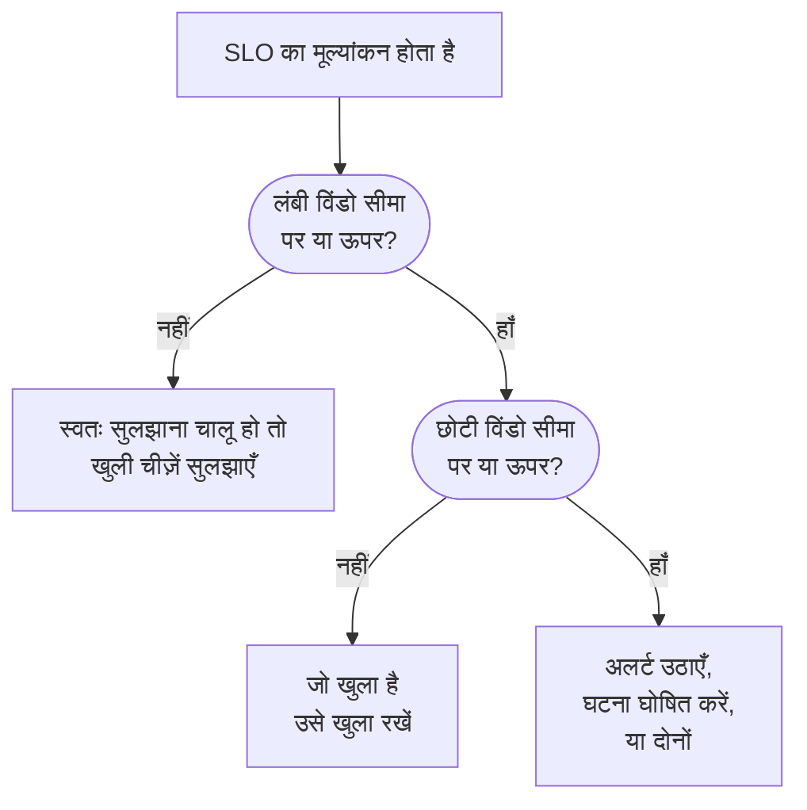

# बर्न रेट अलर्ट और घटनाएँ

एरर बजट बताते हैं कि आप कहाँ खड़े हैं; बर्न रेट नियम बताते हैं कि कब बिस्तर से उठना है। जब कोई SLO अपना एरर बजट इतनी तेज़ी से खर्च करता है कि फ़र्क पड़े, तो बर्न रेट नियम अलर्ट उठाता है, घटना घोषित करता है या दोनों करता है, आपके अपने शीर्षक और विवरण, गंभीरता, स्वामियों, लेबल, ऑन-कॉल एस्केलेशन और वर्कस्पेस सूचनाओं के साथ।

:::cards
- [नियम कैसे तय करता है](#नियम-कैसे-तय-करता-है-कि-ट्रिगर-हो): दो विंडो, दोनों सीमा से ऊपर।
- [डिफ़ॉल्ट नियम](#डिफ़ॉल्ट-नियम): Fast burn और Slow burn, SLO की विंडो के अनुसार।
- [नियम बनाएँ](#नियम-बनाएँ-या-संपादित-करें): SLO के Burn Rate Rules पेज पर पाँच चरण।
- [टेम्पलेट वेरिएबल](#हर-अलर्ट-और-घटना-क्या-कहती-है): अपने शीर्षक और विवरण लिखें।
:::

## बर्न रेट का अर्थ

बर्न रेट बताता है कि एक समान गति की तुलना में आप एरर बजट कितनी तेज़ी से खर्च कर रहे हैं:

```text
burn rate = (share of time that was bad) ÷ (share of time the target allows to be bad)
```

बर्न रेट 1 होने पर आप बजट ठीक पूरी विंडो में खर्च करते हैं और कुछ बचाए बिना लक्ष्य पूरा करते हैं। ऊँची संख्याएँ इसे जल्दी खत्म करती हैं। 30 दिनों में 99.9% वाले SLO के लिए:

| बर्न रेट, अगर बना रहे | बजट खत्म होने में |
| --- | --- |
| 1 | 30 दिन |
| 2 | 15 दिन |
| 6 | 5 दिन |
| 14.4 | लगभग 2 दिन (50 घंटे) |

बर्न रेट इस पर निर्भर नहीं करता कि कितना बजट बचा है। यह बताता है कि "अभी हालत कितनी खराब है?", और किसी को बुलाने का फ़ैसला करने के लिए यही जानना ज़रूरी है।

## नियम कैसे तय करता है कि ट्रिगर हो

OneUptime हर सक्षम बर्न रेट नियम को SLO के हर मूल्यांकन पर, हर 5 मिनट में, जाँचता है। हर नियम दो विंडो पर बर्न रेट मापता है और तभी ट्रिगर होता है जब दोनों उसकी सीमा पर या उससे ऊपर हों:

- **लंबी विंडो** (जैसे 1 घंटा) दिखाती है कि खर्च लगातार और महत्वपूर्ण है, कोई एक विफल जाँच नहीं।
- **छोटी विंडो** (जैसे 5 मिनट) दिखाती है कि यह अब भी हो रहा है। इसके बिना एक घंटे पहले का उछाल ठीक होने के काफ़ी बाद तक अलर्ट करता रहता।

यह Google SRE Workbook का मल्टी-विंडो, मल्टी-बर्न-रेट पैटर्न है, और OneUptime इसे आपके लिए सेट करता है।



जब तक SLO के पास निगरानी इतिहास की एक पूरी लंबी विंडो न हो, नियम ट्रिगर नहीं हो सकता: वरना किसी मॉनिटर की सबसे पहली विफल जाँच को कुछ मिनटों के इतिहास से भाग देने पर बहुत बड़ा बर्न रेट आता। इसलिए नया SLO पहले घंटे में अपना **Fast burn** नियम ट्रिगर नहीं कर सकता, और पहले छह घंटों में अपना **Slow burn** नियम। अगर बाद में SLO के पास उतना इतिहास न रहे, जैसे उसके मॉनिटर नए मॉनिटर से बदले जाने के बाद, तो नियम जो खोला था उसे लटकाए रखने के बजाय सुलझा देता है। जब SLO का कोई मॉनिटर निर्धारित रखरखाव में हो, तब भी नियम ट्रिगर नहीं होता: [निर्धारित रखरखाव](#निर्धारित-रखरखाव) देखें।

## डिफ़ॉल्ट नियम

हर नए SLO को दो बर्न रेट नियम मिलते हैं। 30-दिन की विंडो के लिए:

| नियम | सीमा | लंबी विंडो | छोटी विंडो | कब ट्रिगर होता है |
| --- | --- | --- | --- | --- |
| **Fast burn** | 14.4× | 1 घंटा | 5 मिनट | बजट का लगभग 2% एक घंटे में खर्च होता है: यह लगभग 2 दिनों में खत्म हो जाएगा। |
| **Slow burn** | 6× | 6 घंटे | 30 मिनट | बजट का लगभग 5% छह घंटों में खर्च होता है: यह लगभग 5 दिनों में खत्म हो जाएगा। |

14.4× और 6× की सीमाएँ 30-दिन के बजट के लिए निकाली गई हैं, इसलिए OneUptime उन्हें आपके SLO की विंडो के अनुसार ढालता है। हर नियम का अर्थ हमेशा "1 घंटे में बजट का 2%" या "6 घंटों में बजट का 5%" होता है:

| SLO की विंडो | Fast burn सीमा | Slow burn सीमा |
| --- | --- | --- |
| 7 दिन | 3.36× | 1.4× |
| 28 दिन | 13.44× | 5.6× |
| 30 दिन | 14.4× | 6× |
| 90 दिन | 43.2× | 18× |

कैलेंडर-महीने वाले SLO को 30-दिन के मान मिलते हैं। दोनों नियम प्रोजेक्ट की सबसे ऊँची अलर्ट गंभीरता के साथ, डिफ़ॉल्ट शीर्षक और विवरण के साथ अलर्ट उठाते हैं, उसे अपने आप सुलझाते हैं, और कोई स्वामी या लेबल नहीं जोड़ते। वे घटनाएँ घोषित नहीं करते, इसलिए OneUptime अपग्रेड करने से आपके लिए घटनाएँ घोषित होना कभी शुरू नहीं होता। उन्हें संपादित करें, हटाएँ, या अपने नियम जोड़ें।

## नियम बनाएँ या संपादित करें

आपको SLO बर्न रेट नियम बनाने की अनुमति चाहिए।

:::steps
### Burn Rate Rules खोलें

SLO खोलें, **Burn Rate Rules** पर जाएँ और **SLO Burn Rate Rule बनाएँ** पर क्लिक करें, या किसी डिफ़ॉल्ट नियम को संपादित करें।

### नियम को नाम दें

**Rule** में एक **नाम** दर्ज करें, जैसे "Fast burn"। **सक्षम** चालू है।

### बर्न विंडो सेट करें

**Burn Window** में **Burn Rate Threshold** (जैसे `14.4`), **Long Window (Minutes)** और **Short Window (Minutes)** सेट करें, और चाहें तो **Re-fire Suppression (Minutes)** भी।

### चुनें कि यह क्या घोषित करता है

**What It Declares** में **अलर्ट बनाएं**, **घटना घोषित करें** या दोनों चालू करें। **Add SLO Owners as Owners** SLO के स्वामियों को भी नियम द्वारा बनाई गई हर चीज़ का स्वामी बनाता है।

### अलर्ट और घटना का वर्णन करें

**अलर्ट** और **घटना** चरण केवल उसी के लिए दिखते हैं जो नियम घोषित करता है। हर एक में शीर्षक और गंभीरता होती है, और मुड़े हुए सेक्शन: **विवरण**, **स्वामित्व और लेबल**, **ऑन-कॉल** और **और फ़ील्ड**, जिसमें स्वतः सुलझाना, गोपनीयता और सुधार नोट हैं। नए नियम डिफ़ॉल्ट शीर्षक और विवरण से शुरू होते हैं, संपादन के लिए तैयार। आख़िरी चरण पर **SLO Burn Rate Rule बनाएँ** पर क्लिक करें।
:::

सहेजते समय OneUptime नियम की संख्याएँ जाँचता है:

| सेटिंग | यह होनी चाहिए |
| --- | --- |
| **Burn Rate Threshold** | 0 से अधिक। |
| **Short Window (Minutes)** | 0 से अधिक। |
| **Long Window (Minutes)** | छोटी विंडो से लंबी। |
| **Re-fire Suppression (Minutes)** | 0 या अधिक। खाली का अर्थ है लंबी विंडो की अवधि। |

नियम को अलर्ट बनाना, घटना घोषित करना या दोनों करना चाहिए: दोनों बंद वाला नियम अस्वीकार किया जाता है, क्योंकि उसे हर मूल्यांकन पर जाँचा जाएगा पर वह कभी कुछ घोषित नहीं करेगा।

नियम तालिका हर नियम की सीमा, विंडो और सप्रेशन, वह क्या घोषित करता है (और अलर्ट या घटना केवल हाथ से सुलझती है या निजी है), गंभीरताएँ, ऑन-कॉल नीतियाँ, स्वामी और लेबल दिखाती है।

> [!TIP]
> एक अच्छी शुरुआत: दोनों डिफ़ॉल्ट नियम रखें, तेज़ बर्न नियम को उच्च गंभीरता के साथ उस ऑन-कॉल नीति पर भेजें जो लोगों को बुलाती है, और धीमे बर्न नियम को कामकाजी घंटों के लिए कम गंभीरता का अलर्ट उठाने दें। अगर आपकी टीम घटनाओं के ज़रिए काम करती है, तो तेज़ बर्न नियम पर **घटना घोषित करें** चालू करें, और अगर दोनों नहीं चाहिए तो वहाँ **अलर्ट बनाएं** बंद करें।

## नियम क्या घोषित करता है

|  | **अलर्ट बनाएं** | **घटना घोषित करें** |
| --- | --- | --- |
| शुरुआत में | चालू | बंद |
| यह क्या है | हल्का संकेत: अलर्ट सूची में जाता है। | भारी संकेत: घटना संख्या पाता है और पूरा प्रतिक्रिया वर्कफ़्लो शुरू करता है। |
| शीर्षक और विवरण | अपने, या डिफ़ॉल्ट टेक्स्ट | अपने, या डिफ़ॉल्ट टेक्स्ट |
| गंभीरता | **अलर्ट गंभीरता**: खाली होने पर प्रोजेक्ट की सबसे ऊँची | **घटना गंभीरता**: खाली होने पर प्रोजेक्ट की सबसे ऊँची |
| एस्केलेशन | **Alert On-Call Duty Policies** | **Incident On-Call Duty Policies** |
| स्वामी और लेबल | **अलर्ट के स्वामी** और **अलर्ट लेबल** | **घटना के स्वामी** और **घटना लेबल** |
| निजी | बंद | बंद |
| स्वतः सुलझाना | चालू | चालू |
| स्टेटस पेज | कभी प्रकाशित नहीं | कभी प्रकाशित नहीं |

क्योंकि हर एक अलग से सेट होता है, आप ज़िम्मेदार टीम के रोटेशन को एक छोटा अलर्ट और अपने बड़ी-घटना रोटेशन को एक विस्तृत घटना भेज सकते हैं। वे अलग-अलग भी चलते हैं: हर एक अपने आप में डीडुप्लिकेट, सुलझाया और सप्रेस होता है, इसलिए घटना सुलझाने से अलर्ट का सप्रेशन रीसेट नहीं होता, और इसका उल्टा भी नहीं।

### SLO एक प्रभावित संसाधन है

बर्न रेट नियम द्वारा बनाया गया हर अलर्ट और घटना अपने SLO को **प्रभावित संसाधन** के अंतर्गत सूचीबद्ध करता है और उसका लिंक देता है। अलर्ट और घटनाओं की सूचियों का **प्रभावित संसाधन** फ़िल्टर उन्हें एक SLO तक सीमित करता है, और SLO के **अलर्ट** और **घटनाएं** पेज उन्हें सूचीबद्ध करते हैं, साइड मेनू के बैज खुले आइटम गिनते हैं। OneUptime यह जुड़ाव ख़ुद बनाता है, और अलर्ट या घटना संपादित करने से यह कभी नहीं हटता।

### बर्न रेट घटनाएँ आंतरिक रहती हैं

तेज़ी से खर्च होता एरर बजट इंजीनियरिंग के लिए एक संकेत है, कोई घोषित आउटेज नहीं। बर्न रेट घटना कभी स्टेटस पेज पर नहीं दिखती और कभी स्टेटस पेज सब्सक्राइबरों को सूचित नहीं करती। यह किसी मॉनिटर से भी नहीं जुड़ती, क्योंकि ऐसा होने पर इसे सुलझाना उन्हीं मॉनिटर के स्थिति इतिहास को फिर से लिख देता जिससे SLO मापा जाता है।

अगर आप ऐसी घटना हाथ से सुलझाते हैं, तो जब तक खर्च ठीक न हो जाए और नियम सच में फिर से ट्रिगर न हो, कुछ भी उसे फिर से घोषित नहीं करता, इसलिए किसी घटना पर काम करते समय आपको नियम से कभी नहीं जूझना पड़ता।

## हर अलर्ट और घटना क्या कहती है

नए नियम अलर्ट और घटना दोनों पर डिफ़ॉल्ट शीर्षक और विवरण से शुरू होते हैं। डिफ़ॉल्ट टेक्स्ट पर लौटने के लिए शीर्षक या विवरण खाली करें। डिफ़ॉल्ट शीर्षक है:

```text
SLO burn rate: {{sloName}} — {{ruleName}}
```

डिफ़ॉल्ट विवरण नियम का नाम, सीमा के मुकाबले दोनों विंडो का बर्न रेट, और बचा हुआ एरर बजट बताता है।

अपना टेक्स्ट लिखने के लिए शीर्षक, विवरण और सुधार नोट में टेम्पलेट वेरिएबल का उपयोग करें। इनमें से हर फ़ील्ड उन्हें **टेम्पलेट वेरिएबल** के अंतर्गत सूचीबद्ध करता है: कर्सर पर डालने के लिए किसी पर क्लिक करें, या फ़ील्ड में `{{` टाइप करके एक चुनें। विवरण और सुधार नोट के टूलबार में **वेरिएबल डालें** भी है। नियम ट्रिगर होने पर वेरिएबल भरे जाते हैं:

| वेरिएबल | इसमें क्या है | उदाहरण |
| --- | --- | --- |
| `{{sloName}}` | SLO का नाम। | `Checkout availability` |
| `{{sloId}}` | SLO की ID। | `b7f4c2d8-1f3e-4a5b-9c6d-7e8f9a0b1c2d` |
| `{{sloLink}}` | OneUptime डैशबोर्ड में SLO का लिंक। | `https://oneuptime.com/dashboard/project-id/slos/slo-id` |
| `{{sloStatus}}` | इस मूल्यांकन के बाद SLO की स्थिति। | `At Risk` |
| `{{ruleName}}` | ट्रिगर हुए बर्न रेट नियम का नाम। | `Fast burn` |
| `{{burnRateThreshold}}` | नियम की बर्न रेट सीमा (टिकाऊ गति का गुणक)। | `14.4` |
| `{{longWindowBurnRate}}` | नियम की लंबी विंडो पर मापा गया बर्न रेट। | `21.5` |
| `{{shortWindowBurnRate}}` | नियम की छोटी विंडो पर मापा गया बर्न रेट। | `36` |
| `{{longWindowInMinutes}}` | नियम की लंबी विंडो की अवधि, मिनटों में। | `60` |
| `{{shortWindowInMinutes}}` | नियम की छोटी विंडो की अवधि, मिनटों में। | `5` |
| `{{targetPercentage}}` | SLO का लक्ष्य, प्रतिशत में। | `99.9` |
| `{{currentSliPercentage}}` | SLO की अनुपालन विंडो पर मापा गया SLI, प्रतिशत में। | `99.87` |
| `{{errorBudgetRemainingPercentage}}` | अभी उपलब्ध एरर बजट का हिस्सा, प्रतिशत में। बजट से अधिक खर्च होने पर ऋणात्मक। | `42.5` |
| `{{errorBudgetRemaining}}` | अभी उपलब्ध एरर बजट, अवधि के रूप में। बजट से अधिक खर्च होने पर ऋण चिह्न से शुरू होता है। | `18m 22s` |
| `{{errorBudgetRemainingMinutes}}` | अभी उपलब्ध एरर बजट, मिनटों में। | `18.37` |
| `{{windowDescription}}` | SLO की अनुपालन विंडो, शब्दों में। | `rolling 30-day window` |

उदाहरण के लिए, शीर्षक `{{ruleName}}: {{sloName}} is burning {{longWindowBurnRate}}x` बन जाता है `Fast burn: Checkout availability is burning 21.5x`।

:::details वेरिएबल कैसे भरे जाते हैं
- संख्याएँ दो दशमलव स्थानों तक पूर्णांकित होती हैं।
- घुंघराले कोष्ठकों के अंदर स्पेस ठीक है: `{{ sloName }}` काम करता है।
- गलत लिखा वेरिएबल जैसा है वैसा ही रहता है, ताकि टाइपो चुपचाप गायब होने के बजाय अलर्ट में दिखे।
- शीर्षक 500 अक्षरों तक, और विवरण व सुधार नोट 50,000 अक्षरों तक हो सकते हैं। वेरिएबल भरने के बाद 500 अक्षरों से लंबा शीर्षक एक पंक्ति में लाकर इलिप्सिस से छोटा किया जाता है, ताकि अलर्ट या घटना फिर भी बने।
- अगर नियम ट्रिगर होने पर SLO का लिंक नहीं बन पाता, तो `{{sloLink}}` खाली रहता है और अलर्ट या घटना फिर भी बनती है।
:::

## स्वामी, लेबल और गोपनीयता

- **अलर्ट के स्वामी** और **घटना के स्वामी** लोग और टीमें हैं, जिन्हें **स्वामी जोड़ें** से एक ही सूची से चुना जाता है। अलर्ट या घटना बनते ही वे जोड़े जाते हैं, और उन्हें सूचना मिलती है। लोगों का प्रोजेक्ट का सदस्य होना ज़रूरी है।
- **Add SLO Owners as Owners** SLO के स्वामियों, यानी उसके स्वामी उपयोगकर्ताओं और उसकी स्वामी टीमों के सदस्यों, को भी नियम द्वारा बनाई गई हर चीज़ में जोड़ता है। SLO के स्वामियों को SLO की अपनी स्थिति में बदलाव की जानकारी पहले से मिलती है, इसलिए इससे उन्हें दो बार सूचना मिल सकती है। यह डिफ़ॉल्ट रूप से बंद है।
- हर स्वामी एक बार जोड़ा जाता है: जो उपयोगकर्ता पहले से अलर्ट या घटना का स्वामी है, जैसे प्रोजेक्ट के स्वामी नियमों के ज़रिए, या किसी जोड़ी गई स्वामी टीम में है, उसे फिर से नहीं जोड़ा जाता।
- **अलर्ट लेबल** और **घटना लेबल** अलर्ट या घटना में जोड़े जाते हैं, ताकि फ़िल्टर, स्वामी नियम और वर्कस्पेस सूचना नियम उन पर मिलान कर सकें।
- निजी अलर्ट या घटना केवल उसके स्वामियों, प्रोजेक्ट एडमिन और प्रोजेक्ट स्वामियों को दिखती है।

लेबल, स्वामी टीमें और ऑन-कॉल नीतियाँ SLO के प्रोजेक्ट की होनी चाहिए।

## सुलझाना और दोबारा ट्रिगर होने से रोकना

- **सुलझाना लंबी विंडो के साथ चलता है।** स्वतः सुलझाना चालू होने पर (डिफ़ॉल्ट), जैसे ही लंबी विंडो का बर्न रेट सीमा से नीचे जाता है, OneUptime नियम का अलर्ट और घटना सुलझा देता है। छोटी विंडो पर सुलझाने से बार-बार बदलाव होता: रुक-रुककर होने वाला आउटेज पाँच शांत मिनटों के बाद सुलझ जाता और रात भर लोगों को फिर बुलाता।
- **स्वतः सुलझाना बंद।** **अलर्ट स्वतः सुलझाएं** या **घटना स्वतः सुलझाएं** बंद करें, तो वह रिकॉर्ड तब तक खुला रहता है जब तक कोई उसे सुलझा न दे, खर्च ठीक हो जाने के बाद भी। नियम उसके ऊपर दूसरा नहीं खोलता, और एक बार हाथ से सुलझ जाने और लंबी विंडो के सीमा से नीचे होने पर नियम अपने सप्रेशन के बाद फिर ट्रिगर हो सकता है।
- **दोबारा ट्रिगर होने से रोकना।** किसी रिकॉर्ड के सुलझने के बाद नियम सप्रेशन अवधि तक, डिफ़ॉल्ट रूप से लंबी विंडो की अवधि, उस तरह का रिकॉर्ड फिर घोषित नहीं करता। इससे ठीक हो रहे सिस्टम को बचे हुए शोर पर किसी को बुलाए बिना ठीक होने का समय मिलता है।

कुछ बदलाव हमेशा वह सुलझा देते हैं जो किसी नियम ने खोला था, उसकी स्वतः सुलझाने की सेटिंग्स चाहे जो कहें, ताकि कोई चीज़ ऐसे नियम के लिए एस्केलेट न होती रहे जो अब उसे सही नहीं ठहरा सकता:

- **अलर्ट बनाएं** या **घटना घोषित करें** बंद करने से उस आउटपुट का खोला हुआ बंद हो जाता है;
- नियम को बंद करना या हटाना;
- SLO का मूल्यांकन बंद करना, SLO संग्रहीत करना या उसे हटाना;
- SLO का **रोका गया** या **Misconfigured** हो जाना, क्योंकि तब वह कुछ नहीं मापता;
- नियम का अपनी सीमा या विंडो खो देना, या SLO के पास इतिहास की पूरी लंबी विंडो न रहना।

## निर्धारित रखरखाव

जब SLO का कोई मॉनिटर चल रहे निर्धारित रखरखाव इवेंट में हो, तब उसके बर्न रेट नियम न अलर्ट उठाते हैं न घटनाएँ घोषित करते हैं: योजनाबद्ध काम पर किसी को नहीं बुलाया जाना चाहिए। नियमों ने जो पहले से खोला है, वह सामान्य रूप से सुलझता है। यह समय SLO की डाउनटाइम स्थितियों के अनुसार फिर भी एरर बजट में गिना जाता है।

## SLO की फ़ीड

SLO की **Feed** नियम द्वारा उठाया गया हर अलर्ट और घोषित की गई हर घटना, लिंक और उसे समझाने वाले बर्न रेट के साथ प्रकाशित करती है, और यह भी कि हर एक कब सुलझा, अपने आप या हाथ से। जो रिकॉर्ड नियम फिर से उठाता है क्योंकि वह अब भी खुला था, वह दो बार प्रकाशित नहीं होता। नियम बनाना, संपादित करना और हटाना भी प्रकाशित होता है, और SLO के **ऑडिट लॉग** में दर्ज होता है। [SLO फ़ीड और ऑडिट लॉग](/docs/slo/feed-and-audit-logs) देखें।

## समस्या निवारण

:::details SLO बनने के ठीक बाद नियम ट्रिगर नहीं हुआ
नियम तभी ट्रिगर होता है जब SLO के पास निगरानी इतिहास की एक पूरी लंबी विंडो हो: डिफ़ॉल्ट तेज़ बर्न नियम के लिए एक घंटा, धीमे बर्न नियम के लिए छह घंटे।
:::

:::details आउटेज जारी रहते हुए अलर्ट सुलझ गया
स्वतः सुलझाना लंबी विंडो के साथ चलता है: जैसे ही लंबी विंडो का बर्न रेट सीमा से नीचे जाता है, अलर्ट सुलझ जाता है। नियम को लंबी विंडो लंबी दें, या **अलर्ट स्वतः सुलझाएं** बंद करें और अलर्ट हाथ से सुलझाएँ।
:::

:::details निर्धारित रखरखाव के दौरान कुछ भी ट्रिगर नहीं हुआ
जब SLO का कोई मॉनिटर चल रहे निर्धारित रखरखाव इवेंट में हो, तब बर्न रेट नियम शांत रहते हैं। डाउनटाइम फिर भी बजट में गिना जाता है।
:::

:::details क्या न्यूनतम सैंपल संख्या है?
मॉनिटर उपलब्धता से मापे जाने वाले SLO के लिए नहीं। उपलब्धता सेकंड में मापी जाती है, इसलिए विंडो का हर सेकंड एक सैंपल है और कम ट्रैफ़िक वाले मामले से बचाव की ज़रूरत नहीं है। न्यूनतम सैंपल संख्या केवल इवेंट-आधारित SLI के लिए मायने रखती है, जो अभी उपलब्ध नहीं हैं।
:::

## आगे के कदम

:::cards
- [एरर बजट](/docs/slo/error-budget): बजट क्या है और यह कितना चलता है।
- [एस्केलेशन नियम](/docs/on-call/escalation-rules): किसे बुलाया जाता है, और किस क्रम में।
- [SLO फ़ीड और ऑडिट लॉग](/docs/slo/feed-and-audit-logs): नियम द्वारा उठाया गया हर अलर्ट और घटना।
:::
