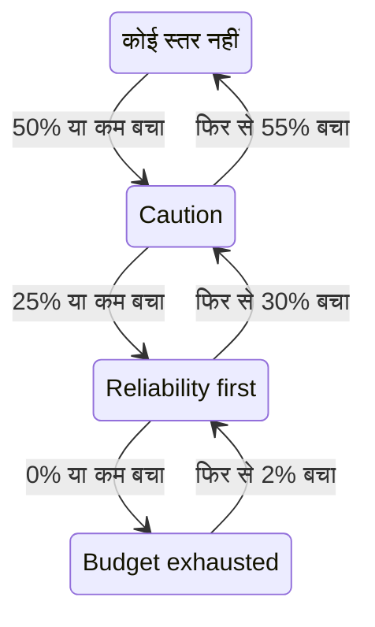

# एरर बजट नीति

एरर बजट नीति यह लिखती है कि किसी SLO का एरर बजट घटने के दौरान आपकी टीम ने क्या करना तय किया है, जैसे आधा बजट खर्च होने पर जोखिम भरे बदलावों की समीक्षा करना, या पूरा खर्च होने पर रिलीज़ रोक देना। OneUptime SLO को नीति के उस स्तर में रखता है जहाँ तक उसका बजट पहुँचा है, उस स्तर के लिए टीम का समझौता SLO के पेजों पर दिखाता है, SLO के किसी स्तर में जाने पर अलर्ट उठा सकता है या घटना घोषित कर सकता है, हर स्तर बदलाव को आपके चुने हुए Slack, Microsoft Teams या Mattermost चैनलों पर पोस्ट करता है, और आपकी CI/CD पाइपलाइनों को बताता है कि रिलीज़ रोककर रखनी हैं या नहीं। यह [Google SRE Workbook](https://sre.google/workbook/error-budget-policy/) की एरर बजट नीति वाली कार्यप्रणाली है।

:::cards
- [स्तर कैसे काम करते हैं](#स्तर-कैसे-काम-करते-हैं): कौन-सा स्तर लागू होता है, और SLO उसे कब छोड़ता है।
- [नीति सेट करें](#नीति-सेट-करें): सुझाई गई नीति से शुरू करें, या अपने स्तर लिखें।
- [अलर्ट और घटनाएँ](#अलर्ट-और-घटनाएँ): SLO के किसी स्तर में जाने पर अपनी टीम को सूचित करें।
- [Slack, Microsoft Teams और Mattermost पर पोस्ट करें](#slack-microsoft-teams-और-mattermost-पर-पोस्ट-करें): SLO के किसी स्तर में जाने पर किसी चैनल को बताएँ, किसी को पेज किए बिना।
- [डिप्लॉयमेंट गेट](#डिप्लॉयमेंट-गेट): जब तक कोई स्तर डिप्लॉयमेंट फ़्रीज़ करता है, CI/CD से रिलीज़ रोककर रखें।
- [API से स्तर पढ़ें](#api-से-स्तर-पढ़ें): CI और स्क्रिप्ट से स्तर जाँचें।
:::

## स्तर कैसे काम करते हैं

नीति स्तरों का एक समूह है। हर स्तर में तीन फ़ील्ड होते हैं:

| फ़ील्ड | इसमें क्या होता है |
| --- | --- |
| **नाम** | टीम स्तर को क्या कहती है, जैसे "Reliability first"। |
| **बचे बजट की सीमा (%)** | बचे एरर बजट का वह हिस्सा जिस पर या जिससे नीचे स्तर लागू होता है। 0 से 100 तक, दशमलव की अनुमति है। किसी SLO के हर स्तर की अपनी अलग सीमा होती है। |
| **हम क्या करते हैं** | SLO के उस स्तर में रहने के दौरान टीम ने क्या करना तय किया है, Markdown में। ज़रूरी, 10,000 अक्षरों तक। |

कोई स्तर तब तक लागू रहता है जब तक बचा बजट उसकी सीमा पर या उससे नीचे है, इसलिए 0% वाला स्तर समाप्त बजट का स्तर है। जब कई स्तर लागू होते हैं, तो SLO सबसे कम सीमा वाले स्तर में होता है: सबसे गंभीर में। जब कोई लागू नहीं होता, तो SLO किसी स्तर में नहीं होता। 50%, 25% और 0% वाले स्तरों के साथ, जिस SLO का 30% बजट बचा है वह 50% वाले स्तर में है, और जिसका 10% बचा है वह 25% वाले स्तर में।

कोई स्तर, SLO के उसमें रहने के दौरान, डिप्लॉयमेंट फ़्रीज़ भी कर सकता है: देखें [डिप्लॉयमेंट गेट](#डिप्लॉयमेंट-गेट)।

### किसी स्तर में जाना और उसे छोड़ना

स्तर बचे बजट के पीछे वैसे ही चलता है जैसे SLO की स्थिति:

- किसी स्तर में जाना तुरंत होता है: जो मूल्यांकन बजट को किसी स्तर की सीमा पर या उससे नीचे पाता है, वही SLO को उस स्तर में रख देता है। जो बजट एक साथ कई सीमाओं से नीचे गिरता है, वह सीधे सबसे गंभीर स्तर में जाता है।
- किसी स्तर को छोड़कर कम गंभीर स्तर में जाने के लिए बजट के साफ़ तौर पर लौटने तक इंतज़ार होता है। 0% वाला स्तर तब छूटता है जब बजट का 2% फिर से बच जाता है। कोई भी दूसरा स्तर तब छूटता है जब बजट उसकी सीमा से 5 अंक ऊपर होता है।

इसलिए 0% वाला स्तर **बजट समाप्त** स्थिति के साथ बदलता है, और SLO की जोखिम-स्तर सीमा वाला स्तर **जोखिम में** के साथ: देखें [स्थिति में बदलाव और जोखिम-स्तर सीमा](/docs/slo/error-budget#स्थिति-में-बदलाव-और-जोखिम-स्तर-सीमा)। किसी सीमा के आसपास डोलती रोलिंग विंडो स्तर को आगे-पीछे नहीं करती।



## नीति सेट करें

आपको SLO एरर बजट नीति के स्तर बनाने की अनुमति चाहिए।

:::steps
### एरर बजट नीति खोलें

SLO खोलें और उसके साइड मेन्यू के **नियम** सेक्शन में **एरर बजट नीति** पर जाएँ। पेज SLO के स्तर दिखाता है, हर एक के नाम, जिस बचे बजट पर वह लागू होता है, और टीम क्या करती है, के साथ।

### सुझाई गई नीति से शुरू करें

जब तक SLO में कोई स्तर नहीं होता, पेज **सुझाई गई नीति इस्तेमाल करें** देता है। उस पर क्लिक करें, उसमें दिखाए गए तीन स्तर जाँचें, और पुष्टि करें। फिर हर स्तर के शब्दों को अपनी टीम के समझौते के अनुसार बदलें।

### या ख़ुद स्तर जोड़ें

**SLO एरर बजट नीति स्तर बनाएँ** पर क्लिक करें। एक **नाम** और एक **बचे बजट की सीमा (%)** डालें, और **हम क्या करते हैं** में टीम का समझौता लिखें। अगर SLO के उस स्तर में रहने के दौरान पाइपलाइनों को रिलीज़ रोककर रखनी चाहिए, तो **डिप्लॉयमेंट फ़्रीज़ करें** चालू करें।

### चुनें कि स्तर क्या उठाता है

स्तर समझौते को दर्ज करता है और दिखाता है। SLO के उसमें जाने पर किसी को सूचित भी करने के लिए, मुड़ी हुई अलर्ट और घटना सेटिंग्स खोलें और अलर्ट, घटना या दोनों चालू करें। दोनों डिफ़ॉल्ट रूप से बंद हैं। देखें [अलर्ट और घटनाएँ](#अलर्ट-और-घटनाएँ)।
:::

किसी स्तर को जोड़ना, संपादित करना या हटाना तुरंत लागू होता है: OneUptime लगभग एक मिनट के भीतर SLO का फिर से मूल्यांकन करता है। अगर बजट पहले से किसी स्तर की सीमा पर या उससे नीचे है, तो SLO तब उस स्तर में आ जाता है, और स्तर वह उठाता है जो उसे उठाने के लिए सेट किया गया है। किसी स्तर को बंद करना या हटाना उसके उठाए गए को हल करता है, और SLO उस स्तर में चला जाता है जिसमें उसका बजट है। किसी स्तर का अलर्ट या घटना बंद करना वह अलर्ट या घटना हल करता है।

### सुझाई गई नीति

**सुझाई गई नीति इस्तेमाल करें** बजट के आधे, एक चौथाई और शून्य पर तीन स्तर, इस अंग्रेज़ी पाठ के साथ, जोड़ता है:

| स्तर | कब लागू होता है | टीम क्या करती है | डिप्लॉयमेंट |
| --- | --- | --- | --- |
| **Caution** | 50% या कम बचा | Half of the error budget is spent. Review risky changes before they ship, and find out what has been spending the budget. | अनुमति है |
| **Reliability first** | 25% या कम बचा | Reliability comes first. Only reliability improvements and critical fixes ship until the budget recovers. | अनुमति है |
| **Budget exhausted** | 0% या कम बचा | The error budget is spent. Freeze non-critical releases: only fixes for this SLO's reliability and security fixes ship until the budget is back. | फ़्रीज़ |

जब तक आप चालू न करें, इनमें से कोई भी अलर्ट नहीं उठाता या घटना घोषित नहीं करता। **Budget exhausted** डिप्लॉयमेंट फ़्रीज़ करता है, जैसा उसका समझौता कहता है, और पुष्टि वाली विंडो उसे ऐसा ही चिह्नित करती है: देखें [डिप्लॉयमेंट गेट](#डिप्लॉयमेंट-गेट)। गेट आने से पहले जोड़े गए स्तर तब तक कुछ भी फ़्रीज़ नहीं करते, जब तक आप उनके लिए यह स्विच चालू न करें। केवल वे स्तर जोड़े जाते हैं जो SLO में नहीं हैं: उसी नाम वाला, या उसी सीमा वाला स्तर मौजूद माना जाता है, चाहे वह चालू हो या बंद। इसलिए इसे दो बार माँगने पर, दूसरे टैब से या API से, कुछ भी दो बार नहीं जुड़ता। अगर कोई एक स्तर नहीं जोड़ा जा सकता, तो कोई भी स्तर नहीं जुड़ता: SLO पहले जैसा ही रहता है, और आप फिर से कोशिश कर सकते हैं। इस तरह जोड़ा गया हर स्तर SLO के ऑडिट लॉग में आपके द्वारा जोड़ा गया दर्ज होता है।

## स्तर कहाँ दिखता है

- SLO का **अवलोकन** वह स्तर दिखाता है जिसमें SLO है और उसमें टीम ने क्या करना तय किया है, ताकि SLO खोलने वाला हर व्यक्ति अभी लागू समझौता देखे। जब तक स्तर डिप्लॉयमेंट फ़्रीज़ करता है, उसके नाम के नीचे एक लाल बैज बताता है कि कब से।
- **त्रुटि बजट बर्न-डाउन** चार्ट जोखिम-स्तर सीमा की रेखा के साथ हर स्तर की सीमा पर लेबल वाली एक रेखा खींचता है।
- SLO का **फ़ीड** हर स्तर बदलाव पोस्ट करता है: SLO ने जो स्तर छोड़ा और जिसमें गया, बचा बजट, नए स्तर में टीम ने क्या करना तय किया है, और यह कि बदलाव ने डिप्लॉयमेंट फ़्रीज़ किए या उन्हें फिर से अनुमति दी।
- आपके नियमों में बताए गए Slack, Microsoft Teams और Mattermost चैनलों को भी यही पोस्ट मिलती है: देखें [Slack, Microsoft Teams और Mattermost पर पोस्ट करें](#slack-microsoft-teams-और-mattermost-पर-पोस्ट-करें)।
- SLO के **ऑडिट लॉग** हर स्तर बदलाव को, और हर बार डिप्लॉयमेंट के फ़्रीज़ होने या उन्हें फिर से अनुमति मिलने को, OneUptime द्वारा ख़ुद किए गए बदलाव के रूप में दर्ज करते हैं, इसलिए उसे केवल तब दिखाते हैं जब **सिस्टम इवेंट संग्रहित करें** चालू हो: देखें [ऑडिट लॉग चालू करें](/docs/slo/feed-and-audit-logs#ऑडिट-लॉग-चालू-करें)। किसी स्तर को जोड़ना, संपादित करना और हटाना उस व्यक्ति के नाम से दर्ज होता है जिसने यह किया।
- SLO का पढ़ने वाला API स्तर लौटाता है, और यह भी कि डिप्लॉयमेंट की अनुमति है या नहीं: देखें [API से स्तर पढ़ें](#api-से-स्तर-पढ़ें) और [डिप्लॉयमेंट गेट](#डिप्लॉयमेंट-गेट)।

## अलर्ट और घटनाएँ

हर स्तर, SLO के उसमें जाने पर, अलर्ट उठा सकता है, घटना घोषित कर सकता है, या दोनों कर सकता है। इनके विकल्प बर्न रेट नियम के अलर्ट और घटना वाले ही हैं: गंभीरता, ऑन-कॉल नीतियाँ, शीर्षक, विवरण और सुधार नोट्स के टेम्पलेट, गोपनीयता, स्वतः-समाधान, लेबल, स्वामी टीमें और उपयोगकर्ता, और SLO के स्वामियों को स्वामी के रूप में जोड़ना। देखें [नियम क्या घोषित करता है](/docs/slo/burn-rate-alerts#नियम-क्या-घोषित-करता-है)। दोनों डिफ़ॉल्ट रूप से बंद हैं, इसलिए जब तक आप इनमें से कोई चालू न करें, स्तर किसी को सूचित नहीं करता।

- किसी अधिक गंभीर स्तर में जाना पिछले स्तर के उठाए गए को हल करता है, उसकी स्वतः-समाधान सेटिंग चाहे जो हो, क्योंकि नया स्तर उसकी जगह ले लेता है। इसलिए एक समय पर अधिकतम एक स्तर का अलर्ट और घटना खुले रहते हैं, और वे उस स्तर के होते हैं जिसमें SLO है।
- किसी कम गंभीर स्तर में या सभी स्तरों से बाहर लौटना उन्हें तब हल करता है जब स्तर का स्वतः-समाधान चालू हो, जैसा कि वह डिफ़ॉल्ट रूप से होता है। स्वतः-समाधान बंद होने पर वे तब तक खुले रहते हैं जब तक कोई उन्हें हल न करे।
- दोबारा ट्रिगर होने से रोकने की कोई व्यवस्था नहीं है। कोई स्तर तभी फिर से उठाता है जब SLO उसे साफ़ तौर पर छोड़कर फिर उसमें आए, इसलिए वह बार-बार नहीं बदलता। अगर SLO के उसी स्तर में रहते हुए कोई उसके उठाए गए को हाथ से हल कर दे, तो वह हल ही रहता है।
- जब तक SLO का कोई मॉनिटर निर्धारित रखरखाव में है, स्तर कुछ नहीं उठाते। स्तर ख़ुद फिर भी बदलता है, और जो खुला है वह हल होता रहता है। अगर रखरखाव ख़त्म होने पर SLO अब भी उसी स्तर में है, तो स्तर तब वह उठाता है जो उसे उठाने के लिए सेट किया गया है।

बर्न रेट नियम की तरह, किसी स्तर द्वारा उठाया गया अलर्ट या घटना SLO को **प्रभावित संसाधन** में दिखाता है, और कोई घटना कभी स्टेटस पेज पर नहीं दिखती। SLO का फ़ीड हर एक को, और उसके हल होने का समय, पोस्ट करता है।

### वे क्या कहते हैं

किसी स्तर का शीर्षक, विवरण और सुधार नोट्स टेम्पलेट वेरिएबल लेते हैं, जैसे किसी नियम के: देखें [हर अलर्ट और घटना क्या कहती है](/docs/slo/burn-rate-alerts#हर-अलर्ट-और-घटना-क्या-कहती-है)। किसी स्तर के फ़ील्ड SLO और उसके बजट के वेरिएबल, और स्तर के अपने तीन वेरिएबल देते हैं: `{{sloName}}`, `{{sloId}}`, `{{sloLink}}`, `{{sloStatus}}`, `{{policyTier}}`, `{{policyTierThresholdPercentage}}`, `{{policyTierWhatWeDo}}`, `{{targetPercentage}}`, `{{currentSliPercentage}}`, `{{errorBudgetRemainingPercentage}}`, `{{errorBudgetRemaining}}`, `{{errorBudgetRemainingMinutes}}` और `{{windowDescription}}`। किसी नियम के अपने वेरिएबल, जैसे `{{ruleName}}` और बर्न रेट, नहीं दिए जाते, और स्तर के टेम्पलेट में खाली रहते हैं।

स्तर के तीनों वेरिएबल बर्न रेट नियमों के टेम्पलेट में भी काम करते हैं:

| वेरिएबल | इसमें क्या होता है |
| --- | --- |
| `{{policyTier}}` | मूल्यांकन के बाद SLO जिस स्तर में है, उसका नाम, या किसी स्तर में न होने पर `None`। |
| `{{policyTierThresholdPercentage}}` | उस स्तर की सीमा, जैसे `25`। SLO किसी स्तर में न हो तो खाली। |
| `{{policyTierWhatWeDo}}` | उस स्तर में टीम ने क्या करना तय किया है। SLO किसी स्तर में न हो तो खाली। |

जिस स्तर का शीर्षक खाली छोड़ा गया है, वह अंतर्निहित शीर्षक इस्तेमाल करता है:

```text
SLO error budget policy: {{sloName}} — {{policyTier}}
```

अंतर्निहित विवरण स्तर का नाम बताता है, बचे बजट की तुलना स्तर की सीमा से करता है, और बताता है कि उस स्तर में टीम ने क्या करना तय किया है।

## Slack, Microsoft Teams और Mattermost पर पोस्ट करें

कोई नियम किसी SLO की एरर बजट नीति के हर बदलाव को उन Slack, Microsoft Teams या Mattermost चैनलों पर पोस्ट कर सकता है जिन्हें आपकी टीम पढ़ती है, किसी को पेज किए बिना: जब SLO किसी स्तर में जाता है, किसी कम गंभीर स्तर में लौटता है या हर स्तर से बाहर निकलता है, और जब उसके डिप्लॉयमेंट फ़्रीज़ होते हैं या उन्हें फिर से अनुमति मिलती है। हर नियम चुनता है कि वह किन SLO के कौन-से बदलाव पोस्ट करे। पहले वर्कस्पेस को प्रोजेक्ट से कनेक्ट करें: देखें [Slack](/docs/workspace-connections/slack), [Microsoft Teams](/docs/workspace-connections/microsoft-teams) या [Mattermost](/docs/workspace-connections/mattermost)।

:::steps
### SLOs मेन्यू का वर्कस्पेस सेक्शन खोलें

**SLOs** → **वर्कस्पेस** → **Slack**, या **Microsoft Teams**, या **Mattermost** पर जाएँ। **वर्कस्पेस** सेक्शन में केवल वे चैट वर्कस्पेस दिखते हैं जिन्हें आपके प्रोजेक्ट ने कनेक्ट किया है।

### नियम बनाएँ

**SLO सूचना नियम बनाएँ** पर क्लिक करें और उसे एक **नियम नाम** दें। **कौन-से SLO** के नीचे **सभी SLO** रहने दें, या **केवल शर्तों से मेल खाने वाले SLO** चुनें और शर्तें जोड़ें: देखें [नियम किससे मेल खाता है](#नियम-किससे-मेल-खाता-है)।

### चुनें कि यह कहाँ पोस्ट करे

**फिर, Slack में** के नीचे उन चैनलों के नाम लिखें जिनमें नियम पोस्ट करता है। Microsoft Teams में, कोई टीम और उसके चैनल चुनें, या वे चैट जिनमें OneUptime ऐप जोड़ा गया है। किसी SLO को अपना अलग चैनल नहीं मिलता, इसलिए नियम केवल उन्हीं चैनलों और चैट में पोस्ट करता है जो आपके पास पहले से हैं।
:::

संदेश बदलाव को SLO के **फ़ीड** के शब्दों में बताता है: SLO ने जो स्तर छोड़ा और जिसमें गया, डिप्लॉयमेंट में क्या बदला, बचा एरर बजट, नए स्तर की सीमा, और उस स्तर में टीम ने क्या करना तय किया है, ठीक वैसे ही जैसे टीम ने लिखा है। उस समझौते में कोई मेंशन, जैसे `<!channel>`, सादे पाठ के रूप में पोस्ट होता है और किसी को सूचित नहीं करता।

- हर बदलाव एक बार पोस्ट होता है, उसे लाने वाले मूल्यांकन के सहेजे जाने के बाद। जो मूल्यांकन सहेजा नहीं जाता, वह कुछ पोस्ट नहीं करता, और अगला मूल्यांकन वह बदलाव पोस्ट करता है।
- जब तक SLO अपने स्तर में रहता है, कुछ भी पोस्ट नहीं होता, चाहे बजट कितनी भी देर किसी सीमा के आसपास डोलता रहे: देखें [किसी स्तर में जाना और उसे छोड़ना](#किसी-स्तर-में-जाना-और-उसे-छोड़ना)।
- SLO जिस स्तर में है, उसके लिए **डिप्लॉयमेंट फ़्रीज़ करें** चालू या बंद करने पर एक अलग संदेश पोस्ट होता है।
- रोका गया, गलत कॉन्फ़िगर, अक्षम या संग्रहित SLO अपना स्तर बनाए रखता है, और कुछ पोस्ट नहीं करता।
- जो संदेश भेजा नहीं जा सकता, वह लॉग होता है, और मूल्यांकन, SLO का फ़ीड और स्तर जो उठाता है, वह सब उसके बिना चलता रहता है।

### नियम किससे मेल खाता है

| शर्त | यह किससे मेल खाती है |
| --- | --- |
| **SLOs** | आपके चुने हुए SLO, या उनके अलावा हर SLO। |
| **SLO लेबल** | SLO के लेबल: आपके चुने हुए लेबल में से कोई भी, सभी, या इनमें से कोई नहीं। |
| **SLO नाम** | SLO का नाम: आपके पाठ के बराबर या नहीं, उसे शामिल करता है या नहीं, उससे शुरू या ख़त्म होता है। |
| **एरर बजट नीति में बदलाव** | क्या बदला: **ज़्यादा गंभीर स्तर में आया**, **कम गंभीर स्तर पर लौटा**, **किसी भी स्तर में नहीं रहा**, **डिप्लॉयमेंट फ़्रीज़ हैं** या **डिप्लॉयमेंट फिर से अनुमत हैं**। |

जिस स्तर बदलाव ने डिप्लॉयमेंट फ़्रीज़ किए, या उन्हें फिर से अनुमति दी, वह एक ही संदेश होता है जो दोनों बदलाव गिना जाता है। इसलिए **डिप्लॉयमेंट फ़्रीज़ हैं** वाला नियम उस बदलाव को भी पोस्ट करता है जो SLO को डिप्लॉयमेंट फ़्रीज़ करने वाले स्तर में ले गया: रिलीज़ चैनल को हर फ़्रीज़ की ख़बर मिलती है।

## जब बजट मापा नहीं जाता

- **रोका गया** या **गलत कॉन्फ़िगर** SLO कोई बजट नहीं मापता, इसलिए उसका स्तर जहाँ था वहीं रहता है, और स्तर का उठाया गया तब तक खुला रहता है जब तक माप फिर से शुरू न हो। इसके उलट, बर्न रेट नियम तब अपना खुला हुआ हल कर देते हैं।
- SLO का मूल्यांकन बंद करना, या SLO को संग्रहित करना, उसके स्तरों के उठाए गए को हल करता है। SLO जिस स्तर में है, वह वैसा ही रहता है।
- SLO को हटाना उसके स्तर हटा देता है और उनके उठाए गए को हल करता है।
- इनमें से हर स्थिति में SLO डिप्लॉयमेंट के बारे में दिया गया अपना जवाब बनाए रखता है, क्योंकि वह अपना स्तर बनाए रखता है: देखें [डिप्लॉयमेंट गेट](#डिप्लॉयमेंट-गेट)।

## डिप्लॉयमेंट गेट

कोई स्तर डिप्लॉयमेंट फ़्रीज़ कर सकता है। जब तक SLO ऐसे स्तर में है जिसमें **डिप्लॉयमेंट फ़्रीज़ करें** चालू है, SLO का `deploymentsAllowed` फ़ील्ड `false` रहता है, इसलिए रिलीज़ से पहले इसे जाँचने वाली CI/CD पाइपलाइन रिलीज़ रोककर रखती है। बाकी समय यह `true` रहता है: जब SLO की कोई नीति नहीं है, जब तक उसका बजट हर स्तर से ऊपर है, और ऐसे स्तर में जो डिप्लॉयमेंट फ़्रीज़ नहीं करता। सुझाई गई नीति का **Budget exhausted** स्तर डिप्लॉयमेंट फ़्रीज़ करता है।

:::steps
### डिप्लॉयमेंट फ़्रीज़ करें चालू करें

SLO की **एरर बजट नीति** खोलें, स्तर संपादित करें, **डिप्लॉयमेंट फ़्रीज़ करें** चालू करें और सहेजें। तालिका में स्तर का **डिप्लॉयमेंट** कॉलम **फ़्रीज़** दिखाता है।

### पाइपलाइन को एक कुंजी दें

प्रोजेक्ट की एक ऐसी [API कुंजी](/docs/api-reference/api-reference) बनाएँ जो SLO पढ़ सके, और उसे पाइपलाइन में `ONEUPTIME_API_KEY` नाम के सीक्रेट के रूप में रखें।

### रिलीज़ से पहले SLO जाँचें

नीचे दी गई जाँच को डिप्लॉय करने वाले चरण से पहले के चरण के रूप में जोड़ें, और `<slo-id>` की जगह SLO की ID रखें।
:::

:::tabs
@tab Shell
```bash
ALLOWED=$(curl -sS -X POST 'https://oneuptime.com/api/service-level-objective/<slo-id>/get-item' \
  -H "ApiKey: $ONEUPTIME_API_KEY" \
  -H 'Content-Type: application/json' \
  -d '{ "select": { "deploymentsAllowed": true } }' | jq -r '.deploymentsAllowed')
[ "$ALLOWED" = "true" ]
```
@tab GitHub Actions
```yaml title=".github/workflows/deploy.yml"
name: Deploy
on:
  push:
    branches: [main]

jobs:
  deploy:
    runs-on: ubuntu-latest
    steps:
      - uses: actions/checkout@v4
      - name: Stop while the error budget policy freezes deployments
        env:
          ONEUPTIME_API_KEY: ${{ secrets.ONEUPTIME_API_KEY }}
          SLO_ID: <slo-id>
        run: |
          SLO=$(curl -sS -X POST "https://oneuptime.com/api/service-level-objective/$SLO_ID/get-item" \
            -H "ApiKey: $ONEUPTIME_API_KEY" \
            -H 'Content-Type: application/json' \
            -d '{ "select": { "deploymentsAllowed": true, "currentErrorBudgetPolicyTierName": true } }')
          if [ "$(echo "$SLO" | jq -r '.deploymentsAllowed')" != "true" ]; then
            echo "Not deploying: $SLO"
            exit 1
          fi
      - name: Deploy
        run: ./deploy.sh
```
@tab GitLab CI
```yaml title=".gitlab-ci.yml"
error-budget-gate:
  stage: test
  image: alpine:3.20
  variables:
    SLO_ID: <slo-id>
  before_script:
    - apk add --no-cache curl jq
  script:
    - >
      SLO=$(curl -sS -X POST "https://oneuptime.com/api/service-level-objective/$SLO_ID/get-item"
      -H "ApiKey: $ONEUPTIME_API_KEY"
      -H 'Content-Type: application/json'
      -d '{ "select": { "deploymentsAllowed": true, "currentErrorBudgetPolicyTierName": true } }')
    - echo "$SLO"
    - test "$(echo "$SLO" | jq -r '.deploymentsAllowed')" = "true"
```
:::

जाँच केवल तब पास होती है जब जवाब `true` हो। फ़्रीज़ SLO, बिना उस फ़ील्ड वाला जवाब (कुंजी SLO नहीं पढ़ सकती, या ID गलत है) और कोई जवाब न मिलना, इनमें से हर एक चरण को रोक देता है, इसलिए पाइपलाइन कभी ऐसे जवाब पर रिलीज़ नहीं करती जो उसे मिला ही नहीं। GitLab CI में जॉब test स्टेज में चलता है, इसलिए फ़्रीज़ SLO उसके बाद वाले deploy स्टेज को रोक देता है; `ONEUPTIME_API_KEY` को मास्क किए हुए CI/CD वेरिएबल के रूप में जोड़ें। सेल्फ़-होस्टेड इंस्टॉलेशन पर oneuptime.com की जगह उसका अपना पता इस्तेमाल करें।

SLO दो फ़ील्ड के साथ जवाब देता है, जिन्हें SLO की अपनी पढ़ने की अनुमति से पढ़ा जाता है:

| फ़ील्ड | इसमें क्या होता है |
| --- | --- |
| `deploymentsAllowed` | जब तक SLO डिप्लॉयमेंट फ़्रीज़ करने वाले स्तर में है, तब तक `false`, वरना `true`। |
| `deploymentsFrozenAt` | डिप्लॉयमेंट कब फ़्रीज़ हुए। जब तक उनकी अनुमति है, खाली रहता है। |

जवाब कैसे बदलता है:

- डिप्लॉयमेंट उस मूल्यांकन से फ़्रीज़ होते हैं जो SLO को उन्हें फ़्रीज़ करने वाले स्तर में रखता है, और उस मूल्यांकन से उन्हें फिर से अनुमति मिलती है जो SLO को उस स्तर से बाहर निकालता है, स्तर के अपने वापसी अंतर के साथ: देखें [किसी स्तर में जाना और उसे छोड़ना](#किसी-स्तर-में-जाना-और-उसे-छोड़ना)। डिप्लॉयमेंट फ़्रीज़ करने वाले एक स्तर से दूसरे ऐसे स्तर में जाने पर वे फ़्रीज़ ही रहते हैं, और `deploymentsFrozenAt` अपना समय बनाए रखता है।
- SLO जिस स्तर में है, उसके लिए **डिप्लॉयमेंट फ़्रीज़ करें** चालू या बंद करना लगभग एक मिनट के भीतर लागू होता है। बजट लौटने से पहले रिलीज़ करने के लिए इसे बंद करें: यह बदलाव SLO के ऑडिट लॉग में आपके नाम से दर्ज होता है।
- **रोका गया** या **गलत कॉन्फ़िगर** SLO अपना पिछला जवाब बनाए रखता है, जैसे वह अपना स्तर बनाए रखता है: हर मॉनिटर को रोकने वाली रखरखाव विंडो न तो कोई फ़्रीज़ हटाती है और न कोई फ़्रीज़ शुरू करती है। अक्षम या संग्रहित SLO का मूल्यांकन होता ही नहीं, इसलिए वह भी अपना जवाब बनाए रखता है।
- जब तक डिप्लॉयमेंट फ़्रीज़ हैं, SLO का **अवलोकन** दिखाता है कि कब से, और उसका **फ़ीड** बताता है कि वे कब फ़्रीज़ हुए और कब उन्हें फिर से अनुमति मिली।

## API से स्तर पढ़ें

SLO का अपना पढ़ने वाला API वह स्तर लौटाता है जिसमें SLO है, ताकि कोई CI जॉब या स्क्रिप्ट कुछ करने से पहले, जैसे रिलीज़ से पहले, उसे जाँच सके। जब तक SLO किसी स्तर में नहीं है, तीनों फ़ील्ड खाली रहते हैं:

| फ़ील्ड | इसमें क्या होता है |
| --- | --- |
| `currentErrorBudgetPolicyTierId` | स्तर की ID। |
| `currentErrorBudgetPolicyTierName` | स्तर का नाम। |
| `currentErrorBudgetPolicyTierEnteredAt` | SLO कब उस स्तर में गया। |

इन्हें SLO की अपनी पढ़ने की अनुमति से पढ़ा जाता है, वही जो उसके बजट के लिए भी चाहिए। उदाहरण के लिए, प्रोजेक्ट की [API कुंजी](/docs/api-reference/api-reference) के साथ:

```bash
curl -X POST 'https://oneuptime.com/api/service-level-objective/<slo-id>/get-item' \
  -H "ApiKey: $ONEUPTIME_API_KEY" \
  -H 'Content-Type: application/json' \
  -d '{ "select": { "name": true, "errorBudgetRemainingPercentage": true, "currentErrorBudgetPolicyTierName": true, "currentErrorBudgetPolicyTierEnteredAt": true } }'
```

स्तर ख़ुद एक अलग संसाधन हैं, `/api/service-level-objective-error-budget-policy-tier`, जिसमें सूची, पढ़ना, बनाना, बदलना और हटाना जैसे अनुरोध हैं जो हर संसाधन में होते हैं। दो और अनुरोध सुझाई गई नीति के लिए हैं। दोनों `{ "serviceLevelObjectiveId": "..." }` लेते हैं और `tiers` में स्तरों के साथ जवाब देते हैं:

| अनुरोध | यह क्या करता है |
| --- | --- |
| `POST /api/service-level-objective-error-budget-policy-tier/recommended-policy` | SLO में न मौजूद सुझाए गए स्तरों की सूची देता है। कुछ नहीं लिखता। |
| `POST /api/service-level-objective-error-budget-policy-tier/recommended-policy/add` | उन्हें जोड़ता है, और जो जोड़ा उसकी सूची देता है। दोबारा पूछने पर कुछ नहीं जुड़ता। |

## अनुमतियाँ

| अनुमति | भूमिका को क्या करने देती है |
| --- | --- |
| **Read SLO Error Budget Policy Tier** | किसी SLO के स्तर देखना। |
| **Create SLO Error Budget Policy Tier** | स्तर जोड़ना, हाथ से या **सुझाई गई नीति इस्तेमाल करें** से। |
| **Edit SLO Error Budget Policy Tier** | स्तर बदलना, और उन्हें चालू या बंद करना। |
| **Delete SLO Error Budget Policy Tier** | स्तर हटाना। |

ये अनुमतियाँ किसी भूमिका के SLO समूह में हैं। Project Owner और Project Admin भूमिकाओं के पास ये सभी हैं, और Project Member और Viewer भूमिकाएँ स्तर पढ़ सकती हैं।

## अभी उपलब्ध नहीं

एरर बजट नीति के कुछ हिस्से अभी उपलब्ध नहीं हैं: हर स्तर के लिए उसका अपना वर्कफ़्लो ट्रिगर, कई SLO में साझा नीति, किसी स्तर को स्वीकार करना या उसे अपवाद देना, और ऐसे स्तर जो बचे बजट के बजाय बजट के बचे समय पर आधारित हों। OneUptime अपने आप कोई रिलीज़ नहीं रोकता: `deploymentsAllowed` जाँचने वाली पाइपलाइन रोकती है, जैसा [डिप्लॉयमेंट गेट](#डिप्लॉयमेंट-गेट) दिखाता है।

## आगे के कदम

:::cards
- [एरर बजट](/docs/slo/error-budget): बजट क्या है, और स्थिति उसके पीछे कैसे चलती है।
- [बर्न रेट अलर्ट और घटनाएँ](/docs/slo/burn-rate-alerts): बजट बहुत तेज़ी से खर्च होने पर अपनी टीम को सूचित करें।
- [SLO फ़ीड और ऑडिट लॉग](/docs/slo/feed-and-audit-logs): हर स्तर बदलाव, और स्तरों ने क्या उठाया।
:::
