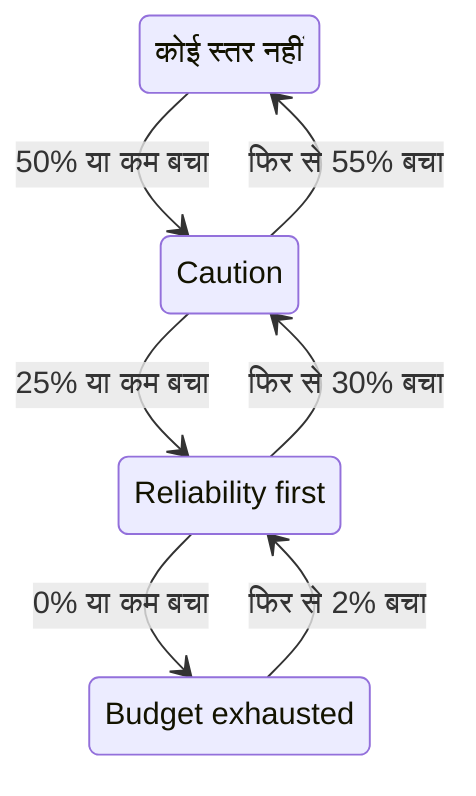

# एरर बजट नीति

एरर बजट नीति यह लिखती है कि किसी SLO का एरर बजट घटने के दौरान आपकी टीम ने क्या करना तय किया है, जैसे आधा बजट खर्च होने पर जोखिम भरे बदलावों की समीक्षा करना, या पूरा खर्च होने पर रिलीज़ रोक देना। OneUptime SLO को नीति के उस स्तर में रखता है जहाँ तक उसका बजट पहुँचा है, उस स्तर के लिए टीम का समझौता SLO के पेजों पर दिखाता है, और SLO के किसी स्तर में जाने पर अलर्ट उठा सकता है या घटना घोषित कर सकता है। यह [Google SRE Workbook](https://sre.google/workbook/error-budget-policy/) की एरर बजट नीति वाली कार्यप्रणाली है।

:::cards
- [स्तर कैसे काम करते हैं](#स्तर-कैसे-काम-करते-हैं): कौन-सा स्तर लागू होता है, और SLO उसे कब छोड़ता है।
- [नीति सेट करें](#नीति-सेट-करें): सुझाई गई नीति से शुरू करें, या अपने स्तर लिखें।
- [अलर्ट और घटनाएँ](#अलर्ट-और-घटनाएँ): SLO के किसी स्तर में जाने पर अपनी टीम को सूचित करें।
- [API से स्तर पढ़ें](#api-से-स्तर-पढ़ें): CI और स्क्रिप्ट से स्तर जाँचें।
:::

## स्तर कैसे काम करते हैं

नीति स्तरों का एक समूह है। हर स्तर में तीन फ़ील्ड होते हैं:

| फ़ील्ड | इसमें क्या होता है |
| --- | --- |
| **नाम** | टीम स्तर को क्या कहती है, जैसे "Reliability first"। |
| **Budget Left Threshold (%)** | बचे एरर बजट का वह हिस्सा जिस पर या जिससे नीचे स्तर लागू होता है। 0 से 100 तक, दशमलव की अनुमति है। किसी SLO के हर स्तर की अपनी अलग सीमा होती है। |
| **What We Do** | SLO के उस स्तर में रहने के दौरान टीम ने क्या करना तय किया है, Markdown में। ज़रूरी, 10,000 अक्षरों तक। |

कोई स्तर तब तक लागू रहता है जब तक बचा बजट उसकी सीमा पर या उससे नीचे है, इसलिए 0% वाला स्तर समाप्त बजट का स्तर है। जब कई स्तर लागू होते हैं, तो SLO सबसे कम सीमा वाले स्तर में होता है: सबसे गंभीर में। जब कोई लागू नहीं होता, तो SLO किसी स्तर में नहीं होता। 50%, 25% और 0% वाले स्तरों के साथ, जिस SLO का 30% बजट बचा है वह 50% वाले स्तर में है, और जिसका 10% बचा है वह 25% वाले स्तर में।

### किसी स्तर में जाना और उसे छोड़ना

स्तर बचे बजट के पीछे वैसे ही चलता है जैसे SLO की स्थिति:

- किसी स्तर में जाना तुरंत होता है: जो मूल्यांकन बजट को किसी स्तर की सीमा पर या उससे नीचे पाता है, वही SLO को उस स्तर में रख देता है। जो बजट एक साथ कई सीमाओं से नीचे गिरता है, वह सीधे सबसे गंभीर स्तर में जाता है।
- किसी स्तर को छोड़कर कम गंभीर स्तर में जाने के लिए बजट के साफ़ तौर पर लौटने तक इंतज़ार होता है। 0% वाला स्तर तब छूटता है जब बजट का 2% फिर से बच जाता है। कोई भी दूसरा स्तर तब छूटता है जब बजट उसकी सीमा से 5 अंक ऊपर होता है।

इसलिए 0% वाला स्तर **बजट समाप्त** स्थिति के साथ बदलता है, और SLO की जोखिम-स्तर सीमा वाला स्तर **जोखिम में** के साथ: देखें [स्थिति में बदलाव और जोखिम-स्तर सीमा](/docs/slo/error-budget#स्थिति-में-बदलाव-और-जोखिम-स्तर-सीमा)। किसी सीमा के आसपास डोलती रोलिंग विंडो स्तर को आगे-पीछे नहीं करती।



## नीति सेट करें

आपको SLO एरर बजट नीति के स्तर बनाने की अनुमति चाहिए।

:::steps
### Error Budget Policy खोलें

SLO खोलें और उसके साइड मेन्यू के **नियम** सेक्शन में **Error Budget Policy** पर जाएँ। पेज SLO के स्तर दिखाता है, हर एक के नाम, जिस बचे बजट पर वह लागू होता है, और टीम क्या करती है, के साथ।

### सुझाई गई नीति से शुरू करें

जब तक SLO में कोई स्तर नहीं होता, पेज **Use the recommended policy** देता है। उस पर क्लिक करें, उसमें दिखाए गए तीन स्तर जाँचें, और पुष्टि करें। फिर हर स्तर के शब्दों को अपनी टीम के समझौते के अनुसार बदलें।

### या ख़ुद स्तर जोड़ें

**SLO Error Budget Policy Tier बनाएँ** पर क्लिक करें। एक **नाम** और एक **Budget Left Threshold (%)** डालें, और **What We Do** में टीम का समझौता लिखें।

### चुनें कि स्तर क्या उठाता है

स्तर समझौते को दर्ज करता है और दिखाता है। SLO के उसमें जाने पर किसी को सूचित भी करने के लिए, मुड़ी हुई अलर्ट और घटना सेटिंग्स खोलें और अलर्ट, घटना या दोनों चालू करें। दोनों डिफ़ॉल्ट रूप से बंद हैं। देखें [अलर्ट और घटनाएँ](#अलर्ट-और-घटनाएँ)।
:::

किसी स्तर को जोड़ना, संपादित करना या हटाना तुरंत लागू होता है: OneUptime लगभग एक मिनट के भीतर SLO का फिर से मूल्यांकन करता है। अगर बजट पहले से किसी स्तर की सीमा पर या उससे नीचे है, तो SLO तब उस स्तर में आ जाता है, और स्तर वह उठाता है जो उसे उठाने के लिए सेट किया गया है। किसी स्तर को बंद करना या हटाना उसके उठाए गए को हल करता है, और SLO उस स्तर में चला जाता है जिसमें उसका बजट है। किसी स्तर का अलर्ट या घटना बंद करना वह अलर्ट या घटना हल करता है।

### सुझाई गई नीति

**Use the recommended policy** बजट के आधे, एक चौथाई और शून्य पर तीन स्तर, इस अंग्रेज़ी पाठ के साथ, जोड़ता है:

| स्तर | कब लागू होता है | टीम क्या करती है |
| --- | --- | --- |
| **Caution** | 50% या कम बचा | Half of the error budget is spent. Review risky changes before they ship, and find out what has been spending the budget. |
| **Reliability first** | 25% या कम बचा | Reliability comes first. Only reliability improvements and critical fixes ship until the budget recovers. |
| **Budget exhausted** | 0% या कम बचा | The error budget is spent. Freeze non-critical releases: only fixes for this SLO's reliability and security fixes ship until the budget is back. |

जब तक आप चालू न करें, इनमें से कोई भी अलर्ट नहीं उठाता या घटना घोषित नहीं करता। केवल वे स्तर जोड़े जाते हैं जो SLO में नहीं हैं: उसी नाम वाला, या उसी सीमा वाला स्तर मौजूद माना जाता है, चाहे वह चालू हो या बंद। इसलिए इसे दो बार माँगने पर, दूसरे टैब से या API से, कुछ भी दो बार नहीं जुड़ता। इस तरह जोड़ा गया हर स्तर SLO के ऑडिट लॉग में आपके द्वारा जोड़ा गया दर्ज होता है।

## स्तर कहाँ दिखता है

- SLO का **अवलोकन** वह स्तर दिखाता है जिसमें SLO है और उसमें टीम ने क्या करना तय किया है, ताकि SLO खोलने वाला हर व्यक्ति अभी लागू समझौता देखे।
- **त्रुटि बजट बर्न-डाउन** चार्ट जोखिम-स्तर सीमा की रेखा के साथ हर स्तर की सीमा पर लेबल वाली एक रेखा खींचता है।
- SLO का **फ़ीड** हर स्तर बदलाव पोस्ट करता है: SLO ने जो स्तर छोड़ा और जिसमें गया, बचा बजट, और नए स्तर में टीम ने क्या करना तय किया है।
- SLO के **ऑडिट लॉग** हर स्तर बदलाव को OneUptime द्वारा ख़ुद किए गए बदलाव के रूप में दर्ज करते हैं, इसलिए उसे केवल तब दिखाते हैं जब **सिस्टम इवेंट संग्रहित करें** चालू हो: देखें [ऑडिट लॉग चालू करें](/docs/slo/feed-and-audit-logs#ऑडिट-लॉग-चालू-करें)। किसी स्तर को जोड़ना, संपादित करना और हटाना उस व्यक्ति के नाम से दर्ज होता है जिसने यह किया।
- SLO का पढ़ने वाला API स्तर लौटाता है: देखें [API से स्तर पढ़ें](#api-से-स्तर-पढ़ें)।

## अलर्ट और घटनाएँ

हर स्तर, SLO के उसमें जाने पर, अलर्ट उठा सकता है, घटना घोषित कर सकता है, या दोनों कर सकता है। इनके विकल्प बर्न रेट नियम के अलर्ट और घटना वाले ही हैं: गंभीरता, ऑन-कॉल नीतियाँ, शीर्षक, विवरण और सुधार नोट्स के टेम्पलेट, गोपनीयता, स्वतः-समाधान, लेबल, स्वामी टीमें और उपयोगकर्ता, और SLO के स्वामियों को स्वामी के रूप में जोड़ना। देखें [नियम क्या घोषित करता है](/docs/slo/burn-rate-alerts#नियम-क्या-घोषित-करता-है)। दोनों डिफ़ॉल्ट रूप से बंद हैं, इसलिए जब तक आप इनमें से कोई चालू न करें, स्तर किसी को सूचित नहीं करता।

- किसी अधिक गंभीर स्तर में जाना पिछले स्तर के उठाए गए को हल करता है, उसकी स्वतः-समाधान सेटिंग चाहे जो हो, क्योंकि नया स्तर उसकी जगह ले लेता है। इसलिए एक समय पर अधिकतम एक स्तर का अलर्ट और घटना खुले रहते हैं, और वे उस स्तर के होते हैं जिसमें SLO है।
- किसी कम गंभीर स्तर में या सभी स्तरों से बाहर लौटना उन्हें तब हल करता है जब स्तर का स्वतः-समाधान चालू हो, जैसा कि वह डिफ़ॉल्ट रूप से होता है। स्वतः-समाधान बंद होने पर वे तब तक खुले रहते हैं जब तक कोई उन्हें हल न करे।
- दोबारा ट्रिगर होने से रोकने की कोई व्यवस्था नहीं है। कोई स्तर तभी फिर से उठाता है जब SLO उसे साफ़ तौर पर छोड़कर फिर उसमें आए, इसलिए वह बार-बार नहीं बदलता। अगर SLO के उसी स्तर में रहते हुए कोई उसके उठाए गए को हाथ से हल कर दे, तो वह हल ही रहता है।
- जब तक SLO का कोई मॉनिटर निर्धारित रखरखाव में है, स्तर कुछ नहीं उठाते। स्तर ख़ुद फिर भी बदलता है, और जो खुला है वह हल होता रहता है। अगर रखरखाव ख़त्म होने पर SLO अब भी उसी स्तर में है, तो स्तर तब वह उठाता है जो उसे उठाने के लिए सेट किया गया है।

बर्न रेट नियम की तरह, किसी स्तर द्वारा उठाया गया अलर्ट या घटना SLO को **प्रभावित संसाधन** में दिखाता है, और कोई घटना कभी स्टेटस पेज पर नहीं दिखती। SLO का फ़ीड हर एक को, और उसके हल होने का समय, पोस्ट करता है।

### वे क्या कहते हैं

किसी स्तर का शीर्षक, विवरण और सुधार नोट्स टेम्पलेट वेरिएबल लेते हैं, जैसे किसी नियम के: देखें [हर अलर्ट और घटना क्या कहती है](/docs/slo/burn-rate-alerts#हर-अलर्ट-और-घटना-क्या-कहती-है)। किसी स्तर के फ़ील्ड SLO और उसके बजट के वेरिएबल, और स्तर के अपने तीन वेरिएबल देते हैं: `{{sloName}}`, `{{sloId}}`, `{{sloLink}}`, `{{sloStatus}}`, `{{policyTier}}`, `{{policyTierThresholdPercentage}}`, `{{policyTierWhatWeDo}}`, `{{targetPercentage}}`, `{{currentSliPercentage}}`, `{{errorBudgetRemainingPercentage}}`, `{{errorBudgetRemaining}}`, `{{errorBudgetRemainingMinutes}}` और `{{windowDescription}}`। किसी नियम के अपने वेरिएबल, जैसे `{{ruleName}}` और बर्न रेट, नहीं दिए जाते, और स्तर के टेम्पलेट में खाली रहते हैं।

स्तर के तीनों वेरिएबल बर्न रेट नियमों के टेम्पलेट में भी काम करते हैं:

| वेरिएबल | इसमें क्या होता है |
| --- | --- |
| `{{policyTier}}` | मूल्यांकन के बाद SLO जिस स्तर में है, उसका नाम, या किसी स्तर में न होने पर `None`। |
| `{{policyTierThresholdPercentage}}` | उस स्तर की सीमा, जैसे `25`। SLO किसी स्तर में न हो तो खाली। |
| `{{policyTierWhatWeDo}}` | उस स्तर में टीम ने क्या करना तय किया है। SLO किसी स्तर में न हो तो खाली। |

जिस स्तर का शीर्षक खाली छोड़ा गया है, वह अंतर्निहित शीर्षक इस्तेमाल करता है:

```text
SLO error budget policy: {{sloName}} — {{policyTier}}
```

अंतर्निहित विवरण स्तर का नाम बताता है, बचे बजट की तुलना स्तर की सीमा से करता है, और बताता है कि उस स्तर में टीम ने क्या करना तय किया है।

## जब बजट मापा नहीं जाता

- **रोका गया** या **गलत कॉन्फ़िगर** SLO कोई बजट नहीं मापता, इसलिए उसका स्तर जहाँ था वहीं रहता है, और स्तर का उठाया गया तब तक खुला रहता है जब तक माप फिर से शुरू न हो। इसके उलट, बर्न रेट नियम तब अपना खुला हुआ हल कर देते हैं।
- SLO का मूल्यांकन बंद करना, या SLO को संग्रहित करना, उसके स्तरों के उठाए गए को हल करता है। SLO जिस स्तर में है, वह वैसा ही रहता है।
- SLO को हटाना उसके स्तर हटा देता है और उनके उठाए गए को हल करता है।

## API से स्तर पढ़ें

SLO का अपना पढ़ने वाला API वह स्तर लौटाता है जिसमें SLO है, ताकि कोई CI जॉब या स्क्रिप्ट कुछ करने से पहले, जैसे रिलीज़ से पहले, उसे जाँच सके। जब तक SLO किसी स्तर में नहीं है, तीनों फ़ील्ड खाली रहते हैं:

| फ़ील्ड | इसमें क्या होता है |
| --- | --- |
| `currentErrorBudgetPolicyTierId` | स्तर की ID। |
| `currentErrorBudgetPolicyTierName` | स्तर का नाम। |
| `currentErrorBudgetPolicyTierEnteredAt` | SLO कब उस स्तर में गया। |

इन्हें SLO की अपनी पढ़ने की अनुमति से पढ़ा जाता है, वही जो उसके बजट के लिए भी चाहिए। उदाहरण के लिए, प्रोजेक्ट की [API कुंजी](/docs/api-reference/api-reference) के साथ:

```bash
curl -X POST 'https://oneuptime.com/api/service-level-objective/<slo-id>/get-item' \
  -H "ApiKey: $ONEUPTIME_API_KEY" \
  -H 'Content-Type: application/json' \
  -d '{ "select": { "name": true, "errorBudgetRemainingPercentage": true, "currentErrorBudgetPolicyTierName": true, "currentErrorBudgetPolicyTierEnteredAt": true } }'
```

स्तर ख़ुद एक अलग संसाधन हैं, `/api/service-level-objective-error-budget-policy-tier`, जिसमें सूची, पढ़ना, बनाना, बदलना और हटाना जैसे अनुरोध हैं जो हर संसाधन में होते हैं। दो और अनुरोध सुझाई गई नीति के लिए हैं। दोनों `{ "serviceLevelObjectiveId": "..." }` लेते हैं और `tiers` में स्तरों के साथ जवाब देते हैं:

| अनुरोध | यह क्या करता है |
| --- | --- |
| `POST /api/service-level-objective-error-budget-policy-tier/recommended-policy` | SLO में न मौजूद सुझाए गए स्तरों की सूची देता है। कुछ नहीं लिखता। |
| `POST /api/service-level-objective-error-budget-policy-tier/recommended-policy/add` | उन्हें जोड़ता है, और जो जोड़ा उसकी सूची देता है। दोबारा पूछने पर कुछ नहीं जुड़ता। |

## अनुमतियाँ

| अनुमति | भूमिका को क्या करने देती है |
| --- | --- |
| **Read SLO Error Budget Policy Tier** | किसी SLO के स्तर देखना। |
| **Create SLO Error Budget Policy Tier** | स्तर जोड़ना, हाथ से या **Use the recommended policy** से। |
| **Edit SLO Error Budget Policy Tier** | स्तर बदलना, और उन्हें चालू या बंद करना। |
| **Delete SLO Error Budget Policy Tier** | स्तर हटाना। |

ये अनुमतियाँ किसी भूमिका के SLO समूह में हैं। Project Owner और Project Admin भूमिकाओं के पास ये सभी हैं, और Project Member और Viewer भूमिकाएँ स्तर पढ़ सकती हैं।

## अभी उपलब्ध नहीं

एरर बजट नीति के कुछ हिस्से अभी उपलब्ध नहीं हैं: ऐसा डिप्लॉयमेंट गेट जो अपने आप रिलीज़ रोक दे (इसके बजाय कोई CI जॉब API से स्तर पढ़ सकता है), हर स्तर के लिए वर्कफ़्लो ट्रिगर और Slack या Microsoft Teams सूचनाएँ, कई SLO में साझा नीति, किसी स्तर को स्वीकार करना या उसे अपवाद देना, और ऐसे स्तर जो बचे बजट के बजाय बजट के बचे समय पर आधारित हों।

## आगे के कदम

:::cards
- [एरर बजट](/docs/slo/error-budget): बजट क्या है, और स्थिति उसके पीछे कैसे चलती है।
- [बर्न रेट अलर्ट और घटनाएँ](/docs/slo/burn-rate-alerts): बजट बहुत तेज़ी से खर्च होने पर अपनी टीम को सूचित करें।
- [SLO फ़ीड और ऑडिट लॉग](/docs/slo/feed-and-audit-logs): हर स्तर बदलाव, और स्तरों ने क्या उठाया।
:::
