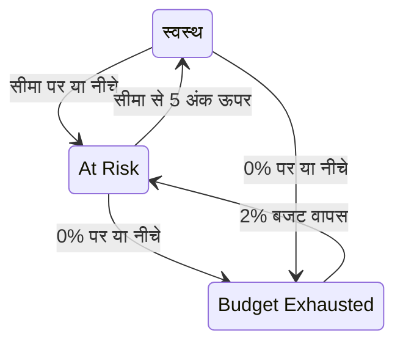

# एरर बजट

एरर बजट वह डाउनटाइम है जिसकी SLO का लक्ष्य अनुमति देता है। 99.9% के लक्ष्य का अर्थ "कभी डाउन न होना" नहीं है: इसका अर्थ है "आप 30 दिनों में 43 मिनट तक डाउन रह सकते हैं, इसलिए उन्हें सोच-समझकर खर्च करें"। यह पेज बताता है कि OneUptime बजट कैसे गिनता है, यह कितना चलता है, कैसे वापस आता है, और किसे इसकी जानकारी मिलती है।

:::cards
- [बजट की गणना कैसे होती है](#बजट-की-गणना-कैसे-होती-है): सूत्र और आम लक्ष्यों का बजट।
- [बजट का बचा समय](#बजट-का-बचा-समय): मौजूदा गति से बजट कितना चलेगा।
- [बजट कैसे लौटता है](#बजट-कैसे-लौटता-है): रोलिंग विंडो और कैलेंडर महीने।
- [स्वामियों को सूचना](#स्वामियों-को-सूचना): बजट कम होने पर किसे पता चलता है।
:::

## बजट की गणना कैसे होती है

कुल बजट विंडो का वह हिस्सा है जिसका आपका लक्ष्य वादा नहीं करता:

```text
total budget = (100% − target) × window length
```

| लक्ष्य | 7-दिन की विंडो | 28-दिन की विंडो | 30-दिन की विंडो | 90-दिन की विंडो |
| --- | --- | --- | --- | --- |
| 99% | 1h 40m 48s | 6h 43m 12s | 7h 12m | 21h 36m |
| 99.5% | 50m 24s | 3h 21m 36s | 3h 36m | 10h 48m |
| 99.9% | 10m 5s | 40m 19s | 43m 12s | 2h 9m 36s |
| 99.95% | 5m 2s | 20m 10s | 21m 36s | 1h 4m 48s |
| 99.99% | 1m 0s | 4m 2s | 4m 19s | 12m 58s |

SLO का **सेटिंग्स** पेज लक्ष्य के बगल में वह बजट दिखाता है जो लक्ष्य देता है, जैसे "हर 30-दिन की विंडो में 43m 12s डाउनटाइम"।

### कई मॉनिटर वाले SLO का बजट

**Any Monitor Down** मोड में बजट `(100% − target) × window` होता है, चाहे SLO कितने भी मॉनिटर मापे: विंडो एक ही टाइमलाइन है।

**Monitor Seconds Average** मोड में बजट सभी मॉनिटर पर जोड़े गए मॉनिटर-सेकंड में गिना जाता है, इसलिए यह मॉनिटर की संख्या के साथ बढ़ता है: 30 दिनों में 99.9% वाले तीन-मॉनिटर SLO का बजट 43 के बजाय लगभग 129 मिनट होता है। प्रतिशत (SLI, बचा हुआ बजट, बर्न रेट) का अर्थ वही रहता है; केवल अवधियाँ बदलती हैं।

### कैलेंडर महीने का बजट

कैलेंडर-महीने वाले SLO के पास पहले दिन से पूरे महीने का बजट होता है: 31 दिनों के महीने में 99.9% वाले SLO के पास 1 तारीख को ही अपने पूरे 44m 38s होते हैं। बजट महीने के बीते हिस्से के अनुपात में नहीं दिया जाता, इसलिए 1 तारीख की सुबह एक मिनट का आउटेज महीने के बजट से एक मिनट खर्च कर देता है।

## बचा हुआ बजट

जैसे-जैसे डाउनटाइम जुड़ता है, **अवलोकन** अपनी **Error budget left** टाइल में बचा हुआ बजट दिखाता है:

- कुल के प्रतिशत के रूप में, जो SLO की स्थिति भी तय करता है और बार भरता है। बार पर SLO की जोखिम-स्तर सीमा पर एक निशान होता है;
- अवधि के रूप में, जैसे "31m 4s left of 43m 12s"।

बजट खत्म होने पर टाइल **No budget left** दिखाती है। जब डाउनटाइम उससे आगे निकल जाता है, तो टाइल **Budget exceeded** और समय के रूप में अधिक खर्च दिखाती है, जैसे "4d 23m over budget · 5m 47s allowed": SLO ने अपने बजट के पूरे 5 मिनट 47 सेकंड और उसके अलावा 4 दिन 23 मिनट और खर्च किए। बार खाली और लाल रहता है।

गणना और इतिहास चार्ट के लिए बचा हुआ बजट चिह्न वाली संख्या के रूप में रखा जाता है, इसलिए वहाँ अधिक खर्च हुआ बजट ऋणात्मक प्रतिशत के रूप में दिखता है। बहुत ऋणात्मक प्रतिशत का अर्थ है कि अधिक खर्च बजट की तुलना में बड़ा है; यह उस समय का हिस्सा नहीं है जब सेवा डाउन थी।

कौन से सेकंड डाउनटाइम गिने जाते हैं, यह SLO की डाउनटाइम स्थितियाँ तय करती हैं, और कई मॉनिटर वाले SLO के लिए उसका मल्टी-मॉनिटर मोड भी; दोनों **सेटिंग्स** → **Downtime Calculation** में हैं। [SLO अवलोकन](/docs/slo/introduction) देखें।

## बजट का बचा समय

**अवलोकन** की **Budget runway** टाइल इस सवाल का जवाब देती है कि "अगर ऐसा ही चलता रहा, तो बजट कब खत्म होगा?"। यह बचे हुए बजट को पिछले 60 मिनट के बर्न रेट से भाग देती है:

```text
runway = budget left ÷ (burn rate × (100% − target))
```

| टाइल दिखाती है | इसका अर्थ |
| --- | --- |
| एक अवधि, जैसे **~2d 5h** | मौजूदा गति से बजट लगभग इतने समय में खत्म हो जाएगा। एम्बर रंग में, और एक दिन या कम बचने पर लाल। **Under 1m** का अर्थ है एक मिनट से कम। |
| **Not burning** | पिछले 60 मिनट में कोई बजट खर्च नहीं हुआ। |
| **Sustainable** | केवल रोलिंग विंडो: बचा समय कम से कम एक पूरी विंडो है, इसलिए बजट उतनी तेज़ी से खर्च नहीं हो रहा जितनी तेज़ी से पुराना डाउनटाइम विंडो से निकलता है। इस गति से यह खत्म नहीं होगा। |
| **Lasts until reset** | केवल कैलेंडर महीने: बजट खत्म होने से पहले अगले महीने की शुरुआत में रीसेट हो जाता है। |
| **Overspent** | बजट पहले ही खर्च हो चुका है। टाइल बताती है कि यह कितना अधिक खर्च हुआ। |

कैलेंडर-महीने वाले SLO के लिए टाइल यह भी बताती है कि बजट कब रीसेट होगा।

बचा समय एक सीधी-रेखा अनुमान है। रोलिंग विंडो में, विंडो से निकलने वाला पुराना डाउनटाइम बजट वापस देता है, जिसे यह अनुमान अनदेखा करता है: इसे अपने पास बचे कम से कम समय के रूप में पढ़ें। यह पहले मूल्यांकन से पहले नहीं दिखता, और न ही **Monitor Seconds Average** मोड वाले SLO के लिए, जिनका बजट वास्तविक समय में नहीं बल्कि मॉनिटर-सेकंड में गिना जाता है।

## एरर बजट बर्न-डाउन

**अवलोकन** का **Error budget burn-down** चार्ट मौजूदा अनुपालन विंडो में बचे हुए बजट को प्रतिशत में दिखाता है:

- 0% पर एक रेखा बताती है कि बजट कहाँ खत्म होता है, और एक बिंदीदार रेखा SLO की जोखिम-स्तर सीमा बताती है।
- कैलेंडर-महीने वाले SLO के लिए एक हल्की रेखा महीने की शुरुआत के पूरे बजट से रीसेट पर खाली बजट तक समान रूप से गिरती है। उस रेखा से नीचे होने का अर्थ है कि महीना अपना बजट बहुत तेज़ी से खर्च कर रहा है।
- हर मूल्यांकन पर, हर 5 मिनट में, एक बिंदु दर्ज होता है, इसलिए नए SLO का चार्ट उसके पहले मूल्यांकन तक खाली रहता है।
- विंडो के किसी हिस्से को ज़ूम करने के लिए चार्ट पर ड्रैग करें। पूरी विंडो फिर देखने के लिए डबल-क्लिक करें, या **Reset zoom** पर क्लिक करें।

**Open metrics** SLO का **मेट्रिक्स** पेज खोलता है, जिसका **Error Budget History** टैब 400 दिनों तक पीछे जाता है। [SLO मेट्रिक्स और डैशबोर्ड](/docs/slo/metrics) देखें।

## बजट कैसे लौटता है

बजट कैसे वापस आता है, यह SLO के विंडो प्रकार पर निर्भर करता है:

:::tabs
@tab Rolling
रोलिंग विंडो हमेशा अभी से उतनी ही दूर पीछे देखती है, इसलिए डाउनटाइम आख़िरकार उससे बाहर निकल जाता है: कोई आउटेज होने के ठीक एक विंडो बाद गिना जाना बंद हो जाता है। 1 जून का 30 मिनट का आउटेज 30-दिन वाले SLO की गणना से 1 जुलाई को बाहर हो जाता है, और बजट एक साथ नहीं बल्कि धीरे-धीरे लौटता है, जैसे-जैसे डाउनटाइम का हर सेकंड विंडो छोड़ता है।

इसलिए सुधार कमाया जाता है, निर्धारित नहीं किया जाता। अगर छोटे आउटेज होते रहें, तो पुराना डाउनटाइम निकलता है जबकि नया आता है, और बजट सुधरने के बजाय वहीं ठहरा रहता है।
@tab Calendar Month
कैलेंडर-महीने वाला SLO अपने टाइमज़ोन में हर महीने की पहली तारीख की आधी रात को रीसेट होता है। पूरा बजट एक बार में लौट आता है और पिछला महीना बंद हो जाता है। किसी भी दिशा में एक महीने से अगले महीने में कुछ नहीं जाता: बुरा महीना अगले को नुकसान नहीं पहुँचाता, और अच्छा महीना अगले को अतिरिक्त गुंजाइश नहीं देता।
:::

### नए SLO

रोलिंग विंडो वाला SLO जो अपनी विंडो से नया है, अब तक मौजूद डेटा पर मापा जाता है, और उसका कुल बजट उसके साथ बढ़ता है: एक हफ़्ते पहले बना 30-दिन का SLO अभी के लिए 7 दिनों का बजट रखता है। जब तक विंडो नहीं भरती, **अवलोकन** **Window 23% full** संकेतक और **Error budget left** टाइल में उसी टिप्पणी के साथ दिखाता है कि वह कितनी भरी है। विंडो भरने के साथ संख्याओं के स्थिर होने की अपेक्षा करें।

## स्थिति में बदलाव और जोखिम-स्तर सीमा

बचा हुआ बजट SLO की स्थिति तय करता है:

| स्थिति | कब |
| --- | --- |
| **स्वस्थ** | जोखिम-स्तर सीमा से अधिक बजट बचा है। |
| **At Risk** | बचा हुआ बजट जोखिम-स्तर सीमा पर या उससे नीचे है: डिफ़ॉल्ट रूप से 20%। |
| **Budget Exhausted** | बचा हुआ बजट शून्य या उससे नीचे है। |

जोखिम-स्तर सीमा **सेटिंग्स** → **Objective** में सेट करें।

रोलिंग विंडो एक-एक सेकंड करके सुधरती हैं, इसलिए किसी सीमा के पास का SLO दो स्थितियों के बीच आगे-पीछे कूद सकता है। ताकि हर स्थिति बदलाव का कुछ अर्थ हो, SLO किसी स्थिति को तभी छोड़ता है जब वह सीमा को साफ़ तौर पर पार कर ले:



20% की डिफ़ॉल्ट सीमा के साथ, जोखिम वाला SLO 25% बचे बजट पर फिर स्वस्थ होता है, और खत्म बजट वाला SLO 2% पर फिर जोखिम में लौटता है। हर स्थिति बदलाव SLO की **Feed** में दिखता है, उसे समझाने वाले SLI, बजट और बर्न रेट के साथ।

## स्वामियों को सूचना

जब कोई SLO **At Risk** या **Budget Exhausted** में जाता है, तो OneUptime उसके स्वामियों को सूचित करता है:

- स्वामी SLO के **मालिक** पेज पर वे उपयोगकर्ता और टीम सदस्य हैं जो अब भी प्रोजेक्ट के सदस्य हैं। बिना स्वामियों वाला SLO इसके बजाय प्रोजेक्ट के स्वामियों को सूचित करता है।
- हर स्वामी को डिफ़ॉल्ट रूप से ईमेल मिलता है, और हर उस दूसरे चैनल पर सूचना जिसे वह **उपयोगकर्ता सेटिंग्स** → **सूचना सेटिंग्स** → **निगरानी** में **SLO status changed** के लिए चालू करता है।
- ईमेल के विषय में स्थिति और SLO का नाम होता है, जैसे `[SLO At Risk] API Availability`।

ताकि सीमा के पास का SLO बार-बार सूचित न करे, उसके स्वामियों को एक घंटे में अधिकतम एक सूचना मिलती है। **Budget Exhausted** में जाने की सूचना हमेशा भेजी जाती है, उस घंटे के भीतर भी।

> [!TIP]
> स्वामियों को सूचना SLO के ज़िम्मेदार लोगों को बताती है कि उसका बजट मुश्किल में है। एस्केलेशन नीतियों के ज़रिए अपनी ऑन-कॉल टीम को बुलाने के लिए [बर्न रेट अलर्ट और घटनाएँ](/docs/slo/burn-rate-alerts) का उपयोग करें। बर्न रेट नियम अपने बनाए हर अलर्ट और घटना में SLO के स्वामियों को भी जोड़ सकता है।

## आगे के कदम

:::cards
- [बर्न रेट अलर्ट और घटनाएँ](/docs/slo/burn-rate-alerts): जब बजट बहुत तेज़ी से खर्च हो, तो अपनी टीम को सूचित करें।
- [SLO मेट्रिक्स और डैशबोर्ड](/docs/slo/metrics): समय के साथ बजट का चार्ट बनाएँ।
- [SLO अवलोकन](/docs/slo/introduction): लक्ष्य, विंडो और डाउनटाइम स्थितियाँ।
:::
