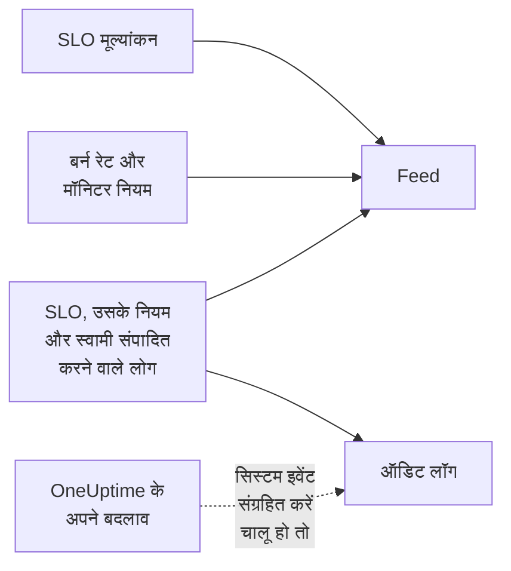

# SLO फ़ीड और ऑडिट लॉग

SLO अपने इतिहास के दो रिकॉर्ड रखता है, और वे अलग-अलग सवालों के जवाब देते हैं। **Feed** इस सवाल का जवाब देती है कि "इस SLO के साथ क्या हुआ?", उन लोगों के लिए लिखी गई जो उसकी देखभाल करते हैं। **ऑडिट लॉग** फ़ील्ड-दर-फ़ील्ड इस सवाल का जवाब देते हैं कि "ठीक-ठीक किसने क्या बदला?", समीक्षा और अनुपालन के लिए।

## फ़ीड या ऑडिट लॉग?

| | **Feed** | **ऑडिट लॉग** |
| --- | --- | --- |
| जवाब देता है | SLO के साथ क्या हुआ | किसने क्या बदला, और कब |
| दर्ज करता है | स्थिति में बदलाव, बर्न रेट अलर्ट और घटनाएँ, और SLO, उसके नियमों, मॉनिटर और स्वामियों में बदलाव | लोगों द्वारा SLO, उसके बर्न रेट नियमों, मॉनिटर नियमों और स्वामियों में किया गया हर बदलाव, पुराने और नए मान के साथ |
| OneUptime का अपना काम शामिल है | हाँ: मूल्यांकन और मॉनिटर जोड़ने वाले मॉनिटर नियम | केवल जब **सिस्टम इवेंट संग्रहित करें** चालू हो |
| प्लान | हर प्लान | OneUptime Cloud पर Enterprise प्लान, या सेल्फ़-होस्टेड इंस्टॉलेशन पर Enterprise Edition |
| कितने समय तक | OneUptime Cloud पर तीन साल | डिफ़ॉल्ट रूप से 7 दिन, अधिकतम 180 |

## SLO की फ़ीड

फ़ीड SLO के **Feed** पेज पर है, और उसकी नवीनतम प्रविष्टियाँ SLO के **अवलोकन** पर **Recent activity** के अंतर्गत हैं। प्रविष्टियाँ उन SLO, मॉनिटर, अलर्ट और घटनाओं के लिंक देती हैं जिनका वे उल्लेख करती हैं, और ज़्यादातर में संख्याओं या पुराने और नए मानों वाला **More Information** सेक्शन होता है।

| इवेंट | कब प्रकाशित होता है |
| --- | --- |
| SLO बनाया गया | SLO बनता है। उसका लक्ष्य, अनुपालन विंडो, SLI, जोखिम-स्तर सीमा, विवरण और वे डिफ़ॉल्ट बर्न रेट नियम सूचीबद्ध करता है जिनके साथ वह शुरू हुआ। |
| SLO अपडेट किया गया | नाम, विवरण, लेबल, लक्ष्य, अनुपालन विंडो, टाइमज़ोन, जोखिम-स्तर सीमा, मल्टी-मॉनिटर मोड या डाउनटाइम स्थितियाँ बदलती हैं। हर पुराना और नया मान दिखाता है। |
| SLO सक्षम या अक्षम किया गया | मूल्यांकन चालू या बंद किया जाता है। |
| SLO संग्रहीत या पुनर्स्थापित किया गया | SLO संग्रहीत या अनसंग्रहीत किया जाता है। |
| स्थिति बदली | कोई मूल्यांकन SLO को नई स्थिति में ले जाता है। उसके पीछे का SLI, एरर बजट, बर्न रेट और जोखिम-स्तर सीमा दिखाता है, और **रोका गया** या **Misconfigured** का कारण। |
| बर्न रेट अलर्ट उठाया गया | कोई बर्न रेट नियम अलर्ट बनाता है। उसका लिंक देता है और उसे ट्रिगर करने वाले बर्न रेट दिखाता है। |
| बर्न रेट घटना घोषित की गई | कोई बर्न रेट नियम घटना घोषित करता है। उसका लिंक देता है और उसे ट्रिगर करने वाले बर्न रेट दिखाता है। |
| बर्न रेट अलर्ट या घटना सुलझाई गई | किसी नियम का अलर्ट या घटना बंद होती है: अपने आप सुलझाई गई, या स्वतः सुलझाना बंद रहते हुए हाथ से। |
| बर्न रेट नियम जोड़ा, बदला या हटाया गया | कोई बर्न रेट नियम बनाता, संपादित करता या हटाता है। नए SLO के डिफ़ॉल्ट नियम इसके बजाय उसकी "SLO बनाया गया" प्रविष्टि में होते हैं। |
| मॉनिटर नियम जोड़ा, बदला या हटाया गया | कोई मॉनिटर नियम बनाता, संपादित करता या हटाता है। जो सहेजना कुछ भी मायने रखने वाला नहीं बदलता, वह प्रकाशित नहीं होता। |
| मॉनिटर जोड़े या अलग किए गए | मॉनिटर SLO में जोड़े या उससे हटाए जाते हैं, हाथ से या किसी मॉनिटर नियम द्वारा। लंबी सूचियाँ पहले कुछ मॉनिटर के नाम देकर "और N अन्य" लिखती हैं। |
| स्वामी जोड़ा या हटाया गया | कोई उपयोगकर्ता या टीम SLO के स्वामियों में जोड़ी या उनसे हटाई जाती है। |
| लेबल नियम लागू हुआ | किसी लेबल नियम ने SLO पर लेबल लगाए, उसके बनने पर या जब किसी ने नियम चलाया। मेल खाने वाले नियमों के नाम देता है। [लेबल और स्वामी नियम](/docs/slo/label-and-owner-rules) देखें। |
| स्वामी नियम लागू हुआ | किसी स्वामी नियम ने SLO में स्वामी जोड़े। मेल खाने वाले नियमों के नाम देता है; उसके जोड़े गए हर स्वामी को अपनी अलग "स्वामी जोड़ा गया" प्रविष्टि भी मिलती है। |

कुछ बातें:

- जब बदलाव किसी व्यक्ति ने किया हो, तो प्रविष्टियाँ बताती हैं कि किसने किया। OneUptime द्वारा ख़ुद किए गए बदलाव, जैसे कोई मूल्यांकन या मॉनिटर जोड़ने वाला मॉनिटर नियम, और API या ऑटोमेशन से किए गए बदलाव किसी उपयोगकर्ता के नहीं होते।
- जिस अलर्ट या घटना को कोई नियम फिर से उठाता है क्योंकि वह अब भी खुला था, वह दो बार प्रकाशित नहीं होता।
- निजी अलर्ट या घटना के लिए प्रविष्टि उसका शीर्षक, संख्या और लिंक छोड़ देती है, क्योंकि जो भी SLO पढ़ सकता है वह उसकी फ़ीड पढ़ सकता है। फिर भी वह बताती है कि एक निजी रिकॉर्ड बना, और उसे ट्रिगर करने वाले बर्न रेट दिखाती है।
- कोई भी फ़ीड प्रविष्टियाँ संपादित या हटा नहीं सकता। OneUptime Cloud पर तीन साल से पुरानी प्रविष्टियाँ हटा दी जाती हैं।

## ऑडिट लॉग

SLO का **ऑडिट लॉग** पेज इनमें किए गए बदलाव सूचीबद्ध करता है:

- ख़ुद SLO: उसका विवरण, सेटिंग्स, लेबल, मॉनिटर और संग्रह;
- उसके बर्न रेट नियम;
- उसके मॉनिटर नियम;
- उसके स्वामी उपयोगकर्ता और स्वामी टीमें।

नियमों और स्वामियों में बदलाव नियम या स्वामी पर दर्ज होते हैं और SLO तक इकट्ठा होते हैं, इसलिए उसका पेज उसका पूरा इतिहास एक जगह दिखाता है, और हर प्रविष्टि उस पेज का लिंक देती है जिससे वह जुड़ी है। लेबल और मॉनिटर जैसी संबंधित चीज़ें केवल अपनी ID नहीं बल्कि अपने नाम के साथ दर्ज होती हैं।

दो चीज़ें शामिल नहीं होतीं:

- **मूल्यांकन परिणाम।** SLI, एरर बजट, बर्न रेट, स्थिति और मूल्यांकन के समय हर कुछ मिनट में बदलते हैं। उनका इतिहास **अवलोकन**, **मेट्रिक्स** पेज और **Feed** पर है।
- **OneUptime द्वारा ख़ुद किए गए बदलाव**, जैसे कोई मॉनिटर नियम किसी मॉनिटर को जोड़ता या अलग करता है, जब तक कि प्रोजेक्ट के लिए **सिस्टम इवेंट संग्रहित करें** चालू न हो। **Feed** मॉनिटर जुड़ने और अलग होने को हर हाल में दर्ज करती है।

### ऑडिट लॉग चालू करें

ऑडिट लॉग एक Enterprise सुविधा है: इनके लिए OneUptime Cloud पर **Enterprise** प्लान, या सेल्फ़-होस्टेड इंस्टॉलेशन पर Enterprise Edition चाहिए। दूसरे प्लान पर SLO का **ऑडिट लॉग** पेज बताता है कि इसे कैसे पाएँ। सेल्फ़-होस्टेड इंस्टॉलेशन पर वैध लाइसेंस के बिना ऑडिट लॉगिंग दर्ज करना बंद कर देती है (14-दिन के ट्रायल के बाद, या लाइसेंस समाप्त होने के 30 दिन बाद), और लाइसेंस सक्रिय होते ही फिर शुरू हो जाती है ([When a license expires or is missing](/docs/self-hosted/enterprise#जब-लाइसेंस-समाप्त-हो-जाए-या-न-हो) देखें)। जब यह दर्ज नहीं कर रही होती, तो **ऑडिट लॉग** पेज यह बताते हैं।

ऑडिट लॉग हर प्रोजेक्ट में डिफ़ॉल्ट रूप से भी बंद होते हैं। उन्हें चालू करने के लिए:

:::steps
### ऑडिट लॉग सेटिंग्स खोलें

**प्रोजेक्ट सेटिंग्स** पर जाएँ, साइड मेनू में **ऑडिट लॉग** खोलें और **सेटिंग्स** पर क्लिक करें।

### सेटिंग्स संपादित करें

**Edit Audit Log Settings** पर क्लिक करें और **ऑडिट लॉग्स सक्षम करें** चालू करें।

### चुनें कि क्या रखना है

**धारण (दिन)** को 7 (डिफ़ॉल्ट) से 180 तक सेट करें, और OneUptime द्वारा ख़ुद किए गए बदलाव भी दर्ज करने के लिए **सिस्टम इवेंट संग्रहित करें** चालू करें। सहेजें। बदलाव लगभग एक मिनट में लागू होता है।
:::

जब ऑडिट लॉगिंग बंद होती है, तो SLO का **ऑडिट लॉग** पेज **Audit logging is off** दिखाता है, साथ में इसे चालू करने का लिंक। बंद होने से पहले दर्ज की गई प्रविष्टियाँ दिखती रहती हैं। हर संसाधन का प्रोजेक्ट का पूरा ऑडिट लॉग **प्रोजेक्ट सेटिंग्स** → **ऑडिट लॉग** → **ऑडिट लॉग** में है।

## आगे के कदम

:::cards
- [SLO अवलोकन](/docs/slo/introduction): SLO का हर पेज।
- [मॉनिटर और मॉनिटर नियम](/docs/slo/monitor-rules): मॉनिटर को क्या जोड़ता और अलग करता है।
- [बर्न रेट अलर्ट और घटनाएँ](/docs/slo/burn-rate-alerts): फ़ीड के अलर्ट और घटनाओं को क्या उठाता और सुलझाता है।
- [लेबल और स्वामी नियम](/docs/slo/label-and-owner-rules): लेबल और स्वामी अपने आप क्या जोड़ता है।
:::
