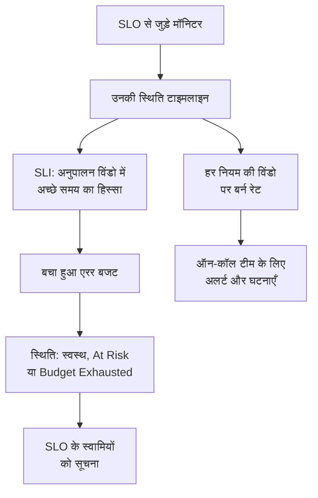

# SLO अवलोकन

सर्विस लेवल ऑब्जेक्टिव (SLO) उस चीज़ के लिए विश्वसनीयता का लक्ष्य है जिसकी आप निगरानी करते हैं, जैसे "रोलिंग 30 दिनों में 99.9% समय उपलब्ध"। OneUptime हर 5 मिनट में हर SLO को उसके लक्ष्य से मापता है, इसलिए "क्या यह अभी चल रहा है?" के बजाय आप यह जवाब दे सकते हैं कि "क्या हम ऐसी अवधि में पर्याप्त विश्वसनीय रहे जो हमारे उपयोगकर्ताओं के लिए मायने रखती है, और विफलता की कितनी गुंजाइश बची है?"।

:::cards
- [SLO बनाएँ](#slo-बनाएँ): एक नाम और एक लक्ष्य। बाकी सब कुछ डिफ़ॉल्ट मान से शुरू होता है।
- [मॉनिटर और मॉनिटर नियम](/docs/slo/monitor-rules): वे मॉनिटर चुनें जिन्हें SLO मापता है।
- [एरर बजट](/docs/slo/error-budget): लक्ष्य कितना डाउनटाइम देता है और बजट कैसे वापस आता है।
- [बर्न रेट अलर्ट और घटनाएँ](/docs/slo/burn-rate-alerts): जब बजट बहुत तेज़ी से खर्च हो, तो अपनी टीम को सूचित करें।
:::

## यह कैसे काम करता है

SLO अपने से जुड़े मॉनिटर की स्थिति टाइमलाइन पढ़ता है: वही डेटा जो आपके स्टेटस पेज दिखाते हैं। उससे OneUptime गणना करता है कि अनुपालन विंडो का कितना हिस्सा अच्छा समय था, एरर बजट कितना बचा है, और वह कितनी तेज़ी से खर्च हो रहा है।

## मुख्य अवधारणाएँ

| शब्द | अर्थ |
| --- | --- |
| **SLI** (सर्विस लेवल इंडिकेटर) | माप: अनुपालन विंडो का वह प्रतिशत जिसमें SLO के मॉनिटर उपलब्ध थे। |
| **SLO** (सर्विस लेवल ऑब्जेक्टिव) | SLI का लक्ष्य, जैसे "पिछले 30 दिनों में कम से कम 99.9%"। |
| **एरर बजट** | वह डाउनटाइम जो लक्ष्य अनुमति देता है: `(100% − target) × window`। 30 दिनों में 99.9% के लिए यह 43 मिनट 12 सेकंड है। |
| **बर्न रेट** | एक समान गति की तुलना में बजट कितनी तेज़ी से खर्च हो रहा है। बर्न रेट 1 होने पर बजट ठीक विंडो के अंत में खत्म होता है। |

एरर बजट विश्वसनीयता को ऐसी चीज़ बना देता है जिसे आप खर्च कर सकते हैं। ज़्यादा बचा हो तो तेज़ी से रिलीज़ करें और जोखिम लें; कम बचा हो तो धीमे चलें और स्थिरता में निवेश करें। SLO इस बातचीत को एक ऐसी संख्या देता है जिसे सब देख सकते हैं।

## SLO बनाएँ

आपको ऐसी भूमिका चाहिए जो SLO बना सके: Project Owner, Project Admin, या Create Service Level Objective अनुमति वाली कस्टम भूमिका।

:::steps
### SLO खोलें

ऊपर की बार में **उत्पाद** मेनू से **SLOs** खोलें। यह पहले समूह में, मॉनिटर और घटनाओं के साथ है। **Service Level Objective बनाएँ** पर क्लिक करें।

### नाम दें और लक्ष्य तय करें

एक **नाम** दर्ज करें, जैसे "API Availability", और एक **Target (%)**: वह समय का हिस्सा जिसमें इसके मॉनिटर उपलब्ध होने चाहिए। लक्ष्य `99.9` से शुरू होता है। यह 0 से अधिक और अधिकतम 99.999 होना चाहिए, क्योंकि 100% के लक्ष्य में ट्रैक करने के लिए कोई एरर बजट नहीं बचता।

### और फ़ील्ड में डिफ़ॉल्ट मान जाँचें

**और फ़ील्ड** मुड़ा हुआ रहता है, और एक पंक्ति बताती है कि इसके डिफ़ॉल्ट मान क्या करते हैं: SLO को 30 दिनों की रोलिंग विंडो पर मापा जाता है और जब उसके एरर बजट का 20% से कम बचता है तो वह जोखिम में आ जाता है। नीचे की तालिका के किसी फ़ील्ड को बदलने के लिए इसे खोलें।

### SLO सहेजें

**Service Level Objective बनाएँ** पर क्लिक करें। OneUptime नया SLO खोलता है। नए SLO में अभी कोई मॉनिटर नहीं है, इसलिए उसका **अवलोकन** **Choose what this SLO measures** दिखाता है।

### मॉनिटर जोड़ें

अभी और आगे मेल खाने वाले हर मॉनिटर को जोड़ने के लिए **Create a monitor rule** पर क्लिक करें, या उन्हें हाथ से चुनने के लिए **Add monitors** पर। [मॉनिटर और मॉनिटर नियम](/docs/slo/monitor-rules) देखें।

### पहली संख्याएँ आती देखें

OneUptime सक्षम SLO का मूल्यांकन हर 5 मिनट में करता है। SLI, एरर बजट और बर्न-डाउन चार्ट उस पहले मूल्यांकन के बाद दिखते हैं जिसमें मापने के लिए मॉनिटर हों।
:::

**और फ़ील्ड** के फ़ील्ड:

| फ़ील्ड | आप क्या सेट करते हैं | डिफ़ॉल्ट |
| --- | --- | --- |
| **विवरण** | SLO किस लिए है। | खाली |
| **जोखिम-स्तर सीमा (%)** | बचे हुए एरर बजट का वह हिस्सा जिस पर SLO **At Risk** में चला जाता है। 0 से 100 तक की पूर्ण संख्या। | 20 |
| **Window Type** | **Rolling**: पिछले N दिन, जो पुराने डाउनटाइम के विंडो से बाहर निकलने के साथ ठीक होते हैं। **Calendar Month**: हर महीना अलग, 1 तारीख को रीसेट। | **Rolling** |
| **Window (Days)** | केवल रोलिंग विंडो: कितने दिन पीछे देखना है, 1 से 366 तक। आम तौर पर 28 या 30। | 30 |
| **टाइमज़ोन** | केवल कैलेंडर महीने: वह टाइमज़ोन जिसमें हर महीना शुरू और खत्म होता है। | UTC |
| **लेबल** | SLO को व्यवस्थित और फ़िल्टर करने के लिए लेबल। | कोई नहीं |

SLO कैसे मापता है, यह तय करने वाली हर चीज़ एक डिफ़ॉल्ट मान से शुरू होती है जिसे आप बाद में बदलते हैं:

| सेटिंग | नया SLO किससे शुरू होता है | कहाँ बदलें |
| --- | --- | --- |
| मॉनिटर | कोई नहीं | **मॉनिटर** या **Monitor Rules** |
| डाउनटाइम स्थितियाँ | प्रोजेक्ट की सभी गैर-परिचालन स्थितियाँ | **सेटिंग्स** → **Downtime Calculation** |
| मल्टी-मॉनिटर मोड | **Any Monitor Down** | **सेटिंग्स** → **Downtime Calculation** |
| मूल्यांकन | चालू | **सेटिंग्स** → **मूल्यांकन** |
| बर्न रेट नियम | विंडो के अनुसार बना एक **Fast burn** नियम और एक **Slow burn** नियम | **Burn Rate Rules** |

## SLO किससे बनता है

| भाग | यह क्या तय करता है |
| --- | --- |
| मॉनिटर | SLI कहाँ से आता है। इन्हें हाथ से या मॉनिटर नियमों से जोड़ें: [मॉनिटर और मॉनिटर नियम](/docs/slo/monitor-rules) देखें। |
| लक्ष्य | अच्छे समय का वह हिस्सा जिसका SLO वादा करता है, 0 से अधिक और अधिकतम 99.999। |
| अनुपालन विंडो | वह अवधि जिस पर SLI और बजट मापे जाते हैं: 1 से 366 दिनों की रोलिंग विंडो, या एक कैलेंडर महीना। |
| जोखिम-स्तर सीमा | बचे हुए बजट का वह हिस्सा जिस पर SLO **At Risk** में चला जाता है। |
| डाउनटाइम स्थितियाँ | कौन सी मॉनिटर स्थितियाँ डाउनटाइम गिनी जाती हैं। |
| मल्टी-मॉनिटर मोड | कई मॉनिटर का डाउनटाइम कैसे जोड़ा जाता है। |

### कौन सी स्थितियाँ डाउनटाइम गिनी जाती हैं

हर SLO की अपनी सूची होती है कि कौन सी मॉनिटर स्थितियाँ डाउनटाइम गिनी जाएँ। नया SLO प्रोजेक्ट की उन सभी स्थितियों से शुरू होता है जो परिचालन के रूप में चिह्नित नहीं हैं, जैसे Degraded और Offline, ठीक वैसे ही जैसे आपके स्टेटस पेज करते हैं। सूची **सेटिंग्स** → **Downtime Calculation** में बदलें। इसे खाली छोड़ें तो सभी गैर-परिचालन स्थितियाँ गिनी जाती हैं, बाद में प्रोजेक्ट में जोड़ी गई स्थितियाँ भी।

> [!TIP]
> दो SLO से एक ही मॉनिटर को दो तरह से मापें: एक सख़्त उपलब्धता SLO जिसमें Degraded और Offline दोनों गिने जाते हैं, और एक नरम पूर्ण-आउटेज SLO जिसमें केवल Offline गिना जाता है।

### अनुपालन विंडो

| विंडो प्रकार | यह कैसे व्यवहार करती है |
| --- | --- |
| **Rolling** | अभी से तय दिनों की संख्या पीछे देखती है। पुराना डाउनटाइम विंडो से बाहर निकल जाता है, इसलिए बजट धीरे-धीरे लौटता है। |
| **Calendar Month** | SLO के टाइमज़ोन (डिफ़ॉल्ट रूप से UTC) में महीने की पहली तारीख से मापती है। हर महीने की शुरुआत में पूरा बजट लौट आता है। |

### एक SLO पर कई मॉनिटर

जब SLO एक से अधिक मॉनिटर मापता है, तो उसका **Multi Monitor Mode** तय करता है कि उनका डाउनटाइम कैसे जोड़ा जाए। नया SLO **Any Monitor Down** का उपयोग करता है।

| मोड | डाउनटाइम कैसे गिना जाता है | कब उपयोग करें |
| --- | --- | --- |
| **Any Monitor Down** | जिस भी पल कम से कम एक मॉनिटर डाउन हो, वह पूरे SLO का डाउनटाइम गिना जाता है। एक साथ होने वाले आउटेज एक बार गिने जाते हैं। | मॉनिटर मिलकर एक ही सेवा बनाते हैं: किसी एक के डाउन होने पर उपयोगकर्ता नोटिस करते हैं। |
| **Monitor Seconds Average** | हर मॉनिटर का डाउनटाइम अलग से गिना जाता है और पूरे निगरानी समय पर औसत लिया जाता है: SLI = 1 − (सभी मॉनिटर के डाउन सेकंड ÷ सभी मॉनिटर के निगरानी सेकंड)। | मॉनिटर एक जैसे संसाधनों का बेड़ा हैं और आंशिक प्रभाव आंशिक रूप से गिना जाना चाहिए। |

उदाहरण के लिए, मॉनिटर A 10:00 से 11:00 तक डाउन रहता है जबकि मॉनिटर B उपलब्ध रहता है। **Any Monitor Down** 60 मिनट का डाउनटाइम दर्ज करता है; **Monitor Seconds Average** 30 मिनट के बराबर दर्ज करता है, क्योंकि दो में से एक मॉनिटर एक घंटे तक डाउन था। इस मोड में बजट भी मॉनिटर-सेकंड में गिना जाता है: [एरर बजट](/docs/slo/error-budget) देखें।

## SLO की स्थिति

OneUptime हर मूल्यांकित SLO को एक स्थिति देता है:

| स्थिति | इसका अर्थ |
| --- | --- |
| **स्वस्थ** | जोखिम-स्तर सीमा से अधिक बजट बचा है। |
| **At Risk** | बचा हुआ बजट जोखिम-स्तर सीमा तक या उससे नीचे गिर गया है: डिफ़ॉल्ट रूप से 20%। |
| **Budget Exhausted** | बजट पूरी तरह खर्च हो गया है, या उससे अधिक खर्च हो गया है। |
| **Misconfigured** | SLO को मापा नहीं जा सकता: उसके कोई मॉनिटर नहीं हैं, उसके मॉनिटर अब मौजूद नहीं हैं या उन्होंने उसकी विंडो में अभी तक कोई स्थिति दर्ज नहीं की है, या उसका लक्ष्य सीमा से बाहर है। |
| **रोका गया** | यह जिन मॉनिटर को मापता है वे सभी संग्रहीत हैं या उनकी सक्रिय निगरानी बंद है: हाथ से, किसी मैनुअल घटना से, या निर्धारित रखरखाव से। उनमें से किसी एक की निगरानी फिर शुरू होते ही यह अपने आप फिर शुरू हो जाता है। |

बंद या संग्रहीत SLO का मूल्यांकन नहीं होता, इसलिए उसकी स्थिति वैसी ही रहती है; SLO सूची इसके बजाय **अक्षम** या **संग्रहीत** बैज दिखाती है। जब स्थिति **At Risk** या **Budget Exhausted** में बदलती है, तो SLO के स्वामियों को सूचित किया जाता है: [एरर बजट](/docs/slo/error-budget) देखें।

## SLO सूची

**SLOs** पेज हर गैर-संग्रहीत SLO को उसकी स्थिति, SLI, बचे हुए बजट, बर्न रेट, लक्ष्य, विंडो, मॉनिटर, लेबल और स्वामियों के साथ दिखाता है।

- सूची के ऊपर की टाइलें SLO को स्थिति के अनुसार गिनती हैं: **स्वस्थ**, **At Risk**, **Budget Exhausted**, **Misconfigured**, **रोका गया** और **अक्षम**। केवल वही SLO देखने के लिए किसी टाइल पर क्लिक करें, और सभी देखने के लिए फिर से क्लिक करें।
- एक साथ लेबल और स्वामी जोड़ने या हटाने, उन्हें संग्रहीत करने या हटाने के लिए SLO चुनें।
- साइड मेनू के **सेटिंग्स** सेक्शन में **लेबल नियम** और **स्वामी नियम** हैं, जो नए SLO पर लेबल लगाते हैं और उन्हें स्वामी देते हैं: [लेबल और स्वामी नियम](/docs/slo/label-and-owner-rules) देखें।
- साइड मेनू के **उन्नत** सेक्शन में **संग्रहीत** है, यानी संग्रहीत SLO की सूची।

## SLO के पेज

SLO खोलें और साइड मेनू में उसके पेज देखें:

| पेज | यह क्या दिखाता है |
| --- | --- |
| **अवलोकन** | स्थिति, मुख्य संख्याएँ, एरर बजट बर्न-डाउन, हाल की गतिविधि, खुले अलर्ट और घटनाएँ, और बर्न रेट नियम। |
| **मेट्रिक्स** | SLO के `oneuptime.slo.*` मेट्रिक्स, उसके एरर बजट का दीर्घकालिक इतिहास, और उसे प्रभावित करने वाली घटनाओं और अलर्ट के मेट्रिक्स। [SLO मेट्रिक्स और डैशबोर्ड](/docs/slo/metrics) देखें। |
| **घटनाएं** | उसके बर्न रेट नियमों द्वारा घोषित घटनाएँ। बैज खुली घटनाओं को गिनता है। |
| **अलर्ट** | उसके बर्न रेट नियमों द्वारा उठाए गए अलर्ट। बैज खुले अलर्ट को गिनता है। |
| **Feed** | SLO के साथ क्या हुआ, एक टाइमलाइन के रूप में। [SLO फ़ीड और ऑडिट लॉग](/docs/slo/feed-and-audit-logs) देखें। |
| **मॉनिटर** | वह जिन मॉनिटर को मापता है, और हर मॉनिटर किसी व्यक्ति ने जोड़ा या किसी नियम ने। |
| **Monitor Rules** | वे नियम जो मेल खाने वाले मॉनिटर जोड़ते हैं। |
| **Burn Rate Rules** | वे नियम जो बजट बहुत तेज़ी से खर्च होने पर अलर्ट उठाते हैं और घटनाएँ घोषित करते हैं। |
| **मालिक** | वे उपयोगकर्ता और टीमें जिन्हें उसकी स्थिति में बदलाव की जानकारी मिलती है। |
| **सेटिंग्स** | लक्ष्य, अनुपालन अवधि, डाउनटाइम गणना, मूल्यांकन स्विच और संग्रह कार्ड। |
| **ऑडिट लॉग** | SLO, उसके नियमों और उसके स्वामियों को किसने और कब बदला। |
| **Delete SLO** | SLO को स्थायी रूप से हटाता है और उसके खुले बर्न रेट अलर्ट और घटनाओं को सुलझा देता है। |

**मॉनिटर**, **Monitor Rules** और **Burn Rate Rules** एक **कॉन्फ़िगरेशन** सेक्शन में हैं, और **मालिक**, **सेटिंग्स**, **ऑडिट लॉग** और **Delete SLO** एक **Management** सेक्शन में। दोनों शुरू में मुड़े हुए रहते हैं, ठीक वैसे ही जैसे कोड से SLO प्रबंधित करने वाला **डेवलपर** सेक्शन: किसी सेक्शन को खोलने के लिए उसके शीर्षक पर क्लिक करें।

जब कोई चीज़ SLO को मापने से रोकती है, तो उसके हर पेज के ऊपर एक बैनर बताता है कि क्या गड़बड़ है और उस पेज का लिंक देता है जहाँ इसे ठीक किया जा सकता है: [समस्या निवारण](#समस्या-निवारण) देखें।

### अवलोकन पेज

**अवलोकन** ऊपर से नीचे तक इस सवाल का जवाब देता है कि "क्या हम बजट के भीतर हैं?":

- **सारांश**: स्थिति, उसका अर्थ बताने वाला एक वाक्य, और विवरण। उसके बगल में **रिफ्रेश** और यह कि SLO का पिछला मूल्यांकन कब हुआ। उसके नीचे लक्ष्य, **Compliance window** (जब तक नई रोलिंग विंडो भरती है, तब तक भरने के संकेतक के साथ: [नए SLO और विंडो भरने का संकेतक](#नए-slo-और-विंडो-भरने-का-संकेतक) देखें), मॉनिटर की संख्या और स्वामी।
- **मुख्य संख्याएँ**:
  - **SLI**: विंडो में अच्छे समय का हिस्सा, और यह लक्ष्य से कितना ऊपर या नीचे है।
  - **Error budget left**: एक प्रतिशत, "12m 30s left of 43m 12s" जैसी अवधि, और जोखिम-स्तर सीमा पर निशान वाली एक बार। बजट से अधिक खर्च होने पर यह **Budget exceeded** और कितना अधिक, यह दिखाता है।
  - **Burn rate**: पिछले 60 मिनट में बजट कितनी तेज़ी से खर्च हो रहा है, यही अवधि डिफ़ॉल्ट तेज़ बर्न नियम उपयोग करता है। 1× से ऊपर यह एम्बर हो जाता है, और SLO के सक्षम बर्न रेट नियमों की सबसे कम सीमा पर **Rule threshold reached** के साथ लाल।
  - **Budget runway**: इस गति से बजट कितने समय चलेगा। [एरर बजट](/docs/slo/error-budget#बजट-का-बचा-समय) देखें।
- **Error budget burn-down**: मौजूदा विंडो में बचा हुआ बजट। [एरर बजट](/docs/slo/error-budget#एरर-बजट-बर्न-डाउन) देखें।
- **Recent activity**: SLO की फ़ीड की नवीनतम प्रविष्टियाँ।
- **SLO Details**: नाम, विवरण और लेबल, अवलोकन पर संपादित होने वाली एकमात्र सेटिंग्स।
- **Open alerts & incidents**: बर्न रेट नियमों ने अभी क्या खुला रखा है।
- **Burn rate rules**: हर सक्षम नियम की सीमा मौजूदा बर्न रेट के साथ, और नियम क्या घोषित करता है।

### सेटिंग्स

**सेटिंग्स** पेज एक जगह लाता है कि SLO कैसे मापता है, हर चीज़ के लिए एक कार्ड:

| कार्ड | आप क्या बदलते हैं | जानने योग्य |
| --- | --- | --- |
| **Objective** | **Target (%)** और **जोखिम-स्तर सीमा (%)**, **Edit Objective** के साथ। | लक्ष्य द्वारा दिया गया डाउनटाइम दिखाता है, जैसे "हर 30-दिन की विंडो में 43m 12s डाउनटाइम"। |
| **Compliance Period** | **Window Type**, **Window (Days)** और **टाइमज़ोन**, **Edit Period** के साथ। | विंडो बदलने पर बर्न रेट नियम अपनी सीमाएँ रखते हैं, इसलिए बाद में उनकी समीक्षा करें। |
| **Downtime Calculation** | **Multi Monitor Mode** और **डाउनटाइम मॉनिटर स्थितियां**, **Edit Downtime Calculation** के साथ। | कोई स्थिति न चुनने पर सभी गैर-परिचालन स्थितियाँ गिनी जाती हैं, बाद में जोड़ी गई भी। |
| **मूल्यांकन** | **इस SLO का मूल्यांकन करें** स्विच, जो पलटते ही सहेज लेता है। | इसे बंद करने पर पुष्टि माँगी जाती है, क्योंकि इससे SLO के खुले बर्न रेट अलर्ट और घटनाएँ भी सुलझ जाती हैं। |
| **Archive SLO** | **संग्रहित करें** या **अनसंग्रहीत करें**। | [SLO संग्रहीत करना](#slo-संग्रहीत-करना) देखें। |

लक्ष्य, अवधि या डाउनटाइम गणना बदलने के बाद, OneUptime अगली बार चलने पर SLO का फिर से मूल्यांकन करता है।

## SLO संग्रहीत करना

ऐसा SLO संग्रहीत करें जिसे आप अब नहीं मापते लेकिन रखना चाहते हैं, जैसे बंद की गई सेवा या पिछले साल का लक्ष्य। इसे **सेटिंग्स** → **Archive SLO** से संग्रहीत करें, या सूची में SLO चुनें और **संग्रहित करें** चुनें।

संग्रहीत SLO:

- SLO सूची, उसकी स्थिति टाइलों और डैशबोर्ड के SLO पिकर और सूचियों से छिपा रहता है;
- मूल्यांकित नहीं होता: उसकी संख्याएँ पिछले मूल्यांकन जैसी रहती हैं, उसके बर्न रेट नियम ट्रिगर नहीं होते, और वह कोई मेट्रिक्स नहीं भेजता;
- उसके खुले बर्न रेट अलर्ट और घटनाएँ सुलझा दी जाती हैं;
- अपनी सेटिंग्स, इतिहास, नियम और स्वामी रखता है। उसके मॉनिटर नियम उसकी मॉनिटर सूची को अद्यतन रखते हैं, इसलिए वह सही मॉनिटर के साथ फिर शुरू होता है।

संग्रहीत SLO, SLO सूची के साइड मेनू में **उन्नत** के अंतर्गत **संग्रहीत** पेज पर सूचीबद्ध होते हैं। उन्हें वहाँ चुनें और वापस लाने के लिए **अनसंग्रहीत करें** चुनें: अगली बार चलने पर उनका फिर से मूल्यांकन होता है, और SLI व बजट उनके मॉनिटर के इतिहास से फिर से गणना किए जाते हैं।

संग्रहीत करना और मूल्यांकन बंद करना अलग-अलग स्विच हैं। जो SLO संग्रहीत होने से पहले बंद था, वह अनसंग्रहीत करने के बाद भी बंद रहता है: उसे उसके बैनर में **मूल्यांकन चालू करें** से, या **सेटिंग्स** → **मूल्यांकन** में **इस SLO का मूल्यांकन करें** से फिर चालू करें।

| आप चाहते हैं | यह करें |
| --- | --- |
| कुछ समय के लिए मापना बंद करें और इसे सूची में रखें | मूल्यांकन बंद करें |
| इसे सेवानिवृत्त करें, लेकिन इतिहास और सेटिंग्स रखें | इसे संग्रहीत करें |
| इसे हमेशा के लिए हटा दें | इसे हटाएँ |

## अलर्ट, घटनाओं और मॉनिटर पर SLO

बर्न रेट नियम द्वारा बनाया गया हर अलर्ट और घटना अपने SLO से जुड़ा होता है:

- अलर्ट या घटना का पेज SLO को **प्रभावित संसाधन** के अंतर्गत दिखाता है, उसके लिंक के साथ।
- अलर्ट और घटनाओं की सूचियाँ प्रभावित संसाधनों में SLO दिखाती हैं, और **प्रभावित संसाधन** फ़िल्टर किसी सूची को एक SLO तक सीमित करता है।
- SLO के **अलर्ट** और **घटनाएं** पेज उन्हें सूचीबद्ध करते हैं, और साइड मेनू में उनके बैज खुले आइटम गिनते हैं।

OneUptime यह जुड़ाव तब बनाता है जब कोई नियम अलर्ट या घटना बनाता है; आप इसे हाथ से नहीं जोड़ सकते, और अलर्ट या घटना संपादित करने से यह कभी नहीं हटता।

मॉनिटर के साइड मेनू में भी एक **SLOs** पेज होता है: वे SLO जो उस मॉनिटर को मापते हैं, ताकि मॉनिटर को रोकने या बदलने से पहले आप जान सकें कि कौन से लक्ष्य उस पर निर्भर हैं।

## नए SLO और विंडो भरने का संकेतक

रोलिंग विंडो वाला SLO जो अपनी विंडो से नया है, अब तक मौजूद डेटा पर मापा जाता है: कल बनाया गया 30-दिन का SLO केवल एक दिन का डेटा रखता है। उसका एरर बजट छोटा शुरू होता है और विंडो भरने के साथ बढ़ता है, इसलिए उसकी शुरुआती संख्याएँ बाद की तुलना में ज़्यादा ऊपर-नीचे होती हैं।

जब तक ऐसा है, **अवलोकन** यह बताता है: सारांश में **Window 23% full** संकेतक दिखता है (पहले दिन **Window under 1% full**), और **Error budget left** टाइल अपनी संख्या के नीचे यही दोहराती है। विंडो भर जाने पर दोनों गायब हो जाते हैं। कैलेंडर-महीने वाले SLO इन्हें कभी नहीं दिखाते, क्योंकि उनका बजट पहले दिन से पूरे महीने को कवर करता है, और न ही **Monitor Seconds Average** मोड वाले SLO, जिनका बजट सभी मॉनिटर पर गिना जाता है।

## समस्या निवारण

SLO के पेजों के ऊपर एक बैनर बताता है कि उसे मापने से क्या रोक रहा है:

| बैनर | इसका अर्थ | क्या करें |
| --- | --- | --- |
| **No monitors attached** | SLO के कोई मॉनिटर नहीं हैं, इसलिए मापने को कुछ नहीं है। | मॉनिटर जोड़ें या एक मॉनिटर नियम बनाएँ। |
| **Waiting for SLO evaluation** | मॉनिटर जुड़े हैं, लेकिन पिछले मूल्यांकन में उनसे कोई स्थिति डेटा नहीं था। | जाँचें कि मॉनिटर की जाँच हो रही है। डेटा वाले अगले मूल्यांकन के बाद संख्याएँ दिखेंगी। |
| **Measurement is paused** | यह जिन मॉनिटर को मापता है वे सभी संग्रहीत हैं या उनकी सक्रिय निगरानी बंद है। | कम से कम एक मॉनिटर की निगरानी फिर चालू करें, या रखरखाव खत्म होने की प्रतीक्षा करें। |
| **The target is out of range** | लक्ष्य 0 से अधिक और 100 से कम की सीमा में नहीं है। | **सेटिंग्स** → **Objective** में 99.9 जैसा लक्ष्य सेट करें। |
| **This SLO is disabled** | मूल्यांकन बंद है। | **मूल्यांकन चालू करें** पर क्लिक करें। |
| **This SLO is archived** | SLO संग्रहीत है। | **सेटिंग्स** में इसे अनसंग्रहीत करें। |
| **Not evaluated yet** | SLO अभी-अभी बना है। | पहले मूल्यांकन की प्रतीक्षा करें, अधिकतम कुछ मिनट। |

## आगे के कदम

:::cards
- [मॉनिटर और मॉनिटर नियम](/docs/slo/monitor-rules): मॉनिटर हाथ से या नियमों से जोड़ें।
- [एरर बजट](/docs/slo/error-budget): बजट की गणना, बचा हुआ समय और बजट कैसे लौटता है।
- [बर्न रेट अलर्ट और घटनाएँ](/docs/slo/burn-rate-alerts): जब बजट बहुत तेज़ी से खर्च हो, तो ऑन-कॉल टीम को सूचित करें।
- [SLO मेट्रिक्स और डैशबोर्ड](/docs/slo/metrics): SLO के चार्ट बनाएँ और एक SLO डैशबोर्ड बनाएँ।
:::
