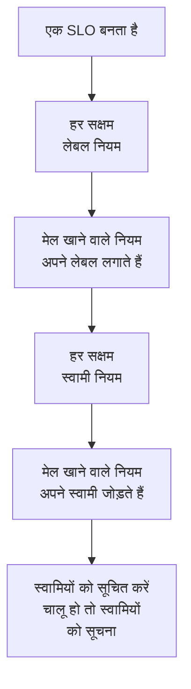

# लेबल और स्वामी नियम

लेबल नियम और स्वामी नियम आपके SLO को आपके लिए व्यवस्थित रखते हैं। **लेबल नियम** उससे मेल खाने वाले हर नए SLO पर लेबल लगाता है, और **स्वामी नियम** उसमें स्वामी उपयोगकर्ता और टीमें जोड़ता है, इसलिए checkout का नया SLO अपने आप _Checkout_ लेबल पाता है और checkout टीम का हो जाता है, बिना किसी को यह याद रखे। दोनों हर दूसरे उत्पाद के लेबल और स्वामी नियमों की तरह काम करते हैं: इनमें क्या साझा है, इसके लिए [लेबल और स्वामी नियम](/docs/configuration/label-and-owner-rules) देखें।

## यह कैसे काम करता है

नियम तब चलते हैं जब कोई SLO बनता है, डैशबोर्ड से या API से। लेबल नियम पहले चलते हैं, ताकि कोई स्वामी नियम उस लेबल से मेल खा सके जिसे किसी लेबल नियम ने अभी लगाया है।

दोनों तरह के नियम पूरे प्रोजेक्ट पर लागू होते हैं। इन्हें SLO सूची के साइड मेनू में **सेटिंग्स** के अंतर्गत पाएँ: **लेबल नियम** और **स्वामी नियम**। **सेटिंग्स** सेक्शन शुरू में मुड़ा रहता है; इसे खोलने के लिए इसके शीर्षक पर क्लिक करें।

## नियम बनाएँ

:::steps
### नियम सूची खोलें

**SLOs** खोलें, फिर साइड मेनू में **सेटिंग्स** → **लेबल नियम** या **सेटिंग्स** → **स्वामी नियम**, और **SLO Label Rule बनाएँ** या **SLO Owner Rule बनाएँ** पर क्लिक करें।

### चुनें कि नियम किससे मेल खाता है

**मिलान** चरण पर, हर उस शर्त के लिए **शर्त जोड़ें** पर क्लिक करें जो SLO को पूरी करनी है ([मिलान मानदंड](#मिलान-मानदंड) देखें)। दो या अधिक के साथ **सभी से मिलान** या **किसी से भी मिलान** चुनें। बिना शर्तों वाला नियम हर नए SLO से मेल खाता है।

### चुनें कि नियम क्या जोड़ता है

लेबल नियम का दूसरा चरण **लेबल** है, जहाँ आप **जोड़ने के लिए लेबल** चुनते हैं। स्वामी नियम का दूसरा चरण **मालिक** है, जहाँ आप जोड़ने के लिए **मालिक** चुनते हैं — लोग और टीमें, **स्वामी जोड़ें** से एक ही सूची से चुने हुए। नियम को कम से कम एक लेबल या स्वामी जोड़ना चाहिए।

### नाम और मुड़े हुए फ़ील्ड जाँचें

**नाम** आपके चुनाव से भरा जाता है, जैसे _Checkout, Production जोड़ें_ या _Checkout team को स्वामी के रूप में जोड़ें_, और जब तक आप अपना नाम टाइप न करें, आपके चुनाव के साथ बदलता रहता है। **और फ़ील्ड** में वैकल्पिक **विवरण** है और, स्वामी नियम पर, **स्वामियों को सूचित करें**।

### नियम सहेजें

आख़िरी चरण पर फिर से **SLO Label Rule बनाएँ** या **SLO Owner Rule बनाएँ** पर क्लिक करें। नियम सक्षम रूप में शुरू होता है।
:::

**स्वामियों को सूचित करें** (**और फ़ील्ड** के अंतर्गत) डिफ़ॉल्ट रूप से चालू है: स्वामी नियम द्वारा जोड़े गए स्वामियों को वही "आपको स्वामी के रूप में जोड़ा गया" सूचना मिलती है जो हाथ से जोड़े गए स्वामी को मिलती है। बिना बताए स्वामी जोड़ने के लिए इसे बंद करें।

किसी नियम को हटाए बिना रोकने के लिए उसके संपादन फ़ॉर्म में **सक्षम** बंद करें। संपादन फ़ॉर्म कभी लेबल या स्वामियों पर ज़ोर नहीं देता: कुछ नहीं जोड़ने वाले पुराने नियम का नाम अब भी बदला जा सकता है, उसे बंद या हटाया जा सकता है, और सूची उसे **कुछ नहीं जोड़ता** से चिह्नित करती है।

जब कोई नियम किसी SLO से मेल खाता है:

- लेबल नियम **जोड़ने के लिए लेबल** का हर लेबल लगाता है। SLO के पास पहले से मौजूद लेबल दोबारा नहीं जोड़े जाते, और जब कई नियम मेल खाते हैं, तो SLO को उन सबके लेबल मिलते हैं।
- स्वामी नियम नियम के हर उपयोगकर्ता और टीम को स्वामी के रूप में जोड़ता है। SLO के पहले से मौजूद स्वामी छोड़ दिए जाते हैं, और जब कई नियम मेल खाते हैं, तो SLO को उन सबके स्वामी मिलते हैं। जो उपयोगकर्ता अब प्रोजेक्ट का सदस्य नहीं है, या किसी दूसरे प्रोजेक्ट की टीम, कभी नहीं जोड़ी जाती; नियम के बाकी स्वामी फिर भी जोड़े जाते हैं।

SLO के स्वामी वे लोग हैं जिन्हें SLO की स्थिति में बदलाव की जानकारी मिलती है: [एरर बजट](/docs/slo/error-budget) देखें।

## मिलान मानदंड

हर शर्त SLO के एक फ़ील्ड की तुलना करती है:

| फ़ील्ड | किससे तुलना | ऑपरेटर |
| --- | --- | --- |
| **SLO लेबल** | SLO के लेबल। | **इनमें से कोई भी है**, **ये सभी हैं**, **इनमें से कोई नहीं है** |
| **SLO नाम** | SLO का नाम। | **शामिल है**, **शामिल नहीं है**, **बराबर**, **बराबर नहीं**, **से शुरू होता है**, **पर समाप्त होता है**, **पैटर्न से मेल खाता है**, **पैटर्न से मेल नहीं खाता** |
| **SLO विवरण** | SLO का विवरण। | **SLO नाम** जैसे ही |

नाम या विवरण पर नई शर्त **शामिल है** से शुरू होती है। पैटर्न एक रेगुलर एक्सप्रेशन होता है, जैसे `^checkout-.*`, या एक `*` वाइल्डकार्ड, जैसे `*checkout*`, और यह अक्षरों के छोटे-बड़े होने को नहीं देखता। जो पैटर्न इनमें से कुछ भी नहीं है, जैसे `checkout-(01`, उसे चुपचाप कुछ भी मेल न खाने देने के बजाय सहेजते समय अस्वीकार कर दिया जाता है।

| आप चाहते हैं | शर्तें |
| --- | --- |
| checkout सेवा का हर SLO | **SLO नाम** में `checkout` शामिल है |
| हर प्रोडक्शन SLO | **SLO लेबल** में इनमें से कोई भी है _Production_ |
| checkout SLO, लेकिन staging वाले नहीं | **सभी से मिलान**: **SLO नाम** में `checkout` शामिल है, और **SLO लेबल** में इनमें से कोई नहीं है _Staging_ |

## नियम कब चलते हैं

- **जब कोई SLO बनता है**, डैशबोर्ड से या API से: हर सक्षम लेबल नियम, फिर हर सक्षम स्वामी नियम।
- **जब आप कोई नियम चलाते हैं**, **Run Now** से: नीचे देखें।

SLO संपादित करने से नियम फिर से लागू नहीं होते, और नियम कभी कुछ नहीं हटाता: न वे लेबल या स्वामी जो किसी ने हाथ से जोड़े, न वे जो उसने ख़ुद जोड़े। बंद नियम कुछ नहीं करता।

## मौजूदा SLO पर नियम चलाएँ

आज लिखा गया नियम उसके बाद बने SLO पर लागू होता है। इसे पहले से मौजूद SLO पर लागू करने के लिए नियम की पंक्ति में **Run Now** पर क्लिक करें, या **देखें** पर और फिर नियम के अपने पेज पर **Run Now** पर। आप कई नियम चुनकर उन्हें तालिका की बल्क कार्रवाइयों से भी चला सकते हैं।

एक रन प्रोजेक्ट के हर SLO को जाँचता है, संग्रहीत SLO सहित, और बताता है कि वह कितनों से मेल खाया और कितनों को बदला। रन द्वारा जोड़े गए स्वामियों को तभी सूचना मिलती है जब आप रन डायलॉग में उन्हें सूचित करना चुनते हैं और नियम में **स्वामियों को सूचित करें** चालू हो। [मौजूदा संसाधनों पर नियम चलाना](/docs/configuration/run-rules-now) देखें।

लेबल नियम प्रोजेक्ट के बीच कॉपी भी किए जा सकते हैं: [लेबल नियम आयात और निर्यात करना](/docs/configuration/label-rule-import-export) देखें।

## इतिहास

जब भी कोई नियम किसी SLO को बदलता है, SLO की **Feed** दर्ज करती है कि किन नियमों ने ऐसा किया। नियम द्वारा जोड़े गए हर स्वामी को अपनी अलग "स्वामी के रूप में जोड़ा गया" फ़ीड प्रविष्टि भी मिलती है, इसलिए फ़ीड बताती है कि किसे और क्यों जोड़ा गया। [SLO फ़ीड और ऑडिट लॉग](/docs/slo/feed-and-audit-logs) देखें।

## अनुमतियाँ

| इसके लिए | आपको चाहिए |
| --- | --- |
| लेबल नियमों के साथ काम करना | **Create SLO Label Rule**, **Edit SLO Label Rule**, **Delete SLO Label Rule** या **Read SLO Label Rule** |
| स्वामी नियमों के साथ काम करना | **Create SLO Owner Rule**, **Edit SLO Owner Rule**, **Delete SLO Owner Rule** या **Read SLO Owner Rule** |
| लेबल नियम चलाना | **Edit SLO Label Rule** और **Edit Service Level Objective** |
| स्वामी नियम चलाना | **Edit SLO Owner Rule**, **Edit Service Level Objective**, **Create SLO User Owner** और **Create SLO Team Owner** |

ये अनुमतियाँ किसी भूमिका के SLO समूह में हैं, और Project Owner और Project Admin भूमिकाओं के पास ये सब हैं। एक रन प्रोजेक्ट के हर SLO को बदलता है, इसलिए कुछ लेबल तक, या आपके स्वामित्व वाले SLO तक सीमित अनुमति नियम चलाने के लिए पर्याप्त नहीं है।

## आगे के कदम

:::cards
- [लेबल और स्वामी नियम](/docs/configuration/label-and-owner-rules): हर उत्पाद के लेबल और स्वामी नियम कैसे काम करते हैं।
- [मौजूदा संसाधनों पर नियम चलाना](/docs/configuration/run-rules-now): हर तरह के नियम के लिए Run Now कैसे काम करता है।
- [SLO अवलोकन](/docs/slo/introduction): SLO का हर पेज, और SLO सूची।
:::
