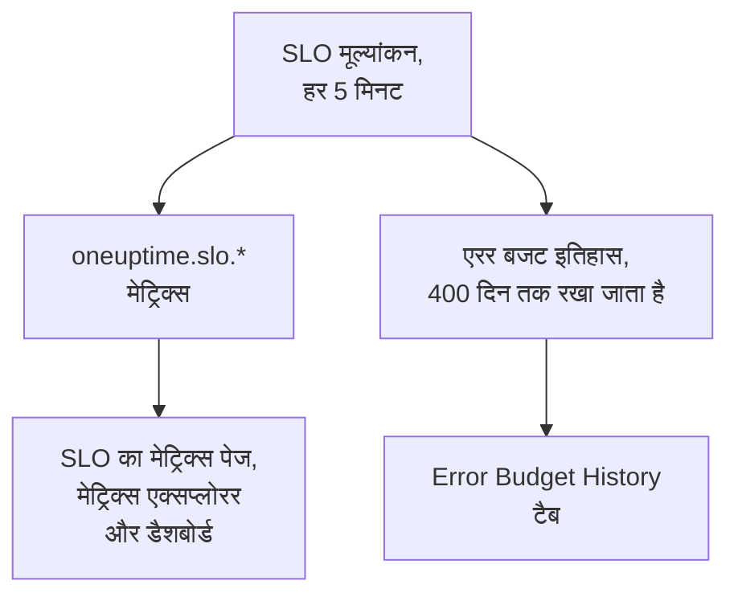

# SLO मेट्रिक्स और डैशबोर्ड

OneUptime जब भी किसी SLO का मूल्यांकन करता है, हर 5 मिनट में, वह परिणामों को `oneuptime.slo.*` नाम के मेट्रिक्स के रूप में लिखता है। ये आपके मॉनिटर मेट्रिक्स वाले उसी मेट्रिक स्टोर में रहते हैं, इसलिए आप SLO का चार्ट उसके **मेट्रिक्स** पेज पर बना सकते हैं, उसे मेट्रिक्स एक्सप्लोरर में खोल सकते हैं, और किसी भी दूसरी सीरीज़ की तरह फ़िल्टर और ग्रुप करके किसी भी डैशबोर्ड पर रख सकते हैं।

:::cards
- [मेट्रिक्स](#मेट्रिक्स): छह सीरीज़, उनकी इकाइयाँ और उन्हें कैसे एग्रीगेट करें।
- [मेट्रिक्स पेज](#मेट्रिक्स-पेज): SLO के चार्ट, इतिहास, और घटना व अलर्ट मेट्रिक्स।
- [डैशबोर्ड पर SLO](#डैशबोर्ड-पर-slo): SLO विजेट और SLO Dashboard टेम्पलेट।
:::

## यह कैसे काम करता है

## मेट्रिक्स

| मेट्रिक | इकाई | एग्रीगेशन | इसमें क्या है |
| --- | --- | --- | --- |
| `oneuptime.slo.sli.percent` | `%` | Avg | SLO की अनुपालन विंडो पर SLI: मापे गए समय का वह हिस्सा जो अच्छा था। |
| `oneuptime.slo.target.percent` | `%` | Avg | SLO का लक्ष्य, हर मूल्यांकन के साथ भेजा जाता है ताकि चार्ट उसे SLI के ऊपर खींच सके। |
| `oneuptime.slo.error.budget.remaining.percent` | `%` | Avg | विंडो में अभी तक खर्च न हुए एरर बजट का हिस्सा। बजट से अधिक खर्च होने पर ऋणात्मक। |
| `oneuptime.slo.error.budget.remaining.seconds` | `seconds` | Avg | वह डाउनटाइम जो SLO उल्लंघन से पहले अभी भी झेल सकता है। बजट से अधिक खर्च होने पर ऋणात्मक। |
| `oneuptime.slo.burn.rate` | `x` | Max | पिछले 60 मिनट में बजट कितनी तेज़ी से खर्च हो रहा है। 1x बजट को ठीक पूरी विंडो में खर्च करता है। |
| `oneuptime.slo.status` | — | Max | हर मूल्यांकन पर SLO की स्थिति: `0` स्वस्थ है, `1` At Risk है, `2` Budget Exhausted है। |

एग्रीगेशन वह तरीका है जिससे SLO के अपने चार्ट और SLO Dashboard टेम्पलेट एक चार्ट बकेट में आने वाले बिंदुओं को मिलाते हैं। प्रतिशत और अवधियों का औसत लिया जाता है। बर्न रेट और स्थिति अधिकतम लेते हैं, ताकि थोड़ी देर का बर्न उछाल या Budget Exhausted में छोटा सा दौर औसत में खो न जाए।

**Monitor Seconds Average** मोड वाले SLO के लिए `oneuptime.slo.error.budget.remaining.seconds` उसके मॉनिटर पर जोड़े गए मॉनिटर-सेकंड गिनता है, जैसे उसका एरर बजट गिनता है: [एरर बजट](/docs/slo/error-budget) देखें।

### जब कोई बिंदु नहीं लिखा जाता

- बंद या संग्रहीत SLO का मूल्यांकन नहीं होता, इसलिए वह कुछ नहीं भेजता।
- **रोका गया** या **Misconfigured** SLO कुछ नहीं मापता, इसलिए वह केवल `oneuptime.slo.target.percent` भेजता है, जो माप नहीं बल्कि कॉन्फ़िगरेशन है। उसके SLI, बजट, बर्न रेट और स्थिति चार्ट में खाली जगह दिखती है।
- जो मान वास्तविक संख्या नहीं है, जैसे बिना डेटा वाली विंडो पर बर्न रेट, उसे छोड़ दिया जाता है, कभी 0 के रूप में नहीं लिखा जाता।

### एट्रिब्यूट

हर बिंदु के साथ ये एट्रिब्यूट होते हैं:

| एट्रिब्यूट | मान |
| --- | --- |
| `sloId` | SLO की ID। SLO के अपने पेज इसी पर फ़िल्टर करते हैं, इसलिए SLO का नाम बदलने से उसके चार्ट कभी नहीं बँटते। |
| `sloName` | बिंदु लिखे जाते समय SLO का नाम। |
| `projectId` | प्रोजेक्ट की ID। |
| `oneuptime.label.<key>` | हर SLO लेबल के लिए एक एट्रिब्यूट। `Tier 1` नाम का लेबल `oneuptime.label.tier_1` = `true` बनता है, और `product:checkout` नाम का लेबल `oneuptime.label.product` = `checkout` बनता है। कुंजियाँ छोटे अक्षरों में होती हैं, और स्पेस व विराम चिह्न `_` में बदल जाते हैं। |

सीरीज़ SLO की होती हैं, उसके किसी मॉनिटर की नहीं, और टेलीमेट्री उपयोग में नहीं गिनी जातीं।

घटना और अलर्ट मेट्रिक्स के साथ दो मिलते-जुलते एट्रिब्यूट होते हैं, `serviceLevelObjectiveIds` और `serviceLevelObjectiveNames`: उन SLO की कॉमा से अलग सूचियाँ जिन्हें घटना या अलर्ट प्रभावित करता है।

### प्रतिधारण

`oneuptime.slo.*` मेट्रिक्स मॉनिटर मेट्रिक्स जितने समय तक रखे जाते हैं: डिफ़ॉल्ट रूप से **30 दिन**। सेल्फ़-होस्टेड इंस्टॉलेशन पर एक मास्टर एडमिन इसे Admin Dashboard की **डेटा प्रतिधारण** सेटिंग्स में **Monitor Metric Retention (Days)** से बदल सकता है।

यह SLO के **मेट्रिक्स** पेज के **Error Budget History** टैब को सीमित नहीं करता। वह इतिहास अलग से संग्रहीत होता है और 400 दिनों तक रखा जाता है।

## मेट्रिक्स पेज

SLO के **मेट्रिक्स** पेज पर चार टैब हैं:

| टैब | यह क्या दिखाता है |
| --- | --- |
| **SLO Metrics** | `oneuptime.slo.*` सीरीज़ तीन कार्ड में जो एक ही समय सीमा साझा करते हैं, डिफ़ॉल्ट रूप से पिछला एक दिन: **Objective** (उसके ऊपर लक्ष्य के साथ SLI, और बचा हुआ बजट), **Burn** (बर्न रेट और बचा हुआ बजट समय) और **स्थिति**। |
| **Error Budget History** | दीर्घकालिक इतिहास पर SLI, बचा हुआ बजट और बर्न रेट, लक्ष्य पर, जोखिम और खत्म होने की सीमाओं पर, और हर सक्षम बर्न रेट नियम की सीमा पर रेखाओं के साथ। |
| **घटना मीट्रिक** | इस SLO को प्रभावित करने वाली घटनाओं की संख्या, स्वीकार करने का समय, सुलझाने का समय और अवधि, डिफ़ॉल्ट रूप से पिछला एक हफ़्ता। उसके बर्न रेट नियमों द्वारा घोषित घटनाएँ शामिल हैं। |
| **अलर्ट मीट्रिक** | अलर्ट के लिए वही। उसके बर्न रेट नियमों द्वारा उठाए गए अलर्ट शामिल हैं। |

**SLO Metrics**, **घटना मीट्रिक** और **अलर्ट मीट्रिक** टैब मेट्रिक स्टोर पढ़ते हैं, जिसके लिए टेलीमेट्री पढ़ने की अनुमति चाहिए। जो कस्टम भूमिका SLO पढ़ सकती है लेकिन टेलीमेट्री नहीं, उसे ये टैब खाली दिखते हैं, जबकि **Error Budget History** फिर भी काम करता है।

## डैशबोर्ड पर SLO

### किसी भी SLO मेट्रिक का चार्ट बनाएँ

:::steps
#### चार्ट जोड़ें

डैशबोर्ड के संपादन मोड में एक चार्ट या वैल्यू विजेट जोड़ें और `oneuptime.slo.*` मेट्रिक्स में से एक चुनें।

#### ग्रुप या फ़िल्टर करें

हर SLO के लिए एक रेखा पाने के लिए `sloName` और `sloId` से ग्रुप करें; `sloId` एक जैसे नाम वाले दो SLO को अलग रखता है। या `sloName` पर, या किसी `oneuptime.label.*` एट्रिब्यूट पर फ़िल्टर करें।

#### एग्रीगेशन चुनें

ऊपर की तालिका का एग्रीगेशन उपयोग करें: प्रतिशत और अवधियों के लिए Avg, बर्न रेट और स्थिति के लिए Max।
:::

### SLO विजेट

[SLO विजेट](/docs/dashboards/widgets#slo) एक SLO का SLI, बचा हुआ बजट या बर्न रेट टाइल या चार्ट के रूप में दिखाता है। यह अपना SLO दो में से एक तरीके से पाता है:

| सेटिंग | यह कैसे व्यवहार करती है |
| --- | --- |
| **Service Level Objective** | विजेट को एक SLO पर पिन करती है। पिकर उन SLO को सूचीबद्ध करता है जो संग्रहीत नहीं हैं। |
| **Follow SLO Variable** | डैशबोर्ड वेरिएबल में चुना गया SLO दिखाती है: `sloName` कुंजी पर एक **Telemetry Attribute** वेरिएबल। जब तक कोई SLO पिन है, इसे अनदेखा किया जाता है। |

[सार्वजनिक डैशबोर्ड](/docs/dashboards/sharing) पर, वेरिएबल का अनुसरण करने वाला विजेट दर्शकों को प्रोजेक्ट का कोई भी गैर-संग्रहीत SLO नाम से चुनने देता है। पिन किया गया विजेट केवल अपना SLO दिखाता है, और बाद में संग्रहीत हुए SLO की आख़िरी संख्याएँ दिखाता रहता है।

### SLO Dashboard टेम्पलेट

डैशबोर्ड बनाते समय **SLO Dashboard** टेम्पलेट चुनें, ताकि प्रोजेक्ट के हर SLO का तैयार बोर्ड तीन पट्टियों में मिले:

1. **Service Level Objectives**: हर गैर-संग्रहीत SLO की सूची, उसकी स्थिति, लक्ष्य के मुकाबले SLI, बजट बार और बर्न रेट के साथ, और स्थिति के अनुसार SLO की गिनती। सक्षम SLO पहले आते हैं, सबसे कम बजट वाला सबसे पहले; बंद SLO आख़िर में **अक्षम** के रूप में आता है, उसकी आख़िरी संख्याएँ धुंधली।
2. **Error Budget & Burn Rate**: **Lowest Error Budget Remaining**, **Least Error Budget Time Left** और **Peak Burn Rate** टाइलें, और **Error Budget Remaining by SLO** और **Burn Rate by SLO** चार्ट, हर SLO के लिए एक रेखा, `sloName` और `sloId` से ग्रुप किए हुए।
3. **Selected SLO**: एक SLO की **SLI**, **Error Budget Remaining** और **Burn Rate** टाइलें और **SLI History**, **Error Budget History** और **Burn Rate History** चार्ट।

टूलबार का एक SLO वेरिएबल पूरे बोर्ड का दायरा तय करता है। यह `sloName` पर एक Telemetry Attribute वेरिएबल है, इसलिए इसके विकल्प मेट्रिक्स में मिले SLO नाम हैं। कोई SLO चुनने से सूची उस तक सीमित हो जाती है, पट्टी के चार्ट और टाइलें उसी दायरे में आ जाती हैं, और वेरिएबल का अनुसरण करने वाले **Selected SLO** विजेट भर जाते हैं। जब तक आप कोई नहीं चुनते, वे आपसे टूलबार में SLO चुनने को कहते हैं।

## समस्या निवारण

:::details टूलबार के SLO पिकर में कोई SLO नहीं है
पिकर पिछले एक दिन में भेजे गए SLO नाम सूचीबद्ध करता है। नया SLO अपने पहले मूल्यांकन के बाद दिखता है; **रोका गया** या **Misconfigured** SLO चुना जा सकता है क्योंकि वह अब भी अपना लक्ष्य भेजता है; बंद या संग्रहीत SLO अपने आख़िरी बिंदु के लगभग एक दिन बाद हट जाता है।
:::

:::details कोई नाम चुनने पर दो SLO दिखते हैं
दो SLO का एक ही नाम है। सूची और चार्ट दोनों को दिखाते हैं, और **Selected SLO** विजेट बताते हैं कि नाम अस्पष्ट है। SLO को अलग-अलग नाम दें।
:::

:::details SLO Metrics टैब खाली है
आपकी भूमिका टेलीमेट्री नहीं पढ़ सकती, या SLO का अभी तक मूल्यांकन नहीं हुआ है। **Error Budget History** SLO को ही पढ़ता है और फिर भी काम करता है।
:::

## आगे के कदम

:::cards
- [डैशबोर्ड विजेट](/docs/dashboards/widgets): हर विजेट, SLO विजेट सहित।
- [डैशबोर्ड वेरिएबल](/docs/dashboards/variables): एक पिकर से पूरे बोर्ड का दायरा तय करें।
- [एरर बजट](/docs/slo/error-budget): बजट की संख्याओं का अर्थ।
:::
