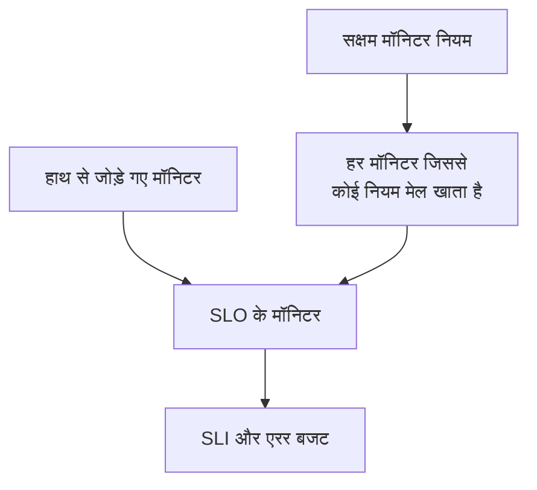

# मॉनिटर और मॉनिटर नियम

SLO अपने से जुड़े मॉनिटर की उपलब्धता मापता है। उन्हें हाथ से जोड़ें, मॉनिटर नियमों को हर मेल खाने वाला मॉनिटर जोड़ने दें, या दोनों करें। यह पेज SLO के **मॉनिटर** और **Monitor Rules** पेजों के बारे में है, जो दोनों उसके साइड मेनू में **कॉन्फ़िगरेशन** के अंतर्गत हैं।

:::cards
- [मॉनिटर हाथ से चुनें](#मॉनिटर-हाथ-से-जोड़ें): छोटे, तय सेट के लिए सबसे अच्छा।
- [नियम से मॉनिटर जोड़ें](#नियम-से-मॉनिटर-जोड़ें): "Production लेबल वाला हर मॉनिटर", आपके लिए अद्यतन रखा जाता है।
- [मिलान मानदंड](#मिलान-मानदंड): वे फ़ील्ड और ऑपरेटर जिन पर कोई नियम मिलान कर सकता है।
:::

## SLO कौन से मॉनिटर मापता है

SLO आपके हाथ से जोड़े गए मॉनिटर और हर उस मॉनिटर का संयोजन मापता है जिससे उसके सक्षम मॉनिटर नियमों में से कम से कम एक मेल खाता है।

नए SLO में कोई मॉनिटर नहीं होता, क्योंकि बनाने का फ़ॉर्म इनके बारे में नहीं पूछता। जब तक उसमें कोई मॉनिटर न हो, उसका मूल्यांकन नहीं हो सकता: उसके पेज **No monitors attached** दिखाते हैं, और उसका **अवलोकन** मॉनिटर जोड़ने के दोनों तरीके देता है।

## मॉनिटर हाथ से जोड़ें

आपको SLO संपादित करने की अनुमति चाहिए।

:::steps
### मॉनिटर पेज खोलें

SLO खोलें और **मॉनिटर** पर जाएँ।

### मॉनिटर चुनें

**Add Monitors** पर क्लिक करें और प्रोजेक्ट के मॉनिटर चुनें। केवल वे मॉनिटर सूचीबद्ध होते हैं जो पहले से जुड़े नहीं हैं।

### सूची सहेजें

**Add Monitors** पर क्लिक करें। मॉनिटर **Manual** स्रोत के साथ सूची में दिखते हैं और अगले मूल्यांकन से SLI में गिने जाते हैं।
:::

किसी मॉनिटर को SLO से हटाने के लिए उसकी पंक्ति में **हटाएं** पर क्लिक करें। मॉनिटर ख़ुद नहीं बदलता; वह बस SLO के SLI और एरर बजट में गिना जाना बंद हो जाता है।

**मॉनिटर** पेज हर मॉनिटर के लिए दिखाता है:

| कॉलम | यह क्या दिखाता है |
| --- | --- |
| **वर्तमान स्थिति** | मॉनिटर की वर्तमान स्थिति, या जब उसकी जाँच नहीं हो रही हो या उसने अभी तक कुछ रिपोर्ट नहीं किया हो, तो **संग्रहीत**, **अक्षम**, **प्रोब सक्षम नहीं हैं**, **प्रोब डिस्कनेक्ट हो गए** या **अज्ञात**। |
| **स्रोत** | अगर SLO के किसी मॉनिटर नियम ने इसे जोड़ा है तो **Rule**, अगर किसी ने हाथ से जोड़ा है तो **Manual**। |
| **लेबल** | मॉनिटर के लेबल। |

## नियम से मॉनिटर जोड़ें

मॉनिटर नियम उन मॉनिटर का वर्णन करता है जिन्हें SLO को मापना चाहिए, जैसे "Production लेबल वाला हर मॉनिटर" या "हर मॉनिटर जिसका नाम api- से शुरू होता है"। हर मेल खाने वाला मॉनिटर जोड़ा जाता है, अभी भी और हर बार जब मॉनिटर बनाए या बदले जाते हैं, इसलिए किसी को उस मॉनिटर को याद रखने की ज़रूरत नहीं जिसे कोई अगले महीने जोड़ेगा।

:::steps
### Monitor Rules खोलें

SLO खोलें, **Monitor Rules** पर जाएँ और **SLO Monitor Rule बनाएँ** पर क्लिक करें।

### नियम को नाम दें

**मूल जानकारी** में एक **नाम** दर्ज करें, और चाहें तो **विवरण** में लिखें कि ये मॉनिटर इस SLO के क्यों हैं।

### चुनें कि यह किससे मेल खाता है

**मिलान मानदंड** में **शर्त जोड़ें** पर क्लिक करें, एक फ़ील्ड और ऑपरेटर चुनें, और मान दर्ज करें या चुनें। दो या अधिक शर्तों के साथ **सभी से मिलान** या **किसी से भी मिलान** चुनें। मॉनिटर नियम को कम से कम एक शर्त चाहिए।

### नियम सहेजें

**SLO Monitor Rule बनाएँ** पर क्लिक करें। नियम सक्षम रूप में शुरू होता है और SLO के मॉनिटर का तुरंत फिर से आकलन होता है: हर मेल खाने वाला मॉनिटर **Rule** स्रोत के साथ जुड़ता है।
:::

नियम तालिका हर नियम का नाम, सरल शब्दों में उसका मिलान मानदंड और यह दिखाती है कि वह सक्षम है या नहीं। किसी नियम को रोकने के लिए उसके संपादन फ़ॉर्म में **सक्षम** बंद करें। **View Monitors** SLO का **मॉनिटर** पेज खोलता है।

### मिलान मानदंड

हर शर्त मॉनिटर के एक फ़ील्ड की तुलना करती है:

| फ़ील्ड | किससे तुलना | ऑपरेटर |
| --- | --- | --- |
| **मॉनिटर लेबल** | मॉनिटर के लेबल। | **इनमें से कोई भी है**, **ये सभी हैं**, **इनमें से कोई नहीं है** |
| **मॉनिटर प्रकार** | प्रकारों की सूची से चुना गया मॉनिटर का प्रकार। | **बराबर**, **बराबर नहीं** |
| **मॉनिटर नाम** | मॉनिटर का नाम। | **शामिल है**, **शामिल नहीं है**, **बराबर**, **बराबर नहीं**, **से शुरू होता है**, **पर समाप्त होता है**, **पैटर्न से मेल खाता है**, **पैटर्न से मेल नहीं खाता** |
| **मॉनिटर विवरण** | मॉनिटर का विवरण। | **मॉनिटर नाम** जैसे ही |

पैटर्न एक रेगुलर एक्सप्रेशन होता है, जैसे `^api-.*`, या एक `*` वाइल्डकार्ड, जैसे `*checkout*`, और यह अक्षरों के छोटे-बड़े होने को नहीं देखता। जो पैटर्न इनमें से कुछ भी नहीं है, जैसे `api-(01`, उसे चुपचाप कुछ भी मेल न खाने देने के बजाय सहेजते समय अस्वीकार कर दिया जाता है। प्रोजेक्ट के हर मॉनिटर को जोड़ने के लिए **मॉनिटर नाम** पर एक शर्त जोड़ें जो पैटर्न `.*` से मेल खाए।

| आप चाहते हैं | शर्तें |
| --- | --- |
| हर प्रोडक्शन मॉनिटर | **मॉनिटर लेबल** में इनमें से कोई भी है _Production_ |
| हर API मॉनिटर | **मॉनिटर प्रकार** बराबर _API_ |
| मैनुअल को छोड़कर हर मॉनिटर | **मॉनिटर प्रकार** बराबर नहीं _Manual_ |
| हर मॉनिटर जिसका नाम api- से शुरू होता है | **मॉनिटर नाम** पैटर्न `^api-` से मेल खाता है |
| checkout मॉनिटर, लेकिन staging वाले नहीं | **सभी से मिलान**: **मॉनिटर नाम** पैटर्न `*checkout*` से मेल खाता है, और **मॉनिटर लेबल** में इनमें से कोई नहीं है _Staging_ |

### नियम कब चलते हैं

- जब आप कोई नियम बनाते, संपादित करते, चालू करते, बंद करते या हटाते हैं, तो SLO के मॉनिटर का तुरंत फिर से आकलन होता है।
- जब कोई मॉनिटर बनता है, या उसके लेबल, नाम या विवरण बदलते हैं, तो प्रोजेक्ट का हर मॉनिटर नियम उसे जाँचता है, जिसमें वे लेबल भी शामिल हैं जो आपके मॉनिटर लेबल नियम उसे देते हैं।
- जब कोई लेबल हटाया जाता है, तो वे SLO जिनके नियम उसका उपयोग करते थे, फिर से आकलित होते हैं।
- SLO बंद या संग्रहीत होने पर भी नियम उसकी मॉनिटर सूची को अद्यतन रखते हैं, इसलिए वह सही मॉनिटर के साथ फिर शुरू होता है।

नियम हर बार सहेजने पर फिर से सिंक होते हैं, इसलिए **Run Now** उस चीज़ को पकड़ने के लिए है जो SLO से छूट गई। यह हर पंक्ति में, नियम के अपने पेज (**देखें**) पर, और तालिका की बल्क कार्रवाइयों में है। कोई नियम चलाने पर SLO के सभी सक्षम मॉनिटर नियमों का एक साथ फिर से आकलन होता है, और फिर डायलॉग बताता है कि कितने मॉनिटर जुड़े और कितने अलग हुए। नियम चलाने के लिए SLO मॉनिटर नियम संपादित करने की अनुमति चाहिए। [मौजूदा संसाधनों पर नियम चलाना](/docs/configuration/run-rules-now) देखें।

### कौन से मॉनिटर किसी नियम के हैं

- कोई मॉनिटर तब तक जुड़ा रहता है जब तक कोई सक्षम नियम उससे मेल खाता है, और जैसे ही कोई नियम मेल नहीं खाता, वह अलग हो जाता है।
- किसी नियम को बंद करने या हटाने से केवल वे मॉनिटर अलग होते हैं जिनसे अब कोई दूसरा सक्षम नियम मेल नहीं खाता।
- नियम केवल वही मॉनिटर अलग करते हैं जिन्हें किसी नियम ने जोड़ा था। हाथ से जोड़ा गया मॉनिटर कभी किसी ऐसे नियम द्वारा नहीं लिया जाता जो संयोग से उससे मेल खाता हो, और मेल खाना बंद होने पर भी अलग नहीं होता। उसका स्रोत **Manual** ही रहता है।

## नियम चालू रहते हुए हाथ से चुनना

जब तक कम से कम एक नियम सक्षम है, SLO के मॉनिटर नियम ही संभालते हैं:

- मॉनिटर हाथ से नहीं जोड़े जा सकते: **Add Monitors** अक्षम रहता है, और एक बैनर **This SLO's monitors are managed by its monitor rules** कहता है, साथ में **Manage Monitor Rules** लिंक;
- किसी नियम द्वारा जोड़े गए मॉनिटर हाथ से नहीं हटाए जा सकते, क्योंकि नियम उन्हें फिर जोड़ देगा: उनका **हटाएं** बटन लॉक रहता है और उसका टूलटिप कारण बताता है;
- नियम चालू करने से पहले हाथ से जोड़े गए मॉनिटर अब भी हटाए जा सकते हैं।

यह API पर भी लागू होता है। मॉनिटर फिर से ख़ुद चुनने के लिए सभी नियम बंद करें।

## वे SLO जिनमें कोई मॉनिटर गिना जाता है

मॉनिटर का पेज उन SLO को सूचीबद्ध करता है जो उसे मापते हैं: मॉनिटर खोलें और उसके साइड मेनू में **SLOs** पर जाएँ। किसी मॉनिटर को रोकने या बदलने से पहले इसे देखें, ताकि पता चले कि कौन से लक्ष्य उस पर निर्भर हैं। संग्रहीत SLO नहीं दिखते, क्योंकि उनका मूल्यांकन नहीं होता।

## Auto-Add Monitors With Labels से आना

पिछले संस्करणों में SLO फ़ॉर्म पर **Auto-Add Monitors With Labels** सेटिंग थी। अपग्रेड करने पर, इसका उपयोग करने वाले हर SLO को **Auto-add monitors with labels** नाम का एक सक्षम मॉनिटर नियम मिलता है जो उन्हीं लेबल से मेल खाता है, इसलिए वह ठीक उन्हीं मॉनिटर को मापता रहता है। SLO API का `monitorLabels` फ़ील्ड पदावनत है: इसके बजाय SLO मॉनिटर नियमों का उपयोग करें।

:::details अगर कोई चीज़ अब भी पुरानी सेटिंग सहेजे तो?
अपग्रेड से पहले खोला गया डैशबोर्ड टैब, या पिछले संस्करण के लिए लिखा गया API क्लाइंट या वर्कफ़्लो, अब भी पुरानी सेटिंग सहेज सकता है। ताकि SLO इस तरह चुपचाप मॉनिटर न खोए:

- **बिना मॉनिटर नियमों वाला SLO** सहेजे गए लेबल को **Auto-add monitors with labels** नियम में बदल देता है, और उसके मॉनिटर का तुरंत फिर से आकलन होता है। खाली सूची सहेजने से वे मॉनिटर अलग हो जाते हैं जिन्हें सेटिंग ने जोड़ा था, पहले की तरह।
- **मॉनिटर नियमों वाला SLO**, चाहे नियम चालू हों या नहीं, पुरानी सेटिंग से सहेजे गए लेबल को अनदेखा करता है, क्योंकि वह क्या मापता है यह उसके नियम तय करते हैं।
- **पहला मॉनिटर नियम बनाना**, ऐसे SLO के लिए जिसके मॉनिटर पुरानी सेटिंग ने जोड़े थे, पहले सेटिंग को नियम में बदलता है, इसलिए नया नियम उसे बदलने के बजाय उसके साथ जुड़ता है।

आपके द्वारा हटाया गया बदला हुआ नियम हटा ही रहता है, जब तक कि उसके मॉनिटर बाद में भी जुड़े न रहें, जैसे कि पिछला संस्करण चला रहे किसी सर्वर ने अपग्रेड के दौरान उन्हें फिर से जोड़ दिया हो: तब अगला मॉनिटर बदलाव या अगला नया नियम लेबल को फिर से बदल देता है। अपग्रेड पूरा होने पर उस नियम को फिर से हटा दें।
:::

## इतिहास

हर जुड़ाव और अलगाव, और हर नियम का बनना, संपादित होना या हटना, SLO की **Feed** में दिखता है। नियमों में बदलाव उसके **ऑडिट लॉग** में भी दर्ज होते हैं। [SLO फ़ीड और ऑडिट लॉग](/docs/slo/feed-and-audit-logs) देखें।

## समस्या निवारण

:::details Add Monitors अक्षम है
SLO का कम से कम एक मॉनिटर नियम सक्षम है, इसलिए उसके मॉनिटर नियम संभालते हैं। नियम बदलें, या मॉनिटर हाथ से चुनने के लिए सभी को बंद करें।
:::

:::details किसी मॉनिटर का हटाएं बटन लॉक है
किसी मॉनिटर नियम ने उस मॉनिटर को जोड़ा है और उसे फिर से जोड़ देगा। उससे मेल खाने वाले नियम को बदलें या बंद करें।
:::

:::details जिस मॉनिटर से किसी नियम को मेल खाना चाहिए, वह जुड़ा नहीं है
जाँचें कि नियम सक्षम है और **सभी से मिलान** के साथ हर शर्त पूरी होती है। मॉनिटर लेबल नियम द्वारा जोड़े गए लेबल भी गिने जाते हैं। SLO को फिर से सिंक करने के लिए नियम पर **Run Now** पर क्लिक करें।
:::

:::details नियम सहेजना पैटर्न त्रुटि के साथ विफल होता है
मान न तो रेगुलर एक्सप्रेशन है और न ही `*` वाइल्डकार्ड, जैसे किसी बिना बंद कोष्ठक के कारण। पैटर्न ठीक करें, या **शामिल है** का उपयोग करें।
:::

## आगे के कदम

:::cards
- [SLO अवलोकन](/docs/slo/introduction): कई मॉनिटर का डाउनटाइम कैसे जोड़ा जाता है।
- [एरर बजट](/docs/slo/error-budget): मॉनिटर का डाउनटाइम किसे खर्च करता है।
- [मौजूदा संसाधनों पर नियम चलाना](/docs/configuration/run-rules-now): हर तरह के नियम के लिए Run Now कैसे काम करता है।
:::
